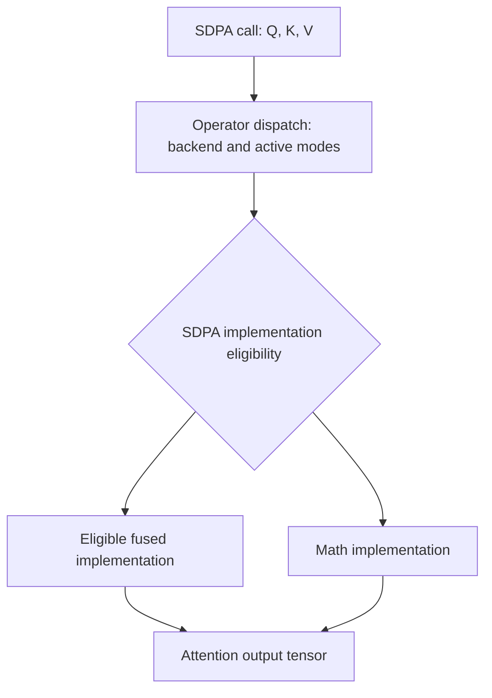
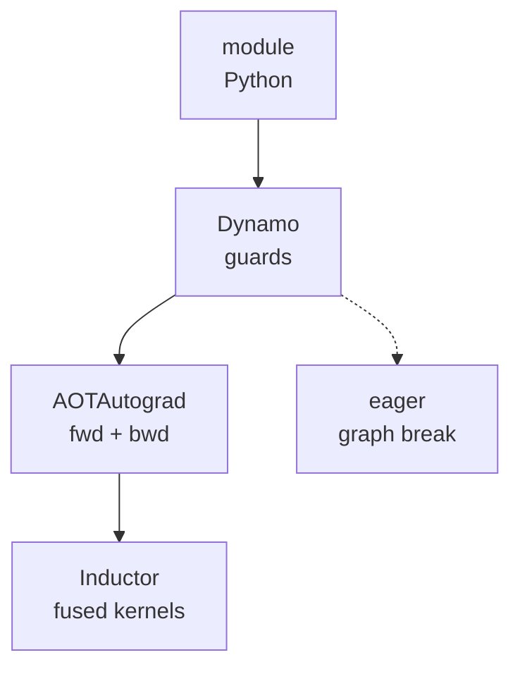
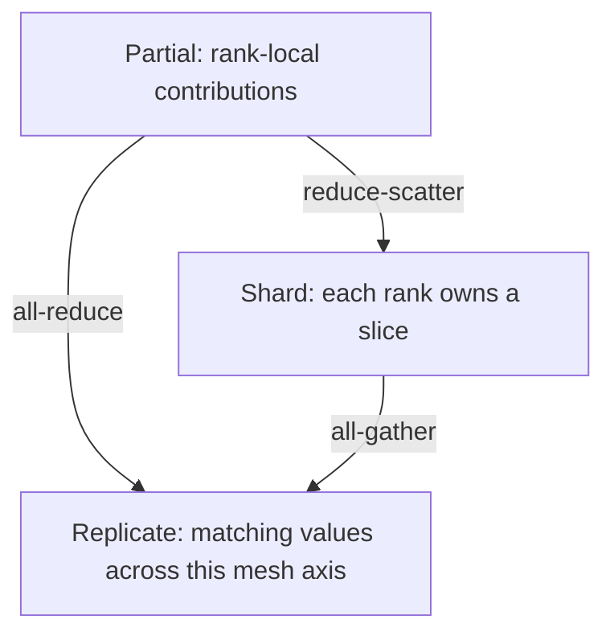
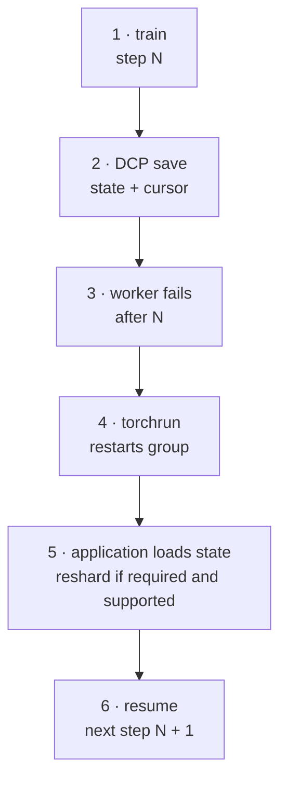

---
{
  "id": "deep-dive-pytorch",
  "title": "Deep Dive - PyTorch",
  "slug": "deep-dive-pytorch",
  "section": "Project Deep Dives",
  "category": "Fine-Tuning & Training",
  "difficulty": "Hard",
  "order": 11,
  "coverImage": "illustrations/_generated/tensor_view_strides_dark.png",
  "companies": [
    "PyTorch Foundation",
    "Meta AI",
    "Linux Foundation",
    "Microsoft",
    "AWS",
    "Google"
  ],
  "shortDescription": "A transpose shares storage, then the next kernel slows down. Follow that change through PyTorch views, dispatch, autograd, and sharded training.",
  "keyConceptsTested": [
    "TensorImpl, storage, strides, and views",
    "Operator schemas, code generation, and dispatch keys",
    "Reverse-mode autograd and in-place versioning",
    "torch.compile with Dynamo, AOTAutograd, and Inductor",
    "Scaled dot-product attention and kernel selection",
    "c10d, DeviceMesh, DTensor, FSDP2, and tensor parallelism",
    "Pipeline stages, microbatches, and schedules",
    "Distributed checkpointing and elastic worker restart",
    "LLM training and inference ownership layers",
    "Graph breaks, memory pressure, and distributed failures"
  ],
  "prerequisites": [
    "pytorch-training-loops",
    "transformer-architecture-end-to-end",
    "distributed-training-fsdp-deepspeed-zero",
    "deep-dive-megatron"
  ]
}
---

You transpose a matrix, and its rows become columns without copying its values. Then the next operation gets slower. Where did the extra work happen? PyTorch lets us inspect both the shared data and the code that consumes it, so we can follow that change instead of guessing from the final output.

<span data-glossary="pytorch">PyTorch</span> is a framework for tensor computation and automatic differentiation, which calculates the gradients used in training. The running case is scaled dot-product attention (SDPA), the operation that combines queries, keys, and values in a transformer.[^pytorch2019][^pytorchSdpaDocs2026] A transpose changes strides, the steps that map tensor indices into storage, while an attention mask changes which tokens contribute to each representation. Either modification can redirect kernel dispatch or cause hidden memory copies even though output shapes remain identical.

The runnable examples use PyTorch 2.13.0 on CPU, one computation thread, and small tensors to demonstrate genuine views, autograd version tracking, attention kernel mechanics, compiler capture, and checkpoint reload. Production workloads deploy these primitives across distributed accelerator clusters, building on concepts from earlier FSDP and Megatron deep dives.

## Eager Python, compiled kernels

Deep-learning research requires two properties that pull in opposite directions: local reasoning and global optimization. Imperative Python must execute immediately, produce clear tracebacks, and support interactive debugging, while the underlying execution engine must reach vectorized CPU kernels, <span data-glossary="cuda-kernel">CUDA kernels</span>, fused attention, graph compilers, and distributed communication rings. PyTorch balances these competing goals through an imperative tensor API, tape-based reverse-mode autodiff, and modular extension points.[^pytorch2019][^pytorch2026repo]

The same high-level tensor API targets diverse hardware architectures. On Apple silicon, the <span data-glossary="mps-backend">Metal Performance Shaders (MPS) backend</span> executes operations on the local GPU across a shared <span data-glossary="unified-memory">unified-memory</span> pool.[^pytorchMpsBackend2026][^appleMetalPytorch2026] Discrete NVIDIA accelerators require explicit <span data-glossary="host-to-device-transfer">host-to-device transfers</span> across PCIe before CUDA kernels can access host-allocated memory.[^cudaProgrammingGuide2026] Because operator coverage, numerical precision, and memory characteristics vary by backend, diagnosing bottlenecks requires understanding which layer of the runtime handles each operation.

Execution paths differ fundamentally across PyTorch subsystems:

| Layer | Responsibility | LLM consequence |
| --- | --- | --- |
| Python API | Modules, <span data-glossary="optimizer">optimizers</span>, tensor expressions, inspectable call sites | Model code stays inspectable and composable |
| ATen operators | Schemas, <span data-glossary="tensor">tensor</span> kernels, shape and dtype definitions | `mm`, `view`, `softmax`, and attention share one operator surface |
| Dispatcher and c10 | Select backend, autograd, functionalization, and other keys | One call can route to CUDA, a sparse backend, or a tracing layer |
| Autograd | Build a dynamic graph and execute reverse-mode derivatives | Training can branch on data and still backpropagate |
| Compiler stack | Capture, transform, and lower Python programs | Stable regions can become fused kernels |
| c10d and distributed | Process groups, collectives, meshes, sharding | Parameters and activations can span a GPU cluster |

Performance varies significantly depending on runtime mode and topology. Eager execution, compiled execution, fused kernels, memory layout, device characteristics, sequence length, and communication overhead all change the execution path. Pinpointing a bottleneck requires tracing through these layers rather than treating framework execution as a monolithic black box.

```checkpoint
What is the first useful question when an LLM operation is slower than expected?
---
Identify its execution path: eager or compiled, which dispatch backend, which dtype and layout, which attention kernel, and whether a collective or synchronization is on the critical path.
```

## The tensor is metadata plus storage

A transpose is often the first place unexpected overhead hides before any kernel executes. For an ordinary dense, strided tensor, `torch.Tensor` is a Python handle to an internal `TensorImpl` object that carries dimensional metadata and points to a block of device memory. Multiple tensors can view the exact same physical allocation under different coordinate interpretations. While sparse tensors and meta tensors use different memory structures, dense strided tensors rely on a core set of attributes:

- **Storage** owns the contiguous byte allocation on a specific device, with `TensorImpl` providing dtype metadata so kernels interpret bytes correctly.
- **Sizes** describe the length of each logical dimension.
- **Strides** specify the memory step, in elements, required to advance by one index along each dimension.
- **Offset** marks the location of the logical zero element within storage.
- **Device and dtype** govern memory location and numeric representation.
- **Autograd metadata** links the tensor to its computational history, leaf status, and in-place mutation version counter.

Transposing a matrix alters index coordinates and strides without shifting byte contents in storage. For example, six values in storage `[0, 1, 2, 3, 4, 5]` organized as a contiguous `[2, 3]` matrix with strides `[3, 1]` map element `(i, j)` to storage index `offset + 3i + j`. Transposing this tensor produces a `[3, 2]` view with strides `[1, 3]`, leaving value `3` accessible simultaneously as `x[1, 0]` and `y[0, 1]` at identical element offset 3 without copying memory.

<figure>
  
  <figcaption>The six storage cells never move. Transpose only changes the index map, so x[1, 0] and y[0, 1] are the same 3. A kernel that requires contiguous input may still copy after this "free" view.</figcaption>
</figure>

Check the actual PyTorch storage and strides. Strides and `storage_offset()` count **elements**, not bytes: element 3 of an `int64` allocation starts 24 bytes from its beginning. Mutation demonstrates aliasing; `reshape` demonstrates a case where a new allocation is necessary.

<!-- leetllm: test deps=torch==2.13.0 output=show -->
```python title="view_strides.py"
import torch

torch.set_num_threads(1)
x = torch.arange(6, dtype=torch.int64).reshape(2, 3)
y = x.t()
assert x.stride() == (3, 1) and y.stride() == (1, 3)
assert x.untyped_storage().data_ptr() == y.untyped_storage().data_ptr()
assert x[1, 0].item() == y[0, 1].item() == 3
assert x.untyped_storage().nbytes() == 48
print("x:", x.tolist(), "strides:", x.stride())
print("y:", y.tolist(), "strides:", y.stride())
print("storage bytes:", x.untyped_storage().nbytes())
try:
    y.view(-1)
except RuntimeError:
    print("view(-1): incompatible strides")
else:
    raise AssertionError("This transpose cannot be flattened with view")
flat = y.reshape(-1)
assert flat.tolist() == [0, 3, 1, 4, 2, 5]
assert flat.untyped_storage().data_ptr() != y.untyped_storage().data_ptr()
y[0, 1] = 30
assert x[1, 0].item() == 30 and flat[1].item() == 3
print("alias changed x; copied reshape stayed unchanged")
```

<!-- leetllm: output:start -->
```text title="Output" output compact
x: [[0, 1, 2], [3, 4, 5]] strides: (3, 1)
y: [[0, 3], [1, 4], [2, 5]] strides: (1, 3)
storage bytes: 48
view(-1): incompatible strides
alias changed x; copied reshape stayed unchanged
```
<!-- leetllm: output:end -->

A training step that mutates one view modifies all views referencing the same underlying storage. Compiler guards also record stride patterns during tracing, which can trigger recompilations if subsequent batches arrive with non-matching memory layouts. When entering attention operations, queries (Q), keys (K), and values (V) frequently start with dimension order `[batch, sequence, heads, head_dim]` before permuting to `[batch, heads, sequence, head_dim]`. Although this permutation adjusts metadata instantaneously, downstream matrix multiplications may execute an implicit layout copy if their target kernel requires row-contiguous inputs.[^pytorchTensorViews2026]

## Operator schemas and the dispatcher

When Python executes an operator, PyTorch routes the call through an internal dispatcher governed by formal operator schemas. These schemas specify argument names, types, return values, overloads, and mutability. Because most generated Python and C++ bindings map directly to ATen operators, a call like `torch.mm(x, w)` represents a typed, registered dispatch invocation rather than an unstructured Python function.

The dispatcher selects implementations using a `DispatchKeySet` composed from tensor backends and active execution modes. Dispatch keys prioritize CUDA, CPU, autograd, functionalization, batching, and tracing handlers. The dispatcher resolves the highest-priority applicable key and may recursively redispatch to lower keys. Python fake-tensor and symbolic tracing intercept calls through Python dispatch keys, allowing one operator surface to serve execution, differentiation, and compilation seamlessly.[^pytorchSourceSnapshot2026]

Profiling attention reveals how dispatch keys route requests to specialized execution engines:



Generated bindings automate boilerplate dispatch code, but backends must strictly uphold operator semantics. Custom operators must compute correct shapes and strides, preserve dtype precision, and respect aliasing invariants. An operator that produces non-standard strides may function in isolation but trigger downstream failures when consumed by view operators or compiler passes.

Execution contexts modify dispatch behavior dynamically without altering model definitions. The `torch.no_grad()` context disables autograd graph construction, while `torch.inference_mode()` disables version tracking and view tracking for maximum throughput. Functionalization converts in-place mutations into pure functional operations for symbolic tracing, and fake tensors propagate shapes and dtypes without allocating GPU buffers.

```checkpoint
Why can a custom operator that computes correct values still be wrong?
---
It can violate dtype, device, stride, aliasing, mutation, autograd, or dispatch requirements. Downstream views, compiler guards, and distributed wrappers depend on those details as well as numerical values.
```

## Autograd records a dynamic execution tape

PyTorch autograd operates as a dynamic tape recorder rather than a static computational graph. During grad-enabled execution, operations on tensors with `requires_grad=True` construct directed acyclic graphs of backward execution nodes. Each node stores only the tensor values and dimensional metadata necessary to evaluate its local Jacobian-vector product. Invoking `loss.backward()` traverses this graph in reverse topological order, accumulating gradients at leaf parameters and deallocating intermediate activations as soon as their consumers finish.

Because the backward graph records dynamic Python execution, control flow can vary on every iteration without graph recompilation. Loops can terminate early, conditional statements can route tokens through different branches, and attention masks can alter dimensions across steps. Ordinary eager mode has no separate graph-building phase.

### Views and in-place mutation

Autograd tracks tensor modifications to ensure values saved for backward remain unmodified. Tensors maintain an internal version counter that increments on every in-place mutation, with the exception of tensors created inside `torch.inference_mode()`. When a backward node caches an intermediate activation, it records its current version counter; if the counter increments before backward executes, autograd raises a runtime error rather than returning incorrect gradients.[^pytorch2026autograd]

Because views share storage with their parent tensor, mutating a view increments the version counter of the underlying storage and all associated views. A write to a view can therefore invalidate an activation cached earlier in the forward pass, producing errors indicating that a variable needed for gradient computation was modified in place. Furthermore, modifying leaf parameters that require gradients raises an immediate exception during forward execution to protect gradient history integrity.

These error checks prevent silent corruption of gradient updates during backpropagation. When an intermediate activation must be preserved for backward calculation, developers should clone the tensor before mutating it or rewrite the computation out of place. Disabling gradient tracking around required mutations creates invalid gradients and hides model bugs.

```checkpoint
A view and its base share storage. Why does `view.add_(1)` sometimes fail only during backward?
---
The in-place update increments shared version tracking. If a backward node saved the old value, its version check detects the mutation only when that node executes. The failure can appear far from the original update.
```

Isolating gradient history requires selecting the proper detachment method. Calling `detach()` yields a new tensor that shares storage but stops autograd history, meaning in-place mutations to the detached alias still alter the original tensor's contents. When full operational isolation is necessary, calling `clone().detach()` duplicates the underlying memory while detaching autograd history.

For a scalar loss $L=x^2$ at $x=3$, the derivative evaluates to $2x=6$. Backward requires the original value of $x$. The CPU verification below demonstrates the valid gradient, reproduces the error when mutating through a detached alias, and validates that an independent cloned buffer preserves original gradient flow.

<!-- leetllm: test deps=torch==2.13.0 output=show -->
```python title="autograd_alias.py"
import torch

torch.set_num_threads(1)
x = torch.tensor([3.0], dtype=torch.float64, requires_grad=True)
x.square().sum().backward()
assert x.grad.item() == 6.0
print("gradient at x=3:", x.grad.item())

x = torch.tensor([3.0], dtype=torch.float64, requires_grad=True)
loss = x.square().sum()
x.detach().add_(1.0)  # Shares storage with the saved x.
try:
    loss.backward()
except RuntimeError as error:
    assert "modified by an inplace operation" in str(error)
    print("detached alias mutation: rejected during backward")
else:
    raise AssertionError("Expected a saved-value version mismatch")

x = torch.tensor([3.0], dtype=torch.float64, requires_grad=True)
loss = x.square().sum()
independent = x.detach().clone()
independent.add_(1.0)
loss.backward()
assert x.item() == 3.0 and independent.item() == 4.0
assert x.grad.item() == 6.0
assert torch.autograd.gradcheck(lambda t: t.square().sum(), (x,))
print("independent clone: original gradient preserved; gradcheck passed")
```

<!-- leetllm: output:start -->
```text title="Output" output compact
gradient at x=3: 6.0
detached alias mutation: rejected during backward
independent clone: original gradient preserved; gradcheck passed
```
<!-- leetllm: output:end -->

Entering `torch.no_grad()` prevents autograd from allocating backward nodes during dynamic evaluation. Inference mode goes further by disabling view tracking and version counter increments, producing tensors that cannot subsequently participate in gradient computations.[^pytorch2026autograd] For custom gradient functions, `torch.autograd.gradcheck` verifies analytical derivatives against finite-difference approximations on small double-precision tensors before deploying custom kernels. Custom extensions, saved tensor hooks, and activation checkpointing must satisfy these reverse-mode requirements: checkpointing must replay forward operations deterministically, and custom backward methods must match the exact aliasing and dtype semantics of their forward counterparts.

## Attention is a kernel-selection problem

Scaled dot-product attention illustrates how operational constraints govern kernel selection. For queries $Q$, keys $K$, and values $V$ with shapes `[B, H, S, D]`, the mathematical formulation evaluates:

$$
A = \operatorname{softmax}\left(\frac{QK^T}{\sqrt{D}} + M\right)V.
$$

Here $M$ represents an additive attention mask containing zeros for attended positions and negative infinity for masked tokens. Softmax normalizes across the key dimension, assuming identical query and key sequence lengths.

Materializing intermediate attention score matrices creates quadratic memory scaling that quickly overwhelms accelerator memory. For a sequence length of $S=8192$ across 2 heads, the uncoalesced attention score matrix requires 134,217,728 elements. Fused attention kernels circumvent this memory bottleneck by tiling the matrix multiplication and softmax operations into SRAM, recomputing intermediate scores on chip rather than writing gigabytes to high-bandwidth memory.

<!-- leetllm: test output=show -->
```python title="score_cells.py"
batch, heads, sequence = 1, 2, 8192
score_cells = batch * heads * sequence * sequence
print(score_cells)
assert score_cells == 134_217_728
```

<!-- leetllm: output:start -->
```text title="Output" output compact
134217728
```
<!-- leetllm: output:end -->

The `torch.nn.functional.scaled_dot_product_attention` function dispatches across multiple candidate backends, including FlashAttention-2, memory-efficient attention (xFormers cutlass kernels), cuDNN attention, and high-precision math fallback.[^pytorchSdpaEnum2026][^pytorchSdpaBackends2026] Backend selection evaluates hardware architecture, tensor dtypes, sequence lengths, causal flags, and mask structures. When auditing performance, developers can enforce specific backends using the `torch.nn.attention.sdpa_kernel` context manager.[^pytorchSdpaDocs2026][^pytorchSdpaBackends2026][^dao2023]

Calling SDPA requires adhering to several critical API behaviors:

- **Dropout operates independently of `eval()`.** The functional API always applies `dropout_p`, requiring explicit `dropout_p=0.0` during evaluation.
- **Boolean attention masks define inclusion.** A value of `True` retains an attention score, which is the inverse of `nn.MultiheadAttention`'s `key_padding_mask` where `True` denotes masked tokens.
- **Grouped-query attention support varies by backend.** GQA allows multiple query heads to share key-value heads, subject to head divisibility rules and backend support.
- **Math fallback preserves higher precision.** While fused kernels compute in half or bfloat16 precision, the CPU/math fallback supports `float64` for numerical verification.

When handling non-square attention, setting `is_causal=True` enforces upper-left causal alignment. When evaluating single-token generation against a cached key-value prefix, explicit position masks or causal offsets must be provided rather than assuming upper-left causality automatically permits full prefix access.[^pytorchSdpaDocs2026]

At the call site, inspect these operational signals:

| Signal | What it can reveal |
| --- | --- |
| Q/K/V strides plus allocation evidence | Whether a layout changed and whether a copy actually occurred |
| Dtype and head dimension | Hardware kernel constraints or fallback to math |
| Causal flag vs arbitrary mask | Supported fused path versus generic masked matmul |
| Sequence length | Tiling efficiency, memory pressure, and launch overhead |
| Autograd state | Training backward path versus inference-only fast path |
| Kernel logs or profiler | Active implementation versus preferred implementation |

Fused attention kernels do not guarantee superior performance across all input dimensions. Sequences shorter than typical hardware tile sizes can become launch-latency bound, arbitrary non-causal masks can force fallbacks to standard matrix multiplies, and unaligned tensor strides can induce costly memory reorganizations. Profiling actual kernel dispatches and memory allocations remains essential when benchmarking transformer layers.

Numerical verification should precede benchmark measurements. In the worked example below, a two-token sequence with an attention mask restricting attention to the first key confirms that both output rows match the first value vector. The test verifies forward evaluations and analytical gradients against closed-form expressions in double precision before checking causal prefix masking.

<!-- leetllm: test deps=torch==2.13.0 output=show -->
```python title="attention_contract.py"
import math
import torch
import torch.nn.functional as F
from torch.nn.attention import SDPBackend, sdpa_kernel

torch.set_num_threads(1)
q = torch.tensor([[[[1.0, 0.0], [0.0, 1.0]]]], dtype=torch.float64, requires_grad=True)
k = q.detach().clone().requires_grad_()
v = torch.tensor([[[[10.0, 0.0], [0.0, 20.0]]]], dtype=torch.float64, requires_grad=True)
with sdpa_kernel(SDPBackend.MATH):
    actual = F.scaled_dot_product_attention(q, k, v, dropout_p=0.0)
reference = (q @ k.transpose(-2, -1) / math.sqrt(2)).softmax(dim=-1) @ v
torch.testing.assert_close(actual, reference)
actual_grads = torch.autograd.grad(actual.square().sum(), (q, k, v))
reference_grads = torch.autograd.grad(reference.square().sum(), (q, k, v))
for actual_grad, expected_grad in zip(actual_grads, reference_grads):
    torch.testing.assert_close(actual_grad, expected_grad)

keep_first = torch.tensor([[True, False], [True, False]])
with sdpa_kernel(SDPBackend.MATH):
    masked = F.scaled_dot_product_attention(q, k, v, attn_mask=keep_first, dropout_p=0.0)
expected = torch.tensor([[[[10.0, 0.0], [10.0, 0.0]]]], dtype=torch.float64)
torch.testing.assert_close(masked, expected)
print("CPU math: forward and all Q/K/V gradients match the formula")
print("True means keep:", masked.detach().tolist())

with sdpa_kernel(SDPBackend.MATH):
    upper_left = F.scaled_dot_product_attention(q[:, :, :1], k, v, is_causal=True)
    cached_last = F.scaled_dot_product_attention(q[:, :, :1], k, v, is_causal=False)
torch.testing.assert_close(upper_left, expected[:, :, :1])
torch.testing.assert_close(cached_last, reference[:, :, :1])
assert not torch.allclose(upper_left, cached_last)
print("one query, two keys: upper-left causal sees key 0; cached-last sees both")
```

<!-- leetllm: output:start -->
```text title="Output" output compact
CPU math: forward and all Q/K/V gradients match the formula
True means keep: [[[[10.0, 0.0], [10.0, 0.0]]]]
one query, two keys: upper-left causal sees key 0; cached-last sees both
```
<!-- leetllm: output:end -->

Beyond standard SDPA backends, FlexAttention provides a programmable API where score modification functions and block-sparse masks are lowered directly into fused Triton kernels, extending kernel fusion to custom attention variants.[^pytorchFlexAttention2026]

```checkpoint
For an attention input with `S=8192`, why is avoiding the materialized score matrix more important than shaving one Python function call?
---
The score matrix grows as `S²`. A tiled fused kernel reduces peak intermediate memory and memory traffic, while Python dispatch overhead is nearly constant with sequence length.
```

## `torch.compile`: capture, transform, lower

The `torch.compile` subsystem transforms dynamic Python programs into optimized device code through a three-stage compiler pipeline. TorchDynamo intercepts Python frame evaluation bytecode to extract straight-line computational graphs. Ahead-of-time autograd (AOTAutograd) traces joint forward and backward graphs, capturing backward operations ahead of runtime execution. Finally, TorchInductor lowers these intermediate representations into optimized device code, generating vectorized C++ for CPUs and fused Triton kernels for GPUs.[^ansel2024pytorch2][^pytorch2026compile]

During compilation, a guarded region preserves eager semantics while changing Python values or tensor metadata can send execution back to eager or trigger a new variant. Four pipeline stages govern this compilation process:

1. **Bytecode capture.** Dynamo inspects frame evaluation, extracts numerical operations into an FX graph, and installs guards verifying tensor properties and Python values.
2. **Functionalization and decomposition.** In-place operations are rewritten into out-of-place functional equivalents, and high-level operators are decomposed into core ATen primitives.
3. **Joint autograd graph extraction.** AOTAutograd traces forward and backward execution together, resolving saved activations and gradient data dependencies before code generation.
4. **Backend code lowering.** Inductor groups elementwise and reduction operators into fused kernel loops, optimizes memory access patterns, and compiles hardware-specific machine code.



Best practice recommends compiling the highest-level cohesive function that avoids external side effects, such as the complete forward-backward step of an `nn.Module`. When integrating compiler passes with distributed wrappers like Distributed Data Parallel (DDP) or FSDP2, compilation targets must align with communication hooks to prevent redundant graph partitioning and collective serialization.[^pytorchCompileDocs2025]

### Graph breaks and recompilation

Python constructs that TorchDynamo cannot translate into pure computational graphs trigger graph breaks. Common causes include data-dependent control flow (such as `if tensor.item() > 0:`), unsupported third-party library calls, tensor data inspection via `print()`, and unmodeled object mutations. When a graph break occurs, Dynamo compiles the preceding operations, yields execution back to the CPython interpreter for the unsupported logic, and resumes graph compilation for subsequent blocks. While graph breaks preserve semantic correctness, they eliminate operator fusion across boundaries and introduce host-device synchronization latencies.

Compiler guards protect specialized graphs against invalid execution assumptions. When an input's shape, stride, dtype, or scalar value deviates from the guarded specification, Dynamo recompiles a new graph variant for the modified layout. While dynamic shape modes mitigate unnecessary recompilations, highly variable input lengths can saturate compiler caches with specialized kernels. Inspecting recompilations using `TORCH_LOGS="graph_breaks,guards,recompiles"` identifies exact guard failures and guides refactoring to keep execution within compiled regions.[^pytorch2026compiletroubleshooting]

Diagnosis begins by isolating captured graphs from kernel execution. In the example below, a custom counting backend captures graphs and executes them eagerly, demonstrating that identical Python scalars reuse cached graphs while modified values create new specializations. A companion `aot_eager` check confirms gradient equivalence across forward and backward passes without introducing Inductor code generation.

<!-- leetllm: test deps=torch==2.13.0 output=show -->
```python title="compile_boundaries.py"
import torch
import torch._functorch.config

torch.set_num_threads(1)
torch.compiler.reset()
captures = []

def counting_backend(graph, inputs):
    captures.append(graph)
    return graph.forward

def scaled_square(x, scale):
    return x.square() * scale

compiled = torch.compile(scaled_square, backend=counting_backend, fullgraph=True, dynamic=False)
x = torch.tensor([1.0, 2.0], dtype=torch.float64)
torch.testing.assert_close(compiled(x, 2.0), torch.tensor([2.0, 8.0], dtype=torch.float64))
compiled(x, 2.0)
assert len(captures) == 1
torch.testing.assert_close(compiled(x, 3.0), torch.tensor([3.0, 12.0], dtype=torch.float64))
assert len(captures) == 2

def loss_fn(value):
    return value.sin().square().sum()

a = x.clone().requires_grad_()
b = x.clone().requires_grad_()
staged = torch.compile(loss_fn, backend="aot_eager", fullgraph=True)
eager_loss, staged_loss = loss_fn(a), staged(b)
eager_loss.backward()
staged_loss.backward()
torch.testing.assert_close(eager_loss, staged_loss)
torch.testing.assert_close(a.grad, b.grad)

# Match the compiler's backward assumption to backward outside autocast.
torch.manual_seed(0)
inputs = torch.randn(4, 3)
weight = torch.randn(3, 2, requires_grad=True)
staged_weight = weight.detach().clone().requires_grad_()
def amp_loss(value):
    return (inputs @ value).square().mean()
with torch.autocast("cpu", dtype=torch.bfloat16):
    eager_amp_loss = amp_loss(weight)
eager_amp_loss.backward()
with torch._functorch.config.patch(backward_pass_autocast="off"):
    compiled_amp_loss = torch.compile(amp_loss, backend="aot_eager", fullgraph=True)
    with torch.autocast("cpu", dtype=torch.bfloat16):
        staged_amp_loss = compiled_amp_loss(staged_weight)
    staged_amp_loss.backward()
torch.testing.assert_close(eager_amp_loss, staged_amp_loss, rtol=0, atol=0)
torch.testing.assert_close(weight.grad, staged_weight.grad, rtol=0, atol=0)
print("guarded Python scales: 2 captured graphs for 3 calls")
print("aot_eager: forward and gradient agreement; no optimized-kernel benchmark")
print("CPU BF16 autocast: backward outside autocast matches with assumption off")
```

<!-- leetllm: output:start -->
```text title="Output" output compact
guarded Python scales: 2 captured graphs for 3 calls
aot_eager: forward and gradient agreement; no optimized-kernel benchmark
CPU BF16 autocast: backward outside autocast matches with assumption off
```
<!-- leetllm: output:end -->

```checkpoint
What does a graph break mean for correctness, and what does it usually cost?
---
A graph break returns an unsupported region to eager Python, preserving correctness while adding transition overhead, synchronization, and lost optimization opportunity. Inspect numerical outputs to evaluate model math.
```

Compilation introduces compilation latency and memory overhead that must amortize over prolonged training runs. Small models or rapid iterative experimentation may spend more time compiling than executing, and dynamic sequence distributions can degrade cache hit rates.

Compiled backward passes capture assumptions about ambient execution context. For instance, the compiler's autograd engine assumes by default that backward execution occurs within the same autocast context as the forward pass (`backward_pass_autocast="same_as_forward"`). When forward evaluation runs under automatic mixed precision but backward executes outside autocast, developers must set `backward_pass_autocast="off"` using `torch._functorch.config.patch` to prevent gradient calculation errors.[^pytorchCompileAutograd2026] Custom extensions and specialized CUDA kernels remain opaque to compiler transformations, requiring explicit benchmarking of warm execution latency, peak VRAM residency, and tokens-per-second throughput.

## Distributed PyTorch: process groups first

Distributed computation in `torch.distributed` coordinates multiple processes across one or more process groups. In this execution model, each process occupies a distinct rank within a world of $N$ processes. Communication occurs through collective operations executed across rank subsets, typically mediated by <span data-glossary="nccl">NCCL</span> on NVIDIA GPUs and Gloo on host CPU clusters.[^pytorch2026distributed]

Because collectives operate synchronously across participants, all ranks must issue matching collective operations in identical sequence. If rank 0 invokes `all_reduce` while rank 1 issues `all_gather`, the communication channel deadlocks. Establishing uniform collective sequencing, setting process group timeouts, and logging rank-divergent execution paths are essential safeguards in distributed deployments.

The primitive operations are familiar:

| Collective | Result | LLM use |
| --- | --- | --- |
| `all_reduce` | Every rank receives the reduced value | <span data-glossary="data-parallelism">Data-parallel</span> gradient sum or TP partial output |
| `reduce_scatter` | Reduce, then give each rank one slice | <span data-glossary="fsdp">FSDP2</span> gradient sharding |
| `all_gather` | Every rank receives all slices | Rebuild a parameter or activation |
| `all_to_all` | Each rank exchanges distinct slices | <span data-glossary="mixture-of-experts">MoE</span> token dispatch or sequence partition |
| `broadcast` | One source sends to all | Initial state or control metadata |

Rank-symmetric execution ensures that all processes advance through identical collective sequences. Even subtle differences in Python control flow can trigger collective desynchronization and distributed deadlocks across nodes.

## DeviceMesh and DTensor make placement explicit

Managing complex multi-dimensional parallelism with raw process groups becomes unwieldy when combining data, tensor, and pipeline dimensions. `DeviceMesh` organizes available hardware devices into an $n$-dimensional grid, abstracting physical rank assignments into logical coordinate spaces such as `(data_parallel, tensor_parallel)`.[^pytorch2026distributed]

Distributed Tensor (DTensor) pairs a global tensor abstraction with explicit layout specifications along each mesh dimension. Rather than manually slicing tensors and calling collectives, DTensor tracks three fundamental placement states:[^pytorchDTensor2026]

- **Replicate:** Every rank along the specified mesh axis stores an identical copy of the tensor.
- **Shard(dim):** Ranks partition the tensor evenly along dimension `dim`, adhering to `torch.chunk(dim)` partitioning.
- **Partial:** Each rank holds an incomplete additive contribution that requires reduction (typically summation) to reconstruct the true mathematical value.

Mathematical operations across DTensors propagate placements automatically and insert collective operations when operations require layout transitions. For example, transitioning a tensor from `Partial()` to `Replicate()` invokes an `all_reduce`, redistributing `Shard(dim)` to `Replicate()` performs an `all_gather`, and converting `Partial()` to `Shard(dim)` executes a `reduce-scatter`. Understanding these placement transformations clarifies how communication costs arise in sharded linear layers.[^pytorchDTensor2026]

For a sum-Partial vector on two ranks, local values `[1, 2]` and `[10, 20]` represent the complete vector `[11, 22]`. All-reduce leaves `[11, 22]` on both ranks. Reduce-scatter instead leaves `[11]` on rank 0 and `[22]` on rank 1. Simply concatenating the Partial inputs would produce four elements and the wrong logical tensor.

For a mesh `mesh = (dp=2, tp=4)`, a weight with global shape `[4096, 16384]` can be `Shard(1)` over `tp`, giving each TP rank `[4096, 4096]`, while DP replicas hold the same shard. If a downstream operation needs a full output, DTensor may insert an all-gather or reduce. Estimate communication before selecting a placement.

Each edge below redistributes one mesh dimension; other dimensions keep their placement.



FSDP2 uses this placement machinery for data-parallel state sharding. Its default is `Shard(0)` on a one-dimensional mesh, or hybrid sharding `(Replicate(), Shard(0))` on a two-dimensional mesh. The `shard_placement_fn` option can override the parameter dimension or mesh. Placement dimensions describe storage axes; they don't by themselves identify a parallelism strategy.[^pytorchFsdp2Docs2025]

## Tensor and pipeline parallelism split different work

Parallelism strategies divide computational load across distinct architectural axes: tensor parallelism (TP) partitions individual matrix operations, pipeline parallelism (PP) distributes model layers across sequential processing stages, and FSDP2 shards parameter, gradient, and optimizer states across data-parallel replicas.

Tensor parallelism divides linear layers across ranks using `parallelize_module` with coordinate strategies like `ColwiseParallel` and `RowwiseParallel`. In a transformer MLP, the first projection shards output features across ranks, maintaining partitioned activations without cross-device communication. The second projection shards input features and executes an `all_reduce` or `reduce-scatter` to assemble output states. Because PyTorch stores linear weights with shape `[out_features, in_features]`, `ColwiseParallel` shards along storage dimension 0, requiring careful coordination with data-parallel sharding policies.[^pytorchTensorParallel2026][^pytorchSourceSnapshot2026]

Pipeline parallelism partitions the sequential layers of a model into distinct stages assigned to sequential device groups. PyTorch provides stage orchestration and execution schedules including GPipe, 1F1B (one-forward-one-backward), and interleaved 1F1B through `torch.distributed.pipelining`.[^pytorchPipeline2026] Scheduling requires balancing microbatch counts against pipeline bubble overhead: too few microbatches leave downstream stages idle during pipeline filling and draining, while excessive microbatches elevate activation memory retention.

These axes solve different limits and compose through different communication:

| Axis | What each rank owns | Main communication | Typical reason to use it |
| --- | --- | --- | --- |
| FSDP2 / data | Parameter, gradient, and optimizer shards (default dim-0 parameter placement) | Parameter all-gather, gradient reduce-scatter | Full model state doesn't fit per rank |
| Tensor | Slice of one layer's matrix or activation | All-reduce, reduce-scatter, or all-gather inside the layer | One layer's compute or weights are too large |
| Pipeline | Consecutive model stages | Activations forward, gradients backward | Model depth spans devices or slower links |

For 1F1B, forward and backward work alternate after warmup. With equally sized microbatches and mean-reduced losses, the schedule's `scale_grads=True` divides accumulated gradients by the microbatch count. For sum-reduced losses, use `scale_grads=False` to preserve the full-batch sum. Dividing a mean loss manually while leaving schedule scaling active causes double-division errors, while unequal microbatch dimensions require weighted averaging to reproduce correct gradients.[^pytorchPipeline2026]

```checkpoint
Why can't adding pipeline stages fix a tensor-parallel collective bottleneck by itself?
---
Pipeline parallelism moves activations and gradients between consecutive model stages. Tensor parallelism still communicates inside each sharded layer, so its collective cost remains unless the tensor layout, mesh, or operator plan changes.
```

## <span data-glossary="fsdp">FSDP2</span> shards parameters around the forward

Fully Sharded Data Parallel (FSDP2) shards model parameters across data-parallel workers, storing each weight as a DTensor shard at rest. Applying `fully_shard` bottom-up to individual transformer blocks creates fine-grained parameter groups that can overlap communication with computation.[^pytorchFsdp2Docs2025]

During forward evaluation, pre-forward hooks trigger an `all_gather` to assemble the full parameter tensor immediately before module execution. Once computation finishes, post-forward hooks free the gathered full parameter (if `reshard_after_forward=True`) and restore the memory-efficient shard. During backward evaluation, pre-backward hooks gather parameters again for gradient calculation, after which gradients are reduced and scattered across workers so each rank updates only its assigned parameter partition.[^pytorchFsdp2Docs2025]

This hook structure changes how model methods must be invoked: applications must call `model(input)` rather than `model.forward(input)` to ensure PyTorch's forward hooks execute properly. If invoking `forward` directly is unavoidable, calling `model.unshard()` beforehand is required. When defining custom entry points such as `encode()`, developers must register the method using `register_fsdp_forward_method(model, "encode")` to preserve lifecycle hooks.

Resharding policies trade memory footprint against backward communication overhead:

- `True`: free the full parameter after forward; all-gather again in backward.
- `False`: keep the unsharded parameter until backward. The usual choice for the root module, which is needed as soon as backward starts.
- `None`: `True` for non-root modules, `False` for the root.

An integer can instead request resharding to a smaller shard-group size, subject to documented divisibility constraints. These options change parameter residency, debunking the misconception that FSDP2 always frees weights immediately after forward.

<figure>
  
  <figcaption>For a parameter with P elements on four ranks, the picture assumes <code>reshard_after_forward=True</code>. The full parameter is only one part of live memory; shards, prefetched parameters, activations, gradients, and temporary buffers may coexist.</figcaption>
</figure>

For a parameter with `P` elements and a data-parallel shard degree `d`, the steady-state model copy is roughly `P/d` elements per rank. Peak memory still includes all-gathered parameters, activations, gradients, <span data-glossary="optimizer-state">optimizer state</span>, communication buckets, and temporary kernels.

Applying `fully_shard` only to the root groups all its managed parameters for gathering. Block-level application allows prefetch and compute to overlap, but peak memory can include several prefetched or retained blocks. Sizing requires evaluating the true live allocation set rather than assuming that only one layer resides in memory at any moment.[^pytorchFsdp2Docs2025]

```checkpoint
Why does <span data-glossary="fsdp">FSDP2</span> not mean every parameter is permanently absent from every rank?
---
The owning module needs a compute parameter view, so <span data-glossary="fsdp">FSDP2</span> all-gathers across its data-parallel shard axis around the forward or backward and can reshard afterward. A tensor-parallel placement can remain sharded on another axis. The memory win comes from limiting how much is materialized at one time and sharding optimizer and gradient state.
```

## Checkpoint and restart form one recovery loop

Sharded training architectures require distributed checkpointing to preserve model state without coupling file structures to fixed rank counts. PyTorch Distributed Checkpoint (DCP) coordinates concurrent sharded reads and writes across ranks, streaming tensor data directly into preallocated storage buffers in place.[^pytorch2026dcp][^pytorchFsdp2Tutorial2025]

DCP decouples storage formats from runtime cluster topology, allowing checkpoints saved across an 8-GPU cluster to reload seamlessly onto 4 or 16 GPUs. State-dict utilities expose canonical parameter identifiers that normalize differences across distributed wrappers, ensuring clean serialization and deserialization across heterogeneous worker configurations.

This single-process CPU example uses DCP's real save/load and state-dict APIs. It saves a tiny linear model after one Adam update, then compares an uninterrupted second update with a fresh model and optimizer restored from disk. Fixed input removes data-order and RNG differences from this narrow test. The example checks optimizer-state recovery, not multi-rank resharding or worker restart.

<!-- leetllm: test deps=torch==2.13.0 output=show -->
```python title="distributed_checkpoint.py"
import tempfile
import torch
from torch.distributed.checkpoint import load, save
from torch.distributed.checkpoint.state_dict import get_state_dict, set_state_dict

torch.set_num_threads(1)
torch.manual_seed(7)
inputs = torch.tensor([[1.0, 2.0], [2.0, -1.0]], dtype=torch.float64)
targets = torch.tensor([[0.5], [-0.5]], dtype=torch.float64)

def make_model():
    model = torch.nn.Linear(2, 1).double()
    return model, torch.optim.Adam(model.parameters(), lr=0.01)

def update(model, optimizer):
    optimizer.zero_grad(set_to_none=True)
    loss = (model(inputs) - targets).square().mean()
    loss.backward()
    optimizer.step()
    return loss.detach().clone()

model, optimizer = make_model()
update(model, optimizer)
model_state, optim_state = get_state_dict(model, optimizer)
state = {"model": model_state, "optimizer": optim_state, "step": 1}
with tempfile.TemporaryDirectory() as directory:
    save(state, checkpoint_id=directory, no_dist=True)
    expected_loss = update(model, optimizer)
    expected_params = [p.detach().clone() for p in model.parameters()]
    expected_optim = get_state_dict(model, optimizer)[1]

    resumed, resumed_optimizer = make_model()
    model_state, optim_state = get_state_dict(resumed, resumed_optimizer)
    restored = {"model": model_state, "optimizer": optim_state, "step": 0}
    load(restored, checkpoint_id=directory, no_dist=True)
    set_state_dict(resumed, resumed_optimizer,
                   model_state_dict=restored["model"],
                   optim_state_dict=restored["optimizer"])
    assert restored["step"] == 1
    actual_loss = update(resumed, resumed_optimizer)
    torch.testing.assert_close(actual_loss, expected_loss, rtol=0, atol=0)
    for actual, expected in zip(resumed.parameters(), expected_params):
        torch.testing.assert_close(actual, expected, rtol=0, atol=0)
    actual_optim = get_state_dict(resumed, resumed_optimizer)[1]
    for name, expected_state in expected_optim["state"].items():
        for key, expected in expected_state.items():
            torch.testing.assert_close(actual_optim["state"][name][key], expected, rtol=0, atol=0)
print("restored step: 1")
print("second update: loss, parameters, Adam moments and counters match exactly")
```

<!-- leetllm: output:start -->
```text title="Output" output compact
restored step: 1
second update: loss, parameters, Adam moments and counters match exactly
```
<!-- leetllm: output:end -->

Comprehensive checkpointing encompasses far more than raw model weights and optimizer moments. Resilient distributed training requires saving optimizer state, learning-rate scheduler steps, gradient scaler scales, pseudorandom generator states, and dataset iteration cursors. Omitting data-loader offsets or scheduler state allows resumed jobs to restart from valid weights while corrupting training trajectories and learning rate decay schedules.

The `torchrun` launcher manages worker process lifecycles and orchestrates automated restarts when individual processes fail. However, launcher scripts provide process restart mechanics, not state preservation: application code remains responsible for loading the latest verified checkpoint, rebuilding process groups, and resuming from recorded dataset cursors.[^pytorchTorchrun2026]



Resilience testing should be conducted systematically as part of deployment verification. By saving checkpoints at step $N$, terminating a worker rank, and verifying that all workers successfully resume from step $N$, teams ensure that data loaders, optimizers, and rank assignments recover reliably without silent divergence.

```checkpoint
A worker dies after step 1,240, and the latest complete checkpoint is step 1,200. What should torchrun restore automatically?
---
torchrun restarts the worker group, but training code must load checkpoint 1,200. Up to 40 completed steps may be replayed or lost, depending on data-cursor handling. Rank IDs from the failed group must not determine restored ownership.
```

## A PyTorch LLM training path

Tracing a scaled dot-product attention invocation through an end-to-end training iteration highlights how execution crosses multiple runtime subsystems:

1. The data loader yields input token IDs with validated dtypes, device placements, shapes, and stride arrangements.
2. Embedding layers map token sequences to hidden states, optionally sharded across a DTensor device mesh.
3. Attention layers invoke SDPA, which evaluates hardware capabilities and tensor properties to select an optimized backend.
4. MLP feedforward projections and normalization layers dispatch through ATen, undergoing operator fusion via Inductor.
5. Autograd records executed operations on the backward tape and caches forward activations required for differentiation.
6. FSDP2 pre-backward hooks gather sharded parameters and execute reduce-scatter collectives on completed gradients.
7. Optimizers apply updates exclusively to parameter shards assigned to the local rank.
8. DCP serializes sharded model states, optimizer statistics, and dataset cursors to shared storage.

Trace subsystem ownership when debugging anomalies. A drop in generation throughput frequently originates from serving engine scheduling delays rather than ATen operator inefficiency. Similarly, an out-of-memory error during FSDP2 execution typically points to unmanaged all-gather parameter spikes rather than total model parameter size. Isolating system responsibilities ensures diagnostic effort targets the correct runtime layer.

| Application | PyTorch owns | Another system may own |
| --- | --- | --- |
| Fine-tuning | Model modules, autograd, optimizer, distributed collectives | Dataset streaming, experiment tracking |
| Pretraining | Kernels, graph execution, sharding, distributed checkpoint state | Cluster placement and durable storage service |
| Native inference | Tensor math, SDPA, quantized modules | HTTP, batching, KV cache, <span data-glossary="autoscaling">autoscaling</span> |
| vLLM or <span data-glossary="sglang">SGLang</span> serving | Custom model components or exported weights | Request scheduling, KV blocks, sampling |
| RL post-training | Policy loss, gradient update, model state | <span data-glossary="rollout">Rollout</span> orchestration, reward service, trainer mesh |

Compile graph breaks around environment calls belong to Python capture, not autograd. A logged MLflow metric does not indicate which runtime layer encountered an issue; it only reports that an execution step completed or failed.

## Strengths and weaknesses

| Dimension | Strength | Architectural tradeoff |
| --- | --- | --- |
| Research loop | Eager Python, inspectable state, dynamic control flow | Divergence between eager and compiled performance requires dual profiling |
| Operator ecosystem | One schema reaches CPU, CUDA, autograd, tracing, and custom backends | Dispatch and aliasing requirements demand rigorous adherence in extensions |
| Performance | Fused kernels, SDPA backends, compiler lowering, and memory allocators | Small or irregular workloads can encounter compilation and launch overhead |
| Autograd | Flexible reverse-mode tape and custom functions | In-place mutation, views, and saved tensors create subtle debugging pitfalls |
| Distributed scale | c10d, DeviceMesh, DTensor, FSDP2, TP, PP, DCP, and elastic workers | Collective ordering, topology alignment, and state completeness expand debugging surface |
| Ecosystem | Broad model, accelerator, and tooling support | Complex backend and version matrix requires active dependency verification |
| Deployment | Export paths, inference mode, <span data-glossary="quantization">quantization</span>, ExecuTorch, and custom ops[^pytorch2026executorch] | Native runtime omits production serving scheduler and batching queues |

Use PyTorch when model code, kernels, compiler choices, and distributed training need one composable substrate. Measure `torch.compile` for each model, inspect the costs of its stride patterns, and choose a separate production serving layer when needed.

## Failure-oriented debugging loop

When model execution is correct but slow, or when behavior diverges following distributed sharding, isolate one variable at a time on a single device before scaling out:

1. **Reproduce on one device.** Fix random seeds, dtypes, shapes, and layouts with a minimal batch size, saving input tensors and reference outputs.
2. **Inspect tensor layouts.** Print device, dtype, shape, strides, storage offsets, `requires_grad` flags, and memory formats across suspected layers.
3. **Isolate compilation effects.** Execute in eager mode first, compile only stable inner modules, and inspect graph break logs.
4. **Identify selected attention backends.** Vary `sdpa_kernel` contexts to verify whether fused kernels or math fallbacks execute.
5. **Verify autograd versioning.** Eliminate in-place mutations, compare cloned versus viewed tensors, and run `torch.autograd.gradcheck` on double-precision inputs.
6. **Minimize distributed topology.** Run a two-rank collective reproducer to confirm identical collective sequencing across all ranks.
7. **Profile memory and communication.** Separate parameter all-gather durations, reduce-scatter transfers, allocator peaks, and compilation overhead.
8. **Validate restart mechanics.** Simulate worker termination after a known checkpoint to verify process group recreation and dataset cursor recovery.

Use these targeted observations to locate the failing layer:

| Symptom | First suspect | Useful proof |
| --- | --- | --- |
| Unexpected copy before attention | Stride or memory format | Compare `.stride()` and profiler copy event |
| "Modified by an inplace operation" | View alias or saved tensor version | Remove mutation and run <span data-glossary="anomaly">anomaly</span> detection |
| Compile produces many variants | Shape, dtype, stride, or Python guard | Recompilation report and guard list |
| Fused SDPA unavailable | Mask, dtype, head dimension, or device | Backend enablement and fallback log |
| <span data-glossary="fsdp">FSDP2</span> OOM during layer entry | Parameter all-gather peak | Peak allocation around `fully_shard` module |
| Distributed hang | Rank divergence or collective mismatch | Per-rank logs, timeout, and one-collective reproducer |
| Restart begins at step 0 or repeats data | Missing application state or wrong checkpoint path | Restored step, scheduler, RNG, and data cursor |

## Project identity

PyTorch began in 2016 as an evolution of the Torch scientific computing framework, supported by Meta AI and developed collaboratively with researchers from NVIDIA, Twitter, and the broader machine learning community.[^pytorch2022foundation] The 2019 paper by Adam Paszke, Sam Gross, Soumith Chintala, and colleagues established the imperative, Pythonic paradigm that redefined modern deep learning research.[^pytorch2019]

| Field | Current project fact |
| --- | --- |
| Origin | Torch community work became PyTorch with substantial Meta funding and broad external collaboration.[^pytorch2022foundation] |
| Stewardship | The Linux Foundation hosts the PyTorch Foundation. Technical leadership rests with individual maintainers working through open project governance.[^pytorch2022foundation][^pytorch2026governance] |
| Contributor path | Public issues, pull requests, maintainer review, code ownership, and technical decision processes provide the contribution path.[^pytorch2026governance] |
| Project licenses | Core codebase is licensed under BSD 3-Clause, with distributed modules incorporating Apache, MIT, and LLVM-exception components.[^pytorch2026license][^pytorch2026packagelicense] |
| Commercial scope | Commercial organizations contribute to and build products upon PyTorch within an open foundation governance structure. |
| Asset scope | The PyTorch software license governs framework code independently from external model weights, datasets, and commercial service endpoints. |

The repository contains operator code, compiler internals, distributed APIs, tests, and release work.[^pytorch2026repo] The source walkthrough pins the August 2, 2026 snapshot below. Local checks use the PyTorch 2.13.0 wheel, a different build. Test accelerator behavior on the exact installed wheel. API review uses 2.14 documentation checked September 23, 2026, plus the explicitly cited moving compiler and distributed guides. These three versions serve different jobs: pinned source for reading, a pinned wheel for the CPU checks, and newer documentation for current API specifications.

Important research roots map to present code:

| Research or source | Core idea | Where to connect it |
| --- | --- | --- |
| Paszke et al. (2019) | Imperative tensors plus tape-based autograd | Python API, ATen, autograd, and extension model[^pytorch2019] |
| PyTorch 2 paper (2024) | Preserve eager semantics while adding graph capture and compiler lowering | Dynamo, AOTAutograd, Inductor, and graph-break diagnostics[^ansel2024pytorch2] |
| FlashAttention-2 | Tiled attention with lower memory traffic and improved parallel work partitioning | SDPA backend selection and custom attention kernels[^dao2023] |
| FSDP2 documentation | Per-parameter sharding around module execution with composable APIs | `fully_shard`, DTensor placements, and resharding behavior[^pytorchFsdp2Docs2025] |
| Current distributed docs | Process groups, DeviceMesh, DTensor, and collective invariants | `torch.distributed`, `torch.distributed.tensor`, and mesh APIs[^pytorch2026distributed] |

The research paper articulates design philosophy, while a checked-out commit reveals concrete execution semantics. Both perspectives are essential when profiling accelerator workloads.

## A source-reading path

The official PyTorch repository at commit `4ee8fea1f8cbb27acf0dac1c4f2e8b8bb6aef7f7` provides the structural blueprint for this architecture:[^pytorchSourceSnapshot2026]

1. Examine `torch/_tensor.py` for the Python tensor interface, `c10/core/TensorImpl.h` for core metadata representations, and `torch/overrides.py` for operator interception.
2. Read `aten/src/ATen/core/dispatch/Dispatcher.h` and `c10/core/DispatchKey.h` to trace operator registration and dispatch key ordering.
3. Review `aten/src/ATen/native/native_functions.yaml` and `torchgen/` to understand how schemas generate C++ bindings and backend registrations.
4. Inspect `torch/autograd/graph.py`, `torch/csrc/autograd/engine.cpp`, and `torch/csrc/autograd/saved_variable.cpp` for backward execution and version tracking.
5. Trace `torch/nn/functional.py` around scaled dot-product attention to inspect backend capability filters and fallback conditions.
6. Explore `torch/_dynamo/eval_frame.py`, `torch/_functorch/aot_autograd.py`, and `torch/_inductor/compile_fx.py` for graph capture, joint autograd tracing, and code generation.
7. Analyze `torch/distributed/device_mesh.py`, `torch/distributed/tensor/parallel/`, and `torch/distributed/fsdp/` for mesh topologies, TP partitioning, and FSDP2 hooks.
8. Follow `torch/distributed/pipelining/` to observe stage construction and 1F1B schedule execution.
9. Inspect `torch/distributed/checkpoint/` and `torch/distributed/run.py` for sharded state serialization, resharded loading, and worker lifecycle management.
10. Verify distributed recovery using a two-node cluster or multi-GPU setup by simulating worker preemption during training loops.

Internal source paths evolve across releases, but the fundamental runtime chain persists: tensor metadata, operator interfaces, dispatcher tables, autograd tapes, compiler graphs, and distributed device meshes.

## What to remember

Separate a view from the copy a later kernel may still make, a dispatch key from the kernel that ran, and a restored weight from a training step that actually resumed.

- An ordinary dense, strided tensor views storage through sizes, strides, and an offset; it also carries device, dtype, and autograd metadata.
- Operator schemas and dispatch keys let one API route through backend, tracing, functionalization, and autograd behavior.
- Reverse-mode autograd records the branch actually executed; views and in-place writes are guarded by version tracking.
- SDPA backend eligibility depends on shapes, masks, strides, dtype, device, and the installed build. Inspect profiler output to verify which kernel the backend selected.
- `torch.compile` captures guarded regions and can stage forward/backward for lowering. Validate the intended module and sharding boundaries. Graph breaks, guard failures, and kernel compilation are different events.
- c10d collectives and DeviceMesh define communication topologies. DTensor placements make replicate, shard, and partial states explicit.
- <span data-glossary="fsdp">FSDP2</span> defaults to dim-0 sharding, gathers around use, and follows its configured resharding policy. Peak memory includes more than the active full parameter. Call `model(input)` so the hooks run.
- TP splits operators, while PP splits model execution into scheduled microbatches. They move different tensors and expose different idle time.
- DCP stores sharded training state in place; torchrun restarts workers. Recovery works only when training code reloads complete state without assuming stable ranks.
- PyTorch owns tensor and training semantics. Serving schedulers, model-definition packs, rollout orchestration, and experiment tracking may belong to vLLM, Transformers, SGLang, Ray, or another layer.

## Mastery check

### Evaluation rubric

- Demonstrate the shared storage and changed strides of a transpose, identify when reshaping copies, and reproduce the saved-tensor mutation failure without suppressing it.
- Compare SDPA outputs and Q/K/V gradients with a reference formula. Distinguish mask semantics, backend eligibility, graph capture, guard specialization, and optimized-kernel execution.
- Explain parameter residency for the chosen FSDP2 policy and verify a restored optimizer's next update. Separate the demonstrated single-process checks from untested distributed restart and accelerator behavior.

### Follow-up questions

```checkpoint
A transpose has the right values and shape, but attention slows down. What observation distinguishes a view from a subsequent layout copy?
---
Shared storage pointers and changed strides demonstrate the view. They don't show whether the next operator copied. Inspect allocation and profiler events around that operator, then compare a supported contiguous input without changing the attention mask or values. Time the conversion as part of the path, not outside the measurement.
```

```checkpoint
The CPU checkpoint example passes. What remains before claiming recovery after losing a distributed worker?
---
Run the actual multi-rank sharding configuration, save a complete durable checkpoint, fail a worker, and rebuild the group. Verify model and optimizer shards, scheduler and scaler state, RNG, data position, and the first resumed update. If world size changes, test the supported resharding path and data-assignment semantics explicitly; these checks require the distributed configuration.
```

```checkpoint
Can the two captured graphs in the compiler example establish a speedup?
---
No. The counting backend executes its graphs eagerly, and aot_eager checks staged autograd without Inductor optimization. Benchmark the chosen optimized backend separately, including startup and warm execution, and compare outputs and gradients under realistic shapes, strides, and autocast settings.
```

```mastery-quiz
[
  {
    "question": "A contiguous int32 tensor x has shape [3,4] and x.storage_offset() == 0. Its transpose y has shape [4,3] and strides [1,4]. After z=y.reshape(-1) creates a copy, you change y[3,2] from 11 to 99. What is the byte offset of y[3,2] from the start of x's storage? What do x[2,3] and z[11] read after the write?",
    "options": [
      "44 bytes, x[2,3]=99 and z[11]=99.",
      "88 bytes, x[2,3]=99 and z[11]=11.",
      "44 bytes, x[2,3]=99 and z[11]=11.",
      "44 bytes, x[2,3]=11 and z[11]=11."
    ],
    "answer": "44 bytes, x[2,3]=99 and z[11]=11.",
    "explanation": "The strides place y[3,2] at element 0 + 3×1 + 2×4 = 11. Each int32 occupies four bytes, so the write starts at byte 44. Getting 88 uses eight bytes per element. The transpose shares that cell with x[2,3], so x reads 99. The copy took its last value before the write, so z[11] still reads 11."
  },
  {
    "question": "With a grad-requiring scalar x=2, the executed path is y=3*x and loss=y². In run A, y.detach().add_(1) executes before backward. In run B, y.detach().clone().add_(1) executes instead. Which pair of backward outcomes follows?",
    "options": [
      "A is rejected for a changed saved value; B gives x gradient 36.",
      "A gives x gradient 36; B is rejected for a changed saved value.",
      "A is rejected for a changed saved value; B gives x gradient 12.",
      "A gives x gradient 42; B gives x gradient 36."
    ],
    "answer": "A is rejected for a changed saved value; B gives x gradient 36.",
    "explanation": "The square saves y, so changing its detached alias changes the saved storage and version even though x was not directly mutated. The independent clone in B leaves y=6 unchanged. Reverse differentiation gives 2y × 3 =36; 12 is only the derivative with respect to y."
  },
  {
    "question": "An nn.MultiheadAttention layer uses a Boolean key_padding_mask with flags [false,true,false] and a training dropout rate of 0.3. For one query, all three scores are zero before masking and the keys have scalar values [2,8,20]. When migrating to functional SDPA, which flags and dropout_p reproduce the layer's evaluation behavior, and what value should every call return?",
    "options": [
      "Keep the flags, dropout_p=0.0, output 8.",
      "Invert the flags, dropout_p=0.3, output 11.",
      "Keep the flags, dropout_p=0.3, output 8.",
      "Invert the flags, dropout_p=0.0, output 11."
    ],
    "answer": "Invert the flags, dropout_p=0.0, output 11.",
    "explanation": "True in key_padding_mask excludes the middle key. True in SDPA includes a key, so invert the flags to keep 2 and 20. Equal scores give each half the weight, for an output of 11. Keeping the flags selects only 8. Passing 0.3 with either mask still drops attention weights at random during evaluation. Pass 0.0 to reproduce the original layer's output on every call."
  },
  {
    "question": "A compiler specialization cache keys on (dtype,stride,Python scale). Five calls have keys (float64,1,2), (float64,1,2), (float64,2,2), (float64,2,3), (float64,1,2). Their tensor values differ. Which capture/reuse trace and total follow for this cache?",
    "options": [
      "Capture,reuse,reuse,capture,reuse; total 2.",
      "Capture,reuse,capture,capture,reuse; total 3.",
      "Capture,capture,capture,capture,capture; total 5.",
      "Capture,reuse,capture,reuse,capture; total 3."
    ],
    "answer": "Capture,reuse,capture,capture,reuse; total 3.",
    "explanation": "The first key is reused on calls two and five. Changing stride creates the second entry, and changing the Python scalar creates the third. Tensor values alone do not change this declared key. This counts guarded variants, not optimized kernel builds or speed."
  },
  {
    "question": "Two ranks hold sum-Partial vectors [2,-1] and [-3,5]. What values does redistribution to Replicate produce, and what does redistribution to a two-rank Shard produce?",
    "options": [
      "Replicate: both [-1,4]; Shard: rank 0 [-1], rank 1 [4].",
      "Replicate: both [2,-1,-3,5]; Shard: rank 0 [2,-1], rank 1 [-3,5].",
      "Replicate: both [-0.5,2]; Shard: rank 0 [-0.5], rank 1 [2].",
      "Replicate: rank 0 [2,-1], rank 1 [-3,5]; Shard: both [-1,4]."
    ],
    "answer": "Replicate: both [-1,4]; Shard: rank 0 [-1], rank 1 [4].",
    "explanation": "Sum-Partial stores contributions to matching global coordinates, so 2−3=-1 and −1+5=4. All-reduce replicates that logical vector; reduce-scatter gives one reduced coordinate to each rank. Concatenation and averaging describe different logical tensors."
  },
  {
    "question": "An nn.Linear layer has 12 output features and 9 input features. Two runs each use three ranks. One uses ColwiseParallel tensor parallelism (TP). The other uses only FSDP2 with its default sharding. On one rank, what shape is the stored TP weight shard, and what shape is the FSDP2 weight during the forward computation?",
    "options": [
      "TP [12,3] and FSDP2 [4,9].",
      "TP [12,3] and FSDP2 [12,9].",
      "TP [4,9] and FSDP2 [12,9].",
      "TP [4,9] and FSDP2 [4,9]."
    ],
    "answer": "TP [4,9] and FSDP2 [12,9].",
    "explanation": "Each ColwiseParallel rank computes 12/3 = 4 output features from all 9 inputs. Output features are rows of the stored weight, so each shard has shape [4,9]. A [12,3] shard would split the input features. Each FSDP2 rank holds [4,9] at rest and gathers all 12 rows before the forward computation, giving it a [12,9] weight."
  },
  {
    "question": "Three equal-sized microbatches have mean-loss gradients 3,6 and 9. A schedule has scale_grads=True. What gradient results with no manual division, and what results if each loss is also divided by 3 before backward?",
    "options": [
      "No manual division 18; extra division 6.",
      "No manual division 6; extra division 6.",
      "No manual division 2; extra division 6.",
      "No manual division 6; extra division 2."
    ],
    "answer": "No manual division 6; extra division 2.",
    "explanation": "The gradients add to 18 and the schedule divides once by 3, giving 6. Manual loss division followed by the same schedule scaling divides twice, giving 2. Equal microbatch size is necessary for this simple mean-of-means relationship."
  },
  {
    "question": "A parameter has 96 global elements sharded evenly over four ranks. At one execution point, a worker rank simultaneously contains its local shard, a separate full 96-element compute allocation, a 48-element prefetched group and 32 activation elements. Other allocations are excluded from this subtotal. What subtotal and 192-element allowance result follow?",
    "options": [
      "176 elements; fits the allowance.",
      "200 elements; exceeds the allowance.",
      "152 elements; fits the allowance.",
      "224 elements; exceeds the allowance."
    ],
    "answer": "200 elements; exceeds the allowance.",
    "explanation": "The local shard is 96/4=24 elements. Add the independent simultaneous allocations 24+96+48+32=200, which exceeds 192 by 8. Counting only the at-rest shard, omitting prefetch or treating the full parameter as the shard does not describe this memory scenario."
  },
  {
    "question": "A restored run has weight 1.5 and the same Adam moments/counter as its uninterrupted run. Its next normalized Adam direction is −0.25 in both runs. The saved scheduler would use rate 0.04, but a reset scheduler applies 0.02. Which next weights and recovery diagnosis are correct?",
    "options": [
      "Uninterrupted 1.510; reset 1.505; scheduler state changed the update.",
      "Uninterrupted 1.505; reset 1.510; scheduler state changed the update.",
      "Uninterrupted 1.510; reset 1.510; matching moments determine the update.",
      "Uninterrupted 1.505; reset 1.505; matching moments determine the update."
    ],
    "answer": "Uninterrupted 1.510; reset 1.505; scheduler state changed the update.",
    "explanation": "Subtract rate times the common normalized direction: 1.5 −0.04 × (−0.25) =1.510 versus 1.5 −0.02 × (−0.25) =1.505. Equal loaded weights and moments do not restore the learning-rate trajectory. A matching pre-update forward loss would not detect this scheduler difference."
  },
  {
    "question": "A complete checkpoint at step 80 stores a logical 12-element tensor formerly sharded over three ranks. The job fails after step 87, then restarts on two ranks with a supported equal contiguous target placement. Which destination shard size and progress point should recovery use?",
    "options": [
      "Four elements per rank; resume saved step 80 and replay seven later steps.",
      "Six elements per rank; resume failed step 87 without replay.",
      "Four elements per rank; resume failed step 87 without replay.",
      "Six elements per rank; resume saved step 80 and replay seven later steps."
    ],
    "answer": "Six elements per rank; resume saved step 80 and replay seven later steps.",
    "explanation": "The constructed target world has two equal shards, so each receives 12/2=6 elements through supported resharding. The complete checkpoint is step 80; the seven subsequent completed steps were not saved. Old rank filenames and launcher restart cannot substitute for the application’s load and data-cursor recovery."
  }
]
```

> **Next:** Continue to [Deep Dive - Transformers](/learn/deep-dive-transformers). PyTorch owns tensors, kernels, autograd, compilation, and distributed placement. Hugging Face Transformers packages model families, tokenizers, generation, and checkpoint interoperability on top of that substrate, so a named revision can become a forward pass that still executes the mechanisms you just traced.
