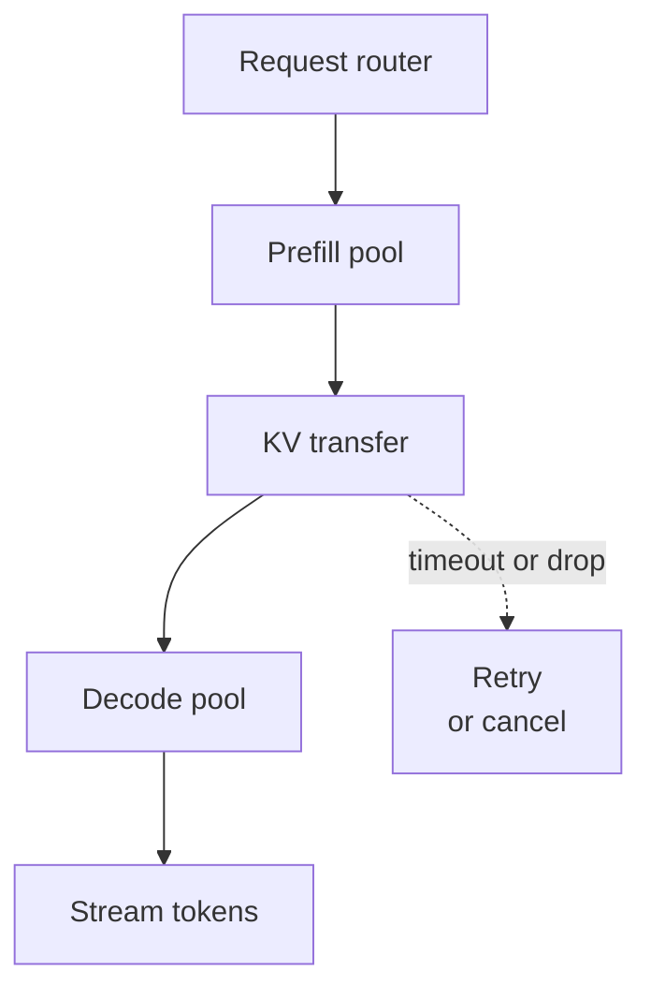

---
{
  "id": "deep-dive-sglang",
  "title": "Deep Dive - SGLang",
  "slug": "deep-dive-sglang",
  "section": "Project Deep Dives",
  "category": "Inference Optimization",
  "difficulty": "Hard",
  "order": 13,
  "coverImage": "illustrations/_generated/sglang_runtime_stack_dark.png",
  "shortDescription": "GPU use falls, and two requests that shared a prefix now prefill apart. Follow that lost time through SGLang's cache, scheduler, and decode path.",
  "keyConceptsTested": [
    "SGLang frontend expressions and SGLang Runtime (SRT)",
    "Radix tree prefix caching and KV memory ownership",
    "Continuous batching, chunked prefill, and scheduler overlap",
    "Structured outputs through grammar-constrained decoding",
    "Speculative decoding, EAGLE-family drafts, and multi-token prediction",
    "Tensor, pipeline, data, and expert parallelism",
    "Prefill-decode disaggregation and transfer costs",
    "Operational failure modes and code-reading mental models"
  ],
  "prerequisites": [
    "inference-mechanics-ttft-tps-kv-cache",
    "continuous-batching-request-scheduling",
    "prefix-caching-prompt-caching",
    "structured-output-constrained-generation",
    "speculative-decoding",
    "model-parallelism-for-llm-inference"
  ],
  "relatedQuestions": [
    "inference-mechanics-ttft-tps-kv-cache",
    "continuous-batching-request-scheduling",
    "prefix-caching-prompt-caching",
    "structured-output-constrained-generation",
    "speculative-decoding",
    "model-parallelism-for-llm-inference"
  ],
  "companies": [
    "SGLang Project",
    "LMSYS Org",
    "UC Berkeley",
    "NVIDIA",
    "AMD",
    "PyTorch ecosystem"
  ]
}
---

Suppose a serving alert shows GPU utilization dropping to 35%, <span data-glossary="ttft">time to first token (TTFT)</span> doubling, and two `classify_and_explain` requests that previously shared prefix work suddenly prefilling separately. One request picked up a new chat-template token; another landed on a different replica. The model weights never changed, yet both reuse and hardware occupancy collapsed.

Building on the standard model-and-tokenizer package from <span data-glossary="hugging-face-transformers">Hugging Face Transformers</span>, **<span data-glossary="sglang">SGLang</span>** co-designs two layers to eliminate redundant inference work: an optional Python **frontend** for multi-step language-model programs, and **SGLang Runtime (SRT)**, a high-throughput serving engine built around radix-tree KV caching, chunked prefill scheduling, grammar-constrained decoding, speculative decoding, and prefill-decode disaggregation.[^zheng2024sglang][^sglang2026docs]

To track where every millisecond goes, watch three metrics together: **TTFT** (wait until the first output token), **<span data-glossary="itl">inter-token latency (ITL)</span>** (interval between output tokens), and **<span data-glossary="tokens-per-second">tokens per second</span>** (aggregate throughput).

## Frontend program or HTTP request

SGLang accepts requests through four entry paths, all feeding SRT's scheduler and KV cache:[^zheng2024sglang][^sglang2026docs][^sglang2026repo]

| Entry path | Caller interface | Runtime focus | Best fit |
| --- | --- | --- | --- |
| Frontend program | `@sgl.function`, `sgl.gen`, `sgl.select`, `fork` / `join` | Shared prefixes, parallel branches, variable dependencies | Agents, few-shot programs, structured pipelines |
| OpenAI-compatible API | HTTP JSON chat / completion | Batching, radix KV reuse, grammar, streaming | Drop-in serving endpoints |
| Offline engine | Python `sgl.Engine` | Direct batching and persistent cache | Benchmarks, evals, replay suites |
| RL rollout client | Trainer / environment requests | High throughput, weight updates, reproducibility | Post-training and <span data-glossary="rlvr">verifiable rewards</span> |

Whether a request arrives via the Python frontend or HTTP, SRT always matches exact <span data-glossary="token">token</span> IDs plus cache namespace keys (such as adapter IDs or tenant cache salts). One extra whitespace character or changed chat-template token truncates a prefix hit immediately.

## Frontend: a small intermediate representation for model calls

SGLang's frontend (`python/sglang/lang/`) compiles decorated functions into a lightweight intermediate representation (IR) of generation sites and control flow: `sgl.gen` samples autoregressively until a stop rule or token cap, `sgl.select` scores a finite candidate set, and `fork`/`join` branch shared prompt state in parallel.[^zheng2024sglang]

```python title="structured-program.py"
import sglang as sgl

@sgl.function
def classify_and_explain(s, question):
    s += sgl.system("Return concise, evidence-backed answers.")
    with s.user():
        s += question
    with s.assistant():
        s += "Label: "
        s += sgl.select("label", ["bug", "feature", "question"])
        s += "\nExplanation: "
        s += sgl.gen("explanation", max_tokens=64, stop="\n")
```

Run two calls: `R0` asks `"Login button throws 500"` (already decoding its explanation) while `R1` asks `"Add dark mode to settings"` (still prefilling). Both share the system prompt and user-role opening, then diverge on the ticket text. Crucially, the later `"Label: "` and `"\nExplanation: "` strings are *not* reusable across `R0` and `R1`, because their attention keys and values depend on the differing preceding ticket tokens. Within `R0` alone, the explanation reuses the full prefix up through its chosen label.

Keeping a separate stream executor and named program state lets the same program target a local engine or a remote SRT endpoint, while isolating prompt/control-flow bugs before requests ever reach GPU scheduling.

## Runtime path: from API to model runner

Inside SRT, every request traverses the same five ownership stages:[^sglang2026docs]
1. **Entrypoints & tokenizer manager:** parse requests, apply chat templates, tokenize prompts, and track active requests.
2. **Scheduler & radix cache:** match cached KV prefixes, manage KV-page locks, and build the next forward batch.
3. **Model runner:** execute the forward pass across attention backends and tensor/pipeline/expert parallel groups.
4. **Grammar & sampler:** apply constrained-decoding masks and sample or verify speculative tokens.
5. **Detokenizer manager:** stream decoded text back to clients asynchronously.

<figure>
  
  <figcaption>Input preparation feeds a repeating scheduling, forward-pass, and sampling loop. <span data-glossary="tokenization">Tokenization</span> runs once per request; scheduling and sampling run on every output token.</figcaption>
</figure>

### One step, one token budget

Decode requests need 1 new token per step, while a long prompt can require thousands of prefill tokens. **Chunked prefill** slices long prompts across steps so incoming prefills do not stall active decodes.

Trace our two `classify_and_explain` requests under a 6-token mixed-step budget (`R0` needs 1 decode token; `R1` has 4 cached prefix tokens and 9 unmatched prompt tokens):

| Step | Ready work | Scheduled this step | State after step |
| --- | --- | ---: | --- |
| 0 | `R0` decode (1); `R1` prefill (9) | `R0=1`, `R1=5` | `R0` emits token; `R1` has 4 prompt tokens left |
| 1 | `R0` decode (1); `R1` prefill (4) | `R0=1`, `R1=4` | `R1` finishes prefill and samples first output token |
| 2 | `R0` decode (1); `R1` decode (1) | `R0=1`, `R1=1` | Both decode together |

In SRT's `PrefillAdder` (when `enable_mixed_chunk` is enabled), active decode tokens are subtracted from the step's token budget before slicing prefill chunks, alongside checks for KV capacity, page alignment, and future output reservations.[^sglangPinnedSource2026] Larger chunks lower new-request TTFT at the cost of decode ITL; smaller chunks protect ITL while stretching prompt prefill. SRT also supports **overlap scheduling**, pipelining CPU batch preparation with the previous GPU forward pass to hide host scheduling latency.

## RadixAttention: prefix reuse as a tree

**<span data-glossary="radixattention">RadixAttention</span>** indexes reusable KV-cache blocks inside a <span data-glossary="radix-tree">radix tree</span> (a compressed prefix tree whose edges hold multi-token spans) mapped to physical KV slots. Notice the clean subsystem split: the radix tree manages *cache lookup and memory ownership*, while an attention backend (FlashInfer, FlashAttention, Triton) executes the GPU kernel on those slots.

Each tree key (`RadixKey`) pairs exact token IDs with an optional `extra_key` (combining caller cache salts and <span data-glossary="lora">LoRA</span> adapter IDs) so distinct adapters or tenants stay isolated.[^sglangPinnedSource2026] Remember the difference between prompt context and output masking: rendering a tool schema into the prompt changes token IDs and KV states, whereas applying a grammar mask solely to output logits leaves prompt KV reusable across requests with different schemas. Matching is also page-aligned: under page size 4, a 5-token shared prefix reuses only the first 4 tokens.

<!-- leetllm: test, output=show -->
```python title="radix_prefix_budget.py"
def match_len(cached, request, extra_a, extra_b, page_size=1):
    if extra_a != extra_b:
        return 0
    n = 0
    for a, b in zip(cached, request):
        if a != b:
            break
        n += 1
    return (n // max(1, page_size)) * max(1, page_size)


shared = ["A", "B", "C", "D"]
r1 = shared + [f"P{i}" for i in range(1, 10)]
hit = match_len(shared, r1, extra_a="base", extra_b="base")
prefill_left = len(r1) - hit
budget = 6
r0_decode = 1
r1_now = min(prefill_left, budget - r0_decode)

assert hit == 4
assert prefill_left == 9
assert r1_now == 5
assert match_len(shared, r1, extra_a="base", extra_b="lora-7") == 0
assert match_len(shared + ["P1"], r1, extra_a="base", extra_b="base", page_size=4) == 4
assert match_len(["A", "B", "X", "D"], shared, "base", "base") == 2
assert match_len(["X", "B", "C", "D"], shared, "base", "base") == 0
print(f"hit={hit} decode={r0_decode} prefill_now={r1_now} remaining={prefill_left - r1_now}")
```

<!-- leetllm: output:start -->
```text title="Output" output compact
hit=4 decode=1 prefill_now=5 remaining=4
```
<!-- leetllm: output:end -->

<figure>
  
  <figcaption>The radix tree reuses four shared token-to-KV slots across requests while the six-token budget schedules 1 decode token and 5 prefill tokens, deferring the remaining 4 prompt tokens.</figcaption>
</figure>

Under heavy queues, cache-aware scheduling prioritizes requests with the longest matched prefix over strict FIFO order (trading strict fairness for higher prefix reuse).[^zheng2024sglang] SGLang's **HiCache** extends the same exact-match tree into host RAM and storage tiers when GPU HBM fills up.[^sglang2026docs]

### Insert, lock, evict

Radix caching (`python/sglang/srt/mem_cache/radix_cache.py`) pairs lookup with strict reference-counted memory ownership:
1. `match_prefix` finds the longest compatible token path and returns its KV slots.
2. `insert` attaches newly computed suffix KV slots to the tree.
3. Lock / unlock reference counts protect active prefixes from eviction while any running request or pending GPU kernel reads them.
4. `evict` reclaims only unreferenced leaf branches (for example via LRU) when free KV slots run low.

Releasing a reference while a GPU reader is still in flight corrupts active generations; leaking a reference starves KV capacity until new requests stall.

<!-- leetllm: test, output=show -->
```python title="prefix-lifetime.py"
class PrefixSegment:
    def __init__(self, locations):
        self.locations = tuple(locations)
        self.owners = set()
        self.evicted = False

    def acquire(self, request):
        if self.evicted or request in self.owners:
            raise ValueError("invalid acquisition")
        self.owners.add(request)

    def release(self, request):
        if request not in self.owners:
            raise ValueError("request does not own this segment")
        self.owners.remove(request)

    def evict(self):
        if self.owners:
            return False
        self.evicted = True
        return True

prefix = PrefixSegment([12, 13, 14, 15])
prefix.acquire("R0")
prefix.acquire("R1")
prefix.release("R0")
assert not prefix.evict()
print("R0 finished; R1 still owns four KV locations: eviction blocked")
prefix.release("R1")
assert prefix.evict()
try:
    prefix.acquire("R2")
except ValueError:
    print("Both finished: evicted segment cannot be reacquired")
else:
    raise AssertionError("stale locations reused")
```

<!-- leetllm: output:start -->
```text title="Output" output compact
R0 finished; R1 still owns four KV locations: eviction blocked
Both finished: evicted segment cannot be reacquired
```
<!-- leetllm: output:end -->

Because each replica maintains its own radix tree, round-robin load balancing across replicas cuts prefix hit rates sharply unless a cache-aware router steers matching prompts to the same worker.

## Structured generation: constrain the next token

Prompting for JSON suggests a format; **constrained decoding** guarantees syntactic validity by tracking a finite-state automaton per request and masking every illegal vocabulary logit to $-\infty$ before sampling. SGLang supports regex, <span data-glossary="json-schema">JSON schema</span>, and EBNF grammars (mutually exclusive on server APIs; frontend `sgl.gen` exposes `regex` and `json_schema`) via **XGrammar** (default), **Outlines**, and **llguidance**.[^sglang2026structured][^sglangPinnedSource2026]

```python title="schema-constrained.py"
import sglang as sgl

@sgl.function
def extract(s, passage):
    s += "Extract one entity from this passage:\n" + passage
    s += sgl.gen(
        "record",
        json_schema='{"type":"object","properties":{"name":{"type":"string"}},"required":["name"],"additionalProperties":false}',
        max_tokens=64,
    )
```

SGLang's compressed finite-state-machine jumps skip deterministic single-choice spans (such as JSON keys and punctuation) in bulk instead of running redundant decode steps.[^zheng2024sglang] Remember two limits: grammar masks guarantee syntax rather than factual truth, and hitting `max_tokens` can still truncate an incomplete JSON object, so always check finish reason and validate parsed output.

## Speculative decoding: verify a draft in parallel

Because memory-bound decode generates one token per forward pass, **<span data-glossary="speculative-decoding">speculative decoding</span>** proposes $k$ candidate tokens with a cheap draft path and verifies all of them in one batched target forward pass. On a greedy 8-token draft that first disagrees at position 6, SRT commits the 5 matching tokens (reusing their target KV) plus the target's replacement token at position 6 (which still needs the next forward pass to populate its KV) and discards positions 7–8.

| Phase | Work | State |
| --- | --- | --- |
| Draft | Propose candidates via cheap path | Draft tokens + optional draft KV |
| Verify | Target scores all candidates in one batched pass | Target logits + acceptance test |
| Commit | Keep accepted prefix + replacement/bonus token | Retain valid KV; drop rejected suffix and sync grammar state |

SGLang's speculative registry (`python/sglang/srt/speculative/`) supports **EAGLE-2 / EAGLE-3** (tree drafts from target hidden states), **<span data-glossary="multi-token-prediction">multi-token prediction (MTP)</span>** heads, **DFlash** block-diffusion drafts, standalone draft LLMs, **n-gram** lookup, and **UNO** (drafting with a LoRA adapter on the target model; CUDA/FA3, TP=PP=1, no grammar).[^sglang2026speculative][^li2024eagle2][^li2025eagle3][^chen2026dflash] Operational constraints vary by mode: n-gram disables overlap scheduling and mixed chunked prefill, whereas EAGLE overlap workers require `--speculative-eagle-topk 1`. Speculation pays off only when average accepted length beats draft + verification overhead (low acceptance or saturated high-batch decode can make speculation slower).

## Parallelism and prefill-decode disaggregation

SGLang scales models across five orthogonal axes:[^sglang2026parallelism]

| Axis | Partitioned dimension | Primary benefit | Cost |
| --- | --- | --- | --- |
| Tensor parallelism (TP) | Weight matrices across GPUs | Fits large layers, lowers per-request latency | Per-layer all-reduces |
| Pipeline parallelism (PP) | Layer ranges across nodes | Fits depth across nodes | Pipeline bubbles and stage waits |
| Data parallelism (DP) | Replicas or DP-attention groups | Independent request throughput | Replicated weights, split cache locality |
| Expert parallelism (EP) | MoE experts across GPUs | Scales sparse capacity | All-to-all dispatch/combine |
| Context / sequence parallelism | Sequence positions | Long-context memory and compute | Extra KV/activation communication |

Because prefill is compute-bound while decode is memory-bandwidth-bound, **prefill-decode (P/D) disaggregation** separates them onto dedicated worker pools linked by KV transfer engines (Mooncake, NIXL) and SGLang Model Gateway.[^sglang2026pd]

Watch destination KV reservation timing: the default `early` mode reserves decode KV slots as soon as prefill starts (10 concurrent 512 MiB prompts hold 5 GiB of decode HBM before decode even starts), whereas `prefill_complete` defers reservation until prefill finishes (requiring Mooncake and keeping KV on prefill longer without chunk-transfer overlap).[^sglang2026pd]

Always check the physics of KV transfer before disaggregating. For a 32-layer model with 8 KV heads, head dim 128, 4,096 tokens, and 2 bytes/scalar (counting both K and V), a single prompt generates 512 MiB of KV state, taking at least 21.47 ms over a sustained 25 GB/s link before setup or queueing:

<!-- leetllm: test, output=show -->
```python title="kv-transfer-bound.py"
layers, kv_heads, head_dim, tokens, bytes_per_scalar = 32, 8, 128, 4096, 2
kv_bytes = 2 * layers * kv_heads * head_dim * tokens * bytes_per_scalar
payload_bytes_per_second = 25_000_000_000  # 25 GB/s sustained transfer rate
lower_bound_ms = 1000 * kv_bytes / payload_bytes_per_second
assert kv_bytes == 536_870_912
print(f"KV={kv_bytes / 2**20:.0f} MiB; transfer lower bound={lower_bound_ms:.2f} ms")
```

<!-- leetllm: output:start -->
```text title="Output" output compact
KV=512 MiB; transfer lower bound=21.47 ms
```
<!-- leetllm: output:end -->



A decode worker must verify both KV layout compatibility and a fresh completion event for the current transfer attempt before starting decode, with clean retry or cancellation on drop.

## A production failure drill

Return to our opening alert: GPU utilization fell to 35%, TTFT doubled, and two `classify_and_explain` requests that previously shared prefix work now prefill separately. Rather than guessing at server flags, walk the runtime path in causal order and separate four distinct failure modes:

1. **Token identity:** Compare exact token IDs and chat-template versions on a controlled test prompt. Character-level similarity hides extra special tokens or formatting shifts that truncate a radix hit at position zero.
2. **Replica routing:** Inspect which worker handled each request. Because each replica owns a local radix tree, round-robin load balancing splits identical prompts across separate caches unless cache-aware routing steers matching prefixes to the same worker.
3. **Host queueing and batching:** Measure tokenizer time, scheduler queue wait, and chunked-prefill budgets (`max_prefill_tokens`). A stalled host queue leaves GPUs idle even when weights and kernels are healthy.
4. **KV memory pressure:** Distinguish a *cold* cache (short matched prefix, plenty of free KV slots) from a *full* cache (zero free KV slots, active references blocking eviction, and new requests stalled waiting for space).
5. **Grammar and speculation overhead:** Measure per-step CPU grammar mask latency and draft acceptance length in an isolated replay without relaxing production schemas.

Now invert the symptoms: GPU utilization is high and prefix hits are healthy, yet decode ITL spikes whenever a long prompt arrives. That pattern points directly to prefill chunk size, collective synchronization, or P/D routing rather than cache capacity: increasing cache size cannot fix a token budget that lets long prefills monopolize every step.

<!-- leetllm: edition:reference:start -->

## Applications and workload shape

| Application | SGLang advantage | Typical pitfall |
| --- | --- | --- |
| Agent loops | Reuse system/tool prefixes; `fork` parallel branches | Early divergence or external tool latency |
| RAG | Cache stable templates and shared documents | Reordered chunks or random IDs break prefix matches |
| Structured extraction | Zero-overhead syntax guarantees via XGrammar/llguidance | Huge schemas raise CPU mask overhead |
| Multi-turn chat | Hot conversation prefix reuse | Context trimming or cross-replica routing misses cache |
| RL <span data-glossary="rollout">rollout</span> | High-throughput batched generation | Trainer/rollout weight version skew |

## Strengths and common pitfalls

| Dimension | Strength | Trade-off |
| --- | --- | --- |
| Frontend IR | Cleanly expresses branches and variable dependencies | Extra abstraction layer above HTTP |
| RadixAttention | Exact zero-copy KV prefix sharing | Fragile to tiny leading token changes or unaligned replicas |
| Scheduling | Mixed chunked prefill + overlap protects ITL | Queue ordering trades fairness vs. cache hit rate |
| Constrained decoding | Enforces valid grammar tokens per step | CPU mask cost varies sharply with grammar complexity |
| Speculation | Multi-token commits per target pass | Overhead dominates when acceptance drops |
| P/D disaggregation | Isolates decode ITL from long prefills | Adds KV transfer latency, reservation pressure, and failure paths |

## Project identity

SGLang originated with UC Berkeley, Stanford, and LMSYS researchers (Lianmin Zheng, Liangsheng Yin, Zhiqiang Xie, Ying Sheng, Ion Stoica, Joseph E. Gonzalez, and collaborators) and is incubated by the nonprofit LMSYS Org under `sgl-project/sglang` (`Apache-2.0` license; <span data-glossary="model-checkpoint">model checkpoints</span> and third-party kernels carry separate terms).[^zheng2024sglang][^lmsys2026about][^sglang2026maintainers][^sglang2026license][^sglang2024v04]

## Code-reading route in the pinned commit

Follow one request end to end through `sgl-project/sglang`:[^sglangPinnedSource2026]

1. `python/sglang/lang/api.py`, `ir.py`, `interpreter.py`: frontend DSL, IR nodes, and stream executor.
2. `python/sglang/srt/entrypoints/http_server.py`: HTTP API ingress.
3. `python/sglang/srt/managers/tokenizer_manager.py` & `detokenizer_manager.py`: tokenization and response streaming.
4. `python/sglang/srt/managers/scheduler.py` & `schedule_policy.py`: token budgets, `PrefillAdder`, chunked prefill, and overlap.
5. `python/sglang/srt/mem_cache/radix_cache.py`: `match_prefix`, `insert`, locks, and eviction.
6. `python/sglang/srt/model_executor/model_runner.py`: forward batches, attention backends, and parallel groups.
7. `python/sglang/srt/constrained/grammar_manager.py`: XGrammar / Outlines / llguidance integration.
8. `python/sglang/srt/speculative/spec_info.py` & `spec_registry.py`: EAGLE, MTP, DFlash, n-gram, and UNO dispatch.
9. `python/sglang/srt/disaggregation/prefill.py` & `decode.py`: P/D transfer lifecycle and reservations.

## Rerun and measure

Record full environment metadata (GPU SKU, topology, SGLang/model/tokenizer revisions, attention backend, precision, warmup, and trace distribution) alongside six layers of telemetry: input tokens/templates, queue wait and matched prefix length, batch/chunk/preemption counts, forward/collective time, grammar mask time and draft acceptance length, plus TTFT/ITL/finish reasons.

Separate **qualified <span data-glossary="goodput">goodput</span>** (valid completions meeting TTFT and ITL SLOs divided by full window duration) from **offered-load capacity** (highest offered request rate whose qualifying fraction meets the SLO target, counting rejected, failed, and late attempts in the denominator). Use Nsight Systems for scheduling/transfer gaps and Nsight Compute for individual kernel limits.[^nsightSystems2026][^nsightCompute2026]

<!-- leetllm: edition:reference:end -->

## Architectural summary

- SGLang pairs an optional Python program frontend (`gen`, `select`, `fork`/`join`) with SRT, which also serves standard OpenAI-compatible HTTP traffic.
- **RadixAttention** reuses exact, namespace-scoped, page-aligned KV prefixes in a reference-counted radix tree rather than acting as an attention kernel itself.
- **Chunked prefill** and **overlap scheduling** bound per-step prefill tokens to protect decode ITL while hiding host scheduling work.
- **Constrained decoding** (XGrammar, Outlines, llguidance) enforces syntax by masking logits per step without modifying reusable prompt KV.
- **Speculative decoding** (EAGLE, MTP, DFlash, n-gram, UNO) trades draft compute for multi-token verification commits whenever acceptance length is high.
- **P/D disaggregation** isolates prefill compute from decode memory bandwidth, limited by KV transfer size, link bandwidth, and destination slot reservations.

<!-- leetllm: edition:reference:start -->

### Evaluation rubric

- **Context identity:** Pinpoint the first differing token, distinguish shared prefixes from repeated suffixes, and separate prompt KV from per-request grammar state.
- **Memory lifetime:** Protect shared radix segments until every active GPU reader finishes before allowing eviction.
- **Scheduling:** Compute mixed chunk budgets accurately while accounting for page alignment and KV reservations.
- **Serving metrics:** Distinguish qualified goodput, offered-load capacity, and raw token TPS; size KV transfer lower bounds for P/D handoffs.

### Follow-up questions

```checkpoint
The four-token prefix is shared, but R1 changes only its output grammar. Does it need fresh prompt KV?
---
No. If model weights, prompt token IDs, positions, and cache namespace match, prompt KV is reused directly while each request maintains its own grammar automaton state. (Rendering the schema into the prompt text itself would change the tokens and break the match.)
```

```checkpoint
Chunked prefill is enabled, yet decodes still spike. What should you inspect before forcing a tiny 6-token chunk?
---
Check whether mixed-chunk batching is actually enabled, inspect real batch traces, KV reservations, running-request caps, and collective timings, then tune chunk size against measured TTFT and ITL on your target arrival rate.
```

<!-- leetllm: edition:reference:end -->

```mastery-quiz
[
  {
    "question": "A cached token path and a request share their first ten IDs, then diverge. Reuse requires four-token pages. With the same namespace the path is otherwise valid; a second request has a different adapter namespace. What are the two reusable lengths?",
    "options": [
      "Same namespace 10; different namespace 0.",
      "Same namespace 8; different namespace 8.",
      "Same namespace 8; different namespace 0.",
      "Same namespace 12; different namespace 0."
    ],
    "answer": "Same namespace 8; different namespace 0.",
    "explanation": "Rounding 10 exact tokens down to a multiple of page size 4 gives 8 reusable tokens. A mismatched adapter namespace isolates the cache and returns 0."
  },
  {
    "question": "A support program calls sgl.select('route', ['escalate', 'selfserve']). Its next prompt asks for instructions specific to the selected route. While selection is pending, who owns the named result, and when should the program submit that prompt?",
    "options": [
      "The frontend program state owns route. Submit after appending the selected text.",
      "The runtime scheduler owns route. Submit after appending the selected text.",
      "The frontend program state owns route. Submit now with the name 'route' in the prompt.",
      "The runtime scheduler owns route. Submit now with the name 'route' in the prompt."
    ],
    "answer": "The frontend program state owns route. Submit after appending the selected text.",
    "explanation": "The frontend interpreter holds named variables in program state, waits for `select` to resolve, appends the chosen text to the prompt, and then submits the resulting call to SRT."
  },
  {
    "question": "A configured mixed-step budget allows 10 fresh input positions. Three existing decodes each need one; a new prompt has 12 unmatched positions after valid reuse. Ignoring other admission limits, what prompt chunk fits now and what prompt work remains?",
    "options": [
      "Prefill 10 now; 2 prompt positions remain.",
      "Prefill 9 now; 3 prompt positions remain.",
      "Prefill 3 now; 9 prompt positions remain.",
      "Prefill 7 now; 5 prompt positions remain."
    ],
    "answer": "Prefill 7 now; 5 prompt positions remain.",
    "explanation": "Reserve 3 tokens for active decodes first (10 - 3 = 7), leaving room for min(12, 7) = 7 prefill tokens now and 5 remaining for the next step."
  },
  {
    "question": "A four-token toy vocabulary has raw probabilities [0.50, 0.25, 0.15, 0.10]. The grammar permits only the first and third entries. What are their normalized probabilities, in that order?",
    "options": [
      "First 1/2; third 3/20.",
      "First 10/13; third 3/13.",
      "First 2/3; third 1/3.",
      "First 3/4; third 1/4."
    ],
    "answer": "First 10/13; third 3/13.",
    "explanation": "Allowed probability mass sums to 0.50 + 0.15 = 0.65. Renormalizing gives 0.50 / 0.65 = 10/13 and 0.15 / 0.65 = 3/13."
  },
  {
    "question": "Two requests own the same KV segment. A has completed and released. B is cancelled by the client, but B’s last GPU reader is still pending. After that reader completes, B releases its reference. Which eviction sequence preserves memory safety?",
    "options": [
      "Eligible at A release; reclaim after B’s cancellation notification.",
      "Blocked until another request; reclaim despite B’s pending reader.",
      "Blocked until B releases; eligible afterward under eviction policy.",
      "Eligible at B cancellation; reclaim KV while retaining B’s token IDs."
    ],
    "answer": "Blocked until B releases; eligible afterward under eviction policy.",
    "explanation": "Client cancellation does not stop an in-flight GPU kernel from reading those KV slots. Eviction remains blocked until B's GPU reader finishes and B releases its reference."
  },
  {
    "question": "A linear draft proposes token IDs [11, 24, 37, 50, 62, 79, 83]. The target's greedy choices through the first disagreement are [11, 24, 37, 50, 65]. Take a snapshot just after commit, before the next target forward pass. For these new positions, count accepted draft tokens, committed outputs, positions with reusable target-model KV, and replacements awaiting a forward pass.",
    "options": [
      "4 accepted, 5 committed, 4 ready KV, 1 pending.",
      "5 accepted, 6 committed, 5 ready KV, 1 pending.",
      "4 accepted, 4 committed, 4 ready KV, 1 pending.",
      "4 accepted, 5 committed, 5 ready KV, 0 pending."
    ],
    "answer": "4 accepted, 5 committed, 4 ready KV, 1 pending.",
    "explanation": "The first 4 draft tokens match and keep their verified target KV. Token 65 replaces 62 as the 5th committed output, and still awaits the next target forward pass to generate its KV."
  },
  {
    "question": "An unsharded full-attention KV transfer spans 12 layers, 4 KV heads, head dimension 64, 2048 positions and 2 bytes per scalar. Count both K and V. At an achieved 6 decimal GB/s, what payload and payload-only lower bound follow?",
    "options": [
      "12 MiB; about 2.10 ms.",
      "24 MiB; about 4.19 ms.",
      "24 MiB; about 8.39 ms.",
      "48 MiB; about 8.39 ms."
    ],
    "answer": "24 MiB; about 4.19 ms.",
    "explanation": "2 × 12 × 4 × 64 × 2048 × 2 = 25,165,824 bytes = 24 MiB. Dividing by 6 × 10^9 B/s gives 4.194 ms before setup or queueing."
  },
  {
    "question": "Two complete 10-second trials require at least 90% of offered attempts to be valid and meet both latency SLOs. A offers 80 attempts and 76 qualify; B offers 100 and 88 qualify. What are qualified goodputs (A, B) and the highest passing tested offered rate?",
    "options": [
      "7.6/s, 8.8/s; 10 offered/s.",
      "8/s, 10/s; 10 offered/s.",
      "7.6/s, 10/s; 8 offered/s.",
      "7.6/s, 8.8/s; 8 offered/s."
    ],
    "answer": "7.6/s, 8.8/s; 8 offered/s.",
    "explanation": "Qualified goodput is 76 / 10 = 7.6/s for A and 88 / 10 = 8.8/s for B. Because A passes 95% (≥ 90%) while B passes only 88%, the highest passing offered rate is 80 / 10 = 8 offered/s."
  },
  {
    "question": "A service enforces a JSON schema during decoding. Repeated trials use the same hardware, revisions, warm-cache setup, requests, input and output lengths, and arrival times. All three configurations are supported, and all replies pass the same quality checks. Ordinary decoding with the schema averages 96 ms per request. With speculation enabled, trial A averages 81 ms with the schema enforced and trial B averages 73 ms with the grammar disabled. What latency reductions do these records show for enabling speculation on the service and for disabling the grammar in a diagnostic replay with speculation enabled?",
    "options": [
      "15 ms for speculation and 8 ms for disabling the grammar.",
      "23 ms for speculation and 8 ms for disabling the grammar.",
      "15 ms for speculation and 23 ms for disabling the grammar.",
      "8 ms for speculation and 15 ms for disabling the grammar."
    ],
    "answer": "15 ms for speculation and 8 ms for disabling the grammar.",
    "explanation": "Holding the JSON schema constant, enabling speculation cuts latency by 96 - 81 = 15 ms. Holding speculation constant, disabling the grammar cuts another 81 - 73 = 8 ms."
  },
  {
    "question": "Two separate handoffs have all required bytes received. X requires attempt 9 and compatible layout; its only ready event belongs to old attempt 8. Y has a current attempt-4 ready event, but its received KV layout differs from the layout Y requires. Without any further event or conversion, which decode paths may start?",
    "options": [
      "X open; Y open.",
      "X hold; Y open.",
      "X hold; Y hold.",
      "X open; Y hold."
    ],
    "answer": "X hold; Y hold.",
    "explanation": "Receiving bytes alone is not enough: X lacks a completion event matching current attempt 9, and Y has an incompatible KV layout. Both decode workers must hold."
  }
]
```

> **Next:** Continue to [Deep Dive - slime](/learn/deep-dive-slime). Serving a fixed model made cache ownership central. An RL rollout system adds changing weights, so request lifetimes must also agree with policy versions and trainer synchronization.
