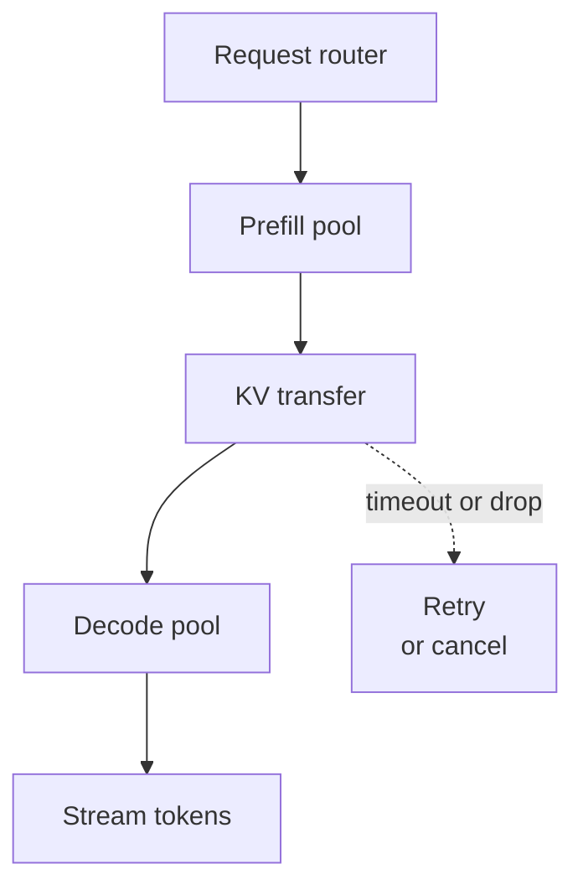

---
{
  "id": "deep-dive-sglang",
  "title": "Deep Dive - SGLang",
  "slug": "deep-dive-sglang",
  "section": "Project Deep Dives",
  "category": "Inference Optimization",
  "difficulty": "Hard",
  "order": 13,
  "coverImage": "illustrations/_generated/sglang_runtime_stack_dark.png",
  "shortDescription": "GPU use falls, and two requests that shared a prefix now prefill apart. Follow that lost time through SGLang's cache, scheduler, and decode path.",
  "keyConceptsTested": [
    "SGLang frontend expressions and SGLang Runtime (SRT)",
    "Radix tree prefix caching and KV memory ownership",
    "Continuous batching, chunked prefill, and scheduler overlap",
    "Structured outputs through grammar-constrained decoding",
    "Speculative decoding, EAGLE-family drafts, and multi-token prediction",
    "Tensor, pipeline, data, and expert parallelism",
    "Prefill-decode disaggregation and transfer costs",
    "Operational failure modes and code-reading invariants"
  ],
  "prerequisites": [
    "inference-mechanics-ttft-tps-kv-cache",
    "continuous-batching-request-scheduling",
    "prefix-caching-prompt-caching",
    "structured-output-constrained-generation",
    "speculative-decoding",
    "model-parallelism-for-llm-inference"
  ],
  "relatedQuestions": [
    "inference-mechanics-ttft-tps-kv-cache",
    "continuous-batching-request-scheduling",
    "prefix-caching-prompt-caching",
    "structured-output-constrained-generation",
    "speculative-decoding",
    "model-parallelism-for-llm-inference"
  ],
  "companies": [
    "SGLang Project",
    "LMSYS Org",
    "UC Berkeley",
    "NVIDIA",
    "AMD",
    "PyTorch ecosystem"
  ]
}
---

Suppose a serving alert says GPU utilization is 35%, time to first token has doubled, and two `classify_and_explain` requests that used to share work now prefill separately. One request picked up a new chat-template token; another landed on a different replica. The model weights didn't change. Either change can lose a prefix hit, but neither alone explains low utilization. You need to locate both the lost reuse and the time spent waiting.

The previous chapter's <span data-glossary="hugging-face-transformers">Hugging Face Transformers</span> lesson established a standard model-definition package: revision, config, weights, and tokenizer travel together. <span data-glossary="sglang">SGLang</span> takes that foundation, then directs its effort toward request programs, key-value (KV) reuse, and GPU scheduling.

The lost time has to sit in one of five handoffs: frontend or HTTP payload, tokenization, prefix lookup and scheduling, model execution, then constrained sampling and streaming. Each handoff owns different state, so one latency symptom can have several causes.

SGLang pairs a Python frontend for program-shaped calls with SGLang Runtime (SRT), which batches <span data-glossary="gpu">GPU</span> work, reuses exact KV prefixes, and can constrain or speculate during decoding. The frontend is optional; an OpenAI-compatible request can enter SRT directly.[^zheng2024sglang][^sglang2026docs]

Keep two `classify_and_explain` requests in view as we follow the path. Measure <span data-glossary="ttft">time to first token (TTFT)</span>, the wait until first output; <span data-glossary="itl">inter-token latency (ITL)</span>, the interval between output tokens; and <span data-glossary="tokens-per-second">tokens per second</span>, an aggregate throughput signal. Together they show whether a change saved input work, protected decode, or shifted cost to a host-side stage.

```checkpoint
What do the two primary SGLang layers own during inference?
---
The frontend owns a program-shaped request: text, roles, generation sites, choices, and control flow. SRT owns execution: tokenization handoff, KV-cache allocation, scheduling, model runners, and response streaming.
```

## Frontend program or HTTP request

Start at caller ingress. A program and a JSON request can carry the same visible question, but they expose different opportunities to the runtime. The original SGLang paper describes a frontend language plus a runtime for structured language-model programs.[^zheng2024sglang]

SGLang serves language and multimodal models through several hardware backends. Support depends on the model, attention backend, device, and release; a supported device doesn't imply that every grammar or speculative mode works there.[^sglang2026docs][^sglang2026repo]

The entry path determines whether the application exposes a multi-call program or sends individual generation requests:

| Entry path | Reader writes | SGLang must optimize | Good fit |
| --- | --- | --- | --- |
| Frontend program | `@sgl.function`, `sgl.gen`, `sgl.select`, `fork` / `join`, roles | Shared prefixes, parallel program branches, output dependencies | Agents, few-shot programs, extraction, multi-turn workflows |
| OpenAI-compatible API | JSON chat or completion request | Batching, KV reuse, sampling, streaming | Drop-in model endpoint |
| Offline engine | Python calls against `sgl.Engine` | Batch admission and reusable cache state | Evaluation, replay, test suites |
| RL rollout client | Requests from a trainer or environment | Throughput, weight refresh, deterministic execution | Post-training and <span data-glossary="rlvr">verifiable rewards</span> |

The frontend can organize a system prompt, demonstrations, and retrieved documents into reusable prompt state. The runtime still compares exact <span data-glossary="token">token</span> IDs, not application-level similarity. A space matters if it changes tokenization; a changed template token can shorten the hit. An adapter identifier or cache salt can partition the cache even when tokens match.

Now hold that program aside and use the API row. SGLang also serves requests that never use the frontend. A benchmark that sends plain OpenAI requests measures SRT's serving path, not frontend-specific convenience methods or client-side hints.

A program benchmark adds branch parallelism, variable binding, and <span data-glossary="prefix-cache">prefix reuse</span> to the workload. Compare those results only after naming which path you measured; they answer different questions.

The paper evaluates agent control, logical reasoning, few-shot tasks, JSON decoding, <span data-glossary="rag">retrieval-augmented generation</span>, and multi-turn chat.[^zheng2024sglang] Its throughput metric is completed programs per second, so a program with several dependent calls isn't one generated token or one HTTP request. Its historical comparisons motivate the mechanisms. A release, GPU, model, tokenizer, and request mix can change the winner. Those comparisons do not say what the frontend submits before any GPU work starts.

## Frontend: a small intermediate representation for model calls

The frontend submits an intermediate representation for model calls, not a finished token string. The `sgl.gen` primitive requests model tokens, `sgl.select` evaluates explicit strings, and role helpers format chat templates. Notice the contrast: `select` evaluates a finite candidate set, whereas `gen` samples autoregressively until hitting a stop condition or token limit.

The paper also names `fork` and `join` for parallel copies of prompt state, so a program can run several candidates without flattening them into one prompt.[^zheng2024sglang] A decorated function becomes an `SglFunction`; the interpreter walks its expressions and sends generated spans to a backend.

The source for these pieces lives under `python/sglang/lang/`. The code-reading route below pins one commit; the web documentation describes a moving release surface.

The snippet below demonstrates SGLang's frontend program interface with function decoration and assistant blocks:

```python title="structured-program.py"
import sglang as sgl

@sgl.function
def classify_and_explain(s, question):
    s += sgl.system("Return concise, evidence-backed answers.")
    with s.user():
        s += question
    with s.assistant():
        s += "Label: "
        s += sgl.select("label", ["bug", "feature", "question"])
        s += "\nExplanation: "
        s += sgl.gen("explanation", max_tokens=64, stop="\n")
```

Call this twice. `R0` classifies `"Login button throws 500"` and is already decoding the explanation. `R1` classifies `"Add dark mode to settings"` and is still prefilling a longer ticket body.

Both calls share the system prompt and the user-role opening. Their ticket tokens then diverge. The later `Label:` and `Explanation:` strings are repeated text, but they aren't reusable prefixes across these two tickets: their KV depends on the different preceding context. Within one request, the explanation can reuse the context already computed for its label.

One generation site has a finite choice set. Another is open-ended but has a stop condition. The result contains named values such as `label` and `explanation`, so application code can use one generation to shape the next prompt.

`select` scores a finite choice set using its configured method, while `gen` samples under its generation parameters. Output can vary with sampling state and runtime. A JSON-looking prompt supplies no schema; use an explicit constraint through an API that supports it.

SGLang's interpreter keeps a stream executor and a program state. The executor submits text and generation operations to the backend; the state holds named variables and assembled text. This split lets one program use a local engine, a remote runtime endpoint, or a test backend without changing its control flow.

That decoupling also localizes bugs. An unexpected branch, missing variable, or chat-template mismatch can fail above SRT before the scheduler sees any model work.

```checkpoint
Does using the frontend automatically create more prefix hits than sending the same tokenized requests through HTTP?
---
No. SRT can reuse exact prefixes from either entry path. The frontend helps express generation dependencies, named values, and independent branches. It can expose opportunities to reuse state, but identical tokens and placement can produce the same cache hits through HTTP. A single flattened prompt isn't an equivalent replacement for a program with dependent model calls.
```

## Runtime path: from API to model runner

A frontend expression and a plain HTTP payload look different at the edge. Inside SRT they share owners. Entrypoints parse requests; the tokenizer manager prepares model inputs and tracks request/output state. A separate detokenizer manager converts generated IDs to text in the usual multiprocess serving path.

The scheduler plus radix cache decide which tokens run next and which KV locations already exist. The model runner loads weights, builds a forward batch, selects attention backends, and returns <span data-glossary="logits">logits</span> or sampled tokens.[^sglang2026docs]

A delay before the first model batch suggests input, cache, or admission work. A delay between generated tokens can include scheduling, the runner, communication, grammar, speculation, and output delivery. TTFT includes the first forward pass and sampling too; these metrics don't divide neatly into CPU and GPU stages.

The process split can vary with server mode and parallelism, but those responsibilities stay recognizable. Grammar and sampling code constrain or select the next token before the stream is updated. Follow the data, not a fixed process layout.

<figure>
  
  <figcaption>Input preparation leads into a repeating execution loop. <span data-glossary="tokenization">Tokenization</span> isn't repeated for every output token, but scheduling is. TTFT includes the first trip through the loop; ITL includes later trips and delivery delays.</figcaption>
</figure>

Debugging starts at a handoff. High <span data-glossary="ttft">TTFT</span> with low GPU utilization points to tokenization, queue wait, prefix lookup, or admission before kernel work. Rising ITL after a model update points to forward-batch shapes, attention backend selection, collective wait, and grammar or speculative work. Malformed output calls for separating model logits from grammar masking and detokenization.

### One step, one token budget

SRT maintains active requests and schedules a batch repeatedly. Decodes usually need one new token per request; prefills need many prompt tokens. Chunked <span data-glossary="prefill">prefill</span> divides a long prompt so it doesn't monopolize a step while decodes wait. Exact flags and defaults change by release, so inspect `Scheduler.init_chunked_prefill` and the server arguments for the pinned commit.

Use a simplified mixed-batch policy for the two classify requests. Shared prefix length is 4. `R0` is decoding (1 token); `R1` has 9 unmatched prompt tokens. With budget 6 and one decode token reserved, five `R1` prompt tokens fit:

| Step | Ready work | Tokens scheduled | State after step |
| --- | --- | ---: | --- |
| 0 | `R0` decode needs 1; `R1` prefill needs 9 | `R0=1`, `R1=5` | `R0` advances; `R1` has 4 prompt tokens left |
| 1 | `R0` decode needs 1; `R1` prefill needs 4 | `R0=1`, `R1=4` | `R1` finishes prefill |
| 2 | `R0` and `R1` decode | `R0=1`, `R1=1` | Both requests continue generation |

Use this accounting example to understand mixed-chunk budgeting. At the pinned commit, `enable_mixed_chunk` defaults to false; when enabled, `PrefillAdder` subtracts mixed decode tokens from its input and chunk budgets. Admission also checks KV capacity, page alignment, and reservations for future output. Running both modes in one batch also depends on those admission checks.[^sglangPinnedSource2026]

At step 1, the final prefill can already sample `R1`'s first output token. Step 2 feeds that output token back through the model. A larger prefill slice may improve TTFT for a new prompt but delay existing decodes; a smaller slice can protect <span data-glossary="itl">ITL</span> while stretching prompt processing.

SGLang also has an overlap path. CPU scheduling, token movement, and GPU execution can be pipelined when the backend and flags permit it. Overlap hides some host work, but it adds queues and synchronization.

Use the ownership question to test an overlap change: if a request state, grammar update, or KV location arrives late, which consumer reads it first? A race can affect correctness as well as latency.

```checkpoint
What does chunked prefill protect, and what can it cost?
---
It protects decode ITL by bounding prompt work in one step. It can increase a new request's TTFT because its prompt is spread across multiple steps, and an oversized chunk can still delay decodes.
```

## RadixAttention: prefix reuse as a tree

<span data-glossary="radixattention">RadixAttention</span> names SGLang's use of a <span data-glossary="radix-tree">radix tree</span>, a compressed prefix tree whose edges can hold several tokens, to find reusable <span data-glossary="kv-cache">KV-cache</span> prefixes. Start with clear subsystem separation: the tree stores token-key paths and references to KV locations; an attention backend later reads those locations.

RadixAttention is not an attention kernel. A cache hit and a faster hardware kernel are separate claims, so keep them separate in a performance report.

The two classify requests share tokens `A B C D` and then diverge. Consider the lookup: which path is reusable, and how many new tokens compete for this step's budget?

| Request | Token sequence | Reused path | New work this step |
| --- | --- | --- | --- |
| `R0` | `A B C D` plus generated suffix | `A B C D` | 1 decode token |
| `R1` | `A B C D` plus 9 unmatched prompt tokens | `A B C D` | 9 prefill tokens, 5 scheduled |

The tree contains one shared path for the first four tokens. A request's prefix match returns the longest cached path and the corresponding token-to-KV indices. The scheduler can skip prefill for that matched region and allocate new KV slots only for the suffix.

In the pinned source, `RadixKey` stores token IDs plus an optional `extra_key`. Request construction combines the caller-provided extra key with a <span data-glossary="lora">LoRA</span> identifier when present. The tree keeps different namespaces disjoint; direct `RadixKey.match` calls reject incompatible keys. Cache salts can separate tenants' reuse, but authentication and authorization remain enforced at the HTTP API layer.[^sglangPinnedSource2026]

Model-equivalent context and request-local output state serve different roles. A tool schema rendered into the prompt changes tokens and alters KV cache contents. Conversely, a grammar applied strictly to output logits does not modify an otherwise identical prompt's KV cache; each request maintains its own grammar state. Model or adapter updates must invalidate or partition stale KV even if the prompt text stays identical.

The match is exact and page-aware. If a cache policy or backend requires aligned units, a partial final unit isn't reusable as a complete prefix. Stable system prompts and demonstrations therefore help, while per-request timestamps and random IDs near the front of a prompt destroy hits.

The prefix matching and chunked prefill mechanics can be implemented cleanly with standard Python:

The helper below models tree lookup, not the internal `RadixKey.match` method: it returns zero for a different namespace rather than raising. It then truncates the match to a page multiple. These letters stand for token IDs, and the example assumes ordinary full attention, not EAGLE bigram keys or hybrid-state caches.

<!-- leetllm: test, output=show -->
```python title="radix_prefix_budget.py"
def match_len(cached, request, extra_a, extra_b, page_size=1):
    if extra_a != extra_b:
        return 0
    n = 0
    for a, b in zip(cached, request):
        if a != b:
            break
        n += 1
    return (n // max(1, page_size)) * max(1, page_size)


shared = ["A", "B", "C", "D"]
r1 = shared + [f"P{i}" for i in range(1, 10)]
hit = match_len(shared, r1, extra_a="base", extra_b="base")
prefill_left = len(r1) - hit
budget = 6
r0_decode = 1
r1_now = min(prefill_left, budget - r0_decode)

assert hit == 4
assert prefill_left == 9
assert r1_now == 5
assert match_len(shared, r1, extra_a="base", extra_b="lora-7") == 0
assert match_len(shared + ["P1"], r1, extra_a="base", extra_b="base", page_size=4) == 4
assert match_len(["A", "B", "X", "D"], shared, "base", "base") == 2
assert match_len(["X", "B", "C", "D"], shared, "base", "base") == 0
print(f"hit={hit} decode={r0_decode} prefill_now={r1_now} remaining={prefill_left - r1_now}")
```

<!-- leetllm: output:start -->
```text title="Output" output compact
hit=4 decode=1 prefill_now=5 remaining=4
```
<!-- leetllm: output:end -->

A LoRA extra key turns a four-token hit into zero even though the token IDs match. A page size of 4 still keeps the shared prefix, but a five-token shared run would reuse only the first full page.

<figure>
  
  <figcaption>The radix tree preserves four shared token-to-KV slots across requests. The step budget admits 1 decode token and 5 prompt tokens, deferring the remaining 4 prompt tokens to the next forward pass.</figcaption>
</figure>

When the waiting queue is long, request order changes hit rate. The paper's cache-aware scheduler prefers requests with longer matched prefixes instead of pure first-come, first-served order.[^zheng2024sglang] That can raise reuse and also starve unrelated traffic, so fairness is a real trade-off.

Current docs also describe hierarchical KV caching (HiCache) for host and storage tiers when GPU memory isn't the only cache.[^sglang2026docs] The same exact-match rule still applies; a colder tier changes where the bytes live, not what counts as a match.

### Insert, lock, evict

A prefix cache needs ownership rules alongside its lookup map. While a request is active, its matched KV locations are protected. When a request finishes or releases a branch, nodes can become evictable. The eviction policy can be LRU or another configured strategy, but it must never reclaim state still referenced by a live request.

The source path is visible in `python/sglang/srt/mem_cache/radix_cache.py`:

1. `match_prefix` finds the longest compatible path and returns KV indices.
2. `insert` adds a new token path after forward computation.
3. Lock and unlock operations protect prefixes while requests use them.
4. `evict` removes unprotected branches according to the selected policy.

This sequence exposes a common failure. If a request's KV reference is released too early, another request can overwrite memory while the first is still decoding. If references never drop, free KV capacity shrinks until admission stalls. Instrument active references, evictable tokens, match lengths, and allocator failures together.

Try releasing the shared prefix while `R1` is still using it. This CPU state model has one leaf segment and two owners; the real tree propagates locks through ancestors and coordinates an allocator. It checks the lifetime rule, not SGLang's concurrent implementation:

<!-- leetllm: test, output=show -->
```python title="prefix-lifetime.py"
class PrefixSegment:
    def __init__(self, locations):
        self.locations = tuple(locations)
        self.owners = set()
        self.evicted = False

    def acquire(self, request):
        if self.evicted or request in self.owners:
            raise ValueError("invalid acquisition")
        self.owners.add(request)

    def release(self, request):
        if request not in self.owners:
            raise ValueError("request does not own this segment")
        self.owners.remove(request)

    def evict(self):
        if self.owners:
            return False
        self.evicted = True
        return True

prefix = PrefixSegment([12, 13, 14, 15])
prefix.acquire("R0")
prefix.acquire("R1")
prefix.release("R0")
assert not prefix.evict()
print("R0 finished; R1 still owns four KV locations: eviction blocked")
prefix.release("R1")
assert prefix.evict()
try:
    prefix.acquire("R2")
except ValueError:
    print("Both finished: evicted segment cannot be reacquired")
else:
    raise AssertionError("stale locations reused")
```

<!-- leetllm: output:start -->
```text title="Output" output compact
R0 finished; R1 still owns four KV locations: eviction blocked
Both finished: evicted segment cannot be reacquired
```
<!-- leetllm: output:end -->

The cache is local to an engine or replica unless a higher-level routing layer coordinates it. A load balancer that sends identical prompts to different replicas may see low hit rates even when each replica has a healthy tree. Cache-aware routing can improve locality, but adding replicas still changes hit probability and warm-up behavior.

```checkpoint
Why doesn't an embedding similarity qualify as a RadixAttention hit?
---
The cache reuses exact token-key paths and compatible extra keys. Similar meaning doesn't imply identical hidden states, so semantic similarity needs retrieval or application logic, not KV reuse.
```

## Structured generation: constrain the next token

Many applications need valid JSON, a tool-call schema, a regular-language field, or one label from a known set. A prompt can request JSON; constrained decoding and schema validation enforce the structural output format.

SGLang's server APIs support regex, <span data-glossary="json-schema">JSON schema</span>, and EBNF (Extended Backus-Naur Form) constraints. EBNF describes grammar rules such as nested expressions, beyond a finite label set. Those three parameters are mutually exclusive, not mandatory for every request.[^sglang2026structured] At the pinned commit, frontend `sgl.gen` exposes `regex` and `json_schema`, but not an `ebnf` argument. Don't infer a frontend signature from a server API example.[^sglangPinnedSource2026]

At each decoding step, a grammar engine tracks an automaton state. It computes the set of tokens that keep the partial output valid, and the sampler masks other logits. The model still chooses among allowed tokens. Keep the responsibility clear: the grammar restricts which token IDs can follow, but it does not evaluate factual accuracy or fix hallucinated values.

The model supplies the entity value; the schema constrains its serialized shape. This unexecuted integration fragment requires the same configured backend as the first frontend example:

```python title="schema-constrained.py"
import sglang as sgl

@sgl.function
def extract(s, passage):
    s += "Extract one entity from this passage:\n" + passage
    s += sgl.gen(
        "record",
        json_schema='{"type":"object","properties":{"name":{"type":"string"}},"required":["name"],"additionalProperties":false}',
        max_tokens=64,
    )
```

The pinned commit ships three grammar backends: XGrammar (the documented default), Outlines, and llguidance. XGrammar and llguidance support EBNF constraints; Outlines supports JSON schema and regex. The selected backend, tokenizer, vocabulary, and schema shape affect CPU work and compatibility.[^sglang2026structured]

A grammar with many alternatives can take more time to update than a small enum. Measure grammar preparation, per-step mask time, and end-to-end latency; constrained requests don't all cost the same.

The original SGLang work also introduced compressed finite-state-machine techniques for faster structured decoding.[^zheng2024sglang] The enduring design is a clean architectural separation: grammar state stays on the control side, while logits remain on the model side. Constraints stay inspectable, and the runtime can reuse model KV state even when grammar states differ.

Failure handling needs an explicit policy. If no token satisfies the grammar, the request should return an error or a clearly marked incomplete result. A token limit, cancellation, or transport failure can also truncate an otherwise valid prefix. Check the finish reason and validate the complete object before acting on it. Retrying with a looser grammar changes the output guarantee; validate any repaired object against the original schema before use.

## Speculative decoding: verify a draft in parallel

Autoregressive decoding normally produces one token per target-model forward step. <span data-glossary="speculative-decoding">Speculative decoding</span> asks a cheaper draft path for several candidates, then lets the target model verify them in one pass. Accepted tokens advance the sequence faster; rejected tokens fall back to a target-sampled token. The core trade-off is straightforward: saved target steps help only when draft work and verification cost less than repeated target decoding passes.

The documentation rechecked on October 10, 2026 exposes EAGLE-2 and EAGLE-3 (Extrapolation Algorithm for Greater Language-model Efficiency), <span data-glossary="multi-token-prediction">multi-token prediction (MTP)</span> heads that some models already train, DFlash-family drafts, a standalone smaller draft LLM, an n-gram lookup that needs no extra model, and UNO.[^sglang2026speculative] UNO drafts through a trained LoRA adapter on the target transformer and verifies with its base weights, avoiding a separate draft transformer. Its documented integration requires CUDA, FA3 attention, TP=PP=1, and doesn't support grammar decoding. That represents a different set of constraints from EAGLE.

The enum and worker registry live under `python/sglang/srt/speculative/`, including `spec_info.py` and `spec_registry.py`. UNO isn't an enum member in this chapter's pinned commit; live documentation and a specific source release do not necessarily expose the same modes. Choose the algorithm from the installed release's supported surface, not a union of both lists.

Flags and model requirements are version-specific. Check those files before enabling a mode, then test its interaction with grammar, chunked prefill, and overlap.

For a greedy linear example, suppose an eight-token draft first disagrees with the target at position six. Commit the five matching tokens and the target's replacement at position six, not the rejected suffix. Stochastic verification instead uses its acceptance and correction rules; it isn't generally a comparison with the target's argmax. Tree drafts add branch selection to this bookkeeping.

| Phase | Work | State |
| --- | --- | --- |
| Draft | Propose `y1 ... yk` from a cheap path | Draft tokens and optional draft KV |
| Verify | Target scores candidates with one batched forward | Target logits and acceptance tests |
| Commit | Keep accepted prefix and target replacement/bonus token | Retain valid KV; rejected suffix is discarded |

EAGLE-2 and EAGLE-3 research explores draft generation from target-model representations and tree-shaped candidates.[^li2024eagle2][^li2025eagle3] DFlash-family work targets faster block-diffusion draft paths in newer SGLang releases.[^chen2026dflash] MTP reuses extra heads on the target model, so the draft path may not be a separate checkpoint.

Whatever supplies the draft, implementation state still has to agree: token ordering, position IDs, grammar state, and cache ownership move with the accepted prefix.

The docs include an EAGLE-2/EAGLE-3 comparison on Llama 3.1 8B Instruct, MT-bench, and one H100.[^sglang2026speculative] That summary table doesn't supply a complete engine revision, precision, concurrency, warmup, and correctness protocol. Use it as a lead to the paper and benchmark setup, then reproduce the comparison on your workload before making a speedup or service-SLO claim.

Speculation helps when acceptance is high and draft work is cheaper than the target steps it avoids. Short outputs leave little work to amortize startup; high-concurrency target batches may already use the hardware efficiently. Low draft acceptance, grammar interactions, and extra draft KV can erase the benefit. Prompt length alone doesn't determine whether speculation helps.

The current guide says n-gram speculation disables overlap scheduling and mixed chunked prefill. EAGLE/standalone V2 workers instead use overlap by default, but that path requires `--speculative-eagle-topk 1`. Explicitly setting a larger value fails; omitting it can let model-specific auto-tuning choose an incompatible tree width. These are algorithm-specific operational constraints, not a single rule for all draft modes. Track acceptance length, draft and verify latency, rejected tokens, extra memory, and ITL by model and workload.[^sglang2026speculative]

```checkpoint
What evidence would convince you speculative decoding is hurting a service?
---
Low accepted-token length together with draft overhead, rising memory pressure, or unchanged target-model time. Compare against the same traffic with speculation disabled and split draft, verify, and commit timings.
```

## Parallelism and prefill-decode disaggregation

SGLang maps model work onto hardware through several parallelism axes. Before choosing a parallelism strategy, determine the operational bottleneck: fitting weights in VRAM, accelerating per-request compute, routing tokens between experts, or preserving decode cache locality. Names vary by model, but the trade-offs are stable:

| Axis | What is split | Helps with | Costs |
| --- | --- | --- | --- |
| Tensor parallelism (TP) | <span data-glossary="matrix">Matrix</span> dimensions across devices | Fit and per-request compute | Per-layer collectives |
| Pipeline parallelism (PP) | Layer ranges across stages | Fit depth across nodes | Pipeline bubbles and stage sync |
| Data parallelism (DP) | Full model replicas or request groups | Independent throughput | Weight memory and routing |
| Expert parallelism (EP) | <span data-glossary="mixture-of-experts">Mixture-of-Experts</span> experts | Expert capacity and load balance | Token routing and all-to-all |
| Context or sequence paths | Sequence positions or attention work | Long contexts and bandwidth | Extra communication and layout constraints |

These choices have to align with attention backends, <span data-glossary="quantization">quantization</span>, CUDA graphs, and model-specific layers. A TP setting that fits weights can still increase ITL if collective overhead dominates. A DP replica can raise throughput while lowering prefix-cache locality. SGLang's DP-attention path also differs from independent full-model replicas: attention can be data-parallel while other model parts remain sharded. Read the parallelism docs and benchmark the target topology before copying flags.[^sglang2026parallelism]

Prefill and decode have different resource shapes. Prefill consumes many prompt tokens and tends to be compute-heavy. Decode consumes one or a few tokens per request and repeatedly reads KV memory, making it more latency and memory sensitive. Prefill-decode (P/D) disaggregation places them on separate worker pools and transfers KV state between them.[^sglang2026pd]

The P/D path can protect decode latency from a long prompt and let each pool scale for its own traffic. It adds transfer bytes, synchronization, routing, and a cache locality decision. Current docs use transfer engines such as Mooncake and NIXL, then a router (SGLang Model Gateway) to place prefill and decode instances.[^sglang2026pd]

A low-utilization decode pool can also be short of capacity before a transfer starts. The guide checked on October 10, 2026 says the default `early` policy reserves destination KV slots before prefill finishes. Ten long prefills reserving 512 MiB each would hold 5 GiB of destination capacity while their bytes are still being computed, under the same unsharded assumptions as the example below. Distinguish reserved slots from ready KV and active decode tokens in the trace.[^sglang2026pd]

The documented `prefill_complete` policy defers that reservation until final prefill readiness. It also retains KV on prefill longer and removes overlap between chunked prefill and transfer. Its initial implementation requires Mooncake, the Python bootstrap registry, attention TP/CP and pipeline sizes of one, and matching worker revisions and policy. Check those requirements against this chapter's pinned checkout before trying it. Compare queue wait, reserved capacity, and transfer latency under both policies rather than treating delayed allocation as free capacity.[^sglang2026pd]

Disaggregation doesn't remove prompt computation. It moves that work away from decode and permits different resource allocation. Compare the reduction in interference and queueing against added transfer, synchronization, and routing costs. A lower transfer bound is KV bytes divided by achieved payload bandwidth, not advertised link speed.

For a 32-layer full-attention model with 8 KV heads, head dimension 128, 4,096 tokens, and two bytes per scalar, count both K and V. The check below assumes no sharding, quantization, compression, or prefix reuse. It measures no network:

<!-- leetllm: test, output=show -->
```python title="kv-transfer-bound.py"
layers, kv_heads, head_dim, tokens, bytes_per_scalar = 32, 8, 128, 4096, 2
kv_bytes = 2 * layers * kv_heads * head_dim * tokens * bytes_per_scalar
payload_bytes_per_second = 25_000_000_000  # 25 GB/s sustained transfer rate
lower_bound_ms = 1000 * kv_bytes / payload_bytes_per_second
assert kv_bytes == 536_870_912
print(f"KV={kv_bytes / 2**20:.0f} MiB; transfer lower bound={lower_bound_ms:.2f} ms")
```

<!-- leetllm: output:start -->
```text title="Output" output compact
KV=512 MiB; transfer lower bound=21.47 ms
```
<!-- leetllm: output:end -->

That is 512 MiB and about 21.47 ms before setup, queueing, or contention. For a 10 ms transfer allowance, this configuration already misses on payload time alone. P/D could still improve another workload's decode tail latency; the bound doesn't predict the whole service.



P/D disaggregation isn't a free scale-out switch. Test queueing at both pools, transfer latency, failure recovery, and <span data-glossary="cache-hit-rate">cache hit rate</span>. A decode worker that loses its prefill connection needs a clear retry or cancellation path so stale KV state isn't treated as valid.

## Applications and workload shape

The runtime pays off when request structure matches runtime structure. Use the classify-and-explain example as a test: is context stable, are branches independent, and does each extra mechanism preserve required output invariants? Expand scope only when the next workload presents distinct operational requirements:

| Application | Runtime opportunity | What can break |
| --- | --- | --- |
| Agent loop | Reuse system and tool instructions; batch independent branches | Branches diverge early, tool latency dominates |
| Retrieval-augmented generation | Cache stable prompt and template prefix | Retrieved chunks change order or include random IDs |
| Structured extraction | Grammar masks invalid tokens | Schema is large or semantically underspecified |
| Reasoning and self-consistency | Run candidate branches together | More samples multiply KV and verification cost |
| Multi-turn chat | Keep conversation prefix hot | Context trimming or replica routing loses locality |
| Multimodal chat | Share batching and model runner infrastructure | Media preprocessing, transfer, and model support vary |
| RL <span data-glossary="rollout">rollout</span> | High-throughput generation and weight updates | Version skew between trainer and rollout workers |

The paper evaluates several of these program shapes.[^zheng2024sglang] RL rollout adds a weight-synchronization requirement this serving path does not resolve. Not every row benefits from every feature.

## Strengths and common pitfalls

Each mechanism operates within definite operational constraints:

| Dimension | Strength | Operational constraint or weakness |
| --- | --- | --- |
| Programming model | Frontend names generation sites and branches | Extra abstraction can hide a prompt or state bug |
| Prefix reuse | Radix tree finds exact shared token paths | Small prompt changes or replica routing erase hits |
| Scheduling | <span data-glossary="continuous-batching">Continuous batching</span>, chunked prefill, and overlap share a step | Queue policy can trade TTFT, ITL, and fairness |
| Structured output | Grammar constraints enforce syntax during sampling | Grammar preparation and per-step masks add CPU work |
| Speculation | Accepted draft tokens reduce target-model steps | Low acceptance turns draft work into overhead |
| Hardware | Multiple attention backends and parallelism axes | Compatibility matrix changes quickly by model and accelerator |
| Scale | P/D and distributed execution separate bottlenecks | KV transfer, collectives, and routing add failure surfaces |
| Ecosystem | OpenAI API, frontend, model integrations, and RL clients | API compatibility doesn't mean identical sampling or error behavior |

Most operational incidents fit one of four subsystem stages. Start with the earliest stage that can explain the symptom, then follow state forward:

1. **Prompt ingestion:** tokenization or chat-template output differs from what the application expects.
2. **Cache management:** prefix keys, references, or allocator capacity don't match request lifetime.
3. **Execution engine:** a scheduler batch, attention backend, or collective stalls or returns wrong shapes.
4. **Output pipeline:** grammar, sampler, detokenizer, or stream assembly changes the result.

Separate those stages in telemetry. A single end-to-end latency number can't tell whether a prefix hit helped or whether a grammar mask consumed the saved time.

## A production failure drill

Suppose a service reports low GPU utilization, high TTFT, and almost no radix hits. Before altering server flags, gather decisive evidence in order: request identity, replica placement, queueing, then KV capacity.

1. Compare token IDs and chat-template versions on controlled evaluation tests. Length alone can't reveal an early mismatch. Avoid logging production prompt contents; use approved redacted traces and tenant-scoped diagnostics.
2. Check router placement. Identical requests on different replicas won't share a local tree unless routing is cache-aware.
3. Inspect scheduler queue wait, tokenizer time, and `max_prefill_tokens` or chunked-prefill settings.
4. Check KV allocator free capacity and evictable tokens. A full cache can trigger admission stalls even when compute is idle.
5. Compare grammar and speculation flags. CPU grammar work or rejected drafts can make GPU gaps look like a cache issue.
6. In an isolated replay, compare speculation and grammar disabled against the production configuration. Don't relax production structured-output schemas to collect an artificially faster baseline.

Now invert the symptoms: high GPU utilization, good radix hits, but ITL spikes when a long prompt arrives. That points toward prefill scheduling, chunk size, collective wait, or P/D routing. Increasing cache size won't fix a token-budget policy that lets prefill consume every step.

```checkpoint
Which observation separates "cache is cold" from "cache is full"?
---
A low match length shows reuse is absent, while allocator free capacity, evictable tokens, and admission failures show whether memory is full. You need both sets of signals before changing cache policy.
```

## Project identity

The SGLang paper came from researchers and engineers around UC Berkeley, Stanford, and the LMSYS community, including Lianmin Zheng, Liangsheng Yin, Zhiqiang Xie, Ying Sheng, Ion Stoica, Joseph E. Gonzalez, and collaborators.[^zheng2024sglang] LMSYS is a 501(c)(3) nonprofit that incubates open-source systems and research projects; SGLang lives under the `sgl-project` GitHub organization.[^lmsys2026about]

The current repository is a multi-contributor project rather than a single-vendor SDK. Support and performance therefore depend on model, hardware, and release.

| Field | Current project fact |
| --- | --- |
| Origin | Researchers around UC Berkeley, Stanford, and LMSYS built SGLang around language-model programming and efficient serving. The founding paper names Lianmin Zheng, Liangsheng Yin, Zhiqiang Xie, Ying Sheng, and collaborators.[^zheng2024sglang] |
| Stewardship | LMSYS, a nonprofit research organization, incubates SGLang under the `sgl-project` GitHub organization.[^lmsys2026about] |
| Contributor path | `MAINTAINER.md` and `CODEOWNERS` define merge on-call, code-owner, write, CI, and review responsibilities.[^sglang2026maintainers] |
| Source license | Core SGLang source is Apache-2.0.[^sglang2026license] |
| Commercial support | Sponsors, vendors, and consultants can support or integrate SGLang without owning its nonprofit-hosted repository. |
| Asset licensing | <span data-glossary="model-checkpoint">Model checkpoints</span>, tokenizers, datasets, and third-party kernels can carry licenses separate from SGLang's source license. |

Read the history as a sequence of co-design decisions:

| Research or release thread | Runtime idea it motivates |
| --- | --- |
| SGLang frontend plus runtime paper | Expose dependent calls and reusable prompt state to an execution backend |
| RadixAttention | Reuse exact token prefixes through a tree of KV locations |
| Compressed grammar decoding | Keep <span data-glossary="structured-output">structured output</span> constraints on the decoding path |
| v0.4 scheduler and cache-aware work | Reduce host scheduling overhead and preserve locality as traffic grows[^sglang2024v04] |
| EAGLE-2, EAGLE-3, and MTP | Draft and verify multiple candidate tokens, including model-native extra heads[^li2024eagle2][^li2025eagle3] |
| DFlash-family research | Add newer parallel draft paths to SGLang's speculative registry[^chen2026dflash] |
| P/D and distributed runtime docs | Separate prompt compute from decode memory traffic when topology supports it[^sglang2026pd] |

The code keeps these ideas modular enough to inspect. A paper explains why a mechanism helps. A release guide explains which flags and models expose it. The pinned source shows ownership, state transitions, and failure handling. Read all three before making a production claim. Which files, at one commit, show who owns the prefix, the grammar, and the transferred cache?

## Code-reading route in the pinned commit

Those owners are visible in the official SGLang repository at commit `f8e62a9224815cc9c6fc56b940eb7fde791a8870`.[^sglangPinnedSource2026] The original web-documentation check was September 23, 2026. The speculative and P/D specifications above were rechecked on October 10. A wheel or newer checkout can have different defaults and algorithms.

Read one request through these files:

1. `python/sglang/lang/api.py`: public `function`, `gen`, `select`, role, regex, and JSON-schema operations.
2. `python/sglang/lang/ir.py`: expression nodes and the program representation passed to a backend.
3. `python/sglang/lang/interpreter.py`: program state, stream executor, batch execution, and optional prefix tracing.
4. `python/sglang/srt/entrypoints/http_server.py`: online request ingestion and server routes.
5. `python/sglang/srt/managers/tokenizer_manager.py` and `detokenizer_manager.py`: input preparation, request tracking, and output text conversion.
6. `python/sglang/srt/managers/scheduler.py` and `schedule_policy.py`: token pools, chunked prefill, overlap setup, and `PrefillAdder` admission budgets.
7. `python/sglang/srt/mem_cache/radix_cache.py`: `match_prefix`, insert, reference protection, and eviction.
8. `python/sglang/srt/model_executor/model_runner.py`: model loading, forward-batch setup, attention backends, and parallel state.
9. `python/sglang/srt/constrained/grammar_manager.py`: grammar backend selection and constrained token state.
10. `python/sglang/srt/speculative/spec_info.py` and `spec_registry.py`: speculative algorithm registry and draft/verify capability checks.
11. `python/sglang/srt/disaggregation/prefill.py` and `decode.py`: P/D worker coordination and KV transfer lifecycle.

Keep these invariants beside the source:

- A frontend generation name identifies a value in program state; it isn't a cache key by itself.
- A radix match is exact over token IDs and compatible extra keys; semantic similarity doesn't qualify.
- A scheduler may execute only tokens backed by valid KV locations and request ownership.
- A grammar filter can remove logits but can't make an invalid model state valid.
- Speculative verification can commit only accepted tokens in order and must update grammar and KV state together.
- P/D transfer must complete before decode consumes the transferred KV range.

## Rerun and measure

Start with the three standard-library checks above: exact prefix matching and budget accounting, prefix lifetime, and a KV-transfer bound. They don't launch SRT or load weights. For an integration run on supported hardware, configure a backend and verify that the frontend program returns named values. Send the same tokenized prompt twice, then change one early token and compare matched-prefix tokens and prefill work. A mock backend can check call order and names, but can't demonstrate radix hits or model correctness.

For serving benchmarks, a performance measurement requires complete configuration details. Record the accelerator model, count, and topology; SGLang, model, and tokenizer revisions; a realistic request or public trace with prompt and output-length distributions, concurrency or arrival process, and warmup and steady-state window.

Also record precision, quantization, attention backend, flags, and cache state, plus the exact baseline and correctness check. Without that tuple, a speedup is hard to interpret.

Record these runtime signals:

| Layer | Minimum signals |
| --- | --- |
| Input | token count, template version, media preprocessing time |
| Admission | queue wait, matched-prefix tokens, allocated KV tokens |
| Scheduler | batch token count, prefill chunks, overlap delay, preemptions |
| Model runner | forward time, attention backend, collectives, GPU utilization |
| Grammar or speculation | mask time, accepted draft length, rejection count |
| Output | TTFT, ITL, finish reason, detokenization time |

For serving, distinguish qualified <span data-glossary="goodput">goodput</span>, the number of valid completions meeting the declared TTFT and ITL conditions divided by the full measurement duration, from offered-load capacity, the highest tested offered rate meeting the required qualifying fraction. Keep rejected, failed, cancelled and late attempts in the offered denominator under the declared measurement policy. A higher qualified count per second can coexist with a failing fraction at higher offered load; raw token TPS measures another quantity. Keep p50 and p99 latency, queue wait, cache hit or matched tokens, accepted draft length, memory pressure, warmup or compile time, and error rate beside that number.

Change one mechanism at a time against an explicit baseline; don't assume the server starts with radix caching off. Separate cold-cache from warm-cache trials and keep schemas fixed while comparing speculation. A grammar-off replay diagnoses overhead but isn't a valid replacement for a constrained service. For P/D, compare colocated and disaggregated modes with the same prompt mix and latency targets.

When service metrics and kernel timing disagree, use the tool that answers the layer in question. Nsight Systems can show host scheduling, queue gaps, transfers, and GPU launch timelines; Nsight Compute can explain a selected kernel's occupancy, memory behavior, and instruction mix.[^nsightSystems2026][^nsightCompute2026]

Measure one change, inspect the trace, then verify the same workload again. A profiler screenshot without a fixed replay is an observation, not an attribution.

## Architectural summary

A lost prefix is a different stall from a scheduler wait. A grammar or a prefill-decode transfer can spend the time the cache saved.

- The program frontend is optional. Plain API requests can use SRT without it.
- Frontend expressions expose generation sites, branches, and constraints that a flattened prompt hides.
- RadixAttention is a prefix-cache data structure and scheduling aid, not an attention kernel.
- A token budget, chunked prefill, and overlap let decodes and prefills share repeated steps, with TTFT and ITL trade-offs.
- Grammar constraints mask invalid next tokens; validate the resulting meaning separately.
- Speculative decoding trades draft work and memory for accepted target tokens. Acceptance length is the key health signal.
- TP, PP, DP, EP, and P/D disaggregation solve different fit and latency problems, each with communication costs.
- Production debugging needs token, cache, scheduler, runner, grammar, and stream signals, not one throughput number.

Explain the runtime path without looking at the diagram. Then answer why a stable system prefix helps two classify requests, why a grammar can increase CPU time, and why a P/D split can lose to colocated execution on a bandwidth-limited network.

### Evaluation rubric

- **Context identity:** Locate the first differing token, distinguish repeated suffixes from shared prefixes, and separate model KV from request-local grammar state.
- **Memory lifetime:** Follow matched KV locations through acquisition, completion, cancellation, and eviction without freeing live state.
- **Scheduling:** Reproduce the six-token example, then identify the actual mixed-batch, page, and capacity checks it omits.
- **Execution evidence:** Pin model and source revisions; separate frontend checks, CPU arithmetic, GPU correctness, and service-level goodput.
- **Distributed readiness:** Account for KV bytes and ensure decode waits for valid transferred state, with a defined retry or cancellation path.

### Follow-up questions

```checkpoint
The four-token prefix is shared, but R1 changes only its output grammar. Does it need fresh prompt KV?
---
Not solely because its output mask changed. If model state, prompt tokens, positions, and cache namespace remain compatible, prompt KV can be shared while grammar state remains per request. If the schema is rendered into the prompt or policy requires a different namespace, the reuse decision changes.
```

```checkpoint
The preview deployment enables chunked prefill and still delays decodes. What would you inspect before setting the chunk to six tokens?
---
Check the installed mixed-chunk setting, actual batch trace, page alignment, KV reservations, running-request limits, and kernel/collective timings. Tune the chunk and running-request caps on hardware telemetry rather than copying `6` blindly. Measure ITL and TTFT on the same arrival pattern after each change.
```

```mastery-quiz
[
  {
    "question": "A cached token path and a request share their first ten IDs, then diverge. Reuse requires four-token pages. With the same namespace the path is otherwise valid; a second request has a different adapter namespace. What are the two reusable lengths?",
    "options": [
      "Same namespace 10; different namespace 0.",
      "Same namespace 8; different namespace 8.",
      "Same namespace 8; different namespace 0.",
      "Same namespace 12; different namespace 0."
    ],
    "answer": "Same namespace 8; different namespace 0.",
    "explanation": "Round ten exact positions down to the full-page multiple 8. The adapter namespace rejects the other reuse before token equality can qualify it. Repeated later text cannot repair a leading-context mismatch."
  },
  {
    "question": "A support program calls sgl.select('route', ['escalate', 'selfserve']). Its next prompt asks for instructions specific to the selected route. While selection is pending, who owns the named result, and when should the program submit that prompt?",
    "options": [
      "The frontend program state owns route. Submit after appending the selected text.",
      "The runtime scheduler owns route. Submit after appending the selected text.",
      "The frontend program state owns route. Submit now with the name 'route' in the prompt.",
      "The runtime scheduler owns route. Submit now with the name 'route' in the prompt."
    ],
    "answer": "The frontend program state owns route. Submit after appending the selected text.",
    "explanation": "The interpreter reads route from this request's program state. The read waits for selection to finish. If the choice is 'escalate', the program appends 'escalate' to the prompt and submits it. Sending 'route' would give the model the variable name. The runtime scheduler batches the model work after the frontend submits it."
  },
  {
    "question": "A configured mixed-step budget allows 10 fresh input positions. Three existing decodes each need one; a new prompt has 12 unmatched positions after valid reuse. Ignoring other admission limits, what prompt chunk fits now and what prompt work remains?",
    "options": [
      "Prefill 10 now; 2 prompt positions remain.",
      "Prefill 9 now; 3 prompt positions remain.",
      "Prefill 3 now; 9 prompt positions remain.",
      "Prefill 7 now; 5 prompt positions remain."
    ],
    "answer": "Prefill 7 now; 5 prompt positions remain.",
    "explanation": "Subtract the three decode positions first: 10−3=7. Taking min(12, 7) schedules seven prompt inputs and leaves five. Real admission separately checks pages, KV capacity and future output; scheduled inputs are not accepted output tokens."
  },
  {
    "question": "A four-token toy vocabulary has raw probabilities [0.50, 0.25, 0.15, 0.10]. The grammar permits only the first and third entries. What are their normalized probabilities, in that order?",
    "options": [
      "First 1/2; third 3/20.",
      "First 10/13; third 3/13.",
      "First 2/3; third 1/3.",
      "First 3/4; third 1/4."
    ],
    "answer": "First 10/13; third 3/13.",
    "explanation": "Legal mass is .50+.15=.65. Divide each legal mass by .65: .50/.65=10/13 and .15/.65=3/13. Masking tokens to enforce grammatical legality does not guarantee that a selected field is factually or operationally correct."
  },
  {
    "question": "Two requests own the same KV segment. A has completed and released. B is cancelled by the client, but B’s last GPU reader is still pending. After that reader completes, B releases its reference. Which eviction sequence preserves memory safety invariants?",
    "options": [
      "Eligible at A release; reclaim after B’s cancellation notification.",
      "Blocked until another request; reclaim despite B’s pending reader.",
      "Blocked until B releases; eligible afterward under eviction policy.",
      "Eligible at B cancellation; reclaim KV while retaining B’s token IDs."
    ],
    "answer": "Blocked until B releases; eligible afterward under eviction policy.",
    "explanation": "A pending device reader still needs the locations, despite application cancellation. Protect B’s reference until its final use completes. Last-owner release makes the segment evictable but does not require immediate physical deletion."
  },
  {
    "question": "A linear draft proposes token IDs [11, 24, 37, 50, 62, 79, 83]. The target's greedy choices through the first disagreement are [11, 24, 37, 50, 65]. Take a snapshot just after commit, before the next target forward pass. For these new positions, count accepted draft tokens, committed outputs, positions with reusable target-model KV, and replacements awaiting a forward pass.",
    "options": [
      "4 accepted, 5 committed, 4 ready KV, 1 pending.",
      "5 accepted, 6 committed, 5 ready KV, 1 pending.",
      "4 accepted, 4 committed, 4 ready KV, 1 pending.",
      "4 accepted, 5 committed, 5 ready KV, 0 pending."
    ],
    "answer": "4 accepted, 5 committed, 4 ready KV, 1 pending.",
    "explanation": "The first four IDs match, so the target can reuse their KV. Accepting 62 as a fifth match and appending 65 would commit both candidates for the same position. The reply contains the four matches and 65, so counting only four outputs drops the replacement. Counting five ready KV positions treats the state for 62 as if it belonged to 65. The target must process 65 to produce its KV."
  },
  {
    "question": "An unsharded full-attention KV transfer spans 12 layers, 4 KV heads, head dimension 64, 2048 positions and 2 bytes per scalar. Count both K and V. At an achieved 6 decimal GB/s, what payload and payload-only lower bound follow?",
    "options": [
      "12 MiB; about 2.10 ms.",
      "24 MiB; about 4.19 ms.",
      "24 MiB; about 8.39 ms.",
      "48 MiB; about 8.39 ms."
    ],
    "answer": "24 MiB; about 4.19 ms.",
    "explanation": "2×12×4×64×2048×2=25,165,824 bytes=24 MiB. Divide by 6,000,000,000 bytes/s and multiply by 1000 for 4.194304 ms. Setup, queueing and readiness remain outside this lower bound."
  },
  {
    "question": "Two complete 10-second trials require at least 90% of offered attempts to be valid and meet both latency SLOs. A offers 80 attempts and 76 qualify; B offers 100 and 88 qualify. What are qualified goodputs (A, B) and the highest passing tested offered rate?",
    "options": [
      "7.6/s, 8.8/s; 10 offered/s.",
      "8/s, 10/s; 10 offered/s.",
      "7.6/s, 10/s; 8 offered/s.",
      "7.6/s, 8.8/s; 8 offered/s."
    ],
    "answer": "7.6/s, 8.8/s; 8 offered/s.",
    "explanation": "Goodput uses qualified count/full duration: 76/10=7.6 and 88/10=8.8. A qualifies 95% and B 88%, so only A meets 90%. The highest passing tested offered rate is 80/10=8/s, even though B has more qualified completions per second."
  },
  {
    "question": "A service enforces a JSON schema during decoding. Repeated trials use the same hardware, revisions, warm-cache setup, requests, input and output lengths, and arrival times. All three configurations are supported, and all replies pass the same quality checks. Ordinary decoding with the schema averages 96 ms per request. With speculation enabled, trial A averages 81 ms with the schema enforced and trial B averages 73 ms with the grammar disabled. What latency reductions do these records show for enabling speculation on the service and for disabling the grammar in a diagnostic replay with speculation enabled?",
    "options": [
      "15 ms for speculation and 8 ms for disabling the grammar.",
      "23 ms for speculation and 8 ms for disabling the grammar.",
      "15 ms for speculation and 23 ms for disabling the grammar.",
      "8 ms for speculation and 15 ms for disabling the grammar."
    ],
    "answer": "15 ms for speculation and 8 ms for disabling the grammar.",
    "explanation": "The baseline and trial A both enforce the schema. Enabling speculation reduces their mean latency by 96 − 81 = 15 ms. Trials A and B both use speculation. Disabling the grammar reduces their mean latency by 81 − 73 = 8 ms. Swapping the reductions assigns each to the wrong setting. The 23 ms difference from baseline to B includes both changes. Even when B produces valid replies in this replay, it omits the enforcement the service requires."
  },
  {
    "question": "Two separate handoffs have all required bytes received. X requires attempt 9 and compatible layout; its only ready event belongs to old attempt 8. Y has a current attempt-4 ready event, but its received KV layout differs from the layout Y requires. Without any further event or conversion, which decode gates may open?",
    "options": [
      "X open; Y open.",
      "X hold; Y open.",
      "X hold; Y hold.",
      "X open; Y hold."
    ],
    "answer": "X hold; Y hold.",
    "explanation": "Complete byte counts are insufficient. X lacks readiness for its current attempt, while Y lacks compatible layout. A stale attempt’s success cannot authorize a new attempt, and current readiness does not repair incompatible tensors. Both remain held until their own failed condition is repaired."
  }
]
```

> **Next:** Continue to [Deep Dive - slime](/learn/deep-dive-slime). Serving a fixed model made cache ownership central. An RL rollout system adds changing weights, so request lifetimes must also agree with policy versions and trainer synchronization.
