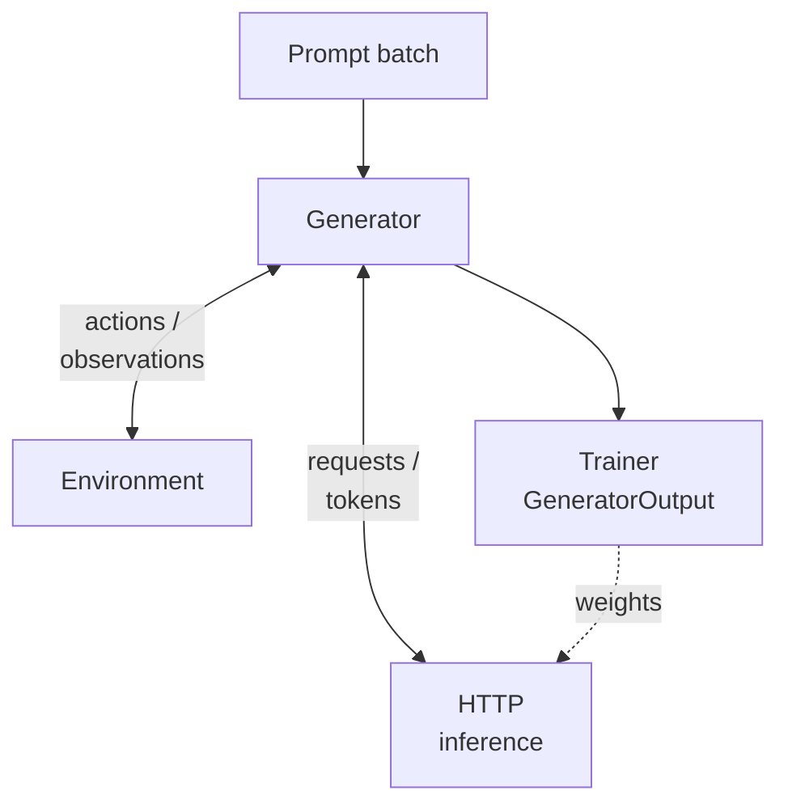
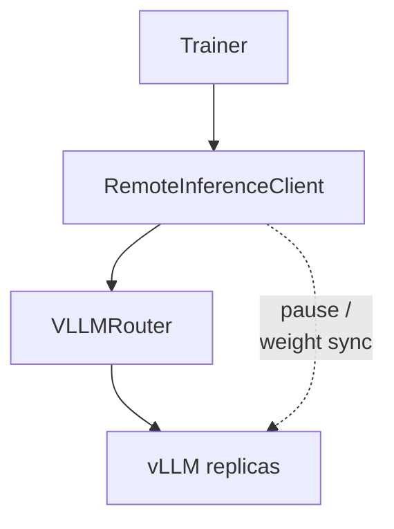

---
{
  "id": "deep-dive-skyrl",
  "title": "Deep Dive - SkyRL",
  "slug": "deep-dive-skyrl",
  "section": "Project Deep Dives",
  "category": "Fine-Tuning & Training",
  "difficulty": "Hard",
  "order": 2,
  "companies": [
    "NovaSky AI",
    "Berkeley Sky Computing Lab",
    "Anyscale",
    "Databricks",
    "NVIDIA",
    "Thinking Machines Lab"
  ],
  "shortDescription": "A SQL repair is still in flight when two replicas load new weights and a third keeps the old ones. SkyRL has to record which policy produced each action.",
  "keyConceptsTested": [
    "Modular RL trainer architecture",
    "Generator and environment interfaces",
    "Synchronous and fully asynchronous RL",
    "Rollout staleness control",
    "HTTP inference and weight synchronization",
    "Tinker-compatible training APIs",
    "Long-horizon agent training",
    "PPO, GRPO, and DAPO tradeoffs",
    "RL operations and failure diagnosis"
  ],
  "prerequisites": [
    "deep-dive-vllm",
    "introduction-to-reinforcement-learning-fundamentals",
    "inference-mechanics-ttft-tps-kv-cache",
    "distributed-training-fsdp-deepspeed-zero"
  ],
  "relatedQuestions": [
    "rlhf-dpo-aligning-language-models",
    "rlvr-verifiable-rewards-training",
    "distributed-training-fsdp-deepspeed-zero",
    "observability-monitoring-llm-systems",
    "model-versioning-continuous-deployment"
  ],
  "coverImage": "illustrations/_generated/skyrl_modular_loop_dark.png"
}
---

A step-12 SQL-repair run can hit this edge condition: a trajectory is still waiting on its database when training finishes an update. Two serving replicas load the new weights. A third answers the next turn with the old ones. The query can still earn a good reward, yet the run no longer knows which model version produced each action.

Follow one trajectory, `query-42_0`, from prompt through generator, environment, trainer, and weight sync. Its token IDs, loss masks, reward, and identity must survive every handoff. Version tracking needs extra care: a scheduled trainer step is recorded for each async group, but that number isn't a per-token record of the weights used during an in-flight update.

The implementation walkthrough is pinned to official SkyRL commit `955c3e23bf8939b28a9d6c424308a762dcb8a2e7`. Its selected source interfaces and living documentation were rechecked September 23, 2026. It uses the unified `skyrl/` package; `skyrl-gym` and `skyrl-agent` remain separate directories. Older `skyrl-train` and `skyrl-tx` recipes use different paths. Match a recipe to its commit before copying commands.[^skyrl2026repo]

## Replaceable interfaces, not one trainer

Suppose `query-42_0` becomes a terminal task tomorrow. Which code should change? The environment may change from SQL execution to shell commands, and the generator may change how it parses turns. Advantage calculation should keep receiving the same trajectory data format. That is the interface to look for before opening a trainer file.

SkyRL names four working seams: trajectory generator, environment, inference engine, and trainer. A controller role also owns placement, initialization, and control flow, although current training control still lives in `trainer.py` while extraction of a standalone controller remains work in progress. Explicit inputs and outputs keep the trainer from knowing every task implementation.[^skyrl2026overview]

This makes an extension local. A Text-to-SQL task adds an environment or generator; it doesn't edit advantage calculation. A local vLLM worker can be replaced by a remote OpenAI-compatible endpoint without moving reward processing. One-step pipelining can become fully asynchronous while the trajectory fields stay recognizable. The schedule and freshness policy change, but the handoff still answers the same ledger questions.

The native trainer includes <span data-glossary="ppo">Proximal Policy Optimization (PPO)</span>, <span data-glossary="grpo">Group Relative Policy Optimization (GRPO)</span>, and several policy-gradient variants. Its documented fully async backends are <span data-glossary="fsdp">Fully Sharded Data Parallel (FSDP)</span> and <span data-glossary="nvidia-megatron">Megatron</span>. The Tinker path also includes <span data-glossary="jax">JAX</span>; backend presence doesn't imply every trainer supports it. HTTP inference uses vLLM API servers plus a router.[^skyrl2026repo][^skyrl2026async]

> **💡 Key insight:** If a seam preserves prompt, token, reward, mask, and version semantics, the implementation behind it can change without changing the learning loop.

## Project identity and lineage

The seams are modular code interfaces, not an org chart. SkyRL is developed at the Berkeley Sky Computing Lab in collaboration with Anyscale. Its repository acknowledges compute support from Databricks, NVIDIA, Lambda Labs, AMD, AWS, Modal, and Daytona. Those acknowledgments explain context. They don't assign every subsystem to every organization.[^skyrl2026repo]

| Field | Current project fact |
| --- | --- |
| Origin | NovaSky AI, a Berkeley Sky Computing Lab initiative, built SkyRL with academic and industry collaborators.[^skyrl2026repo] |
| Founding contributors | SkyRL-v0 and SkyRL-Agent name Shiyi Cao, Dacheng Li, Sumanth Hegde, Richard Liaw, Philipp Moritz, Matei Zaharia, Joseph Gonzalez, Ion Stoica, and collaborators.[^skyrl2026repo][^patil2025skyrlagent] |
| Contributor model | The public development guide documents contributions, tests, environments, generators, algorithms, and trainer changes. Those reviewed pages don't establish a separate TSC or committer charter.[^skyrl2026development] |
| Source license | The repository root uses Apache-2.0.[^skyrl2026license] Package metadata, copied components, and third-party dependencies can carry additional terms, so audit the package you redistribute. |
| Commercial scope | Anyscale and listed compute providers are collaborators or supporters, not owners of every SkyRL component.[^skyrl2026repo] |
| External assets | Training recipes can download external checkpoints and datasets whose licenses aren't replaced by SkyRL's source license. |

The lineage is visible in the repository layout and release notes:

| Lineage piece | What it contributed | Why it still matters |
|---|---|---|
| SkyRL-v0 | Long-horizon, multi-turn tool-use RL for real environments | Establishes the agent-training problem and trajectory shape |
| SkyRL-v0.1 / `skyrl-train` | Modular trainer, placement options, PPO and <span data-glossary="grpo">GRPO</span> | Makes algorithms and execution plans replaceable |
| SkyRL-Gym | <span data-glossary="gymnasium-environment">Gymnasium-style</span> math, coding, search, and <span data-glossary="sql">SQL</span> environments | Gives task authors a small environment interface |
| SkyRL tx | Tinker-compatible backend for local hardware | Separates a user-facing training API from engine placement |
| SkyRL-Agent | Agent tasks, tools, async dispatch, and backend adapters | Moves long-horizon loops into a reusable agent layer |
| Harbor integration | Terminal-use environments wired into the trainer | Shows the environment seam can absorb an external harness |
| `skyrl/` | Unified package for training, inference, and Tinker paths | Reduces split-brain documentation during reorganization |

The project also credits ideas and code from veRL, OpenRLHF, Search-R1, OpenReasonerZero, and NeMo-RL. That lineage maps the ecosystem. It doesn't make SkyRL a drop-in replacement for any one project, and it doesn't say what the trainer still needs after two SQL turns.[^skyrl2026repo]

## Generator, environment, trainer

Return to `query-42_0`. Before naming classes, predict what the trainer needs after two SQL turns: the sampled response, the database observation, the reward, and a way to distinguish trainable tokens from context. If that record is complete, the optimizer can stay unaware of whether the environment is SQL, a terminal, or a browser.

A controller role sets up execution. A Generator coordinates inference and environments to produce trajectories. A Trainer turns those trajectories into <span data-glossary="gradient">gradients</span>. Current control flow remains in `trainer.py`, while InferenceEngine and Environment stay replaceable subsystems inside the Generator.

The loop isn't "model in, loss out." A multi-turn trajectory can include token IDs, tool calls, observations, rewards, per-token masks, and a stop reason. Those fields carry the decision from environment execution into optimization. Without them, a trainer can apply loss to an observation, credit a failed tool call as success, or join a retry to the wrong episode.

### Vocabulary at the seams

The table is a decoder ring for the code. Read `Rollout` as the artifact being handed forward, and read the final column as the bug that appears when one interface silently changes its meaning.

| Term | Meaning here | Failure if misunderstood |
|---|---|---|
| Rollout | One model interaction or multi-turn trajectory collected from an environment | Treating a partial turn as a complete training example |
| Generator | Component that turns prompts and environment configuration into trajectories | Putting task-specific loops inside the trainer |
| Environment | <span data-glossary="state-machine">State machine</span> that consumes actions and emits observations, reward, and termination | Accepting unverified model-written scores |
| Inference engine | Runtime that samples tokens and often returns log probabilities | Assuming the training model and sampler always share weights |
| Training input | Tokenized prompt, response, masks, rewards, advantages, and metadata used by optimization | Applying loss to tool or padding tokens by accident |
| Staleness | Difference between <span data-glossary="rollout">rollout</span> scheduling step and consumption step | Optimizing on data generated by a policy far in the past |
| Weight sync | Transfer of updated policy parameters to inference workers | Sampling with an old policy while labeling it on-policy |

`GeneratorInput` includes prompts, environment classes, optional environment extras, sampling parameters, trajectory IDs, and batch metadata. `GeneratorOutput` returns batched prompt and response token IDs, rewards, loss masks, stop reasons, rollout metrics, optional log probabilities, trajectory IDs, and timing splits. It also includes step-wise completion flags and vision <span data-glossary="tensor">tensors</span>. `TypedDict` describes the interface for type checkers; it doesn't validate a custom generator's arrays at runtime.[^skyrlPinnedGenerator2026]

Here `Optional[...]` means a field's **value** may be `None`; it doesn't make that key optional. The pinned `TypedDict` uses required keys. A real extension must populate its declared fields, using `None` where appropriate, as well as preserve array alignment.[^skyrlPinnedGenerator2026]

### The architecture in one request

The same handoff must work for a one-turn math answer and a long tool-use task. A generator may call an environment many times before returning one output, but the trainer still receives one normalized object. That normalization is what lets us reuse the rest of the route for `query-42_0`.



The two feedback paths have different jobs: inference samples actions, while the environment executes them and returns observations. The trainer receives completed records rather than raw tool traffic. Zero-<span data-glossary="variance">variance</span> rewards, broken tools, stale groups, and failed transfers need separate handling across those components.

```checkpoint
Why does SkyRL put `loss_masks` in `GeneratorOutput` instead of asking the trainer to infer them from text?
---
The generator knows which tokens are model actions, tool arguments, observations, or padding. Carrying an explicit mask prevents the trainer from learning from tokens that should be context only, especially in multi-turn or step-wise trajectories.
```

## A concrete trajectory

Now follow the ledger instead of the class diagram. The prompt is: "List active customers with more than three unresolved incidents." The generator asks for a SQL action, sends it to a <span data-glossary="sandbox">sandboxed</span> database environment, appends either an error or rows as an observation, and gives the model another turn to repair its query. The environment supplies evidence; the loss mask decides which tokens can move the policy.

Call this trajectory `query-42_0`. Should the database error receive policy loss? No: it's context, not a sampled action. To keep the alignment visible, use a toy vocabulary with two tokens for an attempted query, one observation token, and two tokens for its repair. These IDs don't come from a real tokenizer, and the labels aren't executable SQL. This reduced view shows one row of a batched output; other declared fields are omitted for legibility, so it isn't a complete typed return object:

| Field | Example | Why trainer needs it |
|---|---|---|
| `prompt_token_ids` | `[[101, 921, 3321]]` | Keep the prompt separate from the response |
| `response_ids` | `[[11, 12, 90, 21, 22]]` | Preserve actions **and** intermediate observations |
| `rewards` | `[[0, -0.2, 0, 0, 1.0]]` | Place each turn's reward at its final action token |
| `loss_masks` | `[[1, 1, 0, 1, 1]]` | Exclude the observation from the policy-loss objective |
| `stop_reasons` | `["stop"]` | Store one final reason per output row |
| `trajectory_ids` | `[TrajectoryID("query-42", 0)]` | Render as `query-42_0` for log joins |

The reward field accepts either one scalar per trajectory or one reward per response token. It isn't an arbitrary list of turn rewards: the default multi-turn generator stamps each turn reward onto the corresponding final action token. Here the total is `0.8`; aggregation and advantage estimation decide how that return influences the sampled actions.[^skyrlPinnedGenerator2026][^skyrlPinnedGym2026]

<figure>

<figcaption>Arrays align to response positions, including the observation. Reward is stamped at each action turn's end. Mask 0 removes the observation's direct policy-loss term, but later actions still attend to it.</figcaption>
</figure>

The IDs and masks aren't decoration. `SkyRLGymGenerator` enforces <span data-glossary="ti-to">token-in-token-out</span> in its default multi-turn path: it appends sampled token IDs, appends tokenized observations with mask 0, then samples again. If you retokenize the whole chat from strings, token boundaries can change after the sampler has finished. Training then sees a different sequence from the one that earned the reward.[^skyrl2026gymgenerator]

A multi-turn batch can flatten several conversations. Step-wise training can return one turn at a time and mark whether an episode is complete. Keep those distinctions attached to each row, or a retry and its reward can be joined to the wrong turn.

The toy row below checks alignment and computes the masked mean negative log probability for sampled actions. GRPO training adds group-relative advantages and clipped policy-ratio terms; this alignment check leaves those terms out. Changing the observation's assigned score doesn't change this objective, while changing a sampled action's score does.

<!-- leetllm: test output=show output_title="Response-mask filtering" deps=numpy -->
```python title="skyrl_response_mask.py"
import numpy as np

token_ids = np.array([11, 12, 90, 21, 22], dtype=np.int64)
masks = np.array([1, 1, 0, 1, 1], dtype=np.float32)
rewards = np.array([0.0, -0.2, 0.0, 0.0, 1.0], dtype=np.float32)


def masked_nll(logprobs: np.ndarray, mask: np.ndarray) -> float:
    """Compute mean negative log-probability over active response tokens."""
    active_weights = mask.astype(bool)
    active_logprobs = logprobs[active_weights]
    return float(-np.mean(active_logprobs))


logprobs = np.array([-0.2, -0.4, 0.0, -0.6, -0.8], dtype=np.float32)
baseline = masked_nll(logprobs, masks)

# Observation tokens are masked out: modifying them does not affect loss
modified_observation = logprobs.copy()
modified_observation[2] = -99.0
assert np.isclose(masked_nll(modified_observation, masks), baseline)

# Action token modification changes the training objective
modified_action = logprobs.copy()
modified_action[4] = -1.2
assert np.isclose(masked_nll(modified_action, masks), 0.60)

trainable_tokens = int(np.sum(masks))
total_reward = float(np.sum(rewards))
print(f"trainable_tokens={trainable_tokens} total_reward={total_reward:.1f} masked_nll={baseline:.2f}")
```

<!-- leetllm: output:start -->
```text title="Response-mask filtering" output compact
trainable_tokens=4 total_reward=0.8 masked_nll=0.50
```
<!-- leetllm: output:end -->

Masking the observation's loss doesn't remove it from attention or prevent gradients from depending on its context. The check changes an assigned score, not the observation tokens fed to a real model.

## Read the main code paths

With the artifact in hand, code reading has an order. Start at `skyrl/train/trainer.py`, then follow the generator interface and the environment adapter. The trainer initializes weight-sync state, prepares the sampler, optionally evaluates, and requests a batch. Each next operation consumes the previous operation's output, so a missing field is easier to locate at the handoff where it disappears.

The generator interface lives in `skyrl/train/generators/base.py`. Its abstract method is asynchronous even for a synchronous RL schedule. A browser, remote verifier, or tool process can be waiting while the generator yields control. A custom generator has one required method, `generate()`, and returns output in input order. That order is another part of the ledger: IDs and rewards must still line up when the batch comes back.

The environment path stays outside the trainer. `SkyRLGymGenerator` adapts <span data-glossary="gymnasium-environment">Gymnasium-style tasks</span>, while examples also integrate verifiers, OpenEnv, Harbor, and Terminal-Bench. The agent layer adds another adapter for long-horizon loops. A new task therefore changes the edge that executes actions and computes reward, while the core still consumes the same output schema.

### The trainer's order of operations

Read the regular loop as three handoffs.

First, prompts and sampling parameters enter the generator; trajectories come back with rewards, masks, IDs, and any timing metadata. Dynamic sampling and step-wise merging then decide which complete records reach the trainer.

Second, SkyRL converts those records into training input and computes current log probabilities, values when a critic is configured, advantages, and returns. Only then do policy and optional critic workers update.

Finally, checkpoints and evaluation produce evidence, and weight sync publishes the resulting policy to the next sampling window.

In the synchronous schedule, the batch's environment interactions finish before optimization, and weight sync completes before the next batch starts. Fully async deliberately relaxes that ordering: other groups can still be interacting with environments while this batch trains. Neither schedule replaces sandbox isolation, correct token alignment, or explicit version logging.

## Synchronous RL: the reference schedule

Start with a schedule that separates sampling from updates. Generate a batch with policy version $\pi_k$, wait for every response and reward, update to $\pi_{k+1}$, then send that version to the sampler. The next batch starts only after every sampler crosses the sync barrier. For `query-42_0`, the whole SQL repair finishes before weights change. A partial or unverified transfer can still break this invariant, even in synchronous mode.

Why keep this slower baseline? It gives policy-gradient math a clean reference. For a response $y$ sampled from prompt $x$, the trainer uses an objective of the form:

$$
L(\theta) = -\mathbb{E}_{(x,y) \sim \pi_k}\left[A(x,y) \log \pi_\theta(y \mid x)\right],
$$

where $A(x,y)$ is an advantage estimate. Minimizing this objective encourages higher probability for positive-advantage actions and lower probability for negative-advantage actions. Shared parameters couple updates across actions and samples, so an individual action's probability can move either way. <span data-glossary="ppo">PPO</span> clips the probability-ratio objective to limit incentives for large changes. The resulting policy can still move beyond the clip range because clipping does not constrain every final probability ratio.

GRPO replaces a learned value baseline with relative scores within a group of samples for the same prompt. Identical rewards give zero centered reward advantage. An enabled KL penalty or another auxiliary term can still contribute gradients, so zero reward variance doesn't universally mean zero optimizer update.

Some recipes also divide by the group standard deviation; the tiny example below uses mean centering only, matching the Dr. GRPO-style optional skip.

### What synchronous training buys

Use this table as a baseline for the async choices that follow. Each benefit comes from waiting at one visible synchronization point; each cost is the idle time that waiting introduces.

| Property | Synchronous behavior | Practical consequence |
|---|---|---|
| Policy freshness | Batch is sampled before one update | Easier on-policy reasoning |
| Debugging | Clear start and end for each step | Replay logs by global step |
| Hardware use | Trainer or sampler may wait | Idle <span data-glossary="gpu">GPU</span> time on long tools |
| Failure isolation | Step fails as one unit | Simpler retry, slower recovery |
| Metric interpretation | Throughput per completed batch | Easier baseline for async comparisons |

The cost appears when tools are slow or trajectories have uneven lengths. One browser task can hold an entire step open while other GPUs wait. Synchronous mode is still the right first implementation for a new environment: it limits moving parts and gives you a trustworthy reward, mask, and version baseline before overlap enters the picture.

```checkpoint
You add a browser environment and the first synchronous run sometimes gives a reward of zero for every sample. What should you inspect before changing the optimizer?
---
Inspect environment termination, reward calculation, and generated action parsing first. A zero-variance group produces no useful relative signal in GRPO, and a malformed tool action can make every sample look equally wrong even when the policy is improving.
```

## One-step async and fully async

The baseline exposes the tension: waiting protects freshness but lets a straggler idle the cluster. Suppose three SQL repairs finish in four seconds and `query-42_0` needs forty. One-step off-policy pipelining can generate the next batch while the current one trains, but a slow generation batch still stalls its own handoff. Fully asynchronous training goes further: generation workers keep producing groups in a bounded buffer, and after each trainer step the inference client pauses in-flight requests, syncs weights, and resumes those trajectories.[^skyrl2026async]

That distinction predicts the debugging surface. One-step overlap adds a pipeline stage. Fully async adds a freshness budget, queue-capacity control, pause/resume around weight sync, and metrics that tell you how old each group was when consumed. A throughput gain without those measurements leaves the opening incident hidden.

The fully async implementation lives in `fully_async_trainer.py`. It creates one `asyncio.Task` per generation worker, places completed groups in an `asyncio.Queue`, and uses an `AsyncStalenessManager` to limit producer capacity. Here a GRPO group is `n_samples_per_prompt` trajectories for one prompt. Control stays within an epoch: SkyRL doesn't run generation from epoch $t+1$ while epoch $t$ is still training.[^skyrl2026async]

<figure>

<figcaption>This legal counter trace has no wall-clock speedup claim. L stays running while three short groups train. At consumption step 4 its scheduling lag is 3, even though outstanding work never exceeds B(S+1)=3.</figcaption>
</figure>

### Staleness as a budget

`max_staleness_steps` limits the aggregate queue budget; individual trajectories can exceed that value. Let $s_i$ be the trainer's current global step when group $i$ is consumed and $g_i$ be the step when generation was scheduled. SkyRL records:

$$
\operatorname{staleness}_i = s_i - g_i.
$$

If `query-42_0` starts at step 1 and reaches the trainer at step 4, its staleness is 3. The staleness controller isn't a rule that drops every group whose number exceeds $S$. With mini-batch size $B$ and `max_staleness_steps` $S$, at global step $s$ it keeps

$$
\text{accepted} + \text{running} \le (S + s)\,B.
$$

`accepted` is cumulative across training: it includes completed groups and the current queue. At the start of step $s$, completed training has consumed $(s-1)B$ groups. Subtracting that count leaves at most $B(S+1)$ groups buffered or running. A separate worker-concurrency bound can reduce scheduling further. With $S=0$, only the current mini-batch fits, so generation can't get ahead of its update.[^skyrlPinnedAsync2026]

Scheduling lag also differs from exact policy lineage. A long trajectory can resume under new weights several times. Its recorded start step doesn't identify the behavior policy for every token; preserve rollout log probabilities and log weight update timestamps when interpreting correction ratios.

The inequality is aggregate. With `max_staleness_steps = 2`, a long `query-42_0` group can still arrive with staleness 3. Current behavior accepts it and logs a warning. Track the full lag distribution alongside submitted, running, accepted, and filtered counts. Frequent high-lag groups point to a producer outrunning the consumer or generation latency with a long tail.

That budget comes with configuration constraints. The guide at the pinned revision limits fully async to generators that talk to `/chat/completions`. `generator.batched` must be false, dynamic sampling must be disabled, `train_batch_size` must equal `policy_mini_batch_size`, and colocation of all training and inference workers isn't supported. The pinned trainer checks dynamic sampling against Python `None`; use YAML `null` in the sketch below.[^skyrlPinnedAsync2026]

Instead of synchronous `dynamic_sampling`, fully async offers `sample_full_batch` with zero-variance filtering. A dropped group moves from `accepted` to `filtered`, freeing queue capacity. The invariant is `submitted = accepted + filtered + running`. Without that reclassification, filtered groups could fill the capacity limit and block producers forever.[^skyrlPinnedAsync2026]

Filtering changes the sample population and consumes extra prompts. If the epoch runs out before a full useful mini-batch exists, the partial batch is discarded and the epoch ends early. Trained and filtered prompt IDs are both persisted and skipped on resume. Count them separately; an all-zero-reward dataset cannot produce a useful batch under this filter.[^skyrlPinnedAsync2026]

The filter compares the reward spread among live trajectories, meaning rows with nonzero loss masks, using a configurable tolerance. Groups with at most one live trajectory are retained by this helper; inspect sample counts and masks to confirm the accepted group contains comparative reward signal.

```checkpoint
Why is "more generation workers" not an unconditional fix for a slow fully async run?
---
More workers can fill the buffer faster, but they can also push staleness beyond the budget, increase memory pressure, and make policy updates consume older data. Tune worker count together with mini-batch size, `max_staleness_steps`, queue capacity, and measured generation latency. Official docs also cap useful workers at `policy_mini_batch_size * (max_staleness_steps + 1)`.
```

### AReaL, DAPO, and off-policy correction

The systems question is now explicit: can language-model RL keep GPUs busy without letting policy lag erase the training signal? AReaL frames the same trade-off around in-flight generation, workload balance, and staleness control. SkyRL's manager follows that vocabulary, while its own queue and acceptance behavior still need to be read from the local revision.[^mei2025areal]

DAPO supplies a second comparison. Its open system makes dynamic sampling and token-level policy-gradient choices part of the algorithm. SkyRL's `sample_full_batch` path is an async-native analogue of filter sampling. Establish experimental parity by comparing filtering, reward normalization, rollout policy versions, and evaluation protocol.[^yu2025dapo]

Staleness isn't the only source of off-policy behavior. Training and inference can disagree at one nominal weight version because kernels, expert routing, or parallelism differ. SkyRL's correction stack offers truncated <span data-glossary="importance-sampling">importance sampling</span>, geometric sequence masking, token masking, and <span data-glossary="mixture-of-experts">mixture-of-experts (MoE)</span> routing replay. These controls address residual mismatch; they don't turn an unbounded queue into fresh data.[^skyrl2026offpolicy]

Use papers as design evidence, then trace the local code that realizes each assumption. A queue can overlap work. Only the lag distribution, reward diversity, and held-out curve can show whether that overlap still produces learnable batches.

## Inference and weight synchronization

The opening incident ends at the sampler. After the trainer creates $\pi_{12}$, which process receives it, and which process keeps serving $\pi_{11}$ if the transfer is partial? SkyRL separates training and sampling because their hardware and runtimes differ.

The training path commonly uses <span data-glossary="fsdp">FSDP</span> or Megatron, with JAX available through the Tinker path; generation typically reaches vLLM over HTTP. Training and generation can be colocated on one GPU set or disaggregated across workers.[^skyrl2026inference][^skyrl2026tinker]

The pinned commit's Linux FSDP and Megatron extras require `vllm==0.28.0`. Replacing the sampler with today's latest server is a compatibility change: v0.30.0, for example, changed scale-out route registration. Check the recipe's server/router dependencies and actual generation **and control** endpoints before combining versions. An OpenAI-compatible chat response doesn't demonstrate pause/resume or weight-transfer support.[^skyrlPinnedDependencies2026][^vllm2026release0300]

The official inference architecture separates ordinary token traffic from calls on the <span data-glossary="control-plane">control plane</span>. Data-plane requests need routing; control-plane calls need to reach every replica. Three pieces carry those jobs:

| Piece | Role | Plane |
|---|---|---|
| `RemoteInferenceClient` | Single HTTP entry point for trainers | Both |
| `VLLMRouter` | Session-aware load balancer, often wrapping `vllm-router` | Data |
| vLLM API servers | One replica per engine | Data plus fan-out control |

Generation requests travel through `proxy_url`: `/v1/chat/completions`, `/v1/completions`, tokenize, and related routes. Pause, resume, sleep, wake, and weight-sync endpoints fan out to every `server_url`. Built-in generators pass the trajectory ID as `X-Session-ID`, so later turns of `query-42_0` stay on one replica and can reuse its prefix cache. `sticky_least_loaded` is the documented policy for long multi-turn work: the first turn chooses the least-loaded replica, and later turns stay there.[^skyrl2026inference]



Weight synchronization is where "on-policy" becomes an operational claim. In non-colocated mode, SkyRL pauses with `/pause?mode=keep`, freezes in-flight rollouts with KV state preserved, broadcasts tensors over <span data-glossary="nccl">NCCL</span> from trainer rank 0, then resumes.

Current inference docs spell out a four-stage transfer: `/init_weight_transfer_engine`, `/start_weight_update`, chunked `/update_weights`, then `/finish_weight_update`. Sending a chunk is different from finishing the update; keep generation paused until the selected protocol completes. At the pinned revision, the remote client implements start, chunk transfer, and finish through `/collective_rpc` worker methods rather than calling all of those native endpoint paths directly. Verify that adapter and server combination.[^skyrl2026inference]

In colocated mode it uses CUDA IPC handles plus `/sleep` and `/wake_up` so the inference engine can free VRAM during the train step. Project lineage and older docs also describe Gloo and checkpoint-and-load paths; verify the strategy at the revision you deploy. No path removes the need to record policy versions.[^skyrl2026inference]

The current inference guide also documents `delta` transfers through a shared filesystem or object store and `sharded_rdt` transfers pulled through NIXL/RDMA. These have different storage and network requirements from NCCL and IPC. Select and test the backend your deployment actually constructs.[^skyrl2026inference]

Fully async adds a KV-cache decision. `clear_kv_cache_on_weight_sync` defaults to false, so a resumed trajectory can retain KV state computed with older weights. `generator.use_cache_salt` separates prefix-cache reuse across versioned requests; it doesn't make an already-running trajectory fresh. Clearing KV state forces recomputation, but previously sampled actions and buffered groups remain off-policy. It doesn't restore the synchronous sampling schedule.[^skyrl2026async]

### A sync failure path

Return to step 12. One replica still serves step 11 weights, so routing can give the next group a mixed policy version. Treat that as an evidence problem first, not as a reward problem. A safe recovery sequence is:

1. Pause new generation if the endpoint supports it.
2. Record trainer step and sampler version for every replica.
3. Check transfer logs and replica health.
4. Retry or <span data-glossary="rollback">roll back</span> the sync operation.
5. Resume only when all replicas report the expected version.

This operational acceptance protocol records the client counter as one signal. Collect sampler-side version evidence for every replica when the client view lacks that coverage. Quarantine a replica with uncertain weights until its sampling probabilities are known. Validate the full update state after the RPC succeeds.

```checkpoint
What evidence proves that a weight sync worked?
---
A successful RPC is not enough. Check the expected policy version on every serving replica, observe a post-sync request, confirm no in-flight request crossed an invalid pause state, and compare sync duration and generation error metrics with the release budget.
```

## Tinker: a stable API over changing hardware

What if the experiment should keep its training calls while the hardware changes underneath? Tinker is a training API from Thinking Machines Lab that presents training and sampling through a service-like interface. SkyRL implements a Tinker-compatible backend so the same style of program can run on local hardware. The unified package carries that work under `skyrl`; the old `skyrl-tx` directory records the migration.[^skyrl2026tinker]

The official architecture divides the service into three layers:

| Layer | Responsibility | Invariant to verify |
|---|---|---|
| API (`skyrl.tinker.api`) | FastAPI server, request persistence, future IDs | Auth, request identity, and <span data-glossary="backpressure">backpressure</span> |
| Engine (`skyrl.tinker.engine`) | Background process that polls, batches, and dispatches | Version and lifecycle state |
| Backend (`skyrl.backends`) | FSDP, Megatron, or JAX plus vLLM sampling | Tensor shapes, optimizer semantics, and weight sync |

The lifecycle is easy to test with one update. A user submits an operation and receives a future-like handle. Training calls (`forward_backward`, `optim_step`, `forward`) travel through the engine to GPU workers, while sampling wraps `RemoteInferenceClient`.

After `optim_step`, the client must call `save_weights_for_sampler()` before the next sample if it wants the new policy. Persistent mode also writes a Hugging Face checkpoint; ephemeral mode syncs weights and returns a sampling client without the disk write, which suits a hot RL loop that syncs every batch.[^skyrl2026tinker]

Use `save_weights_and_get_sampling_client()` for that ephemeral path. A persistent **sampler** export still isn't the full training-resume artifact: `save_checkpoint()` preserves model weights, optimizer state, and the learning-rate scheduler. Complete the corresponding operation before relying on its result.[^skyrl2026tinker]

```checkpoint
The machine disappears after you export sampler weights, but before saving a full training checkpoint. Can you resume the same optimizer trajectory from that export alone?
---
No. The export preserves sampling weights, not the optimizer and scheduler state required for training continuation. Use a completed full checkpoint and verify a restore round trip. In fully async training, also check the trained/filtered prompt-ID resume semantics described below; an in-flight queue isn't restored as saved training progress.
```

The Tinker architecture guide lists `cross_entropy` and `importance_sampling` as validated API losses, but its conversion warning lags the pinned code. The pinned engine carries sampling log probabilities and advantages; the SkyRL-Train backend inserts those fields into training batches and normalizes public PPO/GSPO requests. The JAX loss implementation separately defines cross-entropy, importance sampling, PPO, and CISPO. API acceptance, a backend implementation, and a validated end-to-end recipe are different evidence. Check the selected backend's converted batch, required fields, and an executed update before porting a native-trainer recipe.[^skyrl2026tinker] The inspected paths are [the pinned engine](https://github.com/NovaSky-AI/SkyRL/blob/955c3e23bf8939b28a9d6c424308a762dcb8a2e7/skyrl/tinker/engine.py), [SkyRL-Train backend](https://github.com/NovaSky-AI/SkyRL/blob/955c3e23bf8939b28a9d6c424308a762dcb8a2e7/skyrl/backends/skyrl_train_backend.py), and [JAX loss functions](https://github.com/NovaSky-AI/SkyRL/blob/955c3e23bf8939b28a9d6c424308a762dcb8a2e7/skyrl/tinker/loss_fns.py).

The interface surface can drift. Backend-specific loss support, normalization, checkpoint formats, and model constraints still need integration tests. Don't infer API compatibility merely from a shared loss name. Pin the SkyRL commit, SDK, backend versions, tokenizer, and recipe configuration before comparing runs.

## SkyRL-Agent: long-horizon work belongs above the trainer

The same ledger gets longer for SWE (software-engineering) agents, web researchers, and terminal users. One episode may make many tool calls, carry state across turns, and fail because a test, shell, or network service broke. SkyRL-Agent puts task logic, tools, dispatch strategies, and training-backend adapters above the trainer. It can connect to OpenAI-compatible serving such as vLLM, veRL, SkyRL-Train, or Tinker through configuration.[^patil2025skyrlagent]

The paper's systems claim is specific. An optimized asynchronous pipeline dispatcher reported a $1.55\times$ speedup over naive asynchronous batching by overlapping CPU-bound tool work with GPU generation.

Using that stack, the authors trained SA-SWE-32B from Qwen3-32B with pure RL. The paper reports the base at 24.4% Pass@1 and SA-SWE-32B at 39.4% Pass@1 on SWE-Bench Verified, under a simplified ReAct loop with file-editor and bash tools, 40k context, and 100 max steps. That's a dated paper snapshot, not a live leaderboard. Copy the protocol before comparing the numbers.[^patil2025skyrlagent]

The agent layer keeps environment-specific logic close to the task. Browser tools return page observations, code-execution tools return stdout and process status, and finish tools mark episodes complete. The dispatcher can run work asynchronously, while the training backend consumes a normalized trajectory. That division makes a failed test diagnosable without pretending it was a bad gradient.

### Application map

| Application | Environment signal | Key SkyRL subsystem |
|---|---|---|
| Math and reasoning | Verifier result or exact answer | Group rewards and zero-variance filtering |
| Text-to-SQL | Query execution, schema checks, answer match | Multi-turn generator and loss masks |
| Search and research | Retrieved evidence and citation checks | Tool observations and trajectory logging |
| SWE-Bench or Terminal-Bench | Tests, patch status, process exit | Sandbox environment, timeout, terminal agent |
| Browser tasks | DOM (Document Object Model) or visual observation, action success | Async tool calls and bounded episode state |
| Memory agents | Recall and write decisions across turns | Step-wise trajectories and episode completion |

The same library can support all six, but the reward definition isn't interchangeable. SQL execution may yield an exact reward; research agents may combine evidence coverage, citation validity, and answer quality; terminal tasks may depend on flaky or expensive tests. Keep those semantics documented next to the environment.

## A worked policy update

For a separate binary-reward SQL experiment, sample two queries for the same prompt. A frozen result checker gives the correct query reward 1 and the incorrect query reward 0. Their mean is $0.5$, giving centered advantages $+0.5$ and $-0.5$. This binary reward deliberately differs from the earlier shaped turn rewards. Choose the reward formulation for the experiment and document how it maps into advantages and loss masks.

With $y_+$ denoting the correct query and $y_-$ the incorrect one, the simplified loss encourages that change:

$$
L = -\frac{1}{2}\left[(+0.5)\log \pi_\theta(y_+\mid x) + (-0.5)\log \pi_\theta(y_-\mid x)\right].
$$

That equation hides three implementation details:

1. The group must contain comparable samples for the same prompt.
2. The reward must be aligned with the environment's true success condition.
3. The loss mask must identify the response tokens that policy optimization should change.

If both responses receive reward 1, the relative advantages are zero. That can mean an easy prompt or a broken evaluator. Inspect which case applies before changing the <span data-glossary="learning-rate">learning rate</span>; more samples don't repair a checker that always returns success.

The standard-library example checks mean-centered rewards and the exact counter trace in the figure. It's a small arithmetic model, not a SkyRL training run. Each row is taken just before consumption; accepted counts include groups used by earlier updates.

<!-- leetllm: test output=show output_title="GRPO group and staleness trace" deps=numpy -->
```python title="skyrl_group_and_staleness.py"
import numpy as np


def compute_group_advantages(rewards: np.ndarray) -> tuple[np.ndarray, bool]:
    """Compute mean-centered group relative advantages and detect zero-variance."""
    baseline = np.mean(rewards)
    advantages = rewards - baseline
    zero_variance = bool(np.allclose(advantages, 0.0))
    return advantages, zero_variance


sql_group = np.array([1.0, 0.0, 1.0, 0.0], dtype=np.float32)
advantages, zero_variance = compute_group_advantages(sql_group)
assert np.allclose(advantages, [0.5, -0.5, 0.5, -0.5])
assert not zero_variance

uniform_group = np.ones(4, dtype=np.float32)
_, is_uniform = compute_group_advantages(uniform_group)
assert is_uniform

print("advantages", [round(float(x), 1) for x in advantages])

# (step, consumed group, scheduled step, accepted, running)
trace = [
    (1, "A", 1, 2, 1),
    (2, "B", 1, 3, 1),
    (3, "C", 2, 3, 1),
    (4, "L", 1, 4, 0),
]
B, S = 1, 2
for step, group, scheduled, accepted, running in trace:
    consumed = (step - 1) * B
    outstanding = accepted - consumed + running
    assert accepted + running <= (S + step) * B
    assert 0 <= outstanding <= B * (S + 1)
    lag = step - scheduled
    print(f"step={step} group={group} lag={lag} outstanding={outstanding}")
```

<!-- leetllm: output:start -->
```text title="GRPO group and staleness trace" output compact
advantages [0.5, -0.5, 0.5, -0.5]
step=1 group=A lag=0 outstanding=3
step=2 group=B lag=1 outstanding=3
step=3 group=C lag=1 outstanding=2
step=4 group=L lag=3 outstanding=1
```
<!-- leetllm: output:end -->

The long group L violates the nominal two-step lag budget without violating aggregate capacity. The horizontal axis counts consumption steps. Measure throughput and lag under load to estimate performance for this schedule.

The configuration sketch below exposes the decisions without pretending to be a complete launch recipe. It uses names from SkyRL's documented config model.

```yaml title="skyrl-rl-config.yaml"
trainer:
  train_batch_size: 1
  policy_mini_batch_size: 1
  algorithm:
    advantage_estimator: grpo
    policy_loss_type: rollout_is
    zero_variance_filter: true
    dynamic_sampling:
      type: null
  placement:
    colocate_all: false
  fully_async:
    enabled: true
    max_staleness_steps: 2
    num_parallel_generation_workers: 3
    sample_full_batch: true
    clear_kv_cache_on_weight_sync: false
generator:
  batched: false
  n_samples_per_prompt: 4
  use_cache_salt: true
  inference_engine:
    backend: vllm
environment:
  env_class: text2sql
```

Use the `FullyAsyncRayPPOTrainer` entrypoint and a revision-matched HTTP generator. `rollout_is` uses behavior-policy log probabilities; configure the generator to return them. YAML `null` becomes Python `None`, unlike the literal string `none` still shown in some documentation. This sketch omits the model, tokenizer, dataset, placement, and <span data-glossary="cuda">CUDA</span> environment, so it isn't a launchable configuration.[^skyrlPinnedAsync2026][^skyrl2026async]

### Check the pinned implementation without a GPU

The downloadable [verification script](assets/verify_pinned_contracts.py) checks the upstream source bytes against fixed SHA-256 hashes, then executes only the reviewed scheduling classes, buffer-drain method, and reward-stamping method. It avoids the GPU-dependent module imports. Run it from the article directory; `--fetch` downloads the two public source files into a temporary source directory.

```bash title="verify_pinned_skyrl_components.sh"
uv run assets/verify_pinned_contracts.py --fetch
```

The [recorded CPU test log](assets/cpu_contract_receipt.json) contains eight passing checks, including a blocked producer released by filtering, epoch accounting, checkpoint capacity restoration, the long-group trace, buffer exhaustion, and reward truncation/EOS branches. Those are executed method checks, not a full upstream test-suite pass. A custom chat-template branch returns the final scalar reward instead of the per-token vector, so a generator extension must test its selected path.[^skyrlPinnedGym2026]

No CUDA model, Ray cluster, vLLM HTTP server, real SQL environment, weight transfer, or learning curve was executed for this review. The simulated trainer still needs inference endpoints and skips actual optimization and broadcast, so distributed updates remain untested. Before a real experiment, run the revision's small synchronous recipe, verify a save/resume round trip, then compare async against that baseline at equal evaluated prompts and GPU-hours.

## Strengths and weaknesses

A component count doesn't say whether `query-42_0` stayed aligned. A run does. The first table asks what each seam buys. The evidence column names the measurement that can confirm it.

### Strengths

| Strength | Why it matters | Evidence to collect |
|---|---|---|
| Modular trainer | New algorithms and execution plans avoid task rewrites | Generator and backend diffs stay local |
| Real environment loop | Rewards can come from tests, SQL execution, or tools | Replayable observations and verifier output |
| Multiple placement modes | Colocated and disaggregated training fit different hardware | GPU map, sync latency, and queue metrics |
| Async support | Long tool calls can run without idling every worker | Throughput plus staleness distribution |
| HTTP inference split | Routing and weight sync can be debugged separately | Session stickiness, pause mode, replica versions |
| Tinker compatibility | Recipes can target a stable API over local hardware | API call trace and checkpoint resume |
| Agent layer | Long-horizon tools and backends share a dispatcher interface | Per-tool latency, episode completion, <span data-glossary="evaluation-slice">failure slices</span> |
| Inspectable config | Configuration and interfaces expose decisions | Small experiment diff and reproducible config |

The useful sequence is incremental: start with synchronous GRPO, add a custom generator, then test async generation while preserving output fields. Each experiment changes one subsystem at a time, so an ablation can point to a seam instead of a pile of infrastructure changes.

### Weaknesses and sharp edges

| Weakness | Why it bites | <span data-glossary="guardrail">Guardrail</span> |
|---|---|---|
| Many moving services | Ray, inference servers, environments, trackers, and storage can fail independently | Health checks, versioned configs, and run manifests |
| Async freshness risk | Fast generation can outrun training and produce stale groups | Cap buffer, measure the lag distribution, alert on sustained drift |
| Backend divergence | FSDP, Megatron, JAX, and vLLM differ in kernels and numerics | Test one backend path end to end before comparing; watch logprob diffs |
| Reward quality dominates | A fast trainer optimizes a bad verifier faster | Frozen evaluator slices and reward audits |
| Reorganization churn | `skyrl-train` and `skyrl-tx` paths moved into `skyrl/` | Pin commits and follow official migration notes |
| Heavy environment setup | GPU, CUDA, Ray, and model artifacts are expensive | Use the simulated fully async trainer or a small smoke environment first |
| Unsupported combinations | Fully async rejects batched generate, colocation, and sync dynamic sampling | Read config validation errors before changing code |

These edges define the readiness criteria for a serious RL experiment: <span data-glossary="reproducible-environment">reproducible environment</span> state, traceable policy versions, bounded queues, and an explicit stop when rewards or sync health become untrustworthy. The operator section turns that bar into evidence you can collect before burning more GPU hours.

## Research papers and design lineage

The core path is now complete. Keep the papers as a second reading layer: they explain why a workload matters and what was measured, while the code shows which assumptions became interfaces and which remain configuration constraints.

| Paper or source | Design lesson to carry into code reading |
|---|---|
| SkyRL-v0 and the project repository | Long-horizon agents need environment integration alongside a loss function.[^skyrl2026repo] |
| SkyRL-Agent | Tools, dispatch, and backend adapters can be a reusable layer for multi-turn agents.[^patil2025skyrlagent] |
| DAPO | Dynamic sampling and scalable policy-gradient systems make data selection part of algorithm design.[^yu2025dapo] |
| AReaL | Fully async reasoning systems need explicit overlap and staleness accounting.[^mei2025areal] |
| SkyRL overview | Trainer, Generator, InferenceEngine, Environment, and Controller are the core conceptual interfaces.[^skyrl2026overview] |
| SkyRL inference architecture | Control plane, data plane, routing, placement, and sync should be debugged separately.[^skyrl2026inference] |
| SkyRL Tinker architecture | A stable SDK can front multiple engines and checkpoint lifecycles.[^skyrl2026tinker] |
| SkyRL off-policy correction | Train/infer mismatch and async lag are different ratios and need different knobs.[^skyrl2026offpolicy] |

This table supplies research context rather than a leaderboard. DAPO and AReaL cover related systems, while SkyRL provides a framework for testing environment and execution-plan variants. Compare exact task, base model, reward, sampling, and update settings before importing a result.

## Verify a run and recover it

Before launching a serious SkyRL run, write its validation checklist. If one answer is unknown, use a smaller smoke job before spending more GPU hours. The order matters: trust the reward, identify the policy, bound overlap, then rehearse recovery.

### Gate 1: make reward traceable

Define one episode and its termination condition. Record which tokens receive policy loss and whether reward is scalar, per-turn, or per-token. Then ask whether the evaluator can give every sample the same score and whether tool outputs are reproducible under a fixed seed and environment snapshot. A zero-variance group or nondeterministic tool can flatten a run before optimization gets a chance to help.

### Gate 2: name every weight owner

Write down which process owns training, reference, and sampler weights, whether training and generation are colocated or disaggregated, and which inference and weight-sync backends are selected. After every sync, require every serving replica to report the same policy version. Pin model, tokenizer, CUDA, Ray, and dependency versions so a replay has a meaningful environment.

### Gate 3: bound async work

Set mini-batch size, generation-worker count, and `max_staleness_steps` together. Calculate completed-group plus in-flight headroom as $B(S+1)$, choose the pause mode (`keep`, `abort`, or `wait`), and check whether `use_cache_salt` isolates prefix-cache blocks across policy versions. Decide which trajectories are filtered as lag rises, how generation failures surface, and which metric stops the run automatically.

### Gate 4: keep a recovery packet

A replayable trajectory joins prompt, actions, observations, rewards, and policy version. Logs separate environment latency from inference latency. Require checkpoint saves to be atomic and resumable, and keep a rollback path for reward or sync regressions. Finally, name the offline slice that must pass before online gains count as learning.

> **🎯 Production tip:** Log trajectory ID, scheduled policy step, consumed policy step, reward components, stop reason, and environment revision together. A throughput chart without those joins fails to explain a bad update.

## When the extra seams pay off

Choose this stack when the research question includes an environment, a changing rollout policy, or a nontrivial training and inference plan. Tool-use agents, verifier-backed reasoning, Text-to-SQL, terminal tasks, and sync-versus-async experiments all cross those subsystem seams.

A smaller trainer fits a static supervised dataset with no environment or rollout control. SkyRL's interfaces add coordination cost, so their value starts when one of those subsystem seams is part of the question.

There is a second fork when policy or data must stay outside your GPU cluster. SkyRL-Tinker offers a service-like API with local hardware control, but its compatibility surface still needs a pinned integration test.[^skyrl2026tinker]

The practical handoff is hybrid: prototype reward and environment logic in a synchronous local run, validate trajectory fields and evaluator slices, then move to disaggregated or fully async execution after a baseline and staleness budget exist. That order lets a later throughput win answer a useful question: did the system learn more, or did it only move more stale tokens?

Keep `query-42_0` aligned from the observation mask, through the staleness counters, to the replica that still serves the previous step. If a chart can't do that, it isn't a learning result.

## Review an extension before running it

### Evaluation rubric

- **Foundational:** Trace one response through token IDs, observation masks, reward placement, and the final stop reason without treating a tool observation as a sampled action.
- **Intermediate:** Reconstruct accepted, running, filtered, and consumed counts, including a long group whose scheduling lag exceeds the aggregate budget.
- **Advanced:** Separate backend/API compatibility, sampler-version evidence, cache behavior, and held-out learning outcomes when accepting an async change.

### Follow-up questions

```checkpoint
A two-group mini-batch has one useful group left when the epoch is exhausted. What does sample_full_batch imply for training and resume?
---
The incomplete mini-batch is discarded rather than padded into an update. Its prompt IDs are marked consumed so they aren't regenerated on resume. Report discarded and filtered groups separately from trained groups; the nominal epoch step count is only an upper bound.
```

```checkpoint
The client increments its weight-version counter and rewards improve. Has every sampler loaded the new weights?
---
No. A local counter records control progress, and reward can improve for unrelated reasons. Check each replica's loaded version and a post-sync probe, then establish the pause state for in-flight requests. Unknown sampling weights can't be repaired merely by labeling trajectories off-policy.
```

```mastery-quiz
[
  {
    "question": "A six-position response has mask [1,0,1,1,0,1] and log probabilities [-0.2,NaN,-0.6,-1.0,+Inf,-0.8]. Using the article’s action-only masked NLL, what are the baseline and the result after changing only the last action score to -1.2?",
    "options": [
      "Baseline 0.4333; changed 0.5.",
      "Baseline 0.65; changed 0.75.",
      "Baseline 0.65; changed 0.65.",
      "Baseline 0.75; changed 0.85."
    ],
    "answer": "Baseline 0.65; changed 0.75.",
    "explanation": "Select the four mask-one positions before checking their finite scores. Their negative sum is 2.6, giving 2.6/4=0.65. The changed sum is 3.0, giving 0.75. Observation scores do not enter this direct objective; their context remains available."
  },
  {
    "question": "One prompt’s group receives rewards [0.2,0.6,1.0]. A later group receives [0.6,0.6,0.6]. With mean centering and an enabled KL term, which pair describes the centered signals and what the second group reveals?",
    "options": [
      "[-0.4,0,0.4]; second group requires a zero complete gradient.",
      "[-0.6,-0.2,0.2]; second group leaves auxiliary gradients possible.",
      "[-0.4,0,0.4]; second group confirms an accurate evaluator.",
      "[-0.4,0,0.4]; second group leaves auxiliary gradients possible."
    ],
    "answer": "[-0.4,0,0.4]; second group leaves auxiliary gradients possible.",
    "explanation": "Both means are 0.6. The first centered rewards are [-0.4,0,0.4]; the second are all zero. A KL or other enabled term can still contribute gradients. Equal scores alone cannot distinguish an easy group from an uninformative checker."
  },
  {
    "question": "Use the clipped surrogate min(rA, clip(r,1-epsilon,1+epsilon)A), before negating it for loss. With epsilon=0.1, case P has r=1.3,A=+0.4 and case N has r=0.7,A=-0.4. Which surrogate pair and final-ratio interpretation follow?",
    "options": [
      "P 0.44; N -0.36; clipping alone leaves final ratios unconstrained.",
      "P 0.52; N -0.28; clipping alone leaves final ratios unconstrained.",
      "P 0.44; N -0.28; clipping alone enforces final ratios in [0.9,1.1].",
      "P 0.52; N -0.36; clipping alone enforces final ratios in [0.9,1.1]."
    ],
    "answer": "P 0.44; N -0.36; clipping alone leaves final ratios unconstrained.",
    "explanation": "For P, min(0.52,0.44)=0.44. For N, min(-0.28,-0.36)=-0.36. Clipping changes the objective incentive and is not a hard constraint on the parameters or every final probability ratio."
  },
  {
    "question": "Before consumption at step s=5, a run has B=2,S=1,accepted=9,running=2 and four generation-worker slots. A queued group was scheduled at step 1. Which tuple gives outstanding groups, next scheduling headroom, and the implication of that group’s lag?",
    "options": [
      "Outstanding 11; next headroom 1; lag requires rejection.",
      "Outstanding 3; next headroom 2; lag alone permits aggregate acceptance.",
      "Outstanding 3; next headroom 1; lag alone permits aggregate acceptance.",
      "Outstanding 1; next headroom 2; lag requires rejection."
    ],
    "answer": "Outstanding 3; next headroom 1; lag alone permits aggregate acceptance.",
    "explanation": "Consumed=(5-1)*2=8. Outstanding=9+2-8=3. The cumulative limit is (1+5)*2=12, leaving one slot; worker capacity is four minus two running=2, so the smaller margin is one. Lag 4 exceeds S but this is an aggregate queue bound, not automatic per-group rejection."
  },
  {
    "question": "A ledger has submitted=14,accepted=9,filtered=3,running=2. Without advancing the training step, two already accepted groups are filtered, then one new group is enqueued. What is the final (submitted,accepted,filtered,running) tuple?",
    "options": [
      "(15,7,5,3).",
      "(15,9,5,1).",
      "(14,7,5,2).",
      "(15,7,3,5)."
    ],
    "answer": "(15,7,5,3).",
    "explanation": "Filtering reclassifies two accepted groups: (14,7,5,2). Enqueuing increments submitted and running: (15,7,5,3). The invariant remains 15=7+5+3. Neither filtering nor enqueue claims a completed optimizer step."
  },
  {
    "question": "Input rows are r8,r9. Return A has internally aligned rows in order r9,r8 and all declared keys. Return B keeps r8,r9 but omits the declared Optional pixel_values key because no images were used. Which repairs satisfy the pinned generator interface?",
    "options": [
      "A: reorder IDs alone; B: insert pixel_values=None.",
      "A: reorder every aligned row field; B: omit unused pixel_values.",
      "A: keep completion order; B: insert pixel_values=None.",
      "A: reorder every aligned row field; B: insert pixel_values=None."
    ],
    "answer": "A: reorder every aligned row field; B: insert pixel_values=None.",
    "explanation": "The interface returns rows in input order, so every aligned field must move together. Optional permits None as a value; the declared TypedDict key remains required. A runtime validator is still needed because annotations do not enforce a custom return by themselves."
  },
  {
    "question": "Before a weight update, the sampler recorded probabilities [0.48, 0.14] for two action tokens. After the update and a rebuild of the key/value cache, the current policy assigns [0.24, 0.35] to those same tokens. What are their current-to-behavior ratios, and which scores should the trajectory keep as its behavior probabilities?",
    "options": [
      "Ratios [0.5, 2.5]. Store the current scores.",
      "Ratios [0.5, 2.5]. Store the scores from sampling.",
      "Ratios [2, 0.4]. Store the scores from sampling.",
      "Ratios [2, 0.4]. Store the current scores."
    ],
    "answer": "Ratios [0.5, 2.5]. Store the scores from sampling.",
    "explanation": "Divide each current probability by the probability of that action when it was sampled. The ratios are 0.24 / 0.48 = 0.5 and 0.35 / 0.14 = 2.5. Dividing in reverse gives [2, 0.4]. Rebuilding the cache recomputes context for the same tokens. Storing the current scores as behavior probabilities would erase the denominators for those actions."
  },
  {
    "question": "Use the lesson’s fleet acceptance gate. Fleet A reports the target version on every replica and passing probes, but finish-update is pending. Fleet B reports finish-update and passing probes, but one replica reports an older version. What is the resume vector (A,B)?",
    "options": [
      "(resume,hold).",
      "(hold,resume).",
      "(hold,hold).",
      "(resume,resume)."
    ],
    "answer": "(hold,hold).",
    "explanation": "Fleet A lacks completed protocol evidence. Fleet B lacks the expected version on every replica. Both stay paused under this operator gate; a client-side success or correct version on some replicas cannot replace the missing confirmation log."
  },
  {
    "question": "Two PPO critic batches each contain one response with three token weights. Batch A supplies three predicted values and three returns. Batch B supplies two predicted values and two returns. Which batches pass the SkyRL-Train converter’s length check, and what does a pass tell you about the backend’s PPO update?",
    "options": [
      "Both batches pass. The backend update still needs a numerical test.",
      "Only A passes. A pass confirms that the backend computes the intended update.",
      "Both batches pass. A pass confirms that the backend computes the intended update.",
      "Only A passes. The backend update still needs a numerical test."
    ],
    "answer": "Only A passes. The backend update still needs a numerical test.",
    "explanation": "A supplies a value and a return for each of its three token weights. In B the two lists match each other, but the third token has neither a value nor a return. Even in A, swapping two different return targets would preserve all three lengths. To verify the numerical result, run a known batch on the selected backend and compare its update with the expected one."
  },
  {
    "question": "A toy momentum update rule is v_next=mu*v+g and w_next=w-eta*v_next. Save w=2,v=0.5,mu=0.8,eta=0.05; the correct next gradient is -0.2. A full restore, a weights-only restore setting v=0, and a stale-cursor restore using g=+0.4 produce which next-weight tuple?",
    "options": [
      "(1.99,1.99,1.96).",
      "(1.99,2.01,1.96).",
      "(2.01,1.99,1.96).",
      "(1.99,2.01,1.98)."
    ],
    "answer": "(1.99,2.01,1.96).",
    "explanation": "Full restore gives v_next=0.8*0.5-0.2=0.2 and w_next=1.99. Weights-only gives v_next=-0.2 and weight 2.01. The stale cursor gives v_next=0.8 and weight 1.96. This is the evaluated scalar rule, not a claim about SkyRL’s default optimizer."
  }
]
```

> **Next:** Continue to [Deep Dive - FlashAttention](/learn/deep-dive-flashattention). Once `query-42_0` is aligned and the right weights are on the sampler, the remaining cost sits inside attention. FlashAttention is the kernel where memory traffic and numerical correctness decide how those token sequences actually run.
