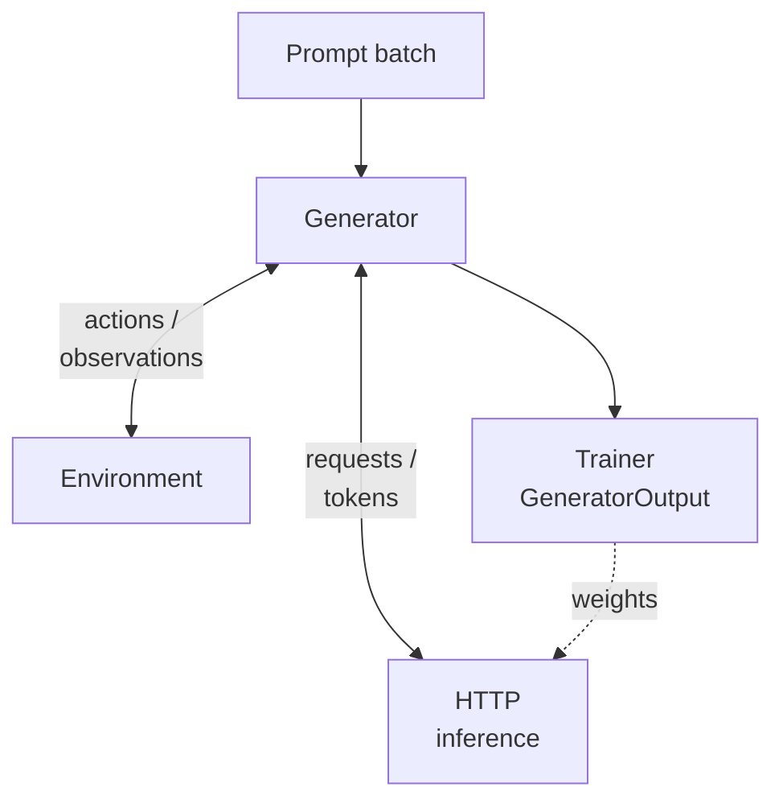
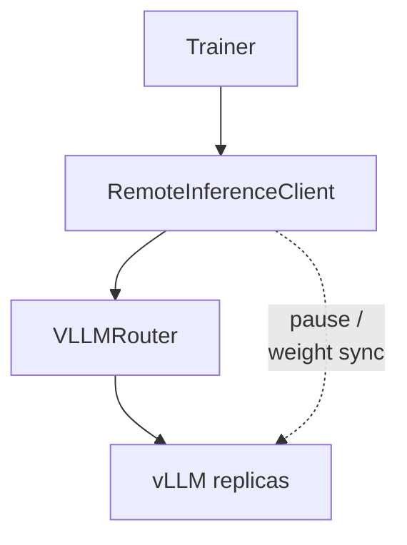

---
{
  "id": "deep-dive-skyrl",
  "title": "Deep Dive - SkyRL",
  "slug": "deep-dive-skyrl",
  "section": "Project Deep Dives",
  "category": "Fine-Tuning & Training",
  "difficulty": "Hard",
  "order": 2,
  "companies": [
    "NovaSky AI",
    "Berkeley Sky Computing Lab",
    "Anyscale",
    "Databricks",
    "NVIDIA",
    "Thinking Machines Lab"
  ],
  "shortDescription": "A SQL repair is still in flight when two replicas load new weights and a third keeps the old ones. SkyRL has to record which policy produced each action.",
  "keyConceptsTested": [
    "Modular RL trainer architecture",
    "Generator and environment interfaces",
    "Synchronous and fully asynchronous RL",
    "Rollout staleness control",
    "HTTP inference and weight synchronization",
    "Tinker-compatible training APIs",
    "Long-horizon agent training",
    "PPO, GRPO, and DAPO tradeoffs",
    "RL operations and failure diagnosis"
  ],
  "prerequisites": [
    "deep-dive-vllm",
    "introduction-to-reinforcement-learning-fundamentals",
    "inference-mechanics-ttft-tps-kv-cache",
    "distributed-training-fsdp-deepspeed-zero"
  ],
  "relatedQuestions": [
    "rlhf-dpo-aligning-language-models",
    "rlvr-verifiable-rewards-training",
    "distributed-training-fsdp-deepspeed-zero",
    "observability-monitoring-llm-systems",
    "model-versioning-continuous-deployment"
  ],
  "coverImage": "illustrations/_generated/skyrl_modular_loop_dark.png"
}
---

At step 12 of a SQL-repair RL run, a multi-turn trajectory is still waiting on its database sandbox when the trainer finishes an optimizer step. Two serving replicas load the new weights, while a third answers the next turn with the old ones. The trajectory still fixes the query and earns a high reward, yet the run can no longer tell which policy actually generated each token.

**SkyRL** (from NovaSky AI at the Berkeley Sky Computing Lab) is a modular post-training RL stack built to keep multi-turn agent loops, inference servers, and distributed trainers cleanly separated and inspectable.[^skyrl2026repo] Throughout this deep dive, we will trace a single SQL-repair trajectory, `query-42_0`, from prompt through generator, environment, trainer, and weight synchronization, watching how token IDs, loss masks, rewards, and staleness counters stay aligned across synchronous and fully asynchronous execution.

## Replaceable interfaces, not one trainer

Suppose `query-42_0` switches tomorrow from SQL execution to a bash terminal. The environment and turn parser should change, while advantage estimation and policy updates should keep receiving the exact same normalized trajectory format.

SkyRL organizes its unified `skyrl/` package around four core seams: **Generator**, **Environment**, **InferenceEngine**, and **Trainer** (with orchestration living in `trainer.py`).[^skyrl2026overview] Because every seam exchanges explicit token-level data, you can swap a Text-to-SQL sandbox for a browser environment, trade local vLLM workers for remote HTTP servers, or switch from synchronous batches to fully asynchronous queues without rewriting the RL objective.

The native trainer ships <span data-glossary="ppo">PPO</span>, <span data-glossary="grpo">GRPO</span>, and policy-gradient variants on top of <span data-glossary="fsdp">FSDP</span> and <span data-glossary="nvidia-megatron">Megatron</span> (with <span data-glossary="jax">JAX</span> also available through its Tinker-compatible backend), paired with HTTP vLLM inference servers and a session-aware router.[^skyrl2026repo][^skyrl2026async]

> **Key insight:** When every subsystem seam preserves exact token IDs, observation masks, rewards, and policy versions, you can swap environments, serving backends, or async schedules without silently corrupting the learning loop.

<!-- leetllm: edition:reference:start -->

## Project identity and lineage

SkyRL is developed by NovaSky AI at the Berkeley Sky Computing Lab in collaboration with Anyscale under an Apache-2.0 source license (crediting design ideas from veRL, OpenRLHF, Search-R1, OpenReasonerZero, and NeMo-RL).[^skyrl2026repo][^skyrl2026development][^skyrl2026license]

| Milestone | Contribution | Why it matters |
| --- | --- | --- |
| SkyRL-v0 | Multi-turn tool-use RL in real environments | Established the multi-turn agent trajectory layout |
| SkyRL-v0.1 (`skyrl-train`) | Modular PPO/GRPO trainer and placement | Separated RL algorithms from cluster topology |
| SkyRL-Gym | <span data-glossary="gymnasium-environment">Gymnasium-style</span> math, code, search, <span data-glossary="sql">SQL</span> envs | Minimal environment interface for task authors |
| SkyRL tx | Tinker-compatible backend on local GPUs | Stable client API over FSDP, Megatron, or JAX |
| SkyRL-Agent & Harbor | Async agent dispatcher & terminal harnesses[^patil2025skyrlagent] | Keeps long-horizon tool loops above the trainer |
| Unified `skyrl/` | Consolidated package layout | Single import path across trainer, inference, Tinker |

<!-- leetllm: edition:reference:end -->

## Generator, environment, trainer

After two SQL turns on `query-42_0`, the trainer needs four things: the exact sampled token IDs, the database observation tokens, the rewards, and a mask distinguishing trainable model actions from read-only environment context.

The **Generator** coordinates inference calls and environment steps to produce trajectories; the **Trainer** converts those completed trajectories into <span data-glossary="gradient">gradients</span> and syncs updated weights back to the **InferenceEngine**.

### Vocabulary at the seams

| Term | Role in SkyRL | Bug when violated |
| --- | --- | --- |
| Rollout | Complete single-turn or multi-turn trajectory | Training on truncated turns as full episodes |
| Generator | Orchestrates sampling + environment loop | Baking task logic inside the trainer |
| Environment | <span data-glossary="state-machine">State machine</span> executing actions & computing reward | Trusting unverified model-written scores |
| Inference engine | Samples tokens and returns logprobs | Assuming sampler always holds latest weights |
| Training input | Aligned tokens, loss masks, rewards, advantages | Computing policy loss on tool outputs |
| Staleness | Consumption step minus generation start step | Updating on heavily off-policy trajectories |
| Weight sync | Pushing updated policy weights to inference | Sampling stale weights while treating them as on-policy |

`GeneratorInput` passes prompts, environment classes, sampling params, and trajectory IDs; `GeneratorOutput` returns batched `prompt_token_ids`, `response_ids`, `rewards`, `loss_masks`, `stop_reasons`, optional logprobs, and `trajectory_ids`. Note that `GeneratorOutput` is a Python `TypedDict` with required keys (`Optional[...]` allows `None` values, not omitted keys) and does not validate array alignment at runtime.[^skyrlPinnedGenerator2026]

### The architecture in one request



```checkpoint
Why does SkyRL put `loss_masks` in `GeneratorOutput` instead of asking the trainer to infer them from text?
---
The generator knows exactly which tokens were sampled by the model versus returned by tools or environments. Explicit masks prevent the trainer from accidentally applying policy loss to observations or padding.
```

## A concrete trajectory

Trace `query-42_0`: the model writes a two-token SQL attempt (`[11, 12]`), the <span data-glossary="sandbox">sandbox</span> database returns a one-token error observation (`[90]`), and the model repairs the query in two more tokens (`[21, 22]`).

| Field | Value | Purpose |
| --- | --- | --- |
| `prompt_token_ids` | `[[101, 921, 3321]]` | Prompt context outside response loss |
| `response_ids` | `[[11, 12, 90, 21, 22]]` | Actions **and** intermediate observation |
| `rewards` | `[[0, -0.2, 0, 0, 1.0]]` | Each turn's reward stamped at its final action token |
| `loss_masks` | `[[1, 1, 0, 1, 1]]` | `0` excludes observation `90` from policy loss |
| `stop_reasons` | `["stop"]` | Episode termination status |
| `trajectory_ids` | `[TrajectoryID("query-42", 0)]` | Renders as `query-42_0` in logs |

`SkyRLGymGenerator` enforces <span data-glossary="ti-to">token-in-token-out</span>: it appends raw sampled token IDs and tokenized observations directly rather than decoding and re-tokenizing chat text, preventing BPE boundary drift between sampling and training.[^skyrl2026gymgenerator][^skyrlPinnedGenerator2026][^skyrlPinnedGym2026]

<figure>

<figcaption>Every array aligns to response positions. Turn rewards land on action endpoints (positions 1 and 4), while mask 0 removes the observation at position 2 from direct policy loss even as later tokens attend to it.</figcaption>
</figure>

This short NumPy check verifies that masked mean negative log-likelihood ignores changes to observation positions while responding immediately to action tokens:

<!-- leetllm: test output=show output_title="Response-mask filtering" deps=numpy -->
```python title="skyrl_response_mask.py"
import numpy as np

token_ids = np.array([11, 12, 90, 21, 22], dtype=np.int64)
masks = np.array([1, 1, 0, 1, 1], dtype=np.float32)
rewards = np.array([0.0, -0.2, 0.0, 0.0, 1.0], dtype=np.float32)


def masked_nll(logprobs: np.ndarray, mask: np.ndarray) -> float:
    return float(-np.mean(logprobs[mask.astype(bool)]))


logprobs = np.array([-0.2, -0.4, 0.0, -0.6, -0.8], dtype=np.float32)
baseline = masked_nll(logprobs, masks)

# Modifying the masked observation leaves the loss unchanged
modified_obs = logprobs.copy()
modified_obs[2] = -99.0
assert np.isclose(masked_nll(modified_obs, masks), baseline)

# Modifying an active action token updates the loss
modified_act = logprobs.copy()
modified_act[4] = -1.2
assert np.isclose(masked_nll(modified_act, masks), 0.60)

print(f"trainable_tokens={int(masks.sum())} total_reward={rewards.sum():.1f} masked_nll={baseline:.2f}")
```

<!-- leetllm: output:start -->
```text title="Response-mask filtering" output compact
trainable_tokens=4 total_reward=0.8 masked_nll=0.50
```
<!-- leetllm: output:end -->

<!-- leetllm: edition:reference:start -->

## Read the main code paths

Start at `skyrl/train/trainer.py`, then trace into `skyrl/train/generators/base.py` (whose `generate()` method is `async` even in synchronous mode so slow sandboxes yield cleanly while preserving input row order). `SkyRLGymGenerator` adapts Gymnasium tasks, while Harbor, OpenEnv, and SkyRL-Agent plug in external harnesses at the same boundary.

### The trainer's order of operations

1. **Generate:** Dispatch prompts to the generator; collect aligned tokens, masks, rewards, and stop reasons, applying dynamic sampling or step-wise merging.
2. **Optimize:** Convert trajectories to training batches, compute current logprobs (and critic values if configured), compute advantages, and step the actor/critic.
3. **Publish:** Checkpoint, evaluate, and synchronize new weights to inference replicas before the next sampling window.

<!-- leetllm: edition:reference:end -->

## Synchronous RL: the reference schedule

In synchronous mode, the cluster generates a batch with $\pi_k$, waits for every trajectory and reward, updates to $\pi_{k+1}$, and broadcasts $\pi_{k+1}$ to every inference replica before starting the next step.

That clean barrier gives policy-gradient optimization a textbook baseline:

$$
L(\theta) = -\mathbb{E}_{(x,y) \sim \pi_k}\!\left[A(x,y) \log \pi_\theta(y \mid x)\right].
$$

<span data-glossary="ppo">PPO</span> clips the importance ratio to damp aggressive steps (note that clipping shapes the loss incentive rather than enforcing a hard box constraint on final post-step ratios), while GRPO replaces a learned critic with group-relative reward centering (where a constant-reward group has zero reward advantage, though an enabled KL term can still yield gradients).

### What synchronous training buys

| Dimension | Synchronous behavior | Practical effect |
| --- | --- | --- |
| Policy freshness | Single policy per batch | Clean on-policy debugging |
| Hardware utilization | Fast workers wait on stragglers | Idle <span data-glossary="gpu">GPUs</span> during slow tool calls |
| Failure isolation | Whole step succeeds or fails together | Simple replay by global step |

Always bring up a new environment synchronously first: it eliminates staleness and sync races while you verify masks, rewards, and evaluation slices.

```checkpoint
You add a browser environment and the first synchronous run sometimes gives reward 0 for every sample. What should you inspect before changing the optimizer?
---
Check action parsing, environment timeouts, and reward calculation first. Uniform zero rewards give zero GRPO advantage regardless of learning rate.
```

## One-step async and fully async

Synchronous barriers hurt badly on agent workloads: if three SQL repairs take 4 seconds and `query-42_0` takes 40, the whole cluster sits idle waiting for the tail. One-step pipelining overlaps the next batch's generation with the current train step, while **fully asynchronous training** (`fully_async_trainer.py`) runs persistent `asyncio` generation workers feeding an `asyncio.Queue`, pausing in-flight requests briefly after each trainer step to broadcast new weights and then resuming them.[^skyrl2026async]

<figure>

<figcaption>With mini-batch B = 1 and staleness budget S = 2, long group L stays in flight while short groups A, B, and C train. L arrives at step 4 with lag 3 even though total outstanding groups never exceed B(S + 1) = 3.</figcaption>
</figure>

### Staleness as a budget

SkyRL measures group lag as $\operatorname{staleness}_i = s_i - g_i$ (consumption step minus scheduled start step). Crucially, `AsyncStalenessManager` enforces an **aggregate capacity bound**, not a hard per-group rejection filter. With mini-batch size $B$ and `max_staleness_steps` $S$, at global step $s$ it maintains:

$$
\text{accepted} + \text{running} \le (S + s)\,B.
$$

Because $(s - 1)B$ groups have already been consumed by prior steps, at most $B(S + 1)$ groups can be buffered or in flight simultaneously (with $S = 0$, only the current mini-batch fits).[^skyrlPinnedAsync2026] A single straggler like `L` can still finish with lag `3 > S = 2`; SkyRL logs a warning and accepts it, so always monitor the full lag histogram.

In fully async mode (`generator.batched: false`, `colocate_all: false`, `train_batch_size == policy_mini_batch_size`, `dynamic_sampling.type: null`), zero-variance groups are dropped via `sample_full_batch` and reclassified from `accepted` to `filtered` so they free queue capacity while keeping the counter balance `submitted = accepted + filtered + running`. If an epoch ends with a partial mini-batch, those trajectories are discarded and their prompt IDs marked consumed on resume.[^skyrlPinnedAsync2026]

```checkpoint
Why is "add more generation workers" not an automatic fix for a slow fully async run?
---
Extra producers fill the buffer faster, driving up policy staleness and memory usage while feeding older trajectories to the trainer. Useful concurrency caps at `policy_mini_batch_size * (max_staleness_steps + 1)`.
```

### AReaL, DAPO, and off-policy correction

SkyRL's staleness controller follows the queue-bounded async design of AReaL[^mei2025areal], while `sample_full_batch` mirrors DAPO's dynamic zero-variance filtering[^yu2025dapo]. Even at zero lag, training and inference kernels (or MoE routing) can drift slightly; SkyRL pairs behavior logprobs with truncated <span data-glossary="importance-sampling">importance sampling</span>, token/sequence masking, and MoE routing replay to stabilize off-policy updates.[^skyrl2026offpolicy]

## Inference and weight synchronization

SkyRL splits HTTP generation traffic (data plane) from fleet lifecycle commands (control plane):[^skyrl2026inference][^skyrl2026tinker][^skyrlPinnedDependencies2026][^vllm2026release0300]

| Component | Role | Plane |
| --- | --- | --- |
| `RemoteInferenceClient` | Trainer's unified HTTP client | Both |
| `VLLMRouter` | Session-aware load balancer (`sticky_least_loaded` via `X-Session-ID`) | Data |
| vLLM API servers | Inference replicas | Data + fan-out control |



Passing `trajectory_id` as `X-Session-ID` keeps later turns of `query-42_0` pinned to the same replica for prefix-cache reuse. For non-colocated weight updates, SkyRL calls `/pause?mode=keep` (preserving in-flight KV caches), broadcasts updated tensors over <span data-glossary="nccl">NCCL</span> (or via shared-storage `delta` / NIXL RDMA `sharded_rdt` backends), completes the finish handshake, and resumes generation; colocated jobs instead use CUDA IPC handles with `/sleep` and `/wake_up`.[^skyrl2026inference]

In fully async mode, `clear_kv_cache_on_weight_sync` defaults to `false` (letting paused trajectories resume with older KV states) while `use_cache_salt` isolates prefix-cache blocks across policy versions.[^skyrl2026async]

### A sync failure path

Returning to our opening step-12 incident where one replica stayed on step 11: never resume generation solely because the trainer's local RPC returned `200`. Pause generation, confirm that *every* replica reports the target policy version and completed its finish handshake, quarantine any lagging replica, and only then resume.

```checkpoint
What confirms that a weight sync succeeded across a multi-replica serving fleet?
---
Confirming that the finish-update handshake completed and every serving replica reports the expected policy version (plus a passing post-sync probe), not just a local client counter increment.
```

## Tinker: a stable API over changing hardware

SkyRL also implements a Tinker-compatible service layer (`skyrl.tinker.api`, `skyrl.tinker.engine`, and `skyrl.backends`) so Tinker-style `forward_backward`, `optim_step`, and `sample` programs can run directly on self-hosted FSDP, Megatron, or JAX clusters.[^skyrl2026tinker]

| Layer | Responsibility |
| --- | --- |
| API (`skyrl.tinker.api`) | FastAPI server, request persistence, future handles, <span data-glossary="backpressure">backpressure</span> |
| Engine (`skyrl.tinker.engine`) | Background batching, scheduling, and lifecycle dispatch |
| Backend (`skyrl.backends`) | FSDP, Megatron, or JAX updates + vLLM sampling |

Just as in hosted Tinker, `save_weights_and_get_sampling_client()` publishes updated weights ephemerally for hot RL loops without writing disk checkpoints, while `save_checkpoint()` persists weights, optimizer moments, and scheduler state for training resume.[^skyrl2026tinker]

```checkpoint
A node fails after exporting sampler weights but before calling `save_checkpoint()`. Can you resume the exact optimizer trajectory?
---
No. Sampler exports contain model weights only, omitting optimizer moments and learning-rate scheduler state required for clean continuation.
```

## SkyRL-Agent: long-horizon work belongs above the trainer

Complex SWE, terminal, and browser agents run dozens of tool turns per episode. **SkyRL-Agent** lifts tool orchestration, async dispatch, and backend adapters *above* the trainer so long-horizon agent code stays decoupled from distributed optimization.[^patil2025skyrlagent] Overlapping CPU-bound tool execution with GPU generation via its async pipeline dispatcher yielded a $1.55\times$ speedup in the SkyRL-Agent paper and trained SA-SWE-32B from Qwen3-32B (24.4% to 39.4% Pass@1 on SWE-Bench Verified under a 40k-context, 100-step ReAct setup).

### Application map

| Domain | Environment signal | Primary SkyRL piece |
| --- | --- | --- |
| Math & reasoning | Exact answer / verifier | Group rewards + zero-variance filter |
| Text-to-SQL | Query execution + result match | Multi-turn generator + observation masks |
| Search & research | Retrieval + citation checks | Tool observations + trajectory logs |
| SWE / Terminal-Bench | Unit tests, exit status | Sandboxed env + async agent dispatcher |
| Browser tasks | DOM / visual state | Bounded async turns |
| Memory agents | Cross-turn recall | Step-wise trajectories |

## A worked policy update

Sample four SQL queries for one prompt and grade them `[1, 0, 1, 0]`. Subtracting the group mean `0.5` gives advantages `[+0.5, -0.5, +0.5, -0.5]`, yielding the centered policy objective:

$$
L = -\frac{1}{2}\!\left[(+0.5)\log \pi_\theta(y_+\mid x) + (-0.5)\log \pi_\theta(y_-\mid x)\right].
$$

This runnable NumPy check computes group centering, detects uniform zero-variance groups, and reproduces our four-step async staleness trace (`B = 1, S = 2`) where long group `L` finishes with lag `3` inside the aggregate headroom of `3`:

<!-- leetllm: test output=show output_title="GRPO group and staleness trace" deps=numpy -->
```python title="skyrl_group_and_staleness.py"
import numpy as np


def compute_group_advantages(rewards: np.ndarray) -> tuple[np.ndarray, bool]:
    advantages = rewards - np.mean(rewards)
    return advantages, bool(np.allclose(advantages, 0.0))


sql_group = np.array([1.0, 0.0, 1.0, 0.0], dtype=np.float32)
advantages, zero_variance = compute_group_advantages(sql_group)
assert np.allclose(advantages, [0.5, -0.5, 0.5, -0.5]) and not zero_variance
assert compute_group_advantages(np.ones(4, dtype=np.float32))[1]

print("advantages", [round(float(x), 1) for x in advantages])

# (step, consumed group, scheduled step, accepted, running)
trace = [
    (1, "A", 1, 2, 1),
    (2, "B", 1, 3, 1),
    (3, "C", 2, 3, 1),
    (4, "L", 1, 4, 0),
]
B, S = 1, 2
for step, group, scheduled, accepted, running in trace:
    consumed = (step - 1) * B
    outstanding = accepted - consumed + running
    assert accepted + running <= (S + step) * B
    assert 0 <= outstanding <= B * (S + 1)
    print(f"step={step} group={group} lag={step - scheduled} outstanding={outstanding}")
```

<!-- leetllm: output:start -->
```text title="GRPO group and staleness trace" output compact
advantages [0.5, -0.5, 0.5, -0.5]
step=1 group=A lag=0 outstanding=3
step=2 group=B lag=1 outstanding=3
step=3 group=C lag=1 outstanding=2
step=4 group=L lag=3 outstanding=1
```
<!-- leetllm: output:end -->

Here is the minimal config structure wiring those exact async staleness and GRPO choices (`FullyAsyncRayPPOTrainer`, noting YAML `null` maps to Python `None`):[^skyrlPinnedAsync2026][^skyrl2026async]

```yaml title="skyrl-rl-config.yaml"
trainer:
  train_batch_size: 1
  policy_mini_batch_size: 1
  algorithm:
    advantage_estimator: grpo
    policy_loss_type: rollout_is
    zero_variance_filter: true
    dynamic_sampling:
      type: null
  placement:
    colocate_all: false
  fully_async:
    enabled: true
    max_staleness_steps: 2
    num_parallel_generation_workers: 3
    sample_full_batch: true
    clear_kv_cache_on_weight_sync: false
generator:
  batched: false
  n_samples_per_prompt: 4
  use_cache_salt: true
  inference_engine:
    backend: vllm
environment:
  env_class: text2sql
```

<!-- leetllm: edition:reference:start -->

### Check the pinned implementation without a GPU

Run the downloadable [CPU verification script](assets/verify_pinned_contracts.py) (see [recorded output](assets/cpu_contract_receipt.json)) to exercise SkyRL's scheduling manager, buffer drain, and reward-stamping helpers directly on CPU:

```bash title="verify_pinned_skyrl_components.sh"
uv run assets/verify_pinned_contracts.py --fetch
```

<!-- leetllm: edition:reference:end -->

## Strengths and weaknesses

### Strengths

| Strength | Why it matters |
| --- | --- |
| Modular interfaces | Swap environments, generators, or losses without rewriting the trainer |
| Real tool-use loops | Native support for SQL, code sandboxes, terminals, and browsers |
| Flexible placement & async | Progress cleanly from colocated sync to disaggregated fully async |
| Clean HTTP inference split | Session-sticky routing (`X-Session-ID`) separate from fan-out weight sync |
| Tinker-compatible backend | Run Tinker-style post-training scripts on your own GPU cluster |

### Weaknesses and sharp edges

| Sharp edge | Why it bites | Practical mitigation |
| --- | --- | --- |
| Many moving services | Ray, vLLM, router, sandboxes, and trainer fail independently | Pin compatible versions; health-check control endpoints |
| Aggregate staleness cap | Individual stragglers can exceed `max_staleness_steps` | Monitor full lag histograms alongside `filtered` counts |
| Train/infer mismatch | FSDP/Megatron and vLLM kernels diverge slightly | Log behavior logprobs and enable importance-sampling correction |
| Strict async config rules | Rejects colocation, batched generate, and sync dynamic sampling | Validate config early on a tiny sync baseline first |

<!-- leetllm: edition:reference:start -->

## Research papers and design lineage

| Source | Key systems idea |
| --- | --- |
| SkyRL-v0 & SkyRL overview[^skyrl2026repo][^skyrl2026overview] | Separate Trainer, Generator, InferenceEngine, and Environment |
| SkyRL-Agent[^patil2025skyrlagent] | Async tool/generation dispatcher above the RL trainer |
| DAPO[^yu2025dapo] | Zero-variance dynamic filtering as part of the RL algorithm |
| AReaL[^mei2025areal] | Bounded-staleness fully asynchronous LLM RL |
| SkyRL inference, Tinker & off-policy docs[^skyrl2026inference][^skyrl2026tinker][^skyrl2026offpolicy] | Control/data plane split, Tinker service layers, importance correction |

## Verify a run and recover it

Bring up any new SkyRL run in four ordered checks:

### Gate 1: make reward traceable

Verify episode termination, observation masks, scalar vs. per-turn reward placement, and non-zero reward variance on a small batch.

### Gate 2: name every weight owner

Verify placement (colocated vs. disaggregated), sync transport, and matching post-sync policy versions across every serving replica.

### Gate 3: bound async work

Size `policy_mini_batch_size`, worker concurrency, and `max_staleness_steps` together using headroom $B(S + 1)$, set pause mode and `use_cache_salt`, and monitor lag distributions.

### Gate 4: keep a recovery packet

Log trajectory ID, scheduled/consumed step, reward breakdown, stop reason, and atomic resumable checkpoints so regressions can be replayed cleanly.

> **Production tip:** Log trajectory ID, scheduled policy step, consumed policy step, reward components, stop reason, and environment revision together. Throughput charts without those joins cannot diagnose a sudden reward drop.

<!-- leetllm: edition:reference:end -->

## When the extra seams pay off

Reach for SkyRL when your post-training loop genuinely crosses environment, multi-turn rollout, or async weight-sync boundaries (Text-to-SQL, SWE agents, verifiable reasoning, or sync-vs-async research). For static supervised fine-tuning with no environment, a simpler trainer avoids unnecessary coordination overhead. Start synchronously to validate rewards and masks, then turn on async overlap once your baseline and staleness budget are solid.

<!-- leetllm: edition:reference:start -->

## Review an extension before running it

### Evaluation rubric

- **Foundational:** Align token IDs, observation masks, per-turn rewards, and stop reasons without leaking tool outputs into policy loss.
- **Intermediate:** Reconstruct `accepted`, `running`, `filtered`, and `consumed` counts across async steps, including stragglers exceeding `S`.
- **Advanced:** Verify replica-wide weight sync, cache salting, and held-out learning curves before adopting an async schedule.

### Follow-up questions

```checkpoint
A two-group mini-batch has one useful group left when the epoch is exhausted. What does `sample_full_batch` do?
---
It discards the incomplete mini-batch rather than padding it, marks those prompt IDs consumed on resume, and ends the epoch cleanly.
```

```checkpoint
The trainer increments its weight-version counter and rewards improve. Has every sampler loaded the new weights?
---
No. Verify each replica's reported policy version and run a post-sync probe; a local trainer counter only records that the control call was sent.
```

<!-- leetllm: edition:reference:end -->

```mastery-quiz
[
  {
    "question": "A six-position response has mask [1, 0, 1, 1, 0, 1] and log probabilities [−0.2, NaN, −0.6, −1.0, +Inf, −0.8]. Using action-only masked NLL, what are the baseline and the result after changing only the last action score to −1.2?",
    "options": [
      "Baseline 0.4333; changed 0.5.",
      "Baseline 0.65; changed 0.75.",
      "Baseline 0.65; changed 0.65.",
      "Baseline 0.75; changed 0.85."
    ],
    "answer": "Baseline 0.65; changed 0.75.",
    "explanation": "Selecting the four mask-1 positions gives [−0.2, −0.6, −1.0, −0.8], whose negative mean is 2.6 / 4 = 0.65. Changing the last action to −1.2 raises the negative sum to 3.0, giving 3.0 / 4 = 0.75, while masked observation slots are excluded."
  },
  {
    "question": "One prompt’s group receives rewards [0.2, 0.6, 1.0]. A later group receives [0.6, 0.6, 0.6]. With mean centering and an enabled KL term, what are the centered advantages for the first group and the gradient status of the second?",
    "options": [
      "[−0.4, 0, 0.4]; second group guarantees zero total gradient.",
      "[−0.6, −0.2, 0.2]; second group can still have auxiliary gradients.",
      "[−0.4, 0, 0.4]; second group confirms an accurate evaluator.",
      "[−0.4, 0, 0.4]; second group can still have auxiliary gradients."
    ],
    "answer": "[−0.4, 0, 0.4]; second group can still have auxiliary gradients.",
    "explanation": "Subtracting the mean 0.6 gives [−0.4, 0, 0.4] for the first group and [0, 0, 0] for the second. Even with zero centered reward advantage, an enabled KL penalty can still contribute gradients."
  },
  {
    "question": "Use the clipped PPO surrogate min(rA, clip(r, 1 − ε, 1 + ε)A) before negating for loss. With ε = 0.1, case P has r = 1.3, A = +0.4 and case N has r = 0.7, A = −0.4. Which values and interpretation follow?",
    "options": [
      "P 0.44; N −0.36; clipping shapes the loss incentive without strictly bounding post-step ratios.",
      "P 0.52; N −0.28; clipping shapes the loss incentive without strictly bounding post-step ratios.",
      "P 0.44; N −0.28; clipping guarantees post-step ratios stay in [0.9, 1.1].",
      "P 0.52; N −0.36; clipping guarantees post-step ratios stay in [0.9, 1.1]."
    ],
    "answer": "P 0.44; N −0.36; clipping shapes the loss incentive without strictly bounding post-step ratios.",
    "explanation": "For P, min(1.3 × 0.4, 1.1 × 0.4) = min(0.52, 0.44) = 0.44. For N, min(0.7 × −0.4, 0.9 × −0.4) = min(−0.28, −0.36) = −0.36. Clipping removes incentive to move further, rather than hard-constraining parameters."
  },
  {
    "question": "Before consumption at step s = 5, a run has B = 2, S = 1, accepted = 9, running = 2, and 4 generation-worker slots. A queued group was scheduled at step 1. What are the outstanding groups, next scheduling headroom, and lag outcome?",
    "options": [
      "Outstanding 11; next headroom 1; lag forces rejection.",
      "Outstanding 3; next headroom 2; lag is accepted under the aggregate bound.",
      "Outstanding 3; next headroom 1; lag is accepted under the aggregate bound.",
      "Outstanding 1; next headroom 2; lag forces rejection."
    ],
    "answer": "Outstanding 3; next headroom 1; lag is accepted under the aggregate bound.",
    "explanation": "Consumed = (5 − 1) × 2 = 8, so outstanding = 9 + 2 − 8 = 3. Cumulative capacity is (1 + 5) × 2 = 12, leaving 12 − 11 = 1 slot (tighter than the 4 − 2 = 2 free worker slots). Lag 4 exceeds S = 1, but SkyRL's cap is aggregate and accepts the group with a warning."
  },
  {
    "question": "A staleness counter has submitted = 14, accepted = 9, filtered = 3, running = 2. Without advancing the training step, two accepted groups are filtered and one new group is enqueued. What is the resulting (submitted, accepted, filtered, running) tuple?",
    "options": [
      "(15, 7, 5, 3).",
      "(15, 9, 5, 1).",
      "(14, 7, 5, 2).",
      "(15, 7, 3, 5)."
    ],
    "answer": "(15, 7, 5, 3).",
    "explanation": "Filtering moves 2 from accepted to filtered -> (14, 7, 5, 2). Enqueuing increments submitted and running -> (15, 7, 5, 3), preserving submitted = accepted + filtered + running (15 = 7 + 5 + 3)."
  },
  {
    "question": "Input rows are r8, r9. Return A has internally aligned rows in order r9, r8 and all declared keys. Return B keeps r8, r9 but omits the declared Optional `pixel_values` key because no images were used. What repairs satisfy SkyRL's `GeneratorOutput`?",
    "options": [
      "A: reorder IDs alone; B: insert `pixel_values=None`.",
      "A: reorder every aligned row field; B: omit unused `pixel_values`.",
      "A: keep completion order; B: insert `pixel_values=None`.",
      "A: reorder every aligned row field; B: insert `pixel_values=None`."
    ],
    "answer": "A: reorder every aligned row field; B: insert `pixel_values=None`.",
    "explanation": "Generators must return rows in input order with every aligned field moving together. `Optional[...]` in the `TypedDict` allows `None` values, not missing keys, so `pixel_values=None` must be present."
  },
  {
    "question": "Before a weight update, the sampler recorded probabilities [0.48, 0.14] for two action tokens. After the update and a KV-cache rebuild, the current policy assigns [0.24, 0.35] to those tokens. What are their current-to-behavior ratios, and which scores must the trajectory keep as behavior probabilities?",
    "options": [
      "Ratios [0.5, 2.5]. Store the current scores.",
      "Ratios [0.5, 2.5]. Store the scores from sampling.",
      "Ratios [2, 0.4]. Store the scores from sampling.",
      "Ratios [2, 0.4]. Store the current scores."
    ],
    "answer": "Ratios [0.5, 2.5]. Store the scores from sampling.",
    "explanation": "Importance ratios divide current by behavior probabilities: 0.24 / 0.48 = 0.5 and 0.35 / 0.14 = 2.5. Keep the original sampling probabilities as the behavior denominators."
  },
  {
    "question": "Fleet A reports the target weight version on every replica and passing probes, but `finish_weight_update` has not completed. Fleet B completed `finish_weight_update` and probes pass, but one replica still reports an older version. Should each fleet resume?",
    "options": [
      "(resume, hold).",
      "(hold, resume).",
      "(hold, hold).",
      "(resume, resume)."
    ],
    "answer": "(hold, hold).",
    "explanation": "Fleet A has not completed the update protocol, and Fleet B still has a stale replica. Both stay paused until every replica finishes and reports the target policy version."
  },
  {
    "question": "Two PPO critic batches each contain one response with three token weights. Batch A supplies three predicted values and three returns; Batch B supplies two predicted values and two returns. Which passes the length check, and is that check sufficient for numerical correctness?",
    "options": [
      "Both batches pass. The backend update still needs a numerical test.",
      "Only A passes. Passing confirms the backend computes the right update.",
      "Both batches pass. Passing confirms the backend computes the right update.",
      "Only A passes. The backend update still needs a numerical test."
    ],
    "answer": "Only A passes. The backend update still needs a numerical test.",
    "explanation": "Only Batch A matches the three token weights. Length checks catch missing elements, not swapped targets or sign bugs, so a numerical test on a known batch is still required."
  },
  {
    "question": "A momentum update uses v_next = μv + g and w_next = w − ηv_next. Starting from saved w = 2, v = 0.5, μ = 0.8, η = 0.05 with true next gradient g = −0.2, what next weight results from (1) a full restore, (2) a weights-only restore (v = 0), and (3) a stale data cursor giving g = +0.4?",
    "options": [
      "(1.99, 1.99, 1.96).",
      "(1.99, 2.01, 1.96).",
      "(2.01, 1.99, 1.96).",
      "(1.99, 2.01, 1.98)."
    ],
    "answer": "(1.99, 2.01, 1.96).",
    "explanation": "Full restore: v_next = 0.8(0.5) − 0.2 = 0.2 -> w_next = 2 − 0.01 = 1.99. Weights-only (v = 0): v_next = −0.2 -> w_next = 2 + 0.01 = 2.01. Stale cursor (g = 0.4): v_next = 0.8(0.5) + 0.4 = 0.8 -> w_next = 2 − 0.04 = 1.96."
  }
]
```

> **Next:** Continue to [Deep Dive - FlashAttention](/learn/deep-dive-flashattention). Once `query-42_0` is aligned and the right weights are on the sampler, the remaining cost sits inside attention. FlashAttention is the kernel where memory traffic and numerical correctness decide how those token sequences actually run.
