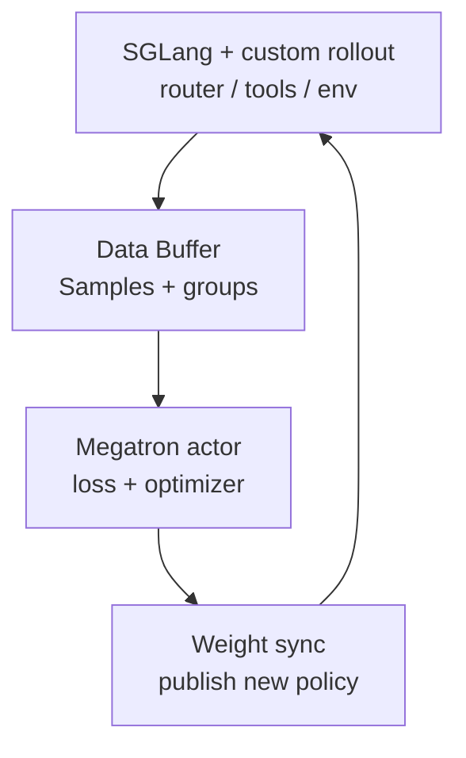

---
{
  "id": "deep-dive-slime",
  "title": "Deep Dive - slime",
  "slug": "deep-dive-slime",
  "section": "Project Deep Dives",
  "category": "Fine-Tuning & Training",
  "difficulty": "Hard",
  "order": 14,
  "coverImage": "illustrations/_generated/slime_sample_ledger_dark.png",
  "companies": [
    "Z.ai",
    "THUDM",
    "SGLang",
    "Megatron-LM",
    "Anyscale"
  ],
  "shortDescription": "Pass rate falls after a green health check. slime has to prove which tokens, masks, and weight version Megatron actually trained.",
  "keyConceptsTested": [
    "Ray placement groups and colocated or decoupled topology",
    "Megatron actor training and token-level rollout data",
    "SGLang servers, sgl-router, and session affinity",
    "Data Buffer groups, loss masks, rewards, and rollout IDs",
    "Synchronous, async, and fully-async training semantics",
    "Full NCCL, full disk, and delta disk weight synchronization",
    "Agentic customization and token lineage",
    "Fault tolerance, governance, and source reading"
  ],
  "prerequisites": [
    "deep-dive-sglang",
    "deep-dive-ray",
    "deep-dive-megatron",
    "deep-dive-skyrl",
    "introduction-to-reinforcement-learning-fundamentals"
  ]
}
---

A coding-agent <span data-glossary="rollout">rollout</span> edits a sandbox, passes every unit test, and earns reward `1.0`. Yet after training on that batch, pass rate drops even though GPUs are running hot and every <span data-glossary="sglang">SGLang</span> health check is green. Before blaming the RL loss function, look at the seams between serving and training: did a tool observation leak into the loss mask, did a segmented trajectory get double-weighted, or is SGLang still serving weights from before <span data-glossary="nvidia-megatron">Megatron</span>'s last update?

**slime** (from THUDM and Z.ai) is the post-training RL framework that owns the handoff between SGLang rollouts, Ray placement, and Megatron-LM training.[^slime2025repo][^slime2025blog][^slime2026sourceSnapshot] We will trace one trajectory, **rollout 7**, across all three layers (placement, timing, and weight sync) so its exact token IDs, loss mask, and serving policy version stay visible end to end.

## Keep Megatron and SGLang, own the handoff

Online RL post-training combines two very different workloads: irregular, tool-calling generation loops and large-scale distributed gradient steps. Instead of wrapping Megatron or SGLang behind a leaky unified abstraction, slime leaves both engines close to their native flags and concentrates on the seam between them:[^slime2025blog]

- **Megatron-LM** owns distributed actor/critic training (TP, PP, EP, CP, DP) and checkpointing.
- **SGLang + `sgl-router`** own high-throughput token generation, prefix caching, and per-token logprobs.
- **Ray** owns GPU placement groups and actor lifecycles.
- **slime** owns the `Sample` schema, Data Buffer, async timing loop, custom agent hooks, and weight synchronization.

```checkpoint
Why does slime expose custom generation hooks instead of forcing one built-in agent class?
---
Coding sandboxes, browsers, and search agents have wildly different loops, message formats, and stopping rules. Custom hooks let each environment run its own loop while returning normalized token-level `Sample` objects to the shared trainer.
```

## A token ledger between two engines

Every rollout flows through the same loop: SGLang samples tokens and logprobs from the current policy, the **Data Buffer** validates and groups completed `Sample` records, Megatron computes losses and steps the <span data-glossary="optimizer">optimizer</span>, and **weight sync** commits the updated parameters back to SGLang.



A generated response enters training only when its <span data-glossary="token">token</span> IDs, response length, loss mask, reward, and status agree, and a weight sync completes only when serving engines load the new version and resume.

## Ray placement defines cluster topology

slime creates a Ray placement group of GPU+CPU bundles, sorts them by node and physical GPU for deterministic rank ordering, and assigns them to Megatron actors and SGLang engines:

| Topology | GPU layout | Upside | Main constraint |
| --- | --- | --- | --- |
| Colocated (`--colocate`) | Shared GPU pool | Minimal hardware; fast local IPC sync | Must offload memory between rollout and train; blocks async |
| Decoupled | Separate actor and rollout pools | Training and generation overlap freely | Requires more GPUs + network/disk weight sync |
| External rollout | Actor pool + external SGLang cluster | Independent serving fleet | Must keep management APIs and storage aligned |

Async training (`train_async.py`) asserts that colocation is off so rollout and training can execute simultaneously. Megatron flags pass straight through, while SGLang flags carry the `--sglang-` prefix (for example `--sglang-moe-a2a-backend deepep` for MoE communication).[^slime2026docs]

```checkpoint
When does decoupled placement pay off for a coding agent?
---
When long-tail sandbox rollouts would leave training GPUs idle, or when actor and serving engines need independent GPU memory budgets. You pay for the extra overlap with explicit weight transport and policy-lag tracking.
```

## SGLang and sgl-router own rollout

slime runs SGLang in server mode behind `sgl-router`, calling `/generate` with `return_logprob=True` so each completion returns exact sampled token IDs and per-token log probabilities. Passing a stable session ID in `X-SMG-Routing-Key` with `router_policy=consistent_hashing` routes multi-turn sessions back to the same worker for <span data-glossary="prefix-cache">radix prefix-cache</span> reuse.

Dynamic sampling filters out zero-variance reward groups, while partial rollout mode can call SGLang's `/abort_request` once oversampling has collected enough valid completions, saving unfinished trajectories for a later pass.[^slime2025blog] For fast bug isolation, slime provides `--debug-rollout-only` (paired with `--save-debug-rollout-data`) and `--debug-train-only` (paired with `--load-debug-rollout-data`) to test generation and Megatron updates independently.[^slime2026faulttolerance]

## Data Buffer coordinates the rollout handoff

The **Data Buffer** bridges prompt generation and Megatron data-parallel ranks (and can optionally run as a standalone HTTP service via `slime_plugins/rollout_buffer`). Each `Sample` carries three distinct identifiers that must never be conflated:[^slime2026sampleContract]

- `group_index`: independent attempts sampled for the same prompt (used for GRPO reward centering).
- `rollout_id`: sibling segments belonging to a single agent trajectory (used for shared loss denominators).
- `weight_versions`: the serving policy version(s) that generated the tokens.

Take **rollout 7**: prompt IDs `[101, 102]` followed by a six-token response containing a model tool call `[11, 12]`, a sandbox observation `[50, 51]`, and a model answer `[13, 14]`. The prompt sits outside `loss_mask`; within the six response positions, four model tokens get mask `1` and the two observation tokens get mask `0`.

| Field | Producer | Role in training | Failure if broken |
| --- | --- | --- | --- |
| `tokens` | SGLang / adapter | Exact forward-pass sequence | Re-tokenization shifts targets |
| `rollout_log_probs` | SGLang | Behavior policy logprobs | Off-policy drift goes undetected |
| `loss_mask` | Adapter / converter | Selects trainable response tokens | Model trains to mimic tool errors |
| `reward` | Verifier / <span data-glossary="reward-model">reward model</span> | Advantage signal | Flat or inverted learning |
| `rollout_id` | Data source / fan-out | Shared trajectory denominator | Multi-segment runs get over-weighted |
| `status` | Rollout worker | `COMPLETED`, `TRUNCATED`, `ABORTED`, `FAILED` | Partial trajectories mix into clean batches |

<figure>
  
  <figcaption>The six response positions align one-to-one with `loss_mask` and `rollout_log_probs`. Observation tokens stay in context with mask `0` and placeholder `0.0` logprobs.</figcaption>
</figure>

This compact NumPy validator checks the exact alignment rules for rollout 7 and rejects malformed candidates before they ever reach Megatron:

<!-- leetllm: test, output=show, deps=numpy -->
```python title="sample_trajectory_schema.py"
from dataclasses import dataclass, replace
import numpy as np


@dataclass
class Sample:
    tokens: np.ndarray
    loss_mask: np.ndarray
    response_length: int
    reward: float
    rollout_id: int
    status: str
    rollout_log_probs: np.ndarray


def prompt_len(sample: Sample) -> int:
    return len(sample.tokens) - sample.response_length


def trainable_positions(sample: Sample) -> int:
    if sample.status != "COMPLETED":
        raise ValueError("Only completed trajectories accepted")
    if not (0 < sample.response_length < len(sample.tokens)):
        raise ValueError("Need nonempty prompt and response suffix")
    if len(sample.loss_mask) != sample.response_length or len(sample.rollout_log_probs) != sample.response_length:
        raise ValueError("Mask and logprobs must match response_length")
    if not np.all(np.isin(sample.loss_mask, [0, 1])) or not np.any(sample.loss_mask):
        raise ValueError("Mask must be binary with at least one trainable token")
    if not np.isfinite(sample.reward) or not np.all(np.isfinite(sample.rollout_log_probs)):
        raise ValueError("Reward and logprobs must be finite")
    if np.any(sample.rollout_log_probs > 0) or np.any(sample.rollout_log_probs[sample.loss_mask == 0] != 0.0):
        raise ValueError("Action logprobs must be <= 0 and masked placeholders must be 0.0")
    return int(np.sum(sample.loss_mask))


sample = Sample(
    tokens=np.array([101, 102, 11, 12, 50, 51, 13, 14], dtype=np.int64),
    loss_mask=np.array([1, 1, 0, 0, 1, 1], dtype=np.int32),
    response_length=6,
    reward=1.0,
    rollout_id=7,
    status="COMPLETED",
    rollout_log_probs=np.array([-0.2, -0.3, 0.0, 0.0, -0.4, -0.5], dtype=np.float32),
)

invalid = [
    replace(sample, status="ABORTED"),
    replace(sample, loss_mask=np.array([1, 1], dtype=np.int32)),
    replace(sample, loss_mask=np.array([1, 2, 0, 0, 1, 1], dtype=np.int32)),
    replace(sample, loss_mask=np.zeros(6, dtype=np.int32)),
    replace(sample, response_length=9),
    replace(sample, rollout_log_probs=np.array([-0.2], dtype=np.float32)),
    replace(sample, rollout_log_probs=np.array([0.2, -0.3, 0.0, 0.0, -0.4, -0.5], dtype=np.float32)),
    replace(sample, rollout_log_probs=np.array([-0.2, -0.3, -0.8, 0.0, -0.4, -0.5], dtype=np.float32)),
    replace(sample, reward=float("nan")),
]
rejected = 0
for candidate in invalid:
    try:
        trainable_positions(candidate)
    except ValueError:
        rejected += 1

print(f"prompt={prompt_len(sample)}, response={sample.response_length}, "
      f"trainable={trainable_positions(sample)}, rejected={rejected}")
```

<!-- leetllm: output:start -->
```text title="Output" output compact
prompt=2, response=6, trainable=4, rejected=9
```
<!-- leetllm: output:end -->

## Megatron owns the train step

Megatron actor workers pull scheduled batches from Ray, run native tensor/pipeline/expert/context/data parallelism, compute actor logprobs (and optional critic values when not using critic-free <span data-glossary="grpo">GRPO</span>), and step the optimizer. When syncing weights, slime gathers sharded Megatron parameters into Hugging Face tensor layouts (directly or via Megatron Bridge) for SGLang to ingest.

## Three timing models

All three execution schedules consume the exact same `Sample` layout; they differ only in when generation overlaps with training and when updated weights reach SGLang.

### Synchronous: finish, train, sync

`train.py` requests one batch from `RolloutManager`, waits for every trajectory to finish, runs the Megatron step, and calls `actor_model.update_weights()`. Cross-round lag stays minimal, but the single slowest sandbox stalls every GPU in the batch.

### Async: start next rollout early

`train_async.py` requires decoupled GPUs and kicks off `rollout_manager.generate.remote(next_id)` while Megatron trains on the current batch, draining that future before syncing every `update_weights_interval` steps.[^slime2026asyncLoop] Idle time drops, and each `Sample` records its sampling weight version so policy lag stays explicit.

### Fully async: keep a warm worker

`generate_rollout_fully_async` keeps a dedicated background `asyncio` loop continuously refilling `generate_and_rm_group` slots from the global Data Buffer and placing finished groups into an output queue.

> **Key insight:** The completion queue itself is unbounded so running tasks never deadlock trying to enqueue results; instead, <span data-glossary="backpressure">backpressure</span> closes the **launch gate** once queued groups reach worker concurrency. Already-running tasks still finish and push into the queue, so peak queue length can exceed the launch threshold until Megatron drains it.[^slime2026sourceSnapshot]

| Mode | Generation trigger | Weight sync point | Best fit | Watch out for |
| --- | --- | --- | --- | --- |
| Sync | After previous sync | Every step | Bring-up & minimal lag | Straggler tail latency |
| Async | Overlaps current train step | Every `update_weights_interval` after drain | Steady decoupled throughput | Bounded policy staleness |
| Fully async | Persistent warm worker | Caller-defined with abort requeue | Heavy-tail agent sandboxes | Queue age, abort loops, no eval mode |

```checkpoint
What separates fully async from simply calling `ray.remote()` one step early?
---
One-step async overlaps a single future per iteration. Fully async runs a persistent background worker managing continuous concurrency slots, completion-queue ordering, backpressure gating, and abort requeueing across steps.
```

## Weight synchronization ensures policy alignment

Getting new Megatron weights onto SGLang without serving half-updated models follows four distinct transport branches depending on topology and mode. Note one surprising dispatch rule: with `--colocate` and full mode, slime automatically uses **CUDA IPC tensor handles** (`UpdateWeightFromTensor`) even when `--update-weight-transport nccl` is set, while delta disk mode rejects colocation outright.[^slime2026actorSync]

### Full NCCL

Non-colocated full NCCL pauses SGLang, flushes KV caches, gathers TP/EP shards on pipeline source ranks into HF-shaped chunks, broadcasts them over <span data-glossary="nccl">NCCL</span> to rollout engines, and resumes serving. Fast and disk-free, though a restarted engine needs another broadcast or checkpoint.

### Full disk

Full disk writes a versioned Hugging Face directory (`weight_v000003`) to shared storage **before** pausing generation, then pauses SGLang briefly to flush caches and call `update_weights_from_disk`. By default, temporary sync directories are deleted after reload unless `--update-weight-disk-keep-files` is set.

### Delta disk

Non-colocated delta disk keeps a CPU baseline seeded from `--hf-checkpoint`, diffs each gathered tensor against the previous version, compresses changed bytes with `zstd`, and writes a self-describing delta plus per-tensor xxHash <span data-glossary="checksum">checksums</span>. Each rollout host applies the patch to its local NVMe checkpoint via `/pull_weights` before pausing to reload.[^slime2026deltaSync]

Watch the **XOR encoding trap**: XOR is its own inverse, so applying the same XOR delta twice silently reverts the weights back to the old model!

<!-- leetllm: test, output=show, deps=numpy -->
```python title="xor_delta_once.py"
import numpy as np


def xor_buffers(left: np.ndarray, right: np.ndarray) -> np.ndarray:
    if len(left) != len(right):
        raise ValueError("Patch and base lengths must match")
    return np.bitwise_xor(left, right)


base = np.array([1, 2, 3, 4], dtype=np.uint8)
new = np.array([1, 2, 8, 4], dtype=np.uint8)
delta = xor_buffers(new, base)

applied_once = xor_buffers(base, delta)
applied_twice = xor_buffers(applied_once, delta)
assert np.array_equal(applied_once, new)
assert np.array_equal(applied_twice, base)

print(delta.tolist(), applied_once.tolist(), applied_twice.tolist())
```

<!-- leetllm: output:start -->
```text title="Output" output compact
[0, 0, 11, 0] [1, 2, 8, 4] [1, 2, 3, 4]
```
<!-- leetllm: output:end -->

> **Common mistake:** Blindly retrying a failed XOR delta sync. If a host already applied version `v5 -> v6`, applying the same XOR patch again silently rolls its bytes back to `v5`. Always check the host's current version and checksum before patching, or restore a full checkpoint when state is uncertain.

```bash title="delta_sync_flags.sh"
--update-weight-mode delta \
--update-weight-transport disk \
--update-weight-disk-dir /shared/fs/delta-updates \
--update-weight-local-checkpoint-dir /local/nvme/rollout-ckpt \
--update-weight-delta-encoding xor \
--update-weight-delta-checksum xxh3-128
```

<figure>
  
  <figcaption>NCCL pauses serving before streaming weight chunks, whereas disk and delta paths prepare and verify files while old weights stay live, pausing only for the local reload.</figcaption>
</figure>

| Path | Transport | Pause window | Key safeguard |
| --- | --- | --- | --- |
| Colocated full | CUDA IPC handles | Offload + swap | Synchronized offload lifecycle |
| Full NCCL | NCCL broadcast | Pause + broadcast + resume | Engine lock & fleet version check |
| Full disk | Shared FS / object store | Flush + disk reload | Versioned directory + retention flag |
| Delta disk | Shared FS + local NVMe | Flush + disk reload | Base version check + per-tensor checksum |

## Agentic customization keeps token lineage

Hook custom tools and sandboxes into slime via `--custom-generate-function-path` (and custom verifiers via `--custom-rm-path`), keeping slime's shared batching and validation intact.[^slime2026customization][^slime2026agents] Built-in `OpenAIAdapter` and `AnthropicAdapter` render chat templates, query SGLang with raw `input_ids` and `return_logprob=True`, and pass `session_id` through `X-SMG-Routing-Key`.

When a long agent trajectory splits into multiple segments (via context compaction or subagents), assign every sibling segment the **same `rollout_id`** so the loss reducer normalizes by the combined trainable-token count across the entire rollout.[^slime2026customization][^slime2026lossReduction]

Suppose one trajectory has per-token loss terms `[1, 3, 5, 7]` (true mean `4.0`) split across two segments `[1, 3]` and `[5, 7]`. Averaging each segment independently sums to `8.0` (double-counting the rollout!), while halving advantages on top of a shared whole-rollout denominator drops it to `2.0`:

<!-- leetllm: test, output=show, deps=numpy -->
```python title="segment_loss_reduction.py"
import numpy as np

segments = [np.array([1.0, 3.0], dtype=np.float32), np.array([5.0, 7.0], dtype=np.float32)]
denominator = sum(len(segment) for segment in segments)

one_rollout = float(sum(np.sum(s) / denominator for s in segments))
wrong_independent = float(sum(np.mean(s) for s in segments))
wrong_extra_halving = float(sum(np.sum(s) / 2 / denominator for s in segments))

# Any split keeps the exact same mean when normalized by the whole-rollout denominator
rebalanced = [np.array([1.0], dtype=np.float32), np.array([3.0, 5.0, 7.0], dtype=np.float32)]
assert np.isclose(float(sum(np.sum(s) / denominator for s in rebalanced)), one_rollout)

print(f"one rollout={one_rollout:.1f}; independent sum={wrong_independent:.1f}; "
      f"extra halving={wrong_extra_halving:.1f}")
```

<!-- leetllm: output:start -->
```text title="Output" output compact
one rollout=4.0; independent sum=8.0; extra halving=2.0
```
<!-- leetllm: output:end -->

When sibling segments land in different microbatches, compute the shared denominator across the whole training step before splitting microbatches.

Here is the minimal shape of a `custom_generate` hook preserving raw token IDs, masks, logprobs, and serving weight versions:

```python title="custom_generate_interface.py"
from slime.utils.types import Sample

async def custom_generate(args, sample, sampling_params):
    trajectory = await run_agent(sample.prompt, sampling_params=sampling_params)
    sample.tokens = trajectory.prompt_ids + trajectory.response_tokens
    sample.loss_mask = trajectory.response_loss_mask
    sample.response_length = len(trajectory.response_tokens)
    sample.rollout_log_probs = trajectory.response_log_probs
    sample.weight_versions = list(trajectory.weight_versions)
    sample.reward = await verify(trajectory)
    if sample.rollout_id is None:
        sample.rollout_id = sample.index
    sample.status = Sample.Status.COMPLETED
    return sample
```

(Check `is None` rather than truthiness because `rollout_id=0` is valid.)

<!-- leetllm: edition:reference:start -->

## Applications and ecosystem

slime powers GLM post-training alongside launch recipes across multiple open model families.[^slime2025repo]

| Workload pressure | slime knob | Metric to watch |
| --- | --- | --- |
| Verifiable math/code | Reward hooks + zero-variance filter | Informative-group ratio |
| Multi-turn tools | `sgl-router` + `X-SMG-Routing-Key` | Prefix-cache hit rate & skew |
| Slow sandboxes | Fully-async worker / partial rollout | Queue age & abort rate |
| Disaggregated fleet | Full-disk or delta-disk weight sync | Per-host version & checksum |
| Sparse MoE rollouts | `--sglang-moe-a2a-backend deepep` | Dispatch/combine latency |

<!-- leetllm: edition:reference:end -->

## Strengths, limits, and failure paths

| Strength | Why it helps | Tradeoff |
| --- | --- | --- |
| Native Megatron-LM | Full TP/PP/EP/CP/DP & mature checkpoints | Upstream Megatron upgrades can break conversion bridges |
| Native SGLang + router | RadixAttention, structured outputs, session affinity | Tied to SGLang as the rollout engine |
| Explicit `Sample` schema | Crisp token lineage, masks, and segment IDs | Custom hooks must populate every aligned field |
| Four weight-sync modes | Matches colocated IPC, NCCL, full disk, or delta disk | Each path carries distinct recovery rules |

Quick triage map across subsystem seams:

| Symptom | Subsystem | First check |
| --- | --- | --- |
| KL spikes right after sync | Weight transport | Fleet policy versions, pause/flush logs, checksums |
| Agent mimics tool errors | Token lineage | `loss_mask` around observation tokens |
| Fully-async throughput stalls | Warm worker queue | Queue age, `ABORTED` requeue rate |
| Disk sync stalls on one host | Shared storage | Host-local checkpoint version and mount freshness |

<!-- leetllm: edition:reference:start -->

## Fault tolerance and reproducibility

slime runs heartbeat health checks against managed SGLang engines, restarting unhealthy servers between rollout rounds and reapplying current weights (with a longer initial grace period so first-run kernel compilation isn't mistaken for a hang).[^slime2026faulttolerance]

In detached-serving recovery, SGLang servers can stay alive across a trainer crash while retained rollout dumps let the restarted trainer restore the last committed checkpoint (weights + optimizer + RNG state) and replay every batch after it in order. Skipping a batch between the checkpoint and the crash corrupts momentum and data alignment. Treat debug rollout dumps as trusted local artifacts, since `--load-debug-rollout-data` uses `torch.load(..., weights_only=False)`.

## Project identity

slime is published under the THUDM organization (THUKEG and Z.ai lineage), authored by Zilin Zhu, Chengxing Xie, Xin Lv, and contributors under an Apache-2.0 source license (Zhipu AI copyright), with a focused vendor-led roadmap emphasizing CI-verified fixes and core RL optimizations.[^thudm2026org][^slime2025repo][^slime2025blog][^slime2026contributing][^slime2026license]

## A source and code reading route

Trace one `Sample` and one weight sync vertically through the repo:

1. `train.py` vs. `train_async.py`: compare every `ray.get`, `generate.remote`, and `update_weights` call.
2. `slime/ray/placement_group.py` and `slime/ray/rollout.py`: GPU bundle sorting and `RolloutManager.generate()`.
3. `slime/rollout/sglang_rollout.py` and `fully_async_rollout.py`: session routing, `/abort_request`, and the warm-worker completion queue.
4. `slime/ray/actor_group.py` and `slime/backends/megatron_utils/update_weight/`: IPC, NCCL, full-disk, and delta-disk sync, paired with `pull_weights` in `slime/backends/sglang_utils/sglang_engine.py`.
5. `examples/coding_agent_rl` and `get_sum_of_sample_mean`: custom agent hooks and shared whole-rollout denominators.[^slime2026customization][^slime2026agents][^slime2026faulttolerance]

## What to remember

- Ray placement groups define whether Megatron and SGLang share GPUs (colocated IPC) or run decoupled (async overlap + NCCL/disk sync).
- Keep raw sampled token IDs, binary response `loss_mask`, behavior logprobs, `group_index`, `rollout_id`, and `weight_versions` aligned inside every `Sample`.
- Sibling segments of one compacted trajectory share one `rollout_id` and whole-step token denominator.
- Never blindly reapply an XOR delta patch; verify host version and checksum first.

## Evaluation rubric

- Validate aligned `tokens`, `loss_mask`, `rollout_log_probs`, `status`, and `weight_versions` for a multi-turn trajectory.
- Compute whole-rollout shared loss denominators across microbatches for multi-segment trajectories.
- Distinguish sync, one-step async, and fully-async queue backpressure.
- Select the right weight-sync transport for a topology and design safe retry/recovery checks.

## Follow-up questions

```checkpoint
An agent adapter changes from two segments to five without changing its generated tokens. What must hold for its training contribution to stay identical?
---
Exact token IDs, loss masks, shared `rollout_id`, reward normalization, and the whole-step trainable-token denominator must match so re-segmenting leaves the summed loss invariant.
```

```checkpoint
A delta reload succeeds on seven of eight engines. Can you resume serving?
---
No. Quarantine the failed engine, verify its base version and checksum, and restore a full known-good checkpoint before returning it to the router pool.
```

<!-- leetllm: edition:reference:end -->

```mastery-quiz
[
  {
    "question": "A Sample has 3 prompt IDs and 7 response positions. Its response mask is [1, 0, 0, 1, 1, 1, 0] with aligned log probabilities [−0.2, 0, 0, −0.4, −0.6, −0.8, 0]. What are its response length, trainable token count, and mean negative log probability over trainable tokens?",
    "options": [
      "10; 4; 0.2",
      "7; 7; 2/7",
      "7; 4; 0.5",
      "4; 4; 0.5"
    ],
    "answer": "7; 4; 0.5",
    "explanation": "The response suffix (including observations) has length 7. The four mask-1 positions have logprobs summing to −2.0, giving mean NLL 2.0 / 4 = 0.5."
  },
  {
    "question": "Two different prompts have 2 and 3 independent executions. Their segment counts are [1, 4] and [2, 1, 3], respectively. How many prompt groups, rollout IDs, and Sample records represent this batch?",
    "options": [
      "2 prompt groups; 5 rollout IDs; 11 Samples",
      "1 prompt group; 5 rollout IDs; 11 Samples",
      "2 prompt groups; 11 rollout IDs; 11 Samples",
      "5 prompt groups; 2 rollout IDs; 5 Samples"
    ],
    "answer": "2 prompt groups; 5 rollout IDs; 11 Samples",
    "explanation": "Two prompts form 2 groups; 2 + 3 independent executions need 5 distinct rollout IDs (shared across sibling segments); total segments equal 1 + 4 + 2 + 1 + 3 = 11 Samples."
  },
  {
    "question": "One execution’s per-token loss terms [2, 4, 9] split into a 1-token and a 2-token segment on different microbatches. Under slime's shared whole-rollout token denominator, what do their contributions sum to?",
    "options": [
      "8.5",
      "2.5",
      "15",
      "5"
    ],
    "answer": "5",
    "explanation": "The whole-rollout denominator is 3 tokens. The segments contribute 2/3 and (4 + 9)/3 = 13/3, summing to 15/3 = 5 (matching the true unsplit mean)."
  },
  {
    "question": "A warm worker’s launch threshold is 3 queued groups. Two groups are queued and two tasks are running. Both tasks finish, each adding one group, before the trainer drains two groups from the queue. What was the peak queue length, and is launching open or closed right after the drain?",
    "options": [
      "Peak of 4, closed",
      "Peak of 3, open",
      "Peak of 4, open",
      "Peak of 3, closed"
    ],
    "answer": "Peak of 4, open",
    "explanation": "The first completion brings the queue to 3 (pausing new launches), and the second already-running task pushes peak length to 4. Draining two groups drops the queue to 2 (< 3), reopening launches."
  },
  {
    "question": "Request A specifies full mode, NCCL transport, and `--colocate`. Request B specifies delta mode, disk transport, and decoupled rollout GPUs. Which weight-sync paths execute?",
    "options": [
      "A tensor/IPC path; B disk-delta path",
      "A distributed NCCL path; B disk-delta path",
      "A tensor/IPC path; B distributed NCCL path",
      "A disk-full path; B tensor/IPC path"
    ],
    "answer": "A tensor/IPC path; B disk-delta path",
    "explanation": "Colocated full sync dispatches to local CUDA IPC tensor transfer even when `--update-weight-transport nccl` is passed; decoupled delta+disk dispatches to the disk-delta path."
  },
  {
    "question": "Drain U waits on futures A and B; drain V waits on B and C. A and B finished, while C is still running. A sampled from policy v13 and B from v14; the actor is now at v15. Which drain is satisfied, and which policy versions should A and B retain?",
    "options": [
      "Both U and V, with v13 on A and v14 on B",
      "Only U, with v15 on A and v15 on B",
      "Only U, with v13 on A and v14 on B",
      "Both U and V, with v15 on A and v15 on B"
    ],
    "answer": "Only U, with v13 on A and v14 on B",
    "explanation": "Only U is ready because V still awaits C. Each sample must retain the policy version that generated it (v13 for A, v14 for B), never the actor's newer v15."
  },
  {
    "question": "An XOR delta patch declares base v5, target v6, and delta [0, 5, 0] (mapping [10, 12, 4] to [10, 9, 4]). Host A already holds v6 ([10, 9, 4]); Host B holds v4. What should a safe sync retry do?",
    "options": [
      "A XOR again; B apply because its bytes look old",
      "A skip write; B reject wrong base",
      "A skip write; B apply and bump version",
      "A XOR again; B reject wrong base"
    ],
    "answer": "A skip write; B reject wrong base",
    "explanation": "Host A is already at v6 (reapplying XOR would compute 9 ^ 5 = 12 and revert it to v5). Host B is at base v4 instead of declared base v5, so reject the patch and restore a clean checkpoint."
  },
  {
    "question": "Run R keeps a full committed step-30 checkpoint (model, optimizer, scheduler, RNG) plus retained batches 31 and 32, while its temporary full-disk HF sync export was cleaned up. Run S keeps only the HF sync export with no optimizer state or batches. Which recovery assets does each run have?",
    "options": [
      "R replay state absent / sync export absent; S replay state present / sync export present",
      "R replay state present / sync export present; S replay state absent / sync export absent",
      "R replay state absent / sync export present; S replay state present / sync export absent",
      "R replay state present / sync export absent; S replay state absent / sync export present"
    ],
    "answer": "R replay state present / sync export absent; S replay state absent / sync export present",
    "explanation": "Run R has the full training checkpoint and post-checkpoint batches needed for deterministic replay (even without the ephemeral sync export). Run S has only serving weights."
  },
  {
    "question": "Trusted debug dump T passes integrity and schema checks. File U arrives from an untrusted uploader with a `.pt` extension. Because `--load-debug-rollout-data` uses `weights_only=False`, how should each file be handled?",
    "options": [
      "Accept T; accept U.",
      "Reject T; accept U.",
      "Accept T; reject U.",
      "Reject T; reject U."
    ],
    "answer": "Accept T; reject U.",
    "explanation": "`torch.load(..., weights_only=False)` executes arbitrary pickle payloads, so a `.pt` extension offers zero safety for untrusted file U. Load only trusted, verified dumps like T."
  },
  {
    "question": "A checkpoint stores weight w = 2 and velocity v = 0.1. Each batch updates v ← 0.8v + g, then w ← w − 0.1v. Two batches ran after the checkpoint with gradients 0.4 and −0.2 in order, but only the second batch was retained. Starting from the checkpoint, what (w, v) result from replaying only batch 2 versus replaying both in order?",
    "options": [
      "Second only (2.012, −0.12), both (1.9336, 0.184)",
      "Second only (2.012, −0.12), both (1.964, −0.12)",
      "Second only (2.02, −0.2), both (1.964, −0.12)",
      "Second only (2.02, −0.2), both (1.9336, 0.184)"
    ],
    "answer": "Second only (2.012, −0.12), both (1.9336, 0.184)",
    "explanation": "Second batch alone: v = 0.8(0.1) − 0.2 = −0.12, w = 2 − 0.1(−0.12) = 2.012. Both in order: after batch 1, v = 0.8(0.1) + 0.4 = 0.48 and w = 1.952; after batch 2, v = 0.8(0.48) − 0.2 = 0.184 and w = 1.952 − 0.0184 = 1.9336."
  }
]
```

> **Next:** Continue to [Deep Dive - DeepEP](/learn/deep-dive-deepep). slime's SGLang rollout can pass `--sglang-moe-a2a-backend deepep`, so mixture-of-experts generation uses DeepEP during rollouts. The next chapter opens that dispatch and combine path: how routed tokens actually move across GPUs and nodes.
