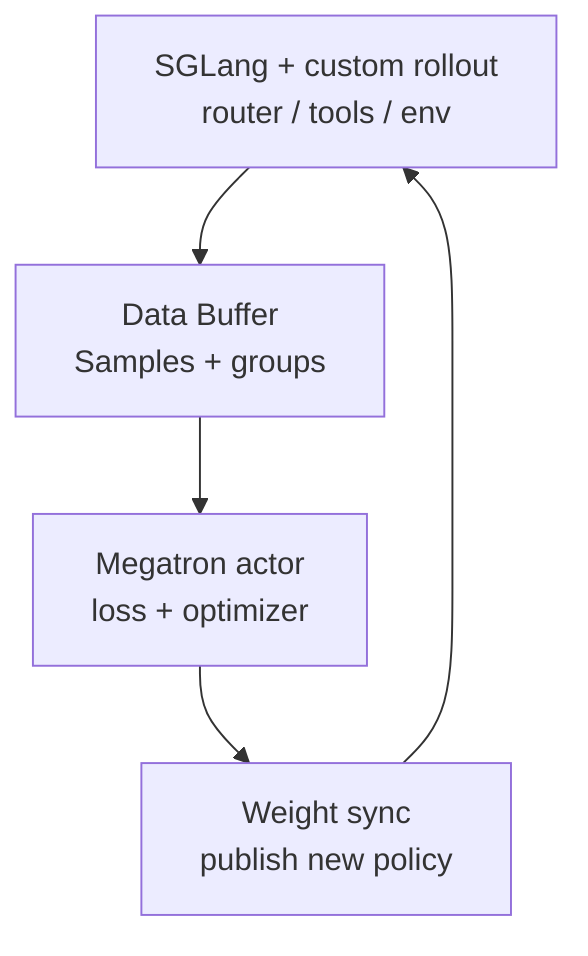

---
{
  "id": "deep-dive-slime",
  "title": "Deep Dive - slime",
  "slug": "deep-dive-slime",
  "section": "Project Deep Dives",
  "category": "Fine-Tuning & Training",
  "difficulty": "Hard",
  "order": 14,
  "coverImage": "illustrations/_generated/slime_sample_ledger_dark.png",
  "companies": [
    "Z.ai",
    "THUDM",
    "SGLang",
    "Megatron-LM",
    "Anyscale"
  ],
  "shortDescription": "Pass rate falls after a green health check. slime has to prove which tokens, masks, and weight version Megatron actually trained.",
  "keyConceptsTested": [
    "Ray placement groups and colocated or decoupled topology",
    "Megatron actor training and token-level rollout data",
    "SGLang servers, sgl-router, and session affinity",
    "Data Buffer groups, loss masks, rewards, and rollout IDs",
    "Synchronous, async, and fully-async training semantics",
    "Full NCCL, full disk, and delta disk weight synchronization",
    "Agentic customization and token lineage",
    "Fault tolerance, governance, and source reading"
  ],
  "prerequisites": [
    "deep-dive-sglang",
    "deep-dive-ray",
    "deep-dive-megatron",
    "deep-dive-skyrl",
    "introduction-to-reinforcement-learning-fundamentals"
  ]
}
---

The last chapter treated <span data-glossary="sglang">SGLang</span> as a serving runtime: tokenize the request, reuse a radix prefix, pack a step, sample tokens. slime sits on the other side of that HTTP interface during reinforcement-learning (RL) post-training.

A coding-agent <span data-glossary="rollout">rollout</span> edits a sandbox, passes tests in a clean grading environment, and earns reward `1.0`. After training on the batch, pass rate falls even though GPUs are busy and every SGLang health check is green. Treat this as a diagnostic scenario: inspect training data, token alignment, and serving-weight versions before assigning a cause.

Don't call that an unstable objective yet. A tool observation may have entered the loss, one trajectory may have been counted twice, or SGLang may still be serving the weights from before Megatron's step.

Follow one trajectory record through that incident. Call it rollout 7. The prompt asks the model to fix a failing test. The model writes a tool call, the sandbox returns an observation, the model writes a patch, and a clean grader returns reward `1.0`. slime has to keep those sampled token IDs, the loss mask, and the group identity intact from SGLang to <span data-glossary="nvidia-megatron">Megatron</span>.[^slime2025repo][^slime2025blog]

Three architectural layers can hide the drop. Ray placement decides which resources may overlap. Timing policy decides how old a sample may be. Weight synchronization decides when a new policy becomes visible. Rollout 7 has to stay identifiable across all three.

Source behavior is pinned to slime commit `681b3adca54105d5ecd3fb822fa0dc58a427e0f9`; the living agent and recovery guides were rechecked October 10, 2026. The recovery section separates the newer retained-serving behavior from this historical source walkthrough. All examples execute CPU-only sample tests with synthetic token IDs, rewards, and weight bytes. They expose correctness conditions while leaving Ray actors, SGLang inference, and Megatron training for a cluster run.[^slime2026sourceSnapshot]

## Keep Megatron and SGLang, own the handoff

RL post-training is an online loop, not a static dataset pass. A prompt reaches a policy, the policy samples one or more responses, an environment or verifier assigns reward, and a trainer changes the policy. The next prompt should eventually see that new policy, while enough work overlaps to keep <span data-glossary="gpu">GPUs</span> busy. Long responses, tool calls, and failed environments make each iteration irregular.

That irregularity is where separate stacks drift. Math, tool use, multi-turn agents, asynchronous sampling, and <span data-glossary="supervised-fine-tuning">supervised fine-tuning</span> can each grow different assumptions about tokens, rewards, and retries. slime keeps the training and serving engines near their upstream interfaces, then puts data-generation and reward logic behind explicit hooks.[^slime2025blog]

The ownership split is deliberate. Megatron owns high-throughput parameter updates. SGLang owns token generation behind a router. Ray owns placement and actor lifecycle. slime owns the handoff, sample schema, timing policy, and checks that keep rollout data aligned with training.

An agent workflow can use a <span data-glossary="sandbox">sandbox</span>, search service, browser, tool server, or another model. Its adapter must still preserve the token-level training schema. slime's hook interface doesn't authorize those tools: credentials, network access, sandbox isolation, and write permissions belong to the application running the rollout.

```checkpoint
Why does slime expose custom generation instead of defining one agent class?
---
Agent environments have different message formats, tools, state, and stopping rules. A custom generation hook lets each workflow keep its own loop while returning token-level Samples that the shared rollout and training code can validate.
```

## A token ledger between two engines

Start with a prediction. If one response contains model tokens, a tool observation, and more model tokens, what tells the trainer which positions deserve credit?

A rollout acts as a ledger entry. Its prompt and sampled response carry the sequence, while log probabilities, loss masks, reward, status, and rollout ID explain how that sequence should affect the next <span data-glossary="gradient">gradient</span> update. Ray decides where the ledger work runs. The Data Buffer keeps entries available until the trainer consumes a complete group.

The policy appears twice, with different jobs. SGLang reads current weights and produces tokens quickly. Megatron reads those tokens and computes losses, gradients, and <span data-glossary="optimizer">optimizer</span> updates. A weight-sync operation is the commit that changes what SGLang will sample next. Delay that commit and data becomes off-policy by design, so timing must be recorded rather than inferred later.



Ray places the rollout and training actors; the arrows here carry data or weight updates, not placement requests. A generated response isn't ready for training until its <span data-glossary="token">token</span> IDs, response length, loss mask, reward, and acceptance status agree. A weight update isn't complete until rollout engines have loaded the intended version and can serve again.

Now ask where that ledger can live. Which GPUs may generate while others train, and which sync path makes that overlap legal? Ray answers the placement question before SGLang or Megatron sees a token.

## Ray placement defines cluster topology

Ray placement groups reserve bundles such as one GPU plus one central processing unit (CPU) slot. slime builds one placement group, labels bundles for actor training or rollout, and sorts them by node and physical GPU so distributed rank order stays stable. This code is infrastructure, but it decides whether a sync path can work.

With `--colocate`, actor training and rollout share a GPU allocation. One side must offload before the other can use that memory. Without colocation, actor and rollout receive separate bundles and can overlap more freely, at the cost of extra hardware and a weight-transport boundary. Async training requires the decoupled shape in `train_async.py`; its first assertion rejects colocation.

| Topology | Ray allocation | What it enables | Main pressure |
| --- | --- | --- | --- |
| Colocated | One shared GPU range | Less hardware, simple local transfer | Memory eviction and blocked overlap |
| Decoupled | Actor and rollout ranges | Training and generation can overlap | Weight transport and shared storage |
| External rollout | Actor range plus external SGLang endpoints | Separately operated serving cluster | Compatible management APIs, storage, and versions |

The same placement group can describe server groups with different sizes. SGLang configuration supports regular, <span data-glossary="prefill">prefill</span>, decode, and placeholder groups. A placeholder reserves GPU slots without creating an engine, while Ray still accounts for every slot. Heterogeneous layout changes where requests run, not what a `Sample` means.

slime passes Megatron arguments directly and prefixes installed SGLang arguments with `--sglang-`. Tensor, pipeline, expert, context, and data parallel settings stay visible to Megatron, while serving flags stay available to SGLang. A run should persist resolved arguments, bundle-to-node mapping, topology, sync mode, and policy version alongside its rollout run log. The launch file explains intent; that resolved record proves what ran.[^slime2026docs]

```checkpoint
When should a reader choose decoupled placement for a long-horizon agent?
---
Choose it when generation and training need independent memory or when agent rollouts have a heavy latency tail. Keep a versioned transport and recovery plan because every overlap introduces a weight-staleness and visibility gap.
```

## SGLang and sgl-router own rollout

At the rollout interface, ask which representation can be trusted after a tool loop: decoded text or the IDs sampled by the policy?

slime launches SGLang in server mode and keeps a router endpoint in front of its workers. A regular sample is tokenized, sent to `/generate` with `return_logprob=True`, and returned with response token IDs, per-token log probabilities, and metadata. Text helps an operator inspect a run; token IDs remain the training source of truth.

The previous chapter's radix prefix cache still matters here. With `router_policy=consistent_hashing`, slime sends `X-SMG-Routing-Key` from the sample session ID, so one multi-turn session can return to the same worker and reuse its <span data-glossary="prefix-cache">prefix cache</span>. That improves locality, not lineage. The trajectory manager still has to prove which tokens came from the model.

The default rollout function creates sample groups, runs generation concurrently, computes rewards, and waits until the requested batch is valid. Dynamic sampling can discard groups whose reward variation is unhelpful. Partial rollout mode can abort requests and keep unfinished samples for a later pass. SGLang's `/abort_request` endpoint supports that early stop when oversampling has already found enough valid responses.[^slime2025blog]

That gives an operator two separate questions: did the request finish with a valid trajectory, and what status did an abort or retry leave? Record both beside the sample so a partial response cannot look complete.

For <span data-glossary="mixture-of-experts">mixture-of-experts (MoE)</span> rollouts, the same pass-through lets you set `--sglang-moe-a2a-backend deepep`. That flag changes how expert-parallel tokens move inside SGLang. It doesn't change what a Sample must contain when it reaches the buffer.

There are two useful debug modes. `--debug-rollout-only` exercises generation without training; use `--save-debug-rollout-data` with a path to retain its samples. `--debug-train-only` isolates the training side, with `--load-debug-rollout-data` providing a saved batch for replay. These modes help place a reward or <span data-glossary="tokenization">tokenization</span> defect before or after the Data Buffer.[^slime2026faulttolerance]

## Data Buffer coordinates the rollout handoff

The logical Data Buffer is the bridge from prompt initialization to generated samples. A data source supplies groups, the rollout function fills them, and the manager converts Samples into tensors and schedules them across <span data-glossary="data-parallelism">data-parallel</span> ranks. The optional `slime_plugins/rollout_buffer` runs a separate HTTP service for agent trajectory generation, but it still returns the same grouped evidence.

Each Sample carries more than text. `tokens` contains prompt IDs followed by the response-side sequence, including any tool observations inserted during the trajectory. `response_length` counts the entire response-side suffix, including tool observations. `loss_mask` identifies response positions that contribute to policy loss. A zero mask excludes the observation as a training target; the observation remains in the context used to predict later model tokens.

Keep three identities separate: `group_index` groups independent attempts at one prompt, `rollout_id` groups segments from one agent execution, and `weight_versions` records serving-policy versions. None substitutes for the others. In particular, the manager's numbered rollout *batch* isn't the same thing as every Sample's trajectory ID.[^slime2026sampleContract]

Predict before reading the figure. Rollout 7 has prompt IDs `[101, 102]`, then a six-token response: model tool call `[11, 12]`, tool observation `[50, 51]`, and model answer `[13, 14]`. The prompt is outside the response mask, and only four model positions should train.

| Field | Producer | Training meaning | Failure if missing |
| --- | --- | --- | --- |
| `tokens` | SGLang or custom adapter | Exact sequence for forward pass | Re-tokenization changes target |
| `rollout_log_probs` | SGLang | Off-policy correction or diagnostics | Mismatch is invisible |
| `loss_mask` | Custom adapter or converter | Which positions enter target loss | Tool observations get trained |
| `reward` | Verifier or <span data-glossary="reward-model">reward model</span> | Advantage input | No learning signal |
| `rollout_id` | Data source or fan-out hook | One trajectory denominator | Segments count as separate rollouts |
| `status` | Rollout worker | Complete, truncate, abort, or fail | Acceptance policy can't distinguish outcomes |

<figure>
  
  <figcaption>The six response positions align with six mask and log-probability entries. The two observation tokens remain in context but have zero target weight. Their zero log-probability entries are placeholders, not sampled probabilities.</figcaption>
</figure>

The manager can normalize rewards for estimators such as <span data-glossary="grpo">Group Relative Policy Optimization (GRPO)</span>, then prepares training fields and a data-parallel schedule. Custom generation can return several Samples for one compacted trajectory. Those siblings need one `rollout_id`, so the configured loss reduction can use the combined trainable-token count. Don't assume flattening variable-sized branches preserves the intended prompt-level reward groups: inspect reward postprocessing as well as the loss denominator.

Check the handoff before the GPU step. Sum trainable positions, inspect status, and group by rollout ID. If those counts change when an adapter changes its message format, the bug is in the handoff even if reward calculation still returns a number.

An external rollout buffer adds another coordination layer. Its generators write items over HTTP, group them by instance ID, and expose valid groups to the trainer. If the service loses a process or clears temporary data, the trainer may still be healthy while its next batch is empty. Treat buffer availability, group completeness, and metadata freshness as separate health signals.

This local validator deliberately accepts only completed trajectories. Slime itself has additional statuses, including usable truncations and recoverable failures; their acceptance policy is workload-dependent. The validation function below is a standalone verification utility, not the upstream `Sample` class. It checks aligned log probabilities, binary masks, nonempty model output, and finite reward before returning a count:

<!-- leetllm: test, output=show, deps=numpy -->
```python title="sample_trajectory_schema.py"
from dataclasses import dataclass, replace
import numpy as np


@dataclass
class Sample:
    tokens: np.ndarray
    loss_mask: np.ndarray
    response_length: int
    reward: float
    rollout_id: int
    status: str
    rollout_log_probs: np.ndarray


def prompt_len(sample: Sample) -> int:
    return len(sample.tokens) - sample.response_length


def trainable_positions(sample: Sample) -> int:
    if sample.status != "COMPLETED":
        raise ValueError("Policy accepts completed trajectories only")
    if not (0 < sample.response_length < len(sample.tokens)):
        raise ValueError("Require a prompt and a nonempty response suffix")
    if len(sample.loss_mask) != sample.response_length:
        raise ValueError("Mask length differs from response length")
    if not np.all(np.isin(sample.loss_mask, [0, 1])) or not np.any(sample.loss_mask):
        raise ValueError("Require binary mask and at least one trainable position")
    if len(sample.rollout_log_probs) != sample.response_length:
        raise ValueError("Log probabilities must align with response positions")
    if not np.isfinite(sample.reward):
        raise ValueError("Reward must be finite")
    if not np.all(np.isfinite(sample.rollout_log_probs)) or np.any(sample.rollout_log_probs > 0):
        raise ValueError("Log probabilities must be finite and nonpositive")
    masked_zeros = sample.loss_mask == 0
    if np.any(sample.rollout_log_probs[masked_zeros] != 0.0):
        raise ValueError("Masked observation tokens must have zero logprob placeholder")
    return int(np.sum(sample.loss_mask))


sample = Sample(
    tokens=np.array([101, 102, 11, 12, 50, 51, 13, 14], dtype=np.int64),
    loss_mask=np.array([1, 1, 0, 0, 1, 1], dtype=np.int32),
    response_length=6,
    reward=1.0,
    rollout_id=7,
    status="COMPLETED",
    rollout_log_probs=np.array([-0.2, -0.3, 0.0, 0.0, -0.4, -0.5], dtype=np.float32),
)
assert prompt_len(sample) == 2
assert trainable_positions(sample) == 4

invalid = [
    replace(sample, status="ABORTED"),
    replace(sample, loss_mask=np.array([1, 1], dtype=np.int32)),
    replace(sample, loss_mask=np.array([1, 2, 0, 0, 1, 1], dtype=np.int32)),
    replace(sample, loss_mask=np.zeros(6, dtype=np.int32)),
    replace(sample, response_length=9),
    replace(sample, rollout_log_probs=np.array([-0.2], dtype=np.float32)),
    replace(sample, rollout_log_probs=np.array([0.2, -0.3, 0.0, 0.0, -0.4, -0.5], dtype=np.float32)),
    replace(sample, rollout_log_probs=np.array([-0.2, -0.3, -0.8, 0.0, -0.4, -0.5], dtype=np.float32)),
    replace(sample, reward=float("nan")),
]
for candidate in invalid:
    try:
        trainable_positions(candidate)
    except ValueError:
        pass
    else:
        raise AssertionError("Invalid sample accepted")
print(f"prompt={prompt_len(sample)}, response={sample.response_length}, "
      f"trainable={trainable_positions(sample)}, rejected={len(invalid)}")
```

<!-- leetllm: output:start -->
```text title="Output" output compact
prompt=2, response=6, trainable=4, rejected=9
```
<!-- leetllm: output:end -->

Four response positions train; the two observation positions remain contextual input. The zeros in their log-probability slots are alignment placeholders; check the adapter's event stream for sampled-token probabilities and mask lineage.

## Megatron owns the train step

Megatron receives scheduled token tensors from Ray's object store or tensor transport. Its actor workers initialize distributed process groups, create model and <span data-glossary="optimizer-state">optimizer state</span>, compute log probabilities, and run the chosen RL loss. A critic can run alongside the actor. <span data-glossary="grpo">GRPO</span>-style paths can train without one when relative rewards provide the advantage signal.

The actor group exposes `async_train`, `save_model`, and `update_weights`. `async_train` is the Ray dispatch name here. `train.py` waits for those references before saving or updating rollout weights, so inspect the caller to understand execution timing.

Megatron parallelism remains native. Tensor, pipeline, expert, context, and data parallel groups are created by Megatron. slime converts gathered parameters to the format SGLang expects through raw conversion or a Megatron Bridge path. That keeps optimizer and checkpoint behavior close to Megatron, but version drift in either upstream engine can surface at the conversion interface.

Once rollout 7's tensors are on the actor, the remaining question is timing. Does generation wait for this train step, overlap the next batch, or keep a warm worker across iterations? The answer sets how much policy staleness the training log must explain.

## Three timing models

All three modes use the same Sample data structure. They differ in when a request may run relative to an optimizer step and when a new policy version becomes visible. Tie each name to the concrete loop in the repository before comparing throughput.

### Synchronous: finish, train, sync

Predict the failure mode first: if one verifier takes ten times longer, what waits? `train.py` asks the RolloutManager for one rollout, waits for its data, trains on it, and then calls `actor_model.update_weights()`. If rollout and training are colocated, it can offload memory between those phases.

After a successful sync, the next generation round can use the updated actor. This minimizes cross-round policy lag. Account for multiple optimizer steps, sampling transforms, precision differences, and carried-over partial trajectories when estimating policy lag.

The cost is idle time. A slow verifier or one long response holds the batch open, and training can't use GPUs while generation is still collecting that batch. Dynamic sampling and partial aborts reduce some waste, but the loop remains round-bound.

### Async: start next rollout early

Predict the operational outcome here: a sample can be valid and still come from an older policy. `train_async.py` starts `rollout_manager.generate.remote(next_id)` before training the current rollout. Training and generation occupy separate GPU ranges.

A later `update_weights_interval` controls how often the actor waits for the next rollout future before changing weights. The ordinary async loop drains that future before sync. A completed future marks the awaited rollout operation; a persistent rollout worker needs its own pause/abort state.[^slime2026asyncLoop]

Async reduces idle time, but samples can be generated by an older policy. That staleness is a chosen property, not a hidden bug. Compare rollout and actor weight versions in logs. Increase overlap only after reward and Kullback-Leibler (KL) behavior stay within the experiment's target limits.

### Fully async: keep a warm worker

The fully-async example uses `train_async.py` plus `slime.rollout.fully_async_rollout.generate_rollout_fully_async`. A process-wide thread owns an asyncio loop, keeps a fixed number of `generate_and_rm_group` tasks in flight, and draws new groups from the global data buffer as soon as slots open. Completed groups wait in an output queue until the next training call needs its target batch.

This worker decouples in-flight concurrency from one rollout's batch size. It sorts completed groups by sample index for deterministic handoff, requeues a group containing an aborted Sample, and doesn't support evaluation mode. It also doesn't own pause or weight-update signaling. Each in-flight generation short-circuits on those signals and surfaces `ABORTED`. Long-tail agents can continue while a later train step consumes completed work, but policy staleness and queue <span data-glossary="backpressure">backpressure</span> become operational metrics.

The completion queue is unbounded so a full queue can't block its callback and freeze the asyncio loop. Backpressure instead stops launching new groups once the queued-group count reaches the worker concurrency. Already-running groups can still finish, so this threshold isn't a hard queue-size limit. For concurrency four, four queued groups stop new launches, but an older in-flight group can add a fifth. Training must drain those groups or filter stale data; increasing concurrency doesn't solve a slow consumer.[^slime2026sourceSnapshot]

If queue age rises while GPUs look busy, inspect aborted groups and policy versions before raising concurrency. More workers can make the queue look healthy while producing samples too old to use.

| Mode | Generation trigger | Weight update point | Best fit | Main failure surface |
| --- | --- | --- | --- | --- |
| Sync | Batch must finish before train | Every loop | Debugging and minimal cross-round lag | Longest sample blocks all work |
| Async | Next batch starts during train | Interval, after future drain | Decoupled throughput | Stale policy or update race |
| Fully async | Warm worker spans iterations | Caller-defined, with queue | Long-tail agent trajectories | Queue growth, abort requeue, no eval |

```checkpoint
What makes fully async different from only calling `ray.remote()` earlier?
---
The warm worker keeps generation tasks alive across rollout calls and consumes the shared Data Buffer continuously. A single early `remote()` overlaps one known future; fully async manages a persistent queue, concurrency cap, completion queue, ordering, and abort requeue.
```

## Weight synchronization ensures policy alignment

The optimizer step changes the actor, but rollout workers may live in separate processes or hosts. The actor needs both a transport for parameters and a lifecycle that prevents generation against a partially loaded update. First resolve the actual branch: full, non-disk updates use local tensor transfer for colocation and distributed <span data-glossary="nccl">NCCL</span> otherwise. Full disk and delta disk are separate alternatives.

With colocation, `UpdateWeightFromTensor` uses CUDA interprocess communication (IPC) handles rather than the distributed broadcast path. The `nccl` transport default alone therefore doesn't identify what moved the weights. Delta disk rejects colocation in this snapshot.[^slime2026actorSync]

### Full NCCL

For non-colocated `--update-weight-mode full --update-weight-transport nccl`, NCCL (the NVIDIA Collective Communications Library) carries the update. Training rank 0 pauses generation and flushes SGLang caches. Pipeline-parallel (PP) source ranks gather tensor-parallel (TP) and expert-parallel (EP) shards into Hugging Face (HF)-shaped chunks, then broadcast them to rollout engines. Engines resume after the chunks and any <span data-glossary="quantization">quantization</span> post-processing finish. The rollout-engine lock serializes broadcast operations; it isn't a durable, cross-system transaction log.

Full NCCL avoids writing a checkpoint for each transfer, but its latency depends on gathering, network topology, and synchronization. A restarted engine needs another transfer or a separate checkpoint; the broadcast itself leaves no replay artifact.

### Full disk

Full disk uses `update-weight-mode=full` and `update-weight-transport=disk`. Each sync writes a canonical Hugging Face checkpoint directory under a version such as `weight_v000003`. The rollout engine pulls that directory, optionally into a host-local checkpoint, and reloads through its ordinary `update_weights_from_disk` endpoint. A post-write hook can publish files to an object-store-backed mount before hosts read them.

A versioned directory makes the update inspectable, but not automatically durable. Full-disk reload normally removes the published directory unless `--update-weight-disk-keep-files` is enabled. Retention and durable storage still need explicit configuration. The file is a weight export, not a complete optimizer-and-data-source recovery checkpoint.

Publication and an optional host-local pull occur **before** generation is paused. Pause, cache flush, and reload form the live-weight transition. Verify that every engine reads the published bytes, then check readiness across the fleet after reload.

### Delta disk

Delta mode is disk-only and non-colocated. The trainer first captures a CPU baseline seeded from `--hf-checkpoint`, then diffs each gathered HF tensor on later syncs. Changed bytes are compressed with zstd and written as a self-describing version. Each rollout host applies the delta into its local full checkpoint through `/pull_weights`, verifies per-tensor <span data-glossary="checksum">checksums</span>, and reloads through the same disk endpoint used by full sync.

Exclusive-or (XOR) encodes byte differences; compression savings depend on how much changes, not on the mode name. A raw XOR patch must be applied once to the intended base. `overwrite` stores changed positions and values, so repeating the same writes doesn't toggle them back, but it still needs the correct base and version ordering. The index records those identities and a new-state checksum. Neither an xxHash checksum nor a version number authenticates an untrusted publisher.[^slime2026deltaSync]

<!-- leetllm: test, output=show, deps=numpy -->
```python title="xor_delta_once.py"
import numpy as np


def xor_buffers(left: np.ndarray, right: np.ndarray) -> np.ndarray:
    if len(left) != len(right):
        raise ValueError("Patch and base lengths must match")
    return np.bitwise_xor(left, right)


base = np.array([1, 2, 3, 4], dtype=np.uint8)
new = np.array([1, 2, 8, 4], dtype=np.uint8)
delta = xor_buffers(new, base)
applied_once = xor_buffers(base, delta)
applied_twice = xor_buffers(applied_once, delta)
assert np.array_equal(applied_once, new)
assert np.array_equal(applied_twice, base)
try:
    xor_buffers(base, delta[:-1])
except ValueError:
    pass
else:
    raise AssertionError("Truncated delta accepted")
print(delta.tolist(), applied_once.tolist(), applied_twice.tolist())
```

<!-- leetllm: output:start -->
```text title="Output" output compact
[0, 0, 11, 0] [1, 2, 8, 4] [1, 2, 3, 4]
```
<!-- leetllm: output:end -->

Byte `8 ^ 3` is `11`. Applying the patch once reaches the new state. Applying it twice restores the base, which is why a repeated XOR is dangerous: it can look successful while serving the old model.

Keep source version, declared base, destination, checksum, reload result, and served version together. Before retrying, determine whether the local base was already patched; if its state is ambiguous, stop new rollouts and repair from a known checkpoint. Don't blindly XOR again. Crash-safe recovery needs atomic persistence of bytes and version state. The four-byte example illustrates comparison only.

These are **argument fragments**, not a runnable shell command. Add them to a compatible non-colocated training launch with model, dataset, actor, and SGLang configuration. The shared directory must be visible to all participating hosts; the local checkpoint path is host-local:

```bash title="delta_sync_flags.sh"
--update-weight-mode delta \
--update-weight-transport disk \
--update-weight-disk-dir /shared/fs/delta-updates \
--update-weight-local-checkpoint-dir /local/nvme/rollout-ckpt \
--update-weight-delta-encoding xor \
--update-weight-delta-checksum xxh3-128
```

<figure>
  
  <figcaption>Order matters: disk preparation can happen while old weights remain live. Pause generation for the live reload; file publication can happen earlier. Equal-sized cells show sequence only, so measure each path's latency separately. Colocated IPC is a separate branch.</figcaption>
</figure>

| Path | Carrier | Engine-side state | Strong guard | What it can't hide |
| --- | --- | --- | --- | --- |
| Full colocated | CUDA IPC tensor handles | Shared-device weight transfer | Offload and engine lifecycle | IPC isn't a durable checkpoint |
| Full NCCL | NCCL broadcasts | Live SGLang weights | Pause and flush around chunks | A lost engine needs another transfer |
| Full disk | Shared filesystem | Complete HF weight export | Versioned directory and reload | Visibility and retention are separate |
| Delta disk | Shared filesystem plus local checkpoint | Patched full checkpoint | Base version and per-tensor checksum | A bad baseline poisons every later diff |

## Agentic customization keeps token lineage

Start agentic work with `--custom-generate-function-path` when one prompt should run a custom loop. The function can call tools, retrieval, a browser, a sandbox, or another service, then return one Sample or a list of sibling Samples. Use `--custom-rm-path` for verifier or environment reward.[^slime2026customization][^slime2026agents]

Replace the whole rollout function only when scheduling or buffering can't fit the default per-sample loop. Keeping the default orchestration leaves grouping, validation, and handoff behavior visible while the custom hook owns the environment-specific work.

Calling a tool is the smaller step. Preserving token lineage around that call is what keeps the training target honest. Model-generated output tokens should have `loss_mask=1`. Tool observations, template fragments, and environment text inserted into the response suffix should normally have `loss_mask=0`; the initial prompt sits outside that mask. The adapter records sampled token IDs and log probabilities directly from SGLang instead of decoding text and tokenizing it again.

When a reward changes, inspect this interface before changing the objective. Compare the sampled IDs, mask, response length, verifier input, and policy version. A readable transcript can hide a different training target.

slime ships protocol adapters for that job. `AnthropicAdapter` and `OpenAIAdapter` render a chat template, call SGLang with `input_ids` and `return_logprob=True`, and export the returned IDs as trainable segments. They also pass a stable `session_id` as `X-SMG-Routing-Key`. The adapters are a convenience layer, not a second agent framework.

One agent execution can fan out into subagent or compaction segments. Return them with the same `rollout_id`. Choose reward normalization from the reward-to-advantage processing and loss reduction; the segment count alone does not determine it. In the pinned per-rollout-mean path, sibling losses already share the rollout's total trainable-token denominator. Scaling their advantages down again would reduce that rollout's contribution.[^slime2026customization][^slime2026lossReduction]

Hold per-token loss terms fixed at `[1, 3, 5, 7]`. Splitting them into two segments must not change their mean from 4 to 8, or halve it to 2. This isolates the reduction arithmetic; it doesn't simulate GRPO reward normalization or gradients:

<!-- leetllm: test, output=show, deps=numpy -->
```python title="segment_loss_reduction.py"
import numpy as np

segments = [np.array([1.0, 3.0], dtype=np.float32), np.array([5.0, 7.0], dtype=np.float32)]
denominator = sum(len(segment) for segment in segments)
one_rollout = float(sum(np.sum(segment) / denominator for segment in segments))
wrong_independent = float(sum(np.mean(segment) for segment in segments))
wrong_extra_halving = float(sum(np.sum(segment) / 2 / denominator for segment in segments))
assert np.isclose(one_rollout, 4.0)
assert np.isclose(wrong_independent, 8.0)
assert np.isclose(wrong_extra_halving, 2.0)

# A different split preserves the same aggregate denominator
rebalanced = [np.array([1.0], dtype=np.float32), np.array([3.0, 5.0, 7.0], dtype=np.float32)]
assert np.isclose(float(sum(np.sum(s) / denominator for s in rebalanced)), one_rollout)
print(f"one rollout={one_rollout:.1f}; independent sum={wrong_independent:.1f}; "
      f"extra halving={wrong_extra_halving:.1f}")
```

<!-- leetllm: output:start -->
```text title="Output" output compact
one rollout=4.0; independent sum=8.0; extra halving=2.0
```
<!-- leetllm: output:end -->

If segments land in different microbatches, compute the denominator over the whole training step first. A microbatch-local denominator would count one rollout repeatedly. Per-token loss modes or custom objectives have different normalization rules, so check the configured reducer before deciding how to assign segment rewards.

| Workflow | Starting hook | Evidence to preserve | Useful artifact |
| --- | --- | --- | --- |
| Search or retrieval-augmented generation (RAG) | `custom_generate` | Query, retrieved context, sampled tokens | Search trace plus reward report |
| Tool agent | `custom_generate` + `custom_rm` | Tool calls, observations, verifier result | Session trajectory and test log |
| Coding agent | Adapter or custom generate | Model tokens, sandbox diff, clean tests | Patch, rollout dump, grader output |
| Multi-agent | `rollout_function` or fan-out generate | Branch IDs and shared rollout ID | Per-branch masks and explicit reward/reduction policy |
| Long-tail agent | Fully-async rollout function | Queue age, abort status, weight version | Replayable debug dump |

The coding-agent example makes this concrete. An agent edits a fresh sandbox, captures a diff, and a clean grading sandbox runs tests on that diff. The training target is still the model's token stream, not final text copied from a log. This split lets teams change the runner without changing Megatron's loss code.

The integration sketch below copies a trajectory's exact sequence, aligned mask and log probabilities, serving weight versions, and verifier reward into one Sample. `run_agent`, `verify`, and the trajectory type are application-owned and omitted; this isn't a drop-in script or a locally executed agent run.

```python title="custom_generate_interface.py"
import torch
from slime.utils.types import Sample

async def custom_generate(args, sample, sampling_params):
    trajectory = await run_agent(sample.prompt, sampling_params=sampling_params)
    sample.tokens = trajectory.prompt_ids + trajectory.response_tokens
    sample.loss_mask = trajectory.response_loss_mask
    sample.response_length = len(trajectory.response_tokens)
    sample.rollout_log_probs = trajectory.response_log_probs
    sample.weight_versions = list(trajectory.weight_versions)
    sample.reward = await verify(trajectory)
    if sample.rollout_id is None:
        sample.rollout_id = sample.index
    if sample.rollout_id is None:
        raise ValueError("A trajectory ID is required")
    sample.status = Sample.Status.COMPLETED
    return sample
```

Tool permissions are application-owned. Preserve the weight-version metadata from the calls that generated each trajectory; a final engine health check can't reconstruct it. Use the real status enum, and test `is None` when choosing an identity because `rollout_id=0` is valid. Mark completion only after the chosen terminal condition and verifier succeed; failures need an explicit retry/drop policy.

## Applications and ecosystem

The pinned README identifies slime as infrastructure for the GLM family and includes launch examples for other model families. These examples document project-reported adoption. For memory, throughput, or quality comparisons, read the model-specific launch script and report, then reproduce the workload on the target configuration.[^slime2025repo]

Choose a starting example by the subsystem your workload stresses: verifier quality, multi-turn context, tool latency, or weight transport. Evaluate coding-sandbox permissions and aborted-generation handling separately from a math-verifier run.

| Application pressure | slime surface | Question to measure |
| --- | --- | --- |
| Verifiable answers | Reward model and group filter | Are reward groups informative? |
| Long context or tools | SGLang router and session key | Are requests pinned without hot spots? |
| Slow sandboxes | Fully-async worker or partial rollout | Is queue age bounded? |
| Separate serving cluster | Disk or delta weight sync | Can every host prove its base version? |
| MoE rollout communication | `--sglang-moe-a2a-backend deepep` | Did expert-parallel tokens take the intended path? |
| New model family | Native Megatron and SGLang pass-through | Which conversion and parser interfaces changed? |

Treat each application as an experiment with full reproducibility. Save resolved launch arguments, <span data-glossary="model-checkpoint">model checkpoint</span>, data revision, reward code, sync mode, topology, policy versions, rollout dumps, and metrics. Without that documentation, a green reward curve can't tell you whether the policy improved or the verifier changed.

## Strengths, limits, and failure paths

slime's strengths come from narrow ownership interfaces. It doesn't hide Megatron parallelism behind a new trainer abstraction or flatten SGLang's serving flags to a lowest common denominator. Upstream engine work can land without a second trainer API, while RL-specific sample and synchronization rules stay in one place.[^slime2025blog]

| Strength | Why it helps | Cost or limit |
| --- | --- | --- |
| Native Megatron path | Mature distributed training and checkpoint tools remain available | Megatron version changes can break bridges |
| SGLang-native rollout | Server, router, caching, and parser features stay visible | SGLang is the chosen rollout backend |
| Ray placement and actors | One resource vocabulary for train and rollout | Ray scheduling and object-store state need operations |
| Explicit Sample schema | Token lineage and group identity are inspectable | Custom hooks must honor many fields |
| Multiple sync modes | Topology can choose NCCL, full disk, or delta disk | Each mode has different recovery and storage risks |
| Lightweight core | Teams can add environments without a framework fork | Application policy, auth, and governance stay outside |

Most production failures cross subsystem seams. A rollout server can stay alive while serving old weights. A reward function can return a number while masking every response token. A fully-async queue can stay busy while repeatedly requeueing aborted groups. Name the subsystem first, then inspect the diagnostic log that crosses it.

| Symptom | Likely subsystem | Check first | <span data-glossary="guardrail">Guardrail</span> |
| --- | --- | --- | --- |
| Reward changes with no code change | Data or verifier | Dataset revision and reward config | Persist input and reward metadata |
| KL spikes after sync | Weight transport | Engine version, pause/flush logs, checksum | Compare weights before serving |
| Agent learns tool observations | Token trajectory | `loss_mask` around tool messages | Assert mask length and source |
| Fully-async throughput falls | Queue or abort path | Queue age, aborted count, worker logs | Requeue intentionally and cap concurrency |
| Disk sync succeeds on trainer only | Filesystem visibility | Host-local checkpoint and hook output | Publish then pull on every host |
| Job hangs after rollout crash | Fault handling | Health monitor and restart logs | Enable health checks and save replay dumps |

## Fault tolerance and reproducibility

In the pinned snapshot, `--use-fault-tolerance` starts heartbeat checks against SGLang servers. If a heartbeat times out, slime stops the unhealthy engine. After the current rollout round finishes, it restarts the engine and applies the correct parameters before future requests. This covers engine recovery between rollout rounds. A failed trainer rank or preempted cluster job needs checkpoint recovery.[^slime2026faulttolerance]

The current recovery guide, checked October 10, 2026, describes a broader failure scope. Health recovery is enabled by default for serving clusters started by slime; `--use-fault-tolerance` remains a compatibility flag. A named, detached serving actor can survive a failed training attempt while the Ray cluster remains alive. With straw storage or versioned rollout debug dumps, resubmitting training can replay retained batches after the last committed model checkpoint. Ordinary stateful optimization requires optimizer and RNG state as well as model state. Without retained rollout data, keeping serving alive does not reconstruct those batches.[^slime2026faulttolerance]

For example, suppose checkpoint 10 is committed, batches 11 and 12 train, and the trainer fails before checkpoint 12 commits. Recovery must restore checkpoint 10 and retrain the retained batches, including batch 12 even if its earlier optimizer step finished. Skipping directly to batch 13 would combine old checkpoint weights with advanced data progress. Keep the same serving session identity and compatible rollout configuration, resubmit explicitly, and inspect replay logs. Losing the serving actor or Ray cluster still requires fresh serving and checkpoint recovery. Changing parallel layouts can also change updates even when endpoints persist.[^slime2026faulttolerance]

Debug replay narrows the search. Save a rollout with `--save-debug-rollout-data`, load it with `--load-debug-rollout-data`, and use `--debug-train-only` to replay conversion and training without starting SGLang. Pair the dump with checkpoints, trace spans, and a pinned launch command. Load only trusted dumps: the pinned replay path uses PyTorch deserialization with `weights_only=False`, not a safe parser for arbitrary uploads.

Recovery has its own false positives. Health checks can mistake first-run kernel compilation for a dead server, so the docs expose a first-wait setting. Fully-async workers can hide slow samples in a warm queue, so log queue length and completion age. Disk sync can hide stale mounts, so verify every host's local checkpoint and weight version.

The repository's continuous integration (CI) mirrors this split. CPU tests cover Sample behavior, rollout validation, argument schemas, and customization hooks. GPU end-to-end tests cover Megatron, SGLang deployment, async rollout, checkpointing, precision, and replay. Include an environment-specific multi-node smoke run that verifies sync visibility in the release record.

## Project identity

slime is published through the THUDM organization, whose official profile identifies its THUKEG and Z.ai lineage.[^thudm2026org] The repository citation names Zilin Zhu, Chengxing Xie, Xin Lv, and slime contributors. The introductory blog frames the project around an SGLang-native rollout path, Megatron training, Ray resource management, and custom data generation.[^slime2025repo][^slime2025blog]

| Field | Current project fact |
| --- | --- |
| Origin | THUDM and Z.ai built slime for post-training workflows that connect Megatron, SGLang, and Ray.[^slime2025repo][^slime2025blog] |
| Founding contributors | The repository citation names Zilin Zhu, Chengxing Xie, Xin Lv, and slime contributors.[^slime2025repo] |
| Stewardship | Z.ai leads the roadmap. Public contribution scope emphasizes bug fixes and general RL optimizations that its CI can verify.[^slime2026contributing] |
| Source license | slime source is Apache-2.0, with Zhipu AI copyright notices.[^slime2026license] |
| Commercial scope | The framework is open source, and project policy prioritizes Z.ai's internal development roadmap, so governance remains vendor-led.[^slime2026contributing] |
| External assets | GLM checkpoints, other model weights, datasets, environments, and reward services retain separate licenses and terms. |

The first release notes describe v0.1.0 as focusing on <span data-glossary="mixture-of-experts">MoE</span> inference, memory offload, faster parameter updates, Megatron parallel strategies, and strict correctness checks. Those notes describe that release; check the current branch before relying on the same performance or feature set.[^slime2025repo]

Use the pinned source for implementation behavior and the LMSYS design post for architectural motivation. Model reports and related systems papers answer different questions. Validate each framework path with its own source inspection and tests.

Contribution policy is intentionally focused. Bug fixes and general RL optimizations that can be verified through CI are welcome. Large refactors, universal agent abstractions, and changes that can't be tested against routine training stay outside core scope. That governance keeps internal and open development aligned while leaving application-specific systems in their own repositories.[^slime2026contributing]

That history explains the project's shape. slime doesn't own every environment, reward model, or serving backend. It concentrates on the handoff between training and rollout, then lets teams compose the rest around stable contracts. Which file owns each side of that handoff?

## A source and code reading route

Read one vertical path before opening every module. This walkthrough uses the official slime repository at commit `681b3adca54105d5ecd3fb822fa0dc58a427e0f9`.[^slime2026sourceSnapshot] Start with the README architecture section and introductory blog to see why Ray, Megatron, SGLang, and the Data Buffer are separate. Then open `train.py` and `train_async.py` side by side. Mark each `ray.get`, `generate.remote`, and `update_weights` call. That is the timing model in executable form.

Next inspect `slime/ray/placement_group.py` and `slime/ray/rollout.py`. Follow how bundles become server groups, how routers start, and how `RolloutManager.generate()` converts nested Samples into train data. Read `slime/rollout/sglang_rollout.py` for prompt IDs, session routing, aborts, and reward calls. Compare `slime/rollout/fully_async_rollout.py` with the fully-async example to see queue lifetime and abort requeue.

For weight synchronization, read `slime/ray/actor_group.py`, then the transport modules under `slime/backends/megatron_utils/update_weight/`: `update_weight_from_distributed.py`, `update_weight_from_disk.py`, and `update_weight_from_disk_delta.py`. Start with actor-group lifecycle. The transport modules show gathering, publication, and reload orchestration. For engine-side delta application, follow `pull_weights` in `slime/backends/sglang_utils/sglang_engine.py` through its management endpoint and helpers. Trace `source_version`, `base_version`, and engine state step by step across a single weight-sync cycle.

For agents, read the published customization and agent guides alongside `examples/coding_agent_rl`. Compare their examples with the pinned `Sample` type and `get_sum_of_sample_mean` reducer before adapting a reward rule. For operations, use the fault-tolerance guide to choose a recovery experiment, then inspect the corresponding implementation and verify restored state alongside service health.[^slime2026customization][^slime2026agents][^slime2026faulttolerance]

Carry one question into every repository: which state is canonical at this step? In slime, state ownership sits in token IDs during rollout, grouped Samples in the buffer, Megatron parameters during training, and a versioned sync artifact before SGLang serves again.

Before Megatron steps, line up rollout 7's reward of 1.0 with the mask, the rollout ID, and the served weight version. If they agree, Megatron can take the step.

## What to remember

- Ray placement groups make train and rollout topology explicit, including colocation, decoupling, and external engines.
- SGLang and sgl-router generate token evidence; Megatron consumes that evidence for distributed actor training.
- The Data Buffer interface is token based. Preserve log probabilities, loss masks, rewards, statuses, and rollout IDs.
- Synchronous training waits for each round. Async training overlaps one future rollout. Fully async keeps a warm worker and queue across iterations.
- Colocated full sync uses CUDA IPC. Non-colocated NCCL streams chunks; disk paths publish full weights or checked deltas before live reload.
- Agent hooks can add tools, sandboxes, search, and branches without changing the training kernel, but token lineage remains the correctness rule.
- The pinned health monitor restarts rollout engines. Newer retained-serving recovery can replay saved batches after a trainer failure, while cluster loss still needs checkpoint and scheduler recovery.
- Read code by following one Sample and one weight version from source to engine, then verify claims against first-party docs.

## Evaluation rubric

- Trace one trajectory's token IDs, response mask, log probabilities, status, and serving-policy versions through rollout and training.
- Distinguish independent attempts from segments of one execution, and calculate the correct loss denominator across microbatches.
- Explain what ordinary async waits for and what a persistent custom rollout worker must coordinate separately.
- Choose a weight-sync path for a stated topology and identify its base-version, visibility, retention, and recovery checks.

## Follow-up questions

```checkpoint
An agent adapter changes from two segments to five without changing its generated tokens. Which checks establish that its training contribution stayed the same?
---
Compare exact token IDs, masks, rollout identity, reward-to-advantage processing, and the denominator across the whole training step. Hold per-token loss terms fixed and confirm that resegmenting preserves their aggregate; matching final reward alone can hide different training weights.
```

```checkpoint
A delta reload succeeds on seven of eight engines. What evidence would you require before serving new requests?
---
Check the serving membership and every serving engine's loaded version. Quarantine the failed engine rather than treating seven reloads as fleet success. Establish its local base and patch verification log; if those are ambiguous, restore known complete weights before rejoining. A healthy endpoint or correct trainer checkpoint alone is insufficient.
```

```mastery-quiz
[
  {
    "question": "A fresh Sample has 3 prompt IDs and 7 response positions. Its response mask is [1,0,0,1,1,1,0] with aligned log probabilities [−0.2,0,0,−0.4,−0.6,−0.8,0]. Under the completed-only local validation schema, what are response length, selected count and negative mean selected log probability?",
    "options": [
      "10; 4; 0.2",
      "7; 7; 2/7",
      "7; 4; 0.5",
      "4; 4; 0.5"
    ],
    "answer": "7; 4; 0.5",
    "explanation": "The response suffix includes observations, so its length is 7. Four selected log probabilities sum to −2, giving negative mean 2 / 4 = 0.5. Prompt IDs are outside the response mask; zero placeholders do not add sampled targets."
  },
  {
    "question": "Two different prompts have 2 and 3 independent executions. Their segment counts are [1,4] and [2,1,3], respectively. Which prompt-group, rollout-identity and Sample totals preserve those relationships?",
    "options": [
      "2 prompt groups; 5 rollout IDs; 11 Samples",
      "1 prompt group; 5 rollout IDs; 11 Samples",
      "2 prompt groups; 11 rollout IDs; 11 Samples",
      "5 prompt groups; 2 rollout IDs; 5 Samples"
    ],
    "answer": "2 prompt groups; 5 rollout IDs; 11 Samples",
    "explanation": "The two prompts need two groups. Their 2 + 3 independent executions need five rollout IDs, shared within each execution’s siblings. Segment counts sum to 1 + 4 + 2 + 1 + 3 = 11 Samples. Neither the number of segments nor policy versions replace those identities."
  },
  {
    "question": "One execution’s fixed loss terms [2,4,9] are split into a one-token and a two-token segment on different microbatches. Under the taught shared whole-rollout token denominator, what do their contributions sum to?",
    "options": [
      "8.5",
      "2.5",
      "15",
      "5"
    ],
    "answer": "5",
    "explanation": "Compute the denominator over the whole execution before splitting: 3. The segments contribute 2/3 and 13/3, summing to 5. Independent segment means sum to 8.5; an extra halving gives 2.5; the raw sum 15 omits normalization."
  },
  {
    "question": "A warm worker’s launch threshold is 3 queued groups. Two groups are queued and two tasks are running. Both tasks finish, each producing one group, before the trainer takes two groups from the queue. No new task starts. How many groups were queued at the peak, and is the launch gate open or closed just after the drain?",
    "options": [
      "Peak of 4, gate closed",
      "Peak of 3, gate open",
      "Peak of 4, gate open",
      "Peak of 3, gate closed"
    ],
    "answer": "Peak of 4, gate open",
    "explanation": "The first completion brings the queue to 3 and closes the launch gate. The other task is already running, so its result joins the queue and brings the peak to 4. A peak of 3 would treat the launch threshold as a limit on completed results. The trainer takes two groups, leaving 2 queued. The gate reopens as soon as the count falls below 3. Keeping it closed until the queue empties would delay new work."
  },
  {
    "question": "For the inspected source dispatch, request A uses full mode, NCCL transport and colocation. Request B uses delta mode, disk transport and separate rollout GPUs. Which selected carriers match both cases?",
    "options": [
      "A tensor/IPC path; B disk-delta path",
      "A distributed NCCL path; B disk-delta path",
      "A tensor/IPC path; B distributed NCCL path",
      "A disk-full path; B tensor/IPC path"
    ],
    "answer": "A tensor/IPC path; B disk-delta path",
    "explanation": "After the mode/transport checks, colocated full selects the tensor updater despite the NCCL transport flag. Noncolocated delta with disk satisfies the delta branch. These are selected source branches; actual runtime visibility still needs verification."
  },
  {
    "question": "Drain check U waits for futures A and B. Check V waits for B and C. A and B have finished, and C is still running. A sampled from policy v13 and B sampled from v14. The actor has since reached v15. Which checks are satisfied, and which policy versions should the trainer record for the samples from A and B, respectively?",
    "options": [
      "Both U and V, with v13 on A and v14 on B",
      "Only U, with v15 on A and v15 on B",
      "Only U, with v13 on A and v14 on B",
      "Both U and V, with v15 on A and v15 on B"
    ],
    "answer": "Only U, with v13 on A and v14 on B",
    "explanation": "A and B have both finished, so U is satisfied. Counting V as satisfied on the strength of B alone overlooks its wait for C. Each sample keeps the version that generated its tokens. Recording v15 on both would replace their sampling history with the actor’s later version. These checks cover only the named futures."
  },
  {
    "question": "A versioned XOR patch declares base v5, destination v6 and delta bytes [0,5,0], transforming [10,12,4] to [10,9,4]. Host A already has v6 and the target bytes. Host B has v4 and the old bytes. What should the taught guarded retry do?",
    "options": [
      "A XOR again; B apply because the bytes look old",
      "A no write; B reject wrong base",
      "A no write; B apply then advance its version",
      "A XOR again; B reject wrong base"
    ],
    "answer": "A no write; B reject wrong base",
    "explanation": "A matches the destination and should not reapply XOR: 9 XOR 5 would restore 12. B has a wrong declared base version even though its bytes resemble the old baseline. Reconcile or restore known complete state before mutating either host."
  },
  {
    "question": "Run R retains a complete committed checkpoint at step 30 with model, optimizer, scheduler and RNG plus compatible retained batches 31 / 32. Its full-disk HF weight export was removed after reload. Run S retains only its HF weight export, with no trainer state or batches. Which prerequisite/export tuple follows?",
    "options": [
      "R replay prerequisites absent/export absent; S prerequisites present/export present",
      "R replay prerequisites present/export present; S prerequisites absent/export absent",
      "R replay prerequisites absent/export present; S prerequisites present/export absent",
      "R replay prerequisites present/export absent; S prerequisites absent/export present"
    ],
    "answer": "R replay prerequisites present/export absent; S prerequisites absent/export present",
    "explanation": "R has the designated checkpoint and post-checkpoint data needed to attempt replay, while the separate weight-transfer export is absent. S has transfer bytes but lacks full training-recovery state. Neither tuple proves that replay or cluster recovery actually ran."
  },
  {
    "question": "Trusted dump T from the frozen run passes integrity and compatibility checks. File U comes from an unknown uploader with a .pt suffix. The inspected replay path uses weights_only=False and no cluster was exercised. Which acceptance/evidence tuple follows?",
    "options": [
      "T accepted; U accepted; cluster evidence absent",
      "T held; U accepted; cluster evidence present",
      "T accepted; U held; cluster evidence absent",
      "T accepted; U held; cluster evidence present"
    ],
    "answer": "T accepted; U held; cluster evidence absent",
    "explanation": "Validate input safety before the general PyTorch loader; a .pt suffix does not verify safety for U. Preserve exact token logs in T. A local CPU or simulated replay result cannot validate a multi-node Ray, Megatron, or SGLang cluster run."
  },
  {
    "question": "A checkpoint stores weight w = 2 and velocity v = 0.1. Each batch with fixed gradient g updates v ← 0.8v + g, then w ← w − 0.1v. Two batches ran after the checkpoint with gradients 0.4 and −0.2 in that order. Only the second batch was retained. Starting from the checkpoint in each case, what (weight, velocity) do you get from the second batch alone, and what would you get from replaying both batches in order?",
    "options": [
      "Second only (2.012, −0.12), both (1.9336, 0.184)",
      "Second only (2.012, −0.12), both (1.964, −0.12)",
      "Second only (2.02, −0.2), both (1.964, −0.12)",
      "Second only (2.02, −0.2), both (1.9336, 0.184)"
    ],
    "answer": "Second only (2.012, −0.12), both (1.9336, 0.184)",
    "explanation": "Applying only the second gradient gives v = 0.8 × 0.1 − 0.2 = −0.12, so the weight rises to 2.012. The pair (2.02, −0.2) starts with zero velocity. In full replay, the first batch brings velocity to 0.48 and weight to 1.952. The second gives v = 0.8 × 0.48 − 0.2 = 0.184 and w = 1.952 − 0.1 × 0.184 = 1.9336. The pair (1.964, −0.12) keeps the updated weight but resets velocity to 0.1 before the second batch. A record that the first batch ran cannot restore its update."
  }
]
```

> **Next:** Continue to [Deep Dive - DeepEP](/learn/deep-dive-deepep). slime's SGLang rollout can pass `--sglang-moe-a2a-backend deepep`, so mixture-of-experts generation uses DeepEP during rollouts. The next chapter opens that dispatch and combine path: how routed tokens actually move across GPUs and nodes.
