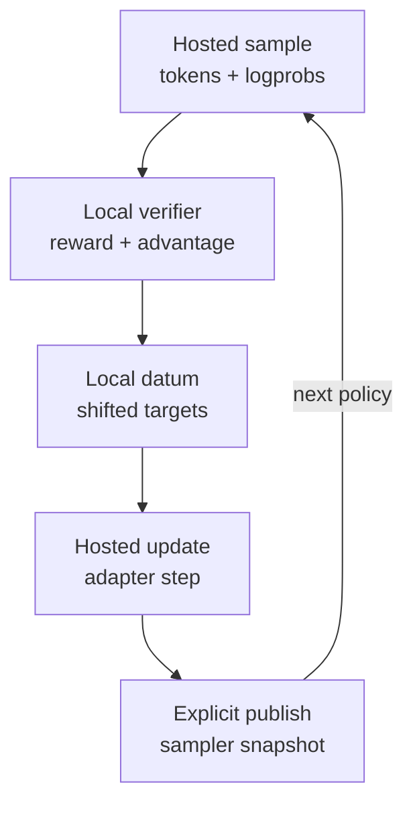
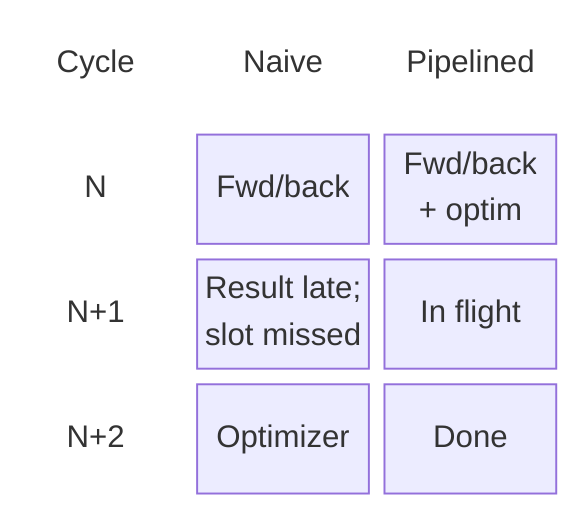

---
{
  "id": "deep-dive-tinker",
  "title": "Deep Dive - Tinker",
  "slug": "deep-dive-tinker",
  "section": "Project Deep Dives",
  "category": "Fine-Tuning & Training",
  "difficulty": "Hard",
  "order": 16,
  "coverImage": "illustrations/_generated/tinker_control_plane_dark.png",
  "companies": [
    "Thinking Machines Lab"
  ],
  "shortDescription": "Loss is lower, but the next sample still returns the old answer. Tinker splits that failure between your loop and the hosted LoRA adapter.",
  "keyConceptsTested": [
    "Hosted service versus Apache-2.0 SDK and cookbook",
    "ServiceClient, TrainingClient, and SamplingClient interfaces",
    "forward_backward, optim_step, sample, and save_state",
    "LoRA adapter updates versus full-parameter training",
    "RL token, logprob, advantage, and mask formats",
    "Clock cycles, futures, and pipelined training",
    "Checkpoint, sampler export, and Hugging Face conversion",
    "Data, model terms, governance, and production failure modes",
    "Tinker versus DeepEP responsibility division"
  ],
  "prerequisites": [
    "deep-dive-slime",
    "deep-dive-skyrl",
    "deep-dive-megatron",
    "introduction-to-reinforcement-learning-fundamentals"
  ]
}
---

Your `clamp` fine-tuning run reports steadily falling loss, yet the next sampled completion still returns `return x` and earns reward `0`. The remote worker accepted both `forward_backward` and `optim_step` without error. Before touching the learning rate, ask three sharper questions: did your loop send the right shifted targets, did the remote worker update the adapter you think it updated, and did the sampler actually load that new snapshot?

**Tinker** is Thinking Machines Lab's hosted <span data-glossary="lora">low-rank adaptation (LoRA)</span> training service, paired with an open-source Python SDK (`tinker`) and recipe library (`tinker-cookbook`).[^tinker2025launch][^tinkerSdk0272026][^tinkerCookbookPinned2026] Its core design splits post-training cleanly across a network boundary: your local Python process owns prompts, environments, verifiers, rewards, and loss inputs, while managed remote workers own the GPU cluster, forward/backward math, LoRA weights, optimizer moments, and sampling.

Throughout this deep dive, we will trace one four-completion `clamp(x, lo, hi)` task (returning `x` inside `[lo, hi]` and the nearest bound outside it) across Tinker's four primitives: `forward_backward`, `optim_step`, `sample`, and `save_state`.

<figure>
  
  <figcaption>Local client objects are remote handles. Adapter updates, optimizer moments, and sampler weights stay on hosted workers, and publishing a sampler snapshot is a separate step from updating the training adapter.</figcaption>
</figure>

## Start with the architecture seams

Three names appear across Tinker documentation and map to distinct surfaces:

| Surface | Role | Who operates it | What you control |
| --- | --- | --- | --- |
| Tinker service | Hosted GPU worker pool, scheduler, storage, model runtime | Thinking Machines Lab | Requests, datasets, loss selection, loop timing |
| `tinker` SDK | Python client, types, futures, CLI, wire conversion | Open source (Apache-2.0) | Client orchestration, tests, local adapters |
| `tinker-cookbook` | Open recipes for <span data-glossary="supervised-fine-tuning">SFT</span>, RL, <span data-glossary="dpo">DPO</span>, distillation, export | Open source (Apache-2.0) | Dataset builders, environments, reward functions |

Cloning the SDK gives you the client and serialization code, not the worker pool or model catalog. Instead of forcing a monolithic trainer, Tinker exposes low-level primitives that let you write arbitrary post-training loops in ordinary Python.[^tinker2026docs][^tinkerSdk0272026]

Tinker supports LoRA fine-tuning across dense and <span data-glossary="mixture-of-experts">mixture-of-experts (MoE)</span> models spanning roughly 1B to 1T+ parameters, including vision models.[^tinker2026docs] Because supported models and losses evolve over time (separating active training IDs, inference-only models, and retired models), query `get_server_capabilities` at run start rather than hardcoding model strings.[^tinkerModels2026]

## Local control plane, remote data plane

Think of Tinker as a split between a **<span data-glossary="control-plane">local control plane</span>** and a **remote data plane**:

- **Your local Python process** loads data, renders <span data-glossary="chat-template">chat templates</span>, runs verifiers or tool environments, computes advantages, picks the loss function, and schedules concurrent requests with `asyncio`.
- **Hosted workers** receive serialized token inputs, run distributed forward and backward passes, update LoRA parameters and remote <span data-glossary="optimizer-state">optimizer state</span>, generate completions with log probabilities, and persist `tinker://` checkpoints.



> **Key insight:** This split makes debugging immediate. If your targets are off by one token, the bug lives in your local datum builder. If loss drops while sampled completions stay frozen, check whether your loop published a fresh sampler snapshot after `optim_step`.

A returned future is a completion handle, not a download of model-parameter <span data-glossary="gradient">gradients</span>. Custom losses can differentiate returned log probabilities locally, which stays cleanly on the token-score boundary.

```checkpoint
What does cloning the `tinker` repository give you?
---
It gives you the Python client, request/response types, wire conversion, tests, and CLI. Hosted GPU workers, model weights, storage, and scheduling live in the managed service.
```

## The four primitives

Every Tinker post-training loop is built from four remote operations:

| Primitive | Client | Input | Remote effect | Returned result |
| --- | --- | --- | --- | --- |
| `forward_backward` | `TrainingClient` | List of `Datum`, loss name, optional config | Runs forward/backward and accumulates adapter gradients | Per-datum outputs, metrics, future |
| `optim_step` | `TrainingClient` | Adam hyperparameters | Applies accumulated gradients to LoRA weights and moments | Optimizer metrics, future |
| `sample` | `SamplingClient` | Tokenized prompt, sample count, sampling params | Generates completions from a published snapshot | <span data-glossary="token">Token</span> IDs, stop reason, optional logprobs |
| `save_state` | `TrainingClient` | Checkpoint name, optional TTL, overwrite flag | Saves resumable training state (weights + optimizer) | `tinker://` checkpoint path |

Notice the companion publishing calls `save_weights_for_sampler` and `save_weights_and_get_sampling_client`. Training checkpoints (`save_state`) preserve optimizer history so you can resume a run with `load_state_with_optimizer`; sampler snapshots publish inference-ready adapter weights for `SamplingClient`.

One async API quirk to watch: awaiting `forward_backward_async` returns an `APIFuture` that still requires `.result_async()`, whereas awaiting `sample_async` resolves directly to the completed `SampleResponse`.[^tinkerSdk0272026]

### `forward_backward` receives a Datum

Each `Datum` pairs a `model_input` (token or multimodal sequence) with `loss_fn_inputs`. For SFT, `loss_fn_inputs` holds `target_tokens` and `weights`; for RL, it adds sampled `logprobs` and `advantages`.

Large datum lists are automatically chunked by the SDK (defaulting to 1,024 datums or 5 MB of estimated protobuf bytes per chunk, without splitting a single oversized datum), and monotonic sequence IDs preserve logical training order across concurrent HTTP requests. Built-in losses include `cross_entropy`, `importance_sampling`, `ppo`, `cispo`, and `dro`.[^tinkerSdk0272026][^tinker2026docs]

### `optim_step` advances adapter state

`optim_step` applies the accumulated gradients using AdamW-style updates (note that Tinker defaults <span data-glossary="weight-decay">weight decay</span> to `0.0`, unlike PyTorch's `AdamW` default of `0.01`).[^tinkerSdk0272026] Because optimizer moments stay on the remote worker, resuming with `load_state` (weights only) resets momentum, whereas `load_state_with_optimizer` continues the trajectory smoothly. Keep a single local owner per `TrainingClient` so concurrent retries cannot scramble request sequence order.

### `sample` returns evidence for learning

`SamplingClient.sample` accepts a `ModelInput`, `num_samples`, and `SamplingParams`, returning generated token IDs, stop reasons, and (when requested) per-token <span data-glossary="logprob">log probabilities</span>. Requesting `num_samples=4` in one grouped call generates a full four-completion `clamp` group in one batched request.[^tinker2026docs][^tinkerCookbookPinned2026]

> **Common mistake:** Decoding sampled completions to text and re-tokenizing them before building an RL `Datum`. Subtle whitespace or chat-template differences shift token boundaries so the training targets no longer match the tokens that earned the reward. Pass the raw sampled token IDs straight into the datum builder.

### `save_state` creates a recovery point

`save_state("step-0042")` writes a named training checkpoint with optional expiration (`ttl`) and `overwrite` control.[^tinkerSdk0272026] When you want to evaluate on Tinker, publish sampler weights instead; when you want to serve elsewhere (such as vLLM or SGLang), Cookbook utilities can download the LoRA adapter and merge it into a compatible Hugging Face checkpoint.

## LoRA is the adaptation layer

Tinker is purpose-built for LoRA rather than full-parameter training. Every adapted weight matrix keeps its frozen base $W$ and learns a low-rank update:

$$
W' = W + \gamma B A,
$$

where $A$ and $B$ are small trainable matrices and $\gamma$ is a constant scale (often $\alpha / r$). Because the frozen base model is shared across tenants on the worker pool, Tinker can host trillion-parameter dense and MoE models while maintaining only lightweight per-run adapter weights and optimizer moments.[^hu2021][^tinker2025launch][^tinker2026lora][^tinker2026ga]

Choosing where to attach LoRA matters more than simply raising rank. Thinking Machines Lab's LoRA study found that adapting only attention projections underperformed MLP adapters at matched parameter counts, and that RL fine-tuning matched full fine-tuning at surprisingly low ranks on math tasks.[^tinker2026lora] Hold target modules fixed when comparing ranks in `create_lora_training_client`.

```checkpoint
Why can't a Tinker LoRA run answer a question about full-parameter optimizer stability?
---
Tinker freezes the base weights and optimizes only low-rank adapters. It shows post-training behavior under LoRA, not full-rank gradient dynamics or full-parameter optimizer memory.
```

## SFT first: a token-level specification

Before adding rewards, check how Tinker lays out supervised fine-tuning. A full tokenized conversation `[10, 11, 20, 21]` (two prompt tokens followed by two answer tokens) shifts by one position to form inputs and next-token targets, while `weights` mark which **target** positions contribute to <span data-glossary="cross-entropy">cross-entropy</span>:

| Position | `model_input` | `target_tokens` | `weights` | Meaning |
| --- | --- | --- | --- | --- |
| 0 | `10` (prompt) | `11` (prompt) | `0` | Do not train on prompt prediction |
| 1 | `11` (prompt) | `20` (1st answer) | `1` | Predict the first answer token from the prompt |
| 2 | `20` (1st answer) | `21` (2nd answer) | `1` | Predict the next answer token |

Masking by the *input* role instead of the *target* role drops position 1, leaving the model untrained on how to start its response. Cookbook's `conversation_to_datum` handles this shift automatically and defaults to `reduction="mean"`, normalizing positive weights to sum to `1` per example (turning `[0, 1, 1]` into `[0, 0.5, 0.5]`). Switching to `reduction="none"` weights examples proportionally to response length, so keep reduction consistent when comparing runs.[^tinkerCookbookPinned2026]

## RL: preserve tokens, logprobs, and credit

In reinforcement learning, our local grader scores each sampled `clamp` completion:

| Completion $i$ | Generated body | Reward $R_i$ | Centered advantage $A_i$ |
| ---: | --- | ---: | ---: |
| 0 | `return min(max(x, lo), hi)` | `1` | `+0.5` |
| 1 | `return max(min(x, lo), hi)` | `0` | `-0.5` |
| 2 | `return min(max(x, lo), hi)` | `1` | `+0.5` |
| 3 | `return x` | `0` | `-0.5` |

Group centering subtracts the group mean ($\bar{R} = 0.5$), giving positive credit to completions 0 and 2 and negative credit to 1 and 3. If all four completions get the same reward, every centered advantage is zero (though a KL penalty or auxiliary loss can still produce gradients).

Cookbook's <span data-glossary="grpo">GRPO</span> loop follows a clean cadence: sample a group of completions from current sampler weights, grade them locally, center rewards within each group, build token-aligned `Datum` objects with sampled logprobs and advantages, submit `forward_backward(..., loss_fn="importance_sampling")` plus `optim_step`, and publish a new sampler snapshot.[^tinkerCookbookPinned2026]

### The RL datum shape

When a multi-turn trajectory branches or compacts context so a later step is no longer a prefix of earlier tokens, Cookbook splits it into multiple datums. Each datum carries:

| Field | Source | Meaning |
| --- | --- | --- |
| `target_tokens` | Shifted sampled sequence | Next token to score at each position |
| `logprobs` | Sampler response | Behavior-policy log probability per target |
| `advantages` | Local group grader | Scalar advantage broadcast across action tokens |
| `mask` | Trajectory converter | `1` for model action tokens, `0` for observations |

Notice an important implementation detail: Cookbook's `train_step` strips the `mask` field before sending the datum to the backend, relying on **zero advantages** at observation positions to suppress the reward term.[^tinkerCookbookPinned2026] Never send nonzero advantages on masked observation positions assuming the backend will ignore them.

For custom objectives over log probabilities, `forward_backward_custom` lets you differentiate any local loss $C(\ell)$ and translates it into a backend weighted cross-entropy pass $-\sum_t w_t \ell_t$ by sending weights $w_t = -\partial C / \partial \ell_t$.[^tinkerSdk0272026]

### Logprob alignment is the hidden invariant

For our sequence `[10, 11, 20, 21]` with advantage `+0.5`, prompt targets get zero mask, zero behavior logprob, and zero advantage, while the last prompt token predicts the first action token:

| Field | Position 0 | Position 1 | Position 2 |
| --- | --- | --- | --- |
| Input | `10` (prompt) | `11` (prompt) | `20` (action) |
| Target | `11` (prompt) | `20` (1st action) | `21` (2nd action) |
| Action mask | `0` | `1` | `1` |
| Behavior logprob | `0` (unused) | `-0.4` | `-0.8` |
| Advantage | `0` | `+0.5` | `+0.5` |

Array-length mismatches fail fast, but a silent off-by-one shift with matching lengths applies the wrong credit to every token while still showing decreasing loss. Always inspect one aligned datum prefix before launching a long run.

## The pipeline clock

Tinker's multi-tenant worker pool executes training operations in lock-step **clock cycles**, packing forward/backward and optimizer steps across active LoRA runs.[^tinker2026docs] Because `TrainingClient` preserves submission order, awaiting `forward_backward` before submitting `optim_step` misses the current cycle and stretches a single update across multiple cycles:[^tinkerClockCycles2026]

```python title="naive_clock_cycle.py"
# Waiting between calls misses the same clock cycle
fwd = await client.forward_backward_async(batch, "cross_entropy")
await fwd.result_async()
opt = await client.optim_step_async(adam_params)
await opt.result_async()
```

Enqueue both calls before awaiting either result so the scheduler packs them into one cycle:

```python title="pipelined_clock_cycle.py"
# Pipelined: submit both calls before waiting
fwd = await client.forward_backward_async(batch, "cross_entropy")
opt = await client.optim_step_async(adam_params)
fwd_result = await fwd.result_async()
opt_result = await opt.result_async()
```



In RL, keep your pipeline depth bounded: queueing too many in-flight groups hides network latency at the cost of higher policy lag. Also avoid wrapping SDK calls in aggressive local timeout-and-resubmit loops, which can stack duplicate remote work on the queue.[^tinker2026docs][^tinkerCookbookPinned2026]

## Checkpoints and export paths

Pick the artifact format that matches the next consumer:

| Artifact | Purpose | Restores optimizer? | Consumer |
| --- | --- | --- | --- |
| Training state (`save_state`) | Resume training | Yes (`load_state_with_optimizer`) | `TrainingClient` |
| Sampler weights (`save_weights_for_sampler`) | Sample or evaluate a policy snapshot | No | `SamplingClient`, OpenAI-compatible API |
| Merged HF model (Cookbook export) | Portable standalone weights | No | <span data-glossary="vllm">vLLM</span>, SGLang, Transformers |

A long-lived `SamplingClient` keeps serving whatever snapshot it was constructed from. After an optimizer step, publish new sampler weights and create a fresh `SamplingClient` (or call `save_weights_and_get_sampling_client`) so evaluation reflects the updated adapter.[^tinker2026docs][^tinkerCookbookPinned2026]

<!-- leetllm: edition:reference:start -->

## API, service, and data partitions

The `tinker` SDK and `tinker-cookbook` are Apache-2.0 open source, while the hosted service, model catalog, and customer data handling are governed separately by Thinking Machines Lab's service terms (which commit not to train company models on customer content and distinguish customer datasets from third-party base-model licenses).[^tinkerSdk0272026][^tinkerCookbookPinned2026][^tinker2026terms] Keep API keys in <span data-glossary="environment-variable">environment variables</span> or a secret manager, redact secrets from tool traces before logging, and set explicit checkpoint retention TTLs.

## Team, contributors, and governance

Thinking Machines Lab builds and operates the Tinker service alongside the open-source SDK and Cookbook (with John Schulman and collaborators authoring the LoRA post-training study).[^tinker2026lora][^tinkerCookbookPinned2026] Cookbook contributions follow an open-science workflow with Ruff, Pyright, and automated tests.

| Area | Owner / source of truth |
| --- | --- |
| Hosted runtime & capacity | Thinking Machines Lab service operations |
| SDK & Cookbook source | Apache-2.0 GitHub repositories |
| Live model catalog | `get_server_capabilities` and live model docs |
| Data retention & export rights | Account service agreement and base-model licenses |

<!-- leetllm: edition:reference:end -->

## Strengths

### The cluster is on the other side of the SDK

You can iterate on reward functions, environments, and custom losses from a laptop without standing up distributed training infrastructure.[^tinker2025launch]

### Low-level enough for research

Exposing token-level `forward_backward` and `sample` lets you build GRPO, <span data-glossary="ppo">PPO</span>, DPO, distillation, or custom logprob losses without fighting a rigid high-level trainer.[^tinker2025launch][^tinker2026docs]

### One path from SFT to RL

The same `TrainingClient` and `SamplingClient` power both supervised warm-start and RL post-training, keeping data handling uniform across stages.

### Large-model access without local replicas

Sharing frozen base weights across multi-tenant LoRA adapters gives small teams access to large dense and MoE models without provisioning full-model replicas.[^tinker2026ga][^tinker2026docs]

### Export is a separate path

Cookbook utilities download adapters and merge $W' = W + \gamma BA$ into standard Hugging Face directories for self-hosted serving.[^tinker2026ga][^tinkerCookbookPinned2026]

## Weaknesses and limits

### Not full-parameter training

LoRA restricts updates to low-rank subspaces. Experiments studying full-parameter optimizer dynamics or architectural surgery require a self-hosted trainer.

### Hosted capacity and catalog are external state

Service availability, queue latency, and model catalog entries live outside your repository. Log server capability responses at run start for reproducibility.

### Network latency shapes algorithm design

Every sample, training batch, and checkpoint crosses the network, so chatty single-turn loops stall quickly without batching and bounded pipelining.

### Staleness can accumulate silently

Forgetting to rebuild `SamplingClient` after `optim_step` (or over-queueing async groups) feeds stale trajectories to the learner. Tag every trajectory with its sampler snapshot version.

### Service terms still apply

An Apache-2.0 client SDK does not turn a hosted run into self-hosted infrastructure; data handling, model export, and benchmarking follow the hosted agreement and third-party model licenses.[^tinker2026terms]

### Failure recovery scope

Hosted workers recover from hardware faults, while external tools in your local environment may have real side effects. Attach <span data-glossary="idempotency">idempotency</span> keys to external actions before enabling retries.

## A runnable validation check

Run a fast local check on reward centering and token-mask alignment before spending remote GPU cycles. This NumPy check grades our four `clamp` candidates across five boundary test cases, centers their rewards, and verifies that our shifted RL datum aligns the first answer token while rejecting malformed inputs:

<!-- leetllm: test, output=show, output_title="RL datum validation check", deps=numpy -->
```python title="validate_tinker_rl_datum.py"
from dataclasses import dataclass, replace
import numpy as np


def center_rewards(rewards: np.ndarray) -> np.ndarray:
    return rewards - np.mean(rewards)


@dataclass(frozen=True)
class RLDatum:
    input_tokens: np.ndarray
    target_tokens: np.ndarray
    sampled_logprobs: np.ndarray
    advantages: np.ndarray
    mask: np.ndarray


def validate(datum: RLDatum) -> None:
    lengths = {
        len(datum.input_tokens),
        len(datum.target_tokens),
        len(datum.sampled_logprobs),
        len(datum.advantages),
        len(datum.mask),
    }
    if len(lengths) != 1 or 0 in lengths:
        raise ValueError(f"unaligned lengths: {sorted(lengths)}")
    if np.any(datum.input_tokens < 0) or np.any(datum.target_tokens < 0):
        raise ValueError("tokens must be nonnegative")
    if not np.all(np.isfinite(datum.sampled_logprobs)) or not np.all(np.isfinite(datum.advantages)):
        raise ValueError("scores must be finite")
    if not np.all(np.isin(datum.mask, [0.0, 1.0])) or not np.any(datum.mask > 0):
        raise ValueError("mask must be binary with at least one action token")
    if np.any((datum.mask > 0) & (datum.sampled_logprobs > 0)):
        raise ValueError("action logprob cannot be positive")
    if np.any((datum.mask == 0.0) & (datum.advantages != 0.0)):
        raise ValueError("masked positions must have zero advantage")


test_cases = np.array([
    [-1, 0, 2, 0],
    [1, 0, 2, 1],
    [3, 0, 2, 2],
    [3, 2, 2, 2],
    [-4, -3, -1, -3],
])
candidates = (
    lambda x, lo, hi: min(max(x, lo), hi),
    lambda x, lo, hi: max(min(x, lo), hi),
    lambda x, lo, hi: min(max(x, lo), hi),
    lambda x, lo, hi: x,
)
clamp_rewards = np.array([
    float(all(f(x, lo, hi) == exp for x, lo, hi, exp in test_cases))
    for f in candidates
])
centered = center_rewards(clamp_rewards)

full_tokens = np.array([10, 11, 20, 21], dtype=np.int64)
full_action_mask = np.array([0.0, 0.0, 1.0, 1.0])
datum = RLDatum(
    input_tokens=full_tokens[:-1],
    target_tokens=full_tokens[1:],
    sampled_logprobs=np.array([0.0, -0.4, -0.8]),
    advantages=np.array([0.0, 0.5, 0.5]),
    mask=full_action_mask[1:],
)
validate(datum)

bad_datums = (
    replace(datum, input_tokens=np.array([10, 11], dtype=np.int64)),
    replace(datum, advantages=np.array([0.0, np.nan, 0.5])),
    replace(datum, mask=np.array([0.0, 0.5, 1.0])),
    replace(datum, mask=np.array([0.0, 0.0, 0.0])),
    replace(datum, sampled_logprobs=np.array([0.0, 0.4, -0.8])),
    replace(datum, advantages=np.array([0.5, 0.5, 0.5])),
    replace(datum, target_tokens=np.array([11, -1, 21], dtype=np.int64)),
)
rejected = 0
for bad in bad_datums:
    try:
        validate(bad)
    except ValueError:
        rejected += 1

print("evaluated rewards:", clamp_rewards.tolist())
print("advantages:", centered.tolist())
print(f"first answer trained; {rejected} invalid inputs rejected")
```

<!-- leetllm: output:start -->
```text title="RL datum validation check" output compact
evaluated rewards: [1.0, 0.0, 1.0, 0.0]
advantages: [0.5, -0.5, 0.5, -0.5]
first answer trained; 7 invalid inputs rejected
```
<!-- leetllm: output:end -->

<!-- leetllm: edition:reference:start -->

### Check the actual SDK without a hosted job

You can also run the downloadable [SDK verification probe](assets/verify_sdk_contracts.py) offline to inspect wire dtypes, protobuf roundtrips, and chunk sequencing (see the [recorded log](assets/sdk_contract_results.json)):

```bash title="offline_sdk_check.sh"
uv run web/src/content/projects/deep-dive-tinker/assets/verify_sdk_contracts.py
```

<!-- leetllm: edition:reference:end -->

## Production failure modes

Start debugging at the token layer, then work outward to sampler snapshots and service state:

| Symptom | Likely subsystem | First check | Fix |
| --- | --- | --- | --- |
| Loss is `NaN` | Input datum or custom loss | Non-finite logprobs or advantages | Filter non-finite rows before submit |
| Loss falls but reward stays flat | Target/mask alignment | Decode shifted targets next to prompt | Verify first-answer index and renderer |
| Reward stays at zero | Constant groups or broken grader | Reward histogram and group spread | Test verifier offline; skip constant groups |
| Reward rises then collapses | Stale policy or oversized step | Sampler step lag, KL, <span data-glossary="learning-rate">learning rate</span> | Bound in-flight groups; lower step size |
| Slow steps despite tiny batches | Missed clock cycles | Submission timestamps | Enqueue `forward_backward` + `optim_step` together |
| Sample text never changes | Stale sampler client | `tinker://` sampler path | Publish and rebuild `SamplingClient` |
| Resume diverges | Missing optimizer moments | Load call used | Use `load_state_with_optimizer` |
| Retry repeats side effect | Non-idempotent tool | Tool execution logs | Add idempotency keys |

### Retry and idempotency

The SDK handles transient transport retries and assigns monotonic sequence IDs across chunks for `TrainingClient`.[^tinkerSdk0272026] External tool calls in your environment still need their own idempotency keys and status reconciliation so a crash mid-call does not double-charge or mutate state twice.

### Catalog and model terms

Query `get_server_capabilities` at run start, log the exact model ID and base revision in your run manifest, and verify any third-party base-model license terms before exporting merged weights.[^tinker2026terms]

<!-- leetllm: edition:reference:start -->

## Source-reading map

Follow a single request from Python handle to wire payload:

### SDK snapshot

1. `src/tinker/lib/public_interfaces/service_client.py`: client creation and capability queries.
2. `src/tinker/lib/public_interfaces/training_client.py`: `_run_fwd_bwd`, `_take_turn` sequencing, chunking, `optim_step`, and checkpointing.
3. `src/tinker/lib/public_interfaces/sampling_client.py`: `sample`, logprob flags, and sampler handles.
4. `src/tinker/types/datum.py` and `src/tinker/proto/request_conv.py`: datum packing into protobuf wire requests.
5. `src/tinker/lib/api_future_impl.py` and `src/tinker/resources/`: future polling and HTTP endpoints.

### Cookbook snapshot

1. `tinker_cookbook/rl/types.py` and `data_processing.py`: `Env`, trajectory splitting, advantage centering, and datum assembly.
2. `tinker_cookbook/rl/train.py`: pipelined clock-cycle loop and checkpoint hooks.
3. `tutorials/104_first_rl.py`, `103_async_patterns.py`, and `501_export_hf.py`: minimal GRPO loop, async batching, and Hugging Face export.

<!-- leetllm: edition:reference:end -->

## Tinker versus DeepEP

A hosted LoRA service and an expert-parallel communication library sit at opposite ends of the post-training stack:[^deepep2026repo][^deepep2026license]

| Dimension | Tinker | DeepEP |
| --- | --- | --- |
| Primary job | Hosted LoRA post-training API | Low-latency MoE dispatch/combine communication |
| Primary user | Researcher writing local SFT/RL loops | Systems engineer building a distributed MoE runtime |
| Compute ownership | Managed worker pool | Your cluster, NVLink, and RDMA fabric |
| Core interface | `forward_backward`, `optim_step`, `sample`, checkpoints | Dispatch/combine buffers and all-to-all transport |
| Trainable state | Remote LoRA adapter + optimizer moments | None (moves hidden states and gradients only) |
| Failure focus | Stale sampler, token alignment, retries, lag | Rank hangs, buffer sizing, fabric topology |

DeepEP powers the communication layer underneath a self-hosted MoE trainer; Tinker hides that entire distributed fabric behind four high-level primitives so researchers can iterate on algorithms and environments directly.

<!-- leetllm: edition:reference:start -->

## A practical reading exercise

Validate the entire loop on `clamp` before scaling up:

1. Run the local datum check above and build one SFT datum with response-only weights.
2. Enqueue `forward_backward` and `optim_step` back-to-back before awaiting either future.
3. Publish a sampler snapshot and draw four completions with logprobs.
4. Grade them in a sandbox, center rewards, and verify token/logprob/advantage alignment before enabling async pipelining.

## Evaluation rubric

- **Ownership:** Separate local client handles and verifiers from hosted LoRA weights, optimizer moments, and sampler snapshots.
- **Trajectory alignment:** Shift targets properly, include the first answer token, preserve behavior logprobs, and zero advantages on observation positions.
- **Pipeline and recovery:** Pipeline `forward_backward` with `optim_step`, bound in-flight lag, resume with `load_state_with_optimizer`, and publish fresh sampler snapshots.

## Follow-up questions

### Can an identical-reward group still update the adapter?

Yes. Mean centering makes reward advantages zero, so the reward term vanishes, but an enabled KL penalty or auxiliary objective can still produce gradients.

### Why can evaluation remain stale after a successful optimizer step?

`optim_step` updates the hosted training adapter, not existing `SamplingClient` snapshots. Publish sampler-compatible weights and build a fresh sampler client to observe the new policy.

<!-- leetllm: edition:reference:end -->

## Mastery quiz

```mastery-quiz
[
  {
    "question": "A local client test succeeds. The live capability response lists model M for inference but not training. Your job needs an RL training loss. What should you do?",
    "options": [
      "Schedule training on M; local client success grants hosted training access.",
      "Hold training on M; inference access does not include training support.",
      "Schedule training on M; the local verifier supplies training support.",
      "Hold inference on M; missing training support disables inference."
    ],
    "answer": "Hold training on M; inference access does not include training support.",
    "explanation": "Server capabilities list training and inference separately. Local SDK tests check client code only, so an inference-only listing cannot run RL training."
  },
  {
    "question": "For one matrix with input width 12, output width 8 and rank 3, how many trainable LoRA values are in A and B together, and what happens to the frozen base forward path?",
    "options": [
      "96 trainable values; the frozen base still executes.",
      "60 trainable values; the frozen base is omitted.",
      "36 trainable values; the frozen base still executes.",
      "60 trainable values; the frozen base still executes."
    ],
    "answer": "60 trainable values; the frozen base still executes.",
    "explanation": "A holds 3 × 12 = 36 values and B holds 8 × 3 = 24 values, for 60 trainable parameters in total. The frozen 8 × 12 base matrix still runs during every forward pass."
  },
  {
    "question": "A full sequence is [5, 6, 7, 8, 9, 10]. The first two tokens are prompt and the remaining four are answer. Which shifted response-only mean weights train the first answer token and give the example unit total weight?",
    "options": [
      "[0, 0.25, 0.25, 0.25, 0.25].",
      "[0.00, 0.00, 1/3, 1/3, 1/3].",
      "[0.2, 0.2, 0.2, 0.2, 0.2].",
      "[0.25, 0.25, 0.25, 0.25, 0]."
    ],
    "answer": "[0, 0.25, 0.25, 0.25, 0.25].",
    "explanation": "Shifted targets are [6, 7, 8, 9, 10]. Target 6 is a prompt token (weight 0), while targets 7, 8, 9, and 10 are the four answer tokens. Normalizing [0, 1, 1, 1, 1] to sum to 1 gives [0, 0.25, 0.25, 0.25, 0.25]."
  },
  {
    "question": "One prompt group has rewards [2, 0, 2, 0, 1]. Center within this group without dividing by standard deviation. Which advantages result?",
    "options": [
      "[0.4, 0.0, 0.4, 0.0, 0.2].",
      "[2.0, 0.0, 2.0, 0.0, 1.0].",
      "[1.0, −1.0, 1.0, −1.0, 0.0].",
      "[−1.0, 1.0, −1.0, 1.0, 0.0]."
    ],
    "answer": "[1.0, −1.0, 1.0, −1.0, 0.0].",
    "explanation": "The group mean is (2 + 0 + 2 + 0 + 1) / 5 = 1.0. Subtracting 1.0 from each reward yields [1.0, −1.0, 1.0, −1.0, 0.0]."
  },
  {
    "question": "A three-position observation/action record has correct sampled logprobs. Position 0 is an observation with mask 0 but advantage +0.4. Positions 1 and 2 are valid actions. Cookbook's train_step strips mask before submitting the reward loss. Which fix preserves valid training?",
    "options": [
      "Keep +0.4 at position 0; the removed mask still suppresses that position remotely.",
      "Set position 0 advantage to zero; keep the two actions and their sampled logprobs.",
      "Set both action advantages to zero; keep +0.4 on the observation as a baseline.",
      "Replace the two action logprobs with zero; keep the observation advantage unchanged."
    ],
    "answer": "Set position 0 advantage to zero; keep the two actions and their sampled logprobs.",
    "explanation": "Because mask is removed before submission, observation positions must have zero advantage so they contribute zero reward gradient while the action tokens keep their aligned logprobs and credit."
  },
  {
    "question": "A custom logprob loss is C(ℓ) = −2ℓ₁ + 3ℓ₂. The backend weighted cross-entropy is −Σwᵢℓᵢ. Which weights reproduce the custom derivative?",
    "options": [
      "[−2, +3].",
      "[+2, +3].",
      "[−2, −3].",
      "[+2, −3]."
    ],
    "answer": "[+2, −3].",
    "explanation": "The derivative ∂C/∂ℓ is [−2, +3]. Because backend cross-entropy has derivative −w, sending w = −∂C/∂ℓ = [+2, −3] reproduces the exact custom logprob gradient."
  },
  {
    "question": "With a datum-count chunk limit of 3 and ten small datums that fit the byte limit, starting from request ID 0, which chunk sizes and next free request ID follow?",
    "options": [
      "[3, 3, 3, 1]; next free ID 4.",
      "[3, 3, 3, 1]; next free ID 10.",
      "[3, 3, 4]; next free ID is 3.",
      "[1, 3, 3, 3]; next free ID 3."
    ],
    "answer": "[3, 3, 3, 1]; next free ID 4.",
    "explanation": "Ten datums split into three chunks of 3 and one chunk of 1, consuming sequence IDs 0, 1, 2, and 3, so the next available ID is 4."
  },
  {
    "question": "Trainer step 20 receives three trajectories sampled from policy steps 18, 19, and 20. Your staleness budget allows lag at most 1. Which trajectories are accepted?",
    "options": [
      "18: accept; 19: accept; 20: drop.",
      "18: drop; 19: drop; 20: accept.",
      "18: drop; 19: accept; 20: accept.",
      "18: accept; 19: accept; 20: accept."
    ],
    "answer": "18: drop; 19: accept; 20: accept.",
    "explanation": "Lag is trainer step minus sampler step: 2, 1, and 0. With maximum allowed lag 1, steps 19 and 20 pass while step 18 is dropped as too stale."
  },
  {
    "question": "A local deadline expires while a sample request is still in flight, and an external environment charge has an uncertain status. What is the safest recovery?",
    "options": [
      "Submit a replacement sample request; replay the charge from the local start log.",
      "Reconcile the in-flight sample; check the charge via destination status or its idempotency key.",
      "Reconcile the in-flight sample; replay the charge using the training request ID.",
      "Submit a replacement sample request; check the charge via destination status or its idempotency key."
    ],
    "answer": "Reconcile the in-flight sample; check the charge via destination status or its idempotency key.",
    "explanation": "Avoid stacking timeout-and-resubmit loops on top of SDK requests, and reconcile uncertain external side effects using destination status or an idempotency key rather than blindly replaying them."
  },
  {
    "question": "You have three saved artifacts: R is a training checkpoint with optimizer state, S is a sampler snapshot, and H is a merged Hugging Face directory. Which plan resumes optimization cleanly, evaluates the policy, and prepares self-hosted serving?",
    "options": [
      "Load R without optimizer state; sample from S; validate H in the target serving stack.",
      "Load S with optimizer state; sample from R; validate H in the target serving stack.",
      "Load H with optimizer state; sample from S; validate R in the target serving stack.",
      "Load R with optimizer state; sample from S; validate H in the target serving stack."
    ],
    "answer": "Load R with optimizer state; sample from S; validate H in the target serving stack.",
    "explanation": "Resuming optimization requires R with its saved optimizer moments (`load_state_with_optimizer`), Tinker evaluation uses sampler snapshot S, and merged model H is deployed and validated in your target inference engine."
  }
]
```

> **Next:** Continue to [Deep Dive - Light-PEFT](/learn/deep-dive-light-peft). Tinker showed how a hosted service keeps the frozen backbone and trains a LoRA adapter. Light-PEFT asks what compute that frozen forward still wastes, then learns which heads, feed-forward widths, adapter modules, and ranks can be removed before a longer fine-tuning run.
