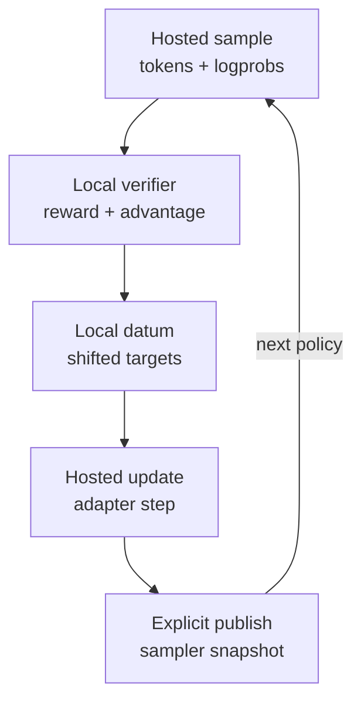
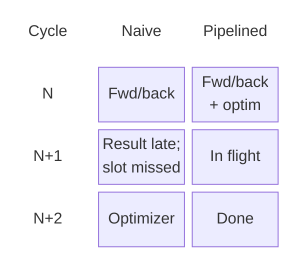

---
{
  "id": "deep-dive-tinker",
  "title": "Deep Dive - Tinker",
  "slug": "deep-dive-tinker",
  "section": "Project Deep Dives",
  "category": "Fine-Tuning & Training",
  "difficulty": "Hard",
  "order": 16,
  "coverImage": "illustrations/_generated/tinker_control_plane_dark.png",
  "companies": [
    "Thinking Machines Lab"
  ],
  "shortDescription": "Loss is lower, but the next sample still returns the old answer. Tinker splits that failure between your loop and the hosted LoRA adapter.",
  "keyConceptsTested": [
    "Hosted service versus Apache-2.0 SDK and cookbook",
    "ServiceClient, TrainingClient, and SamplingClient interfaces",
    "forward_backward, optim_step, sample, and save_state",
    "LoRA adapter updates versus full-parameter training",
    "RL token, logprob, advantage, and mask formats",
    "Clock cycles, futures, and pipelined training",
    "Checkpoint, sampler export, and Hugging Face conversion",
    "Data, model terms, governance, and production failure modes",
    "Tinker versus DeepEP responsibility division"
  ],
  "prerequisites": [
    "deep-dive-slime",
    "deep-dive-skyrl",
    "deep-dive-megatron",
    "introduction-to-reinforcement-learning-fundamentals"
  ]
}
---

At 09:12, your `clamp` run reports lower loss, but the next sample still returns `return x`. The local grader sees reward 0. The remote worker accepted `forward_backward` and `optim_step`. Before changing optimizer settings, ask three narrower questions: did the loop send the intended tokens, did the worker update the intended adapter, and did the sampler read that update?

Your Python process renders prompts, runs the verifier, and decides what evidence to submit. Hosted workers execute model math, hold adapter and optimizer state, and produce samples. You get handles and results back. You don't get the worker's placement decisions or its hidden gradients.

Tinker is Thinking Machines Lab's managed hosted <span data-glossary="lora">low-rank adaptation</span> (LoRA) service for this job. A local Python process builds prompts, environments, rewards, and loss inputs. Remote workers run forward and backward passes, apply optimizer updates, and generate samples. Reinforcement learning (RL) uses the grader's reward to guide these updates; supervised fine-tuning (SFT) instead learns from ground-truth target tokens. The public software development kit (SDK) and Tinker Cookbook are Apache-2.0 open-source code. The hosted service, model catalog, data handling, and API access are a separate product with their own terms.[^tinker2025launch][^tinkerSdk0272026][^tinkerCookbookPinned2026]

Follow one four-completion `clamp` group across `forward_backward`, `optim_step`, `sample`, and `save_state`. The function should return `x` inside the inclusive interval `[lo, hi]` and the nearest bound outside it, with `lo <= hi`. The source walkthrough uses SDK 0.27.0, commit `0ce5bf2484891570b59f8d330a2daf793646917e`, and Cookbook commit `600b802d09be13e03756bfdc31e8c864fed90e7b`, rechecked September 23, 2026. The local examples need no API key and submit no hosted jobs. A pinned client fixes local code, not the remote service implementation.[^tinkerSdk0272026][^tinkerCookbookPinned2026]

<figure>
  
  <figcaption>The client objects are local handles. Adapter updates, sampler weights, and model execution remain hosted. Publishing a new snapshot is a separate transition from updating the training model.</figcaption>
</figure>

## Start with the architecture seams

Before reading an API call, predict who can answer each failure: a malformed `Datum`, an unavailable model, or a missing checkpoint. Tinker has three names that look like one product but describe different surfaces.

| Surface | Role | Who operates it | What you can change |
| --- | --- | --- | --- |
| Tinker service | Hosted worker pool, storage, scheduler, and model runtime | Thinking Machines Lab | Your requests, data, loss choices, and loop timing |
| `tinker` SDK | Python client, types, futures, command-line interface (CLI), and API conversion code | Open-source contributors under Apache-2.0 | Client code, tests, adapters, and local orchestration |
| `tinker-cookbook` | Open recipes for <span data-glossary="supervised-fine-tuning">supervised fine-tuning (SFT)</span>, RL, <span data-glossary="dpo">Direct Preference Optimization (DPO)</span>, distillation, evaluation, and export | Open-source contributors under Apache-2.0 | Dataset builders, environments, reward functions, and recipes |

The hosted service isn't the same thing as the GitHub repository. Cloning the SDK gives you client code, not the worker pool, model weights, scheduler, storage, or failure-recovery system. Using the service also doesn't force a fixed high-level RL trainer. The low-level calls are intentionally small.[^tinker2026docs][^tinkerSdk0272026]

Treat the model catalog as a capability response, not as a constant in your Python package. Current docs describe LoRA fine-tuning for dense and <span data-glossary="mixture-of-experts">mixture-of-experts</span> (MoE) models from about 1B to 1T+ parameters, including vision models, and publish a live models page.[^tinker2026docs]

The model page separates current training IDs, inference offerings, and retired models. A Hugging Face checkpoint isn't automatically a valid Tinker training ID. Check `get_server_capabilities` and the current model documentation before selecting a base model; separately verify its loss, modality, export, and account constraints. A list of model names doesn't encode every capability.[^tinkerModels2026]

A model may fit the service's architecture adapter and still be absent from your account, restricted by third-party terms, or unavailable for a particular loss or input modality. Treat the capability response and live model page as run-start evidence, not as static metadata in a blog post.

## Local control plane, remote data plane

Start with one local question: what should happen to the next completion? The **<span data-glossary="control-plane">control plane</span>** is the code that answers it. Your process loads data, renders a <span data-glossary="chat-template">chat template</span>, calls an environment, grades `clamp`, computes group-relative advantages, selects a loss, and decides when to checkpoint. It can also start many requests concurrently with `asyncio`.

The **data plane** answers a different question: how does the model produce that completion? Hosted workers receive serialized model inputs and loss tensors, run distributed forward and backward computation, apply the <span data-glossary="optimizer-state">optimizer state</span>, and return compact outputs. Sampling workers generate token IDs and optional log probabilities. Storage workers make named checkpoints addressable through `tinker://` paths.



This split lets you change a reward function without changing distributed model code. It also tells you where to look when the run fails. Local code can produce a malformed target <span data-glossary="tensor">tensor</span>. Remote workers can reject a model or run out of capacity. A sampler can use an older checkpoint than the trainer. A retry can duplicate an operation unless request and checkpoint names are idempotent.

When a result looks wrong, ask, "Where does this state live?" Your loop constructs prompt rows, reward labels, and experiment configuration; requests then send selected data to the service. LoRA parameters, optimizer moments, and worker placement stay hosted. A future is a handle to completion, not a download of model-parameter <span data-glossary="gradient">gradients</span>. Custom losses can differentiate returned log probabilities locally, which is a different gradient computation.

```checkpoint
What does cloning `tinker` give you?
---
Cloning provides the client, types, protocol conversion, tests, and CLI. Hosted GPU workers, model catalog, storage service, and API authorization remain outside the checkout.
```

## The four primitives

When `clamp` produces a bad sample, don't start with endpoint names. Predict which state transition should have changed: gradient accumulation, adapter weights, sampler weights, or a recovery artifact. These four primitives make that transition observable.

| Primitive | Client | Input | Remote effect | Returned evidence |
| --- | --- | --- | --- | --- |
| `forward_backward` | `TrainingClient` | `Datum` list, loss name, optional config | Computes loss and accumulates gradients for current adapter state | Per-datum outputs, metrics, and a future |
| `optim_step` | `TrainingClient` | Adam hyperparameters | Applies accumulated gradients and advances adapter plus optimizer state | Optimizer metrics and a future |
| `sample` | `SamplingClient` | Tokenized prompt, count, sampling parameters | Generates one or more completions from a model snapshot | <span data-glossary="token">Token</span> IDs, stop reason, optional log probabilities |
| `save_state` | `TrainingClient` | Name, optional time to live (TTL), overwrite flag | Persists train-resume checkpoint, optionally with optimizer state on load | `tinker://` checkpoint path |

The SDK also exposes `save_weights_for_sampler` and `save_weights_and_get_sampling_client`. Those operations publish a sampler-compatible adapter snapshot. `save_state` writes a training checkpoint; `load_state_with_optimizer` restores its weights and optimizer state. A sampler checkpoint evaluates or serves a chosen weight version. Keep those consumers separate when you name and inspect artifacts.

The synchronous entry points return future-like objects. Their `_async` variants don't all have the same return type behavior: awaiting `forward_backward_async` gives an `APIFuture` that still needs `result_async()`, while awaiting `sample_async` gives the completed `SampleResponse`. Neither changes the server's ordered training schedule into an unbounded asynchronous parameter server.[^tinkerSdk0272026]

### `forward_backward` receives a Datum

Before sending one datum, predict what the remote loss can validate: model input plus tensors named by that loss. A `Datum` has `model_input` and `loss_fn_inputs`. `model_input` is a token or multimodal sequence. For <span data-glossary="supervised-fine-tuning">SFT</span>, `loss_fn_inputs` commonly contains `target_tokens` and `weights`. For RL, it can include sampled `logprobs`, `advantages`, `target_tokens`, and an action `mask` before cookbook code removes or consumes the mask.

Large lists may become multiple requests. The SDK's client-config defaults are 1,024 datums and 5,000,000 estimated pre-compression protobuf bytes per chunk; server-provided configuration can change them. The chunker doesn't split an individual oversized datum, so the byte value isn't a universal hard cap. Ordered sequence IDs preserve logical request order even when chunks are submitted concurrently.

The loss name is a protocol value. The pinned SDK declares `cross_entropy`, `importance_sampling`, `ppo`, `cispo`, and `dro` as supported identifiers, while a model or service deployment may enable fewer options. Validate the current server capability and documentation when a run starts.[^tinkerSdk0272026][^tinker2026docs]

### `optim_step` advances adapter state

If loss improves but a resume behaves differently, inspect the update pipeline first. `optim_step` consumes gradients accumulated by preceding forward/backward work and updates trainable parameters with AdamW-equivalent behavior. SDK documentation calls out a default <span data-glossary="weight-decay">weight decay</span> of zero, which differs from some <span data-glossary="pytorch">PyTorch</span> defaults.[^tinkerSdk0272026]

The optimizer state stays remote, so you don't download a Python optimizer object after every step. That keeps the loop small but makes checkpoint choice consequential. Loading weights alone resets optimizer history; loading with optimizer restores saved moments when the checkpoint contains them.

The operation ordering is part of correctness. An optimizer request submitted before its matching forward/backward result can still be valid because the service sequences requests for that training client. A separate client, a retry, or an accidental concurrent loop can violate the intended order. Give one component ownership of a training client, and log request IDs with step numbers in the local loop.

### `sample` returns evidence for learning

Before trusting a reward, predict what evidence the sampler must return. `SamplingClient.sample` accepts a `ModelInput`, number of completions, and `SamplingParams`. Each returned sequence includes generated token IDs and a stop reason. If requested, it includes one <span data-glossary="logprob">log probability</span> per generated token. `compute_logprobs` can score prompt tokens for a separate comparison.

The decoded string answers the verifier's question; token identifiers (IDs) and log probabilities answer the learner's. If you decode and re-tokenize before constructing an RL `Datum`, a different tokenizer version or normalization rule can shift token positions. The unit test may still pass while the policy-gradient target points at the wrong positions.

`num_samples` is a group primitive. Four independent `clamp` completions give a group over which the Cookbook centers rewards. Four separate calls can work, but one grouped call makes the comparison and batching explicit. Concurrent calls across different prompts add another axis of parallelism.[^tinker2026docs][^tinkerCookbookPinned2026]

### `save_state` creates a recovery point

After an update, ask which consumer needs the bytes. `save_state("step-0042")` stores a named training checkpoint. `load_state` restores model weights but not optimizer state. `load_state_with_optimizer` restores both when available. A TTL can make a checkpoint expire, and `overwrite` controls whether the name can be replaced.[^tinkerSdk0272026]

For evaluation, save sampler-compatible weights instead. Export is another path: for models with downloadable compatible weights, Cookbook utilities can build a <span data-glossary="parameter-efficient-fine-tuning">parameter-efficient fine-tuning (PEFT)</span> adapter or merge it into a Hugging Face model. Not every hosted model necessarily permits the same export. Runtime compatibility, base-model availability, and applicable terms still govern deployment.

## LoRA is the adaptation layer

Those four calls describe movement. The next question is what the optimizer can change.

Tinker is a LoRA training service, not a full-parameter training service. LoRA keeps the frozen base <span data-glossary="matrix">matrix</span> $W$ and learns a low-rank update. Thinking Machines Lab writes the adapted matrix as

$$
W' = W + \gamma BA,
$$

where $A$ and $B$ are small trainable matrices and $\gamma$ is a constant scale. Many implementations, including the original LoRA paper, take $\gamma = \alpha / r$ with rank $r$ and a scale hyperparameter $\alpha$. The service stores and updates the adapter path while sharing the base model across runs. That's how a multi-tenant worker pool can serve many experiments without copying a full model and optimizer state for each run.[^hu2021][^tinker2025launch][^tinker2026lora]

LoRA doesn't mean "small model." Tinker has documented support for large dense and MoE models, including trillion-parameter examples in its announcements. The memory savings come from trainable state and optimizer path, not from making every base-model weight cheap to move. A huge model still needs a compatible hosted topology, checkpoint format, and model-specific adapter implementation.[^tinker2026ga][^tinker2026docs]

Rank sets adapter capacity. A larger rank can express a broader update but costs more adapter parameters and optimizer state; measure task quality to compare ranks. Training only attention, only a multilayer perceptron (MLP), or the unembedding layer changes which behavior can move. Thinking Machines Lab's LoRA study found attention-only LoRA underperformed MLP LoRA even after matching parameter count, and that RL matched full fine-tuning at very low ranks in their math setup. The `create_lora_training_client` options make those choices explicit. Compare runs with target modules held constant before attributing a change to rank.[^tinker2026lora]

LoRA also changes what "full control" means. You control the algorithm, data, reward, sampling schedule, and loss inputs. The provider controls arbitrary base-weight tensors, kernel fusion, placement, and collective algorithms. This division makes Tinker useful for post-training research while leaving infrastructure-level training decisions outside the client API.

```checkpoint
Why can't a Tinker LoRA run answer a question about full-parameter stability?
---
The trainable matrices are low-rank adapters while the base weights remain frozen. Results can reveal post-training behavior under LoRA, but they don't measure a full-parameter optimizer path or its optimizer-state memory.
```

## SFT first: a token-level specification

A low-rank update still needs an explicit token-level layout. Start with supervised `clamp` before adding rewards. Before you submit the datum, predict which positions should be allowed to change the adapter.

A rendered conversation becomes an input sequence and a target sequence. A weight tensor marks which target positions contribute to <span data-glossary="cross-entropy">cross-entropy</span>. Prompt positions usually receive zero weight; assistant positions receive one or a chosen fractional weight.

For one datum, the core alignment is:

| Position | `model_input` | `target_tokens` | `weights` | Training meaning |
| --- | --- | --- | --- | --- |
| 0 | prompt ID `10` | prompt ID `11` | 0 | Don't train on predicting prompt text |
| 1 | prompt ID `11` | first action ID `20` | 1 | Predict the first answer token from the prompt |
| 2 | action ID `20` | second action ID `21` | 1 | Predict the next answer token |

These are toy IDs, not a real tokenizer vocabulary. The full sequence is `[10, 11, 20, 21]`: inputs omit its last token, targets omit its first token, and weights follow the **target** role. Masking by the input role would incorrectly drop the first answer token at position 1.

The arrays must share the expected shifted length. The Cookbook's `conversation_to_datum` helper handles renderer-specific role markers, target shifting, and response masks. Read that helper when a loss curve looks impossible. A one-token offset can produce a decreasing loss while training the model on the wrong targets.

The pinned `conversation_to_datum` also defaults to `reduction="mean"`: after shifting, it normalizes positive-total weights to sum to one per example. Our toy `[0, 1, 1]` becomes `[0, 0.5, 0.5]`, preserving the first-answer position. With `reduction="none"`, the raw weights stay intact and longer answers with more trained tokens contribute more terms to the summed loss. Record this choice when comparing runs: changing reduction changes example weighting, even with identical tokens and masks.[^tinkerCookbookPinned2026]

The smallest SFT loop has one `forward_backward` and one `optim_step`. The Cookbook submits both before waiting so they can share a worker clock cycle. It repeats the pair while recording loss and evaluation metrics. A decrease in loss means the adapter predicts the chosen weighted tokens more easily. Run the unit test separately to evaluate functional behavior.

## RL: preserve tokens, logprobs, and credit

Loss going down doesn't mean the grader is happier. RL adds a second model interaction: the current policy samples a completion, an environment or verifier assigns reward, and the loop converts that evidence into a training datum. The reward function can be local and deterministic, a remote grader, a unit-test <span data-glossary="sandbox">sandbox</span>, or another model. Tinker doesn't choose it for you.

Keep the `clamp` group of four completions:

| Completion $i$ | Body (decoded) | Reward $R_i$ |
| ---: | --- | ---: |
| 0 | `return min(max(x, lo), hi)` | 1 |
| 1 | `return max(min(x, lo), hi)` | 0 |
| 2 | `return min(max(x, lo), hi)` | 1 |
| 3 | `return x` | 0 |

The group mean is $\bar{R} = 0.5$. Centered advantages are $A = (0.5, -0.5, 0.5, -0.5)$. The reward objective encourages completions 0 and 2 and discourages 1 and 3; shared parameters mean no individual probability change is guaranteed. If all rewards were 1, every centered advantage would be zero. A Kullback-Leibler (KL) divergence penalty, which discourages departure from a reference policy, or another auxiliary objective could still contribute gradients.

The Cookbook's basic <span data-glossary="grpo">Group Relative Policy Optimization (GRPO)</span> path turns that prediction into a sequence:

1. Select a group of prompts.
2. Sample several completions per prompt from current sampler weights.
3. Grade every completion.
4. Center rewards within each group: $A_i = R_i - \operatorname{mean}(R_{group})$.
5. Optionally filter constant-reward groups. The helper retains one group with a warning if all are uniform; that fallback avoids an empty batch but doesn't create reward signal. The pinned training config disables this filtering by default.
6. Build `Datum` objects with sampled log probabilities and token-aligned advantages.
7. Submit `forward_backward(..., loss_fn="importance_sampling")`.
8. Submit `optim_step` with the chosen Adam parameters.
9. Save and evaluate a sampler checkpoint.

The group baseline is one <span data-glossary="variance">variance</span>-reduction choice. Code tasks might use unit-test pass rate, while tool-use environments can combine success, invalid-call penalties, and latency budgets. Preference models may return dense scores. Your loop maps each outcome into advantages and masks before the model receives a token-level signal. That mapping turns an evaluation decision into a training decision.

### The RL datum shape

Before looking at fields, predict what should happen when a trajectory branches. The Cookbook's trajectory converter emits one or more datums per trajectory. One trajectory can split when a later observation isn't a prefix of the sequence accumulated so far. That happens naturally with tool calls, branches, or context compaction.

The resulting `loss_fn_inputs` include:

| Field | Shape idea | Source | Meaning |
| --- | --- | --- | --- |
| `target_tokens` | One target per input position | Shifted sampled sequence | Token to score |
| `logprobs` | One sampled logprob per target | Sampler | Behavior-policy evidence |
| `advantages` | One scalar copied across action tokens | Group reward | Credit assigned to action |
| `mask` | Zero for observation, one for action | Trajectory converter | Which positions are trainable |

Observation positions receive zero logprob, zero advantage, and zero mask. Action positions receive the sampled logprob and trajectory advantage. A parse-error policy can set an action mask to zero while retaining the rest of the trajectory. The invalid turn stays visible in metrics without teaching the model to reproduce malformed output.

The named loss consumes only the fields it supports. `importance_sampling` compares current log probabilities with sampled behavior-policy log probabilities. <span data-glossary="ppo">Proximal Policy Optimization</span> (`ppo`) adds clipping behavior. The `cispo` and `dro` losses use other importance and truncation choices. The Cookbook's `train_step` removes `mask` before submission: zero advantages suppress the reward term at observation positions, while the mask remains useful for local diagnostics and auxiliary terms. Sending a `mask` field alone isn't a substitute for zeroing the corresponding advantages.[^tinkerCookbookPinned2026]

A custom loss can run on log probabilities through `forward_backward_custom`, but the SDK still translates your derivative into a backend-supported weighted cross-entropy pass. If the local custom loss is $C(\ell)$ for returned log probabilities $\ell$, it sends weights $-\partial C/\partial \ell$. Backend cross-entropy is $-\sum_t w_t\ell_t$, so this negative sign reproduces the custom loss's derivative. These are gradients with respect to log probabilities, not downloaded adapter-parameter gradients.[^tinkerSdk0272026]

### Logprob alignment is the hidden invariant

Suppose a sampler returns four response tokens and four log probabilities for one `clamp` completion. Predict where the first score belongs before building the datum. The training input usually contains prompt context plus the response prefix, while the target array contains response tokens shifted one position to the left. Prompt padding is deliberate: it keeps positions aligned while assigning zero learning signal to context.

If the arrays differ by one token, an operation can fail loudly. Worse, accidental padding can make lengths agree while applying the wrong credit to every token. Log a short prefix of tokens, log probabilities, advantages, and masks for one group before launching a long run.

Make the reward reproducible enough to debug. Save the prompt ID, sampler checkpoint path, sampled tokens, stop reason, reward components, environment version, and advantage statistics. A reward value without that evidence can't tell you whether the model improved or the grader changed.

The toy sequence `[10, 11, 20, 21]` becomes three inputs and three next-token targets. The positive trajectory advantage is `+0.5`. Mask and log-probability entries align with the targets:

| Field | Position 0 | Position 1 | Position 2 |
| --- | --- | --- | --- |
| Input | 10 (prompt) | 11 (prompt) | 20 (action) |
| Target | 11 (prompt) | 20 (first action) | 21 (next action) |
| Action mask | 0 | 1 | 1 |
| Behavior logprob | 0 (unused) | −0.4 | −0.8 |
| Advantage | 0 | +0.5 | +0.5 |

The last prompt token predicts the first action. Masked prompt targets remain available as input context.

## The pipeline clock

Correct datums can still miss GPU time if the client waits between calls. Tinker worker pools execute training clients in lock-step clock cycles. A cycle can include forward/backward work and an optimizer step for one or more LoRA models sharing the pool. Multi-tenancy keeps small batches from leaving the pool idle, but it also means a small request can observe latency shaped by the pool's schedule.[^tinker2026docs]

Submit work early, then await its results. In Tinker's clock-cycle schedule, blocking on `forward_backward` before submitting `optim_step` misses the next scheduling window and makes the pair span three cycles. Treat that count as a scheduling example; measure end-to-end latency with an initialized client. Both snippets assume an initialized training client, batch, and optimizer parameters.[^tinkerClockCycles2026]

```python title="naive_clock_cycle.py"
# Batch of input token tensors and loss weights
fwd = await client.forward_backward_async(batch, "cross_entropy")
await fwd.result_async()
opt = await client.optim_step_async(adam_params)
await opt.result_async()
```

The pipelined loop submits both operations before waiting:

```python title="pipelined_clock_cycle.py"
# Submit both forward/backward and optimizer step for pipelined execution
fwd = await client.forward_backward_async(batch, "cross_entropy")
opt = await client.optim_step_async(adam_params)
fwd_result = await fwd.result_async()
opt_result = await opt.result_async()
```

The service can place both in one cycle because the training client preserves request order. For several batches, enqueue the next forward/backward plus optimizer pair before consuming the current result. The Cookbook's `train_step` uses this pattern and returns training log probabilities for diagnostics.[^tinker2026docs][^tinkerCookbookPinned2026]

Pipeline depth isn't free. A deeper queue can hide network latency and keep <span data-glossary="gpu">GPUs</span> busy, but it can also increase local data waiting for a result and complicate failure handling. In RL, over-enqueueing samples can also increase policy lag. Keep a bounded number of in-flight groups and log sampler checkpoint version against trainer step.



The clock isn't the same as GPU kernel overlap inside a model. A worker may overlap collective communication and matrix operations internally while your client still misses a cycle by waiting before submitting the next request. Read both layers when tuning throughput.

Official docs warn against adding client timeout-and-resubmit loops around Tinker calls. If an application deadline expires, record the outstanding request, stop scheduling replacement work, and reconcile its status through the supported SDK behavior. Bound concurrency and total run duration without blindly duplicating expensive requests.

## Checkpoints and export paths

Even a fast loop needs a named artifact you can resume or serve. Before saving, decide which question the artifact must answer: can training continue, can a sampler evaluate it, or can another runtime load it? Tinker has three artifact states.

| Artifact | Purpose | Restores optimizer? | Typical consumer |
| --- | --- | --- | --- |
| Training state | Resume the same loop | Yes with `load_state_with_optimizer` | Training client |
| Sampler weights | Evaluate a chosen policy snapshot | Not a training resume | Sampling client, OpenAI-compatible adapter |
| Merged Hugging Face model | Portable base plus LoRA update | No training history | <span data-glossary="vllm">vLLM</span>, SGLang, Transformers, offline inference |

The checkpoint name is part of your experiment schema. Include a run ID, step, dataset revision, and reward version in your own metadata even if the service accepts a shorter name. A checkpoint path says where bytes are; it doesn't explain why that version should be trusted.

`save_state` can preserve a training resume point. `save_weights_for_sampler` makes a sampler path. `save_weights_and_get_sampling_client` combines save and client creation for a convenient evaluation step. The Cookbook's weights utilities download the adapter, build an HF model, build a PEFT adapter, or publish a checkpoint to a hub. Each export choice creates a new license and security review surface.[^tinker2026docs][^tinkerCookbookPinned2026]

Merging $W' = W + \gamma BA$ turns an adapter into a standalone model directory. It doesn't make the base-model license disappear or preserve remote optimizer state. Keep the original `tinker://` path and training metadata next to the exported model so a future evaluator can reproduce the exact adapter, base revision, tokenizer, and renderer.

Evaluation should use a fresh sampler client for the saved path or a path explicitly tied to the training client. A long-lived sampler doesn't automatically see the latest adapter. A serving client built from an older path can produce plausible text from a stale policy and make a reward curve look flat, so record the policy version with every trajectory.

## API, service, and data partitions

Both pinned source snapshots use Apache-2.0. That license lets you inspect, modify, and redistribute client and recipe code under its terms. It doesn't grant rights to Thinking Machines Lab's hosted service, third-party model weights, or every dataset copied into a recipe.[^tinkerSdk0272026][^tinkerCookbookPinned2026]

The service terms rechecked on September 23, 2026 (last updated January 10, 2026) distinguish customer datasets, hosted models, fine-tuned models, third-party terms, company models, and available weights. The service may add or remove model access. Check the applicable terms and weight-download documentation before downloading a hosted model.[^tinker2026terms]

A hosted run has two budgets. Samples, training tokens, retries, and checkpoint storage consume service capacity or storage; missing token execution logs, version IDs, and reward components consume evidence. Put both in the run manifest before scaling. A lower loss is not a cost report, and a reward curve without its policy version is not a reliable evaluation.

Your dataset isn't automatically safe because the SDK serializes it. You are responsible for having the rights to send prompts, images, tool traces, and labels to a hosted service. The terms grant the provider a limited license to access and process customer datasets to provide the service and comply with law. They also commit that Thinking Machines Lab won't use customer content to train or improve their own models. Personal-data deletion and export obligations still depend on the applicable agreement and processing terms.[^tinker2026terms]

Keep secrets out of the dataset and logs. API keys belong in <span data-glossary="environment-variable">environment variables</span> or a secret manager. Reward traces can contain private source code, credentials emitted by a tool, or user data. Redact before logging and set checkpoint retention explicitly. A sampler checkpoint can be as sensitive as the training data because the adapter may memorize rare examples.

Data residency, subprocess behavior, storage TTL, deletion, and enterprise commitments are product questions. Don't infer them from an open-source test or from a local `tinker://` path. Ask the current service and agreement for the requirement your deployment needs.

The published terms also restrict competitive benchmarking and competitive analysis of the service. Before planning a public hosted-service comparison, check the agreement that applies to your account and obtain any needed authorization. This matters separately from testing your own reward function or reading the Apache-2.0 client source; an enterprise agreement can supersede conflicting published terms.[^tinker2026terms]

## Team, contributors, and governance

Tinker is built by Thinking Machines Lab. The company maintains the hosted service, SDK repository, Cookbook, documentation, model integrations, and customer-facing terms. Public repositories show code and commit history, but a contributor count or top-contributor list is only a snapshot. Use the pinned commit and live repository history when attribution matters.

Use repository history for attribution and contribution guidance for proposed changes. Commit counts don't establish control over the hosted runtime, and an accepted SDK contribution doesn't give its author control of service policy. The LoRA study is credited to John Schulman with other Thinking Machines collaborators. That research attribution doesn't identify every SDK maintainer or hosted-runtime engineer.[^tinker2026lora]

The Cookbook's contribution guide asks contributors to run Ruff, Pyright, and tests, and describes an open-science workflow. Its code structure separates configuration builders from heavyweight datasets, environments, <span data-glossary="rollout">rollout</span> strategies, and training loops. Those conventions provide governance through code review and reproducibility, not through a formal foundation with independent technical steering.[^tinkerCookbookPinned2026]

| Question | Evidence to inspect | Safe statement |
| --- | --- | --- |
| Who owns hosted runtime? | Thinking Machines Lab service terms and announcements | Thinking Machines Lab operates the service |
| Who can change SDK code? | GitHub repository permissions and review history | Repository maintainers and accepted contributors |
| What is licensed? | `LICENSE` files at pinned commits | SDK and Cookbook source are Apache-2.0 |
| Which models are available? | Live capabilities and model docs | Catalog is dynamic and model-specific |
| Who owns your data? | Current service agreement and data processing addendum (DPA) | Follow the service terms, not an inference from GitHub |

For an incident, route by evidence. Service errors, capacity, and catalog access belong with the service owner. Malformed datums, reward side effects, and renderer drift belong with your loop owner. Model rights, retention, and export obligations belong with the legal agreement owner. Don't call the SDK a community-governed replacement for the service: its inspectable client and recipe layer still depend on a company-operated API.

## Strengths

### The cluster is on the other side of the SDK

You can test a reward function, a custom loss, or an environment from a CPU-oriented development machine. Thinking Machines Lab handles scheduling, resource allocation, worker placement, and failure recovery for hosted runs. The first experiment is a Python loop, not a cluster bring-up.[^tinker2025launch]

### Low-level enough for research

`forward_backward` and `sample` expose token and logprob evidence that many high-level trainers hide. You can implement GRPO-style relative rewards, <span data-glossary="ppo">Proximal Policy Optimization (PPO)</span>-style clipping, DPO data preparation, prompt distillation, or a custom logprob loss. The Cookbook provides a starting point without forcing every project into one environment abstraction.[^tinker2025launch][^tinker2026docs]

### One path from SFT to RL

The same `TrainingClient` can run cross-entropy SFT and RL losses. The same `SamplingClient` can generate evaluation completions and behavior-policy traces. That keeps one client interface in a staged post-training project, while still requiring separate checks for training and evaluation.

### Large-model access without local replicas

LoRA lets a service share a frozen base model across training runs. The documented model range includes large dense and MoE models. The general-availability announcement added Kimi K2 Thinking as a trillion-parameter example; the current catalog has moved on, so you still have to read the live page rather than that post.[^tinker2026ga][^tinker2026docs] A researcher can test an idea on a small model, then check whether a large model is in the current catalog without rewriting the loop.

### Export is a separate path

Sampler checkpoints can be evaluated through the SDK or an OpenAI-compatible interface. Cookbook utilities can download and merge adapters into Hugging Face layouts. After you check tokenizer, license, and runtime compatibility, you can move a successful experiment onto an existing serving stack.[^tinker2026ga][^tinkerCookbookPinned2026]

## Weaknesses and limits

### Not full-parameter training

LoRA constrains the update space. A behavior that requires broad base-weight changes may not transfer, and a LoRA result doesn't answer full fine-tuning questions. If your research question is optimizer scaling, full-rank catastrophic forgetting, or expert-weight surgery, Tinker isn't the right primary system.

### Hosted capacity and catalog are external state

Your code can be deterministic while service capacity, model availability, and scheduling latency change. A pinned SDK doesn't pin the remote runtime. Record capability responses and service metadata at run start, then treat them as part of the experiment evidence.

### Network latency shapes algorithm design

Every sample, grader, checkpoint, and training request crosses a network hop. A chatty environment can spend more time waiting on transport than grading. Batch prompts, use concurrency, and keep a bounded pipeline. API acceptance doesn't make <span data-glossary="secrets-management">secrets</span> or high-cardinality debug payloads safe to send.

### Staleness can accumulate silently

An RL sampler can continue using an older sampler checkpoint while training updates a newer adapter. A deep local queue can hide that mismatch. Include a policy version in each trajectory, then reject or measure samples beyond your staleness budget.

### Service terms still apply

An Apache-2.0 SDK doesn't turn a hosted run into a self-hosted run. Customer data, model weights, available checkpoints, and downstream use are governed by the current service agreement and third-party model licenses.[^tinker2026terms]

### Failure recovery scope

The service can recover worker failures, but your environment may not be idempotent. If a tool call charges money, mutates a repository, or sends a message, a retry can repeat the side effect. Give every external action an <span data-glossary="idempotency">idempotency</span> key and store a local trajectory log.

## A runnable validation check

Use one cheap local gate before spending remote GPU time. This example grades four known local functions on five test cases, centers their rewards, and validates a toy trajectory using genuine NumPy vector operations. It doesn't execute untrusted generated code or call Tinker. The test cases cover below-range, inside-range, above-range, a zero-width interval, and negative bounds; arbitrary programs need broader functional and safety testing.

<!-- leetllm: test, output=show, output_title="RL datum validation check", deps=numpy -->
```python title="validate_tinker_rl_datum.py"
from dataclasses import dataclass, replace
import numpy as np


def center_rewards(rewards: np.ndarray) -> np.ndarray:
    if rewards.size == 0 or not np.all(np.isfinite(rewards)):
        raise ValueError("rewards must be nonempty and finite")
    return rewards - np.mean(rewards)


def has_signal(rewards: np.ndarray) -> bool:
    return bool(np.ptp(rewards) > 0)


@dataclass(frozen=True)
class RLDatum:
    input_tokens: np.ndarray
    target_tokens: np.ndarray
    sampled_logprobs: np.ndarray
    advantages: np.ndarray
    mask: np.ndarray


def validate(datum: RLDatum) -> None:
    lengths = {
        len(datum.input_tokens),
        len(datum.target_tokens),
        len(datum.sampled_logprobs),
        len(datum.advantages),
        len(datum.mask),
    }
    if len(lengths) != 1 or 0 in lengths:
        raise ValueError(f"unaligned lengths: {sorted(lengths)}")
    if np.any(datum.input_tokens < 0) or np.any(datum.target_tokens < 0):
        raise ValueError("tokens must be nonnegative integers")
    if not np.all(np.isfinite(datum.sampled_logprobs)) or not np.all(np.isfinite(datum.advantages)):
        raise ValueError("scores must be finite")
    if not np.all(np.isin(datum.mask, [0.0, 1.0])):
        raise ValueError("mask must contain only 0.0 or 1.0")
    if not np.any(datum.mask > 0):
        raise ValueError("datum has no trainable action")
    if np.any((datum.mask > 0) & (datum.sampled_logprobs > 0)):
        raise ValueError("action logprob cannot be positive")
    if np.any((datum.mask == 0.0) & (datum.advantages != 0.0)):
        raise ValueError("masked positions must have zero advantage")


test_cases = np.array([
    [-1, 0, 2, 0],
    [1, 0, 2, 1],
    [3, 0, 2, 2],
    [3, 2, 2, 2],
    [-4, -3, -1, -3],
])
candidates = (
    lambda x, lo, hi: min(max(x, lo), hi),
    lambda x, lo, hi: max(min(x, lo), hi),
    lambda x, lo, hi: min(max(x, lo), hi),
    lambda x, lo, hi: x,
)
clamp_rewards = np.array([
    float(all(f(x, lo, hi) == exp for x, lo, hi, exp in test_cases))
    for f in candidates
])
np.testing.assert_array_equal(clamp_rewards, np.array([1.0, 0.0, 1.0, 0.0]))
centered = center_rewards(clamp_rewards)
np.testing.assert_allclose(centered, np.array([0.5, -0.5, 0.5, -0.5]))
assert has_signal(clamp_rewards)
assert not has_signal(np.array([1.0, 1.0, 1.0, 1.0]))

full_tokens = np.array([10, 11, 20, 21], dtype=np.int64)
full_action_mask = np.array([0.0, 0.0, 1.0, 1.0])
datum = RLDatum(
    input_tokens=full_tokens[:-1],
    target_tokens=full_tokens[1:],
    sampled_logprobs=np.array([0.0, -0.4, -0.8]),
    advantages=np.array([0.0, 0.5, 0.5]),
    mask=full_action_mask[1:],
)
validate(datum)

assert datum.target_tokens[1] == 20 and datum.mask[1] == 1.0
bad_datums = (
    replace(datum, input_tokens=np.array([10, 11], dtype=np.int64)),
    replace(datum, advantages=np.array([0.0, np.nan, 0.5])),
    replace(datum, mask=np.array([0.0, 0.5, 1.0])),
    replace(datum, mask=np.array([0.0, 0.0, 0.0])),
    replace(datum, sampled_logprobs=np.array([0.0, 0.4, -0.8])),
    replace(datum, advantages=np.array([0.5, 0.5, 0.5])),
    replace(datum, target_tokens=np.array([11, -1, 21], dtype=np.int64)),
)
for bad in bad_datums:
    try:
        validate(bad)
    except ValueError:
        pass
    else:
        raise AssertionError("invalid datum accepted")

print("evaluated rewards:", clamp_rewards.tolist())
print("advantages:", centered.tolist())
print("first answer trained; 7 invalid inputs rejected")
```

<!-- leetllm: output:start -->
```text title="RL datum validation check" output compact
evaluated rewards: [1.0, 0.0, 1.0, 0.0]
advantages: [0.5, -0.5, 0.5, -0.5]
first answer trained; 7 invalid inputs rejected
```
<!-- leetllm: output:end -->

Equal lengths still can't detect scores attached to the wrong tokens. Here, constructing both arrays from one full sequence and checking the first action protects the illustrated shift. Real multimodal renderers need their own test cases. These checks don't prove reward quality, sampler freshness, or learning improvement.

### Check the actual SDK without a hosted job

The downloadable [SDK verification probe](assets/verify_sdk_contracts.py) pins the exact Git revision behind the `0.27.0` version label. Installing dependencies needs network access; execution creates no `ServiceClient`, HTTP transport, or hosted model. From this repository's root, run:

```bash title="offline_sdk_check.sh"
uv run web/src/content/projects/deep-dive-tinker/assets/verify_sdk_contracts.py
```

The [executed verification log](assets/sdk_contract_results.json) records six passing checks and source hashes: wire dtypes, a protobuf roundtrip preserving the first-answer weight, count-based chunk ordering, oversized-datum behavior, empty chunk input, and the SDK's acceptance of mismatched lengths. The pinned SDK's seven native request-serialization tests also passed, including a mocked transport test. None of these checks measures remote ordering, clock-cycle latency, model quality, checkpoint recovery, or distributed training.

## Production failure modes

The happy path is short. Production debugging isn't. Start with the evidence closest to the token layer, then move outward to service state and terms.

| Symptom | Likely subsystem | First check | Durable fix |
| --- | --- | --- | --- |
| Loss is `NaN` | Input tensor or custom loss | Finite target, weight, logprob, and advantage values | Reject non-finite rows before submission |
| Loss falls but reward doesn't | Wrong target or reward alignment | Decode sampled tokens and inspect shifted targets | Save token-level test case and renderer version |
| Reward is flat at zero | Degenerate groups or broken grader | Reward histogram and group variance | Skip constant groups and test verifier offline |
| Reward rises then collapses | Stale policy or excessive update | Policy version, Kullback-Leibler (KL) divergence, advantage scale, <span data-glossary="learning-rate">learning rate</span> | Bound in-flight groups and tune update size |
| Requests are slow despite small data | Missed clock cycles | Submission timestamps and cycle gaps | Submit forward/backward plus optimizer before await |
| Samples time out and retry storms | Homemade client timeouts | `asyncio.wait_for` around SDK calls | Wait for in-flight samples; don't stack extra retries |
| Sample text doesn't change | Stale sampler checkpoint | `tinker://` path and save step | Rebuild sampler client after save |
| Resume diverges | Optimizer state omitted | Load method and checkpoint manifest | Use `load_state_with_optimizer` for continuation |
| Exported model differs | Base revision or tokenizer drift | Hash base files and tokenizer config | Pin base revision and preserve renderer metadata |
| Retry repeats external action | Non-idempotent environment | Tool execution logs and retry records | Add idempotency keys and replay-safe adapters |
| API returns model unavailable | Catalog or terms mismatch | Capability response at run start | Fail fast with model and account evidence |
| Data appears in logs | Over-broad telemetry | Redacted request and artifact logs | Remove secrets and set retention/TTL |
| Adapter loads but quality regresses | Unsupported target modules or rank | Training-client config and evaluation matrix | Compare rank and module scope explicitly |

An actionable incident record contains the SDK commit, Cookbook commit, model identifier, capability response, base revision, tokenizer revision, renderer name, loss name and config, optimizer parameters, sampler checkpoint path, trajectory sample, reward components, and checkpoint path. Without those fields, a replay is guesswork. Capture them before cleanup or checkpoint expiry removes the trail.

### Retry and idempotency

The SDK retries some transport failures through its client holder. A retry can be safe for a read, but a training request or external environment call needs deterministic ordering. The pinned SDK assigns sequence IDs to training requests and preserves turn ordering across chunks. Your environment must add its own idempotency around side effects.[^tinkerSdk0272026]

For evaluation, prefer pure functions and immutable test data. For a tool write, persist its operation ID and use downstream idempotency or a status lookup. A local "started" record alone can't distinguish a crash before the remote effect from a crash after it. Reconcile uncertain outcomes rather than automatically replaying them.

### Catalog and model terms

A model string in a tutorial isn't a production approval. The service can add or remove models. A third-party model can have a separate license, usage restriction, or attribution requirement. Query capabilities, retain the response, and link your run manifest to the model terms you accepted.[^tinker2026terms]

## Source-reading map

Read the repositories in an order that follows one request instead of scanning every file.

### SDK snapshot

1. `src/tinker/lib/public_interfaces/service_client.py`: client creation, model capability calls, and interface separation between base and saved models.
2. `src/tinker/lib/public_interfaces/training_client.py`: request sequencing, request chunking, `forward_backward`, `optim_step`, save, and load behavior.
3. `src/tinker/lib/public_interfaces/sampling_client.py`: `sample`, logprob options, multiprocessing, and sampler creation.
4. `src/tinker/types/datum.py`: tensor conversion and serialization assumptions. Construction alone doesn't verify semantic token alignment.
5. `src/tinker/proto/request_conv.py`: how a `Datum` becomes a wire request.
6. `src/tinker/lib/api_future_impl.py`: how remote completion and errors reach local code.
7. `src/tinker/resources/training.py` and `src/tinker/resources/sampling.py`: HTTP endpoint names and response conversion.
8. Repository-root `LICENSE` and `pyproject.toml`: license, dependencies, and package identity.

The key path is `TrainingClient._run_fwd_bwd` to `_take_turn` to `resources/training.py`. That path explains why multiple chunks can be submitted concurrently while sequence IDs keep server order. The optimizer path uses the same turn counter. The sampler path is separate and can be created from a saved sampler checkpoint.

### Cookbook snapshot

1. `tinker_cookbook/rl/types.py`: `Env`, trajectories, transitions, stop reasons, and group notation.
2. `tinker_cookbook/rl/data_processing.py`: advantage centering, trajectory splitting, masks, and datum assembly.
3. `tinker_cookbook/rl/train.py`: clock-cycle pipeline, loss selection, training logprob diagnostics, and checkpoint hooks.
4. `tutorials/104_first_rl.py`: the smallest readable GRPO-style loop.
5. `tutorials/103_async_patterns.py`: concurrent sampling and group batching.
6. `tutorials/501_export_hf.py`: adapter download, merge, and validation.
7. `CONTRIBUTING.md`: builder conventions, async guidance, testing, and review expectations.
8. `LICENSE`: Apache-2.0 grant for the cookbook source.

The SDK and Cookbook revisions are pinned at the start of this walkthrough. Their implementations can be tested locally, but no client-side test pins server availability, scheduling latency, or learning outcomes.

## Tinker versus DeepEP

A hosted LoRA loop and an expert-parallel transport library can sit in the same post-training stack, and they still solve different problems. DeepEP's primary interface is expert-parallel dispatch/combine. Its V2 snapshot also has experimental communication primitives beyond expert parallelism. It isn't a hosted training API.[^deepep2026repo][^deepep2026license]

| Dimension | Tinker | DeepEP |
| --- | --- | --- |
| Main job | Hosted LoRA post-training API and recipe layer | Expert-parallel communication library for MoE dispatch and combine |
| Primary user | Researcher writing a local SFT or RL loop | Systems engineer building a distributed MoE runtime |
| Compute ownership | Thinking Machines Lab's managed workers | Your cluster, accelerator fabric, and process groups |
| Core interface | `forward_backward`, `optim_step`, `sample`, checkpoints | Dispatch/combine buffers, all-to-all transport, synchronization |
| Trainable state | LoRA adapter plus remote optimizer state | No model-training policy or reward loop |
| RL abstraction | Rewards, trajectories, advantages, masks, loss names | None. It moves expert tokens and gradients efficiently |
| Model support | Service catalog and adapter integrations | Runtime and hardware constraints you configure |
| Licensing model | Apache-2.0 SDK/Cookbook plus hosted terms | MIT source plus your infrastructure and model terms |
| Failure focus | API retries, stale sampler, checkpoint, data and terms | Rank failure, collective hang, buffer capacity, network topology |

DeepEP can sit below a self-hosted trainer that runs models like DeepSeek's MoE systems. It doesn't replace the RL loop. Tinker can help a researcher run a reward experiment on an available MoE model without assembling expert-parallel collectives. It doesn't expose DeepEP's dispatch buffers, remote direct memory access (RDMA) tuning, or expert routing internals.

The projects complement each other in a curriculum. Tinker teaches the **algorithm interface** and service interactions. DeepEP teaches the **communication primitives** that make sparse expert training and inference fit a real cluster. Megatron or another distributed trainer connects both layers into a full-parameter or adapter training runtime.

A hosted service's wall-clock latency and a communication kernel's tokens-per-second number answer different systems questions. Compare total experiment cost and reproducibility requirements across the full workflow; a single operation's microbenchmark cannot represent both paths.

## A practical reading exercise

Use the tiny deterministic `clamp` task before trying a large model.

1. Run the offline validation check and SDK probe above, then build one SFT datum with a prompt, target tokens, and response-only weights.
2. Submit one forward/backward request for that batch.
3. Submit its optimizer request before awaiting both results; inspect both outcomes.
4. Save a sampler checkpoint with a step name.
5. Sample four completions from the saved path.
6. Grade the actual completions with a sandboxed evaluator. Let the sandboxed verifier determine each sample's binary reward.
7. Center rewards and inspect token-aligned advantages.
8. Compare the hosted token output with your offline alignment test case; keep the actual rewards even when all sampled completions pass or fail together.
9. Only then add asynchronous sampling or a real environment.

The exercise should produce a run manifest alongside reward numbers. Record the model identifier, rank, target modules, renderer, loss, optimizer settings, checkpoint path, sample tokens, reward list, group mean, and mask counts. A manifest lets another reader inspect every configuration parameter; screenshots omit that evidence.

For a large model, scale one dimension at a time. Increase prompt length, group size, number of concurrent environments, adapter rank, or pipeline depth separately. A reward change after four simultaneous changes can't tell you which subsystem moved.

A finished `clamp` run should let you point at the shifted target, the sampler path, and the optimizer moments separately. Interpret the loss after confirming those three inputs.

## Evaluation rubric

- **Trace ownership:** distinguish local client handles from hosted adapter, optimizer, and sampler state, without inferring server internals from an SDK checkout.
- **Audit one trajectory:** derive shifted targets, preserve behavior logprobs, include the first answer token, and explain why equal lengths alone aren't sufficient.
- **Design recovery:** pair updates in order, bound in-flight work, choose an optimizer-preserving resume point, and record the sampler version separately.

## Follow-up questions

### Can an identical-reward group still update the adapter?

Centering makes its reward advantages zero, but a KL penalty or another auxiliary objective can still contribute gradients. Filtering removes the group from the update, including any terms computed on those samples; retaining it doesn't manufacture reward contrast.

### Why can evaluation remain stale after a successful optimizer step?

The training adapter changed, but the sampler snapshot didn't. Publish sampler-compatible weights, select that saved path, and record it beside the trajectory. Bind each trajectory to the sampler's loaded policy version; an optimizer step confirmation records only training-side success.

## Mastery quiz

```mastery-quiz
[
  {
    "question": "A pinned client checkout succeeds locally. The live capability response lists model M for inference but not training. The planned job needs an RL training loss. Which scheduling and access judgment follows?",
    "options": [
      "Schedule training on M; client success provides the missing hosted training entitlement.",
      "Hold training on M; listed inference access does not provide the required training entitlement.",
      "Schedule training on M; the local verifier provides the missing hosted training entitlement.",
      "Hold inference on M; absent training access invalidates its listed inference entitlement."
    ],
    "answer": "Hold training on M; listed inference access does not provide the required training entitlement.",
    "explanation": "The SDK is local implementation evidence. The service capability lists separate model uses, so inference plus a local checkout does not grant the required training operation."
  },
  {
    "question": "For one matrix with input width 12, output width 8 and factor width 3, how many trainable LoRA values are in A and B together, and what happens to the frozen base forward path?",
    "options": [
      "96 trainable values; the frozen base still executes.",
      "60 trainable values; the frozen base is omitted.",
      "36 trainable values; the frozen base still executes.",
      "60 trainable values; the frozen base still executes."
    ],
    "answer": "60 trainable values; the frozen base still executes.",
    "explanation": "A contains 3 × 12 and B contains 8 × 3 values, for 60 total. The frozen 8 × 12 base still participates in the forward computation."
  },
  {
    "question": "A full toy sequence is [5, 6, 7, 8, 9, 10]. The first two tokens are prompt and the remaining four are answer. Which shifted response-only mean weights train the first answer and give each example unit total weight?",
    "options": [
      "[0, 0.25, 0.25, 0.25, 0.25].",
      "[0.00, 0.00, 1/3, 1/3, 1/3].",
      "[0.2, 0.2, 0.2, 0.2, 0.2].",
      "[0.25, 0.25, 0.25, 0.25, 0]."
    ],
    "answer": "[0, 0.25, 0.25, 0.25, 0.25].",
    "explanation": "Shifted targets are [6, 7, 8, 9, 10]. Target 6 is prompt; targets 7-10 are four answer tokens. Their raw weights [0, 1, 1, 1, 1] normalize to the keyed vector."
  },
  {
    "question": "One prompt group has rewards [2, 0, 2, 0, 1]. Center within this group without scaling by its standard deviation. Which advantages result?",
    "options": [
      "[0.4, 0.0, 0.4, 0.0, 0.2].",
      "[2.0, 0.0, 2.0, 0.0, 1.0].",
      "[1.0, −1.0, 1.0, −1.0, 0.0].",
      "[−1.0, 1.0, −1.0, 1.0, 0.0]."
    ],
    "answer": "[1.0, −1.0, 1.0, −1.0, 0.0].",
    "explanation": "The group mean is 5 / 5 = 1. Subtracting it from each reward yields [1, −1, 1, −1, 0]."
  },
  {
    "question": "A three-position observation/action record has correct sampled logprobs. Position 0 is an observation with mask 0 but advantage +0.4. Positions 1 and 2 are valid actions. The pipeline removes mask before a reward-loss submission. Which repair preserves the valid action evidence?",
    "options": [
      "Keep +0.4 at position 0; the removed mask still suppresses that position remotely.",
      "Set position 0 advantage to zero; retain the two actions and their sampled logprobs.",
      "Set both action advantages to zero; retain +0.4 on the observation as a baseline.",
      "Replace the two action logprobs with zero; retain the observation advantage unchanged."
    ],
    "answer": "Set position 0 advantage to zero; retain the two actions and their sampled logprobs.",
    "explanation": "The mask is absent from the backend request. The observation needs zero advantage to suppress its reward term, while the valid action scores and credits remain aligned."
  },
  {
    "question": "A custom logprob loss is C(ℓ) = −2ℓ₁ + 3ℓ₂. The backend weighted cross-entropy is −Σwᵢℓᵢ. Which weights reproduce the custom derivative?",
    "options": [
      "[−2, +3].",
      "[+2, +3].",
      "[−2, −3].",
      "[+2, −3]."
    ],
    "answer": "[+2, −3].",
    "explanation": "The custom derivative is [−2, +3]. Sending its negative, [+2, −3], makes the backend derivative −w match it. These are logprob derivatives, not adapter gradients."
  },
  {
    "question": "With a configuration-only pinned SDK holder, the datum-count limit is 3 and ten small datums fit the byte target. Starting request ID is zero. Which chunk sizes and next request ID follow?",
    "options": [
      "[3, 3, 3, 1]; next free ID 4.",
      "[3, 3, 3, 1]; next free ID 10.",
      "[3, 3, 4]; next free ID is 3.",
      "[1, 3, 3, 3]; next free ID 3."
    ],
    "answer": "[3, 3, 3, 1]; next free ID 4.",
    "explanation": "The chunker emits three groups of three and one group of one, assigning IDs 0-3. The next available ID is 4. The local check does not verify remote cluster scheduling."
  },
  {
    "question": "Trainer step 20 receives three trajectories from sampler paths at steps 18, 19 and 20. This run requires lag at most one. No other checks fail. Which trajectories pass that version gate?",
    "options": [
      "18: pass; 19: pass; 20: withhold.",
      "18: withhold; 19: withhold; 20: pass.",
      "18: withhold; 19: pass; 20: pass.",
      "18: pass; 19: pass; 20: pass."
    ],
    "answer": "18: withhold; 19: pass; 20: pass.",
    "explanation": "Compute lag as trainer step minus sampled-policy step: 2, 1 and 0. The inclusive maximum of one permits only the latter two; an optimizer step confirmation does not change old trajectory identity."
  },
  {
    "question": "A batch deadline expires while a sampled request remains outstanding. A separate environment charge has an uncertain completion record. Which paired recovery follows the documented SDK and execution scope?",
    "options": [
      "Create a replacement sample request; replay the charge using the locally retained start log alone.",
      "Reconcile the outstanding sample; reconcile the charge with destination status or its idempotency key.",
      "Reconcile the outstanding sample; replay the charge using the training request’s sequence identity.",
      "Create a replacement sample request; reconcile the charge with destination status or its idempotency key."
    ],
    "answer": "Reconcile the outstanding sample; reconcile the charge with destination status or its idempotency key.",
    "explanation": "Avoid stacking timeout retries around a request the SDK still owns. External charges require their own destination-supported reconciliation; a local start record and training sequence IDs do not guarantee the execution outcome."
  },
  {
    "question": "Three artifacts are retained: R is a training checkpoint with optimizer state, S is sampler-compatible weights, and H is a merged model directory. Which plan both continues saved moments and evaluates the chosen policy without treating export as a resume?",
    "options": [
      "Load R without moments; select S for sampling; validate H separately in the destination runtime.",
      "Load S with moments; select R for sampling; validate H separately in the destination runtime.",
      "Load H with moments; select S for sampling; validate R separately in the destination runtime.",
      "Load R with moments; select S for sampling; validate H separately in the destination runtime."
    ],
    "answer": "Load R with moments; select S for sampling; validate H separately in the destination runtime.",
    "explanation": "Resume needs the optimizer-preserving training load. Evaluation selects its sampler artifact. A merged model is a separately validated inference export, not remote optimizer history."
  }
]
```

> **Next:** Continue to [Deep Dive - Light-PEFT](/learn/deep-dive-light-peft). Tinker showed how a hosted service keeps the frozen backbone and trains a LoRA adapter. Light-PEFT asks what compute that frozen forward still wastes, then learns which heads, feed-forward widths, adapter modules, and ranks can be removed before a longer fine-tuning run.
