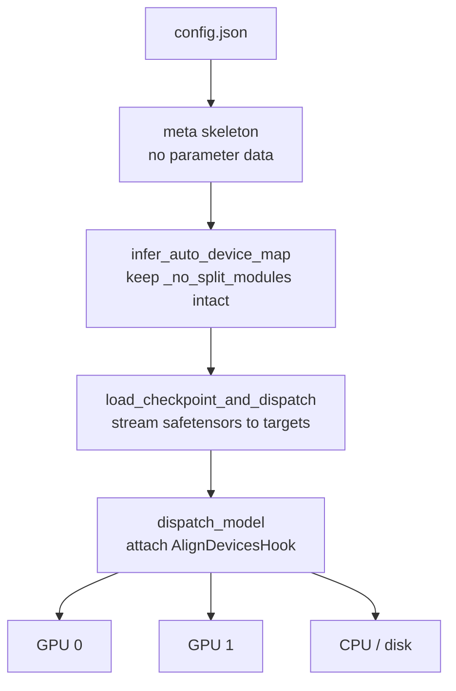
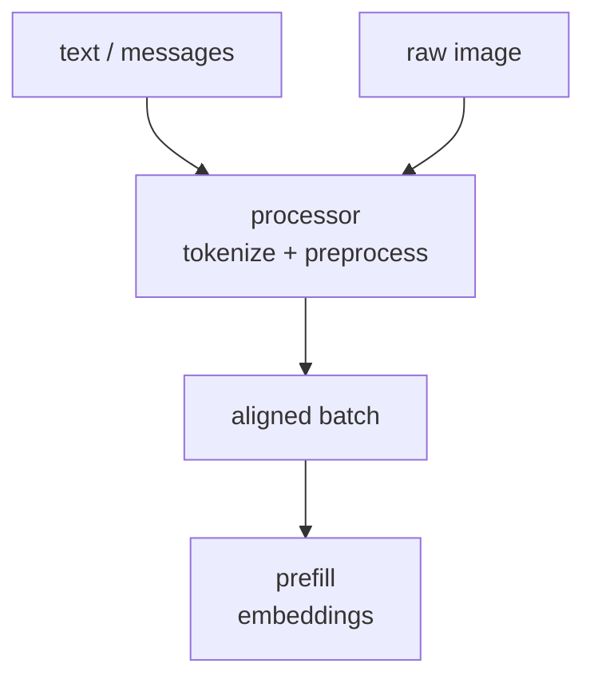

---
{
  "id": "deep-dive-transformers",
  "title": "Deep Dive - Transformers",
  "slug": "deep-dive-transformers",
  "section": "Project Deep Dives",
  "category": "Model Architecture",
  "difficulty": "Hard",
  "order": 2,
  "coverImage": "illustrations/_generated/transformers_auto_pipeline_dark.png",
  "companies": [
    "Hugging Face",
    "Meta AI",
    "Google",
    "Microsoft",
    "OpenAI"
  ],
  "shortDescription": "The same model ID still generates text, but assistant turns start with the wrong control tokens. The weights may not be what changed.",
  "keyConceptsTested": [
    "Model definition versus model architecture",
    "Hub revisions, snapshots, and cache identity",
    "PreTrainedModel lifecycle and weight tying",
    "Multi-device dispatch and device_map execution hooks",
    "AutoConfig and AutoModel lazy dispatch",
    "Safetensors loading and remote-code safety",
    "Tokenizer, processor, and multimodal interfaces",
    "Forward passes, GenerationConfig, and KV caches",
    "Pipelines versus production serving engines",
    "Strengths, failure modes, and source-reading strategy"
  ],
  "prerequisites": [
    "deep-dive-pytorch",
    "transformer-architecture-end-to-end",
    "language-modeling-next-token-prediction",
    "inference-mechanics-ttft-tps-kv-cache"
  ]
}
---

After a routine upgrade, the same model ID loads cleanly and generates fluent text, yet every assistant turn now starts with the wrong control tokens. Did the weights change, or did the tokenizer format the conversation differently? A clean load confirms only that bytes landed in tensors.

PyTorch gives you tensors, kernels, and autograd, which still leaves a gap before you have a loadable language model. A Hub name has to resolve to one snapshot, `config.json` has to pick a Python class, learned weights have to map onto named modules, and raw text has to become the exact token IDs that checkpoint was trained on. <span data-glossary="hugging-face-transformers">Hugging Face Transformers</span> standardizes those interfaces as a model-definition library where a checkpoint, its configuration, preprocessing rules, and forward pass travel together, so the same model loads in a notebook, a <span data-glossary="pytorch">PyTorch</span> trainer, <span data-glossary="fsdp">FSDP</span>, <span data-glossary="vllm">vLLM</span>, or <span data-glossary="sglang">SGLang</span> without every team rewriting the architecture from scratch.[^huggingface2026repo][^huggingface2025v5] To keep the arithmetic concrete, we will trace one small Llama configuration, `tiny-decoder`, through AutoClass lookup, chat formatting, and KV-cache sizing by hand:

```json title="tiny-decoder-config.json"
{
  "model_type": "llama",
  "hidden_size": 1024,
  "num_hidden_layers": 16,
  "num_attention_heads": 16,
  "num_key_value_heads": 4,
  "vocab_size": 32000,
  "max_position_embeddings": 4096,
  "dtype": "bfloat16"
}
```

Dividing `hidden_size` by `num_attention_heads` gives a head dimension of $D = 1024 / 16 = 64$, while grouped-query attention stores $H_{kv} = 4$ key/value heads instead of 16. Those dimensions will drive every memory calculation that follows.

## Four core interfaces around one checkpoint

Loading a model coordinates four layers: identity, architecture metadata, parameter tensors, and input/output semantics. Keeping them modular lets each evolve independently: a repository can update its <span data-glossary="chat-template">chat template</span> without touching weights, model code can adopt a faster cache path while older checkpoints stay loadable, and prior snapshots remain available if you need to revert.

| Subsystem | Files or classes | Job | Failure symptom |
| --- | --- | --- | --- |
| Identity | Hub repo ID, commit | Pick one immutable snapshot | Code/weight version mismatch |
| Configuration | `config.json`, `PreTrainedConfig` | Architecture, sizes, <span data-glossary="token">tokens</span> | Wrong head size or layer count |
| Parameters | `model.safetensors`, index | Load <span data-glossary="tensor">tensors</span> into modules | Missing or mismatched tensors |
| Input/output | tokenizer, processor, `ModelOutput` | Map inputs/outputs to tensors | Wrong IDs, masks, or pixels |

> **Key insight:** Isolate the layer that drifted before touching code. Do not debug attention kernels when the tokenizer injected an extra special token, and do not rewrite a prompt when the loader pulled a different revision.

Each family directory under `src/transformers/models/` holds configuration, modeling, and optional tokenizer or processor files. `PreTrainedConfig` stores hyperparameters without allocating weights, while `PreTrainedModel` subclasses `torch.nn.Module` and drives a five-step lifecycle reused by trainers and serving engines.[^huggingface2026models] Every checkpoint follows this sequence:

1. **`__init__`:** Builds the module tree from config dimensions.
2. **`_init_weights`:** Initializes parameters for fresh training (scaled normal weights, zero biases).
3. **`post_init`:** Registers model properties, runs initialization, and ties input/output embeddings when configured.
4. **`from_pretrained`:** Resolves files, instantiates modules, loads `.safetensors` shards, casts precision, checks keys, and sets eval mode.
5. **`save_pretrained`:** Writes `config.json`, shards (plus index if split), and `generation_config.json`; save tokenizers or processors separately.

## Hub identity and `from_pretrained`

`from_pretrained()` turns a local directory or Hub repository ID into an initialized model by resolving files, downloading missing shards, and copying tensors into matching parameter names.[^huggingface2026models] The snapshot that actually runs is the commit hash resolved by the cache, not the branch name in your call. A branch such as `main` moves whenever the repository updates, whereas a commit SHA names one immutable tree. On disk, the Hub cache separates mutable `refs/` (branch or tag pointers), content-addressed `blobs/` (deduplicated file bytes), and `snapshots/` directories that symlink the exact files for each commit.[^huggingface2026hub]

```python title="load_checkpoint.py"
import torch
from transformers import AutoModelForCausalLM, AutoTokenizer

repo_id = "org/tiny-decoder"
revision = "<commit-sha-from-model-card>"

tokenizer = AutoTokenizer.from_pretrained(repo_id, revision=revision)
model = AutoModelForCausalLM.from_pretrained(
    repo_id,
    revision=revision,
    dtype=torch.bfloat16,
    use_safetensors=True,
    trust_remote_code=False,
)
```

Passing `dtype=torch.bfloat16` (replacing the older `torch_dtype` keyword) makes precision explicit, because omitting `dtype` inherits the precision from `config.json` or the first floating-point weight tensor and can silently load `bfloat16` or `float16` where downstream code assumes `float32`.[^huggingface2026models] Setting `use_safetensors=True` reads raw tensor buffers without pickle's arbitrary Python execution, though safe file parsing checks only format integrity rather than tensor names or architectural compatibility.[^huggingface2026safetensors] Combining an immutable commit hash with explicit `dtype` and `use_safetensors=True` keeps model loading predictable across upgrades and machines.

> **Common mistake:** Enabling `trust_remote_code=True` just to silence an unknown-model error executes arbitrary Python from the repository during import or loading. Leave it `False` by default; if a custom family requires remote code, lock both model and code commit hashes, review the Python modules first, and run in an isolated environment.[^huggingface2026autoclasses]

<!-- leetllm: edition:reference:start -->

### A load failure is evidence about one layer

Use the first error to narrow the failure layer before touching weights or prompts. Multimodal checkpoints follow the same diagnosis: separate missing media files, processor shape mismatches, model class selection, and decoding settings before suspecting corrupted weights. Checking the earliest failing stage prevents wasted debugging on downstream layers.

| Symptom | Likely layer | First check |
| --- | --- | --- |
| `ValueError` for unrecognized model type | Auto mapping or config | `config.json` `model_type`, installed library support |
| Unexpected missing keys | Weight index or class names | Shard index, tied weights, conversion notes |
| Size mismatch | Config or checkpoint variant | Vocabulary, hidden size, <span data-glossary="tensor-parallelism">tensor-parallel</span> export |
| `safetensors` parse error | Artifact integrity | Download <span data-glossary="checksum">checksum</span>, incomplete snapshot, file format |
| Code execution prompt | Dynamic module | `trust_remote_code`, code revision, source review |
| Output has wrong roles | Tokenizer or chat template | Special tokens and `apply_chat_template` |
| Numerics shifted after an upgrade | Dtype default | Explicit `dtype`, config dtype, first weight dtype |

<!-- leetllm: edition:reference:end -->

## Multi-device dispatch and `device_map="auto"`

When a model exceeds a single GPU's VRAM, standard PyTorch construction can run out of memory before weights even load, because `__init__` allocates full random parameters first. Transformers integrates with Accelerate to build an empty parameter skeleton, plan placement across GPUs, CPU RAM, and disk, and stream weights directly into place via `device_map="auto"`.[^huggingface2026acceleratebigmodel] Placement runs in four stages:

1. **Meta device skeleton (`init_empty_weights`):** Allocates tensor shapes and dtypes on PyTorch's `meta` device with zero parameter storage.
2. **Device map calculation (`infer_auto_device_map`):** Measures each submodule's footprint against `max_memory` across `cuda:0`, `cuda:1`, `cpu`, and `disk`, keeping `_no_split_modules` (such as `["LlamaDecoderLayer"]`) intact.
3. **Streaming checkpoint load:** Streams shard tensors straight to their target devices (`load_checkpoint_and_dispatch`) instead of materializing a full CPU copy first.
4. **Execution hooks (`AlignDevicesHook`):** `dispatch_model` attaches pre-forward hooks that align inputs with each block's execution device. In a GPU-backed map, CPU- or disk-offloaded layers are fetched onto the main GPU to execute and then freed, so storage location and execution device differ.[^huggingface2026acceleratedispatch]



> **Key insight:** `device_map="auto"` solves single-instance inference placement, not parallel compute scaling. Inspect `model.hf_device_map` to verify where each block landed (the CPU/disk node holds offloaded weight storage, not a parallel worker). Layers run sequentially while other GPUs wait, so leave VRAM headroom for activations, KV cache, and CUDA workspaces, and use <span data-glossary="fsdp">FSDP</span> or <span data-glossary="deepspeed">DeepSpeed</span> for distributed multi-GPU training.[^huggingface2026acceleratedesign][^huggingface2026acceleratebigmodel]

## AutoClass dispatch turns metadata into Python types

Suppose `config.json` declares `"model_type": "llama"`, while the shard files actually came from another architecture. Which stage catches that error? The `Auto*` API hides family-specific imports behind a deterministic four-step lookup that scales to hundreds of families without importing every modeling file at startup:[^huggingface2026repo][^vonplaten2022transformers][^huggingface2025v5]

1. `AutoConfig.from_pretrained` reads `config.json` and extracts `model_type`.
2. A lazy mapping (`CONFIG_MAPPING_NAMES` in `src/transformers/models/auto/auto_mappings.py`, wrapped by `_LazyConfigMapping` in `configuration_auto.py`) resolves `model_type` to a config class, raising `ValueError` for unknown built-in types.
3. `AutoModelForCausalLM` looks up the task head in `modeling_auto.py` (`MODEL_FOR_CAUSAL_LM_MAPPING_NAMES`), mapping `llama` to `LlamaForCausalLM`.
4. `from_pretrained` on that concrete class allocates modules and loads the weight shards.

<figure>
  
  <figcaption>AutoClass follows model_type before inspecting any tensor shard. Changing tiny-decoder's model_type to gpt2 resolves a valid class, just for the wrong architecture.</figcaption>
</figure>

Because AutoClass selects a class strictly from metadata, a wrong `model_type` can instantiate a valid class that does not match the shards on disk. Always verify `model_type`, <span data-glossary="tensor-shape">tensor shapes</span>, and reference outputs on a known prompt before serving. Once the right class loads, the next place behavior can silently diverge is tokenization.

<!-- leetllm: edition:reference:start -->

The snippet below isolates that metadata-to-class dispatch step: `model_type` picks the class before any weight tensor is inspected, and an unknown type raises immediately. Notice that changing `model_type` to `gpt2` still returns a valid class name even when the rest of the config came from a Llama checkpoint.

<!-- leetllm: test, output=show, output_title="Selected classes" -->
```python title="select_causal_lm.py"
CONFIG_MAPPING = {"llama": "LlamaConfig", "gpt2": "GPT2Config"}
CAUSAL_LM = {"llama": "LlamaForCausalLM", "gpt2": "GPT2LMHeadModel"}


def select_causal_lm(config: dict) -> str:
    model_type = config["model_type"]
    if model_type not in CONFIG_MAPPING:
        raise KeyError(model_type)
    return CAUSAL_LM[model_type]


tiny_decoder = {"model_type": "llama", "hidden_size": 1024}
wrong_type = {**tiny_decoder, "model_type": "gpt2"}

assert select_causal_lm(tiny_decoder) == "LlamaForCausalLM"
assert select_causal_lm(wrong_type) == "GPT2LMHeadModel"

try:
    select_causal_lm({"model_type": "not-a-family"})
except KeyError as exc:
    assert str(exc) == "'not-a-family'"
else:
    raise AssertionError("unknown model_type should raise")

print(select_causal_lm(tiny_decoder))
print(select_causal_lm(wrong_type))
```

<!-- leetllm: output:start -->
```text title="Selected classes" output compact
LlamaForCausalLM
GPT2LMHeadModel
```
<!-- leetllm: output:end -->

<!-- leetllm: edition:reference:end -->

## Tokenizers define more than integer IDs

Tokenization does far more than split strings into integers. `PreTrainedTokenizerBase` exposes a uniform interface over fast Rust-backed `tokenizers` implementations and family-specific backends, controlling vocabulary merges, special tokens (sequence starts, stops, padding, tool calls, media placeholders), padding side, truncation rules, attention masks, offset mappings, and chat templates.[^huggingface2025v5][^huggingface2026tokenizers] Every one of those knobs changes the tensors entering the model. To see how `apply_chat_template` turns structured role messages into control tokens, build a small local word-level tokenizer with a ChatML-style Jinja template and run Transformers' template renderer directly:

> **Key insight:** The model cannot tell whether a token came from the user prompt or from a chat template. It sees only integer IDs, so a chat template is model behavior rather than UI formatting.

<!-- leetllm: test, deps=transformers==5.16.1,jinja2==3.1.6, output=show, output_title="Rendered prompt" -->
```python title="render_chat_template.py"
from tokenizers import Tokenizer
from tokenizers.models import WordLevel
from tokenizers.pre_tokenizers import WhitespaceSplit
from transformers import PreTrainedTokenizerFast

words = ["[UNK]", "<|im_start|>", "<|im_end|>", "system", "user", "assistant",
         "Answer", "with", "one", "sentence.", "What", "does", "a", "revision", "pin?"]
backend = Tokenizer(WordLevel({word: i for i, word in enumerate(words)}, unk_token="[UNK]"))
backend.pre_tokenizer = WhitespaceSplit()
tokenizer = PreTrainedTokenizerFast(
    tokenizer_object=backend, unk_token="[UNK]",
    additional_special_tokens=["<|im_start|>", "<|im_end|>"],
)
tokenizer.chat_template = (
    "{{ '<|im_start|>' + m['role'] + '\\n' + "
    "m['content'] + '<|im_end|>\\n' }}"
    "{{ '<|im_start|>assistant\\n' }}"
)

messages = [
    {"role": "system", "content": "Answer with one sentence."},
    {"role": "user", "content": "What does a revision pin?"},
]
prompt = tokenizer.apply_chat_template(messages, tokenize=False, add_generation_prompt=True)
ids = tokenizer.apply_chat_template(
    messages, tokenize=True, add_generation_prompt=True, return_dict=False,
)

assert prompt.startswith("<|im_start|>system\n")
assert prompt.endswith("<|im_start|>assistant\n")
assert ids == tokenizer(prompt, add_special_tokens=False)["input_ids"]
assert tokenizer.unk_token_id not in ids
print(prompt)
```

<!-- leetllm: output:start -->
```text title="Rendered prompt" output compact
<|im_start|>system
Answer with one sentence.<|im_end|>
<|im_start|>user
What does a revision pin?<|im_end|>
<|im_start|>assistant
```
<!-- leetllm: output:end -->

> **Common mistake:** Rendering a chat template to text and then calling `tokenizer(prompt)` with default settings prepends a second BOS token whenever the template already inserted one. Pass `add_special_tokens=False` on already templated text, or call `apply_chat_template(..., tokenize=True)` in one step.[^huggingface2026chattemplates]

Batched decoder-only generation also depends on padding side. Suppose two prompts have lengths 2 and 4: right padding turns the shorter row into `[a, b, PAD, PAD]`, so a generation loop reading logits at the final column reads from a `PAD` position even when the attention mask hides padding. Left padding produces `[PAD, PAD, a, b]`, placing the real final token `b` at the last column.[^huggingface2026generationpadding] If you reuse EOS as the pad token during training, mask only padding positions in the labels so genuine end-of-sequence targets still contribute to loss.

## Processors make multimodal inputs explicit

`tiny-decoder` is text-only, but checkpoints with vision or audio towers need more than a tokenizer. Image processors resize and normalize pixel tensors, while audio extractors compute log-mel spectrograms from pre-resampled audio. `ProcessorMixin` (`src/transformers/processing_utils.py`) bundles these preprocessors with the tokenizer to emit aligned tensors (`input_ids`, `pixel_values`, `image_sizes`, `input_features`, and placeholder indices) telling the language model where visual or audio <span data-glossary="embedding">embeddings</span> enter the sequence.[^huggingface2026processors][^huggingface2026multimodalchat]



Keep processor and model revisions synchronized, because a change in image resolution, normalization, or placeholder count produces valid shapes that decode into nonsense. A multimodal chat processor handles text templates, placeholder insertion, and pixel preprocessing in one call. If answers diverge after an upgrade, diff processor revisions, rendered templates, normalization, and placeholder indices before inspecting weights:

```python title="prepare_multimodal_batch.py"
from transformers import AutoProcessor

processor = AutoProcessor.from_pretrained("org/vision-language-model", revision="<commit-sha>")
messages = [{"role": "user", "content": [
    {"type": "image", "path": "chart.png"},
    {"type": "text", "text": "Describe this chart."},
]}]
inputs = processor.apply_chat_template(
    messages, add_generation_prompt=True, tokenize=True,
    return_dict=True, return_tensors="pt",
)
```

## `forward` and `generate` are different layers

Calling a model directly runs `forward`, executing one pass through the network. For `LlamaForCausalLM`, `forward` takes `input_ids`, optional `attention_mask`, `position_ids`, `past_key_values`, and `labels`, returning a `ModelOutput` (`CausalLMOutputWithPast`) with `[batch, sequence, vocabulary]` <span data-glossary="logits">logits</span>. Read attributes (`outputs.logits`, `outputs.loss`) rather than tuple indices, because `ModelOutput` drops `None` fields and shifts positions whenever optional outputs appear.[^huggingface2026repo] Passing unshifted `labels` triggers internal next-token shifting (logits at $t$ predict label $t+1$) while ignoring `-100` targets, so a PyTorch loop runs `loss = model(**batch).loss; loss.backward()` directly.[^huggingface2026causalloss] Note that `attention_mask` hides tokens from attention, whereas `-100` excludes targets from loss.

`generate` owns the autoregressive decoding loop above `forward`. It merges `generation_config.json` with call-site overrides into a `GenerationConfig`, applies `LogitsProcessorList` and `StoppingCriteriaList`, and updates the KV cache via `GENERATION_MODES_MAPPING` in `src/transformers/generation/utils.py`.[^huggingface2026generation] The model computes logits in `forward`, while `generate` manages cache state and four decoding modes:

- **Greedy (`_sample`, `do_sample=False`, `num_beams=1`):** Argmax token at every step.
- **Sampling (`_sample`, `do_sample=True`, `num_beams=1`):** Temperature, top-k, and top-p sampling.
- **Beam search (`_beam_search`, `num_beams > 1`, `do_sample=False`):** Fixed-size beam hypotheses with length penalties.
- **Assisted decoding (`_assisted_decoding`):** Draft-model proposals verified in parallel by the target model.

```python title="explicit_greedy_generate.py"
outputs = model.generate(
    **batch, max_new_tokens=96, do_sample=False, num_beams=1,
    return_dict_in_generate=True, use_cache=True,
)
new_ids = outputs.sequences[:, batch["input_ids"].shape[1]:]
text = tokenizer.batch_decode(new_ids, skip_special_tokens=True)
```

> **Common mistake:** Passing `do_sample=False` without `num_beams=1` still runs beam search if `generation_config.json` sets `num_beams > 1`. Slice off `batch["input_ids"].shape[1]` tokens from decoder-only `outputs.sequences` to keep only the completion.

## KV caches turn repeated prefix work into state

During autoregressive decoding, each new token attends to every previous key and value, so without caching generating token $S$ would re-project all $S-1$ prior tokens on every step. A <span data-glossary="kv-cache">KV cache</span> retains each layer's past key and value tensors so every decode step projects only the single new token.[^huggingface2026kvcache] On `tiny-decoder`, each layer stores $H_{kv} = 4$ key heads and 4 value heads of width $D = 64$ in `bfloat16` (2 bytes), giving $2 \times 4 \times 64 \times 2 = 1{,}024$ bytes per token per layer, or 16 KiB across 16 layers. At 512 tokens that payload is 8 MiB; at 4,096 tokens it reaches 64 MiB. Generalizing to a full-attention cache shaped `[batch, kv_heads, sequence, head_dim]`, grouped-query or <span data-glossary="multi-query-attention">multi-query attention</span> shrinks memory linearly with $H_{kv}$:

$$
\text{KV bytes} \approx 2 \times L \times B \times S \times H_{kv} \times D \times \text{bytes(dtype)}.
$$

Here $L$ is layer count, $B$ is active sequence count (including any beam expansion), $S$ is cached sequence length, $H_{kv}$ is key/value head count, $D$ is head dimension, and the leading 2 accounts for keys and values. In `src/transformers/cache_utils.py`, `DynamicCache` grows step by step, `StaticCache` preallocates a fixed maximum length for stable `torch.compile` shapes (occupying full capacity even when few tokens are live), and `QuantizedCache` compresses stored states.[^huggingface2026kvcache] Sliding-window or hybrid layers cap $S$ on windowed layers, while serving engines like vLLM and SGLang replace per-call cache objects with paged physical block pools shared across concurrent requests.

<figure>
  
  <figcaption>DynamicCache for tiny-decoder grows linearly from 8 MiB at S=512 to 64 MiB at S=4096, whereas StaticCache allocated for 4096 tokens holds 64 MiB upfront even at 512 live tokens.</figcaption>
</figure>

<!-- leetllm: edition:reference:start -->

This helper verifies the `tiny-decoder` dynamic and static KV-cache MiB figures directly from the formula. Notice how `StaticCache` charges for the full 4,096-token budget immediately while `DynamicCache` grows with live sequence length. Both numbers count only K/V tensor payload before weights, activations, or concurrent batches.

<!-- leetllm: test, output=show, output_title="KV cache MiB" -->
```python title="tiny_decoder_kv_bytes.py"
def kv_bytes(
    layers: int,
    batch: int,
    seq_len: int,
    kv_heads: int,
    head_dim: int,
    dtype_bytes: int,
) -> int:
    return 2 * layers * batch * seq_len * kv_heads * head_dim * dtype_bytes


LAYERS, BATCH, KV_HEADS, HEAD_DIM, DTYPE_BYTES = 16, 1, 4, 64, 2
mib = 1024 * 1024

assert kv_bytes(LAYERS, BATCH, 512, KV_HEADS, HEAD_DIM, DTYPE_BYTES) == 8 * mib
assert kv_bytes(LAYERS, BATCH, 4096, KV_HEADS, HEAD_DIM, DTYPE_BYTES) == 64 * mib

dynamic_512 = kv_bytes(LAYERS, BATCH, 512, KV_HEADS, HEAD_DIM, DTYPE_BYTES) // mib
static_max = kv_bytes(LAYERS, BATCH, 4096, KV_HEADS, HEAD_DIM, DTYPE_BYTES) // mib
print(dynamic_512)
print(static_max)
```

<!-- leetllm: output:start -->
```text title="KV cache MiB" output compact
8
64
```
<!-- leetllm: output:end -->

<!-- leetllm: edition:reference:end -->

## Run a real model without a downloaded checkpoint

To exercise the real Transformers execution path on CPU with zero downloads, shrink the Llama config to 2 layers, `hidden_size=32`, 4 query heads, 2 KV heads, and a 32-token vocabulary, and pass fixed integer IDs directly. Run the next two blocks in sequence. The first checks shifted masked cross-entropy, backpropagation, tied embeddings, and a local safetensors save/reload round trip:

<!-- leetllm: test, id=transformers-cpu, deps=torch==2.12.0,transformers==5.16.1, output=show, output_title="Real model checks" -->
```python title="local_model_execution.py"
import tempfile
import torch
from transformers import AutoConfig, AutoModelForCausalLM, DynamicCache, StaticCache
from transformers.utils import logging

logging.disable_progress_bar()
torch.manual_seed(7)
torch.set_num_threads(1)
config = AutoConfig.for_model(
    "llama", vocab_size=32, hidden_size=32, intermediate_size=64,
    num_hidden_layers=2, num_attention_heads=4, num_key_value_heads=2,
    max_position_embeddings=32, attention_dropout=0.0,
    bos_token_id=1, eos_token_id=None, pad_token_id=0,
    tie_word_embeddings=True,
)
model = AutoModelForCausalLM.from_config(config, attn_implementation="eager").eval()
ids = torch.tensor([[1, 7, 9, 4, 2]])
labels = ids.clone()
labels[:, 3] = -100
out = model(ids, labels=labels, use_cache=False)
expected_loss = torch.nn.functional.cross_entropy(
    out.logits[:, :-1].reshape(-1, 32), labels[:, 1:].reshape(-1), ignore_index=-100,
)
torch.testing.assert_close(out.loss, expected_loss)
out.loss.backward()
assert model.get_input_embeddings().weight.grad.abs().sum() > 0
assert model.get_input_embeddings().weight is model.get_output_embeddings().weight

with tempfile.TemporaryDirectory() as saved:
    model.save_pretrained(saved)
    restored = AutoModelForCausalLM.from_pretrained(
        saved, local_files_only=True, use_safetensors=True, dtype=torch.float32,
        attn_implementation="eager",
    )
    assert not restored.training
    with torch.no_grad():
        torch.testing.assert_close(restored(ids).logits, out.logits)
print(type(restored).__name__, tuple(out.logits.shape))
print("shifted masked loss, backward, tied weights, reload: passed")
```

<!-- leetllm: output:start -->
```text title="Real model checks" output compact
LlamaForCausalLM (1, 5, 32)
shifted masked loss, backward, tied weights, reload: passed
```
<!-- leetllm: output:end -->

Setting `labels[:, 3] = -100` excludes position 2's prediction from the loss while keeping token 3 visible in attention, and `.eval()` disables training-only modules without disabling autograd (`torch.no_grad()` controls gradient tracking). Next, cache the first four tokens and feed only the fifth so its logits match the full five-token pass. In `float32`, `DynamicCache` stores $2 \times 2 \times 1 \times 5 \times 2 \times 8 \times 4 = 1{,}280$ K/V bytes, while `StaticCache` with capacity 16 reserves $4{,}096$ bytes upfront even with five live tokens:

<!-- leetllm: test, continue=transformers-cpu, output=show, output_title="Cache and decoding checks" -->
```python title="cache_and_generate_execution.py"
with torch.no_grad():
    full = model(ids, use_cache=False).logits[:, -1:]
    changed = ids.clone()
    changed[:, -1] = 3
    original_logits = model(ids, use_cache=False).logits
    changed_logits = model(changed, use_cache=False).logits
    torch.testing.assert_close(original_logits[:, :-1], changed_logits[:, :-1])
    for cache in [DynamicCache(config=config), StaticCache(config=config, max_cache_len=16)]:
        model(ids[:, :-1], past_key_values=cache, use_cache=True)
        tail = model(
            ids[:, -1:], attention_mask=torch.ones_like(ids),
            past_key_values=cache, use_cache=True,
        ).logits
        torch.testing.assert_close(tail, full, atol=1e-6, rtol=1e-5)
        assert cache.get_seq_length() == ids.shape[1]
        stored = sum(t.numel() * t.element_size() for layer in cache.layers
                     for t in [layer.keys, layer.values])
        print(type(cache).__name__, "positions", int(cache.get_seq_length()), "bytes", stored)

    # A same-length prefix can still belong to a different conversation.
    stale = DynamicCache(config=config)
    model(ids[:, :-1], past_key_values=stale, use_cache=True)
    different = ids.clone()
    different[:, 1] = 6
    wrong_tail = model(
        different[:, -1:], attention_mask=torch.ones_like(ids),
        past_key_values=stale, use_cache=True,
    ).logits
    correct_tail = model(different, use_cache=False).logits[:, -1:]
    assert not torch.allclose(wrong_tail, correct_tail, atol=1e-6, rtol=1e-5)

    result = model.generate(
        ids, max_new_tokens=3, do_sample=False, num_beams=1,
        use_cache=True, return_dict_in_generate=True,
    )
    generated = result.sequences
    manual = ids.clone()
    for _ in range(3):
        next_id = model(manual, use_cache=False).logits[:, -1].argmax(-1, keepdim=True)
        manual = torch.cat([manual, next_id], dim=1)
    assert torch.equal(generated, manual)
    assert result.past_key_values.get_seq_length() == generated.shape[1] - 1
    print("generated positions", generated.shape[1],
          "cached positions", int(result.past_key_values.get_seq_length()))
print("causal mask, cache equivalence, stale-prefix rejection, greedy/manual tokens: passed")
```

<!-- leetllm: output:start -->
```text title="Cache and decoding checks" output compact
DynamicCache positions 5 bytes 1280
StaticCache positions 5 bytes 4096
generated positions 8 cached positions 7
causal mask, cache equivalence, stale-prefix rejection, greedy/manual tokens: passed
```
<!-- leetllm: output:end -->

Three details stand out. First, changing the final token leaves earlier logits identical because causal attention hides future positions. Second, equal cache length never implies matching prefix history: changing token 1 alters token 4's K/V context, so verify prefix IDs before reusing a cache and copy shared prefix caches before mutating them.[^huggingface2026kvcache] Third, 8 sequence positions leave 7 cached positions because selecting the final token does not forward it until you resume (EOS is `None` here solely to force three steps):[^huggingface2026repo]

| Pass | Tokens processed | Cached after | Token selected |
| --- | --- | --- | --- |
| Prefill | 5 prompt tokens | 5 | Position 5 |
| Decode 1 | Position 5 | 6 | Position 6 |
| Decode 2 | Position 6 | 7 | Position 7 (stop) |

## Pipelines are high-level entry points, not serving fleets

`pipeline(task=..., model=...)` bundles preprocessing, model loading, local batching, forward execution, and postprocessing into one Python call for smoke tests and offline jobs. Although Transformers includes paged caching, <span data-glossary="continuous-batching">continuous batching</span>, and `transformers serve`, a plain pipeline lacks the request scheduling, fault isolation, autoscaling, and GPU topology controls of dedicated servers like vLLM, SGLang, or <span data-glossary="tensorrt-llm">TensorRT-LLM</span>.[^huggingface2025v5] When a serving engine disagrees with eager Transformers, diff <span data-glossary="tokenization">tokenization</span>, chat template, first-step logits, seed, stop IDs, and cache state before comparing decoded text.

<!-- leetllm: edition:reference:start -->

| Concern | Transformers pipeline | Production serving engine |
| --- | --- | --- |
| Model definition | Broad, model-family aware | Supports a curated compatibility set |
| Input normalization | Task and modality processors | Often adapter-specific or preprocessed upstream |
| Batch behavior | Local batching and padding | Continuous batching and request scheduling |
| KV memory | Per-call cache object | Paged or shared physical block pool |
| API | Python call | Long-lived HTTP or RPC service |
| Scale | One process or user-managed workers | Parallel replicas, ranks, routing, health checks |

## Training, serving, and the drift they introduce

Once a model family conforms to Transformers' interfaces, surrounding tools can specialize around it without reimplementing every architecture: PyTorch handles autograd and `torch.compile`, <span data-glossary="fsdp">FSDP</span> and <span data-glossary="deepspeed">DeepSpeed</span> shard training state, <span data-glossary="parameter-efficient-fine-tuning">Parameter-efficient fine-tuning (PEFT)</span> attaches adapters, quantizers and ONNX/<span data-glossary="tensorrt">TensorRT</span> transform weights, and vLLM/SGLang map supported families onto high-throughput runtimes. For training, `Trainer` or a custom PyTorch loop orchestrates batching and optimization while still relying on the tokenizer and config to supply valid tensors. Because fused kernels, quantizers, and serving runtimes can interpret masks or <span data-glossary="rope">RoPE</span> scaling slightly differently, keep a small eager reference test on fixed token IDs and check logit agreement after every upgrade; note also that Transformers' Apache-2.0 license covers only library code, while Hub weights, datasets, and remote code keep their own licenses.[^huggingface2026transformerslicense][^huggingface2026hublicenses]

| Application | Typical entry point | What to validate | Common production tradeoff |
| --- | --- | --- | --- |
| Text generation | `AutoModelForCausalLM` + tokenizer | Chat template, stop IDs, KV cache, decoding settings | vLLM or SGLang scheduler |
| Classification | `AutoModelForSequenceClassification` | Label map, pooling, threshold <span data-glossary="calibration">calibration</span> | Batch service or feature pipeline |
| Retrieval embeddings | encoder model + pooling | Normalization, truncation, dimension | <span data-glossary="vector">Vector</span> index and embedding version |
| Vision-language chat | `AutoProcessor` + supported multimodal model class | Image tokens, template, pixel budget | Multimodal serving adapter |

## Strengths and limits

Supporting hundreds of model families requires keeping historical checkpoints loadable while adding new modalities and kernels. That breadth makes Transformers the standard reference implementation across the ecosystem, while also meaning no single assumption fits every family. Read the concrete model and processor source files for your checkpoint instead of assuming every architecture behaves like a standard decoder.

| Strength | Why it matters | Cost or limit |
| --- | --- | --- |
| Wide model coverage | One API spans text, vision, audio, video, and multimodal families | Support can lag a brand-new architecture |
| Shared definition | Training and serving systems target common classes | Backends still require per-model integration |
| Reproducible Hub loading | Commit revisions and content-addressed snapshots make artifacts inspectable | Loading `main` or unreviewed remote code defeats reproducibility |
| Typed preprocessing | Tokenizers and processors expose named inputs and masks | Small preprocessing changes can shift model behavior |
| Rich generation options | Sampling, beams, assisted decoding, and cache modes work out of the box | Saved defaults can hide active settings and inflate memory |
| Python-first ergonomics | Fast inspection and experimentation in ordinary Python | Single-process Python is not a high-concurrency serving stack |

## Failure modes worth designing for

### Revision drift

Loading a moving branch (`main`) lets tokenizer or config edits silently change behavior between runs. Lock immutable commit hashes for model, tokenizer, processor, and code revisions in every deployment spec. Advance explicitly to a new commit on upgrade, and revert by switching back to the prior hash.

### Silent template mismatch

Two clients load identical weights but render roles differently, feeding unexpected control tokens that produce empty turns or malformed tool calls. Snapshot the rendered template, special-token IDs, and first-step logits in regression tests. That makes formatting drift fail fast before traffic sees broken turns.

### Shape-compatible wrong class

A misconfigured `model_type` can instantiate a class whose tensor shapes happen to align while applying the wrong positional encoding or attention mask. Verify `model_type`, reference logits, and architectural properties such as causal masking or image-token count. Never trust a clean load alone as proof of family match.

### Weight conversion gaps

Converted checkpoints can contain renamed, tied, sharded, or transposed tensors, allowing a task head to stay randomly initialized behind a seemingly clean load. Inspect every unexpected missing or extra key in the loader report. Accept non-empty key mismatches only when the model card explicitly accounts for them.

### Dtype auto-load

Omitting `dtype` inherits the checkpoint's stored floating precision, which can shift numerics, VRAM usage, and kernel selection after an upgrade. Pass `dtype` explicitly in every load call rather than relying on library defaults. Log the loaded parameter dtype during startup checks so silent precision shifts cannot slip through.

### Cache pressure

Long prompts, wide batches, and long generations expand KV memory rapidly. `DynamicCache` can OOM before compute saturates, while `StaticCache` reserves full max-length capacity even for short prompts. Track cache bytes and sequence lengths, cap concurrency, and use a paged allocator under multi-request traffic.

### Unsafe custom code

Enabling `trust_remote_code=True` executes repository Python on import or load. Lock the code commit, review the source files, and isolate execution permissions before turning it on. Prefer upstream-supported model classes whenever they exist.

### Processor drift

Changes to image resizing, normalization, or audio sampling defaults can degrade multimodal accuracy while text tests keep passing. Include raw media samples, processor configs, and intermediate tensor checks in multimodal test suites. Comparing pixel or spectrogram tensors before forward catches preprocessing drift immediately.

### Offload latency thrashing

With CPU or disk offload, decoding steps can stall on host-to-device weight transfers on every token. Inspect `model.hf_device_map` and measure actual token latency on your workload. Keeping active weights resident on GPU avoids per-step transfer overhead altogether.

## Project identity

Hugging Face open-sourced a PyTorch implementation of BERT in 2018 before expanding Transformers into a multi-family, multimodal library maintained by Hugging Face engineers alongside model authors, infrastructure teams, and community contributors.[^huggingface2022seriesc][^huggingface2026repo] Modern releases focus on PyTorch as the primary backend and add structured cache classes, compiler-friendly execution, quantization integrations, paged caching, continuous batching, `transformers serve`, and modular model authoring.[^huggingface2025v5] Library code is Apache-2.0, while hosted Hub services, weights, datasets, and remote code keep their own licenses and terms.[^huggingface2026transformerslicense][^huggingface2026hublicenses]

| Field | Current project fact |
| --- | --- |
| Origin | Started as a PyTorch BERT release in 2018 and formalized in the 2020 EMNLP demonstration paper by Thomas Wolf, Lysandre Debut, Victor Sanh, and collaborators.[^huggingface2022seriesc][^wolf2020transformers] |
| Stewardship | Maintained by Hugging Face engineers with model authors, infrastructure teams, and community contributors.[^huggingface2026repo] |
| Contributor path | Public model-integration guides, issues, pull requests, tests, and maintainer review.[^huggingface2026contributing] |
| License scope | Library code is Apache-2.0; Hub weights, datasets, and remote code carry separate licenses.[^huggingface2026transformerslicense][^huggingface2026hublicenses] |

## Follow a request through the source

Open the Transformers repository and trace a causal-LM request from config to generated token. Keep a tiny runnable reference script beside the code (locked revision, saved tokenizer output, first-position logits, and one greedy sequence) so any future change points straight to the layer that moved. Walk these files in order:[^huggingface2026repo]

1. `src/transformers/models/auto/auto_mappings.py` (`CONFIG_MAPPING_NAMES`)
2. `src/transformers/models/auto/configuration_auto.py` (`_LazyConfigMapping`, `model_type_to_module_name`, `AutoConfig.from_pretrained`)
3. `src/transformers/models/auto/modeling_auto.py` (`MODEL_FOR_CAUSAL_LM_MAPPING_NAMES`, mapping `llama` to `LlamaForCausalLM`)
4. `src/transformers/models/llama/` (`configuration_llama.py`, `modeling_llama.py`)
5. `src/transformers/modeling_utils.py` (`PreTrainedModel` lifecycle: `_init_weights`, `post_init`, `tie_weights`, shard loading, and device/quantizer hooks)
6. `src/transformers/utils/hub.py` (revision and snapshot file resolution)
7. `src/transformers/tokenization_utils_base.py` (padding, truncation, special tokens, batch encodings)
8. `src/transformers/processing_utils.py` (multimodal processor composition)
9. `src/transformers/generation/utils.py` and `src/transformers/generation/configuration_utils.py` (`GenerationConfig`, `GENERATION_MODES_MAPPING`, logits processors, stopping criteria, cache updates)
10. `src/transformers/cache_utils.py` (`DynamicCache`, `StaticCache`, `QuantizedCache`, offloading)
11. `src/transformers/pipelines/base.py` (preprocessing, batching, model call, and postprocessing)

## A release manifest for a Transformers application

A faster runtime that silently alters the chat template is not an equivalent deployment, and a clean output from a moving branch is not reproducible. Capture the exact runtime specification before promoting a model change so every layer can be diffed independently. Record these items for each release:

- Hub repository and immutable commit hash for model, tokenizer, and processor.
- Transformers, PyTorch, tokenizer backend, and accelerator runtime versions.
- `config.json` hash, resolved AutoClass, safetensors shard index, and parameter count.
- Rendered chat template, special-token IDs, and multimodal processor settings/shapes.
- Explicit `dtype`, quantization mode, device map, cache class, and `GenerationConfig` (seed, stop IDs, `max_new_tokens`).
- Reference logits with tolerance for optimized backends, plus model-card license terms and remote-code review status.

## Test a change before trusting it

### Follow-up questions

- Double the CPU lab's KV-head count from 2 to 4 while keeping query heads fixed, compute both cache sizes by hand, and rerun. The payload doubles from 1,280 to 2,560 bytes dynamically and from 4,096 to 8,192 bytes statically.
- Mask one training label to `-100`. Which logits lose a target, and can that input token still influence later predictions? Check the preceding position's loss term: label masking never removes a token from attention.
- A new serving backend matches full-forward logits yet diverges after the second generated token. Inspect the first divergent token, cache positions and attention masks, logits processors, and stop IDs rather than blaming the weights.

### Evaluation rubric

- Traces a specific checkpoint revision through config resolution, concrete model class, safetensors loading, and preprocessing.
- Distinguishes causal-LM loss shifting, attention masks, `-100` label masks, and `ModelOutput` tuple behavior.
- Verifies cached vs full-forward logit agreement and greedy vs manual decoding equivalence.
- Computes KV-cache bytes accurately from stored KV heads, dtype width, live sequence length, and static capacity.
- Separates single-process API checks from production serving throughput, multi-GPU topology, and task-quality evaluation.

<!-- leetllm: edition:reference:end -->

```mastery-quiz
[
  {
    "question": "A GPU-backed device map offloads one layer to CPU RAM. When that layer runs, GPU memory holds 0.8 GiB resident weights, 1.0 GiB fetched layer, 0.6 GiB live KV cache, and 0.2 GiB workspace on a 2.5 GiB GPU. Where does it run and does it fit?",
    "options": [
      "Main GPU; overflows at 2.6 GiB simultaneous live memory.",
      "CPU; fits because GPU memory holds only 1.6 GiB.",
      "Main GPU; fits because weights plus KV cache total 2.4 GiB.",
      "CPU; overflows at 2.6 GiB CPU-only memory."
    ],
    "answer": "Main GPU; overflows at 2.6 GiB simultaneous live memory.",
    "explanation": "AlignDevicesHook fetches CPU-offloaded layers onto the main GPU to execute them. Summing resident weights (0.8), fetched layer (1.0), KV cache (0.6), and workspace (0.2) gives 2.6 GiB, exceeding 2.5 GiB."
  },
  {
    "question": "A chat template tokenizes as [B,user,Q,E,B,assistant]. A client renders it to text and calls the tokenizer with default special-token insertion, prepending another B. What sequence results and how do you fix it?",
    "options": [
      "[B,user,Q,E,B,assistant]; remove the final assistant marker.",
      "[B,user,Q,E,assistant]; register B as a normal token.",
      "[B,B,user,Q,E,assistant]; add another E after Q.",
      "[B,B,user,Q,E,B,assistant]; pass add_special_tokens=False or use apply_chat_template(..., tokenize=True)."
    ],
    "answer": "[B,B,user,Q,E,B,assistant]; pass add_special_tokens=False or use apply_chat_template(..., tokenize=True).",
    "explanation": "The extra tokenization step prepends a duplicate B without removing template markers, creating seven tokens. Pass add_special_tokens=False or tokenize inside apply_chat_template."
  },
  {
    "question": "A causal LM gets six tokens (positions 0 to 5) with unshifted labels and masks labels 2 and 4 to -100. Next-token target probabilities from logits 0 to 4 are [0.8, 0.4, 0.2, 0.9, 0.5]. What is the mean NLL, and are tokens 2 and 4 visible in attention?",
    "options": [
      "About 0.5108 from 0.4 and 0.9; both tokens remain visible.",
      "About 0.8419 from 0.8, 0.2, and 0.5; both tokens are hidden from attention.",
      "About 0.8419 from 0.8, 0.2, and 0.5; both tokens remain visible.",
      "About 0.7095 from all five probabilities; both tokens are hidden from attention."
    ],
    "answer": "About 0.8419 from 0.8, 0.2, and 0.5; both tokens remain visible.",
    "explanation": "Logits at t predict label t+1, so masking labels 2 and 4 drops logits 1 (0.4) and 3 (0.9). The remaining mean NLL is -ln(0.8 * 0.2 * 0.5) / 3 = 0.8419, and label masking never alters attention visibility."
  },
  {
    "question": "A full-attention decoder has 8 layers, batch 2, 3 KV heads, head dim 32, and 2-byte values, with live length 96 and static capacity 512. Counting K/V payload only, what are the dynamic and static footprints?",
    "options": [
      "0.28125 MiB / 1.5 MiB.",
      "2.25 MiB / 12 MiB.",
      "0.5625 MiB / 0.5625 MiB.",
      "0.5625 MiB / 3 MiB."
    ],
    "answer": "0.5625 MiB / 3 MiB.",
    "explanation": "Dynamic payload is 2 * 8 * 2 * 96 * 3 * 32 * 2 = 589,824 bytes = 0.5625 MiB. StaticCache reserves all 512 slots upfront: 2 * 8 * 2 * 512 * 3 * 32 * 2 = 3,145,728 bytes = 3 MiB."
  },
  {
    "question": "A greedy run starts with 6 prompt tokens and selects 4 new tokens, returning 10 sequence positions and 9 cached KV positions. Forwarding only that pending 10th token (without selecting another token) yields which sequence/cache lengths?",
    "options": [
      "11 / 10, because forwarding appends a new token.",
      "10 / 9, because only newly selected tokens enter the cache.",
      "10 / 10, because forwarding caches the pending token without selecting a new one.",
      "11 / 11, because one forward fills the next unselected position."
    ],
    "answer": "10 / 10, because forwarding caches the pending token without selecting a new one.",
    "explanation": "The pending 10th token is already in the sequence. Forwarding it adds its K/V state (bringing cache length to 10) while returning logits; without another selection, the sequence stays at 10."
  }
]
```

> **Next:** Continue to [Deep Dive - vLLM](/learn/deep-dive-vllm).
