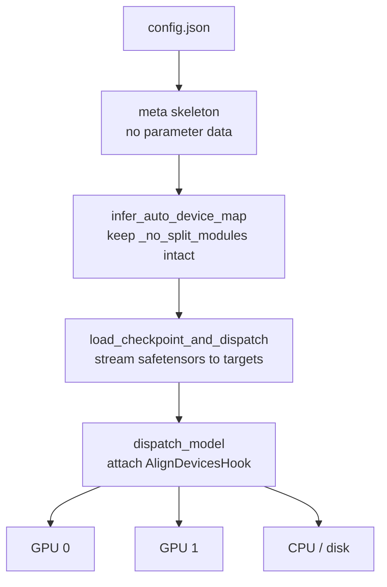
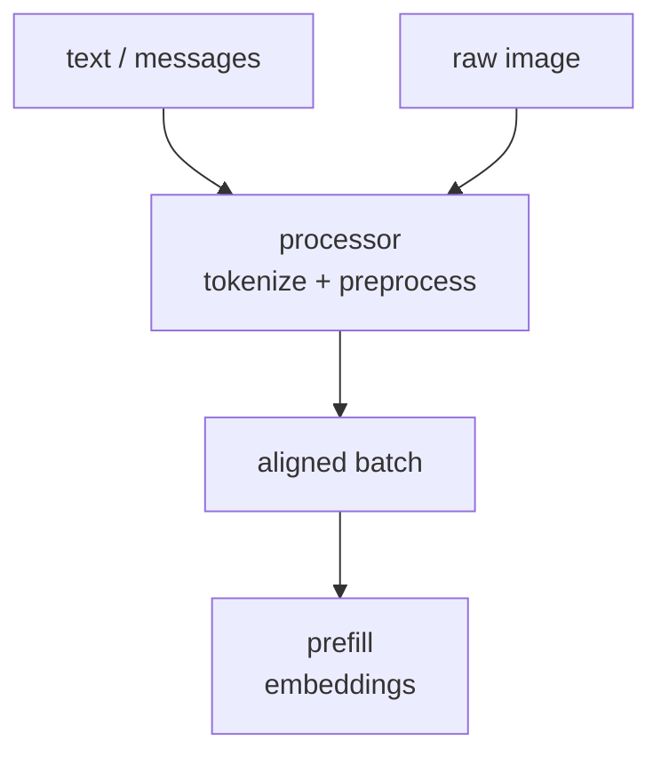

---
{
  "id": "deep-dive-transformers",
  "title": "Deep Dive - Transformers",
  "slug": "deep-dive-transformers",
  "section": "Project Deep Dives",
  "category": "Model Architecture",
  "difficulty": "Hard",
  "order": 12,
  "coverImage": "illustrations/_generated/transformers_auto_pipeline_dark.png",
  "companies": [
    "Hugging Face",
    "Meta AI",
    "Google",
    "Microsoft",
    "OpenAI"
  ],
  "shortDescription": "The same model ID still generates text, but assistant turns start with the wrong control tokens. The weights may not be what changed.",
  "keyConceptsTested": [
    "Model definition versus model architecture",
    "Hub revisions, snapshots, and cache identity",
    "PreTrainedModel lifecycle and weight tying",
    "Multi-device dispatch and device_map execution hooks",
    "AutoConfig and AutoModel lazy dispatch",
    "Safetensors loading and remote-code boundaries",
    "Tokenizer, processor, and multimodal interfaces",
    "Forward passes, GenerationConfig, and KV caches",
    "Pipelines versus production serving engines",
    "Strengths, failure modes, and source-reading strategy"
  ],
  "prerequisites": [
    "deep-dive-pytorch",
    "transformer-architecture-end-to-end",
    "language-modeling-next-token-prediction",
    "inference-mechanics-ttft-tps-kv-cache"
  ]
}
---

After an upgrade, the same model ID might still generate text while starting assistant turns with the wrong control tokens. Did the weights change, or did the tokenizer format the conversation differently? A successful load is only the first check.

Hugging Face Transformers connects a model's saved weights to the code and input processing needed to use them. PyTorch gave you tensors, kernels, and autograd. That still isn't a loadable language model. A Hub name has to resolve to one revision. That revision's `config.json` has to pick a class. The class has to receive tensors with expected names. Text has to become the token IDs that class was trained on. <span data-glossary="hugging-face-transformers">Hugging Face Transformers</span> packages those interfaces.

It isn't one architecture, and it isn't the Hub. It's a model-definition library: a checkpoint, its configuration, preprocessing rules, and forward pass travel together. The same definition can then load in a notebook, a <span data-glossary="pytorch">PyTorch</span> trainer, <span data-glossary="fsdp">FSDP</span>, <span data-glossary="vllm">vLLM</span>, or <span data-glossary="sglang">SGLang</span> without every team rewriting the family from scratch.[^huggingface2026repo][^huggingface2025v5]

Use `tiny-decoder` as an analytical example, not as a Hub repo you'd download. Its fixed dimensions let us check AutoClass lookup, chat rendering, and KV-cache bytes by hand. Later, a smaller randomly initialized Llama runs the real library on CPU without downloading model weights. Those checks establish mechanics, not language quality or serving performance.

```json title="tiny-decoder-config.json"
{
  "model_type": "llama",
  "hidden_size": 1024,
  "num_hidden_layers": 16,
  "num_attention_heads": 16,
  "num_key_value_heads": 4,
  "vocab_size": 32000,
  "max_position_embeddings": 4096,
  "dtype": "bfloat16"
}
```

`hidden_size / num_attention_heads` is the head dimension: $D = 1024 / 16 = 64$. Grouped-query attention here uses $H_{kv} = 4$ key/value heads, not 16. Carry those values through each later check.

```checkpoint
What does Transformers standardize when it doesn't standardize one architecture?
---
It standardizes the execution interface: configuration, model classes, pretrained weight loading, tokenizers or processors, output types, and generation conventions. A Llama, ViT, Whisper, or vision-language model still has its own architecture inside that structure.
```

## Four core interfaces around one checkpoint

Loading a model successfully coordinates multiple distinct layers: identity, shape, parameters, and input/output semantics. A model repository is a versioned collection of structured assets rather than an opaque weight blob. For `tiny-decoder` those pieces are:

| Subsystem | Typical files or classes | Job | A failed integration looks like |
| --- | --- | --- | --- |
| Identity | Hub repo ID, revision, commit | Select one immutable snapshot | Code and weights come from different versions |
| Configuration | `config.json`, `PreTrainedConfig` | Describe architecture, dimensions, <span data-glossary="token">tokens</span>, and options | Wrong head size or layer count |
| Parameters | `model.safetensors` shards and index | Restore learned <span data-glossary="tensor">tensors</span> into modules | Missing, unsafe, or mismatched tensors |
| Input/output | tokenizer, processor, `ModelOutput` | Map user data to tensors and outputs | Token IDs, masks, or pixels have the wrong semantics |

The library keeps these components modular so each can evolve independently. Tokenizers may add a <span data-glossary="chat-template">chat template</span> without changing weights. Model code can add an optimized cache path while historical checkpoints stay loadable. A Hub revision may point at new configuration while older snapshots remain available for <span data-glossary="rollback">rollback</span>.

If output is wrong, inspect the subsystem that produced it. Don't rewrite attention kernels when the tokenizer added an unexpected special token, and don't blame a prompt when the class loaded an unintended revision.

A family directory under `src/transformers/models/` holds configuration and modeling code, often with tokenizer or processor files. Shared AutoClass mappings and output types live elsewhere in the package. `PreTrainedConfig` records hyperparameters and options without creating model parameters. `PreTrainedModel` subclasses `torch.nn.Module` and supplies the loading and initialization lifecycle:[^huggingface2026models]

1. **Instantiation (`__init__`):** Builds the neural network module hierarchy using dimensions from the config.
2. **Weight initialization (`_init_weights`):** Defines parameter initialization formulas (such as normal distributions scaled by `config.initializer_range` and zeroed biases) for fresh training.
3. **Post-initialization (`post_init`):** Collects model properties and initializes weights, including any configured weight tying. Tying makes input embeddings and output LM head share parameters; it is not enabled for every family or configuration.
4. **Checkpoint restoration (`from_pretrained`):** Resolves artifact files, instantiates the architecture, parses `.safetensors` weights, casts precisions, validates tensor keys, and sets evaluation mode.
5. **Persistence (`save_pretrained`):** Saves model configuration and weights, with a shard index when needed and generation configuration for generative models. Save the tokenizer or processor separately; saving the model does not capture preprocessing automatically.

The lifecycle explains what a downstream runtime can reuse. It can replace selected kernels while keeping parameter names and tokenizer behavior, but only when that backend supports the family. A load can still succeed on one machine and fail on another when local caches resolve different snapshot revisions.

## Hub identity and `from_pretrained`

`from_pretrained()` resolves a model source and constructs the class. Given a local directory or Hub ID, it finds configuration and weight files, resolves a revision, downloads missing bytes, and loads tensors into matching parameter names.[^huggingface2026models]

The snapshot is the revision the cache resolved, not the branch name in the call. A branch such as `main` is convenient and mutable. A commit hash identifies one snapshot. The Hub cache keeps `refs/` (branch or tag to commit), content-addressed `blobs/`, and `snapshots/` that symlink the exact files for one revision while sharing unchanged blobs across revisions.[^huggingface2026hub]

Choose the model and tokenizer revisions, dtype, tensor format, and remote-code policy before calling the loader. This API sketch deliberately uses a placeholder repo and revision. For a deployment, select a real commit from repository history; for a local executable check, use the self-contained CPU lab below.

```python title="load_pinned_checkpoint.py"
import torch
from transformers import AutoModelForCausalLM, AutoTokenizer

repo_id = "org/tiny-decoder"
revision = "<commit-sha-from-model-card>"

tokenizer = AutoTokenizer.from_pretrained(repo_id, revision=revision)
model = AutoModelForCausalLM.from_pretrained(
    repo_id,
    revision=revision,
    dtype=torch.bfloat16,
    use_safetensors=True,
    trust_remote_code=False,
)
```

`dtype=torch.bfloat16` makes precision explicit in v5; older examples use the legacy `torch_dtype` name. The current loading guide resolves an omitted dtype from configuration, then from the first floating-point checkpoint weight. That can load bf16 or fp16 when older application code assumed fp32. Pin the library version as well as the checkpoint, and inspect the loaded parameter dtype.[^huggingface2026models]

`use_safetensors=True` makes the storage choice explicit. Safetensors stores tensors without pickle's arbitrary Python deserialization. It does not make custom model code safe.[^huggingface2026safetensors]

A safe parse still says nothing about tensor names, shapes, dtype, or architecture. The checkpoint can fail after parsing, or load into a semantically wrong class if those metadata constraints were not checked.

`trust_remote_code` introduces security risks. AutoClass docs default it to false. When a repository needs custom Python classes, inspect the files, pin both model and code revisions, review dependencies, and run in a constrained environment before enabling it. Never turn it on just to silence an unknown-model error.[^huggingface2026autoclasses]

```checkpoint
Why should a deployment pin a Hub commit instead of loading `main` every time?
---
`main` can change configuration, tokenizer files, custom code, and weights without an application code change. A commit revision gives one auditable snapshot. Roll forward by selecting another commit and keep the old revision as a rollback target.
```

### A load failure is evidence about one layer

Use the first error to narrow the failure domain. A loader can fail before reading bytes, during tensor restoration, or only when the first prompt reaches the model:

| Symptom | Likely layer | First check |
| --- | --- | --- |
| `ValueError` for unrecognized model type | Auto mapping or config | `config.json` `model_type`, installed library support |
| Unexpected missing keys | Weight index or class names | Shard index, tied weights, conversion notes |
| Size mismatch | Config or checkpoint variant | Vocabulary, hidden size, <span data-glossary="tensor-parallelism">tensor-parallel</span> export |
| `safetensors` parse error | Artifact integrity | Download <span data-glossary="checksum">checksum</span>, incomplete snapshot, file format |
| Code execution prompt | Dynamic module | `trust_remote_code`, code revision, audit result |
| Output has wrong roles | Tokenizer or chat template | Special tokens and `apply_chat_template` |
| Numerics shifted after an upgrade | Dtype default | Explicit `dtype`, config dtype, first weight dtype |

The same diagnostic logic applies to multimodal checkpoints. Separate missing media files, processor shape errors, model class selection, and generation bugs before modifying weights. Each symptom points to a different failure mechanism.

## Multi-device dispatch and `device_map="auto"`

When a model would exceed one GPU's video memory (VRAM), ordinary construction can exhaust memory before weights even load. Hugging Face integrates with Accelerate to build an empty skeleton, place a model across GPUs, CPU RAM, and disk, and stream weights with `device_map="auto"`. Disk offload does not require NVMe storage, though storage speed affects transfer time.[^huggingface2026acceleratebigmodel]

Memory placement follows a four-stage execution sequence: first create shapes without parameter storage, then place shard bytes, then move each layer's inputs and weights to its execution device:

1. **Meta device skeleton (`init_empty_weights`):** Parameter tensors have shapes and dtypes but no tensor-data storage. Python modules and metadata still occupy RAM, and buffer handling depends on the initialization context. This avoids allocating a full randomly initialized parameter copy.
2. **Device map calculation (`infer_auto_device_map`):** Accelerate inspects the footprint of each submodule, calculates available memory per GPU (`max_memory`), and plans placement across `cuda:0`, `cuda:1`, `cpu`, and `disk`. It respects `_no_split_modules` (such as `["LlamaDecoderLayer"]`) so individual attention blocks are not fractured across devices.
3. **Checkpoint loading:** The loader places tensors according to the map instead of requiring a complete CPU copy first. Accelerate exposes `load_checkpoint_and_dispatch` for this workflow; Transformers also has its own loading implementation. Peak memory often exceeds final parameter bytes due to temporary buffers.
4. **Dynamic execution hooks (`AlignDevicesHook`):** When dispatch needs hooks, `dispatch_model` attaches them to the mapped blocks and their relevant children. Hooks align inputs with each block's execution device. In a GPU-backed map, CPU- and disk-offloaded weights execute on the main execution device, then their temporary device storage is released. Storage location and execution location are not always the same. A CPU-only map runs on CPU.[^huggingface2026acceleratedispatch]

The device labels below illustrate placement. Inspect `model.hf_device_map` for the actual map; the CPU/disk node shows weight storage, not a separate worker running alongside the GPUs.



The hooks solve single-instance model placement, not distributed training sharding. Accelerate documents this big-model path for inference. It moves sequential layers between devices while other GPUs wait; placement alone does not create tensor parallelism. Leave room beyond weights for activations, KV cache, and CUDA workspaces. A map that loads successfully can still run out of memory during generation.[^huggingface2026acceleratedesign]

For multi-GPU training, use a supported <span data-glossary="fsdp">FSDP</span> or <span data-glossary="deepspeed">DeepSpeed</span> configuration; the chosen strategy determines which parameters, gradients, and optimizer states are sharded.[^huggingface2026acceleratebigmodel]

## AutoClass dispatch turns metadata into Python types

If `config.json` says `llama` but the shards came from another family, which stage should catch it? The `Auto*` family hides model-family imports while preserving a deterministic lookup. A causal-language-model load executes four key steps:

1. `AutoConfig.from_pretrained` reads `config.json` and takes `model_type`.
2. A lazy mapping converts that type into a module name and config class.
3. `AutoModelForCausalLM` looks up the task head associated with the config class.
4. `from_pretrained` on that concrete class allocates modules and restores tensors.

At source commit `b3a36037d3feb22e3f0174b3dd4248fcc0f0f722`, `CONFIG_MAPPING_NAMES` lives in `src/transformers/models/auto/auto_mappings.py`. `configuration_auto.py` wraps it in `_LazyConfigMapping` and implements `AutoConfig.from_pretrained`. The built-in path requires `model_type`; missing or unknown types raise `ValueError` at the public loader. Authorized custom-code dispatch is a separate branch. None of these selections infer the architecture by examining tensor bytes. `modeling_auto.py` owns task maps such as `MODEL_FOR_CAUSAL_LM_MAPPING_NAMES`, where `llama` maps to `LlamaForCausalLM`.[^huggingface2026transformersPinnedSource]

The mapping is the public extension story. A new family registers a config and model class, adds family files, writes conversion tests, and exposes a stable `model_type`. A 2022 design note argued for keeping each family readable in one modeling file. Later releases added a modular contributor path: write one modular file, then generate the expanded source the loader imports.[^vonplaten2022transformers][^huggingface2025v5]

<figure>
  
  <figcaption>Follow model_type, not the shards. tiny-decoder's llama key selects LlamaForCausalLM. The same files with model_type gpt2 still resolve to a class, just the wrong family.</figcaption>
</figure>

This minimal reproduction isolates one decision: config selects a class; weight compatibility comes later. This standard-library lookup mirrors only the mapping, not the complete public loader or its error types. It does not import Transformers.

<!-- leetllm: test, output=show, output_title="Selected classes" -->
```python title="select_causal_lm.py"
CONFIG_MAPPING = {"llama": "LlamaConfig", "gpt2": "GPT2Config"}
CAUSAL_LM = {"llama": "LlamaForCausalLM", "gpt2": "GPT2LMHeadModel"}


def select_causal_lm(config: dict) -> str:
    model_type = config["model_type"]
    if model_type not in CONFIG_MAPPING:
        raise KeyError(model_type)
    return CAUSAL_LM[model_type]


tiny_decoder = {"model_type": "llama", "hidden_size": 1024}
wrong_type = {**tiny_decoder, "model_type": "gpt2"}

assert select_causal_lm(tiny_decoder) == "LlamaForCausalLM"
assert select_causal_lm(wrong_type) == "GPT2LMHeadModel"

try:
    select_causal_lm({"model_type": "not-a-family"})
except KeyError as exc:
    assert str(exc) == "'not-a-family'"
else:
    raise AssertionError("unknown model_type should raise")

print(select_causal_lm(tiny_decoder))
print(select_causal_lm(wrong_type))
```

<!-- leetllm: output:start -->
```text title="Selected classes" output compact
LlamaForCausalLM
GPT2LMHeadModel
```
<!-- leetllm: output:end -->

The `gpt2` row is the trap: AutoClass can return a valid class that still isn't the class those shards belong to. Validate `model_type`, <span data-glossary="tensor-shape">tensor shapes</span>, a known input, and a known output before serving. A correct class still needs the text to become the token IDs that class was trained on.

## Tokenizers define more than integer IDs

Tokenization converts text into integer IDs, but generation requires additional tokenization parameters: padding, masks, truncation, special tokens, and formatted conversation prefixes all shape the model input.[^huggingface2026tokenizers]

- Vocabulary and merge rules determine which strings map to which IDs.
- Special tokens mark beginning, end, padding, tool calls, or image placeholders.
- Padding side affects batched decoder-only generation.
- Truncation policy decides which context disappears at a limit.
- Attention masks distinguish real tokens from padding.
- Offset mappings connect token spans back to source text for extraction tasks.
- Chat templates turn a list of roles into the exact control-token sequence a checkpoint learned.

`PreTrainedTokenizerBase` defines the standard encoding interface. The v5 migration favors the Rust `tokenizers` backend while retaining alternatives for families that need them. Backend support and legacy class names vary by release; inspect the selected tokenizer rather than assuming every family uses the same implementation.[^huggingface2025v5][^huggingface2026tokenizers]

The model does not know whether a token came from a user prompt or a template. It sees IDs. A chat template is model behavior, not presentation polish.

Compare the rendered string, special-token IDs, and attention mask when two clients produce different answers.

The worked example uses a small ChatML-style template so you can see the control tokens. It is not Llama 3's production template. This local word-level tokenizer has no downloaded files; the rendering and tokenization calls use the real Transformers API. Install `transformers==5.16.1` and `jinja2==3.1.6` for this example. No PyTorch model is needed for tokenization.

<!-- leetllm: test, deps=transformers==5.16.1,jinja2==3.1.6, output=show, output_title="Rendered prompt" -->
```python title="render_chat_template.py"
from tokenizers import Tokenizer
from tokenizers.models import WordLevel
from tokenizers.pre_tokenizers import WhitespaceSplit
from transformers import PreTrainedTokenizerFast

words = ["[UNK]", "<|im_start|>", "<|im_end|>", "system", "user", "assistant",
         "Answer", "with", "one", "sentence.", "What", "does", "a", "revision", "pin?"]
backend = Tokenizer(WordLevel({word: i for i, word in enumerate(words)}, unk_token="[UNK]"))
backend.pre_tokenizer = WhitespaceSplit()
tokenizer = PreTrainedTokenizerFast(
    tokenizer_object=backend, unk_token="[UNK]",
    additional_special_tokens=["<|im_start|>", "<|im_end|>"],
)
tokenizer.chat_template = (
    "{{ '<|im_start|>' + m['role'] + '\\n' + "
    "m['content'] + '<|im_end|>\\n' }}"
    "{{ '<|im_start|>assistant\\n' }}"
)

messages = [
    {"role": "system", "content": "Answer with one sentence."},
    {"role": "user", "content": "What does a revision pin?"},
]
prompt = tokenizer.apply_chat_template(messages, tokenize=False, add_generation_prompt=True)
ids = tokenizer.apply_chat_template(
    messages, tokenize=True, add_generation_prompt=True, return_dict=False,
)

assert prompt.startswith("<|im_start|>system\n")
assert prompt.endswith("<|im_start|>assistant\n")
assert ids == tokenizer(prompt, add_special_tokens=False)["input_ids"]
assert tokenizer.unk_token_id not in ids
print(prompt)
```

<!-- leetllm: output:start -->
```text title="Rendered prompt" output compact
<|im_start|>system
Answer with one sentence.<|im_end|>
<|im_start|>user
What does a revision pin?<|im_end|>
<|im_start|>assistant
```
<!-- leetllm: output:end -->

When rendering a template to text and tokenizing afterward, use `add_special_tokens=False` if the template already inserted those tokens. Otherwise a second beginning-of-sequence (BOS) or end-of-sequence (EOS) token can alter the prompt. Prefer `apply_chat_template(..., tokenize=True)` when possible.[^huggingface2026chattemplates]

Decoder-only batched generation commonly needs left padding because the decoding loop reads logits at the final input position. An attention mask alone does not move that position.[^huggingface2026generationpadding] Reusing EOS as a pad token can work with an explicit mask, but do not erase genuine EOS training labels by masking every occurrence of that ID.

Suppose the prompts have two and four tokens. Right padding makes the short row `[a, b, PAD, PAD]`; the usual loop reads the last `PAD` position's logits. Left padding gives `[PAD, PAD, a, b]`, so its final position is the real token `b`. The mask keeps padding out of attention, while the padding side decides which position the loop reads. This distinction matters to generation loops that read the final position; training batches can use their chosen padding side when their masks and loss positions account for padding.

## Processors make multimodal inputs explicit

`tiny-decoder` is text-only. The moment the checkpoint incorporates an image or audio tower, a tokenizer alone is insufficient. An image processor resizes and normalizes pixels; an audio feature extractor generates log-mel features. Check the required sample rate explicitly: many extractors expect pre-resampled audio and raise errors on mismatched rates rather than resampling automatically.

A `ProcessorMixin` composes those pieces with a tokenizer and returns a dictionary of named tensors.[^huggingface2026processors]



Inputs extend beyond `input_ids`. They can include `pixel_values`, `image_sizes`, `pixel_attention_mask`, `input_features`, or model-specific placeholder indices.

The language model must know where those features become <span data-glossary="embedding">embeddings</span> and how many positions they occupy. A processor that emits a valid tensor with the wrong normalization or placeholder count can produce confident nonsense.

`src/transformers/processing_utils.py` defines common modality discovery and save/load behavior. Keep processor and model revisions aligned when a checkpoint changes image resolution, audio rate, or special-token layout.[^huggingface2026processors]

A schematic chat-processor call looks like this. It needs an image file, that processor's image dependencies, and a compatible vision-language repository, binding image preprocessing and token insertion into one processor call. Its multimodal chat template coordinates text, image placeholders, and pixel preprocessing; raw prose alone is not a universal image prompt.[^huggingface2026multimodalchat]

```python title="prepare_multimodal_batch.py"
from transformers import AutoProcessor

processor = AutoProcessor.from_pretrained(
    "org/vision-language-model",
    revision="<commit-sha>",
)
messages = [{"role": "user", "content": [
    {"type": "image", "path": "chart.png"},
    {"type": "text", "text": "Describe this chart."},
]}]
inputs = processor.apply_chat_template(
    messages, add_generation_prompt=True, tokenize=True,
    return_dict=True, return_tensors="pt",
)
```

```checkpoint
Two clients send the same image and words, but one answer changes after a library upgrade. Which inputs should you diff first?
---
Diff processor and tokenizer revisions, rendered chat template, image resize and normalization, placeholder positions, tensor dtypes, and attention masks before comparing model logits.
```

## `forward` and `generate` are different layers

Before choosing an API, determine whether the application requires a single forward evaluation or an autoregressive decoding loop. Calling a model's `forward` executes one pass through the neural network. For a causal model, it accepts `input_ids`, optional `attention_mask`, `position_ids`, `past_key_values`, and optional `labels`.

With dictionary-style outputs enabled, it returns a `ModelOutput` subclass such as `CausalLMOutputWithPast`. You can use attributes (`outputs.logits`, `outputs.loss`) or indexing over non-`None` fields. Call `to_tuple()` for a tuple; the object is not an ordinary tuple, and integer indices shift when optional fields appear.[^huggingface2026repo]

For `LlamaForCausalLM`, a full-sequence forward computes <span data-glossary="logits">logits</span> with shape `[batch, sequence, vocabulary]`. Its causal-LM loss pairs position 0's logits with position 1's label, then position 1 with position 2, and so on. Pass unshifted labels; shifting them yourself would shift the target twice. Labels equal to `-100` are excluded from the loss.[^huggingface2026causalloss]

That lets a PyTorch training loop execute `loss = model(**batch).loss` followed by `loss.backward()`. An attention mask controls attention, not which targets contribute to loss; mask unwanted labels separately. Classification heads and bare base models have different output and loss interfaces. `PreTrainedModel` does not impose causal cross-entropy on all of them.

`generate` owns the autoregressive decoding loop. It consumes a `GenerationConfig` object, loaded from `generation_config.json` or passed as arguments, applies `LogitsProcessorList` transformations, evaluates `StoppingCriteriaList`, and orchestrates KV cache updates across iterative steps.[^huggingface2026generation]

At the pinned revision, `GENERATION_MODES_MAPPING` in `src/transformers/generation/utils.py` routes decoding modes into execution routines. Greedy mode shares `_sample` with sampling, but `do_sample=False` makes its token choice argmax.[^huggingface2026transformersPinnedSource][^huggingface2026generation]

- **Greedy search (`_sample` with sampling disabled):** Selects the argmax token at each step (`do_sample=False`, `num_beams=1`).
- **Multinomial sampling (`_sample`):** Applies temperature scaling, top-k filtering, and nucleus top-p filtering before sampling from the probability distribution (`do_sample=True`, `num_beams=1`).
- **Beam search (`_beam_search`):** Keeps a bounded set of hypotheses (`num_beams > 1`, `do_sample=False`). Final ranking includes configured length penalties and constraints; pruning means it does not necessarily find the globally most probable sequence.
- **Assisted decoding (`_assisted_decoding`):** Employs a smaller draft model or candidate generator for speculative execution, verifying candidate tokens in parallel with the target model.

The neural architecture lives in `forward`; `generate` wraps that pass with state, policy, and stopping decisions.

Once `model` is loaded and `batch` holds tokenizer tensors (`input_ids`, `attention_mask`), an explicit greedy call looks like this:

```python title="make_decoding_policy_explicit.py"
outputs = model.generate(
    **batch,
    max_new_tokens=96,
    do_sample=False,
    num_beams=1,
    return_dict_in_generate=True,
    use_cache=True,
)
new_ids = outputs.sequences[:, batch["input_ids"].shape[1]:]
text = tokenizer.batch_decode(new_ids, skip_special_tokens=True)
```

For a decoder-only model, `outputs.sequences` includes the input prefix. Slice it off when the caller wants only the completion. Explicit `num_beams=1` also matters: `do_sample=False` alone can still select beam search if a saved generation config requests several beams.

`max_new_tokens`, stop tokens, repetition controls, and sampling parameters belong in an explicit generation configuration. A pipeline can supply defaults that hide those choices.

Capture the resolved config when comparing quality or latency across releases.

## KV caches turn repeated prefix work into state

At each autoregressive step, a new token attends to all earlier keys and values. A <span data-glossary="kv-cache">KV cache</span> stores per-layer key and value tensors, so the next forward pass projects only the new token and reads prior state rather than recomputing preceding tokens.[^huggingface2026kvcache]

For one `tiny-decoder` token, a layer stores four key heads and four value heads, each containing 64 bf16 values. That is $2 \times 4 \times 64 \times 2 = 1024$ bytes per layer, or 16,384 bytes across 16 layers. At 512 cached tokens the payload is 8 MiB; at 4096 it is 64 MiB.

A conventional full-attention cache uses tensors shaped like `[batch, kv_heads, sequence, head_dim]`. Grouped-query or <span data-glossary="multi-query-attention">multi-query attention</span> stores fewer key/value heads than query heads. Generalizing the calculation:

$$
\text{KV bytes} \approx 2 \times L \times B \times S \times H_{kv} \times D \times \text{bytes(dtype)}.
$$

$L$ is layer count, $B$ is active sequence count, $S$ is cached sequence length, $H_{kv}$ is key/value head count, and $D$ is head dimension. The leading 2 accounts for keys and values. The trailing `bytes(dtype)` is 2 for bfloat16.

This counts K/V tensor payload only, not weights, activations, allocator overhead, or temporary copies. Beam expansion can increase $B$. Sliding-window layers cap their retained length; hybrid models need a per-layer sum rather than one full-context $S$ everywhere.

`src/transformers/cache_utils.py` defines `DynamicCache`, `StaticCache`, `QuantizedCache`, and `EncoderDecoderCache`. Many decoder models use a dynamic cache that grows as tokens arrive. A static cache allocates a maximum sequence length when initialized, often lazily on the first update, so later calls see a stable shape. Unused slots still occupy storage once allocated.

Dynamic and static caches support offloading through their cache options; quantized cache has a different support matrix. Sliding or hybrid layer types, when present in config, shrink the cached length toward a window instead of the full $S$.[^huggingface2026kvcache]

The cache API is an interoperability seam, but it is not a serving engine's paged pool. Transformers' generation loop usually owns one model call and one cache object per batch.

vLLM and SGLang add request scheduling, physical block allocation, prefix sharing, and multi-request batching around model execution.

<figure>
  
  <figcaption>Dynamic cache for tiny-decoder grows from 8 MiB at S=512 to 64 MiB at S=4096. A StaticCache reserved for 4096 tokens stays at 64 MiB even when only 512 tokens are live.</figcaption>
</figure>

<!-- leetllm: test, output=show, output_title="KV cache MiB" -->
```python title="tiny_decoder_kv_bytes.py"
def kv_bytes(
    layers: int,
    batch: int,
    seq_len: int,
    kv_heads: int,
    head_dim: int,
    dtype_bytes: int,
) -> int:
    return 2 * layers * batch * seq_len * kv_heads * head_dim * dtype_bytes


LAYERS, BATCH, KV_HEADS, HEAD_DIM, DTYPE_BYTES = 16, 1, 4, 64, 2
mib = 1024 * 1024

assert kv_bytes(LAYERS, BATCH, 512, KV_HEADS, HEAD_DIM, DTYPE_BYTES) == 8 * mib
assert kv_bytes(LAYERS, BATCH, 4096, KV_HEADS, HEAD_DIM, DTYPE_BYTES) == 64 * mib

dynamic_512 = kv_bytes(LAYERS, BATCH, 512, KV_HEADS, HEAD_DIM, DTYPE_BYTES) // mib
static_max = kv_bytes(LAYERS, BATCH, 4096, KV_HEADS, HEAD_DIM, DTYPE_BYTES) // mib
print(dynamic_512)
print(static_max)
```

<!-- leetllm: output:start -->
```text title="KV cache MiB" output compact
8
64
```
<!-- leetllm: output:end -->

Those 64 MiB represent a single request's cache footprint without multi-tenant pooling, prefix caching, or block paging.

## Run a real model without a downloaded checkpoint

The analytical example assumes 16 layers. For an executable API check, shrink it to two Llama layers, width 32, four query heads, two KV heads, and a 32-token vocabulary. The architecture is real; the random weights have not learned language. Fixed token IDs keep preprocessing out of this test so a failure points at model behavior rather than a tokenizer.

Save the next two blocks in one script, or run them in order in one notebook. They were checked on CPU with `torch==2.12.0` and `transformers==5.16.1`. The same mechanisms were also rechecked October 10, 2026, with `torch==2.13.0` and `transformers==5.19.0`; the reproducible lab keeps its original pins. Neither run downloads a model. First compare the model's loss with an explicit shifted, masked cross-entropy, run backward, and round-trip the weights through local safetensors.

<!-- leetllm: test, id=transformers-cpu, deps=torch==2.12.0,transformers==5.16.1, output=show, output_title="Real model checks" -->
```python title="local_model_execution.py"
import tempfile
import torch
from transformers import AutoConfig, AutoModelForCausalLM, DynamicCache, StaticCache
from transformers.utils import logging

logging.disable_progress_bar()
torch.manual_seed(7)
torch.set_num_threads(1)
config = AutoConfig.for_model(
    "llama", vocab_size=32, hidden_size=32, intermediate_size=64,
    num_hidden_layers=2, num_attention_heads=4, num_key_value_heads=2,
    max_position_embeddings=32, attention_dropout=0.0,
    bos_token_id=1, eos_token_id=None, pad_token_id=0,
    tie_word_embeddings=True,
)
model = AutoModelForCausalLM.from_config(config, attn_implementation="eager").eval()
ids = torch.tensor([[1, 7, 9, 4, 2]])
labels = ids.clone()
labels[:, 3] = -100
out = model(ids, labels=labels, use_cache=False)
expected_loss = torch.nn.functional.cross_entropy(
    out.logits[:, :-1].reshape(-1, 32), labels[:, 1:].reshape(-1), ignore_index=-100,
)
torch.testing.assert_close(out.loss, expected_loss)
out.loss.backward()
assert model.get_input_embeddings().weight.grad.abs().sum() > 0
assert model.get_input_embeddings().weight is model.get_output_embeddings().weight

with tempfile.TemporaryDirectory() as saved:
    model.save_pretrained(saved)
    restored = AutoModelForCausalLM.from_pretrained(
        saved, local_files_only=True, use_safetensors=True, dtype=torch.float32,
        attn_implementation="eager",
    )
    assert not restored.training
    with torch.no_grad():
        torch.testing.assert_close(restored(ids).logits, out.logits)
print(type(restored).__name__, tuple(out.logits.shape))
print("shifted masked loss, backward, tied weights, reload: passed")
```

<!-- leetllm: output:start -->
```text title="Real model checks" output compact
LlamaForCausalLM (1, 5, 32)
shifted masked loss, backward, tied weights, reload: passed
```
<!-- leetllm: output:end -->

The target at input position 3 is ignored, so logits at position 2 do not contribute to loss. That token can still provide attention context for later positions. Also notice that `eval()` did not disable gradients: it controls training-dependent module behavior, while `torch.no_grad()` controls gradient recording.

Now keep the first four tokens in a cache and feed only the fifth. Its logits should agree with the last position of a full five-token forward. In float32, this reduced model stores $2 \times 2 \times 1 \times 5 \times 2 \times 8 \times 4 = 1280$ K/V bytes dynamically. Static capacity 16 needs 4096 bytes after allocation, even though only five positions are live.

<!-- leetllm: test, continue=transformers-cpu, output=show, output_title="Cache and decoding checks" -->
```python title="cache_and_generate_execution.py"
with torch.no_grad():
    full = model(ids, use_cache=False).logits[:, -1:]
    changed = ids.clone()
    changed[:, -1] = 3
    original_logits = model(ids, use_cache=False).logits
    changed_logits = model(changed, use_cache=False).logits
    torch.testing.assert_close(original_logits[:, :-1], changed_logits[:, :-1])
    for cache in [DynamicCache(config=config), StaticCache(config=config, max_cache_len=16)]:
        model(ids[:, :-1], past_key_values=cache, use_cache=True)
        tail = model(
            ids[:, -1:], attention_mask=torch.ones_like(ids),
            past_key_values=cache, use_cache=True,
        ).logits
        torch.testing.assert_close(tail, full, atol=1e-6, rtol=1e-5)
        assert cache.get_seq_length() == ids.shape[1]
        stored = sum(t.numel() * t.element_size() for layer in cache.layers
                     for t in [layer.keys, layer.values])
        print(type(cache).__name__, "positions", int(cache.get_seq_length()), "bytes", stored)

    # A same-length prefix can still belong to a different conversation.
    stale = DynamicCache(config=config)
    model(ids[:, :-1], past_key_values=stale, use_cache=True)
    different = ids.clone()
    different[:, 1] = 6
    wrong_tail = model(
        different[:, -1:], attention_mask=torch.ones_like(ids),
        past_key_values=stale, use_cache=True,
    ).logits
    correct_tail = model(different, use_cache=False).logits[:, -1:]
    assert not torch.allclose(wrong_tail, correct_tail, atol=1e-6, rtol=1e-5)

    result = model.generate(
        ids, max_new_tokens=3, do_sample=False, num_beams=1,
        use_cache=True, return_dict_in_generate=True,
    )
    generated = result.sequences
    manual = ids.clone()
    for _ in range(3):
        next_id = model(manual, use_cache=False).logits[:, -1].argmax(-1, keepdim=True)
        manual = torch.cat([manual, next_id], dim=1)
    assert torch.equal(generated, manual)
    assert result.past_key_values.get_seq_length() == generated.shape[1] - 1
    print("generated positions", generated.shape[1],
          "cached positions", int(result.past_key_values.get_seq_length()))
print("causal mask, cache equivalence, stale-prefix rejection, greedy/manual tokens: passed")
```

<!-- leetllm: output:start -->
```text title="Cache and decoding checks" output compact
DynamicCache positions 5 bytes 1280
StaticCache positions 5 bytes 4096
generated positions 8 cached positions 7
causal mask, cache equivalence, stale-prefix rejection, greedy/manual tokens: passed
```
<!-- leetllm: output:end -->

The stale-prefix assertion exposes a different failure: both conversations have five positions, but changing token 1 changes the K/V history needed by token 4. Reusing the old four-token cache computes a plausible next-token vector for the wrong context. The assertion detects the mismatch; application code must reject stale cache state. Cache reuse needs matching prefix IDs, model weights, positional state, and attention semantics. Compare those identities before reuse; rebuild the cache when they change, and copy a valid prefix cache before independent continuations mutate it.[^huggingface2026kvcache]

The changed final input token leaves earlier logits unchanged because causal attention hides future positions. That checks an architectural rule separately from cache equivalence.

Generation returns eight sequence positions but seven cached positions in this greedy decoding path because selecting a token does not compute that token's keys and values until the subsequent forward pass.[^huggingface2026transformersPinnedSource]

| Forward pass | Tokens processed now | Cached positions afterward | Token selected |
| --- | --- | --- | --- |
| Prefill | Five prompt tokens | 5 | First new token (position 5) |
| Decode 1 | First new token | 6 | Second new token (position 6) |
| Decode 2 | Second new token | 7 | Third new token (position 7), then stop |

Positions in the last column are zero-based. The final selected token is present in `sequences` but has not been forwarded. If you resume from this cache, supply that token and the correct attention mask and positions rather than skipping it. Assisted decoding and other cache paths can have different bookkeeping, so inspect the path you use.

EOS is disabled only to force exactly three steps in this random-model check. A deployed checkpoint needs its actual stop IDs. Cache internals such as `cache.layers` are version-sensitive; the essential requirement is agreement with the full forward, not that every backend exposes these fields.

These assertions cover loss wiring, gradients, local serialization, causal masking, two cache layouts, and greedy decoding. They do not establish useful language generation, training convergence, GPU performance, multi-device dispatch, or compatibility with a particular Hub checkpoint.

## Pipelines are high-level entry points, not serving fleets

If the first smoke test passes but concurrent requests collapse, separate pipeline defaults from serving scheduling. `pipeline(task=..., model=...)` is the short path for one task. It selects task-specific preprocessing, loads an appropriate model and tokenizer or processor, batches inputs when possible, calls the model, and postprocesses outputs.

Use pipelines for a first end-to-end check, offline jobs, small evaluation test suites, and demos where transparent defaults are acceptable.

Do not assume the default pipeline path is a production scheduler. Transformers v5 exposes paged caching, continuous batching, and `transformers serve`, but a plain pipeline call does not provide the admission policy, fault isolation, autoscaling, or GPU topology controls of a dedicated serving fleet. For high-concurrency generation, compare the native serving path with vLLM, SGLang, <span data-glossary="tensorrt-llm">TensorRT-LLM</span>, or another runtime, then validate outputs and stopping behavior against the same Transformers model definition.[^huggingface2025v5]

| Concern | Transformers pipeline | Production serving engine |
| --- | --- | --- |
| Model definition | Broad, model-family aware | Supports a selected compatibility set |
| Input normalization | Task and modality processors | Often adapter-specific or preprocessed upstream |
| Batch behavior | Local batching and padding | <span data-glossary="continuous-batching">Continuous batching</span> and admission policy |
| KV memory | Model cache object | Paged or shared physical allocation |
| API | Python call | Long-lived HTTP or RPC service |
| Scale | One process or user-managed workers | Parallel replicas, ranks, routing, health checks |

When an optimized server disagrees with an eager Transformers run, compare <span data-glossary="tokenization">tokenization</span>, prompt template, logits at the first generated position, sampling seed, stop conditions, and cache implementation before comparing full text. Those intermediate artifacts tell you whether the drift starts before or after model execution.

## Training, serving, and the drift they introduce

Once the model definition loads, surrounding systems can specialize without owning every family:

- PyTorch supplies tensor, autograd, compiler, and distributed execution.
- <span data-glossary="fsdp">FSDP</span> and <span data-glossary="deepspeed">DeepSpeed</span> wrap parameters, gradients, and optimizer state for training.
- <span data-glossary="parameter-efficient-fine-tuning">Parameter-efficient fine-tuning (PEFT)</span> injects adapters while the base model remains mostly frozen.
- Quantizers replace or transform weight loading paths.
- vLLM and SGLang map supported definitions into high-throughput runtimes.
- Exporters target ONNX, <span data-glossary="tensorrt">TensorRT</span>, TFLite, or other formats where supported.

For training, `Trainer` or a custom PyTorch loop owns batching, optimization, evaluation, and checkpoint cadence. It still hands tokenizer-produced fields to the selected model class; it cannot repair a mismatched config or chat template.

The catalog provides task-specific interfaces rather than a single monolithic design. The same loading ideas cover text, vision, audio, video, and multimodal systems. Hub availability does not mean every backend supports every task.[^huggingface2025v5]

| Application | Typical entry point | What to validate | Common production tradeoff |
| --- | --- | --- | --- |
| Text generation | `AutoModelForCausalLM` + tokenizer | Chat template, stop IDs, KV cache, decoding policy | vLLM or SGLang scheduler |
| Classification | `AutoModelForSequenceClassification` | Label map, pooling, threshold <span data-glossary="calibration">calibration</span> | Batch service or feature pipeline |
| Retrieval embeddings | encoder model + pooling | Normalization, truncation, dimension | <span data-glossary="vector">Vector</span> index and embedding version |
| Vision-language chat | `AutoProcessor` + supported multimodal model class | Image tokens, template, pixel budget | Multimodal serving adapter |

A fused kernel may implement slightly different masking. A quantizer may require a calibration artifact. A serving backend may interpret a cache or <span data-glossary="rope">RoPE</span> scaling option differently.

Keep a small eager reference test with fixed tokens and compare logits within an agreed tolerance after every backend or library change.

Transformers' Apache-2.0 library license does not grant rights to Hub model weights, datasets, or remote-code modules. Inspect each repository card and license before commercial use.[^huggingface2026transformerslicense][^huggingface2026hublicenses]

## Strengths and limits

| Strength | Why it matters | Cost or limit |
| --- | --- | --- |
| Wide model coverage | One API spans text, vision, audio, video, and multimodal families | Coverage can lag a newly released architecture |
| Shared definition | Training and serving systems can target common classes | Backend support still needs per-model work |
| Reproducible Hub loading | Revision and snapshot concepts make artifacts inspectable | Loading `main` or unreviewed code defeats that benefit |
| Typed preprocessing | Tokenizers and processors expose named inputs and masks | Small preprocessing changes can alter model behavior |
| Rich generation policy | Sampling, beams, assisted decoding, and cache modes are available | Defaults can hide policy and use more memory than a tuned server |
| Python-first ergonomics | A researcher can inspect and modify a model quickly | Python orchestration alone isn't a high-throughput serving design |

Supporting many families means preserving old checkpoints while adding new shapes, modalities, kernels, and dispatch rules. Read the exact model and processor code for a checkpoint rather than assuming every model follows a decoder-only template.

A report that the model changed is too coarse. Which layer changed?

## Failure modes worth designing for

### Revision drift

An application loads a moving branch, while its evaluation artifact records only a model name. A later run changes tokenizer or config without changing application code. Fix it with commit revisions, model cards that name revisions, and a release specification containing model, processor, and code identities.

### Silent template mismatch

Two clients use the same weights but format roles differently. The model sees different control tokens and may answer with an empty turn or tool-call text. Store the rendered template and special-token IDs in a test suite, then compare first-step logits.

### Shape-compatible wrong class

A custom config can select a class that accepts tensors but applies the wrong positional or attention rule. Compare known outputs, inspect `model_type`, and test architecture-specific invariants such as causal masking or image-token count.

### Weight conversion gaps

Converted checkpoints can contain renamed, tied, sharded, or transposed tensors. A loader can report missing keys that look harmless while a task head stays randomly initialized. Treat nonzero missing or unexpected keys as a review event unless the model card explains them.

### Dtype auto-load

Omitting `dtype` follows the checkpoint's saved floating precision. Quality, memory, and kernel choice can move after an upgrade even when the revision didn't. Pin `dtype` in the load call and record it in the deployment manifest.

### Cache pressure

Long prompts, large batches, and many generated tokens grow KV memory. Dynamic caches can exhaust a process before compute saturates. Static caches can reserve a large max length for a short request. Track cache bytes and sequence lengths, cap admission, and use a runtime with an allocation policy when traffic is concurrent.

### Unsafe custom code

Enabling remote code can execute repository Python during import or loading. Pin and audit code, isolate permissions, and prefer an upstream-supported model class. A successful load is not a security review.

### Processor drift

An image resize or audio sampling default changes after an upgrade. Output quality falls while text test cases still pass. Keep representative raw inputs, processor configs, and intermediate tensor checks in multimodal evaluation.

### Offload latency thrashing

Offloaded layers may need weight transfers at each decoding step. Disk reads and host-to-device transfers can then dominate token latency. Measure the actual device map, interconnect, and workload; fully resident weights avoid those transfers, while runtime and workload still determine latency.

## Project identity

Hugging Face is the company behind Transformers. Its official history says it open-sourced a PyTorch implementation of BERT in 2018, before the library expanded across model families and modalities.[^huggingface2022seriesc] Hugging Face engineers maintain the project with a large contributor community, while model authors and infrastructure teams contribute architecture support, conversion code, tests, and documentation.[^huggingface2026repo]

| Field | Current project fact |
| --- | --- |
| Origin | Hugging Face released a PyTorch BERT implementation in 2018. Thomas Wolf, Lysandre Debut, Victor Sanh, and collaborators documented the expanding library in its 2020 EMNLP demonstration paper.[^huggingface2022seriesc][^wolf2020transformers] |
| Stewardship | Hugging Face engineers maintain the repository with model authors, infrastructure teams, and community contributors.[^huggingface2026repo] |
| Contributor path | Public model-integration guides, issues, pull requests, tests, and maintainer review define the contribution workflow.[^huggingface2026contributing] |
| Source license | Transformers library code is Apache-2.0.[^huggingface2026transformerslicense] |
| Commercial scope | Hugging Face's hosted Hub and enterprise products are company services. They're distinct from the open-source library. |
| Asset scope | Hub model weights, datasets, spaces, and remote code keep their own licenses and usage conditions.[^huggingface2026hublicenses] |

The 2020 paper describes a common interface for inference and training across many NLP models.[^wolf2020transformers] Transformers implements ideas from model families with their own research histories, including the original Transformer, BERT, GPT-style decoders, encoder-decoder systems, vision transformers, speech encoders, and later multimodal models. The library turns those papers into maintained configuration, model, tokenizer, processor, conversion, and test code.

Current releases add cache classes, compiler-friendly paths, quantization integrations, paged caching, continuous batching, `transformers serve`, and modular contributor workflows. They also dropped TensorFlow and Flax as supported backends in favor of PyTorch. Check the release notes at the revision you deploy; API names and defaults move.[^huggingface2025v5]

## Follow a request through the source

The source-reading path uses official commit `b3a36037d3feb22e3f0174b3dd4248fcc0f0f722` (August 1, 2026), independently of the CPU lab's installed 5.16.1 release.[^huggingface2026transformersPinnedSource] Open that revision on GitHub or in a local checkout. Follow the same request from config to generated token:

1. Start with `src/transformers/models/auto/auto_mappings.py` and find `CONFIG_MAPPING_NAMES`.
2. Open `src/transformers/models/auto/configuration_auto.py` for `_LazyConfigMapping`, `model_type_to_module_name`, and `AutoConfig.from_pretrained`.
3. Open `src/transformers/models/auto/modeling_auto.py` and find `MODEL_FOR_CAUSAL_LM_MAPPING_NAMES` (`llama` → `LlamaForCausalLM`).
4. Follow `src/transformers/models/llama/` for `configuration_llama.py` and `modeling_llama.py`.
5. Read `src/transformers/modeling_utils.py` around `PreTrainedModel` lifecycle (`_init_weights`, `post_init`, `tie_weights`), shard indexes, safetensors, and device or quantizer hooks.
6. Trace revision and file resolution in `src/transformers/utils/hub.py`.
7. Read `src/transformers/tokenization_utils_base.py` for padding, truncation, special tokens, and batch encodings.
8. Read `src/transformers/processing_utils.py` for multimodal processor composition.
9. Follow `src/transformers/generation/utils.py` and `src/transformers/generation/configuration_utils.py` for `GenerationConfig`, `GENERATION_MODES_MAPPING`, logits processors, stopping criteria, and cache updates.
10. Inspect `src/transformers/cache_utils.py` for `DynamicCache`, `StaticCache`, `QuantizedCache`, and the `offloading` flag.
11. Finish at `src/transformers/pipelines/base.py` to see where preprocessing, batching, model invocation, and postprocessing meet.

Maintain a minimal runnable reproduction while reading. Pin one checkpoint revision, record tokenizer output, run one forward pass, save first-position logits, and test one generated sequence. That reference test verifies whether a subsequent change occurred at the identity, input, model, cache, or decoding stage.

## A release manifest for a Transformers application

Before promoting a model, record reproducible runtime specifications: identity, inputs, model class, runtime, policy, and validation evidence:

- Hub repository and immutable revision for model, tokenizer, and processor.
- Transformers, PyTorch, tokenizer backend, and CUDA or accelerator versions.
- Config hash and model class selected by AutoClass.
- Safetensors shard index and expected parameter count.
- Prompt or chat-template rendering and special-token IDs.
- Processor settings, raw input sample, and intermediate tensor shapes for non-text modalities.
- Dtype, quantization mode, device map, parallelism, and cache implementation.
- Generation configuration, random seed, stop IDs, and maximum token policy.
- Reference logits or outputs and tolerance for optimized backends.
- License, model-card restrictions, and custom-code review decision.

This release manifest separates reproducibility from performance. A faster server that changes the prompt template isn't an equivalent deployment. A correct output from an unpinned revision isn't a reproducible release. Use the release manifest to separate a weight change from a template change, a cache-length mismatch, and a device-map stall.

## Test a change before trusting it

### Follow-up questions

- Double the CPU lab's KV-head count from two to four while keeping query heads fixed. Calculate both cache sizes, then rerun. The payload should double from 1280 to 2560 bytes dynamically and from 4096 to 8192 bytes statically.
- Change one training label to `-100`. Which logits lose a target, and can that input token still affect later predictions? Check the previous position's loss term; label masking doesn't remove the token from attention.
- A new backend matches full-forward logits but diverges after the second generated token. What would you compare next? Start with the first divergent token, cache positions and masks, decoding transforms, and stopping rules rather than replacing the weights.

### Evaluation rubric

- Traces a pinned checkpoint through configuration, concrete model class, tensor loading, and preprocessing.
- Distinguishes causal-LM loss shifting, attention masks, label masks, and optional output fields.
- Reproduces cached/full-logit and manual/greedy agreement with an explicit tolerance and version.
- Calculates K/V payload using stored KV heads, dtype bytes, live length, and allocated capacity.
- Separates local CPU evidence from language quality, accelerator performance, and serving compatibility.

```mastery-quiz
[
  {
    "question": "Two execution logs compare baseline and candidate configurations. In chain A, config, class, weights and dtype agree, but rendered input IDs already differ. In chain B, IDs and full-forward logits agree, but the candidate selects among three beams while the approved run uses one-beam argmax. Which paired first repair isolates the observed change in each chain?",
    "options": [
      "A: restore weight bytes; B: restore tokenizer vocabulary before comparing selection.",
      "A: increase cache capacity; B: increase maximum output length before comparing selection.",
      "A: restore approved input rendering and IDs; B: restore the approved selection configuration.",
      "A: restore approved selection configuration; B: restore approved input rendering and IDs."
    ],
    "answer": "A: restore approved input rendering and IDs; B: restore the approved selection configuration.",
    "explanation": "Chain A first diverges before forward, so replay the approved preprocessing. Chain B has already matched those boundaries and logits; the changed beam configuration alters selection. Replacing matching weights, changing cache limits or swapping the two repairs does not isolate each observed first change."
  },
  {
    "question": "A GPU-backed inference map stores one layer on CPU. At that layer’s call, separate allocations are 0.8 GiB resident weights, 1.0 GiB fetched layer, 0.6 GiB live KV and 0.2 GiB workspace. The GPU limit is 2.5 GiB. Under the taught offload hooks, which execution/admission pair follows?",
    "options": [
      "Main-GPU layer execution; reject the 2.6 GiB simultaneous live set.",
      "CPU layer execution; accept the 1.6 GiB GPU live set.",
      "Main-GPU layer execution; accommodate the 2.4 GiB weights-and-KV subtotal.",
      "CPU layer execution; reject the 2.6 GiB CPU-only subtotal."
    ],
    "answer": "Main-GPU layer execution; reject the 2.6 GiB simultaneous live set.",
    "explanation": "0.8+1.0+0.6+0.2=2.6 GiB. In the stated GPU-backed offload path, the CPU-stored layer is fetched to the main execution device. Omitting workspace or treating storage as CPU execution misstates the actual live GPU requirement."
  },
  {
    "question": "A chat template definition tokenizes as [B,user,Q,E,B,assistant]. A client renders that exact template to text, then a subsequent tokenization step prepends another B at the front. What sequence and repair restore the intended tokenization?",
    "options": [
      "[B,user,Q,E,B,assistant]; remove the final assistant marker.",
      "[B,user,Q,E,assistant]; register B as an ordinary vocabulary piece.",
      "[B,B,user,Q,E,assistant]; add an additional E after Q.",
      "[B,B,user,Q,E,B,assistant]; disable the second special-token insertion."
    ],
    "answer": "[B,B,user,Q,E,B,assistant]; disable the second special-token insertion.",
    "explanation": "The extra tokenizer insertion prefixes one B without deleting the template’s own markers, so the sequence has seven positions. Disable that second insertion or use combined chat-template tokenization. Removing the assistant marker or changing vocabulary registration changes a different interface."
  },
  {
    "question": "A declared ModelOutput field order is loss, logits, hidden_states, attentions. Record A has values None, L, H, None. Record B has values S, L, None, A. Derive their non-None tuples and choose the access that returns L for both records.",
    "options": [
      "A: (None,L,H,None); B: (S,L,None,A); read output.logits.",
      "A: (L,H); B: (S,L,A); read output.logits.",
      "A: (H,L); B: (A,L,S); read output[1].",
      "A: (L,H); B: (S,L,A); read output[0]."
    ],
    "answer": "A: (L,H); B: (S,L,A); read output.logits.",
    "explanation": "Omitting None while preserving declared order gives (L,H) and (S,L,A). Named logits access returns L in both. Preserving None contradicts ModelOutput tuple behavior, reversing order is incorrect, and index zero refers to S in the second tuple."
  },
  {
    "question": "For six input positions 0–5, a causal head receives unshifted labels and ignores labels at positions 2 and 4. The five next-token target probabilities from logits 0–4 are [0.8,0.4,0.2,0.9,0.5]. What active-term mean negative log likelihood follows, and do input tokens 2 and 4 remain context under an unchanged attention mask?",
    "options": [
      "About 0.5108 from 0.4 and 0.9; both input tokens remain context.",
      "About 0.8419 from 0.8,0.2,0.5; both input tokens are removed from context.",
      "About 0.8419 from 0.8,0.2,0.5; both input tokens remain context.",
      "About 0.7095 from all five probabilities; both input tokens are removed from context."
    ],
    "answer": "About 0.8419 from 0.8,0.2,0.5; both input tokens remain context.",
    "explanation": "Logit t predicts label t+1, so ignored labels 2 and 4 remove logits 1 and 3. The surviving mean is −ln(0.8×0.2×0.5)/3≈0.8419. Label masking does not alter input IDs or attention visibility. The other values use the removed or all terms, or incorrectly delete context."
  },
  {
    "question": "A full-attention decoder has 8 layers, active batch 2, 3 stored KV heads, head width 32 and two-byte values. Its dynamic live length is 96; its allocated static maximum is 512. Counting K/V tensor payload only, which dynamic/static pair is correct?",
    "options": [
      "0.28125 MiB / 1.5 MiB.",
      "2.25 MiB / 12 MiB.",
      "0.5625 MiB / 0.5625 MiB.",
      "0.5625 MiB / 3 MiB."
    ],
    "answer": "0.5625 MiB / 3 MiB.",
    "explanation": "2×8×2×96×3×32×2=589824 bytes=0.5625 MiB. Replacing live length 96 with allocated capacity 512 gives 3145728 bytes=3 MiB. The distractors omit V, substitute a four-times larger head count, or charge only live static slots."
  },
  {
    "question": "A saved GenerationConfig has num_beams=3 and do_sample=True. A caller overrides only do_sample=False and asks for five new tokens from a four-token decoder-only prompt. Assuming no earlier stop, which selection mode and returned sequence width follow?",
    "options": [
      "Beam search; nine returned positions including the four-token prefix.",
      "Greedy argmax; five returned positions excluding the prompt.",
      "Multinomial sampling; nine returned positions including the prefix.",
      "Beam search; five returned positions excluding the prompt."
    ],
    "answer": "Beam search; nine returned positions including the four-token prefix.",
    "explanation": "The override disables sampling but leaves three beams, so it requests beam search. Decoder-only sequences include the four prompt positions plus five selections, giving nine. Explicit num_beams=1 is also required to choose the ordinary greedy path."
  },
  {
    "question": "An ordinary greedy request has six prompt tokens and stops after four selections. Its sequence has ten positions and cache has nine. The caller then forwards only the pending final token with compatible masks and positions, and performs no new selection. Which new sequence/cache pair follows?",
    "options": [
      "Eleven / ten, because forwarding appends a returned token.",
      "Ten / nine, because only selected tokens can acquire KV state.",
      "Ten / ten, because the pending token acquires KV without another selection.",
      "Eleven / eleven, because one forward also fills the next unselected position."
    ],
    "answer": "Ten / ten, because the pending token acquires KV without another selection.",
    "explanation": "The one pending token is already in the sequence. Its forward adds its own K/V state and returns logits; the caller explicitly does not select another token. Sequence stays 10 and cache reaches 10. Forwarding and token selection are separate operations."
  },
  {
    "question": "Two requests share one mutable cache for prefix [A,B,C]. Request 1 appends X in place, leaving stored IDs [A,B,C,X]. Request 2 should continue the original prefix with Y, whose full-forward reference is [A,B,C,Y]. A separate cache copied before the append still stores [A,B,C]. Which handoff is compatible with request 2, and why?",
    "options": [
      "Use the four-position shared cache and forward Y; equal token counts establish prefix identity.",
      "Use the three-position copy and forward Y; the mutated shared cache would retain an unwanted X in the prefix.",
      "Use the three-position copy and forward X; copying requires both requests to share the same continuation.",
      "Use the four-position shared cache and forward Y; the last stored X is overwritten by the next append."
    ],
    "answer": "Use the three-position copy and forward Y; the mutated shared cache would retain an unwanted X in the prefix.",
    "explanation": "The copied cache still represents exactly A,B,C, so forwarding Y matches the required reference. Appending Y to the shared cache produces A,B,C,X,Y rather than replacing X. Equal sequence lengths do not establish identical token histories, and forwarding X corrupts the prompt context for request 2."
  },
  {
    "question": "A candidate passes its declared fixed-input numerical tolerance. Its separate application-quality release floor is 80%, and its held-out result is 78%. No target-workload latency run exists. Under the taught separate release gates, which numerical/quality/performance status tuple follows?",
    "options": [
      "Pass / pass / pending.",
      "Pass / fail / pass.",
      "Fail / fail / pending.",
      "Pass / fail / pending."
    ],
    "answer": "Pass / fail / pending.",
    "explanation": "The numerical comparison passed. The independent quality result 78% is below its stipulated 80% floor, so that gate fails. Without a workload timing result, performance remains pending. A numerical pass cannot substitute for either a failed quality gate or an unrun latency test."
  }
]
```

> **Next:** Continue to [Deep Dive - SGLang](/learn/deep-dive-sglang). Transformers' `generate` loop owns one batch and one cache object. SGLang is the runtime that schedules many of those model calls at once, with a radix prefix cache and a token budget that a plain Transformers pipeline doesn't provide.
