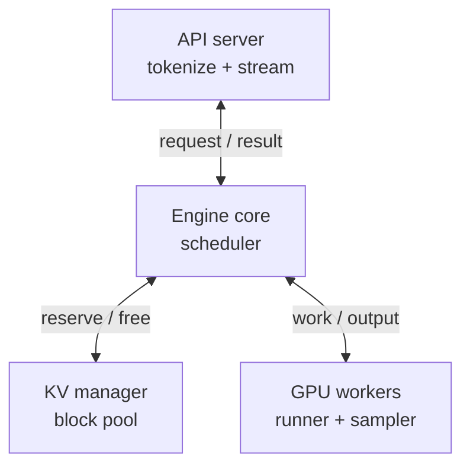

---
{
  "id": "deep-dive-vllm",
  "title": "Deep Dive - vLLM",
  "slug": "deep-dive-vllm",
  "section": "Project Deep Dives",
  "category": "Inference Optimization",
  "difficulty": "Hard",
  "order": 1,
  "coverImage": "illustrations/_generated/vllm_kv_block_pool_dark.png",
  "shortDescription": "R0 is mid-response when a nine-token prompt arrives. vLLM has to share one GPU step and one KV block pool without reserving a hole for every request.",
  "keyConceptsTested": [
    "PagedAttention and logical-to-physical KV blocks",
    "vLLM V1 process architecture",
    "Unified scheduling, continuous batching, and chunked prefill",
    "KV block pools, prefix hashes, reference counts, and LRU eviction",
    "Model runners, attention backends, and parallelism",
    "Serving security, observability, and operational failure modes"
  ],
  "prerequisites": [
    "inference-mechanics-ttft-tps-kv-cache",
    "continuous-batching-request-scheduling",
    "kv-cache-paged-attention-llm-serving",
    "model-parallelism-for-llm-inference"
  ],
  "relatedQuestions": [
    "flashattention-memory-efficient-attention",
    "model-quantization-gptq-awq-gguf",
    "llm-deployment-gpu-serving-autoscaling",
    "long-context-window-management"
  ],
  "companies": [
    "vLLM Project",
    "UC Berkeley",
    "Anyscale",
    "Red Hat",
    "NVIDIA"
  ]
}
---

**R0** is halfway through a response when **R1** arrives with a nine-token prompt. R0 needs one decode step, producing its next token. R1 needs its prompt processed in prefill. If R1 consumes the whole next step, R0's next token waits. If every request reserves its maximum attention state, short responses leave holes that can't serve another request. One serving decision has to keep both <span data-glossary="gpu">GPU</span> work and growing memory moving.

<span data-glossary="vllm">vLLM</span> is built around that conflict. The public API can look like an OpenAI-compatible endpoint. Under that HTTP surface, the engine still schedules <span data-glossary="token">tokens</span>, maps each logical sequence onto physical Key and Value (KV) blocks, chooses a model runner and attention kernel, and streams the result back.

Hold R0 and R1 as the pair. Time to first token (<span data-glossary="ttft">TTFT</span>) is the wait for the first generated token, inter-token latency (<span data-glossary="itl">ITL</span>) is the gap between later tokens, and the <span data-glossary="kv-cache">KV cache</span> is the per-request attention state that saves recomputation during decoding.

```checkpoint
Before reading code, name the two resources vLLM must schedule together.
---
GPU compute and KV-cache memory. A request can fit in one resource and still stall in the other, so V1 schedules token work while reserving physical KV blocks.
```

## Two entry paths, one engine loop

vLLM has two public fronts. The `LLM` Python class offers synchronous offline inference. That doesn't mean its engine and workers all run in the caller's process. The online server accepts requests and streams responses.

The route family includes chat completions, completions, <span data-glossary="embedding">embeddings</span>, scoring, and <span data-glossary="reranker">reranking</span>. A deployment's model and runner still decide which of those tasks it can serve. A generation endpoint isn't automatically an embedding service. Start the server with `vllm serve`. In v0.30.0, the older `python -m vllm.entrypoints.openai.api_server` entrypoint is a deprecated compatibility shim. The v0.28.0 file below still contains the server implementation.[^vllm2026architecture][^vllm2026serving][^vllm2026apiServer0300]

The reproducible trace uses **v0.28.0**, released August 26, 2026. **v0.31.0**, released October 5, is the latest release checked October 10, 2026. Keep the older tag for this reproducible trace; use the installed revision for deployment decisions. The worked examples are CPU-only accounting models, not vLLM executions or performance measurements. They assume a decoder-only, full-attention model with no speculative decoding, cache offload, or hybrid-state cache groups.[^vllm2026release0280][^vllm2026release0310]

One consequential v0.30.0 change: scale-out endpoints on ordinary `vllm serve` are opt-in through `--enable-scale-out`, replacing `VLLM_ENABLE_SCALE_OUT_ENDPOINTS`. A copied environment-variable recipe can therefore leave required routes absent. Check registered routes as well as resolved scheduler settings.[^vllm2026release0300][^vllm2026serving]

The same scheduler and KV pool sit under several request shapes:

| Workload | What the loop has to mix | What to measure |
| --- | --- | --- |
| Interactive chat | Mix short decodes with long prompts | TTFT, ITL, tail latency |
| Code completion | Keep many small sessions active | ITL and scheduler delay |
| <span data-glossary="rag">Retrieval-augmented generation (RAG)</span> | Reuse stable system and document prefixes | Prefix-cache hit rate, <span data-glossary="prefill">prefill</span> time |
| Batch generation | Fill GPU with different prompt lengths | <span data-glossary="tokens-per-second">Tokens per second</span> and queue wait |
| Multimodal requests | Load media, tokenize, then run the model | Media limits, CPU load, end-to-end latency |
| Embedding or reranking service | Batch pooling work for a compatible model | Batch size, throughput, accuracy requirements |
| Reinforcement-learning <span data-glossary="rollout">rollouts</span> | Expose a fast generation endpoint to trainers | Generation throughput and weight version |

The last row belongs to a later project: a trainer will keep calling this engine while the sampler's weights change. The holes in the opening come first. Why does reserving each request's maximum KV size leave memory that another request can't use?

## The historical idea: page KV memory

Autoregressive generation appends one token at a time. In a full-attention Transformer, each new position attends to the Key and Value <span data-glossary="vector">vectors</span> of earlier positions. Reserving each request's maximum possible KV size wastes space *inside* its allocation when it finishes early: internal fragmentation. Allocating differently sized contiguous regions can also leave gaps *between* allocations that can't satisfy a larger request: external fragmentation. Both reduce the number of requests that fit.

PagedAttention borrowed a familiar operating-system idea: split each sequence's KV state into fixed-size blocks and keep a logical block table. A logical sequence can grow from block 0 to block 1 without owning adjacent physical addresses. A kernel follows the table to load the right physical blocks when it computes attention.[^kwon2023]

Use a four-token block for arithmetic, not as a recommended GPU-backend setting. The letters stand for exact token IDs. R0 has already processed `A B C D E F G H`:

| Logical position | Tokens | Physical block |
| --- | --- | --- |
| 0 to 3 | `A B C D` | 12 |
| 4 to 7 | `E F G H` | 41 |

Request code sees one sequence. The GPU sees two physical block IDs. When the sequence grew past four tokens, vLLM could allocate any free physical block instead of searching for four adjacent cache rows. The table is the indirection layer that makes fragmentation manageable.

R1 now arrives with prompt `A B C D E F X Y Z`. The first four tokens match R0 exactly, so both requests can point at physical slot 12. The suffixes diverge, so they need distinct blocks. R1's ninth token `Z` sits in a partial third block that isn't full yet. Unreferenced blocks become candidates for <span data-glossary="lru-cache">least-recently-used (LRU)</span> eviction rather than displacing either request's live prefix.

<figure>
  
  <figcaption>Snapshot after R1's prompt is processed. Five logical blocks occupy four physical slots because both requests share slot 12. Slot 90 is allocated but only partly filled. None of these four live slots is in the free queue.</figcaption>
</figure>

The paper reported 2x to 4x higher throughput than FasterTransformer and Orca at comparable latency.[^kwon2023] Those results belong to its benchmark setup. A current comparison should match hardware, workload, software versions, and latency targets:

| Evidence from the benchmark | What the paper fixed | What a current rerun must fix |
| --- | --- | --- |
| Hardware and software | GCP A2 instances with NVIDIA A100 GPUs, plus PyTorch, Transformers, and NCCL in the distributed path | GPU count and topology, driver/CUDA stack, framework and vLLM revision |
| Workload | Basic sampling used OPT-13B, OPT-66B, and OPT-175B with lengths from ShareGPT and Alpaca and Poisson arrivals. Shared-prefix experiments used LLaMA-13B and WMT16 translation examples | Model, dataset, prompt and output-length distributions, arrival rate, concurrency, warmup, and steady-state window |
| Precision and path | The paper's KV-size calculation uses two bytes per FP16 element; its contribution is the paged block layout and custom kernels | Weight and KV dtypes, quantization, attention backend, sampling mode, and kernel path |
| Baseline and metric | FasterTransformer used a custom dynamic batcher. The authors reimplemented Orca with maximum, power-of-two, and oracle reservation variants. Results used mean end-to-end latency normalized by output length | Same trace and tuning effort for every baseline, with TTFT, ITL or TPOT, tail latency, and goodput reported separately |
| Correctness | The paper reports no accuracy impact for its evaluated configurations | Token or logit parity where deterministic, plus task-level checks for the served output schema |

The paper used one-hour traces for most experiments and 15-minute traces for OPT-175B. That detail matters: a short run can miss queue growth and cache churn. The lasting contribution is the memory layout and its scheduling consequences, not an unconditional speedup for every current model, GPU, or vLLM release.[^kwon2023]

### PagedAttention isn't one current backend

The paper's name remains useful shorthand, but today's vLLM has a backend matrix. V1 model runners select attention implementations for the model, hardware, data type, and feature set. A backend can use paged KV addresses while relying on a fused attention kernel, a FlashAttention-family kernel, a <span data-glossary="triton-language">Triton</span> path, or a hardware plugin. Some model families, such as state-space or hybrid models, don't have the same KV semantics as a decoder-only Transformer.

The stable idea is the logical-to-physical mapping convention. To learn which <span data-glossary="cuda">CUDA</span> kernel a current request uses, inspect the V1 model runner and its attention backend registry, then the backend's block-table arguments and shape checks.

```checkpoint
Why doesn't "vLLM uses PagedAttention" tell you which GPU kernel ran?
---
PagedAttention describes logical KV blocks and their physical mapping. V1 can select different fused or hardware-specific attention backends that consume that mapping, and some supported models use other state representations.
```

## V1 request path: separate processes, one engine loop

V0 is fully deprecated. The rest of this walkthrough is V1.[^vllm2026v1]

V1 separates request handling from scheduling and GPU execution. The API server parses the request, tokenizes text, loads approved media, and streams results. It connects through ZeroMQ (ZMQ) to all engine-core processes, one per <span data-glossary="data-parallelism">data-parallel</span> (DP) rank. Each engine core owns a scheduler and KV-cache manager, then dispatches work to one worker process per GPU.[^vllm2026architecture][^vllm2026v1]

With data parallelism, API-server count defaults to the DP size, and routing between API servers and engine cores is many-to-many. A coordinator process is added when `DP > 1` so ranks can be balanced.[^vllm2026architecture][^vllm2026v1]

Trace R1 across that split: the API server records arrival and tokenizes, an engine core queues the request, the scheduler assigns tokens only alongside enough KV blocks, GPU workers run prefill or decode and sample, and the result travels back for detokenization and streaming. TTFT spans those pipeline stages, so a slow first token isn't automatically a slow attention kernel.



For the online multiprocessing topology documented here, let `A` be API-server count, `DP` data-parallel size, and `N` total GPUs. The main serving processes total `A + DP + N`, plus one coordinator when `DP > 1`. This isn't a count of every OS process, nor a universal formula for offline, Ray, or externally load-balanced deployments.

| Deployment | Processes | Total |
| --- | --- | ---: |
| 4 GPUs, `TP=4`, `DP=1` | 1 API server, 1 engine core, 4 GPU workers | 6 |
| 8 GPUs, `TP=2`, `DP=4` | 4 API servers, 4 engine cores, 8 workers, 1 coordinator | 17 |

This split makes failures easier to place. A slow tokenizer or media download is API-server work. Scheduler delay and block allocation are engine-core work. A kernel launch, CUDA graph, or <span data-glossary="tensor-parallelism">tensor-parallel</span> collective is worker work. CPU limits matter because every process participates in the hot path. V1's optimization guide calls out engine-core scheduling latency and worker CPU resources as throughput factors.[^vllm2026optimization]

R0 and R1 don't care which process owns them until something stalls. The next question is how the engine core decides how much of each request runs in the next model step.

## The V1 scheduler: one token budget

V1 keeps prefill and decode in one accounting system instead of giving them unrelated queues. It tracks how many tokens each request still needs and schedules against a fixed <span data-glossary="token-budget">token budget</span>. A decode request may need one new token. A new prompt may need hundreds, but chunked prefill lets the scheduler accept only a slice. The same allocation interface can therefore combine decode, prefill, prefix hits, and speculative work.[^vllm2026v1]

When V1 can use chunked prefill, it's enabled by default. The optimization guide describes its policy as decode-first, with remaining capacity available for prefill chunks. The code uses unified token accounting across running and waiting requests. KV availability, scheduling policy, and model-specific constraints can prevent a request from running even when token budget remains.[^vllm2026optimization]

Evaluate the first step of the trace. With `max_num_batched_tokens = 6`, R0 needing one decode token and R1 needing nine prefill tokens, which request should consume the first slot, and how many R1 tokens fit after it? Treat APC as off for a moment, so R1's whole prompt still needs prefill:

| Step | Ready work | Scheduler choice | Why |
| --- | --- | --- | --- |
| 0 | Decode `R0` needs 1; prefill `R1` needs 9 | 1 token from `R0`, 5 from `R1` | Keep decode moving, start a chunk |
| 1 | Decode `R0` needs 1; `R1` has 4 left | 1 token from `R0`, 4 from `R1` | Finish prefill; 1 token of budget unused |
| 2 | Decode `R0` needs 1; `R1` can decode | 1 token each | Both requests now decode; budget underfills |

The budget counts **input positions computed**, not output tokens emitted. Step 1 finishes R1's prefill and produces the logits used to sample its first output token. Step 2 feeds that sampled token back through the model to produce the next one. Thus `R1 decode = 0` in step 1 doesn't mean R1 emits nothing.

These counts assume sufficient KV capacity and two requests that remain active. The script models decode-first selection followed by one prefill slice; it omits priorities, speculative tokens, asynchronous scheduling, and preemption.

<figure>
  
  <figcaption>Each bar is one model step with budget 6. Decode is scheduled first, then R1's prompt is chunked into the leftover. After R1 finishes prefill, a decode-only step no longer fills the bar.</figcaption>
</figure>

<!-- leetllm: test, output=show -->
```python title="token-budget-trace.py"
budget = 6
r1_prefill_left = 9
trace = []

for step in range(3):
    left = budget
    r0_decode = min(1, left)
    left -= r0_decode
    if r1_prefill_left > 0:
        r1_prefill = min(r1_prefill_left, left)
        r1_prefill_left -= r1_prefill
        r1_decode = 0
    else:
        r1_prefill = 0
        r1_decode = min(1, left)
    used = r0_decode + r1_prefill + r1_decode
    row = {
        "step": step,
        "r0_decode": r0_decode,
        "r1_prefill": r1_prefill,
        "r1_decode": r1_decode,
        "used": used,
        "r1_prefill_left": r1_prefill_left,
    }
    trace.append(row)
    print(
        f"step {step}: R0 decode {r0_decode}, "
        f"R1 prefill {r1_prefill}, R1 decode {r1_decode}, "
        f"used {used}/{budget}, R1 prefill left {r1_prefill_left}"
    )

assert [row["r0_decode"] for row in trace] == [1, 1, 1]
assert [row["r1_prefill"] for row in trace] == [5, 4, 0]
assert [row["r1_decode"] for row in trace] == [0, 0, 1]
assert [row["used"] for row in trace] == [6, 5, 2]
```

<!-- leetllm: output:start -->
```text title="Output" output compact
step 0: R0 decode 1, R1 prefill 5, R1 decode 0, used 6/6, R1 prefill left 4
step 1: R0 decode 1, R1 prefill 4, R1 decode 0, used 5/6, R1 prefill left 0
step 2: R0 decode 1, R1 prefill 0, R1 decode 1, used 2/6, R1 prefill left 0
```
<!-- leetllm: output:end -->

### Continuous batching and chunked prefill

Continuous batching means a request can join or leave the active set between model steps. The batch isn't a fixed list of sequences built once at the beginning.

Tune `max_num_batched_tokens` against the service <span data-glossary="slo">SLO</span>. Smaller caps can protect ITL by limiting prefill work beside live decodes. Larger caps can finish prompts in fewer steps, but longer steps and queueing can erase that TTFT benefit. The optimization guide suggests trying values above 8192 for smaller models on large GPUs; v0.28.0 also raised a default token-budget setting to 16384. Neither number is a workload-independent optimum. Record the resolved configuration rather than assuming a default applies to every entrypoint and device.[^vllm2026optimization][^vllm2026release0280]

Code-completion services with strict ITL may prefer a smaller cap. Batch document summarizers may prefer larger prefill slices. Frequent preemptions call for more KV capacity or fewer active sequences alongside any token-cap change.

In v0.31.0, `--max-num-active-seqs` separately caps the number of requests transitioned to the RUNNING set. For example, with `max_num_seqs=256` and `max_num_active_seqs=64`, spare token budget does not accept a 65th running request. This can limit live KV growth while retaining the larger execution capacity. The cap affects running requests; measure queue wait and preemptions to assess its effect on latency.[^vllm2026release0310]

### Measure useful requests and token throughput

Raw output tokens per second can rise while a streaming service feels worse. Measure <span data-glossary="goodput">goodput</span> as successful, SLO-compliant completions divided by the measurement duration. If you instead use offered rate times a pass fraction, include **all offered requests** in that fraction. Otherwise errors and unfinished requests disappear from the denominator.

Choose the decode promise explicitly: this example uses each request's p99 ITL, while DistServe uses request-mean time per output token (TPOT). Those aren't interchangeable. Here every request asks for at least two output tokens; a real evaluator also needs a stated policy for requests with no inter-token gaps.[^zhong2024]

Evaluating candidate configurations requires checking which setup serves more useful requests when the product requires TTFT under 300 ms and p99 ITL under 50 ms.

The counts below are synthetic values for a 100-second window. Count only passing completions inside that window; report arrivals, failures, and outstanding requests separately. A vLLM load test should include warmup and steady-state windows so transient startup effects do not dominate.

| Candidate | Offered | Successful completions | Completions meeting both SLOs | Goodput |
| --- | ---: | ---: | ---: | ---: |
| A | 1,000 | 600 | 550 | 5.5 requests/s |
| B | 800 | 780 | 752 | 7.52 requests/s |

This CPU check exposes the denominator error. Candidate A's completion-only pass fraction looks like 91.7%, but multiplying it by its arrival rate invents almost four useful requests per second.

<!-- leetllm: test, deps=numpy, output=show -->
```python title="goodput-denominator.py"
import numpy as np

window_seconds = 100.0
names = ("A", "B")
offered = np.array([1000.0, 800.0])
completed = np.array([600.0, 780.0])
passed = np.array([550.0, 752.0])
assert np.all((0 <= passed) & (passed <= completed) & (completed <= offered))

goodput = passed / window_seconds
completion_only = (offered / window_seconds) * (passed / completed)
for name, gp, wrong in zip(names, goodput, completion_only):
    print(f"{name}: goodput={gp:.2f}/s; "
          f"wrong denominator={wrong:.2f}/s")
assert goodput[1] > goodput[0]
```

<!-- leetllm: output:start -->
```text title="Output" output compact
A: goodput=5.50/s; wrong denominator=9.17/s
B: goodput=7.52/s; wrong denominator=7.71/s
```
<!-- leetllm: output:end -->

Candidate B wins despite lower offered rate. Measure this curve at each load level, alongside p50 and p99 TTFT, ITL or TPOT, queue wait, completion errors, and KV usage. A larger token budget is a change worth keeping only when it raises goodput under the same workload and preserves output correctness.

```checkpoint
What does chunked prefill protect, and what can it hurt?
---
It protects decode ITL by preventing one long prompt from consuming an entire step. It can increase TTFT for that prompt because prefill is spread across steps, and a cap that is too high can still let prompt work delay decodes.
```

When KV blocks run out, V1's default preemption mode is recompute. The engine releases a request's blocks, keeps request state, and schedules its prefix again when capacity returns; surviving cached blocks may still be reusable. V1 recompute differs from V0 CPU-swap preemption. Configured KV offloading is a separate feature. Monitor preemption-counter increases, KV usage, queue wait, TTFT, and ITL together.[^vllm2026optimization][^vllm2026kvoffload]

The scheduler spent two steps on R1's prompt. Did it need those steps? R0 had already computed `A B C D`.

## Block pool, prefix cache, and eviction

The block pool is preallocated when the KV-cache manager starts. Each `KVCacheBlock` has an immutable physical ID, a hash once full, a reference count, and pointers for a doubly linked free queue. The cache maps block hashes to physical IDs. A request maps its own ID to the block IDs it currently uses.[^vllm2026prefix]

The prefix hash is chained. Conceptually:

```text
block_hash = H(parent_hash, block_tokens, extra_hashes)
extra_hashes = LoRA IDs + multimodal hashes + optional cache_salt
```

Including the parent distinguishes identical block tokens after different prefixes. Extra hashes distinguish a multimodal input, adapter, or trust group. This defines reuse identity; it doesn't make finite hashes mathematically collision-free. The documented default is SHA-256. Choosing a faster non-cryptographic hash changes the collision and multi-tenant risk tradeoff.[^vllm2026prefix]

Serialization also matters. The v0.28.0 path concatenates extra values without source tags: a LoRA named `tenant-A` with no salt and a request with salt `tenant-A` and no LoRA can both produce the extra tuple `("tenant-A",)`. With matching parent and token IDs, the hash input itself is identical; stronger hashing can't repair that ambiguity. v0.31.0 tags these fields by source and includes the LoRA path. Treat adapter and tenant identity as part of the cache key specification, rather than relying on text equality or SHA-256 alone.[^vllm2026kvutils0280][^vllm2026release0310]

For the full-attention path here, Automatic Prefix Caching (APC) reuses only full blocks. R0's two cached blocks are `A B C D` in slot 12 and `E F G H` in slot 41. R1's prompt is `A B C D E F X Y Z`. The exact shared prefix is six tokens (`A` through `F`), but that's not one and a half cached blocks. Only the first four-token block is full and identical, so R1 can increment slot 12's reference count and must still prefill the remaining five tokens. A seven-token shared prefix would miss in the same way: the second block isn't an exact match, so it isn't reusable.[^vllm2026prefix]

<!-- leetllm: test, output=show -->
```python title="apc-full-blocks.py"
def reusable_tokens(shared, prompt_length, block_size=4):
    if any(type(count) is not int for count in (shared, prompt_length, block_size)):
        raise ValueError("Token counts and block size must be integers, not booleans")
    if block_size <= 0 or prompt_length <= 0 or not 0 <= shared <= prompt_length:
        raise ValueError("Require a nonempty prompt and valid shared-prefix length")
    # v0.28.0 full-attention path: leave a position for logits recomputation.
    limit = min(shared, prompt_length - 1)
    return (limit // block_size) * block_size

for shared, length in [(6, 9), (7, 9), (8, 9), (8, 8), (1, 1)]:
    skipped = reusable_tokens(shared, length)
    print(f"shared={shared}, prompt={length}: "
          f"skip {skipped}, compute {length - skipped}")

assert reusable_tokens(6, 9) == 4
assert reusable_tokens(8, 9) == 8
assert reusable_tokens(8, 8) == 4
assert reusable_tokens(1, 1) == 0
assert reusable_tokens(0, 9) == 0
for args in [(10, 9), (-1, 9), (0, 0), (6, 9, 0), (6.5, 9), (6, 9, True)]:
    try:
        reusable_tokens(*args)
    except ValueError:
        pass
    else:
        raise AssertionError(f"Invalid input accepted: {args}")
```

<!-- leetllm: output:start -->
```text title="Output" output compact
shared=6, prompt=9: skip 4, compute 5
shared=7, prompt=9: skip 4, compute 5
shared=8, prompt=9: skip 8, compute 1
shared=8, prompt=8: skip 4, compute 4
shared=1, prompt=1: skip 0, compute 1
```
<!-- leetllm: output:end -->

If APC had been on in the earlier trace, R1 would have entered the scheduler with 5 tokens of prefill rather than 9. R0's one decode position plus those five positions would finish R1's prompt in step 0.

The `shared=8, prompt=8` case is different. KV entries aren't the final logits needed to sample a response. In v0.28.0, `get_computed_blocks` limits a hit to at most `prompt_length - 1`; block alignment can therefore force the last **whole block** to be recomputed. The function models that full-attention path, assuming eligible cached blocks are present and hash context matches. It isn't a complete cache lookup for sliding-window, hybrid, offloaded, or prompt-logprob requests.[^vllm2026kvmanager0280]

Reference counts protect live requests. When a request finishes, cached blocks whose counts reach zero move to the tail of the free queue. In v0.28.0, non-cached blocks instead move to its head for earlier reuse. The next allocation pops the head and removes any cached hash before overwriting physical storage. Within the cached blocks, reverse-free ordering makes recently completed suffix blocks more likely to leave first because longer suffixes are less likely to be reused.[^vllm2026prefix][^vllm2026blockpool0280]

This reduced pool starts from the figure's live slots, without its three spare slots. Try to allocate a fifth physical block before freeing anything. Then release R0 and ask which slot becomes reusable: 41, not the shared slot 12. The hash labels are symbolic test values, not production hash functions.

<!-- leetllm: test, output=show -->
```python title="live-block-ownership.py"
from collections import Counter, deque

tables = {"R0": [12, 41], "R1": [12, 73, 90]}
refs = Counter(slot for table in tables.values() for slot in table)
hashes = {12: "prefix-ABCD", 41: "prefix-ABCDEFGH", 73: "prefix-ABCDEFXY"}
free = deque()  # Slot 90 is live but partial, so it has no cache hash.

def allocate():
    if not free:
        raise MemoryError("No free KV block")
    slot = free.popleft()
    assert refs[slot] == 0
    hashes.pop(slot, None)  # Invalidate cache identity before overwriting storage.
    refs[slot] = 1
    return slot

def release(request_id):
    for slot in reversed(tables.pop(request_id)):
        refs[slot] -= 1
        assert refs[slot] >= 0
        if refs[slot] == 0:
            if slot in hashes:
                free.append(slot)
            else:
                free.appendleft(slot)

before = (dict(refs), dict(hashes), list(free))
try:
    allocate()
except MemoryError as error:
    print(error)
else:
    raise AssertionError("Allocation must fail while all four slots are live")
assert before == (dict(refs), dict(hashes), list(free))

release("R0")
assert refs[12] == 1 and list(free) == [41]
assert 41 in hashes  # Being free doesn't immediately erase reusable content.
tables["R2"] = [allocate()]
assert tables["R2"] == [41] and 41 not in hashes
assert refs == Counter(slot for table in tables.values() for slot in table)
print(f"R1 still owns {tables['R1']}; R2 reuses {tables['R2']}")
release("R1")
assert list(free) == [90, 73, 12]  # Partial slot first, then cached suffix/prefix.
assert refs[41] == 1  # R2's live slot remains unavailable.
```

<!-- leetllm: output:start -->
```text title="Output" output compact
No free KV block
R1 still owns [12, 73, 90]; R2 reuses [41]
```
<!-- leetllm: output:end -->

This tests ownership and safe reuse, not vLLM's allocator. The real implementation also coordinates cache-hit touches, multiple cache groups, allocation failure, and scheduler preemption.

Cache salt changes reuse identity: matching text with different salts doesn't share prefix blocks. For tenant isolation, a trusted gateway should assign and enforce the salt for an authenticated trust group; arbitrary client-chosen public values do not provide tenant isolation. Use an unguessable salt where the threat is probing another group's cached prefixes. Salting reduces cross-group cache-timing exposure, but doesn't encrypt memory or replace access control.[^vllm2026prefix]

```checkpoint
Why is an exact-prefix APC hit a prefill optimization, not a decode optimization?
---
The hit skips computation for already processed prompt blocks. Every new output token still needs decode attention and sampling, so long generations with little shared prompt can see almost no APC gain.
```

## From scheduler output to GPU kernels

The engine core emits a scheduler output containing request IDs, token counts, block tables, sampling metadata, and model-execution inputs. Treat that message as the handoff payload: it specifies which work is scheduled and which physical KV blocks back it.

GPU workers receive the schedule and the model runner prepares <span data-glossary="tensor">tensors</span> for the selected model. The runner owns weight loading, input layout, CUDA graph capture or eager execution, forward calls, and sampling handoff.

At the attention interface, a block-table entry is metadata, not a kernel. The runner supplies logical sequence lengths and physical block IDs; the attention backend turns them into addresses and loads the corresponding K/V data. At the model execution layer, parallelism controls how weights and layers are distributed:

| Knob | Split | Main benefit | Main cost |
| --- | --- | --- | --- |
| Tensor parallelism (TP) | <span data-glossary="matrix">Matrix</span> dimensions across GPUs | Shard weights to fit; parallelize layer computation | Collectives in each layer |
| Pipeline parallelism (PP) | Layer depth across stages | Fit deeper models or cross nodes | Pipeline bubbles and stage latency |
| Data parallelism (DP) | Replicas across request groups | More independent throughput | Replicated weights and routing |
| Expert parallelism (EP) | <span data-glossary="mixture-of-experts">Mixture-of-Experts</span> experts | Balance expert compute | Routing and communication |

V1 exposes those costs. A larger TP group can reduce weight memory per GPU, leaving room for KV blocks, but decode steps pay communication costs. A larger PP group can fit the model while exposing bubbles at low concurrency. DP adds engine cores and routing. The simple replica description assumes no expert sharding across those ranks; combined DP and EP changes which weights are replicated. Benchmark each topology on target hardware because more GPUs can hurt small or low-concurrency workloads.[^vllm2026architecture][^vllm2026optimization]

The model runner is why a new family can land without a second engine. A shared configuration object carries model, scheduler, cache, and parallelism choices. Model implementations expose a common runner interface; backend registries pick hardware-specific kernels. Compatibility is still a matrix: architecture, dtype, quantization, attention backend, and <span data-glossary="feature-flag">feature flags</span> can interact.

Current V1 docs list NVIDIA, AMD, Intel GPU, TPU, and CPU as functional hardware paths, with additional platforms through plugins. Kernel quality and feature coverage still vary by platform and dtype, so "supported" isn't the same as "already tuned for this model."[^vllm2026v1]

At v0.28.0, `gpu_worker.py` branches on `self.use_v2_model_runner`: the established runner is `vllm/v1/worker/gpu_model_runner.py`, and the modular runner is `vllm/v1/worker/gpu/model_runner.py`. Here **V2 names a model runner inside the V1 engine**, not a replacement V2 engine. Read the branch your configuration actually constructs.[^vllm2026release0280]

Kernel evidence needs a separate measurement. Warm up compilation and CUDA graphs, synchronize GPU timing, and hold model, shapes, batch, sequence lengths, dtype, block size, and sampling path constant. Separate launch time, KV-memory traffic, arithmetic, and collectives, then compare outputs against a reference. A busy GPU can still be waiting on the wrong memory path, while a quiet GPU can mean the scheduler never issued work.[^vllm2026optimization][^vllm2026metrics]

## APIs and service security

The online server offers OpenAI-compatible JSON, but compatibility isn't the same as a complete security perimeter. Current security docs describe `--api-key` (or `VLLM_API_KEY`) protection under `/v1`, `/v2`, `/inference`, and `/cohere`. Unprefixed aliases such as `/score`, `/rerank`, and SageMaker-style `/invocations`, plus health, metrics, and some operational routes, can remain unauthenticated on the same HTTP server. Protecting `/v1/score` doesn't protect `/score`. Put vLLM behind an authenticated gateway, restrict management routes, and expose only the registered API surface clients need.[^vllm2026security][^vllm2026serving]

For multimodal requests, media URLs are an input capability. Allowlist domains with `--allowed-media-domains`; retain download and decode limits, including `VLLM_MAX_MEDIA_DOWNLOAD_SIZE_MB`, `VLLM_MAX_IMAGE_PIXELS`, `VLLM_MAX_AUDIO_CLIP_FILESIZE_MB`, `VLLM_MAX_AUDIO_DECODE_DURATION_S`, and `VLLM_MAX_AUDIO_DECODE_BYTES`. Compressed-byte, duration, and decoded-byte caps protect different resources. An untrusted URL can target internal services (server-side request forgery, or SSRF), download a huge file, or expand compressed media into an out-of-memory event. Setting `VLLM_MEDIA_URL_ALLOW_REDIRECTS=0` blocks redirect tricks that bypass the allowlist.[^vllm2026security]

In v0.31.0, non-empty per-request `mm_processor_kwargs` and `media_io_kwargs` are rejected unless the server enables `--trust-request-mm-kwargs`. A client that previously changed image sizing or video sampling can now fail before inference. Keep deployment settings in server-level `--mm-processor-kwargs` and `--media-io-kwargs`; enable client overrides only for trusted callers. The offline `LLM` interface isn't subject to this API-server gate.[^vllm2026security][^vllm2026release0310]

Multi-node communication is insecure by default. <span data-glossary="pytorch">PyTorch</span> distributed, KV transfer, and tensor, pipeline, or data-parallel links don't provide an authorization protocol or encryption suitable for an untrusted network. Isolate those ports, set explicit host addresses, and firewall internal interfaces. An API key on `/v1/chat/completions` can't protect a reachable process-group port.[^vllm2026security]

## Project identity

vLLM grew from UC Berkeley's Sky Computing Lab and the <span data-glossary="pagedattention">PagedAttention</span> paper. Governance says committers earn project governance through sustained contributions, reviews, and subsystem ownership. Companies can participate, but committer status belongs to individuals.[^kwon2023][^vllm2026governance]

| Field | Current project fact |
| --- | --- |
| Origin | UC Berkeley's Sky Computing Lab. The PagedAttention paper names Woosuk Kwon, Zhuohan Li, Siyuan Zhuang, Ying Sheng, and collaborators.[^kwon2023] |
| Stewardship | Lead maintainers, committers, and area ownership rather than company seats.[^vllm2026governance] |
| Contributor path | Sustained code, review, and subsystem work. Use the current governance roster instead of a static "top contributors" list.[^vllm2026governance] |
| Source license | Apache-2.0 at the article's v0.28.0 source tag.[^vllm2026license0280] |
| Commercial scope | Companies fund, integrate, and operate vLLM, but participation doesn't turn the community repository into one vendor's product.[^vllm2026governance] |
| Asset licensing | The source license doesn't grant rights to model weights, tokenizers, datasets, or remote code loaded through the engine. Check each artifact separately. |

The advertised compatibility surface is wide. In the checkout, that usually means a feature landed for one model, backend, or topology and can still be missing or untested for another. Read the feature matrix for the revision you run.

## Strengths and weaknesses

| Dimension | Strength | Tradeoff or weakness |
| --- | --- | --- |
| Memory | Fixed KV blocks, reuse, LRU eviction | Block metadata and page-table work add CPU complexity |
| Scheduling | <span data-glossary="continuous-batching">Continuous batching</span> and one token budget | Wrong cap can trade ITL against TTFT or trigger preemption |
| Model coverage | Shared runner plus many backends | New models need backend and feature-matrix work |
| API | Familiar OpenAI-compatible routes | Compatibility doesn't secure every endpoint or behavior |
| Hardware | NVIDIA, AMD, Intel GPU, TPU, CPU, and plugin paths | Tuning and kernel quality vary by platform and dtype |
| Community | Committers earn seats through review and subsystem work | Fast change means defaults and support status evolve |
| Scale | TP, PP, DP, EP, and cache transfer options | Cross-node links need isolation and can dominate latency |

Block-based KV, token scheduling, specialized kernels, and API processing fail in different subsystems. A prefix miss, a token-budget cap, and a slow collective can all lower tokens per second, so that one chart can't tell you which layer needs a change.

## Code-reading route

Open the `v0.28.0` tag in the public repository rather than treating moving `main` as the article's source snapshot. If you already have that checkout, these read-only commands locate the main subsystem components without installing vLLM or loading weights:

```bash title="source-architecture.sh"
git describe --tags --exact-match HEAD
rg -n 'def schedule|num_computed_tokens' vllm/v1/core/sched/scheduler.py
rg -n 'max_cache_hit_length|def allocate_slots' vllm/v1/core/kv_cache_manager.py
rg -n 'use_v2_model_runner|gpu.model_runner' vllm/v1/worker/gpu_worker.py
```

The first command should identify `v0.28.0`. A version mismatch means you must recheck the branch conditions and defaults before comparing behavior. These are source-navigation commands, not a server startup recipe.

Read these files in order, and keep R0's request ID in your head:

1. `vllm/entrypoints/cli/main.py` and `vllm/entrypoints/openai/api_server.py`: supported `vllm serve` CLI, HTTP parsing, input processing, and the streaming responses.
2. `vllm/v1/engine/core.py`: engine-core loop and handoff to workers.
3. `vllm/v1/core/sched/scheduler.py`: token-budget scheduling, preemption, and scheduler output.
4. `vllm/v1/core/kv_cache_manager.py`: computed-block lookup, allocation, touch, and free operations.
5. `vllm/v1/core/block_pool.py`: physical block pool, free queue, hash map, and LRU behavior.
6. `vllm/v1/worker/gpu_worker.py`, then the constructed runner in `gpu_model_runner.py` or `gpu/model_runner.py`: input tensors, model execution, graphs, and output preparation.

While reading, write down three invariants:

- A request's logical token order is independent of physical block addresses.
- A cached block can be reused only when its full hash and extra context match.
- A worker can't execute tokens that the scheduler hasn't assigned and backed with block capacity.

### A small failure drill

Suppose a dashboard shows rising ITL, low GPU utilization, and a growing preemption counter. Don't start by changing the attention kernel. Check, in order:

1. KV-cache usage and free-block count. If blocks are exhausted, recompute work may be stealing GPU time.
2. `max_num_batched_tokens`, `max_num_seqs`, and prompt-length distribution. An oversized active set can create a thrash loop.
3. Engine-core CPU saturation and scheduler latency. V1's process split can make CPU starvation look like a GPU problem.
4. TP and PP topology. A new parallelism size can add collective or pipeline wait.
5. Prefix-<span data-glossary="cache-hit-rate">cache hit rate</span>. A workload with unique prompts won't benefit from APC, no matter how large the cache is.

Prometheus metrics for KV usage, TTFT, and ITL live in the official metrics reference. Use those names rather than inventing dashboard fields.[^vllm2026metrics]

`vllm:inter_token_latency_seconds` measures gaps between engine-core output events, which can bundle tokens; these are engine timestamps rather than HTTP stream-chunk arrival times. Retain request timelines to evaluate this lesson's **per-request** p99 ITL pass count; use the separate request-level TPOT metric when TPOT is the actual service target.[^vllm2026metrics]

```checkpoint
Which symptom points most directly to KV pressure: a low APC hit rate or repeated recompute preemptions?
---
Repeated recompute preemptions. A low APC hit rate says prefixes aren't reusable. Use preemption counters and free-block telemetry to determine whether capacity pressure is filling the cache.
```

For a request that never gets its first token, break TTFT into queue wait, scheduler delay, prefill compute, and worker launch time.

Keep one request ID through the client timeline, engine-core stats, KV events, and GPU trace. High queue time with short prefill points to admission or CPU scheduling. Short queue time with long prefill points to prompt work or its kernel path. Normal engine timings with late client output points outside the engine, such as detokenization or network delivery. That subsystem trace is more useful than replacing the attention backend on a low-utilization graph.

## Research roots and current practice

The PagedAttention paper explains the original memory-management insight and its 2023 throughput evaluation.[^kwon2023] The vLLM repository describes the practical engine that grew around it.[^vllm2024] Current architecture and V1 guides document the process split and unified scheduler, while optimization and prefix-caching guides describe <span data-glossary="chunking">chunking</span>, recompute, hashes, reference counts, and LRU behavior.[^vllm2026architecture][^vllm2026v1][^vllm2026optimization][^vllm2026prefix]

Read those sources with dates in mind. vLLM V1 replaces older V0 assumptions, and backend support changes as models and accelerators change. A paper result can remain historically important without being a current service target. A documentation default can be correct for today's release and still need rechecking before a production rollout.

```checkpoint
The moving V1 guide says Mamba prefix caching isn't supported, but v0.28.0's release notes say it is enabled by default. Which statement should decide your deployment?
---
Neither statement alone. They conflict: inspect the installed revision's implementation, model/cache configuration, and relevant tests, then exercise that exact path. Later releases add further model-specific cache behavior. Don't apply the full-attention arithmetic above to every hybrid-state cache or treat a moving guide as a versioned feature matrix.
```

The guide still contains that restriction when checked October 10, 2026. Meanwhile, v0.30.0 advertises partial prefix checkpoints for a specific hybrid model, and v0.31.0 renames `--enable-mamba-fine-grained-prefix-cache` to `--enable-mamba-shared-prefix-checkpoint`. This is why the worked trace states its cache assumptions rather than promising universal APC behavior.[^vllm2026v1][^vllm2026release0280][^vllm2026release0300][^vllm2026release0310]

A wait on R0 can sit in the token budget, the free-block queue, or a process outside the GPU. Check those before you blame the attention kernel.

## Architectural summary

- Serving is a joint scheduling and memory problem: GPU compute and KV blocks can stall independently.
- PagedAttention's logical-to-physical blocks reduce fragmentation. The name doesn't identify every current attention kernel.
- V1's API server, engine core, and GPU workers separate request I/O, scheduling, cache management, and execution.
- One token budget is how V1 mixes continuous batching, chunked prefill, and decode-first steps.
- APC hashes full blocks, protects live blocks with reference counts, and evicts zero-reference blocks through an LRU queue.
- TP, PP, DP, and EP solve different fit and throughput constraints, each with communication or bubble costs.
- Serving design must cover API keys, network isolation, media allowlists, and metrics.

## Evaluation rubric

- Trace a request through API processing, engine-core scheduling, KV allocation, workers, and streaming without attributing every delay to attention.
- Compute the block-rounded APC hit, including complete-prompt recomputation, and explain why live reference counts prevent eviction.
- Read the pinned scheduler and runner branch before claiming a default, process topology, or kernel applies to your deployment.
- Compare configurations using passing completions per second, latency distributions, errors, and output correctness under the same workload.

## Follow-up questions

```checkpoint
A server has 98% prefix-cache hits but still misses its ITL target on long responses. What would you investigate next?
---
APC saves prompt computation, not the attention and sampling required for each new output token. Check active sequence lengths, KV capacity and preemptions, decode batch size, worker or collective time, and CPU scheduling. Separate prompt-cache success from decode performance before increasing cache capacity.
```

```checkpoint
R1 supplies a cache salt equal to R0's tenant name. Does that prevent it from probing R0's cached prefixes?
---
No. A caller who can choose the same namespace can attempt the same prefix lookups. A trusted gateway must bind cache identity to authenticated tenancy and prevent callers from selecting another group's salt; unguessable salts help against probing but don't replace authorization.
```

The CPU examples establish arithmetic and ownership invariants only. They don't validate vLLM execution, GPU kernels, output parity, security enforcement, or throughput. A deployment review still needs the installed revision, resolved configuration, hardware, workload, correctness checks, and a measured serving trace.

```mastery-quiz
[
  {
    "question": "Each KV block holds four token positions. A request's block table is [37,4,19,62]. For zero-based logical position 14, which physical block and within-block offset are read?",
    "options": [
      "Block 19, offset 2.",
      "Block 62, offset 3.",
      "Block 62, offset 2.",
      "Block 37, offset 3."
    ],
    "answer": "Block 62, offset 2.",
    "explanation": "Dividing 14 by 4 gives quotient 3 and remainder 2. Table index 3 selects the fourth entry, block 62. Offset 2 selects its third cell. Taking the third table entry gives block 19. Counting the cells from one gives offset 3 in block 62. Using the quotient 3 as an offset in the first block gives block 37, offset 3."
  },
  {
    "question": "In the documented online multiprocessing topology, eight GPUs run TP=2, PP=2, DP=2. API-server count is explicitly overridden to 1. How many main serving processes follow the lesson’s formula, including its conditional coordinator?",
    "options": [
      "12: one API, two cores, eight workers and one coordinator.",
      "13: two APIs, two cores, eight workers and one coordinator.",
      "11: one API, two engine cores, eight workers; no coordinator.",
      "10: one API, one engine core, eight workers; no coordinator."
    ],
    "answer": "12: one API, two cores, eight workers and one coordinator.",
    "explanation": "The explicit API count overrides its DP-based default. A+DP+N+1 is 1+2+8+1=12 because DP exceeds one. Auxiliary OS processes and other deployment modes are outside this formula."
  },
  {
    "question": "Use the pinned full-attention APC reference with block size 8 and eligible matching cache context. Case A has prompt length 17 and 16 shared positions. Case B has prompt length 16 and all 16 shared. Which pair gives skipped and computed input positions for A; then B?",
    "options": [
      "A skips 16, computes 1; B skips 16, computes 0.",
      "A skips 8, computes 9; B skips 16, computes 0.",
      "A skips 8, computes 9; B skips 8, computes 8.",
      "A skips 16, computes 1; B skips 8, computes 8."
    ],
    "answer": "A skips 16, computes 1; B skips 8, computes 8.",
    "explanation": "The limit is min(shared,prompt_length−1), rounded down to a multiple of 8. A has limit 16 and skips 16. B has limit 15 and skips 8, leaving a complete block for recomputation and final logits."
  },
  {
    "question": "An adapter keeps the name group-Z but its path changes from weights-A to weights-B. Parent hashes and token IDs match. The pinned v0.28 extra-key function uses the LoRA name; v0.31 uses a tagged name-and-path tuple. Which cache-identity result follows from those two functions?",
    "options": [
      "Both versions change the hash input when the path changes.",
      "v0.28 keeps this hash input; v0.31 changes this hash input.",
      "v0.28 changes this hash input; v0.31 keeps this hash input.",
      "Both versions keep the hash input when the path changes."
    ],
    "answer": "v0.28 keeps this hash input; v0.31 changes this hash input.",
    "explanation": "The old function omits the path, so changing only that path leaves the hash input unchanged. The new tuple includes it. This diagnoses the specified metadata identity, not a claim that finite hashes cannot collide or that path equality verifies artifact bytes."
  },
  {
    "question": "A toy free queue is [42,18,67,5], head first, with zero references on all four blocks. Block 67 has a matching cached hash. Request A touches 67, then request B touches 67. Request C allocates the next free queue head. Which final queue and reference counts follow?",
    "options": [
      "Queue [18,5]; block 42 has one reference and block 67 has one.",
      "Queue [42,18,5]; block 42 has one reference and block 67 has two.",
      "Queue [18,67,5]; block 42 has one reference and block 67 has two.",
      "Queue [18,5]; block 42 has one reference and block 67 has two."
    ],
    "answer": "Queue [18,5]; block 42 has one reference and block 67 has two.",
    "explanation": "The first touch removes zero-reference block 67 from the free queue and acquires its first reference. The second touch increments its live count to two without unlinking it again. Allocation acquires the head block 42, leaving [18,5]."
  },
  {
    "question": "With APC disabled, two active requests each need one decode input per step and a new request needs 11 prompt inputs. The step cap is 8 and KV capacity is sufficient. Apply the taught decode-first toy rule for two steps. Which prompt slices and second-step unused capacity follow?",
    "options": [
      "Prompt slices 6 then 5; second step leaves 1 slot unused.",
      "Prompt slices 8 then 3; second step leaves 3 slots unused.",
      "Prompt slices 6 then 5; second step leaves 3 slots unused.",
      "Prompt slices 8 then 3; second step leaves 1 slot unused."
    ],
    "answer": "Prompt slices 6 then 5; second step leaves 1 slot unused.",
    "explanation": "Reserve two decode inputs from each cap of 8. Six prompt inputs fit first, leaving five. The next step uses 2+5=7 of 8. Finishing prefill can already provide logits for the first sampled output; the count measures computed inputs."
  },
  {
    "question": "In a 20-second observation window, a service receives 80 requests, successfully completes 70 and has 61 completions meeting both stated latency limits. Rounding both rates to two decimal places, which useful rate and completion-only estimate follow?",
    "options": [
      "Useful 3.50/s; completion-only estimate 3.05/s.",
      "Useful 3.05/s; completion-only estimate 3.49/s.",
      "Useful 3.05/s; completion-only estimate 3.50/s.",
      "Useful 3.50/s; completion-only estimate 3.49/s."
    ],
    "answer": "Useful 3.05/s; completion-only estimate 3.49/s.",
    "explanation": "Actual useful rate is 61/20=3.05/s. The inflated calculation is (80/20)×(61/70)≈3.4857/s. It drops the ten failed or unfinished offers from its pass-fraction denominator while still multiplying by the full arrival rate."
  },
  {
    "question": "For one request, the engine logs output reports at 10, 13 and 19 ms. The first report bundles two tokens under one timestamp. Each later report contains one token. What are the gaps between reports and the request-mean time per output token (TPOT) on the report clock? What can you infer about the p99 gap between consecutive token production times before bundling?",
    "options": [
      "Gaps [3,6]; TPOT 4.5 ms; per-token p99 cannot be recovered.",
      "Gaps [3,6]; TPOT 3 ms; per-token p99 equals exactly 6 ms.",
      "Gaps [3,6]; TPOT 3 ms; per-token p99 cannot be recovered.",
      "Gaps [3,6]; TPOT 4.5 ms; per-token p99 equals exactly 6 ms."
    ],
    "answer": "Gaps [3,6]; TPOT 3 ms; per-token p99 cannot be recovered.",
    "explanation": "The reports are 3 ms and 6 ms apart. Four output tokens give three token intervals, so TPOT on the report clock is (19 − 10) / 3 = 3 ms. Dividing by the two report intervals gives 4.5 ms. The longest observed report gap is 6 ms. The first report gives no individual production times for its two tokens, so the production p99 cannot be recovered."
  },
  {
    "question": "Built-in API-key protection is configured, but an unprefixed rerank alias and an internal process-group port are directly reachable around the authenticated gateway. Which pair closes both bypass paths?",
    "options": [
      "Restrict direct HTTP ingress to the authenticated route gateway; isolate the internal port with network policy.",
      "Rely only on the existing built-in --api-key setting while leaving direct alias ingress reachable; isolate the internal port with network policy.",
      "Restrict direct HTTP ingress to the authenticated route gateway; reuse the HTTP bearer header on the internal port.",
      "Rely only on the existing built-in --api-key setting while leaving direct alias ingress reachable; reuse the HTTP bearer header on the internal port."
    ],
    "answer": "Restrict direct HTTP ingress to the authenticated route gateway; isolate the internal port with network policy.",
    "explanation": "The built-in key does not cover every alias, so callers must not bypass the authenticating route filter. A process-group port has a separate protocol and needs private-network/firewall controls. HTTP route credentials do not secure that internal interface."
  },
  {
    "question": "Two request traces report input/queue/prefill/delivery durations in milliseconds. P is [90,4,8,3]; Q is [3,72,7,2]. Which first investigations follow the measured dominant intervals?",
    "options": [
      "P: worker attention; Q: worker attention.",
      "P: API input processing; Q: worker attention.",
      "P: API input processing; Q: engine admission or scheduling.",
      "P: worker attention; Q: engine admission or scheduling."
    ],
    "answer": "P: API input processing; Q: engine admission or scheduling.",
    "explanation": "P spends most of its time before scheduling, in input work. Q spends most in its queue, so inspect admission resources and scheduler CPU before its short prefill. These measured intervals identify the next inspection targets; they indicate where latency accumulated across the pipeline."
  }
]
```

> **Next:** Continue to [Deep Dive - SkyRL](/learn/deep-dive-skyrl). vLLM showed how a serving engine schedules tokens against a KV block pool. SkyRL uses that kind of generation engine as one replaceable interface in an RL loop, where rollouts, environments, weight versions, and trainers have to stay in sync while the sampler keeps changing.
