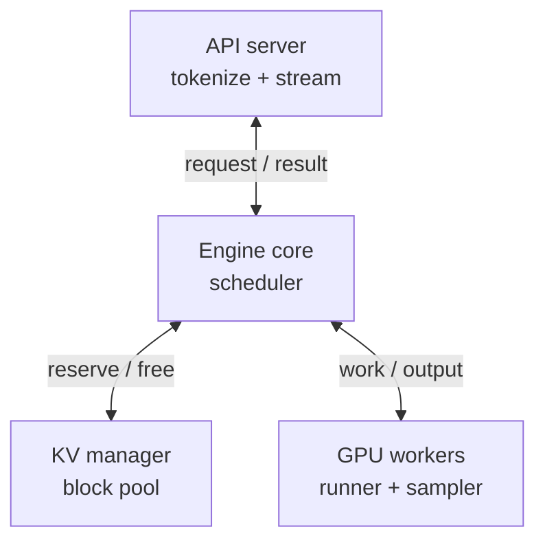

---
{
  "id": "deep-dive-vllm",
  "title": "Deep Dive - vLLM",
  "slug": "deep-dive-vllm",
  "section": "Project Deep Dives",
  "category": "Inference Optimization",
  "difficulty": "Hard",
  "order": 1,
  "coverImage": "illustrations/_generated/vllm_kv_block_pool_dark.png",
  "shortDescription": "R0 is mid-response when a nine-token prompt arrives. vLLM has to share one GPU step and one KV block pool without reserving a hole for every request.",
  "keyConceptsTested": [
    "PagedAttention and logical-to-physical KV blocks",
    "vLLM V1 process architecture",
    "Unified scheduling, continuous batching, and chunked prefill",
    "KV block pools, prefix hashes, reference counts, and LRU eviction",
    "Model runners, attention backends, and parallelism",
    "Serving security, observability, and operational failure modes"
  ],
  "prerequisites": [
    "inference-mechanics-ttft-tps-kv-cache",
    "continuous-batching-request-scheduling",
    "kv-cache-paged-attention-llm-serving",
    "model-parallelism-for-llm-inference"
  ],
  "relatedQuestions": [
    "flashattention-memory-efficient-attention",
    "model-quantization-gptq-awq-gguf",
    "llm-deployment-gpu-serving-autoscaling",
    "long-context-window-management"
  ],
  "companies": [
    "vLLM Project",
    "UC Berkeley",
    "Anyscale",
    "Red Hat",
    "NVIDIA"
  ]
}
---

Request **R0** is halfway through streaming a response when **R1** arrives with a nine-token prompt. R0 needs a single decode step to emit its next token; R1 needs its prompt processed in prefill. Let R1 monopolize the next GPU step and R0's stream stutters. Reserve each request's maximum possible attention memory up front and short responses leave giant unused holes that block new arrivals.

<span data-glossary="vllm">vLLM</span> is engineered around that dual-resource squeeze: **GPU compute** and **<span data-glossary="kv-cache">KV-cache</span> memory** must be scheduled together on every step. Behind an OpenAI-compatible HTTP surface, the engine mixes prefill and decode <span data-glossary="token">tokens</span> inside a shared budget, maps logical sequences onto fixed-size physical KV blocks, selects an attention backend for the active hardware, and streams tokens back while keeping time to first token (<span data-glossary="ttft">TTFT</span>) and inter-token latency (<span data-glossary="itl">ITL</span>) in balance.

> **Key insight:** A serving request can fit in one resource and stall in the other. Plenty of free GPU FLOPs cannot advance a request if no physical KV blocks are free, and abundant KV memory cannot prevent ITL spikes if a long prompt hogs an entire forward pass.

## Two entry paths, one engine loop

vLLM exposes two public interfaces over the same underlying engine core: the synchronous `LLM` Python class for offline batch inference (which still runs engine workers in background processes) and the online HTTP server launched with `vllm serve` (superseding the deprecated `python -m vllm.entrypoints.openai.api_server` entrypoint).[^vllm2026architecture][^vllm2026serving][^vllm2026apiServer0300]

The online server exposes chat completions, completions, <span data-glossary="embedding">embeddings</span>, scoring, and <span data-glossary="reranker">reranking</span> routes, though the loaded model and runner determine which tasks an instance can serve. Scale-out endpoints on `vllm serve` are opt-in via `--enable-scale-out`.[^vllm2026release0300][^vllm2026serving]

The same scheduler and KV pool drive very different serving shapes:[^vllm2026release0280][^vllm2026release0310]

| Workload | Scheduling challenge | Primary metrics |
| --- | --- | --- |
| Interactive chat | Mix short decodes with long prompts | TTFT, ITL, tail latency |
| Code completion | Keep many small sessions responsive | ITL and scheduler delay |
| <span data-glossary="rag">RAG</span> | Reuse shared system and document prefixes | Prefix-cache hit rate, <span data-glossary="prefill">prefill</span> time |
| Batch generation | Pack varied prompt lengths densely | <span data-glossary="tokens-per-second">Tokens per second</span> and queue wait |
| Multimodal | Load media and tokenize before GPU steps | Media limits, CPU load, end-to-end latency |
| Embeddings / reranking | Batch pooling models efficiently | Batch throughput and output parity |
| RL <span data-glossary="rollout">rollouts</span> | Stream fast generations to active trainers | Generation throughput and weight version |

To see how one engine handles all of these workloads without wasting half of GPU memory, start with the memory layout that gave vLLM its name.

## The historical idea: page KV memory

During autoregressive generation, every new token attends to the cached Key and Value <span data-glossary="vector">vectors</span> of all earlier tokens. Pre-allocating each request's maximum sequence length wastes memory *inside* the allocation whenever a response ends early (internal fragmentation). Allocating variable-length contiguous buffers leaves unusable gaps *between* requests (external fragmentation).

PagedAttention applies operating-system virtual memory to the KV cache: split each sequence's KV state into fixed-size blocks and maintain a per-request logical-to-physical block table.[^kwon2023] As a sequence grows, vLLM grabs any free physical block without requiring contiguous addresses, and the attention kernel follows the block table to fetch keys and values.

To trace the mechanics by hand, use a four-token block size (production GPU backends typically use 16 or 32 tokens per block). Suppose R0 has processed `A B C D E F G H`:

| Logical position | Tokens | Physical block |
| --- | --- | --- |
| 0 to 3 | `A B C D` | 12 |
| 4 to 7 | `E F G H` | 41 |

Now R1 arrives with prompt `A B C D E F X Y Z`. Its first four tokens match R0's first block identically, so both requests point logical block 0 at physical slot 12 (reference count 2). Their suffixes diverge at token 6, so R1 allocates physical slot 73 for `E F X Y` and partial slot 90 for its ninth token `Z`.

<figure>
  
  <figcaption>After R1's prompt is processed, five logical blocks occupy only four physical slots because R0 and R1 share slot 12. Slot 90 is partially filled, and unreferenced slots wait in the free queue for allocation or LRU eviction.</figcaption>
</figure>

By cutting KV waste down to at most one partial tail block per sequence, the original PagedAttention paper fit much larger batches on A100 GPUs and reported 2x to 4x higher throughput than FasterTransformer and Orca at comparable latency on ShareGPT and Alpaca traces.[^kwon2023] The lasting architectural takeaway is the paged memory layout and the larger effective batch sizes it unlocks; exact speedups always depend on your hardware, model precision, sequence-length distribution, and steady-state load.

### PagedAttention isn't one current backend

"PagedAttention" names the logical-to-physical block-table convention, not a single <span data-glossary="cuda">CUDA</span> kernel. Modern vLLM V1 model runners select from a matrix of attention backends, including FlashAttention-family kernels, fused paged attention kernels, <span data-glossary="triton-language">Triton</span> paths, and accelerator-specific plugins, all consuming the same block-table metadata. Meanwhile, state-space and hybrid architectures maintain non-Transformer recurrent states alongside or instead of standard KV blocks. To know which kernel actually executes for your model and dtype, inspect the V1 model runner's attention backend registry.

## V1 request path: separate processes, one engine loop

vLLM V1 replaces the deprecated V0 engine with a clean multiprocessing split that keeps Python I/O off the GPU scheduling hot path.[^vllm2026v1]

1. **API server processes** parse HTTP requests, tokenize text, fetch and decode multimodal inputs, and stream detokenized chunks back to clients.
2. **Engine-core processes** (one per <span data-glossary="data-parallelism">data-parallel</span> rank, connected to API servers over ZeroMQ) own the scheduler and KV-cache manager. When `DP > 1`, an extra coordinator process balances traffic across engine cores.
3. **GPU worker processes** (one per GPU) receive scheduled batches, run the model runner and sampler, and return token IDs to the engine core.[^vllm2026architecture][^vllm2026v1]



In a standard online deployment with $A$ API servers (defaulting to $DP$), $DP$ data-parallel ranks, and $N$ total GPUs, vLLM runs $A + DP + N$ main serving processes, plus 1 coordinator when $DP > 1$:

| Deployment | Main serving processes | Total |
| --- | --- | ---: |
| 4 GPUs, `TP=4`, `DP=1` | 1 API server, 1 engine core, 4 GPU workers | 6 |
| 8 GPUs, `TP=2`, `DP=4` | 4 API servers, 4 engine cores, 8 workers, 1 coordinator | 17 |

This separation makes latency debugging concrete. Slow tokenization or media fetching lives in the API server; queue wait and block allocation live in the engine core; kernel launch, CUDA graphs, and <span data-glossary="tensor-parallelism">tensor-parallel</span> collectives live in GPU workers. Because CPU-bound tokenization and scheduling sit directly on the hot path, starving CPU cores can throttle GPU utilization just as severely as slow kernels.[^vllm2026optimization]

## The V1 scheduler: one token budget

Rather than maintaining separate prefill and decode pipelines, V1 tracks how many input tokens each request still needs to process and fills every model step against a single <span data-glossary="token-budget">token budget</span> (`max_num_batched_tokens`).[^vllm2026v1] A decoding request needs 1 token; a new prompt may need hundreds, and chunked prefill (enabled by default in V1) lets the scheduler slice that prompt into pieces that fit alongside active decodes.[^vllm2026optimization]

Trace R0 (1 decode token per step) and R1 (9 prefill tokens, assuming prefix caching is off for a moment) under `max_num_batched_tokens = 6` with decode-first scheduling:

| Step | Ready work | Scheduler choice | Result |
| --- | --- | --- | --- |
| 0 | `R0` decode (1); `R1` prefill (9) | 1 from `R0`, 5 from `R1` | `R0` emits token; `R1` has 4 prefill tokens left |
| 1 | `R0` decode (1); `R1` prefill (4) | 1 from `R0`, 4 from `R1` | `R1` finishes prefill and samples its first output token |
| 2 | `R0` decode (1); `R1` decode (1) | 1 from `R0`, 1 from `R1` | Both decode; 4 slots of budget go unused |

Notice that the token budget counts **computed input positions**, not emitted tokens. Step 1 computes R1's final four prompt positions and produces the logits that sample R1's first output token; step 2 feeds that sampled token back in as R1's first decode input.

<figure>
  
  <figcaption>One unified token budget of 6 across three engine steps. Active decodes claim slots first, and R1's prompt fills the remaining budget until R1 transitions to steady-state decoding.</figcaption>
</figure>

<!-- leetllm: test, output=show -->
```python title="token-budget-trace.py"
budget = 6
r1_prefill_left = 9
trace = []

for step in range(3):
    left = budget
    r0_decode = min(1, left)
    left -= r0_decode
    if r1_prefill_left > 0:
        r1_prefill = min(r1_prefill_left, left)
        r1_prefill_left -= r1_prefill
        r1_decode = 0
    else:
        r1_prefill = 0
        r1_decode = min(1, left)
    used = r0_decode + r1_prefill + r1_decode
    row = {
        "step": step,
        "r0_decode": r0_decode,
        "r1_prefill": r1_prefill,
        "r1_decode": r1_decode,
        "used": used,
        "r1_prefill_left": r1_prefill_left,
    }
    trace.append(row)
    print(
        f"step {step}: R0 decode {r0_decode}, "
        f"R1 prefill {r1_prefill}, R1 decode {r1_decode}, "
        f"used {used}/{budget}, R1 prefill left {r1_prefill_left}"
    )

assert [row["r0_decode"] for row in trace] == [1, 1, 1]
assert [row["r1_prefill"] for row in trace] == [5, 4, 0]
assert [row["r1_decode"] for row in trace] == [0, 0, 1]
assert [row["used"] for row in trace] == [6, 5, 2]
```

<!-- leetllm: output:start -->
```text title="Output" output compact
step 0: R0 decode 1, R1 prefill 5, R1 decode 0, used 6/6, R1 prefill left 4
step 1: R0 decode 1, R1 prefill 4, R1 decode 0, used 5/6, R1 prefill left 0
step 2: R0 decode 1, R1 prefill 0, R1 decode 1, used 2/6, R1 prefill left 0
```
<!-- leetllm: output:end -->

### Continuous batching and chunked prefill

Because requests join and exit between individual steps rather than waiting for an entire static batch to finish, vLLM achieves continuous batching automatically. Tuning `max_num_batched_tokens` directly controls the ITL-versus-TTFT tradeoff: smaller caps shield interactive decode streams from long prompt stalls, while larger caps (8192 to 16384+ on large GPUs) maximize prefill throughput for batch summarization.[^vllm2026optimization][^vllm2026release0280]

To bound KV-cache growth without shrinking execution capacity, `--max-num-active-seqs` separately limits how many requests enter the `RUNNING` set (for instance, keeping `max_num_seqs=256` while capping active running sequences at `64`).[^vllm2026release0310]

When KV blocks do run out, V1 preempts a running sequence by **recompute** rather than V0's CPU swapping: it frees the sequence's blocks, keeps its prompt and generated tokens in scheduler state, and re-prefills it when blocks free up (reusing any cached prefix blocks that survived eviction; explicit KV offloading is a separate mechanism).[^vllm2026optimization][^vllm2026kvoffload]

### Measure useful requests and token throughput

Aggregate output tokens per second can climb even as streaming users suffer timeouts and stalls. Evaluate serving changes by **<span data-glossary="goodput">goodput</span>**: the number of successful completions meeting every latency <span data-glossary="slo">SLO</span> divided by the measurement window duration.[^zhong2024]

Suppose a service requires TTFT under 300 ms and per-request p99 ITL under 50 ms (note that per-request p99 ITL is stricter than request-mean TPOT). Consider two candidate configs measured over a 100-second steady-state window:

| Candidate | Offered | Completed | Met both SLOs | Goodput |
| --- | ---: | ---: | ---: | ---: |
| A | 1,000 | 600 | 550 | 5.50 req/s |
| B | 800 | 780 | 752 | 7.52 req/s |

> **Common mistake:** Computing goodput as `arrival_rate * (passed / completed)`. Dropping failed and unfinished requests from the pass-rate denominator while keeping them in the arrival rate inflates Candidate A from 5.50 req/s to a phantom 9.17 req/s.

<!-- leetllm: test, deps=numpy, output=show -->
```python title="goodput-denominator.py"
import numpy as np

window_seconds = 100.0
names = ("A", "B")
offered = np.array([1000.0, 800.0])
completed = np.array([600.0, 780.0])
passed = np.array([550.0, 752.0])
assert np.all((0 <= passed) & (passed <= completed) & (completed <= offered))

goodput = passed / window_seconds
completion_only = (offered / window_seconds) * (passed / completed)
for name, gp, wrong in zip(names, goodput, completion_only):
    print(f"{name}: goodput={gp:.2f}/s; "
          f"wrong denominator={wrong:.2f}/s")
assert goodput[1] > goodput[0]
```

<!-- leetllm: output:start -->
```text title="Output" output compact
A: goodput=5.50/s; wrong denominator=9.17/s
B: goodput=7.52/s; wrong denominator=7.71/s
```
<!-- leetllm: output:end -->

Now return to R0 and R1. In our trace above, the scheduler spent two steps prefilling R1's nine tokens even though R0 had already computed `A B C D`. Automatic Prefix Caching (APC) eliminates that redundant work.

## Block pool, prefix cache, and eviction

When the KV-cache manager initializes, it preallocates a pool of `KVCacheBlock` entries. Each block carries a physical ID, a reference count, a hash once full, and pointers for a doubly linked free queue.[^vllm2026prefix]

Prefix hashes chain across blocks so identical tokens after different prefixes produce different keys:

```text
block_hash = H(parent_hash, block_tokens, extra_hashes)
extra_hashes = tagged(LoRA name + path, multimodal hashes, cache_salt)
```

vLLM defaults to SHA-256 for prefix hashing; switching to a faster non-cryptographic hash lowers CPU overhead at the cost of higher collision risk in multi-tenant deployments.[^vllm2026prefix] Equally important is **typed serialization** of `extra_hashes`: concatenating untagged strings allows a LoRA adapter named `tenant-A` with no salt to collide with an unsalted base-model request using `cache_salt="tenant-A"`, and omitting the adapter path lets updated weights reuse stale KV blocks under the same adapter name. Tagging extra fields by source and including adapter paths eliminates that ambiguity.[^vllm2026kvutils0280][^vllm2026release0310]

In full-attention models, APC reuses **complete** blocks only. R0 cached `A B C D` (slot 12) and `E F G H` (slot 41). R1's prompt `A B C D E F X Y Z` shares six tokens (`A..F`), but only the first four-token block is full and identical. R1 reuses slot 12 and prefills the remaining 5 tokens, allowing R0 (1 decode) + R1 (5 prefill) to finish inside step 0 of our 6-token budget.

There is one subtle edge case: when an entire prompt matches cached blocks (for example, `shared=8, prompt=8`), vLLM's `get_computed_blocks` caps reuse at `prompt_length - 1` rounded down to a block boundary because cached KV entries do not store the final-position logits needed to sample the first output token.[^vllm2026kvmanager0280] Block alignment therefore recomputes the entire last block:

<!-- leetllm: test, output=show -->
```python title="apc-full-blocks.py"
def reusable_tokens(shared: int, prompt_length: int, block_size: int = 4) -> int:
    if block_size <= 0 or prompt_length <= 0 or not (0 <= shared <= prompt_length):
        raise ValueError("Require positive prompt/block sizes and 0 <= shared <= prompt_length")
    # Leave at least one position to recompute final logits for sampling.
    limit = min(shared, prompt_length - 1)
    return (limit // block_size) * block_size


for shared, length in [(6, 9), (7, 9), (8, 9), (8, 8), (1, 1)]:
    skipped = reusable_tokens(shared, length)
    print(f"shared={shared}, prompt={length}: "
          f"skip {skipped}, compute {length - skipped}")

assert reusable_tokens(6, 9) == 4
assert reusable_tokens(8, 9) == 8
assert reusable_tokens(8, 8) == 4
assert reusable_tokens(1, 1) == 0
assert reusable_tokens(0, 9) == 0
```

<!-- leetllm: output:start -->
```text title="Output" output compact
shared=6, prompt=9: skip 4, compute 5
shared=7, prompt=9: skip 4, compute 5
shared=8, prompt=9: skip 8, compute 1
shared=8, prompt=8: skip 4, compute 4
shared=1, prompt=1: skip 0, compute 1
```
<!-- leetllm: output:end -->

> **Key insight:** APC accelerates prefill only. Long generations with short or unique prompts spend most of their time in decode attention and sampling, where prefix hits provide little relief.

Reference counts protect live blocks from eviction. When a request completes, its blocks are released in reverse order (suffix first, prefix last): blocks whose reference count hits zero move to the tail of the <span data-glossary="lru-cache">LRU</span> free queue if cached (making deeper, less-reusable suffixes evict before shared roots) or to the head of the free queue if uncached (like partial tail block 90) so they are recycled immediately.[^vllm2026prefix][^vllm2026blockpool0280] The next allocation pops from the head and removes any stale hash entry before overwriting physical memory:

<!-- leetllm: test, output=show -->
```python title="live-block-ownership.py"
from collections import Counter, deque

tables = {"R0": [12, 41], "R1": [12, 73, 90]}
refs = Counter(slot for table in tables.values() for slot in table)
hashes = {12: "prefix-ABCD", 41: "prefix-ABCDEFGH", 73: "prefix-ABCDEFXY"}
free = deque()  # Slot 90 is live and partial, so it has no cache hash.


def allocate():
    if not free:
        raise MemoryError("No free KV block")
    slot = free.popleft()
    assert refs[slot] == 0
    hashes.pop(slot, None)  # Invalidate cached identity before overwriting storage.
    refs[slot] = 1
    return slot


def release(request_id):
    for slot in reversed(tables.pop(request_id)):
        refs[slot] -= 1
        assert refs[slot] >= 0
        if refs[slot] == 0:
            if slot in hashes:
                free.append(slot)
            else:
                free.appendleft(slot)


before = (dict(refs), dict(hashes), list(free))
try:
    allocate()
except MemoryError as error:
    print(error)
else:
    raise AssertionError("Allocation must fail while all four slots are live")
assert before == (dict(refs), dict(hashes), list(free))

release("R0")
assert refs[12] == 1 and list(free) == [41]
assert 41 in hashes  # Free blocks keep their reusable hash until overwritten.
tables["R2"] = [allocate()]
assert tables["R2"] == [41] and 41 not in hashes
assert refs == Counter(slot for table in tables.values() for slot in table)
print(f"R1 still owns {tables['R1']}; R2 reuses {tables['R2']}")
release("R1")
assert list(free) == [90, 73, 12]  # Partial slot first, then suffix before prefix.
assert refs[41] == 1
```

<!-- leetllm: output:start -->
```text title="Output" output compact
No free KV block
R1 still owns [12, 73, 90]; R2 reuses [41]
```
<!-- leetllm: output:end -->

For multi-tenant isolation, `cache_salt` separates identical prompts across tenants so one group cannot probe another's cached prefixes via TTFT timing differences. Always have a trusted gateway inject an unguessable salt per authenticated tenant rather than letting callers supply public strings, and keep normal authorization checks in place since salting does not encrypt GPU memory.[^vllm2026prefix]

## From scheduler output to GPU kernels

Each step, the engine core sends workers a scheduler output containing request IDs, scheduled token counts, block tables, and sampling metadata. Inside each GPU worker, the **model runner** loads weights, packs ragged input <span data-glossary="tensor">tensors</span>, runs CUDA graphs or eager forward passes, invokes the selected attention backend with the block tables, and hands logits to the sampler.

Inside the V1 engine, `gpu_worker.py` can instantiate either the established runner (`vllm/v1/worker/gpu_model_runner.py`) or the modular V2 runner (`vllm/v1/worker/gpu/model_runner.py`), toggled via `use_v2_model_runner`. Note that "V2" here names a runner implementation inside the V1 engine, not a separate V2 engine.[^vllm2026release0280]

When a single GPU cannot hold the weights and KV cache or cannot hit throughput targets, vLLM composes four parallel axes:[^vllm2026architecture][^vllm2026optimization]

| Axis | What it splits | Main gain | Main cost |
| --- | --- | --- | --- |
| Tensor parallelism (TP) | <span data-glossary="matrix">Matrix</span> widths across GPUs | Shrinks per-GPU weight memory, leaves room for KV blocks | Per-layer collectives during decode |
| Pipeline parallelism (PP) | Layer depth across stages | Fits deeper models across nodes | Pipeline bubbles at low concurrency |
| Data parallelism (DP) | Engine replicas across request groups | Independent throughput scaling | Replicated dense weights and coordinator routing |
| Expert parallelism (EP) | <span data-glossary="mixture-of-experts">MoE</span> experts across GPUs | Balances sparse expert capacity | All-to-all routing overhead |

vLLM supports NVIDIA, AMD, Intel GPU, TPU, CPU, and plugin backends through this shared runner interface, though kernel tuning and <span data-glossary="feature-flag">feature-flag</span> coverage still vary across hardware and dtypes.[^vllm2026v1] When profiling a runner, warm up compilation and CUDA graphs first, synchronize GPU events, and separate kernel compute from KV-memory bandwidth, collectives, and scheduler idle gaps.[^vllm2026optimization][^vllm2026metrics]

## APIs and service security

OpenAI API compatibility is not a security perimeter. Three concrete boundaries matter in production deployments:[^vllm2026security][^vllm2026serving]

1. **HTTP route authentication:** Built-in `--api-key` (`VLLM_API_KEY`) covers prefixed routes such as `/v1`, `/v2`, `/inference`, and `/cohere`, but unprefixed aliases (`/score`, `/rerank`, `/invocations`), health checks, and metrics endpoints can remain unauthenticated on the same listener. Place vLLM behind an authenticating reverse proxy and expose only required routes.
2. **Multimodal input limits:** URL-based media loading can trigger SSRF or memory-exhaustion bombs if left open. Allowlist domains with `--allowed-media-domains`, disable redirect bypasses with `VLLM_MEDIA_URL_ALLOW_REDIRECTS=0`, and keep compressed-size, pixel, audio-duration, and decoded-byte caps enabled (`VLLM_MAX_MEDIA_DOWNLOAD_SIZE_MB`, `VLLM_MAX_IMAGE_PIXELS`, `VLLM_MAX_AUDIO_CLIP_FILESIZE_MB`, `VLLM_MAX_AUDIO_DECODE_DURATION_S`, `VLLM_MAX_AUDIO_DECODE_BYTES`). By default, the online server also rejects per-request `mm_processor_kwargs` and `media_io_kwargs` unless `--trust-request-mm-kwargs` is explicitly set, keeping media preprocessing under server control.[^vllm2026release0310]
3. **Internal distributed ports:** <span data-glossary="pytorch">PyTorch</span> distributed process groups, KV-transfer links, and TP/PP/DP channels carry no built-in authentication or encryption. Bind them to private interfaces and firewall them from untrusted networks.

<!-- leetllm: edition:reference:start -->
## Project identity

vLLM began in UC Berkeley's Sky Computing Lab with the <span data-glossary="pagedattention">PagedAttention</span> paper and is governed by individual maintainers and committers who earn subsystem ownership through sustained code and review contributions.[^kwon2023][^vllm2026governance]

| Field | Summary |
| --- | --- |
| Origin | UC Berkeley Sky Computing Lab (Woosuk Kwon, Zhuohan Li, Siyuan Zhuang, Ying Sheng, and collaborators)[^kwon2023] |
| Governance | Individual lead maintainers, committers, and area owners rather than vendor seats[^vllm2026governance] |
| Code license | Apache-2.0[^vllm2026license0280] |
| Model and data assets | Licensed separately from vLLM; check weights, tokenizers, and remote code independently |
<!-- leetllm: edition:reference:end -->

## Strengths and weaknesses

| Dimension | Strength | Tradeoff |
| --- | --- | --- |
| Memory | Fixed KV blocks, prefix reuse, LRU eviction | Block tables and hash lookups add CPU overhead |
| Scheduling | <span data-glossary="continuous-batching">Continuous batching</span> and unified token budget | Poor caps trade ITL against TTFT or trigger preemptions |
| Model coverage | Shared V1 runner and pluggable attention backends | Rapidly evolving feature matrix across models and dtypes |
| API | Familiar OpenAI-compatible HTTP surface | Requires external gateway for full route authentication |
| Hardware | NVIDIA, AMD, Intel GPU, TPU, CPU, and plugins | Kernel maturity varies by accelerator and quantization |
| Scale | Composable TP, PP, DP, EP, and KV transfer | Cross-node collectives add latency and need network isolation |

<!-- leetllm: edition:reference:start -->
## Code-reading route

To trace a request end to end in the vLLM repository, inspect these six locations in order:

```bash title="source-architecture.sh"
rg -n 'def schedule|num_computed_tokens' vllm/v1/core/sched/scheduler.py
rg -n 'max_cache_hit_length|def allocate_slots' vllm/v1/core/kv_cache_manager.py
rg -n 'use_v2_model_runner|gpu.model_runner' vllm/v1/worker/gpu_worker.py
```

1. `vllm/entrypoints/cli/main.py` and `vllm/entrypoints/openai/api_server.py`: `vllm serve` CLI, HTTP parsing, input processing, and streaming output.
2. `vllm/v1/engine/core.py`: engine-core event loop and worker handoff.
3. `vllm/v1/core/sched/scheduler.py`: token-budget scheduling, preemption, and scheduler output construction.
4. `vllm/v1/core/kv_cache_manager.py`: computed-block lookup, slot allocation, touch, and release.
5. `vllm/v1/core/block_pool.py`: physical block pool, doubly linked free queue, hash map, and LRU eviction.
6. `vllm/v1/worker/gpu_worker.py` plus `gpu_model_runner.py` or `gpu/model_runner.py`: input packing, CUDA graphs, attention backend calls, and sampling.

Three architectural rules tie these files together: logical token order is decoupled from physical block addresses, cached blocks are reused only when full hashes and tagged extra context match, and GPU workers execute only tokens that the scheduler has explicitly backed with physical KV blocks.

### A small failure drill

When a dashboard shows rising ITL, low GPU utilization, and climbing preemption counts, resist swapping the attention backend immediately. Check in order:

1. **KV usage and free blocks:** Exhausted blocks trigger recompute thrashing that burns GPU cycles without advancing output.
2. **Token budget and concurrency:** Oversized `max_num_batched_tokens` or `max_num_seqs` values let too many requests grow KV state simultaneously.
3. **Engine-core CPU saturation:** V1's multiprocessing split can make a starved scheduler CPU look like an idle GPU.
4. **Parallelism overhead:** Over-provisioning TP or PP adds collective or bubble wait at low concurrency.
5. **Prefix <span data-glossary="cache-hit-rate">cache hit rate</span>:** Low APC hit rates point to non-repeating prompts rather than cache capacity exhaustion.

Use vLLM's official Prometheus metrics for KV usage, TTFT, and ITL.[^vllm2026metrics] Remember that `vllm:inter_token_latency_seconds` records intervals between engine-core output events, which can bundle multiple tokens under one timestamp; measure per-request client timelines when enforcing strict per-token p99 ITL, or use request-level TPOT when mean decode speed is your SLO.

For any stalled request, decompose TTFT into input processing, queue wait, prefill compute, and output delivery: high input time points to API tokenization or media loading, high queue wait points to admission or scheduler CPU pressure, and high prefill time points to prompt compute or kernels.

## Research roots and current practice

The PagedAttention paper introduced block-level KV paging and its original throughput benchmarks,[^kwon2023] while the open-source repository and V1 guides document the multiprocessing engine, unified scheduler, <span data-glossary="chunking">chunked prefill</span>, and prefix-cache internals.[^vllm2024][^vllm2026architecture][^vllm2026v1][^vllm2026optimization][^vllm2026prefix] Because vLLM evolves quickly across models and hybrid architectures (such as Mamba/SSM prefix-checkpoint flags), always verify model-specific cache support against your installed release rather than assuming full-attention APC rules apply universally.[^vllm2026release0280][^vllm2026release0300][^vllm2026release0310]
<!-- leetllm: edition:reference:end -->

## Architectural summary

- Serving is a joint scheduling problem: GPU compute and physical KV blocks can bottleneck independently.
- PagedAttention decouples logical sequence positions from physical block addresses; V1 pairs that layout with pluggable hardware attention backends.
- V1 separates API servers, engine cores, and GPU workers across processes so I/O and tokenization stay off the GPU execution path.
- One unified token budget blends continuous batching, decode-first priority, and chunked prefill.
- Automatic Prefix Caching hashes full blocks with parent chaining and tagged extra metadata, protects active blocks with reference counts, and evicts idle blocks in LRU order.
- Production deployments must close unprefixed HTTP aliases, enforce media download/decode caps, isolate internal distributed ports, and evaluate changes using goodput rather than raw token throughput.

<!-- leetllm: edition:reference:start -->
## Evaluation rubric

- Trace a request across API processing, engine-core scheduling, KV block allocation, GPU workers, and streaming to isolate where latency accumulates.
- Compute block-aligned APC reuse (including the full-prompt final-block recomputation rule) and trace reference-count and LRU eviction transitions.
- Evaluate serving changes using goodput (SLO-passing completions over elapsed time), tail TTFT/ITL, error rates, and output parity on identical steady-state workloads.

## Follow-up questions

```checkpoint
A server has 98% prefix-cache hits but still misses its ITL target on long responses. What would you investigate next?
---
APC reduces prompt prefill only; every generated token still runs decode attention and sampling. Inspect active sequence lengths, KV-cache pressure and preemptions, decode batch size, collective latency, and engine-core CPU scheduling.
```

```checkpoint
R1 supplies a cache salt equal to R0's tenant name. Does that prevent it from probing R0's cached prefixes?
---
No. If callers can choose another tenant's salt string, they can probe that namespace's prefix timings. A trusted gateway must assign an unguessable salt per authenticated tenant and enforce normal authorization checks.
```
<!-- leetllm: edition:reference:end -->

```mastery-quiz
[
  {
    "question": "Each KV block holds four token positions. A request's block table is [37,4,19,62]. For zero-based logical position 14, which physical block and within-block offset are read?",
    "options": [
      "Block 19, offset 2.",
      "Block 62, offset 3.",
      "Block 62, offset 2.",
      "Block 37, offset 3."
    ],
    "answer": "Block 62, offset 2.",
    "explanation": "Dividing 14 by 4 gives quotient 3 and remainder 2. Table index 3 selects the fourth entry, block 62, and offset 2 selects its third cell."
  },
  {
    "question": "In the online multiprocessing topology, eight GPUs run TP=2, PP=2, DP=2. API-server count is explicitly overridden to 1. How many main serving processes follow the formula A + DP + N (plus one coordinator when DP > 1)?",
    "options": [
      "12: one API, two cores, eight workers and one coordinator.",
      "13: two APIs, two cores, eight workers and one coordinator.",
      "11: one API, two engine cores, eight workers; no coordinator.",
      "10: one API, one engine core, eight workers; no coordinator."
    ],
    "answer": "12: one API, two cores, eight workers and one coordinator.",
    "explanation": "The explicit API count overrides the DP default. A + DP + N + 1 = 1 + 2 + 8 + 1 = 12 because DP exceeds 1."
  },
  {
    "question": "Under full-attention APC with block size 8 and matching cache context, Case A has prompt length 17 with 16 shared positions, and Case B has prompt length 16 with all 16 shared. Which pair gives skipped and computed input positions for A, then B?",
    "options": [
      "A skips 16, computes 1; B skips 16, computes 0.",
      "A skips 8, computes 9; B skips 16, computes 0.",
      "A skips 8, computes 9; B skips 8, computes 8.",
      "A skips 16, computes 1; B skips 8, computes 8."
    ],
    "answer": "A skips 16, computes 1; B skips 8, computes 8.",
    "explanation": "The reuse cap is min(shared, prompt_length - 1), rounded down to a multiple of 8 so final logits are computed. Case A caps at 16 and skips 16; Case B caps at 15 and rounds down to 8, recomputing the last full block."
  },
  {
    "question": "An adapter keeps the name group-Z while its weight path changes from weights-A to weights-B, with matching parent hashes and token IDs. Compare an extra-key serializer that records only the LoRA name against one that records a tagged (name, path) tuple. Which cache-identity result follows?",
    "options": [
      "Both serializers change the hash input when the path changes.",
      "Name-only keeps this hash input; tagged (name, path) changes this hash input.",
      "Name-only changes this hash input; tagged (name, path) keeps this hash input.",
      "Both serializers keep the hash input when the path changes."
    ],
    "answer": "Name-only keeps this hash input; tagged (name, path) changes this hash input.",
    "explanation": "Omitting the weight path leaves the serialized cache key unchanged when weights move to a new path, risking stale KV reuse. Recording a tagged (name, path) tuple forces a fresh cache key whenever the path changes."
  },
  {
    "question": "A free queue is [42,18,67,5], head first, with zero references on all four blocks. Block 67 has a matching cached hash. Request A touches 67, then request B touches 67. Request C allocates the next free queue head. Which final queue and reference counts follow?",
    "options": [
      "Queue [18,5]; block 42 has one reference and block 67 has one.",
      "Queue [42,18,5]; block 42 has one reference and block 67 has two.",
      "Queue [18,67,5]; block 42 has one reference and block 67 has two.",
      "Queue [18,5]; block 42 has one reference and block 67 has two."
    ],
    "answer": "Queue [18,5]; block 42 has one reference and block 67 has two.",
    "explanation": "The first touch removes zero-reference block 67 from the free queue and sets its reference count to 1. The second touch increments its live count to 2. Allocation then pops head block 42, leaving [18,5]."
  },
  {
    "question": "With APC disabled, two active requests each need one decode input per step and a new request needs 11 prompt inputs. The step cap is 8 and KV capacity is sufficient. Under decode-first chunked prefill for two steps, which prompt slices and second-step unused capacity follow?",
    "options": [
      "Prompt slices 6 then 5; second step leaves 1 slot unused.",
      "Prompt slices 8 then 3; second step leaves 3 slots unused.",
      "Prompt slices 6 then 5; second step leaves 3 slots unused.",
      "Prompt slices 8 then 3; second step leaves 1 slot unused."
    ],
    "answer": "Prompt slices 6 then 5; second step leaves 1 slot unused.",
    "explanation": "Reserving two decode slots from the budget of 8 leaves 6 slots for prompt prefill in step 0 (5 tokens left). Step 1 runs 2 decode + 5 prefill = 7 tokens, leaving 1 slot unused."
  },
  {
    "question": "In a 20-second observation window, a service receives 80 requests, successfully completes 70 and has 61 completions meeting both stated latency limits. Rounding both rates to two decimal places, which useful rate and completion-only estimate follow?",
    "options": [
      "Useful 3.50/s; completion-only estimate 3.05/s.",
      "Useful 3.05/s; completion-only estimate 3.49/s.",
      "Useful 3.05/s; completion-only estimate 3.50/s.",
      "Useful 3.50/s; completion-only estimate 3.49/s."
    ],
    "answer": "Useful 3.05/s; completion-only estimate 3.49/s.",
    "explanation": "Actual goodput is 61/20 = 3.05/s. The flawed estimate (80/20) × (61/70) ≈ 3.49/s drops the 10 failed or unfinished requests from the pass-rate denominator while multiplying by the full arrival rate."
  },
  {
    "question": "For one request, the engine logs output reports at 10, 13 and 19 ms. The first report bundles two tokens under one timestamp. Each later report contains one token. What are the gaps between reports and the request-mean time per output token (TPOT) on the report clock? What can you infer about the p99 gap between consecutive token production times before bundling?",
    "options": [
      "Gaps [3,6]; TPOT 4.5 ms; per-token p99 cannot be recovered.",
      "Gaps [3,6]; TPOT 3 ms; per-token p99 equals exactly 6 ms.",
      "Gaps [3,6]; TPOT 3 ms; per-token p99 cannot be recovered.",
      "Gaps [3,6]; TPOT 4.5 ms; per-token p99 equals exactly 6 ms."
    ],
    "answer": "Gaps [3,6]; TPOT 3 ms; per-token p99 cannot be recovered.",
    "explanation": "Report gaps are 3 ms and 6 ms. Four output tokens span three inter-token intervals, giving TPOT = (19 - 10) / 3 = 3 ms. Because the first report bundles two tokens under one timestamp, the individual pre-bundling token gap cannot be recovered."
  },
  {
    "question": "Built-in API-key protection is configured, but an unprefixed rerank alias and an internal process-group port are directly reachable around the authenticated gateway. Which pair closes both bypass paths?",
    "options": [
      "Restrict direct HTTP ingress to the authenticated route gateway; isolate the internal port behind private-network firewall rules.",
      "Rely only on the existing built-in --api-key setting while leaving direct alias ingress reachable; isolate the internal port behind private-network firewall rules.",
      "Restrict direct HTTP ingress to the authenticated route gateway; reuse the HTTP bearer header on the internal port.",
      "Rely only on the existing built-in --api-key setting while leaving direct alias ingress reachable; reuse the HTTP bearer header on the internal port."
    ],
    "answer": "Restrict direct HTTP ingress to the authenticated route gateway; isolate the internal port behind private-network firewall rules.",
    "explanation": "The built-in API key does not protect unprefixed aliases, so all HTTP ingress must flow through the authenticating gateway. Distributed process-group ports use non-HTTP protocols and require private-network isolation and firewall rules."
  },
  {
    "question": "Two request traces report input/queue/prefill/delivery durations in milliseconds. P is [90,4,8,3]; Q is [3,72,7,2]. Which first investigations follow the measured dominant intervals?",
    "options": [
      "P: worker attention; Q: worker attention.",
      "P: API input processing; Q: worker attention.",
      "P: API input processing; Q: engine admission or scheduling.",
      "P: worker attention; Q: engine admission or scheduling."
    ],
    "answer": "P: API input processing; Q: engine admission or scheduling.",
    "explanation": "Request P spends 90 ms in input processing before reaching the scheduler, pointing to API tokenization or media loading. Request Q spends 72 ms queued before a short 7 ms prefill, pointing to admission limits or engine-core scheduling."
  }
]
```

> **Next:** Continue to [Deep Dive - SkyRL](/learn/deep-dive-skyrl). vLLM showed how a serving engine schedules tokens against a KV block pool. SkyRL uses that kind of generation engine as one replaceable interface in an RL loop, where rollouts, environments, weight versions, and trainers have to stay in sync while the sampler keeps changing.
