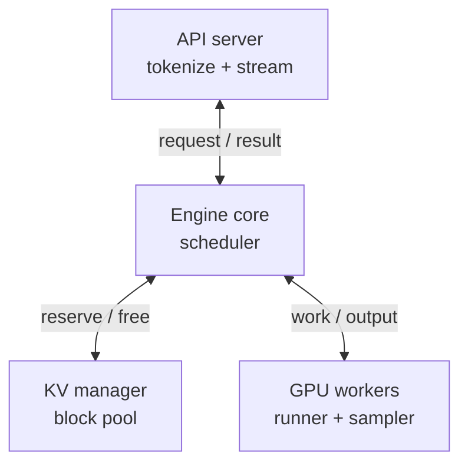

---
{
  "id": "deep-dive-vllm",
  "title": "Deep Dive - vLLM",
  "slug": "deep-dive-vllm",
  "section": "Project Deep Dives",
  "category": "Inference Optimization",
  "difficulty": "Hard",
  "order": 2,
  "coverImage": "illustrations/_generated/vllm_kv_block_pool_dark.png",
  "shortDescription": "R0 is mid-response when a nine-token prompt arrives. vLLM has to share one GPU step and one KV block pool without reserving a hole for every request.",
  "keyConceptsTested": [
    "PagedAttention and logical-to-physical KV blocks",
    "vLLM V1 process architecture",
    "Unified scheduling, continuous batching, and chunked prefill",
    "KV block pools, prefix hashes, reference counts, and LRU eviction",
    "Model runners, attention backends, and parallelism",
    "Serving security, observability, and operational failure modes"
  ],
  "prerequisites": [
    "inference-mechanics-ttft-tps-kv-cache",
    "continuous-batching-request-scheduling",
    "kv-cache-paged-attention-llm-serving",
    "model-parallelism-for-llm-inference"
  ],
  "relatedQuestions": [
    "flashattention-memory-efficient-attention",
    "model-quantization-gptq-awq-gguf",
    "llm-deployment-gpu-serving-autoscaling",
    "positional-encoding-rope-alibi"
  ],
  "companies": [
    "vLLM Project",
    "UC Berkeley",
    "Anyscale",
    "Red Hat",
    "NVIDIA"
  ]
}
---

Request **R0** is mid-stream when **R1** arrives with a nine-<span data-glossary="token">token</span> prompt. R0 needs one decode step; R1 needs prompt prefill. Let R1 hog the GPU step and R0's stream stutters; pre-reserve max context per request and <span data-glossary="kv-cache">KV-cache</span> memory runs dry before compute saturates.

<span data-glossary="vllm">vLLM</span> solves that dual-resource squeeze by scheduling **GPU compute** and **physical KV blocks** together inside one V1 engine loop, balancing <span data-glossary="ttft">TTFT</span> and <span data-glossary="itl">ITL</span> across interactive chat, <span data-glossary="rag">RAG</span>, batch generation, multimodal inputs, and RL <span data-glossary="rollout">rollouts</span>.[^vllm2026architecture][^vllm2026release0280][^vllm2026release0310]

## Two entry paths, one engine loop

Both the offline Python `LLM` class and the online HTTP server (`vllm serve`, replacing deprecated `vllm.entrypoints.openai.api_server`) drive the exact same V1 engine core.[^vllm2026serving][^vllm2026apiServer0300][^vllm2026release0300] Scale-out endpoints are opt-in via `--enable-scale-out`.

## The historical idea: page KV memory

As covered in [KV Cache & PagedAttention](/learn/kv-cache-paged-attention-llm-serving), vLLM maps each sequence's logical blocks onto fixed-size physical KV blocks through a per-request block table, capping fragmentation to one partial tail block and enabling copy-on-write prefix sharing.[^kwon2023] With 4-token blocks, R0 (`A B C D E F G H`) occupies physical slots `[12, 41]`; when R1 (`A B C D E F X Y Z`) arrives, both share slot 12 (refcount 2) while R1 allocates slot 73 (`E F X Y`) and partial slot 90 (`Z`):

<figure>
  
  <figcaption>Five logical blocks fit in four physical slots because R0 and R1 share slot 12 (refcount 2); unreferenced slots wait in the free queue for reuse or LRU eviction.</figcaption>
</figure>

### PagedAttention isn't one current backend

"PagedAttention" names the block-table layout contract, not one <span data-glossary="cuda">CUDA</span> kernel. V1 model runners dispatch FlashAttention-family, FlashInfer, fused paged, <span data-glossary="triton-language">Triton</span>, or accelerator-specific kernels over that same block table (while hybrid/SSM models keep separate recurrent state).

## V1 request path: separate processes, one engine loop

vLLM V1 splits I/O and Python tokenization off the GPU scheduling hot path across three process roles communicating over ZeroMQ:[^vllm2026v1][^vllm2026architecture]

1. **API server processes** parse HTTP, tokenize, fetch/decode media, and stream responses.
2. **Engine-core processes** (one per <span data-glossary="data-parallelism">DP</span> rank, plus 1 coordinator when `DP > 1`) run the scheduler and KV block pool.
3. **GPU worker processes** (one per GPU) execute the model runner, CUDA graphs, attention backend, and sampler.



With $A$ API servers (default $DP$), $DP$ engine cores, and $N$ GPUs, vLLM runs $A + DP + N$ serving processes (plus 1 coordinator if $DP > 1$): 6 processes for `4 GPUs, TP=4, DP=1`, and 17 for `8 GPUs, TP=2, DP=4`. CPU starvation in API servers or engine cores throttles GPU utilization just as hard as slow kernels.[^vllm2026optimization]

## The V1 scheduler: one token budget

V1 replaces separate prefill/decode queues with one **unified <span data-glossary="token-budget">token budget</span>** (`max_num_batched_tokens`) and default <span data-glossary="chunking">chunked prefill</span>.[^vllm2026v1][^vllm2026optimization] Decode requests claim 1 input position each first; waiting prefills consume whatever remains. Tracing R0 (1 decode) and R1 (9 uncached prefill tokens) under a 6-token budget:

<figure>
  
  <figcaption>Decode-first scheduling with a 6-token budget: step 0 runs 1 R0 + 5 R1, step 1 runs 1 R0 + 4 R1 (sampling R1's first output), and step 2 runs 1 decode each.</figcaption>
</figure>

<!-- leetllm: test, output=show -->
```python title="token-budget-trace.py"
budget, r1_left = 6, 9
for step in range(3):
    r0_dec = 1
    if r1_left > 0:
        r1_pre = min(r1_left, budget - r0_dec)
        r1_left -= r1_pre
        r1_dec = 0
    else:
        r1_pre, r1_dec = 0, 1
    used = r0_dec + r1_pre + r1_dec
    print(f"step {step}: R0_dec={r0_dec}, R1_pre={r1_pre}, R1_dec={r1_dec}, used={used}/{budget}")
```

<!-- leetllm: output:start -->
```text title="Output" output compact
step 0: R0_dec=1, R1_pre=5, R1_dec=0, used=6/6
step 1: R0_dec=1, R1_pre=4, R1_dec=0, used=5/6
step 2: R0_dec=1, R1_pre=0, R1_dec=1, used=2/6
```
<!-- leetllm: output:end -->

Use `--max-num-active-seqs` to bound `RUNNING` KV growth independently of `max_num_seqs`.[^vllm2026release0310] When KV blocks exhaust, V1 preempts by **recompute** (freeing blocks while retaining token history for replay; explicit KV offloading is separate via connectors).[^vllm2026kvoffload]

### Measure goodput with the right denominator

Judge scheduler configs by **<span data-glossary="goodput">goodput</span>** (completions passing both TTFT and ITL SLOs divided by window duration), never `arrival_rate * (passed / completed)`, which omits dropped/timed-out requests from the denominator and inflates Candidate A from `5.50` to `9.17 req/s`:[^zhong2024]

<!-- leetllm: test, deps=numpy, output=show -->
```python title="goodput-denominator.py"
import numpy as np

window = 100.0
offered, completed, passed = np.array([1000., 800.]), np.array([600., 780.]), np.array([550., 752.])
for name, gp, wrong in zip(("A", "B"), passed / window, (offered / window) * (passed / completed)):
    print(f"{name}: goodput={gp:.2f}/s | wrong completion-only={wrong:.2f}/s")
```

<!-- leetllm: output:start -->
```text title="Output" output compact
A: goodput=5.50/s | wrong completion-only=9.17/s
B: goodput=7.52/s | wrong completion-only=7.71/s
```
<!-- leetllm: output:end -->

## Block pool, prefix cache, and eviction

Automatic Prefix Caching (APC) chains SHA-256 block hashes over `(parent_hash, block_tokens, tagged_extra_hashes)`.[^vllm2026prefix] Tagging `extra_hashes` by source (LoRA name + weight path, multimodal hashes, gateway-injected `cache_salt`) prevents a LoRA adapter named `tenant-A` from colliding with `cache_salt="tenant-A"` or reusing stale KV after weight updates.[^vllm2026kvutils0280][^vllm2026release0310]

APC reuses **complete** blocks only, capped at `min(shared, prompt_length - 1)` rounded down to a block boundary so the engine always recomputes at least one final position to obtain logits for sampling the first output token:[^vllm2026kvmanager0280]

<!-- leetllm: test, output=show -->
```python title="apc-full-blocks.py"
def reusable_tokens(shared: int, prompt_len: int, block_size: int = 4) -> int:
    return (min(shared, prompt_len - 1) // block_size) * block_size

for shared, length in ((6, 9), (8, 9), (8, 8), (1, 1)):
    skip = reusable_tokens(shared, length)
    print(f"shared={shared}, prompt={length} -> skip {skip}, compute {length - skip}")
```

<!-- leetllm: output:start -->
```text title="Output" output compact
shared=6, prompt=9 -> skip 4, compute 5
shared=8, prompt=9 -> skip 8, compute 1
shared=8, prompt=8 -> skip 4, compute 4
shared=1, prompt=1 -> skip 0, compute 1
```
<!-- leetllm: output:end -->

Reference counts guard live blocks. On completion, blocks release in **reverse order** (suffix first, prefix last): zero-ref cached blocks append to the **tail** of the doubly linked <span data-glossary="lru-cache">LRU</span> free queue (evicting deep suffixes before shared roots), while uncached partial tail blocks push to the **head** for immediate recycling. Allocations pop from the head and clear stale hash entries before reuse:[^vllm2026blockpool0280]

<!-- leetllm: test, output=show -->
```python title="live-block-ownership.py"
from collections import Counter, deque

tables = {"R0": [12, 41], "R1": [12, 73, 90]}
refs = Counter(s for t in tables.values() for s in t)
hashes = {12: "ABCD", 41: "ABCDEFGH", 73: "ABCDEFXY"}  # 90 is partial/uncached.
free = deque()

def release(req):
    for s in reversed(tables.pop(req)):
        refs[s] -= 1
        if refs[s] == 0:
            (free.append if s in hashes else free.appendleft)(s)

def allocate():
    s = free.popleft()
    hashes.pop(s, None)
    refs[s] = 1
    return s

release("R0")                       # frees 41 (cached -> tail), 12 stays ref=1
tables["R2"] = [allocate()]         # pops 41, invalidates its hash
release("R1")                       # frees 90 (head), 73 (tail), 12 (tail)
assert tables["R2"] == [41] and list(free) == [90, 73, 12]
print("R2 reused:", tables["R2"], "| free queue (head->tail):", list(free))
```

<!-- leetllm: output:start -->
```text title="Output" output compact
R2 reused: [41] | free queue (head->tail): [90, 73, 12]
```
<!-- leetllm: output:end -->

> **Key insight:** APC speeds up prefill only. High prefix-cache hit rates do not rescue slow ITL on long generations, and a trusted gateway must inject per-tenant `cache_salt` values rather than letting clients pick strings.

## From scheduler output to GPU kernels

Each step, the engine core sends scheduled token counts, block tables, and sampling metadata to GPU workers (`gpu_worker.py` selects either `gpu_model_runner.py` or the modular V2 runner via `use_v2_model_runner`, still inside V1).[^vllm2026release0280] Across multiple GPUs, vLLM composes **TP** (splits <span data-glossary="matrix">matrix</span> widths; per-layer collectives), **PP** (splits depth; bubbles at low load), **DP** (independent replicas + coordinator), and **EP** (<span data-glossary="mixture-of-experts">MoE</span> expert sharding).[^vllm2026architecture][^vllm2026metrics]

## APIs and service security

OpenAI API compatibility is not a security boundary:[^vllm2026security][^vllm2026serving]

1. **HTTP ingress:** Built-in `--api-key` protects `/v1` prefixed paths while unprefixed aliases (`/score`, `/rerank`, `/invocations`), `/health`, and `/metrics` can stay open on the same listener. Front vLLM with an authenticating gateway.
2. **Media SSRF/OOM limits:** Restrict `--allowed-media-domains`, disable redirects (`VLLM_MEDIA_URL_ALLOW_REDIRECTS=0`), enforce pixel/size/duration caps, and keep `--trust-request-mm-kwargs` off by default.[^vllm2026release0310]
3. **Internal fabric ports:** <span data-glossary="pytorch">PyTorch</span> distributed and KV-transfer ports have no auth/TLS; bind them to isolated private networks.

<!-- leetllm: edition:reference:start -->
## Code-reading route

Trace one request through six V1 files (`Apache-2.0`, UC Berkeley Sky Computing Lab origin[^vllm2026governance][^vllm2026license0280][^vllm2024]):

1. `vllm/entrypoints/openai/api_server.py`: `vllm serve` HTTP parsing, tokenization, streaming.
2. `vllm/v1/engine/core.py`: engine-core event loop and ZeroMQ worker handoff.
3. `vllm/v1/core/sched/scheduler.py`: unified token budget, chunked prefill, recompute preemption.
4. `vllm/v1/core/kv_cache_manager.py`: `get_computed_blocks` APC lookup and slot allocation.
5. `vllm/v1/core/block_pool.py`: physical pool, doubly linked free queue, hash map, LRU eviction.
6. `vllm/v1/worker/gpu_worker.py` + `gpu_model_runner.py`: CUDA graphs, attention dispatch, sampling.

When ITL climbs alongside low GPU utilization and high preemptions, check KV pool exhaustion, `max_num_batched_tokens` / `max_num_seqs` oversubscription, and engine-core CPU saturation before swapping attention kernels. Note that Prometheus `vllm:inter_token_latency_seconds` measures intervals between engine output reports (which may bundle tokens); measure client timestamps for strict per-token p99 ITL.[^vllm2026metrics]
<!-- leetllm: edition:reference:end -->

## Architectural summary

- vLLM schedules GPU compute and physical KV blocks jointly across decoupled API, engine-core, and GPU-worker processes.
- One unified token budget blends <span data-glossary="continuous-batching">continuous batching</span>, decode-first priority, and chunked prefill; KV exhaustion preempts by recompute.
- APC hashes complete blocks with parent chaining and tagged metadata, leaves at least one final token for logit sampling, and evicts zero-ref blocks in suffix-first LRU order.

```mastery-quiz
[
  {
    "question": "Each KV block holds 4 tokens and a request's block table is [37, 4, 19, 62]. Which physical block and offset store zero-based logical position 14?",
    "options": [
      "Block 19, offset 2.",
      "Block 62, offset 3.",
      "Block 62, offset 2.",
      "Block 37, offset 3."
    ],
    "answer": "Block 62, offset 2.",
    "explanation": "14 // 4 = 3 (fourth table entry = block 62), 14 % 4 = 2 (offset 2)."
  },
  {
    "question": "Eight GPUs run TP=2, PP=2, DP=2 with API servers overridden to A=1. How many main serving processes run under A + DP + N (+1 coordinator when DP > 1)?",
    "options": [
      "12 (1 API, 2 cores, 8 workers, 1 coordinator).",
      "13 (2 APIs, 2 cores, 8 workers, 1 coordinator).",
      "11 (1 API, 2 cores, 8 workers, no coordinator).",
      "10 (1 API, 1 core, 8 workers, no coordinator)."
    ],
    "answer": "12 (1 API, 2 cores, 8 workers, 1 coordinator).",
    "explanation": "1 + 2 + 8 + 1 = 12 processes because DP=2 > 1 adds one coordinator."
  },
  {
    "question": "Under full-attention APC (block size 8), Case A has prompt=17 with 16 shared tokens; Case B has prompt=16 with all 16 shared. What (skipped, computed) positions result?",
    "options": [
      "A (16, 1); B (16, 0).",
      "A (8, 9); B (16, 0).",
      "A (8, 9); B (8, 8).",
      "A (16, 1); B (8, 8)."
    ],
    "answer": "A (16, 1); B (8, 8).",
    "explanation": "Reuse caps at min(shared, prompt - 1) rounded down to a block multiple: A skips 16 (computes 1), while B caps at 15 -> skips 8 and recomputes the final 8-token block to produce sampling logits."
  },
  {
    "question": "Free queue is [42, 18, 67, 5] (head first, refcount 0). Requests A and B both hit cached block 67; Request C allocates a fresh block. What final free queue and refcounts remain?",
    "options": [
      "Queue [18, 5]; block 42 ref=1, block 67 ref=1.",
      "Queue [42, 18, 5]; block 42 ref=1, block 67 ref=2.",
      "Queue [18, 67, 5]; block 42 ref=1, block 67 ref=2.",
      "Queue [18, 5]; block 42 ref=1, block 67 ref=2."
    ],
    "answer": "Queue [18, 5]; block 42 ref=1, block 67 ref=2.",
    "explanation": "A's touch removes 67 from the free queue (ref=1); B increments 67 to ref=2; C pops head block 42 (ref=1), leaving [18, 5]."
  },
  {
    "question": "Over 20 s, a service receives 80 requests, completes 70, and 61 meet latency SLOs. What are true goodput and the flawed completion-only estimate?",
    "options": [
      "Goodput 3.50/s; flawed 3.05/s.",
      "Goodput 3.05/s; flawed 3.49/s.",
      "Goodput 3.05/s; flawed 3.50/s.",
      "Goodput 3.50/s; flawed 3.49/s."
    ],
    "answer": "Goodput 3.05/s; flawed 3.49/s.",
    "explanation": "True goodput = 61 / 20 = 3.05 req/s. Dropping the 10 failed requests yields (80/20) * (61/70) = 3.49 req/s."
  },
  {
    "question": "An engine logs output reports at 10, 13, and 19 ms; the first report bundles 2 tokens and each later report emits 1 token (4 total). What is request-mean TPOT and what can you say about pre-bundling per-token p99 ITL?",
    "options": [
      "TPOT 4.5 ms; per-token p99 unrecoverable.",
      "TPOT 3.0 ms; per-token p99 is 6 ms.",
      "TPOT 3.0 ms; per-token p99 unrecoverable.",
      "TPOT 4.5 ms; per-token p99 is 6 ms."
    ],
    "answer": "TPOT 3.0 ms; per-token p99 unrecoverable.",
    "explanation": "4 tokens span 3 intervals over 19 - 10 = 9 ms -> TPOT = 3.0 ms. Bundling 2 tokens under the 10 ms timestamp hides their internal gap."
  }
]
```

> **Next:** Continue to [Deep Dive - SGLang](/learn/deep-dive-sglang).
