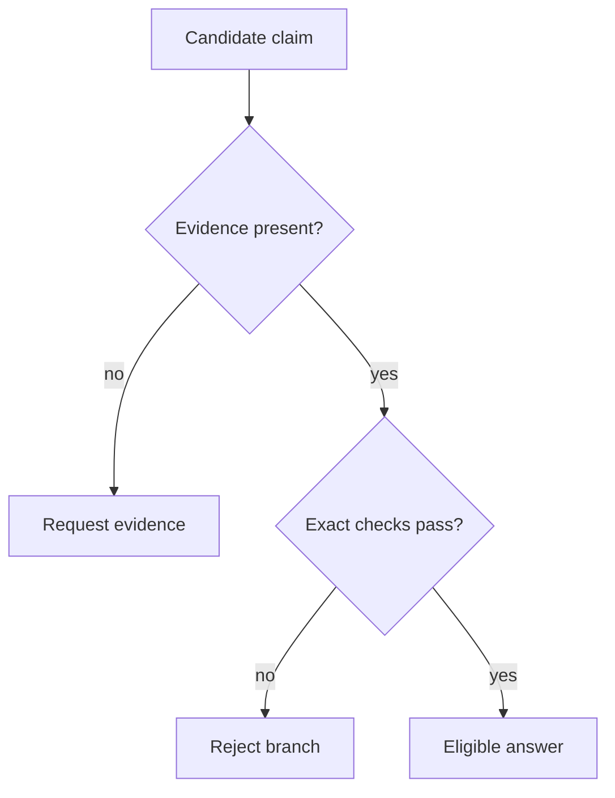
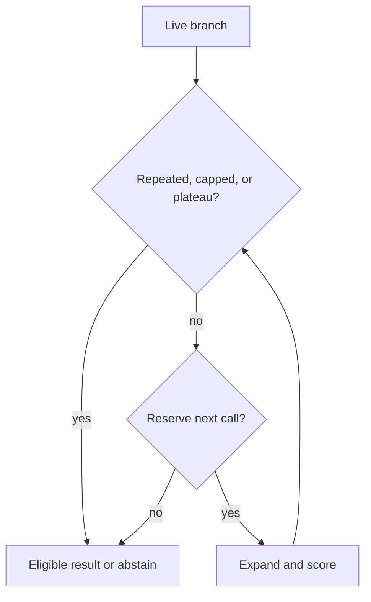

---
{
  "id": "design-reasoning-agent-test-time-compute",
  "slug": "design-reasoning-agent-test-time-compute",
  "title": "Reasoning Agent System Design",
  "shortDescription": "Tests pass, but canary latency spikes after a config change. Design an agent that gathers the evidence, spends extra reasoning only when needed, and recommends whether to hold, roll back, or continue.",
  "difficulty": "Hard",
  "category": "System Design",
  "section": "System Design Capstones",
  "coverImage": "illustrations/_generated/reasoning_agent_dark.png",
  "companies": [
    "OpenAI",
    "Google",
    "Anthropic",
    "DeepSeek",
    "xAI",
    "Meta"
  ],
  "prerequisites": [
    "reasoning-models-test-time-compute",
    "inference-mechanics-ttft-tps-kv-cache",
    "chain-of-thought-advanced-prompting",
    "rlhf-dpo-aligning-language-models",
    "kv-cache-paged-attention-llm-serving",
    "prefix-caching-prompt-caching",
    "agentic-architectures-react-plan-execute",
    "agent-evaluation-benchmarks",
    "observability-monitoring-llm-systems"
  ],
  "relatedQuestions": [
    "design-real-time-voice-ai-agent",
    "scaling-llm-inference-batching-kv-cache",
    "speculative-decoding",
    "continuous-batching-request-scheduling",
    "design-code-completion-system"
  ],
  "order": 10,
  "keyConceptsTested": [
    "Test-Time Compute",
    "Reasoning Effort Budget",
    "Self-Consistency",
    "Overthinking",
    "Chain of Thought",
    "Tree of Thoughts",
    "Beam Search",
    "Monte Carlo Tree Search",
    "Reward Models",
    "Process Reward Models",
    "Production-Evaluation Gap",
    "KV Cache",
    "Value-Aware KV Eviction",
    "Recurrent-Depth Reasoning",
    "PagedAttention",
    "Compute-Optimal Inference",
    "Reasoning Traces"
  ]
}
---

A release owner sees a canary at 10%: <span data-glossary="smoke-test">smoke tests</span> passed, but one latency panel spiked after a config flag changed. The agent must choose <span data-glossary="rollback">rollback</span>, hold, or continue the <span data-glossary="rollout">rollout</span>. A plausible recommendation is cheap. A defensible one needs the rollout state, smoke-test result, latency evidence, and config diff before it spends more search.

That is the running incident. A human SRE would gather those observations, compare them with policy, and only then recommend hold, promote, or rollback. This design spends extra <span data-glossary="test-time-compute">test-time compute</span> on that checked work, then asks whether the extra budget earned a safer release.

A standard large language model (LLM) generates each continuation left to right. It can't rewrite tokens already emitted, though later tokens can state a correction. Extra checking still needs a controller that can call tools, request a revision, or generate competing attempts.

Reasoning models such as OpenAI's earlier o-series, including o1 [^openai_o1_2024], and DeepSeek-R1 [^deepseekai2025] spend additional compute before returning an answer. That native internal reasoning is not the same as a product controller that samples candidates, calls tools, scores partial states, or searches a tree. They have different evidence and operational requirements.

The controller has two jobs: apply a known release policy, then investigate a possible dependency fix. Applying policy needs fresh observations and arithmetic; repair planning may benefit from competing plans. All Python examples below run locally with the standard library, demonstrating control mechanisms and budget tracking with deterministic local data.

## Fast answers do not guarantee safe deployment

Suppose the model says "hold" before it has seen the metrics result. What can the release gate prove? Single-pass decoding only samples the next <span data-glossary="token">token</span> from everything so far. Without a controller or tool, it can emit a fluent hold/rollback recommendation that never touched the deploy API, smoke-test log, or latency panel. Hidden "slow thinking" isn't an enforceable control. The shippable controls are external candidate state, tool evidence, evaluator behavior, and release gates.

Treat this request as a **budgeted search and verification problem**, not one left-to-right decoding loop. A controller can explore candidate actions, score partial solutions, consult external evidence, and spend extra compute only when evaluation justifies it.

The extra work is called **test-time compute**: the floating-point operations (FLOPs) and tokens spent during inference, after training is done. Snell et al. show that a smaller model plus a suitable inference-time strategy can beat a 14x larger model on some math prompts [^snell2024]. Their comparison matches estimated **pretraining plus inference FLOPs** across a workload, not a per-request token allowance. The result depends on prompt difficulty and expected inference load: harder prompts and heavy inference workloads can favor the larger pretrained model. The study also trains its revision models and verifiers; prompting an arbitrary small model doesn't reproduce the result.

```checkpoint
What is the product difference between training compute and test-time compute?
---
Training compute is spent before deployment to build the model. Test-time compute is spent per request to search, verify, rerank, or allocate more internal reasoning budget. Production systems can vary test-time compute by task difficulty instead of making every request pay for the same model size.
```

<figure>
  
  <figcaption>Reservations bound work before execution begins, preventing unmanaged token spend.</figcaption>
</figure>


An initial route is only a spending ceiling. The controller must reserve capacity before dispatching work and can stop well below that ceiling. A threshold lookup needs no competing plans; a dependency repair may need several. Whether that extra search improves quality must be measured on held-out requests.

## The simplest form of extra compute: one deliberate path

When tool observations already settle the canary decision, start with a single deliberate candidate and a bounded output allowance. On supported reasoning APIs, `reasoning.effort` adjusts relative internal effort; it isn't a hard token, time, or cost cap. A structured response format is only an outward interface for checked milestones and a final answer. XML doesn't make the model think longer. Classic Chain of Thought prompts asked a model to "think step by step" [^wei2022a], but a production controller should separate hidden reasoning budget from evidence the application can validate.

OpenAI's guidance, checked October 10, 2026, treats `reasoning.effort` as a tuning knob alongside a clear task, constraints, and output schema [^openai2026reasoning]. Request tool evidence, concise checked milestones, and a final answer rather than a hidden scratchpad. Use recorded tool results and checked milestones as application evidence; hidden reasoning tokens are not an audit log.

Supported effort values are model-dependent. GPT-5.5, for example, documents `none`, `low`, `medium` (default), `high`, and `xhigh` [^openai2026gpt55]. Lower effort favors latency and fewer reasoning tokens; higher effort permits more internal work before answering. Raise effort only when evals show a quality gain that justifies extra latency and cost, and keep the lowest useful setting for fast, deterministic tasks. Treat it as the single-path version of the difficulty router introduced later.

The current guide separates four controls. Check support on the actual model; GPT-6 Astra, for example, rejects `effort=none`.[^openai2026reasoning]

| Responses control | What it changes | Remaining checks |
|---|---|---|
| `reasoning.effort` | Relative deliberation within the selected mode | A hard time, token, or cost cap |
| `reasoning.mode` | `standard` or `pro` execution on supported models | An external search tree or evidence gate |
| `reasoning.context` | Which available, compatible reasoning items carry across turns | Public reasoning text or tool evidence |
| `max_output_tokens` | Per-call generated-token limit, including hidden reasoning and formatting | A completed answer or shared multi-call budget |

The guide documents `all_turns` as GPT-5.6's default; it requires access to prior response items and cannot reuse reasoning across incompatible model families.[^openai2026reasoning] Keep authenticated tool observations and policy versions in application state even when opaque model reasoning persists.

Use a lightweight parser for the interface you want the model to satisfy. It turns a compact XML response into visible checkpoints plus a final answer:

<!-- leetllm: test, output=show -->
```python title="the-simplest-form-of-thinking-longer-one.py"
from dataclasses import asdict, dataclass
import json
import xml.etree.ElementTree as ET

@dataclass
class ReasoningStep:
    kind: str
    content: str

@dataclass
class ReasoningTrace:
    steps: list[ReasoningStep]
    final_answer: str

class SinglePathReasoner:
    RESPONSE_TEMPLATE = """
    Answer using provided tool observations only.

    Return XML with this structure:
    <response>
      <checkpoint>major milestone only</checkpoint>
      <checkpoint>major milestone only</checkpoint>
      <verification_summary>brief check against verified evidence</verification_summary>
      <final_answer>final answer</final_answer>
    </response>

    Keep checkpoints concise. Do not dump a full scratchpad.
    """

    def parse(self, content: str) -> ReasoningTrace:
        if len(content) > 16_000 or "<!" in content:
            raise ValueError("Response exceeds limit or contains declarations")
        root = ET.fromstring(content)
        allowed = {"checkpoint", "verification_summary", "final_answer"}
        if root.tag != "response" or root.attrib or (root.text or "").strip():
            raise ValueError("Expected a response containing only child fields")
        if any(node.tag not in allowed or node.attrib or len(node)
               or not (node.text or "").strip() or (node.tail or "").strip()
               for node in root):
            raise ValueError("Invalid or empty response field")
        if any(len(root.findall(tag)) != 1
               for tag in ("verification_summary", "final_answer")):
            raise ValueError("Expected one verification summary and one final answer")
        checkpoints = [node.text.strip() for node in root.findall("checkpoint") if node.text]
        steps = [ReasoningStep("checkpoint", cp) for cp in checkpoints if cp]
        verification = self._extract_text(root, "verification_summary")
        if verification:
            steps.append(ReasoningStep("verification", verification))
        return ReasoningTrace(
            steps=steps,
            final_answer=self._extract_text(root, "final_answer"),
        )

    def _extract_text(self, root: ET.Element, tag: str) -> str:
        text = root.findtext(tag, default="")
        return text.strip()

model_response = """
<response>
  <checkpoint>Deploy API reports canary still at 10%.</checkpoint>
  <checkpoint>Smoke-test tool reports the release passed.</checkpoint>
  <verification_summary>Metrics tool shows latency above watch threshold but below rollback threshold.</verification_summary>
  <final_answer>Hold the canary at 10%, keep rollback armed, and inspect the config flag before promotion.</final_answer>
</response>
"""

trace = SinglePathReasoner().parse(model_response)
print(json.dumps({
    "steps": [asdict(step) for step in trace.steps],
    "final_answer": trace.final_answer,
}, indent=2))
```

<!-- leetllm: output:start -->
```text title="Output" output compact
{
  "steps": [
    {
      "kind": "checkpoint",
      "content": "Deploy API reports canary still at 10%."
    },
    {
      "kind": "checkpoint",
      "content": "Smoke-test tool reports the release passed."
    },
    {
      "kind": "verification",
      "content": "Metrics tool shows latency above watch threshold but below rollback threshold."
    }
  ],
  "final_answer": "Hold the canary at 10%, keep rollback armed, and inspect the config flag before promotion."
}
```
<!-- leetllm: output:end -->

The split matters. `RESPONSE_TEMPLATE` constrains output to major evidence-backed milestones. Downstream code verifies external facts against tool results; hidden token-by-token deliberation stays inside the model runtime, while the application receives a compact interface it can validate.

For the canary, one bounded path should expose only the observations needed to justify its action:

1. The deploy tool reports that the canary is still at 10%.
2. The smoke-test tool reports that the release passed.
3. The metrics tool shows elevated latency below the rollback threshold.
4. The final answer holds the canary, keeps rollback armed, and inspects the changed config flag before promotion.

That is enough when tool evidence or an exact check settles the result. If multiple plans remain plausible, the next move is a small set of candidates, not a tree by default.

<!-- leetllm: test, output=show -->
```python title="releasing-only-evidence-backed-claims.py"
from dataclasses import dataclass, replace
import json
import math

@dataclass(frozen=True)
class Observation:
    deploy_id: str
    revision: int
    observed_at: int  # seconds in local epoch
    canary_percent: int
    smoke_passed: bool
    p95_ms: float

def release_answer(observation: Observation | None, now: int) -> dict[str, object]:
    # Authenticated adapters, not model output, construct this record.
    if observation is None:
        return {"release": False, "reason": "missing_observation"}
    if (observation.deploy_id, observation.revision) != ("checkout-42", 7):
        return {"release": False, "reason": "wrong_deploy_or_revision"}
    if not 0 <= now - observation.observed_at <= 30:
        return {"release": False, "reason": "stale_or_future_observation"}
    if observation.canary_percent != 10 or observation.p95_ms < 0:
        return {"release": False, "reason": "invalid_observation"}
    # Policy v3: >=300 ms or failed smoke => rollback;
    # >=200 ms => hold; otherwise eligible to continue the rollout.
    if not observation.smoke_passed or observation.p95_ms >= 300:
        action = "rollback"
    elif observation.p95_ms >= 200:
        action = "hold"
    else:
        action = "continue"
    return {"release": True, "recommendation": action,
            "evidence": "checkout-42/revision-7", "policy": "canary-v3"}

observed = Observation("checkout-42", 7, 100, 10, True, 240)
attempts = [None, observed, replace(observed, p95_ms=300),
            replace(observed, revision=6), replace(observed, canary_percent=25)]
print(json.dumps([release_answer(item, now=110) for item in attempts], indent=2))
```

<!-- leetllm: output:start -->
```text title="Output" output compact
[
  {
    "release": false,
    "reason": "missing_observation"
  },
  {
    "release": true,
    "recommendation": "hold",
    "evidence": "checkout-42/revision-7",
    "policy": "canary-v3"
  },
  {
    "release": true,
    "recommendation": "rollback",
    "evidence": "checkout-42/revision-7",
    "policy": "canary-v3"
  },
  {
    "release": false,
    "reason": "wrong_deploy_or_revision"
  },
  {
    "release": false,
    "reason": "invalid_observation"
  }
]
```
<!-- leetllm: output:end -->

At 240 ms, this policy recommends hold; exactly 300 ms means rollback. Tune those latency thresholds to each service's error budget. The model cannot alter the telemetry record, policy version, or decision rule. `release=True` permits an advisory response, not an unverified production write. An automated actuator requires separate authorization, an idempotency token, and an atomic check confirming deployment revision 7 remains active. The 30-second freshness bound also reflects product-specific telemetry latencies.

Production validation requires explicit range and value checks on incoming records. Verifying the canary percentage and deployment revision ensures telemetry anomalies do not trigger erroneous rollback or hold decisions.

A checkpoint is a parseable milestone. The release gate still needs the matching tool observation:



```checkpoint
Why should a reasoning API expose checkpoints instead of raw chain-of-thought?
---
Checkpoints provide concise outward milestones. Parsing validates their shape. Label a milestone verified only when it is tied to a completed tool observation; hidden scratchpads are not retained as an evidence log.
```

## Comparing complete candidates: Best-of-N sampling

What changes when both "hold" and "rollback" look plausible after the first pass? Generate a small set of candidate answers and rank them before selecting a response. In an incident-analysis workflow, separately generated candidates enter a policy check or validated reviewer.

This is **Best-of-N sampling**. Run the single-path generator N times with a diversity-producing configuration, rank candidates with the most reliable evaluator available, and release an eligible winner. <span data-glossary="temperature">Temperature</span> is one knob: low temperature tends to collapse diversity, while a higher value can produce different plans. Neither setting guarantees diversity or correctness.

Start with ranking alone. Verifier ranking selects candidate B, while the downstream policy gate checks grounding eligibility independently. The evidence gate still decides eligibility. Separate model calls would produce the candidates in a live system, but shared prompts and training mean their errors are not necessarily independent.

<!-- leetllm: test, output=show -->
```python title="asking-several-agents-best-of-n-sampling.py"
from dataclasses import asdict, dataclass
import json
import math

@dataclass
class CandidateTrace:
    candidate_id: str
    answer: str
    verifier_score: float

class BestOfNSampler:
    @staticmethod
    def probability_at_least_one_success(base_success_rate: float, n: int) -> float:
        if not (0 <= base_success_rate <= 1 and n >= 0):
            raise ValueError("Expected probability in [0, 1] and nonnegative count")
        if n == 0 or base_success_rate == 0:
            return 0.0
        if base_success_rate == 1:
            return 1.0
        return -math.expm1(n * math.log1p(-base_success_rate))

    def choose(self, traces: list[CandidateTrace]) -> CandidateTrace | None:
        return max(traces, key=lambda trace: trace.verifier_score, default=None)

traces = [
    CandidateTrace("A", "Rollback immediately; latency panel is unknown.", 0.61),
    CandidateTrace("B", "Hold canary; tests passed and latency is below rollback threshold.", 0.93),
    CandidateTrace("C", "Promote to 100% because smoke tests passed.", 0.28),
    CandidateTrace("D", "Disable all traffic before checking metrics.", 0.44),
    CandidateTrace("E", "Ignore the spike because rollout is partial.", 0.19),
]

sampler = BestOfNSampler()
winner = sampler.choose(traces)
rare_coverage = sampler.probability_at_least_one_success(1e-20, 100)
assert math.isclose(rare_coverage, 1e-18, rel_tol=1e-15)
assert sampler.probability_at_least_one_success(1, 0) == 0
assert sampler.probability_at_least_one_success(1, 5) == 1

print(json.dumps({
    "n": len(traces),
    "base_success_rate": 0.30,
    "at_least_one_success": round(
        sampler.probability_at_least_one_success(0.30, len(traces)),
        3,
    ),
    "selected": asdict(winner) if winner else None,
    "rare_case_100_attempts_coverage": format(rare_coverage, ".1e"),
}, indent=2))
```

<!-- leetllm: output:start -->
```text title="Output" output compact
{
  "n": 5,
  "base_success_rate": 0.3,
  "at_least_one_success": 0.832,
  "selected": {
    "candidate_id": "B",
    "answer": "Hold canary; tests passed and latency is below rollback threshold.",
    "verifier_score": 0.93
  },
  "rare_case_100_attempts_coverage": "1.0e-18"
}
```
<!-- leetllm: output:end -->

### Why this helps: a worked example

Suppose the base model has a 30% chance of producing a correct mitigation plan for a complex canary incident. Before looking at the selector, predict what five independent attempts buy you. With one sample, success is 30%. With five, the probability that at least one is correct is:

$$
P(\text{at least one success}) = 1 - (1 - 0.30)^5 = 1 - 0.168 = 0.83
$$

That 83% describes the event that a correct candidate exists under the independence assumption. It's **not** an 83% success rate for the returned answer: selection succeeds only when a checker or verifier recognizes the correct candidate. Extra sampling is wasted if candidates are correlated or the verifier can't identify the useful one.

The rare-case value is still effectively useless coverage. Why use `log1p` and `expm1`? With `p=1e-20`, floating-point `1-p` rounds to 1, making the naive formula return zero. The `expm1(k * log1p(-p))` formulation preserves `1e-18` across $k = 100$ samples without catastrophic cancellation. This fixes arithmetic, not base-model competence, independence, or selection quality.

A <span data-glossary="reward-model">reward model</span> is only a proxy, so pushing N too high can backfire. Gao et al.'s synthetic setup uses a separate “gold” reward model to stand in for human preferences; its score can fall while optimization raises the learned proxy score.[^gao2023scaling] Gold score here isn't an exact correctness oracle. Cap N and evaluate returned outcomes on held-out tasks.

When an exact checker exists, it outranks a persuasive learned score. The next selector chooses a tested dependency path rather than the answer with the highest style score:

<!-- leetllm: test, output=show -->
```python title="prefer-exact-checks-over-proxy-scores.py"
import json

candidates = [
    {"id": "A", "path": ["api", "legacy_adapter", "database"], "proxy_score": 0.96},
    {"id": "B", "path": ["api", "feature_flag", "database"], "proxy_score": 0.82},
]
blocked_edges = {("api", "legacy_adapter")}
allowed_edges = {("api", "legacy_adapter"), ("legacy_adapter", "database"),
                 ("api", "feature_flag"), ("feature_flag", "database")}

def passes_constraints(path: list[str]) -> bool:
    if len(path) < 2 or path[0] != "api" or path[-1] != "database":
        return False
    if len(set(path)) != len(path):
        return False
    edges = set(zip(path, path[1:]))
    return edges <= allowed_edges and not bool(edges & blocked_edges)

checked = [
    {**candidate, "exact_check": passes_constraints(candidate["path"])}
    for candidate in candidates
]
eligible = [candidate for candidate in checked if candidate["exact_check"]]
winner = max(eligible, key=lambda candidate: candidate["proxy_score"], default=None)

print(json.dumps({"checked": checked, "selected": winner["id"] if winner else None}, indent=2))
```

<!-- leetllm: output:start -->
```text title="Output" output compact
{
  "checked": [
    {
      "id": "A",
      "path": [
        "api",
        "legacy_adapter",
        "database"
      ],
      "proxy_score": 0.96,
      "exact_check": false
    },
    {
      "id": "B",
      "path": [
        "api",
        "feature_flag",
        "database"
      ],
      "proxy_score": 0.82,
      "exact_check": true
    }
  ],
  "selected": "B"
}
```
<!-- leetllm: output:end -->

### Self-consistency: Best-of-N without a reward model

When the answer is a comparable string, such as a number, label, or parse, you can sometimes skip a learned reward model. **Self-consistency** samples several traces and returns the most frequent answer [^wang2023]. It can improve selected reasoning benchmarks when correct answers concentrate more than incorrect ones, but majority vote isn't verification: correlated wrong answers still win. Prefer an exact checker whenever available; use voting only when endpoints are comparable and evaluation supports it.

```checkpoint
When does Best-of-N help, and when is it wasted?
---
It helps when the base model has a meaningful chance of producing at least one correct trace and the verifier can identify it. It's wasted when samples are near-identical, the base model has near-zero task competence, or the reward model can't distinguish good traces from bad ones.
```

### Where beam search fits

Beam search is the classic decoding baseline: keep the top-$k$ most likely partial continuations at each step. It's easy to batch, but on tasks requiring distinct hypotheses its high-probability branches can become near-duplicates rather than useful alternatives. Evaluate it as a baseline or pruning mechanism against sampling and search on the task distribution you serve.

```checkpoint
Why can beam search underperform on reasoning tasks?
---
Beam search keeps high-probability continuations, which can become small variations of the same path. For tasks needing diverse hypotheses and backtracking, compare it with sampling or broader search and use it as a pruning mechanism only when evaluation supports that choice.
```

## When one path isn't enough: exploring a tree

The canary is held. The changed flag enabled `parser-v2`, and the latency spike is correlated with that change. Compare timing by route and reproduce the removed API failure to identify the cause. Repair planning is a separate problem from causal attribution. A single tool-using agent can revise a plan; an explicit tree makes competing partial plans, their constraints, and their remaining budgets inspectable.

Diagnosis is now a search problem. The resolver must choose package versions while respecting API compatibility, Python version floors, and security advisories. If it pins `parser-v2` and later learns that `parser-v2` calls an API the deployed runtime removed, it needs to backtrack.

Tree of Thoughts (ToT), proposed by Yao et al. [^yao2023], treats reasoning as tree search. At each step, the model generates possible next actions, scores them, and explores promising branches while pruning weak ones. For dependency resolution, each branch is a candidate version assignment; each evaluator check asks whether that partial assignment still satisfies known constraints.

<figure>
  
  <figcaption>Nightly dies on the runtime floor. Parser-v2 keeps a shim and drops the removed-API call. Parser-v1 plus a sanitizer patch is the other valid plan.</figcaption>
</figure>


The canary's config flag turns into that tree. From the initial state, three version choices are possible. Evaluating the root options indicates that nightly violates the runtime constraint. Parser-v2 looks usable, expanding into two sub-choices where calling the removed API breaks compatibility and gets pruned. The compatibility shim and the parser-v1 sanitizer patch both reach valid solutions.

This local implementation uses a breadth-first beam search. Hard constraint failures are rejected before proxy ranking. Completed solutions are retained separately, so another search round cannot erase them. Beam pruning is irreversible here: unlike a backtracking search, it will not revisit a discarded node or guarantee an optimal solution.

<!-- leetllm: test, output=show -->
```python title="when-one-path-isnt-enough-exploring-a-tree.py"
from dataclasses import dataclass
import json

EXPANSIONS = {
    "start": ["Pin parser v2", "Pin parser nightly", "Keep parser v1"],
    "Pin parser v2": ["A.1 add compatibility shim", "A.2 call removed API"],
    "Keep parser v1": ["C.1 patch sanitizer", "C.2 defer security fix"],
}

SCORES = {
    "Pin parser v2": 0.74,
    "Pin parser nightly": 0.12,
    "Keep parser v1": 0.81,
    "A.1 add compatibility shim": 0.70,
    "A.2 call removed API": 0.18,
    "C.1 patch sanitizer": 0.96,
    "C.2 defer security fix": 0.39,
}
INVALID = {"Pin parser nightly": "runtime_floor",
           "A.2 call removed API": "removed_api",
           "C.2 defer security fix": "unfixed_advisory"}
COMPLETE = {"A.1 add compatibility shim", "C.1 patch sanitizer"}

@dataclass
class ThoughtNode:
    content: str
    depth: int
    score: float
    parent: "ThoughtNode | None" = None

    def trace(self) -> str:
        if self.parent is None:
            return self.content
        return f"{self.parent.trace()}\n{self.content}"

class TreeOfThoughts:
    def __init__(self, beam_width: int = 2, min_score: float = 0.35):
        if beam_width < 1 or not 0 <= min_score <= 1:
            raise ValueError("Invalid search limits")
        self.beam_width = beam_width
        self.min_score = min_score

    def search(self, max_depth: int = 2) -> dict[str, object]:
        if max_depth < 0:
            raise ValueError("Invalid depth")
        root = ThoughtNode("start", depth=0, score=1.0)
        beam = [root]
        rounds = []
        completed = []

        for depth in range(max_depth):
            candidates = []
            for node in beam:
                for thought in EXPANSIONS.get(node.content, []):
                    candidates.append(ThoughtNode(thought, depth + 1, SCORES[thought], node))

            survivors = [node for node in candidates
                         if node.content not in INVALID and node.score >= self.min_score]
            survivors.sort(key=lambda node: node.score, reverse=True)
            completed.extend(node for node in survivors if node.content in COMPLETE)
            unfinished = [node for node in survivors if node.content not in COMPLETE]
            beam = unfinished[:self.beam_width]
            rounds.append({
                "depth": depth + 1,
                "kept": [node.content for node in beam],
                "completed": [node.content for node in completed],
                "pruned": [
                    node.content for node in candidates
                    if node.content in INVALID or node.score < self.min_score
                ] + [node.content for node in unfinished[self.beam_width:]],
            })
            if not beam:
                break

        best = max(completed, key=lambda node: node.score, default=None)
        return {"winner": best.trace().split("\n") if best else None, "rounds": rounds}

print(json.dumps(TreeOfThoughts().search(), indent=2))
```

<!-- leetllm: output:start -->
```text title="Output" output compact
{
  "winner": [
    "start",
    "Keep parser v1",
    "C.1 patch sanitizer"
  ],
  "rounds": [
    {
      "depth": 1,
      "kept": [
        "Keep parser v1",
        "Pin parser v2"
      ],
      "completed": [],
      "pruned": [
        "Pin parser nightly"
      ]
    },
    {
      "depth": 2,
      "kept": [],
      "completed": [
        "C.1 patch sanitizer",
        "A.1 add compatibility shim"
      ],
      "pruned": [
        "C.2 defer security fix",
        "A.2 call removed API"
      ]
    }
  ]
}
```
<!-- leetllm: output:end -->

The constraints and terminal states in this model come from explicit tables, not package metadata or an external dependency solver. It demonstrates search bookkeeping: depth zero or one returns no completed winner; depth two finds the sanitizer patch; extra depth preserves that result. A production resolver derives those verdicts from manifests and compatibility tests. `C.2 defer security fix` is rejected even though its 0.39 score clears the 0.35 proxy threshold.

```checkpoint
What makes Tree of Thoughts different from Best-of-N?
---
Best-of-N generates separate full traces and reranks them at the end. Tree of Thoughts evaluates partial states, can prune low-ranked branches early, and can backtrack when the controller retains alternatives. Separate calls do not necessarily have statistically independent errors.
```

```checkpoint
How does Tree of Thoughts handle non-deterministic outputs?
---
Use a diversity-producing generation policy at each node, then apply the most reliable evaluator available: exact constraints first, learned scoring where exact checks are unavailable. If every generation call returns the same continuation, tree search loses its main advantage.
```

### When revisiting branches beats a fixed beam

Tree of Thoughts is a general framework. If you need adaptive revisits instead of level-by-level pruning, you can swap the beam for <span data-glossary="monte-carlo-tree-search">Monte Carlo tree search (MCTS)</span>. In LLM settings, a common variant is **PUCT** (Predictor + Upper Confidence bounds applied to Trees), the AlphaZero-style selection rule that combines a value estimate with the model's next-step prior [^silver2017]:

$$
\text{PUCT}(s, a) = Q(s, a) + c_{\text{puct}} \cdot P(s, a) \cdot \frac{\sqrt{N(s)}}{1 + N(s, a)}
$$

Where:
- $Q(s, a)$ is the estimated downstream value for taking action $a$ in state $s$ (from rollouts, a value model, or another evaluator)
- $P(s, a)$ is the policy prior for the next thought
- $N(s)$ is the total number of visits to the parent node
- $N(s, a)$ is the number of visits to the child node
- $c_{\text{puct}}$ is the exploration constant that balances exploration vs exploitation

For example, with $Q=0.5$, $c_{\text{puct}}=1$, $P=0.2$, $N(s)=16$, and $N(s,a)=1$, the score is $0.5 + 0.2(4)/2 = 0.9$. At a previously unvisited parent, this expression's exploration bonus is zero; an implementation needs an initialization and tie-breaking rule. Neither Q nor the combined score is proof of correctness. Beam frontiers offer batchable work; MCTS can allocate visits unevenly when that benefits the evaluator/task pair.

```checkpoint
When would you choose MCTS over level-by-level beam expansion?
---
Choose MCTS when revisiting promising branches beats expanding every frontier node evenly, especially when verifier calls are expensive or search depth varies by branch. Beam expansion is simpler to batch on GPUs and is often the first production version.
```

## Who judges the plans? Verifiers and reward models

The search only helps if the controller can identify an eligible result. Use exact checkers for objective constraints wherever possible. When exact checking is unavailable, a learned **verifier** can score candidate traces, but its job must remain explicit.

An **Outcome Reward Model (ORM)** learns from labels on completed outcomes. It may read the whole solution, while its supervision identifies the final outcome rather than the first faulty step. One label per solution can reduce annotation work; total training cost depends on how those labels are obtained.

A **<span data-glossary="process-reward-model">Process Reward Model (PRM)</span>** scores **individual reasoning steps** in a trace[^lightman2023]. When step quality is labelable and the PRM is validated on the served domain, it can prune low-scored branches before complete traces are generated. Treat its score as a learned proxy and check exact compatibility directly for the parser pin.

```checkpoint
Why can a validated PRM be more useful than an ORM for search?
---
An ORM is supervised on completed outcomes; a PRM receives intermediate-step supervision. Stepwise scoring can stop a branch before completion. Exact checkers still outrank either learned score when available.
```

The PRM estimates risk at each dependency step. When a candidate calls a removed API, a validated PRM may give that step a low score. If an exact compatibility checker exists, it makes the authoritative rejection. Otherwise, the score is only a pruning signal whose false positives and negatives need measurement.

### How a PRM works

Lightman et al. train a step classifier over human labels: Positive, Negative, or Neutral. They released **PRM800K**, about 800,000 step-level labels [^lightman2023]. A search controller can reduce that three-way distribution to a scalar such as $P(\text{positive})$, then prune below a held-out threshold. For a binary correctness target, a scalar logistic head scores each step as:

$$
P(\text{positive} \mid \text{context}, s_{1...t}) = \sigma(W \cdot h_t)
$$

$h_t$ is the hidden representation of the current step, $W$ is a learned linear layer, and $\sigma$ is a sigmoid that maps the result into $(0, 1)$. Treating that number as a <span data-glossary="calibration">calibrated</span> probability still requires separate calibration and held-out validation.

Experts can label individual steps. Alternatively, roll out $N>0$ completions from a partial state and use $M/N$ when $M$ reach a checked correct outcome. That estimates downstream success under the rollout policy, not the probability that the current step is logically valid: a later correction can rescue an invalid step. Teacher-model labels need a separate audit before they drive pruning.

```checkpoint
How do you train the Process Reward Model effectively?
---
Use human step labels, rollout-success targets under a defined policy, or audited teacher labels. Neutral labels are optional when ambiguity matters; not every PRM is a three-class classifier. An ORM can bootstrap experiments but doesn't directly supervise intermediate steps.
```

The following example tests when pruning happens during generation. Each yielded step represents a generator call. Scores are looked up from an evaluation table; the loop must stop before requesting the fourth step. Runtime compatibility remains an exact check, independent of the score.

<!-- leetllm: test, output=show -->
```python title="how-a-prm-works.py"
import json

generated = []
def generate_steps():
    for step, score, exact_ok in [
        ("Parse manifest", 0.92, True),
        ("Pin parser v2", 0.74, True),
        ("Call removed API", 0.15, False),
        ("Recommend deployment", 0.85, True),
    ]:
        generated.append(step)
        yield step, score, exact_ok

def consume_until_pruned(steps):
    checked = []
    for step, score, exact_ok in steps:
        checked.append({"step": step, "score": score, "exact_ok": exact_ok})
        if not exact_ok or score < 0.35:
            return {"decision": "prune", "checked": checked}
    return {"decision": "needs_final_check", "checked": checked}

result = consume_until_pruned(generate_steps())
assert len(generated) == 3
print(json.dumps(result, indent=2))
```

<!-- leetllm: output:start -->
```text title="Output" output compact
{
  "decision": "prune",
  "checked": [
    {
      "step": "Parse manifest",
      "score": 0.92,
      "exact_ok": true
    },
    {
      "step": "Pin parser v2",
      "score": 0.74,
      "exact_ok": true
    },
    {
      "step": "Call removed API",
      "score": 0.15,
      "exact_ok": false
    }
  ]
}
```
<!-- leetllm: output:end -->

Only three steps were requested. A post-hoc minimum over an already generated trace would not save the fourth step. In a live system, step scoring adds its own latency and token cost, and a mistaken low score can prune a valid solution. Measure net savings and false rejection rates in realistic offline evaluation suites before deploying aggressive prune thresholds.

### ORM vs PRM at a glance

| Feature | Outcome Reward Model (ORM) | Process Reward Model (PRM) |
| :--- | :--- | :--- |
| **Scoring target** | Completed outcome | Individual intermediate step |
| **Feedback signal** | Sparse (1 signal per chain) | Dense (1 signal per step) |
| **Search utility** | Ranks completed candidates or rollouts from partial states | Direct step feedback can support early pruning |
| **Annotation unit** | Whole solution | Step; often many labels per solution |

<figure>
  
  <figcaption>Terminal-only scoring runs all four steps to completion before evaluation, while stepwise checking halts immediately at step three when the removed-API call fails. Exact invariant checks prevent invalid trajectories regardless of learned scores.</figcaption>
</figure>


Lightman et al. [^lightman2023] found that process supervision outperformed outcome supervision in their challenging math setting. Carrying that result into release-policy, planning, or code tasks requires domain-specific data and validation.

When step three encounters an incompatible API dependency, the generation loop halts immediately without requesting step four. Stepwise pruning prevents generating unusable suffixes while keeping downstream compute budget available for viable branches.

## A correct answer can hide a broken evaluator

An evaluator may accept invalid reasoning because the final answer looks right. Sun et al. isolate this failure with Valid-Answer-Invalid-Reasoning (VAIR) math examples: GPT-5.4 scored 47.9% when asked to grade solutions that contained simple reasoning flaws but valid answers, despite near-perfect production on the same problems.[^sun2026productionevaluation] Their analysis finds evidence of **answer confirmation bias**, where the model works backward from the correct endpoint and rationalizes flawed steps.

That result comes from one controlled math setting. Use it as an evaluation design warning and measure production accuracy on representative tasks:

| Test | Failure it exposes |
|---|---|
| Valid answer, invalid intermediate step | Evaluator trusts endpoint and misses broken derivation |
| Invalid answer, valid early steps | Evaluator rejects useful partial work because endpoint is wrong |
| Answer hidden until step verdicts are locked | Final-answer leakage into process judgment |
| Same trace with answer perturbed | Verdict flips because answer changed, not reasoning |

For release decisions, exact tool evidence remains authoritative. When learned process scoring is necessary, score steps before revealing the final candidate where the interface permits, calibrate on held-out adversarial cases, and track false acceptance separately from ordinary solver accuracy. Solver pass rate and evaluator error rate are different production metrics.

```checkpoint
Why isn't a correct final answer enough to validate the reasoning trace or its evaluator?
---
The correct endpoint can coexist with invalid steps, accidental cancellation, or unsupported evidence. Test the evaluator on valid-answer-invalid-reasoning cases and compare step verdicts before the final answer can influence the judgment.
```

### Training reasoning models with RL

External search controllers aren't the only route. DeepSeek-R1 describes a complementary path where reinforcement learning improves the base policy's ability to produce structured reasoning traces [^deepseekai2025].

Group Relative Policy Optimization (GRPO) is one algorithm in that work. Compared with <span data-glossary="ppo">PPO</span> (Proximal Policy Optimization), <span data-glossary="grpo">GRPO</span> removes the need for a separate critic model [^deepseekai2025]. For one problem, the policy samples a group of outputs, scores each with task rewards, exact verifiers, or validated reward models, and compares each reward with the group mean. The update then favors outputs with higher relative reward.

That removes a separate critic network from this training setup and can make the base model more effective at test time. Production still needs routing, budget limits, and verifier design because training-time improvement and request-time control solve different problems.

```checkpoint
What does GRPO improve, and what does it not replace?
---
GRPO can train the base policy to produce better reasoning traces with lower RL overhead than critic-based PPO. It doesn't replace production routing, token budgets, verifier quality, safe streaming, or serving capacity planning.
```

## Putting it together: a production reasoning agent

A stronger base policy still doesn't decide how much compute this canary may spend. Classify the request, choose a strategy, search, verify, and stream only safe progress. A bounded path, a small set of candidates, a tree, and a judge are options inside that order, not steps every request must take.

### What the system must handle

Canary triage, dependency resolution, and multi-file debugging are different jobs, and the controller has to accept all three. It must keep candidate actions, tool observations, and evaluator results outside the model's hidden scratchpad so search and audit have a shared state.

It also needs adaptive compute. A request asking for the rollback threshold for `checkout-api` shouldn't trigger a 20-second tree search, while a compatibility graph may justify one. Streaming should expose status or safe progress summaries, never an unverified conclusion as a completed check. Finally, token, time, branch, and cost budgets can vary by product tier, but none may weaken evidence requirements.

On the non-functional side, declare measurable objectives: concurrency for a target workload, quality lift over single pass on representative verifiable tasks, <span data-glossary="p95-latency">p95 latency</span>, and per-request cost by route. Treat a `3x` or `10x` budget as an experiment parameter; measure these objectives before setting production limits.

```checkpoint
What are the five core responsibilities of a production reasoning agent?
---
It must classify difficulty, choose a compute strategy, run search or sampling, verify candidates, and stream safe progress plus the final answer while enforcing cost, latency, and token budgets.
```

### Architecture overview

The full pipeline has one gateway, one difficulty router, and three lanes: a fast path, a medium Best-of-N path, and a deep Tree-of-Thoughts path. Branching lanes should use the best available evaluator and reuse key-value (KV) cache prefixes only where the serving runtime safely supports compatible sharing.

<figure>
  
  <figcaption>Route the canary by difficulty first. Fast, medium, and deep lanes all rejoin at one verifier before anything is released.</figcaption>
</figure>


<figure>
  
  <figcaption>Share the canary prompt and early tool context once. Pay extra KV only for suffixes that still look valid, then release one grounded hold.</figcaption>
</figure>

### The difficulty router

Not every problem needs extended thinking. A simple factual query wastes compute if treated as a reasoning task. The router evaluates input complexity and assigns a strategy plus <span data-glossary="token-budget">token budget</span>. Predict the route first: a threshold lookup should stay on the fast path, a canary diagnosis may need candidates, and a compatibility graph may need backtracking.

This small lab uses keyword matches as a transparent demo. A production router is a cheap classifier trained on features such as length, tool need, historical difficulty, and verifier fail rate. Judge it on held-out under-routing and over-routing cost, not on a hardcoded substring list.

<!-- leetllm: test, output=show -->
```python title="the-difficulty-router.py"
from dataclasses import asdict, dataclass
import json

@dataclass
class Route:
    difficulty: str
    strategy: str
    max_tokens: int

class DifficultyRouter:
    CONFIGS = {
        "trivial": Route("trivial", "single_pass", 500),
        "easy": Route("easy", "single_path", 2_000),
        "medium": Route("medium", "best_of_3", 4_000),
        "hard": Route("hard", "tree_search", 8_000),
    }

    def classify(self, problem: str) -> Route:
        text = problem.lower()
        if "satisfies" in text or "constraints after" in text:
            return self.CONFIGS["hard"]
        if "canary" in text or "debug" in text:
            return self.CONFIGS["medium"]
        if "rollback threshold" in text or "policy" in text:
            return self.CONFIGS["easy"]
        return self.CONFIGS["trivial"]

router = DifficultyRouter()
problems = [
    "What is the rollback threshold for checkout-api?",
    "Debug this canary: smoke tests passed, but p95 latency spiked after the parser_v2 flag.",
    "Find a parser pin that satisfies runtime, API, and security constraints after the flag change.",
]

print(json.dumps([asdict(router.classify(problem)) for problem in problems], indent=2))
```

<!-- leetllm: output:start -->
```text title="Output" output compact
[
  {
    "difficulty": "easy",
    "strategy": "single_path",
    "max_tokens": 2000
  },
  {
    "difficulty": "medium",
    "strategy": "best_of_3",
    "max_tokens": 4000
  },
  {
    "difficulty": "hard",
    "strategy": "tree_search",
    "max_tokens": 8000
  }
]
```
<!-- leetllm: output:end -->

Here `max_tokens` means the total generated-token allowance across generator and learned-verifier calls, not an allowance for each branch. It excludes input tokens and isn't a dollar or FLOPs budget. Account for input/cache/output pricing separately. Under-routing can miss a useful answer or cause an abstention; it must never bypass the same evidence gate used by deeper routes. Over-routing increases cost, latency, and opportunities to exploit a flawed evaluator.

```checkpoint
Why should the router be cheap and conservative?
---
The router runs before every expensive reasoning decision, so it must not dominate latency. Evaluate both under-routing quality failures and over-routing cost or proxy-score failures; high-stakes cases may require tools, exact checks, or human review regardless of router confidence.
```

```checkpoint
How would you optimize latency for the easy path?
---
Use a cheap router, direct instructions, low reasoning effort, and a small output schema. Bypass learned scoring and branch management when exact evidence already answers the request. Decode optimizations may help after profiling, but avoiding unnecessary reasoning stages is usually the first latency lever to measure.
```

### Escalation is a measured policy

Snell et al. [^snell2024] show that **no single test-time strategy dominates every prompt**. The best move depends on problem difficulty and on whether the base model already has a plausible path to the correct answer. Ask what the first score can change: a strong exact result should stop cheaply, a weak but verifiable result can justify more candidates, and an unverifiable high-impact claim needs a tool or human. A production <span data-glossary="inference-scheduler">scheduler</span> turns those signals into escalation:

<!-- leetllm: test, output=show -->
```python title="compute-optimal-scheduling.py"
import json

class EscalationPolicy:
    def choose_strategy(
        self, evaluation_score: float, verifiable: bool, high_impact: bool = False,
        exact_complete: bool = False, needs_backtracking: bool = False,
    ) -> dict[str, object]:
        if not (0 <= evaluation_score <= 1):
            raise ValueError("Expected a score in [0, 1]")
        if high_impact and not verifiable:
            return {"strategy": "tool_or_human_review", "reason": "high-impact claim lacks verifier"}
        if not verifiable:
            return {"strategy": "clarify_task", "reason": "no validated acceptance criterion"}
        if exact_complete:
            return {"strategy": "stop", "reason": "required evidence and checks complete"}
        if needs_backtracking:
            return {"strategy": "tree_search", "reason": "partial-state alternatives matter"}
        return {"strategy": "best_of_3", "reason": "compare bounded complete candidates"}

requests = [
    {"task": "Rollback-threshold FAQ", "evaluation_score": 0.94, "verifiable": True, "exact_complete": True},
    {"task": "Ambiguous canary hold", "evaluation_score": 0.72, "verifiable": True},
    {"task": "Parser compatibility graph", "evaluation_score": 0.41, "verifiable": True, "needs_backtracking": True},
    {"task": "Incident-postmortem titles", "evaluation_score": 0.52, "verifiable": False},
    {"task": "Approve production write without policy record", "evaluation_score": 0.82, "verifiable": False, "high_impact": True},
]

scheduler = EscalationPolicy()
for request in requests:
    request.update(scheduler.choose_strategy(**{key: value for key, value in request.items() if key != "task"}))

print(json.dumps(requests, indent=2))
```

<!-- leetllm: output:start -->
```text title="Output" output compact
[
  {
    "task": "Rollback-threshold FAQ",
    "evaluation_score": 0.94,
    "verifiable": true,
    "exact_complete": true,
    "strategy": "stop",
    "reason": "required evidence and checks complete"
  },
  {
    "task": "Ambiguous canary hold",
    "evaluation_score": 0.72,
    "verifiable": true,
    "strategy": "best_of_3",
    "reason": "compare bounded complete candidates"
  },
  {
    "task": "Parser compatibility graph",
    "evaluation_score": 0.41,
    "verifiable": true,
    "needs_backtracking": true,
    "strategy": "tree_search",
    "reason": "partial-state alternatives matter"
  },
  {
    "task": "Incident-postmortem titles",
    "evaluation_score": 0.52,
    "verifiable": false,
    "strategy": "clarify_task",
    "reason": "no validated acceptance criterion"
  },
  {
    "task": "Approve production write without policy record",
    "evaluation_score": 0.82,
    "verifiable": false,
    "high_impact": true,
    "strategy": "tool_or_human_review",
    "reason": "high-impact claim lacks verifier"
  }
]
```
<!-- leetllm: output:end -->

Use this as a policy sketch for evaluation. Its branches depend on task structure and checked completion, with each action threshold chosen from evaluation data. Measure whether escalation improves outcomes enough to cover its cost; a low-competence model may need replacement or abstention. Creative tasks can use a separate user-approved rubric, while unverifiable claims still need evidence or an explicit abstention.

Escalation also needs an exit. A branch may be looping, capped, or producing no new evaluator signal. Check those conditions before expanding another child, then return the best trace that still satisfies hard evidence requirements:

<!-- leetllm: test, output=show -->
```python title="enforcing-branch-stop-budgets.py"
import json
import math

def stop_reason(
    tokens_used: int,
    token_cap: int,
    elapsed_ms: int,
    wall_clock_cap_ms: int,
    repeated_state: bool,
    score_history: list[float],
) -> str:
    if repeated_state:
        return "repeated_state"
    if tokens_used >= token_cap:
        return "token_cap"
    if elapsed_ms >= wall_clock_cap_ms:
        return "wall_clock_cap"
    if len(score_history) >= 4 and max(score_history[-3:]) <= max(score_history[:-3]):
        return "no_recent_score_improvement"
    return "continue"

branches = [
    {"tokens_used": 1200, "token_cap": 4000, "elapsed_ms": 800, "wall_clock_cap_ms": 3000,
     "repeated_state": True, "score_history": [0.54, 0.55]},
    {"tokens_used": 2500, "token_cap": 4000, "elapsed_ms": 1800, "wall_clock_cap_ms": 3000,
     "repeated_state": False, "score_history": [0.72, 0.70, 0.71, 0.69]},
    {"tokens_used": 900, "token_cap": 4000, "elapsed_ms": 500, "wall_clock_cap_ms": 3000,
     "repeated_state": False, "score_history": [0.40, 0.55]},
]

print(json.dumps([stop_reason(**branch) for branch in branches], indent=2))
```

<!-- leetllm: output:start -->
```text title="Output" output compact
[
  "repeated_state",
  "no_recent_score_improvement",
  "continue"
]
```
<!-- leetllm: output:end -->

Those are post-step stop signals, not enforcement of the next call's budget. A three-step plateau is only a heuristic and can discard a useful continuation. Before dispatch, reserve the next call's maximum allowance against the *shared request budget*. At a wall-clock deadline, stop dispatching, cancel in-flight work where supported, and retain its reservation until usage is known.



```checkpoint
What signal should trigger escalation from single path to Best-of-N or tree search?
---
Use an exact-check result or a learned evaluator validated against task outcomes, not user impatience or arbitrary prompt length alone. Escalate when the first path performs weakly under that signal, the task is verifiable, and measured quality lift is worth the extra latency and KV-cache pressure.
```

## Reserving the request budget

Before counting cache bytes, make the compute ceiling real. With 4,000 generated tokens available, two 1,500-token calls can start together. A third 1,500-token reservation must wait. If the first call finishes using 900, its unused 600 becomes available. Generator, retry, and learned-verifier calls all use the same ledger.

This single-owner ledger models atomic admission. Its invariant is `spent + reserved <= cap`. A concurrent service would serialize these operations or use a transactional store, and reconcile usage by unique call ID after retries or crashes.

<!-- leetllm: test, output=show -->
```python title="reserve-before-dispatch.py"
import json

class TokenBudget:
    def __init__(self, cap: int):
        if cap < 0:
            raise ValueError("Invalid cap")
        self.cap, self.spent = cap, 0
        self.pending: dict[str, int] = {}
        self.finished: dict[str, int] = {}

    @property
    def available(self) -> int:
        return self.cap - self.spent - sum(self.pending.values())

    def reserve(self, call_id: str, maximum: int) -> bool:
        if not call_id or maximum <= 0:
            raise ValueError("Invalid reservation")
        if call_id in self.pending or call_id in self.finished:
            raise ValueError("Call ID already used")
        if maximum > self.available:
            return False
        self.pending[call_id] = maximum
        return True

    def settle(self, call_id: str, used: int) -> None:
        if used < 0:
            raise ValueError("Invalid usage")
        if call_id in self.finished:
            if self.finished[call_id] != used:
                raise ValueError("Conflicting duplicate settlement")
            return
        maximum = self.pending[call_id]
        if used > maximum:
            # Keep the reservation and surface a backend protocol violation.
            raise ValueError("Backend exceeded reserved maximum")
        self.pending.pop(call_id)
        self.finished[call_id] = used
        self.spent += used

budget = TokenBudget(4_000)
reservations = [budget.reserve("candidate-a", 1_500),
                budget.reserve("candidate-b", 1_500),
                budget.reserve("candidate-c", 1_500)]
budget.settle("candidate-a", 900)
budget.settle("candidate-a", 900)  # duplicate settlement is idempotent
reservations.append(budget.reserve("candidate-c", 1_500))
assert budget.spent + sum(budget.pending.values()) <= budget.cap
print(json.dumps({"reservations": reservations, "spent": budget.spent,
                  "reserved": sum(budget.pending.values()),
                  "available": budget.available}, indent=2))
```

<!-- leetllm: output:start -->
```text title="Output" output compact
{
  "reservations": [
    true,
    true,
    false,
    true
  ],
  "spent": 900,
  "reserved": 3000,
  "available": 100
}
```
<!-- leetllm: output:end -->

The remaining 100 tokens cannot fit another 1,500-token call. A verifier needing more must wait for released capacity, use a previously reserved allowance, or cause abstention. Don't release a timed-out call's reservation merely because the client disconnected: the backend may still be running. A provider hard output limit must include hidden reasoning tokens where applicable. Reconcile any cap violation against backend usage; raising an exception cannot undo spent compute.

An output cap can also leave an unfinished answer. OpenAI documents `status=incomplete` with reason `max_output_tokens`, sometimes before any visible text; nonempty partial text is still possible.[^openai2026reasoning] Would the word “Hold” alone prove the candidate finished its checks? This advisory adapter requires both terminal completion and eligibility from the separate evidence gate:

<!-- leetllm: test, output=show -->
```python title="partial-text-is-not-a-completed-advisory.py"
import json

def advisory(response: dict[str, object], evidence_eligible: bool) -> dict[str, object]:
    if response.get("status") != "completed":
        return {"release": False, "reason": "response_not_completed"}
    if evidence_eligible is not True:
        return {"release": False, "reason": "evidence_gate_failed"}
    text = str(response.get("output_text") or "").strip()
    if not text:
        return {"release": False, "reason": "empty_advisory"}
    return {"release": True, "advisory": text}

partial = {"status": "incomplete", "output_text": "Hold",
           "incomplete_details": {"reason": "max_output_tokens"}}
complete = {"status": "completed", "output_text": "Hold the canary at 10%."}
results = [advisory(partial, True), advisory(complete, True), advisory(complete, False)]
assert not results[0]["release"] and results[1]["release"]
assert not results[2]["release"]
print(json.dumps(results, indent=2))
```

<!-- leetllm: output:start -->
```text title="Output" output compact
[
  {
    "release": false,
    "reason": "response_not_completed"
  },
  {
    "release": true,
    "advisory": "Hold the canary at 10%."
  },
  {
    "release": false,
    "reason": "evidence_gate_failed"
  }
]
```
<!-- leetllm: output:end -->

These are synthetic projections of response status and the SDK's `output_text` convenience value, not raw API messages or a full output-item parser. Eligibility comes from authenticated evidence and policy checks, never from a model-generated flag. Handle refusals, tools, and other output types in their own adapters. Preserve token usage accounting even when text is incomplete, and reserve any retry against the same request ledger.

```checkpoint
Two calls reserve 1,500 tokens each from a 4,000-token budget. One times out without usage accounting data. Can a third 1,500-token call start?
---
No. The unknown call still occupies its reservation, leaving only 1,000 available. Reconcile its actual usage or confirmed cancellation before returning unused capacity. Otherwise retries can silently overspend the request budget.
```

## KV cache limits live branch width

Long reasoning traces can stress memory as well as floating-point operations (FLOPs). In a full-attention transformer, each live token contributes key and value <span data-glossary="vector">vectors</span> at every <span data-glossary="transformer">transformer</span> layer. The <span data-glossary="kv-cache">key-value (KV) cache</span> therefore grows with live context length and multiplies across unshared branches.

### KV cache pressure

Before choosing a branch width, estimate what one live token costs. A back-of-the-envelope formula is:

$$
\text{KV bytes per token} \approx 2 \cdot L \cdot H_{kv} \cdot d_{\text{head}} \cdot \text{bytes per element}
$$

Here $L$ is the number of layers, $H_{kv}$ is the number of KV heads, and $d_{\text{head}}$ is the head dimension. $H_{kv}$ isn't always the full attention-head count when the model uses <span data-glossary="grouped-query-attention">grouped-query attention (GQA)</span>. For an 80-layer model with 8 KV heads, head dimension 128, and <span data-glossary="bf16">bfloat16 (BF16)</span> activations:

$$
2 \cdot 80 \cdot 8 \cdot 128 \cdot 2 = 327{,}680 \text{ bytes per token} = 320 \text{ KiB/token}
$$

($327{,}680 / 1024 = 320$ KiB; these are binary kibibytes, not decimal KB.) Here and in the figures, `k` means 1,024 tokens. At 16,384 live tokens, one branch needs **5.0 GiB of KV cache**. Without <span data-glossary="prefix-cache">prefix reuse</span>, eight active branches need **40 GiB** before model weights, temporary activations, and allocation overhead. This formula assumes full attention with uniform KV dimensions, not sliding-window or latent-attention caches.

### Prefix sharing and paged KV storage

Best-of-N and tree search create many branches that share the same prompt and often the same early reasoning prefix. If you duplicate that prefix for every branch, memory usage grows with the number and length of branches. Systems like <span data-glossary="vllm">vLLM</span> use **<span data-glossary="pagedattention">PagedAttention</span>** to manage KV memory in blocks, which cuts fragmentation and makes long contexts much easier to serve [^kwon2023pagedattention].

PagedAttention and radix-style prefix caches solve related but different problems. PagedAttention permits non-contiguous block allocation and supports sharing with copy-on-write. <span data-glossary="radixattention">RadixAttention</span>-style caches, as used in <span data-glossary="sglang">SGLang</span>, index shared prefixes in a tree [^zheng2024sglang]. Reuse requires compatible tokens, positions, model/adapters, and cache configuration, plus the intended tenant isolation. Identical-looking prompt text alone isn't sufficient.

Now redo the arithmetic with sharing. Eight branches sharing 12,288 tokens and adding 4,096 tokens each occupy $12{,}288 + 8(4{,}096) = 45{,}056$ distinct token slots. At 320 KiB per slot, that's **13.75 GiB**, approximately 14 GiB. The saving depends on branch divergence and the runtime's sharing granularity; page rounding and metadata add overhead.

<figure>
  
  <figcaption>Eight unshared 16k branches cost about 40 GiB of KV. One 12k stem plus eight 4k suffixes is about 14 GiB, if the runtime can actually share that prefix.</figcaption>
</figure>


Test-time search requires infrastructure as well as a sound policy. Branch width, trace length, or missing compatible prefix reuse can exhaust the serving memory budget before useful search completes.

```checkpoint
Why does tree search stress KV cache more than normal chat?
---
Each live branch carries keys and values for every generated token. Without prefix sharing, branch count multiplies memory usage. Paged KV allocation and prefix-aware reuse let sibling branches share common prompt and early-reasoning blocks.
```

### Compression needs value awareness; recurrent depth changes architecture

Prefix sharing removes duplicate stems, but each surviving suffix still grows. Token eviction can cap memory by dropping old KV entries, yet a reasoning trace may depend on a small earlier detail. Value-Aware Stochastic KV Cache Eviction (VaSE) reports that evicting rare, large-magnitude value states can trigger repetitive failure loops; its mitigation protects those states and adds stochasticity to eviction.[^chang2026vase] These findings cover the models and tasks in the 2026 evaluation; test the importance ranking on deployment traces before using it for eviction.

If the runtime supports protecting selected spans, retain application-critical constraints and tool observations before applying a lossy policy. Keeping raw text in an external record doesn't preserve its KV representation. Reclaim losing suffix pages only after in-flight readers finish and reference counts reach zero. Replay long tasks at the target compression ratio and measure loops, exact-check pass rate, and final quality against the uncompressed baseline.

Recurrent-depth models attack a different source of growth. Instead of expressing every extra unit of compute as more visible chain-of-thought tokens, a recurrent block can unroll additional latent depth while sharing model parameters and KV state. Geiping et al. present a 3.5B-parameter proof-of-concept with per-token adaptive compute, KV-cache sharing, and <span data-glossary="speculative-decoding">speculative decoding</span>.[^geiping2025recurrentdepth] It's a model-architecture choice, not a cache flag you can add to a conventional autoregressive checkpoint. A capacity plan should separate mitigations available now from changes that require training and serving a different architecture.

| Mitigation | Deployable on conventional model? | Main risk |
|---|---|---|
| Prefix sharing and paged allocation | Usually, with runtime support | Incompatible prefixes or unsafe sharing |
| Value-aware eviction | Sometimes, with compatible attention/cache path | Discarding reasoning-critical state |
| Recurrent depth | No, requires purpose-built model | New training, quality, and serving behavior |

```checkpoint
Why can't recurrent depth replace KV eviction as a drop-in runtime optimization?
---
It changes how the model allocates computation and represents iterative state. Existing token-reasoning checkpoints still append KV per generated token; the recurrent-depth benefit requires a model and runtime designed for that architecture.
```

### First update vs final-answer latency

Extended reasoning reshapes end-to-end latency trade-offs. At the model-serving layer, a long hidden search phase can inflate <span data-glossary="ttft">time to first token (TTFT)</span>. At the product layer, a quick status event can make first-update latency look healthy while final-answer latency and total budget still fail. Measure all three separately.

That's why production systems can stream **progress events** instead of raw scratchpads. Safe events include selected strategy, budget usage, branch counts, or summaries of externally confirmed checks. Treat learned verifier scores as internal diagnostics unless they're calibrated and presented with an appropriate presentation format.

```checkpoint
Why do deep reasoning workflows need both first-update and final-answer latency metrics?
---
Without progress events, hidden search can make first visible output unacceptably slow. With progress events, first-update latency can be fast while final-answer latency or cost still exceeds its budget. Track both while keeping raw scratchpads private.
```

### A sample capacity plan

This table uses the 320 KiB/token estimate to show how quickly memory usage grows as you add longer traces or more live branches:

| Workload | Live branches | Context per branch | Unshared KV |
| :--- | :---: | :---: | :---: |
| Single path | 1 | 8,192 tokens | 2.5 GiB |
| Best-of-4 | 4 | 8,192 tokens | 10.0 GiB |
| Tree search | 8 | 16,384 tokens | 40.0 GiB |

These are logical KV bytes, not GPU deployment recommendations. Available capacity also depends on weights, precision, parallelism, workspaces, allocator overhead, and other requests. Prefix reuse changes the count of distinct live slots, not the bytes per slot.

### Streaming safe updates

Users need feedback while the system is spending extra inference budget, but that doesn't mean you should dump raw internal scratchpad text or expose an uncalibrated reward score as confidence. A safer pattern is to stream strategy selection, budget usage, and externally grounded summaries while the solver keeps search details private:

<!-- leetllm: test, output=show -->
```python title="streaming-safe-updates.py"
from dataclasses import dataclass
import json

@dataclass
class StreamEvent:
    type: str
    content: str
    internal_score: float | None = None

class ReasoningSolver:
    def solve_stream(self) -> list[StreamEvent]:
        return [
            StreamEvent("progress", "checked canary status", 0.82),
            StreamEvent("progress", "verified rollback threshold", 0.91),
            StreamEvent("final", "Hold canary at 10% and inspect the config flag.", 0.88),
        ]

def stream_reasoning(config: dict[str, object], solver: ReasoningSolver) -> list[dict[str, object]]:
    events = [
        {"type": "status", "content": "Analyzing problem difficulty..."},
        {
            "type": "config",
            "content": f"Using {config['strategy']} with budget {config['max_tokens']} tokens",
        },
    ]

    for event in solver.solve_stream():
        if event.type == "progress":
            events.append({
                "type": "progress",
                "content": event.content,
            })
        elif event.type == "final":
            events.append({
                "type": "final_answer",
                "content": event.content,
            })
    return events

config = {"strategy": "best_of_3", "max_tokens": 4_000}
print(json.dumps(stream_reasoning(config, ReasoningSolver()), indent=2))
```

<!-- leetllm: output:start -->
```text title="Output" output compact
[
  {
    "type": "status",
    "content": "Analyzing problem difficulty..."
  },
  {
    "type": "config",
    "content": "Using best_of_3 with budget 4000 tokens"
  },
  {
    "type": "progress",
    "content": "checked canary status"
  },
  {
    "type": "progress",
    "content": "verified rollback threshold"
  },
  {
    "type": "final_answer",
    "content": "Hold canary at 10% and inspect the config flag."
  }
]
```
<!-- leetllm: output:end -->

This example demonstrates event projection and strips `internal_score`. The producer remains responsible for deriving progress from completed observations and sending a final event only after the release gate passes; a model-generated "verified" string must not enter that trusted channel. Production streaming also needs disconnect/cancellation handling and access controls on retained traces.

## When reasoning is the wrong tool

Ask first whether more inference can create evidence or only more text. Not every canary question needs a search tree. Tree search or Best-of-N on the rollback FAQ spends tokens and returns no new observation.

**Simple source-of-truth queries** such as "What is the rollback threshold for checkout-api?" belong against the runbook or policy source. Extra internal reasoning won't recover a missing or current fact.

**Retrieval failures** need retrieval, search, or tool use. Longer internal reasoning can't invent the external observation the task requires.

**Open-ended copy** such as "Write three titles for the incident postmortem" has no single objective answer unless the application defines and validates a rubric. Deep PRM-driven search is usually unjustified.

**Latency-sensitive conversational turns** need measured response objectives. If a deep path exceeds the objective, acknowledge, defer, or avoid the search.

**Cost-sensitive batch processing** changes the arithmetic again. Across millions of documents, a large inference multiplier can erase a small quality gain. Escalate only request cohorts whose measured lift pays for the extra cost.

Allocate substantial test-time compute when evaluation shows gain for the request class and evidence or verification can keep the answer trustworthy. Creative revision can use a small candidate budget; reserve proof-oriented budgets for tasks that require verifiable claims.

### Overthinking: when more thinking lowers accuracy

Longer reasoning isn't monotonically better. Ghosal et al. study forced “Wait” extensions on DeepSeek-R1 distilled models and math benchmarks: accuracy can rise then fall, and their analysis associates extension with greater output uncertainty.[^ghosal2025overthinking] Parallel traces with majority vote outperform that sequential policy at matched thinking-token budgets. The comparison leaves total serving cost and other models' native effort policies open; measure both separately.

Keep trivial work on the fast route, choose a useful effort setting, cap generated tokens and elapsed time, and stop when exact results are sufficient or validated evaluation stops improving. Measure all candidate outputs and verifier work when comparing total cost.

```checkpoint
Why can adding more test-time compute hurt accuracy, and how do you defend against it?
---
Forced extension can lower measured accuracy and increase cost or latency. Tune effort and token/time caps separately, stop on exact completion or validated evaluation improvement, and compare parallel candidates at total generator-plus-verifier cost. Measure the same tradeoffs for the reasoning API and task you plan to deploy.
```

## Why a bigger model isn't enough

It's tempting to deploy a bigger frontier model for every reasoning workload. Quality may move, but its cost pattern differs from request-time search:

| Approach | Cost Pattern | Control |
|----------|--------------|---------|
| **Bigger model** (Training / model switch) | Higher steady-state inference cost | Fixed after deployment; every request pays for the larger model |
| **Test-time compute** (Inference) | Higher per-request latency and token cost | Dynamic per problem; easy to scale up or down |

If the base model has near-zero task competence, <span data-glossary="reranker">reranking</span> or sampling is unlikely to manufacture the missing capability. Test-time compute amplifies evaluated candidate quality; it doesn't supply missing knowledge or tools. Snell's FLOPs-matched comparison puts numbers on that boundary: extra inference can beat a much larger model on prompts the small model can already sometimes solve, but the advantage stops on the hardest ones [^snell2024].

```checkpoint
When is switching to a bigger model better than adding test-time search?
---
Use a stronger model when the current base model has near-zero competence, lacks required domain knowledge, or fails before search can produce useful candidates. Test-time search magnifies an existing capability; it doesn't create missing knowledge or tools.
```

## Common pitfalls

### "Higher temperature will reveal a great answer if I sample enough"

If Best-of-N produces varied traces but quality barely improves, diversity isn't the missing ingredient. Without a verifier that tracks correctness, more samples mostly add noise. Increase temperature only when a PRM, ORM, or exact checker can separate strong traces from fluent wrong ones.

### "Tree search is always better than single-path reasoning"

If easy requests become slower and more expensive while accuracy barely moves, search budget reached requests that didn't need it. Route by difficulty, keep trivial and easy work on the fast path, and escalate only when the first trace scores weakly.

### "More thinking always improves the answer"

If a decent first answer degrades while the system keeps exploring, stop when required exact checks pass or a validated evaluator plateaus. Tune effort, enforce token/time caps, and keep the best eligible fallback.

### "One budget policy can serve every request"

If cheap FAQ traffic burns deep-search budget while hard debugging tasks run out of depth, compute was allocated uniformly. Separate routing, branch limits, token caps, and wall-clock caps by request class. Budget policy belongs to product design, not model tuning alone.

### "Users need raw chain-of-thought to trust the system"

If streams become long and unstable while downstream tools can't tell what is final, internal scratchpad text has replaced a progress interface. Stream strategy, budget usage, and short evidence-backed summaries. Keep hidden search traces and uncalibrated evaluator scores inside the runtime.

### "Reasoning quality comes only from prompts"

If prompt tweaks plateau on hard tasks, model capability, verifier quality, cache reuse, and stopping logic may have been collapsed into one prompt-design problem. Treat the base model, search controller, verifier, and serving runtime as separate levers, then improve the bottleneck.

### "Stop criteria are an optional cleanup detail"

If branches revisit the same semantic state until they exhaust tokens or wall-clock time, the controller lacks a hard policy for repetition, budget exhaustion, or diminishing verifier returns. Enforce token, depth, wall-clock, and repeated-state limits per branch, then return the highest-ranked surviving trace that satisfies required checks.

```checkpoint
What happens if the reasoning trace enters an infinite loop?
---
The controller stops it. Enforce hard token, depth, and wall-clock budgets; reject repeated or circular states; and prune branches that revisit the same semantic state. Return the highest-ranked surviving trace that satisfies required checks when the budget expires.
```


## Defending the design

### Evaluation rubric

- **Foundational:** Derive the 240 ms hold decision from policy v3 and fresh revision-7 observations. Distinguish advisory output from the execution permissions required to change a deployment.
- **Intermediate:** Keep hard eligibility separate from proxy ranking, preserve completed search results, and enforce `spent + reserved <= cap` across candidates and verifier calls.
- **Advanced:** Derive 40 GiB versus 13.75 GiB of logical KV, explain compatibility and reference-count requirements for sharing, and design a cost-matched evaluation that could reject the proposed escalation policy.

### Follow-up questions

```checkpoint
The dependency beam returns no completed solution at depth one. Should it release the best partial pin, extend the depth, or abstain?
---
A partial pin isn't eligible. Extend only if the remaining token, time, and memory budgets permit another expansion and evaluation justifies it; otherwise abstain or hand off. Never relabel a partial plan as complete because the budget expired.
```

```checkpoint
How would you determine whether Best-of-3 earns its cost on this canary workload?
---
Freeze the evidence snapshots and policy versions, split incidents rather than paraphrases across development and held-out sets, and compare single path against Best-of-3 at matched total generator-plus-verifier cost. Report eligibility failures, correct recommendations, abstentions, latency, and tokens separately. Audit false acceptance by the learned judge. These deterministic examples establish controller behavior, not that a model or evaluator improves incident decisions.
```


```mastery-quiz
[
  {
    "question": "Given the canary-v3 policy: evidence must match revision 7 and have age between 0 and 30 seconds inclusive before any advisory. For eligible records, failed smoke or p95 at least 300 ms means rollback; otherwise p95 at least 200 ms means hold; lower means continue. At now 200 s, A matches revision 7, was observed at 170 s, has passed smoke and p95 199 ms. B matches revision 7, was observed at 169 s, has passed smoke and p95 350 ms. Which outcomes follow?",
    "options": [
      "A: hold; B: rollback.",
      "A: continue; B: rollback.",
      "A: continue; B: withhold and refresh.",
      "A: hold; B: withhold and refresh."
    ],
    "answer": "A: continue; B: withhold and refresh.",
    "explanation": "A is 200 − 170 = 30 seconds old, so it still qualifies. Its 199 ms reading is below the 200 ms hold threshold, so advise continuing. B is 200 − 169 = 31 seconds old. Even at 350 ms, that stale reading cannot justify rollback. Withhold advice for B and request a fresh reading."
  },
  {
    "question": "Three independent attempts each have success probability 0.40. Which candidate-set coverage and selection interpretation follow?",
    "options": [
      "Coverage 0.784; returned correctness still depends on selection.",
      "Coverage 0.784; returned correctness becomes 0.784 for any selector.",
      "Coverage 0.216; returned correctness still depends on selection.",
      "Coverage 1.200; returned correctness becomes 1.000 after clipping."
    ],
    "answer": "Coverage 0.784; returned correctness still depends on selection.",
    "explanation": "At least one success has probability 1 − .6³ = .784. Independence is assumed and the evaluator still has to identify a correct candidate."
  },
  {
    "question": "Use PUCT = Q + cP√N/(1+n), with c=1 and parent N=9. Child A has Q=.45, P=.25, n=2. Child B has Q=.60, P=.10, n=0. Which scores and selection result?",
    "options": [
      "A .95; B .90; choose A.",
      "A .70; B .70; tie.",
      "A .575; B .75; choose B.",
      "A .70; B .90; choose B."
    ],
    "answer": "A .70; B .90; choose B.",
    "explanation": "A adds .25 × 3 / 3 = .25 to .45. B adds .10 × 3 / 1 = .30 to .60. The scores are .70 and .90, so B is selected under the stated rule."
  },
  {
    "question": "A search retains completed eligible plan C with proxy .72 and unfinished plan F with proxy .95. The remaining budget permits no more expansion. No other completed plan exists. Which return decision preserves the search invariants?",
    "options": [
      "Return F because .95 is the higher completed-outcome estimate.",
      "Return C because F has not completed its required checks.",
      "Return F because budget expiry converts a partial state to terminal.",
      "Return neither because a higher unfinished proxy invalidates C."
    ],
    "answer": "Return C because F has not completed its required checks.",
    "explanation": "Eligibility and completion precede proxy ranking. The completed C remains available even when a more promising unfinished plan cannot be expanded."
  },
  {
    "question": "An advisory adapter checks three fresh drafts separately. All three have completed. Draft A contains only spaces. Drafts B and C both say “Hold the canary.” The independent evidence check passed for A and B and failed for C. Which advisories should the adapter release?",
    "options": [
      "A release; B release; C withhold.",
      "A withhold; B release; C release.",
      "A release; B release; C release.",
      "A withhold; B release; C withhold."
    ],
    "answer": "A withhold; B release; C withhold.",
    "explanation": "Only B has finished with usable text and supporting evidence. Sending A would treat spaces as an advisory. Sending C would accept a recommendation that failed its evidence check. Sending all three would treat completion alone as permission to release."
  },
  {
    "question": "A 5,000-token ledger reserves A for 1,800 and B for 1,700. A settles at 1,100 used. B times out with unknown usage. C asks for 2,200. Which admission and remaining-capacity pair follows?",
    "options": [
      "Admit C; 0 tokens remain free, and B stays reserved.",
      "Reject C; 1,500 tokens remain free, and B stays reserved.",
      "Admit C; 1,700 tokens remain free, because B timed out.",
      "Reject C; 2,200 tokens remain free, because exact fits are disallowed."
    ],
    "answer": "Admit C; 0 tokens remain free, and B stays reserved.",
    "explanation": "Free capacity is 5,000 − 1,100 spent − 1,700 still reserved = 2,200. C fits exactly, leaving zero free. Timeout does not release B’s unknown usage."
  },
  {
    "question": "A uniform full-attention model has 24 layers, 4 KV heads, head width 64 and 2 bytes per element. Four branches each retain 8,192 tokens. A compatible shared layout keeps one 4,096-token stem and four 4,096-token tails. Ignoring overhead, which binary-memory pair follows?",
    "options": [
      "Unshared 768 MiB; shared 192 MiB.",
      "Unshared 384 MiB; shared 240 MiB.",
      "Unshared 768 MiB; shared 480 MiB.",
      "Unshared 480 MiB; shared 768 MiB."
    ],
    "answer": "Unshared 768 MiB; shared 480 MiB.",
    "explanation": "KV per token is 2 × 24 × 4 × 64 × 2 = 24,576 bytes. Unshared slots are 32,768, giving 768 MiB. Shared slots are 4,096 + 4 × 4,096 = 20,480, giving 480 MiB."
  },
  {
    "question": "Two shared KV pages, P and Q, each have a device read in flight. P loses its last branch reference at 4 ms, and its read finishes at 9 ms. Q loses its last branch reference at 12 ms, and its read finishes at 7 ms. No new references or reads arrive. When can the allocator first reuse P and Q, in that order?",
    "options": [
      "4 ms / 12 ms",
      "9 ms / 12 ms",
      "9 ms / 7 ms",
      "4 ms / 7 ms"
    ],
    "answer": "9 ms / 12 ms",
    "explanation": "P loses its last reference at 4 ms, but the device still reads it until 9 ms. Q's read finishes at 7 ms, but a branch still holds Q until 12 ms. Reusing P at 4 ms or Q at 7 ms would let another request overwrite data that is still in use."
  },
  {
    "question": "An evaluator accepts 15 of 20 solutions that reach the right answer through flawed reasoning. A separate solver answers 14 of 16 ordinary problems correctly. What are the evaluator’s false acceptance rate and the solver’s accuracy, in that order?",
    "options": [
      "75% and 87.5%",
      "93.75% and 70%",
      "75% and 70%",
      "93.75% and 87.5%"
    ],
    "answer": "75% and 87.5%",
    "explanation": "The evaluator accepted 15 of 20 flawed solutions, so its false acceptance rate is 75%. The solver got 14 of 16 ordinary problems right, so its accuracy is 87.5%. Using 16 for both rates inflates false acceptance to 93.75%. Using 20 for both lowers solver accuracy to 70%. Reporting 93.75% and 70% swaps the two denominators."
  },
  {
    "question": "Neither branch repeats a state or reaches a hard cap. The plateau rule stops a branch when the maximum of its latest three scores is no greater than its earlier best. From oldest to newest, A scored [.61, .64, .60, .59] and B scored [.80, .78, .79, .77]. Which actions follow?",
    "options": [
      "A stop for plateau; B stop for plateau.",
      "A stop for plateau; B continue.",
      "A continue; B continue.",
      "A continue; B stop for plateau."
    ],
    "answer": "A continue; B stop for plateau.",
    "explanation": "A continues because its recent high of .64 beats .61 despite the two later declines. B stops because its recent high of .79 falls short of .80. Checking only the last score would stop both branches. Looking only for a rise within the last three visits would stop A and continue B because B rose from .78 to .79. Waiting for three identical scores would keep both branches running."
  }
]
```

> **Next:** Continue to [AI Lab Coding Interview: Python Systems](/learn/ai-lab-coding-interview-python-systems). The controller allocates inference compute, checks evidence, and stops when search stops helping. The next chapter asks you to make those invariants hold in production-shaped Python: staged requirements, concurrency, and tests you can defend.
