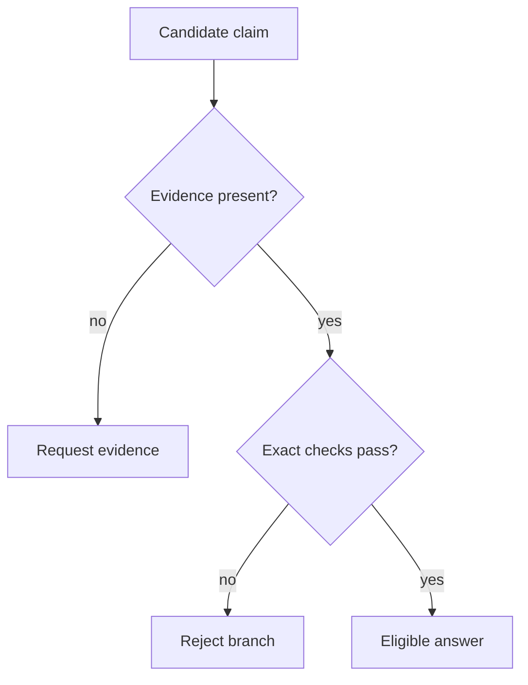
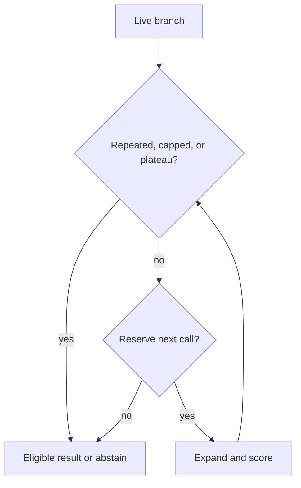

---
{
  "id": "design-reasoning-agent-test-time-compute",
  "slug": "design-reasoning-agent-test-time-compute",
  "title": "Reasoning Agent System Design",
  "shortDescription": "Tests pass, but canary latency spikes after a config change. Design an agent that gathers fresh evidence, spends extra reasoning only when needed, and recommends whether to hold, revert, or continue.",
  "difficulty": "Hard",
  "category": "System Design",
  "section": "AI System Design",
  "coverImage": "illustrations/_generated/reasoning_agent_dark.png",
  "companies": [
    "OpenAI",
    "Google",
    "Anthropic",
    "DeepSeek",
    "xAI",
    "Meta"
  ],
  "prerequisites": [
    "reasoning-models-test-time-compute",
    "inference-mechanics-ttft-tps-kv-cache",
    "chain-of-thought-advanced-prompting",
    "rlhf-dpo-aligning-language-models",
    "kv-cache-paged-attention-llm-serving",
    "prefix-caching-prompt-caching",
    "agentic-architectures-react-plan-execute",
    "agent-evaluation-benchmarks",
    "observability-monitoring-llm-systems"
  ],
  "relatedQuestions": [
    "design-real-time-voice-ai-agent",
    "continuous-batching-request-scheduling",
    "speculative-decoding",
    "design-code-completion-system"
  ],
  "order": 7,
  "keyConceptsTested": [
    "Test-Time Compute",
    "Reasoning Effort Budget",
    "Self-Consistency",
    "Overthinking",
    "Chain of Thought",
    "Tree of Thoughts",
    "Beam Search",
    "Monte Carlo Tree Search",
    "Reward Models",
    "Process Reward Models",
    "Production-Evaluation Gap",
    "KV Cache",
    "Value-Aware KV Eviction",
    "Recurrent-Depth Reasoning",
    "PagedAttention",
    "Compute-Optimal Inference",
    "Reasoning Traces"
  ]
}
---

A canary deployment sits at 10% traffic. <span data-glossary="smoke-test">Smoke tests</span> are green, yet one latency panel jumped right after a config flag enabled `parser-v2`. An automated advisor must recommend whether to revert, hold, or continue. Generating a fluent recommendation takes half a second. Earning a trustworthy one requires fetching live deployment state, smoke-test results, latency metrics, and the config diff, then spending extra <span data-glossary="test-time-compute">test-time compute</span> only if the fix itself requires exploring competing plans.

Standard decoding generates tokens strictly left to right. Reasoning models such as OpenAI's o1[^openai_o1_2024] and DeepSeek-R1[^deepseekai2025] spend additional internal compute before answering, yet native internal reasoning is distinct from an external controller that invokes tools, samples competing plans, prunes invalid branches, and enforces hard evidence checks. This chapter builds that controller from first principles.

## Fast answers do not guarantee safe deployment

If a model outputs "hold" before reading the metrics API, the recommendation is pure guesswork regardless of how long its hidden scratchpad ran. Single-pass decoding predicts the next <span data-glossary="token">token</span> from text already in context; it cannot verify external truth on its own.

Treat hard decisions as a **budgeted search and verification problem**. **Test-time compute** is the extra FLOPs and tokens spent during inference after training finishes. Snell et al. showed that pairing a smaller model with an adaptive test-time strategy (trained revision models and verifiers) can beat a 14x larger model on matched pretraining-plus-inference FLOPs for medium-difficulty math problems, while very hard prompts and heavy query volumes still favor the larger pretrained model.[^snell2024]

<figure>
  
  <figcaption>Reserve capacity against a shared request budget before dispatching calls so parallel branches and verifiers never overspend.</figcaption>
</figure>

A routing ceiling is a maximum budget, not a minimum spend. A simple threshold lookup needs no search tree; resolving a broken dependency graph may justify exploring several branches.

## The simplest form of extra compute: one deliberate path

When fresh tool observations settle the canary verdict directly, start with one deliberate path and a finite output limit. Classic Chain-of-Thought prompting asked models to "think step by step,"[^wei2022a] whereas modern reasoning APIs expose structured controls such as `reasoning.effort` (`none`, `low`, `medium`, `high`, `xhigh` on models like GPT-5.5), `reasoning.mode`, `reasoning.context`, and `max_output_tokens`.[^openai2026reasoning][^openai2026gpt55]

| Control | What it adjusts | Separate controls needed |
| :--- | :--- | :--- |
| `reasoning.effort` | Relative internal deliberation depth | Hard token, time, or dollar caps |
| `reasoning.mode` | Standard vs. extended execution tier | External search tree or evidence check |
| `reasoning.context` | Carrying opaque reasoning state across turns | Authenticated tool observations in app state |
| `max_output_tokens` | Per-call output limit (including hidden reasoning) | Shared multi-call budget or answer completion |

Keep hidden reasoning separate from outward evidence. Ask the model for concise XML milestones paired with a final answer, and let deterministic application code validate every external observation before releasing any advice.

<!-- leetllm: test, output=show -->
```python title="canary-evidence-check.py"
from dataclasses import dataclass, replace
import xml.etree.ElementTree as ET

@dataclass(frozen=True)
class Observation:
    deploy_id: str
    revision: int
    observed_at: int
    canary_percent: int
    smoke_passed: bool
    p95_ms: float

def parse_milestones(xml_text: str) -> tuple[list[str], str]:
    root = ET.fromstring(xml_text)
    if root.tag != "response":
        raise ValueError("expected <response> root")
    steps = [n.text.strip() for n in root.findall("checkpoint") if n.text and n.text.strip()]
    answer = (root.findtext("final_answer") or "").strip()
    if not answer:
        raise ValueError("missing final_answer")
    return steps, answer

def evaluate_canary(obs: Observation | None, now: int) -> dict[str, object]:
    if obs is None:
        return {"release": False, "reason": "missing_observation"}
    if (obs.deploy_id, obs.revision) != ("checkout-42", 7):
        return {"release": False, "reason": "wrong_deploy_or_revision"}
    if not (0 <= now - obs.observed_at <= 30):
        return {"release": False, "reason": "stale_observation"}
    if obs.canary_percent != 10 or obs.p95_ms < 0:
        return {"release": False, "reason": "invalid_observation"}
    if not obs.smoke_passed or obs.p95_ms >= 300:
        action = "revert"
    elif obs.p95_ms >= 200:
        action = "hold"
    else:
        action = "continue"
    return {"release": True, "action": action, "revision": obs.revision}

sample_xml = """<response>
  <checkpoint>Canary sits at 10% traffic with green smoke tests.</checkpoint>
  <checkpoint>p95 latency is 240 ms, between 200 ms hold and 300 ms revert limits.</checkpoint>
  <final_answer>Hold the canary at 10% and inspect the parser_v2 flag.</final_answer>
</response>"""

milestones, final = parse_milestones(sample_xml)
obs = Observation("checkout-42", 7, observed_at=100, canary_percent=10, smoke_passed=True, p95_ms=240)
print("milestones:", len(milestones), "| final:", final)
for label, item in [("fresh_240ms", obs), ("spike_300ms", replace(obs, p95_ms=300)),
                    ("stale_obs", replace(obs, observed_at=60)), ("wrong_rev", replace(obs, revision=6))]:
    print(f"{label:12s}: {evaluate_canary(item, now=110)}")
```

<!-- leetllm: output:start -->
```text title="Output" output compact
milestones: 2 | final: Hold the canary at 10% and inspect the parser_v2 flag.
fresh_240ms : {'release': True, 'action': 'hold', 'revision': 7}
spike_300ms : {'release': True, 'action': 'revert', 'revision': 7}
stale_obs   : {'release': False, 'reason': 'stale_observation'}
wrong_rev   : {'release': False, 'reason': 'wrong_deploy_or_revision'}
```
<!-- leetllm: output:end -->

A parsed milestone only checks output shape; actual release eligibility comes from the verified tool record (`release=True` grants an advisory response, while an automated deployment action still needs its own permission check and idempotency key).



## Comparing complete candidates: Best-of-N sampling

When multiple mitigations look plausible, generate $N$ complete candidates with nonzero <span data-glossary="temperature">temperature</span> and select the best survivor using an exact checker or learned verifier.

### Why this helps: a worked example

Suppose a single attempt produces a valid mitigation plan with probability $p = 0.30$. Across $N = 5$ independent draws, the probability that at least one candidate succeeds is:

$$
P(\text{at least one success}) = 1 - (1 - p)^N = 1 - (1 - 0.30)^5 = 0.832
$$

Two sharp limits apply in production. First, `0.832` is **candidate-set coverage**, not returned accuracy: the system only wins if the verifier can recognize the winning candidate, and shared prompts often correlate model errors so draws are not truly independent. Second, optimizing a proxy <span data-glossary="reward-model">reward model</span> too hard backfires: Gao et al. showed that as Best-of-N grows, proxy scores keep climbing while true ("gold") reward peaks and then drops (reward overoptimization).[^gao2023scaling] Whenever an exact constraint check exists, filter with the exact check *before* ranking by proxy score.

For very small $p$ (such as $10^{-20}$), direct floating-point `1 - (1 - p)**n` loses precision because `1 - p` rounds to `1.0`. Computing `-math.expm1(n * math.log1p(-p))` avoids catastrophic cancellation.

<!-- leetllm: test, output=show -->
```python title="best-of-n-and-constraints.py"
import math

def coverage(p: float, n: int) -> float:
    if n == 0 or p == 0.0:
        return 0.0
    if p == 1.0:
        return 1.0
    return -math.expm1(n * math.log1p(-p))

candidates = [
    {"id": "A", "path": ["api", "legacy_adapter", "database"], "proxy_score": 0.96},
    {"id": "B", "path": ["api", "feature_flag", "database"], "proxy_score": 0.82},
]
allowed = {("api", "legacy_adapter"), ("legacy_adapter", "database"),
           ("api", "feature_flag"), ("feature_flag", "database")}
blocked = {("api", "legacy_adapter")}

def valid_path(path: list[str]) -> bool:
    edges = set(zip(path, path[1:]))
    return path[0] == "api" and path[-1] == "database" and edges <= allowed and not (edges & blocked)

eligible = [c for c in candidates if valid_path(c["path"])]
winner = max(eligible, key=lambda c: c["proxy_score"], default=None)

print(f"coverage(p=0.30, N=5): {coverage(0.30, 5):.3f}")
print(f"stable_rare_coverage(p=1e-20, N=100): {coverage(1e-20, 100):.1e}")
print("winner_after_exact_check:", winner["id"], f"(proxy={winner['proxy_score']})")
```

<!-- leetllm: output:start -->
```text title="Output" output compact
coverage(p=0.30, N=5): 0.832
stable_rare_coverage(p=1e-20, N=100): 1.0e-18
winner_after_exact_check: B (proxy=0.82)
```
<!-- leetllm: output:end -->

Even though candidate A scored `0.96` on the learned proxy, it traverses a blocked legacy edge and drops out, letting valid candidate B win.

### Self-consistency: Best-of-N without a reward model

When outputs normalize to comparable answers (numbers, SQL results, labels), **self-consistency** samples $N$ traces and returns the majority answer without needing a reward model.[^wang2023] Voting amplifies accuracy when correct answers cluster more tightly than mistakes, but it fails whenever the model repeats the same systematic error across samples.

### Where beam search fits

Token-level beam search keeps the top-$k$ highest-probability partial continuations at each step. It batches cleanly on GPUs, yet its top-$k$ branches often collapse into minor phrasings of one hypothesis. Use it as a pruning baseline rather than a substitute for diverse multi-step exploration.

## When one path isn't enough: exploring a tree

The canary is held, and profiling links the spike to `parser-v2`. Now the agent must pick a safe dependency fix satisfying Python runtime floors, API compatibility, and security advisories. If a branch pins `parser-v2` and later discovers a removed runtime API, it has to backtrack.

**Tree of Thoughts (ToT)** turns multi-step planning into explicit tree search over intermediate states: generate candidate next actions, reject hard constraint violations immediately, score surviving states, and expand only promising branches.[^yao2023]

<figure>
  
  <figcaption>Pinning nightly fails immediately on the runtime floor. Parser-v2 expands into a valid shim and an invalid removed-API call; parser-v1 plus a sanitizer patch reaches the highest-scoring valid plan.</figcaption>
</figure>

Keep completed valid plans in a separate pool from unfinished frontier nodes so another expansion round never overwrites a finished solution.

### When revisiting branches beats a fixed beam

Breadth-first beam search is easy to batch on GPUs, but pruning is irreversible. When search depth varies sharply or verifier calls are expensive, <span data-glossary="monte-carlo-tree-search">Monte Carlo tree search (MCTS)</span> lets the controller revisit promising earlier nodes using the AlphaZero **PUCT** selection rule:[^silver2017]

$$
\text{PUCT}(s, a) = Q(s, a) + c_{\text{puct}} \cdot P(s, a) \cdot \frac{\sqrt{N(s)}}{1 + N(s, a)}
$$

Here $Q(s, a)$ is the estimated value of taking action $a$ from state $s$, $P(s, a)$ is the model prior, $N(s)$ and $N(s, a)$ are parent and child visit counts, and $c_{\text{puct}}$ balances exploration against exploitation. For example, with $Q = 0.5$, $c_{\text{puct}} = 1$, $P = 0.2$, $N(s) = 16$, and $N(s, a) = 1$, $\text{PUCT} = 0.5 + 0.2 \cdot 4 / 2 = 0.9$.

<!-- leetllm: test, output=show -->
```python title="tree-search-and-puct.py"
import math
from dataclasses import dataclass

EXPANSIONS = {
    "start": ["Pin parser v2", "Pin parser nightly", "Keep parser v1"],
    "Pin parser v2": ["A.1 add compatibility shim", "A.2 call removed API"],
    "Keep parser v1": ["C.1 patch sanitizer", "C.2 defer security fix"],
}
SCORES = {
    "Pin parser v2": 0.74, "Pin parser nightly": 0.12, "Keep parser v1": 0.81,
    "A.1 add compatibility shim": 0.70, "A.2 call removed API": 0.18,
    "C.1 patch sanitizer": 0.96, "C.2 defer security fix": 0.39,
}
INVALID = {"Pin parser nightly", "A.2 call removed API", "C.2 defer security fix"}
COMPLETE = {"A.1 add compatibility shim", "C.1 patch sanitizer"}

@dataclass
class Node:
    text: str
    score: float
    parent: "Node | None" = None

    def path(self) -> list[str]:
        return [self.text] if self.parent is None else self.parent.path() + [self.text]

def beam_tot(width: int = 2, min_score: float = 0.35, max_depth: int = 2) -> list[str] | None:
    frontier, completed = [Node("start", 1.0)], []
    for _ in range(max_depth):
        kids = [Node(ch, SCORES[ch], n) for n in frontier for ch in EXPANSIONS.get(n.text, [])]
        valid = sorted((k for k in kids if k.text not in INVALID and k.score >= min_score),
                       key=lambda n: n.score, reverse=True)
        completed.extend(k for k in valid if k.text in COMPLETE)
        frontier = [k for k in valid if k.text not in COMPLETE][:width]
        if not frontier:
            break
    best = max(completed, key=lambda n: n.score, default=None)
    return best.path() if best else None

def puct(q: float, p: float, n_parent: int, n_child: int, c: float = 1.0) -> float:
    return q + c * p * math.sqrt(n_parent) / (1 + n_child)

print("beam_winner:", beam_tot())
print(f"puct(A: Q=.45, P=.25, n=2 | N=9): {puct(0.45, 0.25, 9, 2):.3f}")
print(f"puct(B: Q=.60, P=.10, n=0 | N=9): {puct(0.60, 0.10, 9, 0):.3f}")
```

<!-- leetllm: output:start -->
```text title="Output" output compact
beam_winner: ['start', 'Keep parser v1', 'C.1 patch sanitizer']
puct(A: Q=.45, P=.25, n=2 | N=9): 0.700
puct(B: Q=.60, P=.10, n=0 | N=9): 0.900
```
<!-- leetllm: output:end -->

Notice that `C.2 defer security fix` clears the `0.35` proxy score (`0.39`) yet is still pruned because hard constraints always run ahead of proxy scores.

## Who judges the plans? Verifiers and reward models

Search only improves accuracy if the selector recognizes valid plans. Use deterministic checkers (unit tests, type checkers, dependency solvers, schema checks) whenever they exist. Where objective checkers are unavailable, learned verifiers fill the gap in two forms:

- **Outcome Reward Model (ORM):** Trained on final-answer correctness; cheaper to annotate, yet it only scores after an entire trajectory finishes.
- **<span data-glossary="process-reward-model">Process Reward Model (PRM)</span>:** Trained on intermediate step labels (such as PRM800K's 800,000 step labels[^lightman2023]), enabling early pruning mid-trajectory before wasted tokens accumulate.

### How a PRM works

For a binary correctness head over hidden state $h_t$ after step $t$, the step probability is:

$$
P(\text{positive} \mid \text{context}, s_{1 \dots t}) = \sigma(W \cdot h_t)
$$

where $\sigma$ is the sigmoid function. Treat raw outputs as ranking signals until held-out <span data-glossary="calibration">calibration</span> checks confirm probability accuracy. Step labels come from human annotators, Monte Carlo completion rates ($M/N$ simulated trajectories reaching a verified answer), or vetted teacher models.

Pruning only saves compute when evaluated online during generation. In the generator loop below, step 3 fails both the exact API check and the PRM threshold, halting execution before step 4 is ever requested:

<!-- leetllm: test, output=show -->
```python title="how-a-prm-works.py"
requested = []

def step_stream():
    for step, prm_score, exact_ok in [
        ("Parse manifest", 0.92, True),
        ("Pin parser v2", 0.74, True),
        ("Call removed API", 0.15, False),
        ("Recommend deployment", 0.85, True),
    ]:
        requested.append(step)
        yield step, prm_score, exact_ok

def run_with_pruning(stream, min_score: float = 0.35):
    checked = []
    for step, score, exact_ok in stream:
        checked.append((step, score, exact_ok))
        if not exact_ok or score < min_score:
            return "pruned", checked
    return "completed", checked

status, trace = run_with_pruning(step_stream())
print(f"status: {status} | steps_requested: {len(requested)} of 4")
for step, score, ok in trace:
    print(f"  {step:22s} score={score:.2f} exact_ok={ok}")
```

<!-- leetllm: output:start -->
```text title="Output" output compact
status: pruned | steps_requested: 3 of 4
  Parse manifest         score=0.92 exact_ok=True
  Pin parser v2          score=0.74 exact_ok=True
  Call removed API       score=0.15 exact_ok=False
```
<!-- leetllm: output:end -->

### ORM vs PRM at a glance

| Feature | Outcome Reward Model (ORM) | Process Reward Model (PRM) |
| :--- | :--- | :--- |
| **Scoring unit** | Complete solution | Individual reasoning step |
| **Feedback density** | Sparse (one label per trace) | Dense (one label per step) |
| **Search utility** | Reranks finished candidates | Prunes broken branches mid-generation |
| **Labeling cost** | Lower per trace | Higher; requires step labels or Monte Carlo traces |

<figure>
  
  <figcaption>Outcome-only scoring pays for step 4 before rejecting the branch. Stepwise scoring plus exact checks halts immediately at step 3, preserving budget for valid branches.</figcaption>
</figure>

## A correct answer can hide a broken evaluator

An evaluator that sees the final answer can rationalize broken intermediate steps. Sun et al. tested Valid-Answer-Invalid-Reasoning (VAIR) math traces and found that even a frontier model (GPT-5.4) scored only 47.9% grading flawed derivations that happened to end on the right number, driven by **answer confirmation bias**.[^sun2026productionevaluation]

Test every learned verifier against four diagnostic slices before letting it steer search:

| Diagnostic test | Failure exposed |
| :--- | :--- |
| Valid answer, flawed intermediate step | Judge trusts endpoint and rationalizes bad reasoning |
| Wrong answer, sound early steps | Judge rejects reusable partial prefixes |
| Hide final answer until step verdicts lock | Final-answer leakage into step grading |
| Perturb final answer with identical trace | Verdict flips on the endpoint rather than the proof |

### Training reasoning models with RL

Reinforcement learning improves the base generator directly so it requires less external search at test time. DeepSeek-R1 popularized **<span data-glossary="grpo">Group Relative Policy Optimization (GRPO)</span>**, which removes the separate value-critic network required by <span data-glossary="ppo">PPO</span> by sampling a group of outputs per prompt, scoring each with exact verifiers or reward models, and updating weights relative to the group mean reward.[^deepseekai2025] Better RL training raises single-pass accuracy, yet production systems still need difficulty routing, hard budgets, exact checks, and KV capacity planning.

## Putting it together: a production reasoning agent

Combine routing, search, verification, and safe progress streaming into one coherent runtime.

### What the system must handle

One agent serves easy runbook lookups, medium canary triage, and hard dependency resolution. Candidate state, tool results, and verification verdicts live outside the model's hidden scratchpad so every tier obeys the same evidence requirements. Define target concurrency, quality lift over single-pass baselines, <span data-glossary="p95-latency">p95 latency</span>, and per-request cost per lane before tuning multipliers.

### Architecture overview

A single gateway and difficulty router dispatch requests into three lanes: a fast single pass, a medium Best-of-3 lane, and a capped tree-search lane. All three converge at one verifier before any advisory leaves the system.

<figure>
  
  <figcaption>Route by difficulty first so easy queries stay cheap, then rejoin every lane at one shared verifier before releasing a recommendation.</figcaption>
</figure>

<figure>
  
  <figcaption>Share the canary prompt and tool context once across branches, spend extra KV memory only on surviving suffixes, and release one evidence-backed hold.</figcaption>
</figure>

### The difficulty router

A lightweight router assigns each query a strategy and shared <span data-glossary="token-budget">token budget</span> covering both generator and verifier outputs. In production, train a fast classifier on prompt length, tool requirements, historical verifier failure rates, and domain tags, evaluating both under-routing misses and over-routing cost. Under-routing may cause a slower retry or abstention, but it never weakens the downstream evidence check.

### Escalation is a measured policy

Snell et al. demonstrated that no single inference strategy wins across every difficulty level.[^snell2024] An <span data-glossary="inference-scheduler">inference scheduler</span> escalates only when the first pass is weak, the task is verifiable, and extra compute pays for itself: stop immediately on exact completion, escalate to Best-of-3 for ambiguous verifiable cases, escalate to tree search when backtracking matters, and hand off unverifiable high-impact requests to tools or human review.

Every live branch also needs explicit stop conditions: repeated semantic state, token cap, wall-clock deadline, or a verifier score plateau where recent steps fail to beat the earlier best.



## Reserving the request budget

Checking token spend *after* parallel calls return lets bursts overrun the budget. Reserve each call's worst-case output allowance up front so `spent + reserved <= cap` holds at every step. When call A reserves 1,500 tokens from a 4,000-token cap and finishes using 900, settling it returns 600 unused tokens so call C can proceed. If a call times out with unknown backend usage, keep its reservation locked until usage or cancellation reconciles.

> **Common mistake:** Treating `status="incomplete"` (for example, hitting `max_output_tokens`) as a usable advisory just because partial text like `"Hold"` arrived. Require both `status == "completed"` and passing external evidence checks before releasing an answer.[^openai2026reasoning]

<!-- leetllm: test, output=show -->
```python title="reserve-budget-and-stop-rules.py"
class TokenBudget:
    def __init__(self, cap: int):
        self.cap, self.spent = cap, 0
        self.pending: dict[str, int] = {}
        self.finished: dict[str, int] = {}

    @property
    def available(self) -> int:
        return self.cap - self.spent - sum(self.pending.values())

    def reserve(self, call_id: str, maximum: int) -> bool:
        if call_id in self.pending or call_id in self.finished or maximum > self.available:
            return False
        self.pending[call_id] = maximum
        return True

    def settle(self, call_id: str, used: int) -> None:
        if call_id in self.finished:
            return
        maximum = self.pending[call_id]
        if used > maximum:
            raise ValueError("backend exceeded reserved maximum")
        self.pending.pop(call_id)
        self.finished[call_id] = used
        self.spent += used

def stop_reason(tokens: int, cap: int, elapsed_ms: int, deadline_ms: int,
                repeated: bool, scores: list[float]) -> str:
    if repeated:
        return "repeated_state"
    if tokens >= cap:
        return "token_cap"
    if elapsed_ms >= deadline_ms:
        return "wall_clock_cap"
    if len(scores) >= 4 and max(scores[-3:]) <= max(scores[:-3]):
        return "score_plateau"
    return "continue"

budget = TokenBudget(4_000)
r = [budget.reserve("a", 1_500), budget.reserve("b", 1_500), budget.reserve("c", 1_500)]
budget.settle("a", 900)
r.append(budget.reserve("c", 1_500))

print("reservations:", r, f"| spent={budget.spent}, reserved={sum(budget.pending.values())}, free={budget.available}")
print("plateau_check:", stop_reason(2500, 4000, 1800, 3000, False, [0.72, 0.70, 0.71, 0.69]))
print("improving_chk:", stop_reason(900, 4000, 500, 3000, False, [0.61, 0.64, 0.60, 0.59]))
```

<!-- leetllm: output:start -->
```text title="Output" output compact
reservations: [True, True, False, True] | spent=900, reserved=3000, free=100
plateau_check: score_plateau
improving_chk: continue
```
<!-- leetllm: output:end -->

## KV cache limits live branch width

Test-time search stresses GPU memory just as hard as compute. Every live token in a full-attention <span data-glossary="transformer">transformer</span> stores key and value <span data-glossary="vector">vectors</span> at every layer, multiplying across concurrent search branches.

### KV cache pressure

For a uniform full-attention model with $L$ layers, $H_{kv}$ KV heads (smaller than query heads under <span data-glossary="grouped-query-attention">grouped-query attention (GQA)</span>), head width $d_{\text{head}}$, and element width $b$ bytes:

$$
\text{KV bytes per token} = 2 \cdot L \cdot H_{kv} \cdot d_{\text{head}} \cdot b
$$

For an 80-layer model with 8 KV heads, $d_{\text{head}} = 128$, and <span data-glossary="bf16">BF16</span> ($b = 2$):

$$
2 \cdot 80 \cdot 8 \cdot 128 \cdot 2 = 327{,}680\text{ bytes/token} = 320\text{ KiB/token}
$$

One 16,384-token (`16k`) branch consumes 5.0 GiB of KV memory. Without sharing, eight live branches consume **40.0 GiB** before model weights or activations.

### Prefix sharing and paged KV storage

Sibling branches in Best-of-N and tree search share the same prompt and early tool context. <span data-glossary="vllm">vLLM</span>'s **<span data-glossary="pagedattention">PagedAttention</span>** allocates KV memory in non-contiguous blocks with copy-on-write sharing,[^kwon2023pagedattention] while <span data-glossary="sglang">SGLang</span>'s **<span data-glossary="radixattention">RadixAttention</span>** indexes reusable prefixes in a radix tree.[^zheng2024sglang]

If eight 16k branches share a 12,288-token stem and diverge for 4,096 tokens each, total distinct slots drop from $8 \times 16{,}384 = 131{,}072$ down to $12{,}288 + 8 \times 4{,}096 = 45{,}056$, cutting KV memory from **40.0 GiB to 13.75 GiB** (roughly 14 GiB). Free a shared KV page only after both its branch reference count reaches zero and any in-flight GPU reads finish.

<figure>
  
  <figcaption>Sharing a 12k-token stem across eight 16k branches reduces logical KV storage from 40 GiB to 13.75 GiB when the serving engine supports prefix sharing.</figcaption>
</figure>

<!-- leetllm: test, output=show -->
```python title="kv-cache-and-streaming.py"
def kv_gib(layers: int, kv_heads: int, head_dim: int, bytes_per_elem: int, total_slots: int) -> float:
    bytes_per_tok = 2 * layers * kv_heads * head_dim * bytes_per_elem
    return (bytes_per_tok * total_slots) / (1024 ** 3)

unshared = kv_gib(80, 8, 128, 2, total_slots=8 * 16_384)
shared = kv_gib(80, 8, 128, 2, total_slots=12_288 + 8 * 4_096)
print(f"8x16k unshared KV: {unshared:.2f} GiB")
print(f"12k stem + 8x4k:   {shared:.2f} GiB (saved {(1 - shared / unshared):.1%})")

# Safe progress stream exposes verified milestones while stripping internal verifier scores.
raw_events = [
    {"type": "progress", "content": "checked canary status", "internal_score": 0.82},
    {"type": "progress", "content": "verified latency thresholds", "internal_score": 0.91},
    {"type": "final_answer", "content": "Hold canary at 10% and inspect parser_v2.", "internal_score": 0.88},
]
public_stream = [{"type": e["type"], "content": e["content"]} for e in raw_events]
print("public_stream_keys:", [sorted(e.keys()) for e in public_stream])
```

<!-- leetllm: output:start -->
```text title="Output" output compact
8x16k unshared KV: 40.00 GiB
12k stem + 8x4k:   13.75 GiB (saved 65.6%)
public_stream_keys: [['content', 'type'], ['content', 'type'], ['content', 'type']]
```
<!-- leetllm: output:end -->

### Compression needs value awareness; recurrent depth changes architecture

Prefix sharing deduplicates stems, yet surviving suffixes still grow. Lossy KV eviction can cap memory, but dropping rare high-magnitude value states triggers repetitive loops; Value-Aware Stochastic KV Cache Eviction (VaSE) protects those critical value entries and adds stochastic eviction to avoid collapse.[^chang2026vase] Recurrent-depth models take an architectural approach instead, looping a shared latent block per token with shared KV state and <span data-glossary="speculative-decoding">speculative decoding</span> rather than emitting thousands of visible chain-of-thought tokens.[^geiping2025recurrentdepth]

| Mitigation | Works on standard checkpoints? | Primary risk |
| :--- | :--- | :--- |
| Prefix sharing + paged KV | Yes, with runtime support | Incompatible keys or cross-tenant reuse |
| Value-aware KV eviction | Sometimes, with custom attention | Evicting reasoning-critical constraints |
| Recurrent depth | No; requires purpose-trained model | Different training and serving stack |

### First update vs final-answer latency

Long hidden thinking inflates raw <span data-glossary="ttft">time-to-first-token (TTFT)</span>. Streaming status updates fixes perceived responsiveness, yet a fast status message can hide a 25-second final answer. Track model TTFT, first-update latency, and final-answer latency separately.

### A sample capacity plan

Using the 320 KiB/token rate above, logical KV memory scales steeply with branch width before accounting for model weights, workspaces, or concurrency:

| Workload | Live branches | Context per branch | Unshared KV |
| :--- | :---: | :---: | :---: |
| Single path | 1 | 8,192 tokens | 2.5 GiB |
| Best-of-4 | 4 | 8,192 tokens | 10.0 GiB |
| Tree search | 8 | 16,384 tokens | 40.0 GiB |

### Streaming safe updates

Stream strategy selection, budget usage, and summaries derived strictly from completed tool checks. Strip raw scratchpads and uncalibrated `internal_score` floats from user-facing streams so downstream clients never confuse an internal ranking heuristic for verified confidence.

## When reasoning is the wrong tool

Before adding search, ask whether extra inference can uncover evidence or only generate more text:

- **Source-of-truth lookups** (such as a runbook threshold) need direct retrieval, not multi-branch thinking.
- **Missing observations** need tool calls; longer thought cannot invent a telemetry panel you never queried.
- **Open-ended copywriting** without an objective rubric rarely justifies PRM tree search.
- **Latency-critical or huge batch jobs** can lose far more in tail latency or dollar cost than a marginal accuracy gain returns.

### Overthinking: when more thinking lowers accuracy

More thinking tokens are not monotonically better. Ghosal et al. showed that forcing longer reasoning chains on DeepSeek-R1 distilled models raises accuracy up to a point and then *degrades* it as output uncertainty grows, while parallel traces with majority voting beat forced sequential extension at the same token budget.[^ghosal2025overthinking] Stop as soon as exact checks pass or verified progress plateaus.

## Why a bigger model isn't enough

| Lever | Cost shape | Flexibility |
| :--- | :--- | :--- |
| **Larger base model** | Higher steady-state cost on every request | Fixed after deployment |
| **Test-time compute** | Extra latency and tokens on hard requests only | Dynamic per prompt via router and budgets |

Test-time search amplifies an existing capability; it cannot conjure knowledge the base model lacks completely. When a small model has near-zero pass rate even across many samples, upgrade the base model or add external tools instead of multiplying search depth.[^snell2024]

## Common pitfalls

### "Higher temperature will reveal a great answer if I sample enough"

Diversity without a reliable verifier only produces more creative errors. Raise temperature only when an exact checker or calibrated verifier can separate valid traces from fluent mistakes.

### "Tree search is always better than single-path reasoning"

Running tree search on easy queries burns latency and GPU memory with zero accuracy lift. Route by difficulty and escalate only when the first pass falls short.

### "More thinking always improves the answer"

Overthinking turns valid initial answers into second-guessed mistakes. Stop on exact check completion, enforce hard token and wall-clock caps, and keep the highest-ranked completed survivor.

### "One budget policy can serve every request"

Uniform ceilings starve hard debugging tasks while letting trivial FAQs burn deep budgets. Set token caps, branch width, and wall-clock limits per difficulty tier.

### "Users need raw chain-of-thought to trust the system"

Raw scratchpads are verbose, unstable, and unsafe to parse downstream. Stream concise progress milestones grounded in actual tool calls and keep internal search traces private.

### "Reasoning quality comes only from prompts"

Prompt tweaks plateau quickly on multi-step constraints. Separate the levers: base model competence, search algorithm, verifier accuracy, KV prefix sharing, and stop criteria.

### "Stop criteria are an optional cleanup detail"

Without repeated-state detection, depth limits, and shared reservations, cyclic branches exhaust tokens and wall-clock deadlines silently. Enforce hard stops before every expansion and return only completed, checked plans.

## Defending the design

### Evaluation rubric

- **Foundational:** Derive the 240 ms hold vs. 300 ms revert decision from fresh revision-7 observations, and separate advisory output from production execution permissions.
- **Intermediate:** Run exact constraint checks ahead of proxy scores, isolate completed solutions from unfinished frontier nodes, and maintain `spent + reserved <= cap` across retries and timeouts.
- **Advanced:** Derive 40.0 GiB vs. 13.75 GiB of logical KV memory, explain reference-count and in-flight read safety for KV page reuse, and design a cost-matched evaluation comparing single-path against Best-of-3.

### Follow-up questions

- **Incomplete frontier at depth 1:** If a dependency beam returns zero completed plans at depth 1, never relabel the best partial pin as complete. Expand another level only if remaining budget allows; otherwise abstain or hand off.
- **Proving Best-of-3 earns its cost:** Freeze evidence snapshots, split distinct incidents across dev and held-out sets, and compare single-path vs. Best-of-3 at matched total generator-plus-verifier cost, reporting accuracy, abstentions, latency, and false verifier acceptance separately.

```mastery-quiz
[
  {
    "question": "Under canary rule v3, observations must match revision 7 and be 0 to 30 seconds old inclusive. For valid records, failed smoke tests or p95 >= 300 ms means revert; p95 >= 200 ms means hold; lower means continue. At now = 200 s, record A (rev 7, observed 170 s, smoke passed, p95 199 ms) and record B (rev 7, observed 169 s, smoke passed, p95 350 ms) arrive. What follows?",
    "options": [
      "A: hold; B: revert.",
      "A: continue; B: revert.",
      "A: continue; B: withhold and refresh.",
      "A: hold; B: withhold and refresh."
    ],
    "answer": "A: continue; B: withhold and refresh.",
    "explanation": "A is 30 seconds old (within 0..30) with p95 199 ms (< 200 ms), so advise continue. B is 31 seconds old (stale), so withhold advice and request fresh telemetry even though its reading is 350 ms."
  },
  {
    "question": "Three independent attempts each succeed with probability 0.40. What are the candidate-set coverage and selection rule?",
    "options": [
      "Coverage 0.784; returned accuracy still depends on the verifier selecting a right answer.",
      "Coverage 0.784; returned accuracy is guaranteed to be 0.784 for any selector.",
      "Coverage 0.216; returned accuracy still depends on the verifier.",
      "Coverage 1.200; returned accuracy becomes 1.000."
    ],
    "answer": "Coverage 0.784; returned accuracy still depends on the verifier selecting a right answer.",
    "explanation": "1 - (1 - 0.40)^3 = 1 - 0.216 = 0.784 is the probability at least one candidate is correct; final accuracy still requires the verifier to pick it."
  },
  {
    "question": "Using PUCT = Q + c * P * sqrt(N) / (1 + n) with c = 1 and parent visits N = 9, child A has Q = 0.45, P = 0.25, n = 2 and child B has Q = 0.60, P = 0.10, n = 0. Which scores and choice follow?",
    "options": [
      "A 0.95; B 0.90; choose A.",
      "A 0.70; B 0.70; tie.",
      "A 0.575; B 0.75; choose B.",
      "A 0.70; B 0.90; choose B."
    ],
    "answer": "A 0.70; B 0.90; choose B.",
    "explanation": "A = 0.45 + 0.25 * 3 / 3 = 0.70. B = 0.60 + 0.10 * 3 / 1 = 0.90. Choose B."
  },
  {
    "question": "A search holds completed valid plan C (proxy 0.72) and unfinished plan F (proxy 0.95). Remaining budget allows zero further expansions. What should the controller return?",
    "options": [
      "Return F because 0.95 is higher.",
      "Return C because F has not completed required checks.",
      "Return F because budget expiry marks it complete.",
      "Return neither because F outscores C."
    ],
    "answer": "Return C because F has not completed required checks.",
    "explanation": "Completion and exact verification always precede proxy scores. Budget expiry never turns an unfinished branch into a valid plan."
  },
  {
    "question": "Three finished drafts arrive: A contains only spaces (evidence passed), B says `Hold the canary.` (evidence passed), and C says `Hold the canary.` (evidence failed). Which drafts may release?",
    "options": [
      "Release A and B; withhold C.",
      "Withhold A; release B and C.",
      "Release all three.",
      "Withhold A; release B; withhold C."
    ],
    "answer": "Withhold A; release B; withhold C.",
    "explanation": "Only B is completed, non-empty, and backed by passing external evidence."
  },
  {
    "question": "A 5,000-token request budget reserves 1,800 for A and 1,700 for B. A settles at 1,100 used. B times out with unknown usage. C requests 2,200. What happens?",
    "options": [
      "Allow C; 0 tokens remain free while B stays reserved.",
      "Reject C; 1,500 tokens remain free while B stays reserved.",
      "Allow C; 1,700 tokens remain free because B timed out.",
      "Reject C; 2,200 tokens remain free."
    ],
    "answer": "Allow C; 0 tokens remain free while B stays reserved.",
    "explanation": "Available capacity is 5,000 - 1,100 (spent) - 1,700 (still reserved for timed-out B) = 2,200. C fits exactly, leaving 0 free."
  },
  {
    "question": "A uniform full-attention model has 24 layers, 4 KV heads, head width 64, and 2 bytes/element. Four branches hold 8,192 tokens each. With prefix sharing, they share one 4,096-token stem plus four 4,096-token suffixes. What are the unshared and shared KV sizes?",
    "options": [
      "Unshared 768 MiB; shared 192 MiB.",
      "Unshared 384 MiB; shared 240 MiB.",
      "Unshared 768 MiB; shared 480 MiB.",
      "Unshared 480 MiB; shared 768 MiB."
    ],
    "answer": "Unshared 768 MiB; shared 480 MiB.",
    "explanation": "KV per token = 2 * 24 * 4 * 64 * 2 = 24,576 bytes (24 KiB). Unshared: 4 * 8,192 * 24 KiB = 768 MiB. Shared: (4,096 + 4 * 4,096) * 24 KiB = 480 MiB."
  },
  {
    "question": "Shared KV pages P and Q each have an active GPU read. P loses its last branch reference at 4 ms and its read ends at 9 ms. Q loses its last branch reference at 12 ms and its read ends at 7 ms. When can the allocator safely reuse P and Q?",
    "options": [
      "4 ms and 12 ms",
      "9 ms and 12 ms",
      "9 ms and 7 ms",
      "4 ms and 7 ms"
    ],
    "answer": "9 ms and 12 ms",
    "explanation": "A page is safe to reclaim only once both its branch references reach zero AND all in-flight GPU reads finish: max(4, 9) = 9 ms for P and max(12, 7) = 12 ms for Q."
  },
  {
    "question": "An evaluator accepts 15 of 20 flawed derivations that reach the right final answer, while a solver answers 14 of 16 ordinary problems correctly. What are the evaluator's false acceptance rate and the solver's accuracy?",
    "options": [
      "75% and 87.5%",
      "93.75% and 70%",
      "75% and 70%",
      "93.75% and 87.5%"
    ],
    "answer": "75% and 87.5%",
    "explanation": "False acceptance is 15/20 = 75%; solver accuracy is 14/16 = 87.5%. Keep each metric over its own denominator."
  },
  {
    "question": "A plateau rule stops a branch when the max of its latest three scores does not exceed its earlier best. Branch A scored [0.61, 0.64, 0.60, 0.59] and branch B scored [0.80, 0.78, 0.79, 0.77]. What follows?",
    "options": [
      "Stop A; stop B.",
      "Stop A; continue B.",
      "Continue A; continue B.",
      "Continue A; stop B."
    ],
    "answer": "Continue A; stop B.",
    "explanation": "For A, max(0.64, 0.60, 0.59) = 0.64 > 0.61, so A continues. For B, max(0.78, 0.79, 0.77) = 0.79 <= 0.80, so B stops for plateau."
  }
]
```

> **Next:** Continue to [AI Lab Coding Interview: Python Systems](/learn/ai-lab-coding-interview-python-systems).
