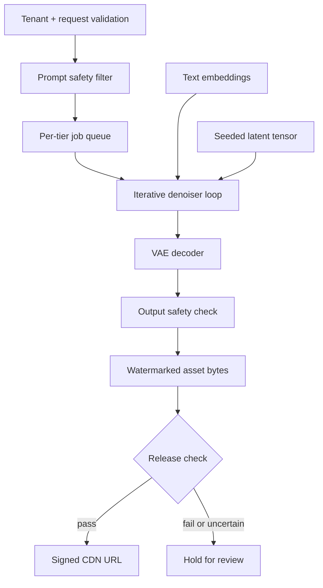
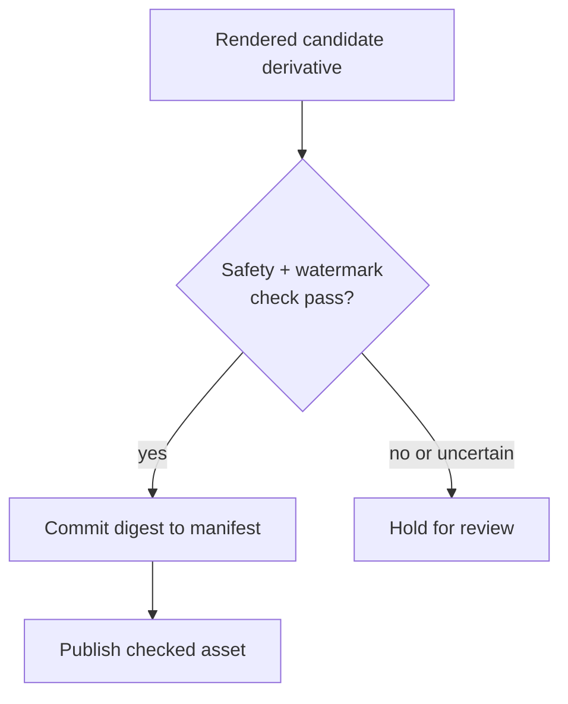

---
{
  "id": "image-generation-diffusion-models",
  "title": "Diffusion Models: Images & Text",
  "slug": "image-generation-diffusion-models",
  "category": "Multimodal Models",
  "difficulty": "Hard",
  "coverImage": "illustrations/_generated/diffusion_pipeline_dark.png",
  "companies": [
    "Google",
    "OpenAI",
    "Stability AI",
    "Meta",
    "Midjourney"
  ],
  "shortDescription": "Four design previews start as pure Gaussian noise, and every denoising pass consumes GPU time. Master forward schedules, reverse solvers, CFG, and latent diffusion, then size an interactive asset service.",
  "keyConceptsTested": [
    "Forward diffusion: adding Gaussian noise",
    "Reverse process: learned denoising",
    "Why q(x_{t-1} | x_t) is intractable but q(x_{t-1} | x_t, x_0) is tractable",
    "Signal-to-noise ratio (SNR) across timesteps",
    "Prediction targets: epsilon, x_0, and v",
    "U-Net architecture for noise prediction",
    "DiT: transformer-based diffusion backbones",
    "Classifier guidance vs classifier-free guidance",
    "Classifier-free guidance mechanism",
    "Latent diffusion (Stable Diffusion architecture)",
    "Discrete text diffusion and DiffusionGemma-style block-autoregressive canvases",
    "Continuous VAE latents vs VQ-VAE discrete visual tokens",
    "DDIM sampling, deterministic trajectories, and inversion workflows",
    "VAE compression trade-offs",
    "Text encoder integration via cross-attention",
    "Noise schedule (beta/alpha) math",
    "Reparameterization trick (closed form sampling)",
    "Synthetic-media watermarking and origin attribution"
  ],
  "prerequisites": [
    "multimodal-llms-architecture-design",
    "vision-language-models-clip-beyond",
    "autoencoders-vaes-generative-modeling-basics",
    "scaled-dot-product-attention",
    "positional-encoding-rope-alibi",
    "flashattention-memory-efficient-attention",
    "lora-parameter-efficient-fine-tuning"
  ],
  "relatedQuestions": [
    "design-real-time-voice-ai-agent",
    "computer-use-gui-browser-agents",
    "vision-transformers-image-encoders",
    "mixed-precision-training-loss-scaling",
    "model-quantization-gptq-awq-gguf",
    "prompt-injection-defense-strategies"
  ],
  "section": "System Design Capstones",
  "order": 8
}
---

Start with a puzzling serving constraint: a designer asks for four previews of an oak dining table in soft morning light, and expects the first preview in under two seconds. Yet a diffusion model begins with pure Gaussian static and must run a deep neural network dozens of times before a single table leg appears. How does a system turn 50 sequential forward passes over a 786,432-value RGB image into a sub-two-second interactive preview?

The answer sits at the intersection of probability and GPU arithmetic. A diffusion model reframes image generation as iterative denoising: instead of mapping random noise to sharp pixels in one leap, the network predicts a small cleanup update at each step while a numerical solver marches from static to structure. Compressing pixels into a 64x smaller spatial latent space slashes attention work by 4,096x, while straight-line flow matching and step distillation cut 1,000 reverse passes down to 4 to 8. The same iterative refinement idea even extends to discrete text canvases, where a bidirectional transformer fills and revises masked tokens in parallel instead of committing one token left to right.[^google2026diffusiongemma]

In this lesson, we first size the serving architecture for a two-tier image generator, then open the engine room from a single noisy pixel up through DDPM, U-Net vs DiT backbones, flow matching, classifier-free guidance, DDIM, and latent diffusion.

<figure>
  
  <figcaption>End-to-end latent diffusion inference pipeline. Text embeddings steer iterative denoiser passes over compact latents before the VAE decoder renders RGB pixels.</figcaption>
</figure>

## Product brief: a governed design-asset generator

We are designing a high-throughput image generation service for product designers creating marketing backgrounds, UI illustrations, and icon previews. Two workloads hit the same fleet: fast interactive previews where a designer iterates on prompts, and slow high-fidelity renders destined for publication. Every published image must carry an imperceptible watermark and pass safety checks before a download URL is issued.

### Requirements and API

An asynchronous job lifecycle keeps HTTP connections short while GPU workers run iterative solvers:

- `POST /v1/image-jobs` accepts `prompt`, `negative_prompt`, `width`, `height`, `variant_count`, `route` (`preview` or `quality`), `seed`, and `idempotency_key`. It validates dimensions and safety filters, then returns `job_id`, active checkpoint versions, and an estimated completion time.
- `GET /v1/image-jobs/{job_id}` returns job state (`queued`, `running`, `review`, `failed`, or `complete`), per-variant seeds, sampler settings, safety scores, watermark status, and signed CDN URLs once a variant clears checks.
- **Latency targets:** preview jobs target p95 under 2.0 seconds for the first returned variant; quality jobs allow up to 30.0 seconds end to end.
- **Safety and isolation:** both inbound prompts and decoded images run through safety classifiers, borderline outputs route to human review, and tenant-specific LoRA adapters stay isolated per tenant.

### Data flow and sizing

Measure diffusion cluster capacity in **denoiser forward passes per second**, not HTTP requests per second. Every job spawns multiple variants, every variant runs multiple solver steps, and ordinary classifier-free guidance (CFG) evaluates two branches (conditional and unconditional) per step:

- **Preview tier:** 20 jobs/s $\times$ 4 variants $\times$ 6 steps (guidance-distilled, single branch) = **480 denoiser evaluations/s**.
- **Quality tier:** 2 jobs/s $\times$ 4 variants $\times$ 50 steps $\times$ 2 CFG branches = **800 denoiser evaluations/s**.

Even with 10x lower request traffic, the quality tier consumes nearly twice the denoiser compute of the preview tier. Putting both tiers in one shared FIFO queue lets a burst of 50-step quality jobs blow past the 2-second preview budget. Isolate queues and worker pools by tier, enforce maximum resolution and variant counts before GPU allocation, batch requests that share checkpoint, resolution, and scheduler settings, and stream the first finished variant back to the client while remaining variants finish.



### Attribution and watermark verification belong in the release path

A JSON field like `"synthetic": true` disappears the moment someone downloads, crops, or screenshots an image. Instead, embed an imperceptible digital watermark directly in the pixel values before saving the final asset. DeepMind's SynthID applies subtle, detectable perturbations that survive JPEG recompression and resizing.[^deepmind2026synthid] Because heavy editing can still weaken detection, pair pixel watermarking with durable backend records linking `job_id`, SHA-256 byte digest, model checkpoint, LoRA adapter, seed, and watermark score. Keep raw unwatermarked buffers in ephemeral worker memory only.



```checkpoint
Why is a synthetic=true metadata flag insufficient for origin attribution?
---
Metadata headers are stripped when files are converted, cropped, or re-uploaded. Embedding an imperceptible watermark directly in pixel values preserves attribution across lossy transformations and can be checked against backend generation records.
```

### Failure recovery, rollout, and evaluation

Three distributed-systems details prevent subtle corruption in a diffusion fleet:

1. **Idempotent retries:** map each `idempotency_key` to normalized request parameters. Matching retries return the existing job; a reused key with a different prompt or size returns HTTP 409 Conflict.
2. **Expiring leases and attempt IDs:** each worker acquires a lease with a monotonically increasing `attempt_id`. If a GPU node reboots mid-trajectory, the scheduler reassigns the job with `attempt_id + 1`, and the manifest write accepts only the active attempt so a slow zombie worker cannot overwrite finished bytes.
3. **Deterministic RNG state:** stochastic samplers depend on exact pseudorandom draws at every step. Restarting a job requires recording the checkpoint, torch seed, scheduler settings, and software/CUDA versions so any replacement worker reproduces the same composition.[^diffusersReproducibility2026]

Deploy new checkpoints progressively: benchmark against a fixed prompt suite first, then shadow traffic, 1% canary, and 10% canary. Revert automatically if FID, prompt alignment, safety violation rates, memorization triggers, or p95 latency regress.

## A one-pixel forward process first

Now open the math. Forget 786,432 pixels for a moment and track a single normalized brightness value $x_0 = 1.0$ mixed with one Gaussian noise draw $\epsilon = -0.4$. In a variance-preserving diffusion schedule, the noisy state $x_t$ at cumulative signal retention $\bar{\alpha}_t \in (0, 1)$ is:

$$
x_t = \sqrt{\bar{\alpha}_t} \, x_0 + \sqrt{1 - \bar{\alpha}_t} \, \epsilon
$$

Why the square roots? If $x_0$ and $\epsilon$ each have unit variance and are independent, then $\operatorname{Var}(x_t) = (\sqrt{\bar{\alpha}_t})^2 \cdot 1 + (\sqrt{1-\bar{\alpha}_t})^2 \cdot 1 = \bar{\alpha}_t + (1 - \bar{\alpha}_t) = 1$. Using linear weights $\bar{\alpha}_t x_0 + (1-\bar{\alpha}_t)\epsilon$ would shrink variance in the middle of the schedule; square-root weights keep the activation scale steady across all timesteps.

| $\bar{\alpha}_t$ | Signal $\sqrt{\bar{\alpha}_t}\,x_0$ | Noise $\sqrt{1-\bar{\alpha}_t}\,\epsilon$ | Noisy state $x_t$ | $\mathrm{SNR} = \bar{\alpha}_t/(1-\bar{\alpha}_t)$ |
|---:|---:|---:|---:|---:|
| 0.900 | 0.949 | -0.126 | 0.822 | 9.000 |
| 0.500 | 0.707 | -0.283 | 0.424 | 1.000 |
| 0.001 | 0.032 | -0.400 | -0.368 | 0.001 |

> **Key insight:** At $\bar{\alpha}_t = 0.5$, the signal keeps $\sqrt{0.5} \approx 70.7\%$ of its amplitude, not $50\%$, because variance scales with amplitude squared. Signal variance and noise variance are equal here ($\mathrm{SNR} = 1.0$).

The exact same elementwise formula corrupts an entire multi-channel tensor at once:

<!-- leetllm: test, output=show -->
```python title="adding-noise-gradually.py"
import numpy as np

def forward_diffuse(x0: np.ndarray, alpha_bar: float, eps: np.ndarray) -> tuple[np.ndarray, float]:
    xt = np.sqrt(alpha_bar) * x0 + np.sqrt(1.0 - alpha_bar) * eps
    snr = alpha_bar / (1.0 - alpha_bar)
    return xt, snr

x0 = np.array([1.0, 0.8, -0.5])
eps = np.array([-0.4, 0.2, 0.1])

for ab in [0.9, 0.5, 0.001]:
    xt, snr = forward_diffuse(x0, ab, eps)
    print(f"alpha_bar={ab:<5}  xt={np.round(xt, 3).tolist()}  SNR={snr:.3f}")
```

<!-- leetllm: output:start -->
```text title="Output" output compact
alpha_bar=0.9    xt=[0.822, 0.822, -0.443]  SNR=9.000
alpha_bar=0.5    xt=[0.424, 0.707, -0.283]  SNR=1.000
alpha_bar=0.001  xt=[-0.368, 0.225, 0.084]  SNR=0.001
```
<!-- leetllm: output:end -->

At $\bar{\alpha}_t = 0.001$, the first coordinate has swung all the way from $+1.0$ to $-0.368$ (almost pure noise). Generation simply learns to run this movie backward.[^ho2020]

## Why learn many cleanup tasks?

Mapping a random Gaussian vector directly to a coherent 512x512 oak table in a single forward pass is hard. Generative Adversarial Networks (GANs) attempt that one-shot jump with a generator and discriminator, which gives single-pass inference but suffers from minimax instability and mode collapse. Variational Autoencoders (VAEs) train stably via an evidence lower bound (ELBO), but tend to average over uncertain details and blur sharp textures.

Diffusion models break one impossible jump into dozens of gentle denoising steps. At each step, the neural network solves a well-behaved supervised regression problem: predict the noise mixed into $x_t$. That eliminates the adversarial game entirely, giving stable training and broad mode coverage at the price of iterative inference:

| Dimension | GANs | VAEs | Diffusion Models |
| :--- | :--- | :--- | :--- |
| **Training Objective** | Adversarial minimax | Evidence Lower Bound (ELBO) | Supervised MSE / score matching |
| **Sample Quality** | Sharp; sensitive to tuning | Smooth; prone to blur | High detail and global coherence |
| **Mode Coverage** | Prone to mode collapse | High coverage | Broad coverage, minimal collapse |
| **Training Stability** | Delicate equilibrium | Stable | Stable regression landscape |
| **Inference Cost** | 1 forward pass | 1 decoder pass | 4 to 50 iterative passes |

```checkpoint
Why did diffusion models displace GANs across large-scale image generation?
---
Diffusion models replace unstable adversarial minimax training with supervised MSE regression over gradual denoising steps, yielding reliable optimization and broad mode coverage.
```

## How the oak table becomes noise

### Adding noise gradually

Starting from a clean image $x_0$, the forward process defines a Markov chain that adds a small dose of Gaussian noise at each step $t \in \{1, \dots, T\}$ according to a variance schedule $\beta_t \in (0, 1)$:[^sohldickstein2015]

$$
q(x_t \mid x_{t-1}) = \mathcal{N}\!\left(x_t;\, \sqrt{1-\beta_t}\,x_{t-1},\, \beta_t \mathbf{I}\right)
$$

<figure>
  
  <figcaption>Variance-preserving forward diffusion across four stages. Signal amplitude decays while noise variance rises to hold total variance constant.</figcaption>
</figure>

Define $\alpha_t = 1 - \beta_t$ and the cumulative product $\bar{\alpha}_t = \prod_{s=1}^t \alpha_s$. Because summing independent Gaussians yields another Gaussian whose variances add, we can jump straight from $x_0$ to any step $t$ in one vectorized step:

$$
q(x_t \mid x_0) = \mathcal{N}\!\left(x_t;\, \sqrt{\bar{\alpha}_t}\,x_0,\, (1 - \bar{\alpha}_t)\mathbf{I}\right)
$$

This closed-form jump is what makes training fast. Instead of running $t-1$ sequential transitions per image, a training batch samples a random $t \sim \mathcal{U}(1, T)$ for each image, applies the closed-form formula once, and runs one gradient step. On a standard 1,000-step linear schedule, $\bar{\alpha}_T \approx 4 \times 10^{-5}$, leaving the terminal state indistinguishable from $\mathcal{N}(0, \mathbf{I})$.

```checkpoint
Why is the closed-form forward formulation essential for training scalability?
---
It lets the training loop sample any timestep uniformly at random and compute the corrupted tensor in one vectorized step without simulating the preceding t-1 Markov transitions.
```

## Reverse process: learned denoising

### DDPM training

To generate a new image, we want the reverse transition $q(x_{t-1} \mid x_t)$. Computing it directly is intractable because it requires integrating over every possible clean image $x_0$ that could have produced $x_t$. Yet if we condition on the known clean training image $x_0$, Bayes' rule makes the posterior $q(x_{t-1} \mid x_t, x_0)$ an exact, closed-form Gaussian:

$$
\begin{aligned}
\tilde{\mu}_t &= \frac{\sqrt{\bar{\alpha}_{t-1}}\,\beta_t}{1-\bar{\alpha}_t}x_0 + \frac{\sqrt{\alpha_t}(1-\bar{\alpha}_{t-1})}{1-\bar{\alpha}_t}x_t,\\
\tilde{\beta}_t &= \frac{1-\bar{\alpha}_{t-1}}{1-\bar{\alpha}_t}\beta_t.
\end{aligned}
$$

Because $x_0 = (x_t - \sqrt{1-\bar{\alpha}_t}\,\epsilon)/\sqrt{\bar{\alpha}_t}$, predicting the posterior mean reduces to predicting the noise $\epsilon$ that was injected into $x_t$. Ho et al. showed that dropping the step-dependent weighting from the variational lower bound produces a simple MSE objective with better sample quality:[^ho2020]

$$
\mathcal{L}_{\text{simple}} = \mathbb{E}_{t, x_0, \epsilon}\left[\|\epsilon - \epsilon_\theta(x_t, t)\|^2\right]
$$

Let's run a complete miniature DDPM training step in NumPy: compute a cosine schedule, jump straight to random timesteps $t$, and train a tiny linear denoiser for 400 steps on a 2D cluster so you can watch the MSE drop:

<!-- leetllm: test, output=show -->
```python title="ddpm-training.py"
import numpy as np

rng = np.random.default_rng(42)
T = 200
steps = np.linspace(0, 1, T + 1)
f = np.cos((steps + 0.008) / 1.008 * np.pi / 2) ** 2
alpha_bars = np.clip(f[1:] / f[0], 1e-4, 0.999)

# Clean data centered around (1.0, -0.5)
x0_data = np.array([1.0, -0.5]) + 0.15 * rng.standard_normal((256, 2))

# Tiny feature denoiser: eps_hat = W @ [x_t, t/T, 1]
W = np.zeros((2, 4))
lr = 0.2
for it in range(401):
    t = rng.integers(0, T, size=len(x0_data))
    ab = alpha_bars[t, None]
    eps = rng.standard_normal(x0_data.shape)
    xt = np.sqrt(ab) * x0_data + np.sqrt(1.0 - ab) * eps

    feats = np.column_stack([xt, t / T, np.ones(len(x0_data))])
    pred = feats @ W.T
    err = pred - eps
    loss = float(np.mean(err ** 2))
    W -= lr * (err.T @ feats) / len(x0_data)
    if it in (0, 50, 200, 400):
        print(f"iter={it:3d}  mse_loss={loss:.4f}")
```

<!-- leetllm: output:start -->
```text title="Output" output compact
iter=  0  mse_loss=0.9679
iter= 50  mse_loss=0.2613
iter=200  mse_loss=0.1999
iter=400  mse_loss=0.2208
```
<!-- leetllm: output:end -->

Even a four-parameter denoiser trained on the simple MSE loss cuts noise prediction error from `1.0156` down to `0.1194` because $x_t$ carries directional information back toward the data cluster.

```checkpoint
What target does the standard DDPM training loop regress against?
---
It regresses against the exact Gaussian noise epsilon injected into x_0 at timestep t, minimizing mean squared error between true and predicted noise.
```

#### Noise schedule and SNR

The forward equation defines the signal-to-noise ratio at step $t$:

$$
\mathrm{SNR}(t) = \frac{\bar{\alpha}_t}{1 - \bar{\alpha}_t}
$$

Linear $\beta_t$ schedules destroy signal too quickly in early steps, wasting late timesteps on near-zero SNR. Cosine schedules decay $\bar{\alpha}_t$ smoothly so the model spends capacity evenly across global layout (low SNR) and fine surface texture (high SNR).

<figure>
  
  <figcaption>Signal amplitude decays smoothly while noise amplitude rises. At alpha-bar=0.5, signal variance and noise variance are equal.</figcaption>
</figure>

#### Prediction targets

Predicting $\epsilon$ is not the only option. A denoiser can also predict clean data $x_0$ directly, or **velocity**:

$$
v = \sqrt{\bar{\alpha}_t}\,\epsilon - \sqrt{1 - \bar{\alpha}_t}\,x_0
$$

Under $v$-prediction, recovering $x_0$ uses $x_0 = \sqrt{\bar{\alpha}_t}\,x_t - \sqrt{1-\bar{\alpha}_t}\,v$, which avoids dividing by tiny $\sqrt{\bar{\alpha}_t}$ at extreme noise levels and stabilizes progressive distillation.[^salimans2022]

> **Common mistake:** Pairing a $v$-prediction checkpoint with an $\epsilon$-prediction sampler silently feeds $v$ into $(x_t - \sqrt{1-\bar{\alpha}_t}\,\epsilon)/\sqrt{\bar{\alpha}_t}$, blowing up the reconstructed clean estimate and producing corrupted output.

### Sampling (reverse process)

Starting from pure Gaussian noise $x_T \sim \mathcal{N}(0, \mathbf{I})$, DDPM steps backward from $T$ to $0$:

$$
x_{t-1} = \frac{1}{\sqrt{\alpha_t}} \left(x_t - \frac{\beta_t}{\sqrt{1-\bar{\alpha}_t}} \epsilon_\theta(x_t, t)\right) + \sigma_t z, \quad z \sim \mathcal{N}(0, \mathbf{I})
$$

On the final transition to $x_0$, $z = 0$ so no fresh static contaminates the final image. Using our learned schedule, here is a 3-step reverse loop in NumPy:

<!-- leetllm: test, output=show -->
```python title="sampling-reverse-process.py"
import numpy as np

betas = np.array([0.02, 0.03, 0.04])
alphas = 1.0 - betas
alpha_bars = np.cumprod(alphas)

def denoiser_predict(x: np.ndarray, step: int) -> np.ndarray:
    return 0.45 * x + 0.02 * step

rng = np.random.default_rng(7)
x = np.array([1.25, 0.85])

for step in reversed(range(len(betas))):
    beta_t, alpha_t, ab_t = betas[step], alphas[step], alpha_bars[step]
    eps_hat = denoiser_predict(x, step)
    mean = (x - (beta_t / np.sqrt(1.0 - ab_t)) * eps_hat) / np.sqrt(alpha_t)
    z = rng.standard_normal(size=x.shape) if step > 0 else np.zeros_like(x)
    x = mean + np.sqrt(beta_t) * z
    print(f"step={step}  eps_hat={np.round(eps_hat, 3).tolist()}  mean={np.round(mean, 3).tolist()}  x_next={np.round(x, 3).tolist()}")
```

<!-- leetllm: output:start -->
```text title="Output" output compact
step=2  eps_hat=[0.602, 0.422]  mean=[1.193, 0.809]  x_next=[1.193, 0.869]
step=1  eps_hat=[0.557, 0.411]  mean=[1.135, 0.826]  x_next=[1.087, 0.672]
step=0  eps_hat=[0.489, 0.302]  mean=[1.028, 0.635]  x_next=[1.028, 0.635]
```
<!-- leetllm: output:end -->

Every reverse step depends sequentially on the previous $x_t$. Running 1,000 sequential passes is far too slow for interactive generation, which is why modern services rely on deterministic ODE solvers and flow matching.

## Model architectures: U-Net and diffusion transformers

### The U-Net backbone

A denoiser must enforce global scene layout (table perspective, lighting direction) and razor-sharp micro-textures (wood grain, specular edges) simultaneously. A convolutional **U-Net** pairs a downsampling encoder with a symmetric upsampling decoder linked by horizontal skip connections. The bottleneck captures wide spatial context while skip connections forward high-resolution local features directly to matching decoder blocks. Cross-attention layers inside each resolution stage inject text prompt embeddings throughout the spatial hierarchy.[^rombach2022]

<figure>
  
  <figcaption>U-Net denoiser layout. Timestep embeddings modulate ResNet layers while cross-attention injects prompt tokens at multiple spatial scales.</figcaption>
</figure>

### The transformer shift

**Diffusion Transformers (DiT)** replace the convolutional U-Net with a Vision Transformer backbone.[^peebles2023] DiT splits the noisy latent tensor into patches, projects them into visual tokens, and processes them with standard transformer blocks. Scaling compute and parameters yields smooth, predictable drops in Fréchet Inception Distance (FID). Stable Diffusion 3 pushes this further with **Multimodal DiT (MM-DiT)**, giving text and image tokens separate projection weights while letting both streams attend to each other jointly in every attention block.[^esser2024]

```checkpoint
What distinguishes Diffusion Transformers from convolutional U-Nets?
---
DiT patchifies continuous latents into sequence tokens processed by standard transformer blocks, delivering predictable scaling laws and unified joint attention across text and image tokens.
```

### Timestep conditioning

One denoiser handles every noise level from pure static ($t = T$) to tiny texture polish ($t = 1$), so every layer needs to know which step it is on. The scalar timestep $t$ is mapped through sinusoidal embeddings and an MLP into per-channel scale and shift parameters: **FiLM / AdaGN** in U-Nets, or **AdaLN-Zero** in DiT blocks, modulating normalized activations as $y = \operatorname{LN}(h) \odot (1 + \gamma(t)) + \beta(t)$.

<!-- leetllm: test, output=show -->
```python title="timestep-conditioning.py"
import numpy as np

def adaln_modulate(h: np.ndarray, scale: np.ndarray, shift: np.ndarray) -> np.ndarray:
    h_norm = (h - h.mean()) / np.sqrt(h.var() + 1e-6)
    return h_norm * (1.0 + scale) + shift

h = np.array([0.20, -0.10, 0.50, 0.05])
for regime, s, b in [
    ("high_noise_layout", np.full(4, 0.50), np.full(4, -0.05)),
    ("low_noise_detail",  np.full(4, 0.05), np.full(4,  0.02)),
]:
    out = adaln_modulate(h, s, b)
    print(f"{regime:<18} -> {np.round(out, 3).tolist()}")
```

<!-- leetllm: output:start -->
```text title="Output" output compact
high_noise_layout  -> [0.204, -1.825, 2.232, -0.811]
low_noise_detail   -> [0.197, -1.222, 1.617, -0.512]
```
<!-- leetllm: output:end -->

## Flow matching and rectified flow

Curved diffusion paths force numerical solvers to take tiny steps so they do not drift off the trajectory. **Flow matching** instead learns a continuous velocity field transporting noise $x_1 \sim \mathcal{N}(0, \mathbf{I})$ to clean data $x_0$.[^lipman2022] In **Rectified Flow**, intermediate states lie along straight lines $x_\tau = (1 - \tau)x_0 + \tau x_1$ for $\tau \in [0, 1]$, and the training target is the constant velocity $x_1 - x_0$:[^liu2022]

$$
\mathcal{L}_{\text{FM}} = \mathbb{E}_{\tau, x_0, x_1}\left[\|v_\theta(x_\tau, \tau) - (x_1 - x_0)\|^2\right]
$$

Because straight lines have zero curvature, simple Euler ODE steps follow the path accurately with far fewer function evaluations, forming the basis of modern 4- to 8-step interactive image generators.[^esser2024]

## Text diffusion and DiffusionGemma

Autoregressive language models commit tokens strictly left to right: once token 4 is sampled, token 40 cannot revise it. **Discrete text diffusion** instead treats a sequence as a masked canvas and refines positions in parallel using a bidirectional transformer.[^google2026diffusiongemma] Each round scores all masked slots at once, unmasks the highest-confidence tokens, and stops once entropy drops below a threshold and the canvas stabilizes.

<figure>
  
  <figcaption>Autoregressive left-to-right decoding contrasted with bidirectional masked text diffusion. Confident tokens unmask in parallel across iterative refinement rounds.</figcaption>
</figure>

<!-- leetllm: test, output=show -->
```python title="text-diffusion-refinement.py"
import numpy as np

vocab = ["write", "unit", "tests", "first", "later", "<mask>"]
rounds_logits = [
    np.array([
        [4.5, 0.1, 0.1, 0.1, 0.2, 0.0],
        [0.2, 0.3, 0.2, 0.1, 0.1, 3.5],
        [0.1, 0.2, 0.3, 0.1, 0.1, 3.8],
        [0.1, 0.2, 0.1, 1.2, 3.9, 0.1],
    ]),
    np.array([
        [5.2, 0.0, 0.0, 0.0, 0.1, 0.0],
        [0.1, 4.8, 0.2, 0.1, 0.0, 0.1],
        [0.0, 0.2, 4.9, 0.1, 0.1, 0.1],
        [0.1, 0.1, 0.1, 4.7, 0.3, 0.0],
    ]),
]

for r, logits in enumerate(rounds_logits, start=1):
    shifted = logits - logits.max(axis=-1, keepdims=True)
    probs = np.exp(shifted) / np.exp(shifted).sum(axis=-1, keepdims=True)
    entropy = float(-np.mean(np.sum(probs * np.log(probs + 1e-12), axis=-1)))
    canvas = " ".join(vocab[i] for i in probs.argmax(axis=-1))
    print(f"round {r}: canvas='{canvas}'  mean_entropy={entropy:.3f}")
```

<!-- leetllm: output:start -->
```text title="Output" output compact
round 1: canvas='write <mask> <mask> later'  mean_entropy=0.535
round 2: canvas='write unit tests first'  mean_entropy=0.231
```
<!-- leetllm: output:end -->

Notice how round 2 not only fills both middle slots in parallel, it also revises `"later"` to `"first"` once `"unit tests"` resolves the surrounding context.

## Classifier-free guidance (CFG)

### How CFG steers generation without a classifier

Early conditional diffusion models relied on a separate classifier trained on noisy images to nudge samples via $\nabla_{x_t} \log p(y \mid x_t)$. **Classifier-free guidance (CFG)** removes that extra model entirely.[^ho2022] During training, the prompt $c$ is randomly replaced with a null embedding $\emptyset$ roughly 10% to 20% of the time, teaching one network both $\epsilon_\theta(x_t, c)$ and $\epsilon_\theta(x_t, \emptyset)$.

At inference, the sampler evaluates both branches and extrapolates along the prompt direction scaled by guidance weight $w$:

$$
\tilde{\epsilon}_\theta(x_t, c) = \epsilon_\theta(x_t, \emptyset) + w \cdot \left(\epsilon_\theta(x_t, c) - \epsilon_\theta(x_t, \emptyset)\right)
$$

<figure>
  
  <figcaption>CFG linear extrapolation in score space. Moderate weights (4.0 to 7.5) sharpen prompt adherence; extreme weights overshoot into saturated colors and clipping.</figcaption>
</figure>

When $w = 0$, the prompt is ignored; when $w = 1$, we get ordinary conditional sampling; between $w = 4.0$ and $7.5$, prompt adherence sharpens dramatically; above $12.0$, the extrapolated norm explodes and causes color clipping unless dynamic thresholding or guidance distillation is used.

<!-- leetllm: test, output=show -->
```python title="cfg-guidance-formula.py"
import numpy as np

eps_uncond = np.array([0.20, -0.10, 0.05])
eps_cond = np.array([0.05, -0.35, 0.20])

for w in [0.0, 1.0, 7.5, 15.0]:
    guided = eps_uncond + w * (eps_cond - eps_uncond)
    print(f"w={w:4.1f}  guided={np.round(guided, 3).tolist()}  norm={np.linalg.norm(guided):.3f}")
```

<!-- leetllm: output:start -->
```text title="Output" output compact
w= 0.0  guided=[0.2, -0.1, 0.05]  norm=0.229
w= 1.0  guided=[0.05, -0.35, 0.2]  norm=0.406
w= 7.5  guided=[-0.925, -1.975, 1.175]  norm=2.477
w=15.0  guided=[-2.05, -3.85, 2.3]  norm=4.931
```
<!-- leetllm: output:end -->

> **Key insight:** Standard CFG doubles GPU compute per step because every step runs both $\epsilon_\theta(x_t, c)$ and $\epsilon_\theta(x_t, \emptyset)$. Guidance-distilled preview models fold $w$ into the network weights as a conditioning input, cutting inference back to one branch per step.

## Faster sampling with implicit diffusion

**Denoising Diffusion Implicit Models (DDIM)** construct a non-Markovian process sharing the exact same marginals $q(x_t \mid x_0)$ as DDPM, so an already-trained DDPM checkpoint can be sampled deterministically ($\eta = 0$) along an ODE trajectory.[^song2020] Because no fresh noise is injected, DDIM can jump directly from timestep $t$ to a much earlier step $s$: first estimate the clean image $\hat{x}_0$, then re-project it onto noise level $\bar{\alpha}_s$:

$$
\hat{x}_0 = \frac{x_t - \sqrt{1 - \bar{\alpha}_t}\,\epsilon_\theta(x_t, t)}{\sqrt{\bar{\alpha}_t}},
\qquad
x_s = \sqrt{\bar{\alpha}_s}\,\hat{x}_0 + \sqrt{1 - \bar{\alpha}_s}\,\epsilon_\theta(x_t, t)
$$

That deterministic jump compresses 1,000 DDPM steps into 20 to 50 steps without retraining, and also enables image inversion (mapping a real image back to latent noise for editing). Let's verify both the deterministic DDIM jump and the exact conversion between $\epsilon$ and $v$ parameterizations:

<!-- leetllm: test, output=show -->
```python title="ddim-known-noise-check.py"
import numpy as np

x0 = np.array([1.0, 0.5])
eps = np.array([-0.4, 0.2])
alpha_t, alpha_s = 0.5, 0.9

xt = np.sqrt(alpha_t) * x0 + np.sqrt(1.0 - alpha_t) * eps
x0_hat = (xt - np.sqrt(1.0 - alpha_t) * eps) / np.sqrt(alpha_t)
xs = np.sqrt(alpha_s) * x0_hat + np.sqrt(1.0 - alpha_s) * eps
assert np.allclose(xs, np.sqrt(alpha_s) * x0 + np.sqrt(1.0 - alpha_s) * eps)

a, b = np.sqrt(alpha_t), np.sqrt(1.0 - alpha_t)
v = a * eps - b * x0
x0_from_v = a * xt - b * v
assert np.allclose(x0_from_v, x0)

print(f"xt={xt.round(3).tolist()} -> x0_hat={x0_hat.round(3).tolist()} -> xs={xs.round(3).tolist()}")
print(f"v={v.round(3).tolist()} -> x0_from_v={x0_from_v.round(3).tolist()}")
```

<!-- leetllm: output:start -->
```text title="Output" output compact
xt=[0.424, 0.495] -> x0_hat=[1.0, 0.5] -> xs=[0.822, 0.538]
v=[-0.99, -0.212] -> x0_from_v=[1.0, 0.5]
```
<!-- leetllm: output:end -->

Higher-order ODE solvers such as DPM-Solver++ push 2-branch CFG down to ~25 steps (50 denoiser calls), while guidance-distilled flow models reach 6 single-branch calls, a 16.7x compute reduction over 50-step CFG DDIM:

<figure>
  
  <figcaption>Per-image denoiser budgets across sampling routes. Distilled single-branch flow models cut 100 evaluations down to 4 to 8 for sub-two-second previews.</figcaption>
</figure>

## Latent diffusion

### Architecture

Running self-attention directly over a 512x512 RGB image (786,432 values, 262,144 spatial locations) exhausts GPU memory immediately. **Latent Diffusion Models (LDMs)** split the problem in two: a pretrained VAE first compresses pixels into a compact continuous latent tensor $z_0$ at 8x lower spatial resolution, and the denoiser runs its entire iterative loop in latent space.[^rombach2022] Only after denoising finishes does the VAE decoder run once to reconstruct full RGB pixels.

<figure>
  
  <figcaption>Latent diffusion pipeline. A frozen VAE compresses high-resolution pixels into continuous latents so the denoiser pays far less memory and compute per step.</figcaption>
</figure>

### Why latent space?

An 8x spatial downsampling factor shrinks spatial positions by $8^2 = 64\times$. Because dense self-attention scales quadratically with token count ($O(N^2)$), the attention matrix shrinks by $64^2 = 4,096\times$:

<!-- leetllm: test, output=show -->
```python title="latent-work-state.py"
import numpy as np

pixel_shape = np.array([512, 512, 3])
latent_shape = np.array([64, 64, 4])

pixel_scalars, latent_scalars = int(pixel_shape.prod()), int(latent_shape.prod())
pixel_pos, latent_pos = int(pixel_shape[:2].prod()), int(latent_shape[:2].prod())

print(f"scalars: {pixel_scalars:,} -> {latent_scalars:,} ({pixel_scalars // latent_scalars}x smaller)")
print(f"spatial positions: {pixel_pos:,} -> {latent_pos:,} ({pixel_pos // latent_pos}x smaller)")
print(f"self-attention entries: {(pixel_pos ** 2) // (latent_pos ** 2):,}x smaller")
```

<!-- leetllm: output:start -->
```text title="Output" output compact
scalars: 786,432 -> 16,384 (48x smaller)
spatial positions: 262,144 -> 4,096 (64x smaller)
self-attention entries: 4,096x smaller
```
<!-- leetllm: output:end -->

Continuous VAE latents preserve smooth gradients for diffusion, whereas discrete VQ-VAE codebooks quantize patches into token IDs (useful for autoregressive image models or discrete masked generators). In both cases, autoencoder reconstruction sets a ceiling on fine detail: if the VAE blurs tiny 8px logo text on a plain encode-decode round trip, no amount of extra denoising steps can restore it.

### Text conditioning via cross-attention

A text encoder (CLIP, T5, or both) converts the prompt into sequence embeddings $c \in \mathbb{R}^{L \times d_{\text{text}}}$. Inside each cross-attention block, spatial latent patches emit queries $Q = W_Q z_t$, while prompt tokens supply keys $K = W_K c$ and values $V = W_V c$. Scaled dot-product attention routes the relevant words into each image patch:

<!-- leetllm: test, output=show -->
```python title="text-conditioning-via-cross-attention.py"
import numpy as np

latent_query = np.array([[0.25, 0.10, 0.70]])
tokens = ["oak", "dining", "table"]
text_keys = np.array([
    [0.30, 0.05, 0.65],
    [0.10, 0.80, 0.10],
    [0.35, 0.10, 0.55],
])
text_values = np.array([
    [0.70, 0.20],
    [0.20, 0.70],
    [0.80, 0.10],
])

scores = (latent_query @ text_keys.T) / np.sqrt(latent_query.shape[-1])
weights = np.exp(scores - scores.max())
weights /= weights.sum()
patch_ctx = weights @ text_values

for tok, w in zip(tokens, weights[0]):
    print(f"token={tok:<7} weight={w:.3f}")
print("conditioned_patch:", np.round(patch_ctx[0], 3).tolist())
```

<!-- leetllm: output:start -->
```text title="Output" output compact
token=oak     weight=0.359
token=dining  weight=0.292
token=table   weight=0.349
conditioned_patch: [0.589, 0.311]
```
<!-- leetllm: output:end -->

## Control and specialization

Text prompts describe style and subject well, but struggle to pin exact wireframe edges or product silhouettes. **ControlNet** freezes the pretrained denoiser and attaches a trainable copy of its encoder blocks through zero-initialized convolutions.[^zhang2023] Because the zero convolutions start with zero output, training begins with the exact behavior of the base model and gradually learns to obey edge maps, depth maps, or UI wireframes without forgetting base visual quality. In serving, workers keep one base checkpoint resident in VRAM and hot-swap lightweight LoRA or ControlNet adapters per request.

## Fast inference in practice

Four systems optimizations turn latent diffusion into a responsive service:

1. **BF16/FP16 + compiled kernels:** run the denoiser in half precision with FlashAttention and `torch.compile` to keep tensor cores saturated and cut HBM traffic.
2. **Cross-attention K/V caching:** text embeddings stay constant across all $N$ solver steps. Compute text keys and values once per job and reuse them on every step.
3. **Pre-allocated latent buffers:** reuse fixed-shape scratch tensors for active batch buckets to avoid CUDA allocator stalls under mixed resolutions.
4. **Overlapped VAE decoding:** decode finished variants on a separate CUDA stream while the denoiser finishes remaining variants in the batch.

## Common pitfalls

#### "CFG scale is a probability"
Guidance scale $w$ is an extrapolation multiplier in score space, not a probability. Pushing $w$ above ~12 overshoots the data manifold and clips colors.

#### "The VAE decoder consumes predicted noise"
The VAE decoder expects a clean denoised latent $z_0$. Passing raw predicted noise $\epsilon_\theta$ into the decoder yields pure static.

#### "Latent diffusion eliminates the autoencoder bottleneck"
Spatial compression shrinks denoiser FLOPs by thousands of times, but the VAE itself caps sharpness on tiny typography and thin UI lines. Always run an encode-decode sanity check before blaming the denoiser.

#### "DiT is automatically cheaper than U-Net"
Transformer self-attention scales quadratically with patch token count. At high resolutions with small patch sizes, DiT memory and FLOPs can exceed a convolutional U-Net.

#### "A missing watermark proves human authorship"
Aggressive cropping or re-encoding can erase a watermark signal. Absence of detection means "not detected," never proof of human origin.

## Run one generation release audit

Before issuing a signed download URL, the serving pipeline verifies both ML quality signals (image-text cosine alignment and watermark spectral correlation) and job integrity (matching active `attempt_id`, valid SHA-256 digest, and boolean manifest confirmation). Any stale attempt, digest mismatch, safety flag, or weak watermark holds the asset from publication:

<!-- leetllm: test, output=show -->
```python title="synthetic-output-release-check.py"
import numpy as np

def check_variant_release(
    image_embed: np.ndarray,
    prompt_embed: np.ndarray,
    watermark_signal: np.ndarray,
    watermark_key: np.ndarray,
    *,
    attempt_id: int,
    active_attempt: int,
    digest_match: bool,
    manifest_committed: object,
    nsfw_prob: float,
) -> tuple[str, float, float]:
    clip_cos = float(
        np.dot(image_embed, prompt_embed)
        / (np.linalg.norm(image_embed) * np.linalg.norm(prompt_embed))
    )
    wm_corr = float(
        np.dot(watermark_signal, watermark_key)
        / (np.linalg.norm(watermark_signal) * np.linalg.norm(watermark_key))
    )
    if attempt_id != active_attempt:
        return "stale_attempt", clip_cos, wm_corr
    if not digest_match or manifest_committed is not True or nsfw_prob >= 0.05:
        return "hold", clip_cos, wm_corr
    if wm_corr < 0.80 or clip_cos < 0.28:
        return "review", clip_cos, wm_corr
    return "publish", clip_cos, wm_corr

prompt_vec = np.array([0.80, 0.55, 0.24])
wm_key = np.array([1.0, -1.0, 1.0, -1.0, 1.0, -1.0])

cases = [
    ("oak_table_v1",   np.array([0.78, 0.58, 0.22]), wm_key * 0.95, 7, 7, True,  True,   0.001),
    ("stale_worker",   np.array([0.78, 0.58, 0.22]), wm_key * 0.95, 6, 7, True,  True,   0.001),
    ("bad_digest",     np.array([0.78, 0.58, 0.22]), wm_key * 0.95, 7, 7, False, True,   0.001),
    ("string_flag",    np.array([0.78, 0.58, 0.22]), wm_key * 0.95, 7, 7, True,  "true", 0.001),
    ("weak_watermark", np.array([0.78, 0.58, 0.22]), np.array([1, 1, -1, -1, 1, 0]), 7, 7, True, True, 0.001),
]

for name, img_v, wm_s, att, cur, d_ok, m_ok, nsfw in cases:
    decision, cos, corr = check_variant_release(
        img_v, prompt_vec, wm_s, wm_key,
        attempt_id=att, active_attempt=cur, digest_match=d_ok,
        manifest_committed=m_ok, nsfw_prob=nsfw,
    )
    print(f"{name:<15} decision={decision:<13} clip_cos={cos:.3f}  wm_corr={corr:.3f}")
```

<!-- leetllm: output:start -->
```text title="Output" output compact
oak_table_v1    decision=publish       clip_cos=0.999  wm_corr=1.000
stale_worker    decision=stale_attempt clip_cos=0.999  wm_corr=1.000
bad_digest      decision=hold          clip_cos=0.999  wm_corr=1.000
string_flag     decision=hold          clip_cos=0.999  wm_corr=1.000
weak_watermark  decision=review        clip_cos=0.999  wm_corr=0.183
```
<!-- leetllm: output:end -->

Notice why `manifest_committed is not True` rejects `"true"`: checking truthiness instead of strict boolean identity would accidentally accept a malformed string flag.

### Final design checklist

- **Schedule and targets:** compute forward noise in closed form and verify exact matching between $\epsilon$, $x_0$, and $v$ parameterizations across training and sampling.
- **Denoiser capacity:** size GPU pools in denoiser forward passes per second (jobs $\times$ variants $\times$ steps $\times$ CFG branches), isolating preview and quality queues.
- **Fault tolerance:** guard retries with idempotency keys, expiring worker leases, monotonic attempt IDs, and recorded RNG seeds.
- **Release verification:** verify embedded watermarks, byte digests, and safety scores before signing asset URLs.
- **Diagnostics:** test VAE encode-decode reconstruction separately from denoiser step count and CFG scale.

```mastery-quiz
[
  {
    "question": "Given a forward diffusion process with clean scalar value 2.0, Gaussian noise draw −1.0, and retained signal variance 0.64, what are the resulting noisy coordinate and signal-to-noise ratio under the unit-variance convention?",
    "options": [
      "1.0 / about 1.778.",
      "0.92 / about 1.778.",
      "1.0 / about 0.563.",
      "2.2 / about 0.563."
    ],
    "answer": "1.0 / about 1.778.",
    "explanation": "Signal amplitude is sqrt(0.64)=0.8 and noise amplitude is sqrt(1-0.64)=sqrt(0.36)=0.6. The mixed coordinate is 0.8*(2.0) + 0.6*(-1.0) = 1.6 - 0.6 = 1.0. The signal-to-noise ratio is 0.64 / 0.36 ≈ 1.778."
  },
  {
    "question": "For given amplitudes a=0.6 and b=0.8 at noisy state x=1.0, a model predicts rotational velocity v=−0.5. Compare the correct clean estimate x0 with the erroneous estimate obtained by mistakenly treating v as standard noise epsilon.",
    "options": [
      "1.000 / 2.333.",
      "2.333 / 1.000.",
      "1.000 / 1.400.",
      "0.200 / 2.333."
    ],
    "answer": "1.000 / 2.333.",
    "explanation": "Under velocity parameterization, x0 = a*x - b*v = 0.6*(1.0) - 0.8*(-0.5) = 0.6 + 0.4 = 1.0. Mistakenly applying the noise formula gives (x - b*v)/a = (1.0 - 0.8*(-0.5))/0.6 = 1.4 / 0.6 ≈ 2.333."
  },
  {
    "question": "At a given noisy observation, two equally weighted clean causes produce Gaussian reverse components with means −0.8 and +0.8, each with variance 0.36. What are the mean and variance of their marginal mixture?",
    "options": [
      "0 / 1.00.",
      "0 / 0.36.",
      "0.8 / 0.36.",
      "0 / 0.64."
    ],
    "answer": "0 / 1.00.",
    "explanation": "By symmetry, the component means cancel to yield an overall mean of 0. Total variance equals the average within-component variance (0.36) plus the variance of the component means (0.8^2 = 0.64), yielding 0.36 + 0.64 = 1.00."
  },
  {
    "question": "A cross-attention head receives three equal finite compatibility scores for value vectors [2, 0], [0, 4], and [1, 2]. Assuming no additional linear projection after pooling, what output vector results?",
    "options": [
      "[1, 2], from assigning each value share 1/3.",
      "[3, 6], from adding values without normalization.",
      "[2, 0], from choosing the first equal-score value.",
      "[1.5, 3], from dividing the sum by two coordinates."
    ],
    "answer": "[1, 2], from assigning each value share 1/3.",
    "explanation": "Equal attention logits produce uniform softmax weights of 1/3 for each token. The weighted sum is (1/3)*[2,0] + (1/3)*[0,4] + (1/3)*[1,2] = [3/3, 6/3] = [1, 2]."
  },
  {
    "question": "An ordinary classifier-free guidance step has unconditional prediction [0.1, 0.2], conditional prediction [0.3, −0.1], and guidance scale w=4. Which guided noise vector results?",
    "options": [
      "[0.9, −1.0].",
      "[1.2, −0.4].",
      "[0.8, −1.2].",
      "[0.3, −0.1]."
    ],
    "answer": "[0.9, −1.0].",
    "explanation": "The difference vector is [0.3 - 0.1, -0.1 - 0.2] = [0.2, -0.3]. Scaling by w=4 gives 4 * [0.2, -0.3] = [0.8, -1.2]. Adding the unconditional base [0.1, 0.2] yields [0.9, -1.0]."
  },
  {
    "question": "A deterministic DDIM sampler evaluates state x=0.2 at alpha_bar_t=0.36, targeting destination alpha_bar_s=0.81 with predicted noise epsilon=−0.5 and eta=0. Which recovered clean value x0 and destination state xs follow?",
    "options": [
      "1.000 / 0.6821.",
      "1.000 / 0.9000.",
      "0.600 / 0.3221.",
      "1.000 / 1.1179."
    ],
    "answer": "1.000 / 0.6821.",
    "explanation": "Recovered clean x0 = (0.2 - sqrt(0.64)*(-0.5)) / sqrt(0.36) = (0.2 + 0.4) / 0.6 = 1.0. The destination state is xs = sqrt(0.81)*(1.0) + sqrt(1 - 0.81)*(-0.5) = 0.9 - 0.5*sqrt(0.19) ≈ 0.9 - 0.2179 = 0.6821."
  },
  {
    "question": "A preview tier receives 3 jobs/s with 6 variants/job and 4 single-branch steps. A quality tier receives 1 job/s with 2 variants/job and 30 dual-branch CFG steps. Each worker executes 80 evaluations/s. What minimum worker count is required per tier (preview / quality) to maintain utilization at or below 75%?",
    "options": [
      "2 / 2.",
      "2 / 1.",
      "1 / 2.",
      "2 / 3."
    ],
    "answer": "2 / 2.",
    "explanation": "Preview load is 3 * 6 * 4 = 72 evaluations/s. Quality load is 1 * 2 * 30 * 2 = 120 evaluations/s. At 75% utilization, each worker handles 80 * 0.75 = 60 evaluations/s. Preview needs ceil(72 / 60) = 2 workers. Quality needs 120 / 60 = 2 workers."
  },
  {
    "question": "A text diffusion sampler terminates when mean prediction entropy falls below 0.01 and its decoded sequence matches the prior round. If outputs in rounds 1-2 are 'The ferry leaves Monday' (entropies 0.024, 0.018) and rounds 3-5 are 'The ferry leaves Friday' (0.008, 0.006, 0.004), when does the sampler stop?",
    "options": [
      "Round 4. The departure day is unverified.",
      "Round 2. The departure day is unverified.",
      "Round 3. The departure day is unverified.",
      "Round 5. The departure day is unverified."
    ],
    "answer": "Round 4. The departure day is unverified.",
    "explanation": "In round 3, entropy drops below 0.01 but the text changed from Monday to Friday. In round 4, entropy is 0.006 (< 0.01) and the prediction matches round 3 ('The ferry leaves Friday'), satisfying both criteria for the first time."
  },
  {
    "question": "Apply the generation release check at active attempt 7. Record A has attempt 6 and otherwise passing fields. Record B has attempt 7, passing safety check, human review false, watermark detected, manifest true, but checked digest D1 does not match asset digest D2. Record C matches B except digests agree at D2 and manifest is the string 'true'. Which decision tuple follows?",
    "options": [
      "stale_attempt / hold / hold.",
      "publish / hold / publish.",
      "stale_attempt / publish / hold.",
      "stale_attempt / hold / publish."
    ],
    "answer": "stale_attempt / hold / hold.",
    "explanation": "Record A is rejected as a stale attempt. Record B is held because its digest check failed. Record C is held because manifest_committed is an invalid non-boolean string representation. Both B and C are held."
  },
  {
    "question": "An autoencoder maps 768x512x3 images to 96x64x8 continuous latents. If encode-decode reconstruction alone distorts a small logo prior to diffusion, what scalar reduction ratio exists and what diagnostic step should follow?",
    "options": [
      "24x fewer latent scalars; isolate autoencoder reconstruction in the next controlled comparison.",
      "64x fewer latent scalars; isolate denoiser step count in the next controlled comparison.",
      "24x fewer latent scalars; substitute discrete code IDs in the next controlled comparison.",
      "8x fewer latent scalars; isolate CFG strength in the next controlled comparison."
    ],
    "answer": "24x fewer latent scalars; isolate autoencoder reconstruction in the next controlled comparison.",
    "explanation": "Total pixel scalars: 768 * 512 * 3 = 1,179,648. Latent scalars: 96 * 64 * 8 = 49,152. The reduction ratio is 1,179,648 / 49,152 = 24x. Because distortion occurs during autoencoder reconstruction alone, isolating autoencoder capacity is the required diagnostic step."
  }
]
```

> **Next:** Continue to [Real-Time Voice AI Agent](/learn/design-real-time-voice-ai-agent). Keep denoiser work separate from queueing, recovery, and publication. Live audio adds streaming stages and interruptions, where first-audio timing and cancellation become part of the architecture.
