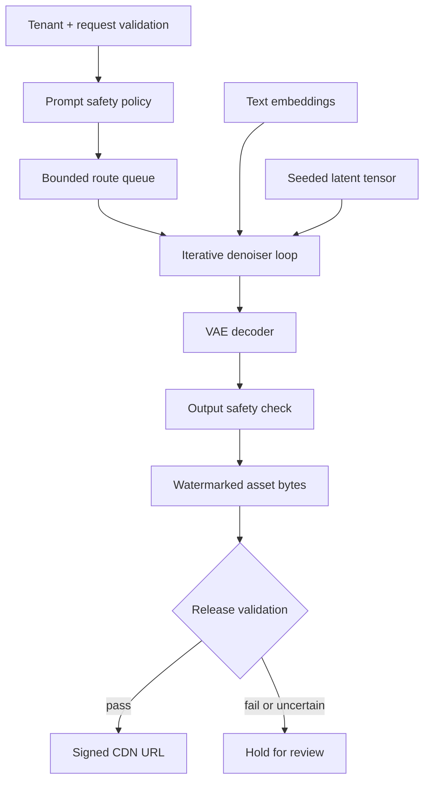
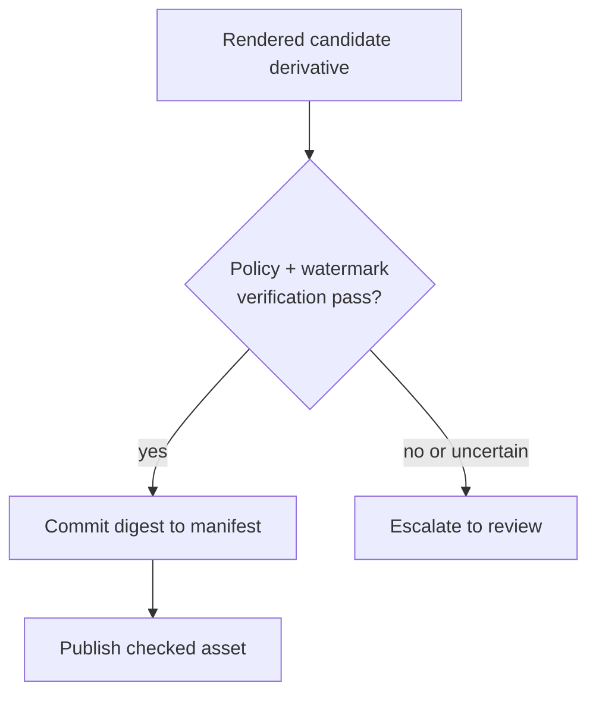

---
{
  "id": "image-generation-diffusion-models",
  "title": "Diffusion Models: Images & Text",
  "slug": "image-generation-diffusion-models",
  "category": "Multimodal Models",
  "difficulty": "Hard",
  "coverImage": "illustrations/_generated/diffusion_pipeline_dark.png",
  "companies": [
    "Google",
    "OpenAI",
    "Stability AI",
    "Meta",
    "Midjourney"
  ],
  "shortDescription": "Four design previews start as pure Gaussian noise, and every denoising pass consumes GPU time. Master the mathematics of forward schedules and reverse solvers, then design a high-throughput asset service.",
  "keyConceptsTested": [
    "Forward diffusion: adding Gaussian noise",
    "Reverse process: learned denoising",
    "Why q(x_{t-1} | x_t) is intractable but q(x_{t-1} | x_t, x_0) is tractable",
    "Signal-to-noise ratio (SNR) across timesteps",
    "Prediction targets: epsilon, x_0, and v",
    "U-Net architecture for noise prediction",
    "DiT: transformer-based diffusion backbones",
    "Classifier guidance vs classifier-free guidance",
    "Classifier-free guidance mechanism",
    "Latent diffusion (Stable Diffusion architecture)",
    "Discrete text diffusion and DiffusionGemma-style block-autoregressive canvases",
    "Continuous VAE latents vs VQ-VAE discrete visual tokens",
    "DDIM sampling, deterministic trajectories, and inversion workflows",
    "VAE compression trade-offs",
    "Text encoder integration via cross-attention",
    "Noise schedule (beta/alpha) math",
    "Reparameterization trick (closed form sampling)",
    "Synthetic-media watermarking and origin attribution"
  ],
  "prerequisites": [
    "multimodal-llms-architecture-design",
    "vision-language-models-clip-beyond",
    "autoencoders-vaes-generative-modeling-basics",
    "scaled-dot-product-attention",
    "positional-encoding-rope-alibi",
    "flashattention-memory-efficient-attention",
    "lora-parameter-efficient-fine-tuning"
  ],
  "relatedQuestions": [
    "design-real-time-voice-ai-agent",
    "computer-use-gui-browser-agents",
    "vision-transformers-image-encoders",
    "mixed-precision-training-loss-scaling",
    "model-quantization-gptq-awq-gguf",
    "prompt-injection-defense-strategies"
  ],
  "section": "System Design Capstones",
  "order": 8
}
---

Four previews of an oak dining table in soft light arrive as a single inbound generation request. Producing these images is not a trivial single-pass calculation: each variant starts as an isotropic Gaussian noise tensor and passes through a deep neural denoiser dozens of times before human eyes can perceive structure. When product requirements demand an interactive preview in under two seconds, the engineering challenge centers on partitioning that latency budget across queueing, numerical solver steps, text cross-attention, and autoencoder decoding. Every layer of the serving architecture must be tuned to minimize redundant floating-point operations while guaranteeing mathematical stability.

That iterative denoising loop forms the mechanical foundation of modern diffusion models. The neural network acts as an empirical score estimator or velocity field predictor, estimating the directional adjustment required by a numerical integration solver to peel away accumulated noise. While continuous visual models operate over high-resolution pixel lattices or compressed spatial latent representations, text diffusion models apply related non-equilibrium dynamics to discrete token canvases, progressively replacing mask tokens instead of strictly committing words left to right.[^google2026diffusiongemma] This conceptual bridge unifies disparate media generation tasks under a shared physical and probabilistic framework.

Generative modeling in modern production environments synthesizes learned perceptual compression with multi-head cross-attention conditioning. Before deploying such models at scale, an infrastructure architect must master both the mathematical mechanics of variance-preserving forward and reverse processes and the rigorous publication checks that guard downstream distribution. The underlying physical mechanism begins with the behavior of a single brightness coordinate under Gaussian corruption, demonstrating how simple linear combinations of signal and noise give rise to complex generative dynamics.

<figure>
  
  <figcaption>End-to-end latent diffusion inference pipeline. Text conditioning vectors steer iterative denoiser passes over compact latents before the spatial VAE decoder renders the final RGB output.</figcaption>
</figure>

## Product brief: a governed design-asset generator

The objective is to design a high-throughput asset generation platform serving product designers with marketing backgrounds, UI illustration drafts, and icon previews. The architectural design must establish strict boundaries where long-running or non-compliant workloads terminate: before scheduling GPU memory, within the iterative solver loop, or following final image decoding. Synthetic outputs must be rigorously governed so that hallucinated UI components, mock performance graphs, or synthetic brand assets are never published without programmatic verification. These governance requirements must integrate seamlessly into the asynchronous serving pipeline without degrading user-perceived responsiveness.

### Requirements and API

The platform exposes an asynchronous submission and polling lifecycle designed for predictable high-load execution:

- `POST /v1/image-jobs` accepts a configuration payload containing `prompt`, `negative_prompt`, `width`, `height`, `variant_count`, `route` (`preview` or `quality`), `seed`, and a unique `idempotency_key`. The endpoint validates input dimensions and policy rules, returning a `job_id`, active model and policy manifests, and an estimated completion timestamp.
- `GET /v1/image-jobs/{job_id}` returns the job state (`queued`, `running`, `review`, `failed`, or `complete`), along with per-variant seeds, sampling parameters, safety filter telemetry, embedded watermark metadata, and synthetic media labels. Secure content delivery URLs are returned only for variants that satisfy all release criteria.
- Preview workflows target a p95 latency under 2.0 seconds for the first returned variant, measured from submission through admission, denoising, and post-decode validation. Quality jobs permit up to 30.0 seconds of end-to-end execution before triggering execution timeouts.
- Inbound prompts and decoded images pass safety classifiers and brand policy verifiers. Content with elevated risk scores routes to human moderation queues, while multi-tenant fine-tuning adapters and tenant data remain strictly isolated.

### Data flow and sizing

Every generated asset carries an immutable audit payload recording its model version, LoRA adapters, scheduler parameters, and per-variant random seeds. Capacity planning must measure work in raw neural network evaluations rather than HTTP requests. For instance, an interactive preview tier handling 20 jobs per second with 4 variants per job over a 6-step guidance-distilled model requires `20 x 4 x 6 = 480` denoiser forward passes per second. This calculation gives offered denoiser work; actual cluster sizing must benchmark real GPU throughput under realistic memory access patterns.



By comparison, the quality tier uses classifier-free guidance, evaluating both prompt-conditioned and unconditional branches at every timestep. Handling 2 jobs per second with 4 variants, 50 steps, and ordinary CFG demands `2 x 4 x 50 x 2 = 800` network evaluations per second. Batching multiple samples across tensor cores amortizes memory bandwidth overhead, but the aggregate floating-point operations remain proportional to total step evaluations. Capacity planning must compare configurations only under identical model checkpoints, spatial resolutions, numeric precision, and batching constraints.

Queue isolation and worker reservation prevent long-running quality jobs from starving interactive preview requests. System limits must enforce maximum image resolutions and variant counts during admission before allocating GPU memory. When batching inference jobs, workers group requests by identical model checkpoints, spatial dimensions, and scheduler configurations to preserve computational efficiency, while a first-variant priority mechanism returns completed images to clients without waiting for remaining batch elements.

### Attribution and watermark verification belong in the release path

Attribution metadata enclosed solely within HTTP JSON responses is easily stripped when media files are downloaded, cropped, or shared. A robust serving architecture embeds an imperceptible, tamper-resistant digital watermark directly into the decoded asset representations prior to persistent storage. DeepMind's SynthID demonstrates this principle by applying subtle, cryptographically verifiable perturbations that persist through lossy compression and spatial scaling.[^deepmind2026synthid] Because aggressive downstream editing can degrade watermark detectability, watermark verification functions as one component of a defense-in-depth safety strategy alongside prompt filtering, visual moderation classifiers, and origin audit logs.



The persistent job record binds the unique `job_id`, SHA-256 byte digest, model checkpoint, LoRA configuration, sampling seed, watermark detector score, and release timestamp into an append-only audit log. Intermediate unwatermarked latents and raw frame buffers remain in ephemeral worker memory and are never exposed via public endpoints. Furthermore, watermark insertion and detection latency must be benchmarked independently from GPU denoiser operations, ensuring that post-processing and cryptographic signing never become hidden throughput bottlenecks.

```checkpoint
Why is a synthetic=true metadata flag insufficient for origin attribution?
---
Metadata headers are easily detached when files are converted, edited, or re-uploaded. Embedding an imperceptible, robust digital watermark directly into pixel values preserves attribution through lossy compression and transformations, which can be corroborated against durable backend generation logs.
```

### Failure recovery, rollout, and evaluation

Idempotency keys prevent duplicate generation charges by mapping normalized request parameters to durable storage records. When a client submits an existing idempotency key with matching generation parameters, the service returns the existing job status. If the prompt or image dimensions differ, the gateway rejects the duplicate request with an HTTP 409 conflict error, maintaining strict consistency across client retry loops.

Distributed worker pools execute tasks under expiring leases with monotonically increasing attempt counters. When a worker experiences an unexpected node reboot or memory exhaustion, the scheduler reassigns the task under an incremented attempt ID. Database transactions verify that only the currently active attempt ID can commit finished asset manifests, preventing timed-out workers from publishing conflicting image bytes after a replacement has already succeeded.

Stochastic diffusion samplers require exact preservation of their pseudorandom generator states when restarting mid-trajectory. Resuming an interrupted sample with a newly seeded generator produces an entirely different composition, corrupting the image. For reproducible generation across worker fleets, the system records the exact software dependencies, model weights, torch seed, and CUDA kernel configurations, ensuring identical outputs across redundant cluster nodes.[^diffusersReproducibility2026]

Model deployments follow progressive canary stages, evaluating candidate weights against a frozen benchmark evaluation suite. Rollouts begin with shadow traffic, proceed to 1% and 10% canary allocations, and expand only when image fidelity, prompt adherence, safety compliance, and latency metrics remain within target thresholds. Automated rollbacks trigger immediately if safety policy violations increase, memorization detectors fire, or latency breaches predefined service-level objectives.

## A one-pixel forward process first

To understand how high-dimensional diffusion models operate, examine the behavior of a single normalized scalar coordinate $x_0 = 1.0$ under a fixed noise sample $\epsilon = -0.4$. In the variance-preserving formulation of diffusion models, the noisy state $x_t$ at any cumulative noise level $\bar{\alpha}_t$ is computed in closed form:

$$
x_t = \sqrt{\bar{\alpha}_t} \, x_0 + \sqrt{1 - \bar{\alpha}_t} \, \epsilon
$$

| $\bar{\alpha}_t$ | Signal component $\sqrt{\bar{\alpha}_t}\,x_0$ | Noise component $\sqrt{1-\bar{\alpha}_t}\,\epsilon$ | Mixed state $x_t$ | Theoretical SNR $\bar{\alpha}_t/(1-\bar{\alpha}_t)$ |
|---:|---:|---:|---:|---:|
| 0.900 | 0.949 | -0.126 | 0.822 | 9.000 |
| 0.500 | 0.707 | -0.283 | 0.424 | 1.000 |
| 0.001 | 0.032 | -0.400 | -0.368 | 0.001 |

At $\bar{\alpha}_t = 0.5$, the retained signal amplitude is $\sqrt{0.5} \approx 0.707$, not half of the original value. The signal-to-noise ratio represents the ratio of preserved variance to injected noise variance under the unit-variance assumption, yielding exactly 1.0 when $\bar{\alpha}_t = 0.5$. As $\bar{\alpha}_t$ approaches 0.001, the signal component drops toward zero and the state becomes dominated by the injected Gaussian noise. The following Python implementation demonstrates this variance-preserving forward calculation across multiple coordinates using NumPy:

<!-- leetllm: test, output=show -->
```python title="adding-noise-gradually.py"
import json
import numpy as np

def forward_diffusion_tensor(
    x0: np.ndarray, alpha_bars: np.ndarray, epsilon: np.ndarray
) -> list[dict[str, float]]:
    steps = []
    for alpha_bar in alpha_bars:
        signal = np.sqrt(alpha_bar) * x0
        noise = np.sqrt(1.0 - alpha_bar) * epsilon
        xt = signal + noise
        snr = alpha_bar / (1.0 - alpha_bar)
        steps.append({
            "alpha_bar": float(round(alpha_bar, 3)),
            "signal_mean": float(round(float(np.mean(signal)), 3)),
            "noise_mean": float(round(float(np.mean(noise)), 3)),
            "xt_mean": float(round(float(np.mean(xt)), 3)),
            "snr": float(round(snr, 3)),
        })
    return steps

x0 = np.array([1.0, 0.8, -0.5], dtype=np.float64)
epsilon = np.array([-0.4, 0.2, 0.1], dtype=np.float64)
alpha_bars = np.array([0.9, 0.5, 0.001], dtype=np.float64)

steps = forward_diffusion_tensor(x0, alpha_bars, epsilon)
print(json.dumps(steps, indent=2))
```

<!-- leetllm: output:start -->
```text title="Output" output compact
[
  {
    "alpha_bar": 0.9,
    "signal_mean": 0.411,
    "noise_mean": -0.011,
    "xt_mean": 0.401,
    "snr": 9.0
  },
  {
    "alpha_bar": 0.5,
    "signal_mean": 0.306,
    "noise_mean": -0.024,
    "xt_mean": 0.283,
    "snr": 1.0
  },
  {
    "alpha_bar": 0.001,
    "signal_mean": 0.014,
    "noise_mean": -0.033,
    "xt_mean": -0.02,
    "snr": 0.001
  }
]
```
<!-- leetllm: output:end -->

The same closed-form transformation applies elementwise to multi-channel latent feature maps across high-dimensional tensors. Generation reverses this trajectory: starting from an unconstrained Gaussian sample, the reverse solver progressively subtracts noise estimates to recover clean data.[^ho2020] By understanding this one-pixel intuition, we can trace how entire visual compositions emerge from random static.

## Why learn many cleanup tasks?

Mapping a random Gaussian vector to a coherent 512x512 image in a single step is fundamentally difficult. Generative Adversarial Networks attempt this one-shot mapping using a generator and a discriminator. While GANs can generate sharp samples rapidly, training an adversarial minimax objective is prone to mode collapse and training instability. Balancing generator and discriminator capacities often requires delicate hyperparameter tuning that fails to generalize across diverse prompt distributions.

Diffusion models reframe generation into an iterative sequence of simpler denoising problems. At each step, the neural network only predicts the noise component present at the current variance level, allowing an external numerical solver to advance the trajectory. Breaking generation into dozens of gradual adjustments yields stable supervised training and high sample diversity. This structural decomposition eliminates the adversarial game entirely, providing a stable loss landscape rooted in score matching.

```checkpoint
Why did diffusion models displace GANs across large-scale image generation?
---
Diffusion models replace unstable adversarial minimax games with stable, supervised mean-squared-error regression objectives. By decomposing generation into dozens of small denoising steps, they achieve superior mode coverage and reliable training dynamics.
```

The trade-off between generative paradigms centers on computational cost during inference. A GAN or standard VAE evaluates a single forward pass, whereas diffusion models execute dozens of sequential neural network evaluations per image. The primary serving constraint in diffusion architectures is this repeated evaluation cost, demanding thoughtful infrastructure optimization to deliver responsive interactive systems:

| Dimension | Generative Adversarial Networks | Variational Autoencoders | Diffusion Models |
| :--- | :--- | :--- | :--- |
| **Training Objective** | Minimax Game (Adversarial) | Evidence Lower Bound (ELBO) | Score Matching / Variational MSE |
| **Sample Quality** | High sharpness; tuning sensitive | Smoothed; blur-prone | State-of-the-art detail and coherence |
| **Mode Coverage** | Susceptible to mode collapse | High coverage; lower fidelity | Broad coverage with minimal collapse |
| **Training Stability** | Delicate equilibrium | Highly stable | Highly stable supervised regression |
| **Inference Cost** | Single forward pass | Single decoder pass | 20 to 50 iterative network passes |
| **Density Evaluation** | Intractable | Tractable lower bound | Tractable variational lower bound |

## How the oak table becomes noise

### Adding noise gradually

Training a diffusion model requires presenting it with noisy images across all stages of destruction. Starting from a clean image $x_0$, the forward process constructs a discrete Markov chain that progressively injects Gaussian noise across $T$ steps. With a sufficient number of steps, the terminal distribution converges toward standard isotropic Gaussian noise $\mathcal{N}(0, \mathbf{I})$.[^sohldickstein2015] This Markovian progression provides the mathematical structure necessary to invert the diffusion process during inference.

<figure>
  
  <figcaption>Variance-preserving forward diffusion process. Across four stages from t=0 to t=1000, signal amplitude decays while noise variance scales to maintain total unit variance.</figcaption>
</figure>

The transition kernel defines how much noise is added at each step $t$:

$$
q(x_t | x_{t-1}) = \mathcal{N}(x_t; \sqrt{1-\beta_t} \, x_{t-1}, \beta_t \mathbf{I})
$$

Here, $\beta_t \in (0, 1)$ represents the variance schedule. By defining $\alpha_t = 1 - \beta_t$ and the cumulative product $\bar{\alpha}_t = \prod_{s=1}^t \alpha_s$, repeated convolution of Gaussian distributions allows the marginal distribution at any step $t$ to be sampled directly in closed form:

$$
q(x_t | x_0) = \mathcal{N}(x_t; \sqrt{\bar{\alpha}_t} \, x_0, (1 - \bar{\alpha}_t) \mathbf{I})
$$

This closed-form property is critical for training efficiency. An optimizer does not need to simulate the Markov chain step-by-step from $t=0$; it can sample an arbitrary timestep $t \sim \mathcal{U}(1, T)$, evaluate the closed-form equation once, and compute gradients immediately. A standard 1000-step linear schedule yields $\bar{\alpha}_T \approx 0.00004$, ensuring the final state is virtually indistinguishable from pure noise. Truncated or custom schedules must verify their cumulative $\bar{\alpha}_T$ product to prevent distribution mismatch during sampling.

```checkpoint
Why is the closed-form forward formulation essential for training scalability?
---
It allows the training loop to sample any timestep uniformly at random and compute the corrupted state in a single vectorized operation without executing the preceding t-1 Markov transitions.
```

At early timesteps (high $\bar{\alpha}_t$), the image retains its global semantics and high-contrast edges. At late timesteps (low $\bar{\alpha}_t$), the signal variance vanishes almost entirely into background static. The noise schedule governs the distribution of training steps across this signal-to-noise spectrum, ensuring that the network receives balanced exposure to both global layout reconstruction and fine-grained texture recovery.

## Reverse process: learned denoising

### DDPM training

The objective of diffusion training is learning to reverse the forward noising process. If the model can approximate the reverse transition distribution $p_\theta(x_{t-1} | x_t)$, generation can proceed by starting from random noise and sampling backward step by step.[^ho2020] Calculating the exact reverse posterior $q(x_{t-1} | x_t)$ is mathematically intractable because it requires marginalizing over the entire data distribution of clean images $x_0$. However, conditioning the reverse step on the known clean image $x_0$ makes the posterior $q(x_{t-1} | x_t, x_0)$ tractable and Gaussian:

$$
\begin{aligned}
\tilde{\mu}_t &= \frac{\sqrt{\bar{\alpha}_{t-1}}\,\beta_t}{1-\bar{\alpha}_t}x_0 + \frac{\sqrt{\alpha_t}(1-\bar{\alpha}_{t-1})}{1-\bar{\alpha}_t}x_t,\\
\tilde{\beta}_t &= \frac{1-\bar{\alpha}_{t-1}}{1-\bar{\alpha}_t}\beta_t.
\end{aligned}
$$

By expressing $x_0$ in terms of $x_t$ and the injected noise $\epsilon$, Ho et al. showed that training a neural network $\epsilon_\theta(x_t, t)$ to predict the injected noise simplifies the variational lower bound into a straightforward mean squared error regression objective:[^ho2020]

$$
\mathcal{L}_{\text{simple}} = \mathbb{E}_{t, x_0, \epsilon}\left[\|\epsilon - \epsilon_\theta(x_t, t)\|^2\right]
$$

The neural network acts as a score estimator, regressing against the true injected noise tensor. The loss calculation confirms that error magnitudes scale across timesteps, but because the true noise is known during forward synthesis, no adversarial discriminator is required. The following implementation demonstrates this batched loss computation across multiple timesteps using NumPy:

<!-- leetllm: test, output=show -->
```python title="ddpm-training.py"
import json
import numpy as np

def batch_denoiser_loss(
    true_noise: np.ndarray, pred_noise: np.ndarray, timesteps: np.ndarray
) -> list[dict[str, float]]:
    per_sample_mse = np.mean((true_noise - pred_noise) ** 2, axis=-1)
    return [
        {
            "timestep": int(t),
            "mse_loss": float(round(float(loss), 4)),
        }
        for t, loss in zip(timesteps, per_sample_mse)
    ]

timesteps = np.array([100, 700], dtype=np.int64)
true_noise = np.array([
    [0.20, -0.10, 0.05],
    [0.90, -0.40, 0.30],
], dtype=np.float64)
pred_noise = np.array([
    [0.18, -0.08, 0.02],
    [0.72, -0.35, 0.10],
], dtype=np.float64)

losses = batch_denoiser_loss(true_noise, pred_noise, timesteps)
print(json.dumps(losses, indent=2))
```

<!-- leetllm: output:start -->
```text title="Output" output compact
[
  {
    "timestep": 100,
    "mse_loss": 0.0006
  },
  {
    "timestep": 700,
    "mse_loss": 0.025
  }
]
```
<!-- leetllm: output:end -->

```checkpoint
What target does the standard DDPM training loop regress against?
---
It regresses against the exact Gaussian noise epsilon injected into the clean sample during the forward transition at timestep t, minimizing the mean squared error between true and predicted noise.
```

#### Noise schedule and SNR

The variance-preserving forward equation yields an explicit signal-to-noise ratio at each timestep $t$:

$$
\mathrm{SNR}(t) = \frac{\bar{\alpha}_t}{1 - \bar{\alpha}_t}
$$

When plotted on a logarithmic scale, SNR declines monotonically as $t$ advances. Linear variance schedules often degrade signal too rapidly in early steps, leading researchers to adopt cosine noise schedules that preserve semantic information longer across intermediate timesteps. The noise schedule determines whether the network devotes its representational capacity to high-frequency surface detail or global structural layout, shaping both visual quality and training efficiency.

<figure>
  
  <figcaption>Signal amplitude decays along a smooth curve while noise amplitude rises. The crossover point at alpha-bar=0.5 marks where signal variance and noise variance are equal.</figcaption>
</figure>

#### Prediction targets

While standard DDPM predicts $\epsilon$, alternative parameterizations offer distinct numerical advantages. A network can predict the clean data $x_0$ directly, or it can predict the velocity vector $v = \sqrt{\bar{\alpha}_t}\,\epsilon - \sqrt{1-\bar{\alpha}_t}\,x_0$. Velocity parameterization prevents numerical instability at low SNR levels and serves as the foundation for progressive distillation and flow-matching solvers.[^salimans2022] The scheduler must match the parameterization used during training to prevent severe reconstruction distortion.

### Sampling (reverse process)

To generate an image, the sampler starts from pure noise $x_T \sim \mathcal{N}(0, \mathbf{I})$ and steps backward toward $t=0$. In DDPM, each reverse transition samples a stochastic Gaussian step:

$$
x_{t-1} = \frac{1}{\sqrt{\alpha_t}} \left(x_t - \frac{\beta_t}{\sqrt{1-\bar{\alpha}_t}} \epsilon_\theta(x_t, t)\right) + \sigma_t z, \quad z \sim \mathcal{N}(0, \mathbf{I})
$$

On the final step to $x_0$, the stochastic component is set to zero ($z=0$). Each reverse step feeds into the subsequent iteration, requiring hundreds of evaluations in traditional pipelines. Generating images across 1000 sequential forward passes is computationally prohibitive for interactive serving, motivating the development of non-Markovian solvers and distillation methods. The following implementation demonstrates a multi-step reverse trajectory using NumPy:

<!-- leetllm: test, output=show -->
```python title="sampling-reverse-process.py"
import json
import numpy as np

betas = np.array([0.02, 0.03, 0.04], dtype=np.float64)
alphas = 1.0 - betas
alpha_bars = np.cumprod(alphas)

def denoiser_predict(x: np.ndarray, step: int) -> np.ndarray:
    return 0.45 * x + 0.02 * step

rng = np.random.default_rng(7)
x = np.array([1.25, 0.85], dtype=np.float64)
trace = []

for step in reversed(range(len(betas))):
    beta_t = betas[step]
    alpha_t = alphas[step]
    alpha_bar_t = alpha_bars[step]

    eps_hat = denoiser_predict(x, step)
    mean = (x - (beta_t / np.sqrt(1.0 - alpha_bar_t)) * eps_hat) / np.sqrt(alpha_t)
    z = rng.standard_normal(size=x.shape) if step > 0 else np.zeros_like(x)
    x = mean + np.sqrt(beta_t) * z

    trace.append({
        "step": step,
        "predicted_noise": [float(round(v, 3)) for v in eps_hat],
        "reverse_mean": [float(round(v, 3)) for v in mean],
        "next_x": [float(round(v, 3)) for v in x],
    })

print(json.dumps(trace, indent=2))
```

<!-- leetllm: output:start -->
```text title="Output" output compact
[
  {
    "step": 2,
    "predicted_noise": [
      0.602,
      0.422
    ],
    "reverse_mean": [
      1.193,
      0.809
    ],
    "next_x": [
      1.193,
      0.869
    ]
  },
  {
    "step": 1,
    "predicted_noise": [
      0.557,
      0.411
    ],
    "reverse_mean": [
      1.135,
      0.826
    ],
    "next_x": [
      1.087,
      0.672
    ]
  },
  {
    "step": 0,
    "predicted_noise": [
      0.489,
      0.302
    ],
    "reverse_mean": [
      1.028,
      0.635
    ],
    "next_x": [
      1.028,
      0.635
    ]
  }
]
```
<!-- leetllm: output:end -->

## Model architectures: U-Net and diffusion transformers

### The U-Net backbone

The denoiser must understand both macro-level spatial composition and fine textural details. In a product design rendering, the network must maintain perspective and proportions while accurately generating micro-textures and sharp contours. The U-Net architecture satisfies this requirement through an encoder-decoder topology linked by horizontal skip connections. The encoder downsamples feature maps to capture global receptive fields, while the decoder upsamples them, concatenating encoder activations to preserve spatial cues. In text-conditioned latent diffusion models, cross-attention layers are interleaved within the downsampling and upsampling blocks, allowing prompt embeddings to steer generation at every spatial scale.[^rombach2022]

<figure>
  
  <figcaption>U-Net denoiser layout. Timestep embeddings modulate ResNet layers, and cross-attention blocks inject prompt tokens at every spatial resolution.</figcaption>
</figure>

### The transformer shift

Modern diffusion architectures increasingly adopt Diffusion Transformers (DiT) in place of convolutional U-Nets. DiT splits the latent representation into patches, flattens them into visual tokens, and processes them through standard transformer blocks with self-attention and cross-attention.[^peebles2023] Scaling studies demonstrate that DiT models adhere to predictable scaling laws, where increasing parameter counts and training tokens yields monotonic improvements in Fréchet Inception Distance (FID). Stable Diffusion 3 introduces Multimodal DiT (MM-DiT), using joint attention streams with modality-specific weights for text and image tokens.[^esser2024]

```checkpoint
What distinguishes Diffusion Transformers from convolutional U-Nets?
---
DiT tokenizes continuous latent patches into sequence tokens processed by standard transformer blocks. This enables clean scaling laws and flexible joint attention mechanisms across text and visual modalities.
```

### Timestep conditioning

The network must adapt its behavior depending on the noise level of its input. Timestep $t$ is encoded through sinusoidal positional embeddings, projected through an MLP, and injected into network blocks. In convolutional U-Nets, timestep signals modulate feature activations through Feature-wise Linear Modulation (FiLM) or Adaptive Group Normalization (AdaGN). In DiT architectures, conditioning is applied through Adaptive LayerNorm (AdaLN), scaling and shifting normalized activations. The network learns distinct modulation parameters across timesteps, shifting its focus from broad semantic composition at high noise levels to subtle textural refinement as noise diminishes:

<!-- leetllm: test, output=show -->
```python title="timestep-conditioning.py"
import json
import numpy as np

def adaptive_layer_modulation(
    features: np.ndarray, scale: np.ndarray, shift: np.ndarray
) -> np.ndarray:
    return features * (1.0 + scale) + shift

feature_map = np.array([0.20, -0.10, 0.50], dtype=np.float64)
controls = {
    "reverse_start_high_noise": {
        "scale": np.array([0.50, 0.50, 0.50]),
        "shift": np.array([-0.05, -0.05, -0.05]),
    },
    "reverse_end_low_noise": {
        "scale": np.array([0.05, 0.05, 0.05]),
        "shift": np.array([0.02, 0.02, 0.02]),
    },
}

outputs = {
    name: [float(round(v, 3)) for v in adaptive_layer_modulation(feature_map, **c)]
    for name, c in controls.items()
}
print(json.dumps(outputs, indent=2))
```

<!-- leetllm: output:start -->
```text title="Output" output compact
{
  "reverse_start_high_noise": [
    0.25,
    -0.2,
    0.7
  ],
  "reverse_end_low_noise": [
    0.23,
    -0.085,
    0.545
  ]
}
```
<!-- leetllm: output:end -->

## Flow matching and rectified flow

Flow matching reframes generative modeling as learning a time-dependent velocity field that transports probability mass along continuous probability flows between noise and data distributions.[^lipman2022] In Rectified Flow, data points $x_0$ and Gaussian noise draws $x_1 \sim \mathcal{N}(0, \mathbf{I})$ are connected via straight-line linear interpolations $x_\tau = (1 - \tau)x_0 + \tau x_1$ for $\tau \in [0, 1]$. The training target is the constant velocity vector $x_1 - x_0$:[^liu2022]

$$
\mathcal{L}_{\text{FM}} = \mathbb{E}_{\tau, x_0, x_1}\left[\|v_\theta(x_\tau, \tau) - (x_1 - x_0)\|^2\right]
$$

Because straight trajectories minimize transport curvature, ordinary differential equation (ODE) numerical solvers can traverse the generative path in substantially fewer steps than curved diffusion trajectories, enabling stable few-step generation.[^esser2024] This mathematical straightening provides the foundation for high-performance four-step and eight-step production serving models.

## Text diffusion and DiffusionGemma

Autoregressive language models generate text by conditioning sequentially on left-to-right token prefixes. Text diffusion applies non-equilibrium denoising dynamics to discrete token sequences, enabling non-monotonic generation, infilling, and iterative text refinement.[^google2026diffusiongemma] In discrete masked diffusion, the canvas begins with mask tokens. Over successive iterations, a bidirectional transformer evaluates candidate probabilities across all masked positions simultaneously, unmasking confident tokens and revising provisional tokens. This decouples sequence length from step count, allowing models to generate or edit long sequences in a constant number of refinement rounds:

<figure>
  
  <figcaption>Autoregressive prefix generation contrasted with bidirectional canvas diffusion. Discrete diffusion refines confident tokens first and updates context across iterative rounds.</figcaption>
</figure>

<!-- leetllm: test, output=show -->
```python title="text-diffusion-refinement.py"
import json
import numpy as np

vocab = ["write", "unit", "tests", "first", "later", "<mask >"]
logits_round1 = np.array([
    [4.5, 0.1, 0.1, 0.1, 0.2, 0.0],
    [0.2, 0.3, 0.2, 0.1, 0.1, 3.5],
    [0.1, 0.2, 0.3, 0.1, 0.1, 3.8],
    [0.1, 0.2, 0.1, 1.2, 3.9, 0.1],
])

probs = np.exp(logits_round1 - np.max(logits_round1, axis=-1, keepdims=True))
probs /= np.sum(probs, axis=-1, keepdims=True)

best_tokens = np.argmax(probs, axis=-1)
confidences = np.max(probs, axis=-1)

tokens = [vocab[idx] for idx in best_tokens]
trace = [{
    "round": 1,
    "canvas": " ".join(tokens),
    "mean_confidence": float(round(float(np.mean(confidences)), 3)),
}]
print(json.dumps(trace, indent=2))
```

<!-- leetllm: output:start -->
```text title="Output" output compact
[
  {
    "round": 1,
    "canvas": "write <mask > <mask > later",
    "mean_confidence": 0.884
  }
]
```
<!-- leetllm: output:end -->

## Classifier-free guidance (CFG)

### How CFG steers generation without a classifier

Early conditional diffusion models used external classifier gradients $\nabla_{x_t} \log p(y | x_t)$ to steer generation toward a target class $y$. However, training robust classifiers on noisy intermediate images is computationally expensive and complex. Classifier-free guidance (CFG) accomplishes directional steering within a single model. During training, conditioning prompts $c$ are randomly dropped with probability $p_{\text{uncond}} \approx 0.10$ to $0.20$, replacing them with an empty token $\emptyset$:[^ho2022]

<!-- leetllm: test, output=show -->
```python title="cfg-training-step.py"
import json
import numpy as np

def cfg_conditioning_batch(
    prompts: list[str], drop_prob: float, seed: int = 7
) -> list[dict[str, str]]:
    rng = np.random.default_rng(seed)
    dropped_mask = rng.uniform(size=len(prompts)) < drop_prob
    return [
        {
            "original_prompt": p,
            "conditioning_used": "<null>" if dropped else p,
            "branch": "unconditional" if dropped else "conditional",
        }
        for p, dropped in zip(prompts, dropped_mask)
    ]

batch = cfg_conditioning_batch(
    [
        "oak dining table in soft light",
        "oak dining table in natural light",
        "mobile dashboard empty state",
        "annotated latency chart hero image",
    ],
    drop_prob=0.35,
)
print(json.dumps(batch, indent=2))
```

<!-- leetllm: output:start -->
```text title="Output" output compact
[
  {
    "original_prompt": "oak dining table in soft light",
    "conditioning_used": "oak dining table in soft light",
    "branch": "conditional"
  },
  {
    "original_prompt": "oak dining table in natural light",
    "conditioning_used": "oak dining table in natural light",
    "branch": "conditional"
  },
  {
    "original_prompt": "mobile dashboard empty state",
    "conditioning_used": "mobile dashboard empty state",
    "branch": "conditional"
  },
  {
    "original_prompt": "annotated latency chart hero image",
    "conditioning_used": "<null>",
    "branch": "unconditional"
  }
]
```
<!-- leetllm: output:end -->

During inference, the model evaluates both conditional and unconditional predictions, extrapolating along the difference vector scaled by guidance weight $w$:

$$
\tilde{\epsilon}_\theta(x_t, c) = \epsilon_\theta(x_t, \emptyset) + w \cdot \left(\epsilon_\theta(x_t, c) - \epsilon_\theta(x_t, \emptyset)\right)
$$

<figure>
  
  <figcaption>CFG vector extrapolation in score space. Guidance weights between 4.0 and 7.5 improve prompt fidelity, while excessive values induce saturation and chromatic clipping.</figcaption>
</figure>

When $w=1$, guidance defaults to standard conditional generation. Values between 4.0 and 7.5 amplify prompt adherence and contrast, while values above 12.0 induce saturation artifacts and color clipping. The linear growth in vector norm highlights why dynamic thresholding or latent clipping is required when serving models at elevated guidance scales:

<!-- leetllm: test, output=show -->
```python title="cfg-guidance-formula.py"
import json
import numpy as np

def compute_guided_noise(
    uncond: np.ndarray, cond: np.ndarray, scale: float
) -> np.ndarray:
    return uncond + scale * (cond - uncond)

noise_uncond = np.array([0.20, -0.10, 0.05], dtype=np.float64)
noise_cond = np.array([0.05, -0.35, 0.20], dtype=np.float64)

rows = []
for scale in [0.0, 1.0, 7.5, 15.0]:
    guided = compute_guided_noise(noise_uncond, noise_cond, scale)
    norm = float(np.linalg.norm(guided))
    rows.append({
        "guidance_scale": scale,
        "guided_noise": [float(round(v, 3)) for v in guided],
        "vector_norm": float(round(norm, 3)),
    })

print(json.dumps(rows, indent=2))
```

<!-- leetllm: output:start -->
```text title="Output" output compact
[
  {
    "guidance_scale": 0.0,
    "guided_noise": [
      0.2,
      -0.1,
      0.05
    ],
    "vector_norm": 0.229
  },
  {
    "guidance_scale": 1.0,
    "guided_noise": [
      0.05,
      -0.35,
      0.2
    ],
    "vector_norm": 0.406
  },
  {
    "guidance_scale": 7.5,
    "guided_noise": [
      -0.925,
      -1.975,
      1.175
    ],
    "vector_norm": 2.477
  },
  {
    "guidance_scale": 15.0,
    "guided_noise": [
      -2.05,
      -3.85,
      2.3
    ],
    "vector_norm": 4.931
  }
]
```
<!-- leetllm: output:end -->

## Faster sampling with implicit diffusion

Denoising Diffusion Implicit Models (DDIM) construct a non-Markovian forward process sharing the same marginal distributions as DDPM, enabling deterministic reverse sampling trajectories.[^song2020] Because DDIM reverse updates can follow deterministic ODE trajectories without fresh stochastic noise, the sampler can skip steps along the noise schedule, compressing a 1000-step process into 20 to 50 iterations without retraining the denoiser. The mathematical equivalence between $\epsilon$ and $v$ parameterizations demonstrates how modern solvers maintain numerical precision across accelerated step budgets:

<!-- leetllm: test, output=show -->
```python title="ddim-known-noise-check.py"
import numpy as np

x0 = np.array([1.0, 0.5], dtype=np.float64)
epsilon = np.array([-0.4, 0.2], dtype=np.float64)
alpha_t, alpha_s = 0.5, 0.9

xt = np.sqrt(alpha_t) * x0 + np.sqrt(1.0 - alpha_t) * epsilon
x0_hat = (xt - np.sqrt(1.0 - alpha_t) * epsilon) / np.sqrt(alpha_t)
xs = np.sqrt(alpha_s) * x0_hat + np.sqrt(1.0 - alpha_s) * epsilon
expected = np.sqrt(alpha_s) * x0 + np.sqrt(1.0 - alpha_s) * epsilon
assert np.allclose(xs, expected, atol=1e-12)

a, b = np.sqrt(alpha_t), np.sqrt(1.0 - alpha_t)
v = a * epsilon - b * x0
x0_from_v = a * xt - b * v
assert np.allclose(x0_from_v, x0, atol=1e-12)

print(f"xt={xt.round(3).tolist()}, recovered_x0={x0_hat.round(3).tolist()}, xs={xs.round(3).tolist()}")
print(f"v={v.round(3).tolist()}, x0_from_v={x0_from_v.round(3).tolist()}")
```

<!-- leetllm: output:start -->
```text title="Output" output compact
xt=[0.424, 0.495], recovered_x0=[1.0, 0.5], xs=[0.822, 0.538]
v=[-0.99, -0.212], x0_from_v=[1.0, 0.5]
```
<!-- leetllm: output:end -->

Numerical solvers such as DPM-Solver++ and Euler flow matching reduce evaluation counts further, permitting production deployments to select the optimal speed-fidelity balance. The evaluation analysis indicates that distilled single-branch routes achieve a 16x compute reduction, making real-time interactive previews practical on commodity serving infrastructure:

<figure>
  
  <figcaption>Inference compute budgets across numerical solvers. Distilled models achieve sub-second execution by compressing trajectories into 4 to 8 single-branch steps.</figcaption>
</figure>

<!-- leetllm: test, output=show -->
```python title="sampler-evaluation-budget.py"
import json
import numpy as np

routes = [
    {"name": "offline_ddim_cfg", "steps": 50, "branches": 2},
    {"name": "high_order_dpmsolver_cfg", "steps": 25, "branches": 2},
    {"name": "interactive_distilled_flow", "steps": 6, "branches": 1},
]

step_arr = np.array([r["steps"] for r in routes], dtype=np.int64)
branch_arr = np.array([r["branches"] for r in routes], dtype=np.int64)
evals = step_arr * branch_arr

budget = [
    {
        "route": r["name"],
        "denoiser_evaluations": int(eval_count),
        "speedup_vs_baseline": float(round(float(evals[0]) / float(eval_count), 2)),
    }
    for r, eval_count in zip(routes, evals)
]
print(json.dumps(budget, indent=2))
```

<!-- leetllm: output:start -->
```text title="Output" output compact
[
  {
    "route": "offline_ddim_cfg",
    "denoiser_evaluations": 100,
    "speedup_vs_baseline": 1.0
  },
  {
    "route": "high_order_dpmsolver_cfg",
    "denoiser_evaluations": 50,
    "speedup_vs_baseline": 2.0
  },
  {
    "route": "interactive_distilled_flow",
    "denoiser_evaluations": 6,
    "speedup_vs_baseline": 16.67
  }
]
```
<!-- leetllm: output:end -->

## Latent diffusion

### Architecture

Operating iterative diffusion models directly in RGB pixel space is computationally demanding. A 512x512 RGB image contains 786,432 scalar values, requiring extensive memory bandwidth during attention operations. Latent Diffusion Models (LDM) resolve this bottleneck by decoupling perceptual compression from semantic generation.[^rombach2022] A pre-trained Variational Autoencoder (VAE) compresses images into a lower-dimensional latent manifold, reducing spatial resolution by a factor of 8 while preserving semantic structure. The reverse diffusion loop runs entirely within this compact latent space, and once denoising converges on clean latent $z_0$, the VAE decoder reconstructs the final RGB pixel representation in a single forward pass.

<figure>
  
  <figcaption>Latent diffusion training pipeline. High-resolution pixels are compressed into continuous latents, enabling the denoiser to operate with lower memory and FLOP requirements.</figcaption>
</figure>

### Why latent space?

Compressing images by an 8x spatial downsampling factor yields a 64x reduction in spatial token positions. Because self-attention complexity scales quadratically with sequence length ($O(N^2)$), this reduction dramatically lowers attention memory and compute requirements. The 4,096x reduction in pairwise attention matrix elements allows high-resolution generative models to fit comfortably within modern GPU memory hierarchies:

<!-- leetllm: test, output=show -->
```python title="latent-work-state.py"
import json
import numpy as np

pixel_shape = np.array([512, 512, 3], dtype=np.int64)
latent_shape = np.array([64, 64, 4], dtype=np.int64)

pixel_values = int(np.prod(pixel_shape))
latent_values = int(np.prod(latent_shape))
pixel_spatial = int(pixel_shape[0] * pixel_shape[1])
latent_spatial = int(latent_shape[0] * latent_shape[1])

attn_reduction = (pixel_spatial ** 2) // (latent_spatial ** 2)

print(json.dumps({
    "pixel_values": pixel_values,
    "latent_values": latent_values,
    "scalar_reduction": pixel_values // latent_values,
    "spatial_reduction": pixel_spatial // latent_spatial,
    "attention_matrix_reduction": attn_reduction,
}, indent=2))
```

<!-- leetllm: output:start -->
```text title="Output" output compact
{
  "pixel_values": 786432,
  "latent_values": 16384,
  "scalar_reduction": 48,
  "spatial_reduction": 64,
  "attention_matrix_reduction": 4096
}
```
<!-- leetllm: output:end -->

### Text conditioning via cross-attention

Text prompts steer generation through multi-head cross-attention mechanisms. Text encoders such as CLIP or T5 project natural language prompts into continuous sequence embeddings $c \in \mathbb{R}^{L \times d_{\text{text}}}$. Spatial latent features act as queries $Q = W_Q z_t$, while text embeddings provide keys $K = W_K c$ and values $V = W_V c$. Scaled dot-product attention computes compatibility distributions, routing semantic text features into corresponding spatial positions. The computed attention distribution confirms how prompt tokens steer specific visual regions, injecting texture, lighting, and composition constraints into each denoising pass:

<!-- leetllm: test, output=show -->
```python title="text-conditioning-via-cross-attention.py"
import json
import numpy as np

latent_query = np.array([[0.25, 0.10, 0.70]], dtype=np.float64)
token_names = ["oak", "dining", "table"]
text_keys = np.array([
    [0.30, 0.05, 0.65],
    [0.10, 0.80, 0.10],
    [0.35, 0.10, 0.55],
], dtype=np.float64)
text_values = np.array([
    [0.70, 0.20],
    [0.20, 0.70],
    [0.80, 0.10],
], dtype=np.float64)

d_k = latent_query.shape[-1]
scores = (latent_query @ text_keys.T) / np.sqrt(d_k)
exp_scores = np.exp(scores - np.max(scores, axis=-1, keepdims=True))
attn_weights = exp_scores / np.sum(exp_scores, axis=-1, keepdims=True)

conditioned_context = attn_weights @ text_values

print(json.dumps({
    "attention_weights": {
        name: float(round(float(w), 3))
        for name, w in zip(token_names, attn_weights[0])
    },
    "conditioned_patch": [float(round(float(v), 3)) for v in conditioned_context[0]],
}, indent=2))
```

<!-- leetllm: output:start -->
```text title="Output" output compact
{
  "attention_weights": {
    "oak": 0.359,
    "dining": 0.292,
    "table": 0.349
  },
  "conditioned_patch": [
    0.589,
    0.311
  ]
}
```
<!-- leetllm: output:end -->

## Control and specialization

Production design systems often require structural constraints beyond text descriptions, such as wireframe layouts, edge maps, or depth contours. ControlNet locks the pre-trained diffusion backbone and creates trainable copies of encoder blocks connected via zero-initialized convolutions.[^zhang2023] This architectural design allows models to adhere strictly to geometric control signals without catastrophic forgetting of foundational generative capabilities. Serving platforms load ControlNet adapters dynamically to support interactive sketching and layout tools without duplicating base model weights, combining high visual quality with flexible user control.

## Fast inference in practice

Deploying diffusion models into production services requires optimizing the end-to-end inference pipeline:

1. **Precision and Compilation:** Execute denoising passes in FP16 or BF16 using FlashAttention and kernel fusion via `torch.compile` to eliminate memory bandwidth bottlenecks.
2. **Dynamic Prefix Caching:** Cache text encoder key-value representations across sampling steps, avoiding redundant prompt re-computation during the reverse loop.
3. **Paged Memory Allocation:** Manage intermediate latent representations and solver state using contiguous pre-allocated memory buffers to eliminate memory fragmentation.
4. **Asynchronous Decoding:** Overlap VAE decoding of completed variants on dedicated GPU streams while subsequent variants complete their final denoising steps.

## Common pitfalls

#### "CFG scale is a probability"
Guidance scale $w$ is an extrapolation multiplier in tangent score space, not a probability value. Setting $w > 1$ amplifies directional prompt gradients; it does not represent conditional likelihood.

#### "The VAE decoder consumes predicted noise"
The VAE decoder reconstructs pixels exclusively from clean latent states $z_0$. Inverting or decoding raw noise predictions $\epsilon$ produces meaningless static.

#### "Latent diffusion eliminates the autoencoder bottleneck"
While latent diffusion avoids pixel-space attention costs, spatial compression inherently introduces reconstruction limits. Delicate typography, fine lines, and small faces can suffer blur if compression ratios exceed the autoencoder's capacity.

#### "DiT is automatically cheaper than U-Net"
Although Diffusion Transformers exhibit superior scaling behavior, their computational cost scales with sequence length. Processing uncompressed high-resolution latents without adequate patchification can exceed U-Net memory demands.

#### "A missing watermark proves human authorship"
Watermark absence indicates that no recognized digital signature was detected; it does not constitute positive proof of human creation. Origin verification requires comprehensive audit logs and source asset tracking.

## Run one generation release audit

A production release gate validates whether a generated asset satisfies quality, alignment, and safety policies before exposing download URLs. The release gate enforces objective numerical score thresholds, routing borderline or unwatermarked assets to review while safely publishing verified outputs:

<!-- leetllm: test, output=show -->
```python title="synthetic-output-release-gate.py"
import json
import numpy as np

def evaluate_release_quality(
    metrics: dict[str, float | str],
    clip_threshold: float = 0.28,
    aesthetic_threshold: float = 5.5,
    watermark_threshold: float = 0.85,
) -> str:
    clip_score = float(metrics["clip_score"])
    aesthetic_score = float(metrics["aesthetic_score"])
    watermark_conf = float(metrics["watermark_confidence"])
    nsfw_prob = float(metrics["nsfw_probability"])
    digest_match = metrics["computed_digest"] == metrics["manifest_digest"]

    if not digest_match or nsfw_prob >= 0.05:
        return "reject_safety"
    if watermark_conf < watermark_threshold:
        return "hold_watermark_unverified"
    if clip_score >= clip_threshold and aesthetic_score >= aesthetic_threshold:
        return "publish_verified_asset"
    return "escalate_human_review"

test_records = [
    {
        "name": "high_fidelity_banner",
        "metrics": {
            "clip_score": 0.32, "aesthetic_score": 6.8,
            "watermark_confidence": 0.94, "nsfw_probability": 0.001,
            "computed_digest": "sha256-a1", "manifest_digest": "sha256-a1",
        },
    },
    {
        "name": "ambiguous_composition",
        "metrics": {
            "clip_score": 0.24, "aesthetic_score": 5.1,
            "watermark_confidence": 0.91, "nsfw_probability": 0.002,
            "computed_digest": "sha256-b2", "manifest_digest": "sha256-b2",
        },
    },
    {
        "name": "watermark_attenuated",
        "metrics": {
            "clip_score": 0.30, "aesthetic_score": 6.2,
            "watermark_confidence": 0.65, "nsfw_probability": 0.001,
            "computed_digest": "sha256-c3", "manifest_digest": "sha256-c3",
        },
    },
    {
        "name": "digest_mismatch_corrupted",
        "metrics": {
            "clip_score": 0.31, "aesthetic_score": 6.4,
            "watermark_confidence": 0.95, "nsfw_probability": 0.001,
            "computed_digest": "sha256-d4", "manifest_digest": "sha256-wrong",
        },
    },
]

decisions = [
    {"asset": rec["name"], "decision": evaluate_release_quality(rec["metrics"])}
    for rec in test_records
]
print(json.dumps(decisions, indent=2))
```

<!-- leetllm: output:start -->
```text title="Output" output compact
[
  {
    "asset": "high_fidelity_banner",
    "decision": "publish_verified_asset"
  },
  {
    "asset": "ambiguous_composition",
    "decision": "escalate_human_review"
  },
  {
    "asset": "watermark_attenuated",
    "decision": "hold_watermark_unverified"
  },
  {
    "asset": "digest_mismatch_corrupted",
    "decision": "reject_safety"
  }
]
```
<!-- leetllm: output:end -->

### Final design checklist

- **Mathematical Foundations:** Compute forward noising schedules in closed form and verify parameterization conversions between $\epsilon$, $x_0$, and $v$.
- **Capacity Planning:** Size cluster capacity in aggregate neural network forward passes, accounting for guidance branches, step counts, and batch sizes.
- **Fault Tolerance:** Isolate worker execution with expiring leases and idempotent task dispatch, preserving RNG seeds and scheduler histories.
- **Safe Release Pipeline:** Verify tamper-resistant digital watermarks and cryptographic byte digests before committing asset records to persistent manifests.
- **Evaluation Discipline:** Benchmark candidate models across fixed prompt suites, separating autoencoder reconstruction loss from denoiser errors.

```mastery-quiz
[
  {
    "question": "Given a forward diffusion process with clean scalar value 2.0, Gaussian noise draw −1.0, and retained signal variance 0.64, what are the resulting noisy coordinate and signal-to-noise ratio under the unit-variance convention?",
    "options": [
      "1.0 / about 1.778.",
      "0.92 / about 1.778.",
      "1.0 / about 0.563.",
      "2.2 / about 0.563."
    ],
    "answer": "1.0 / about 1.778.",
    "explanation": "Signal amplitude is sqrt(0.64)=0.8 and noise amplitude is sqrt(1-0.64)=sqrt(0.36)=0.6. The mixed coordinate is 0.8*(2.0) + 0.6*(-1.0) = 1.6 - 0.6 = 1.0. The signal-to-noise ratio is 0.64 / 0.36 ≈ 1.778."
  },
  {
    "question": "For given amplitudes a=0.6 and b=0.8 at noisy state x=1.0, a model predicts rotational velocity v=−0.5. Compare the correct clean estimate x0 with the erroneous estimate obtained by mistakenly treating v as standard noise epsilon.",
    "options": [
      "1.000 / 2.333.",
      "2.333 / 1.000.",
      "1.000 / 1.400.",
      "0.200 / 2.333."
    ],
    "answer": "1.000 / 2.333.",
    "explanation": "Under velocity parameterization, x0 = a*x - b*v = 0.6*(1.0) - 0.8*(-0.5) = 0.6 + 0.4 = 1.0. Mistakenly applying the noise formula gives (x - b*v)/a = (1.0 - 0.8*(-0.5))/0.6 = 1.4 / 0.6 ≈ 2.333."
  },
  {
    "question": "At a given noisy observation, two equally weighted clean causes produce Gaussian reverse components with means −0.8 and +0.8, each with variance 0.36. What are the mean and variance of their marginal mixture?",
    "options": [
      "0 / 1.00.",
      "0 / 0.36.",
      "0.8 / 0.36.",
      "0 / 0.64."
    ],
    "answer": "0 / 1.00.",
    "explanation": "By symmetry, the component means cancel to yield an overall mean of 0. Total variance equals the average within-component variance (0.36) plus the variance of the component means (0.8^2 = 0.64), yielding 0.36 + 0.64 = 1.00."
  },
  {
    "question": "A cross-attention head receives three equal finite compatibility scores for value vectors [2, 0], [0, 4], and [1, 2]. Assuming no additional linear projection after pooling, what output vector results?",
    "options": [
      "[1, 2], from assigning each value share 1/3.",
      "[3, 6], from adding values without normalization.",
      "[2, 0], from choosing the first equal-score value.",
      "[1.5, 3], from dividing the sum by two coordinates."
    ],
    "answer": "[1, 2], from assigning each value share 1/3.",
    "explanation": "Equal attention logits produce uniform softmax weights of 1/3 for each token. The weighted sum is (1/3)*[2,0] + (1/3)*[0,4] + (1/3)*[1,2] = [3/3, 6/3] = [1, 2]."
  },
  {
    "question": "An ordinary classifier-free guidance step has unconditional prediction [0.1, 0.2], conditional prediction [0.3, −0.1], and guidance scale w=4. Which guided noise vector results?",
    "options": [
      "[0.9, −1.0].",
      "[1.2, −0.4].",
      "[0.8, −1.2].",
      "[0.3, −0.1]."
    ],
    "answer": "[0.9, −1.0].",
    "explanation": "The difference vector is [0.3 - 0.1, -0.1 - 0.2] = [0.2, -0.3]. Scaling by w=4 gives 4 * [0.2, -0.3] = [0.8, -1.2]. Adding the unconditional base [0.1, 0.2] yields [0.9, -1.0]."
  },
  {
    "question": "A deterministic DDIM sampler evaluates state x=0.2 at alpha_bar_t=0.36, targeting destination alpha_bar_s=0.81 with predicted noise epsilon=−0.5 and eta=0. Which recovered clean value x0 and destination state xs follow?",
    "options": [
      "1.000 / 0.6821.",
      "1.000 / 0.9000.",
      "0.600 / 0.3221.",
      "1.000 / 1.1179."
    ],
    "answer": "1.000 / 0.6821.",
    "explanation": "Recovered clean x0 = (0.2 - sqrt(0.64)*(-0.5)) / sqrt(0.36) = (0.2 + 0.4) / 0.6 = 1.0. The destination state is xs = sqrt(0.81)*(1.0) + sqrt(1 - 0.81)*(-0.5) = 0.9 - 0.5*sqrt(0.19) ≈ 0.9 - 0.2179 = 0.6821."
  },
  {
    "question": "A preview tier receives 3 jobs/s with 6 variants/job and 4 single-branch steps. A quality tier receives 1 job/s with 2 variants/job and 30 dual-branch CFG steps. Each worker executes 80 evaluations/s. What minimum worker count is required per tier (preview / quality) to maintain utilization at or below 75%?",
    "options": [
      "2 / 2.",
      "2 / 1.",
      "1 / 2.",
      "2 / 3."
    ],
    "answer": "2 / 2.",
    "explanation": "Preview load is 3 * 6 * 4 = 72 evaluations/s. Quality load is 1 * 2 * 30 * 2 = 120 evaluations/s. At 75% utilization, each worker handles 80 * 0.75 = 60 evaluations/s. Preview needs ceil(72 / 60) = 2 workers. Quality needs 120 / 60 = 2 workers."
  },
  {
    "question": "A text diffusion sampler terminates when mean prediction entropy falls below 0.01 and its decoded sequence matches the prior round. If outputs in rounds 1-2 are 'The ferry leaves Monday' (entropies 0.024, 0.018) and rounds 3-5 are 'The ferry leaves Friday' (0.008, 0.006, 0.004), when does the sampler stop?",
    "options": [
      "Round 4. The departure day is unverified.",
      "Round 2. The departure day is unverified.",
      "Round 3. The departure day is unverified.",
      "Round 5. The departure day is unverified."
    ],
    "answer": "Round 4. The departure day is unverified.",
    "explanation": "In round 3, entropy drops below 0.01 but the text changed from Monday to Friday. In round 4, entropy is 0.006 (< 0.01) and the prediction matches round 3 ('The ferry leaves Friday'), satisfying both criteria for the first time."
  },
  {
    "question": "Apply the generation release policy at current attempt 7. Record A has attempt 6 and otherwise passing fields. Record B has attempt 7, passing policy, human review false, watermark detected, manifest true, but checked digest D1 does not match asset digest D2. Record C matches B except digests agree at D2 and manifest is the string 'true'. Which decision tuple follows?",
    "options": [
      "stale_attempt / hold / hold.",
      "publish / hold / publish.",
      "stale_attempt / publish / hold.",
      "stale_attempt / hold / publish."
    ],
    "answer": "stale_attempt / hold / hold.",
    "explanation": "Record A is rejected as a stale attempt. Record B is held because its digest check failed. Record C is held because manifest_committed is an invalid non-boolean string representation. Both B and C are held."
  },
  {
    "question": "An autoencoder maps 768x512x3 images to 96x64x8 continuous latents. If encode-decode reconstruction alone distorts a small logo prior to diffusion, what scalar reduction ratio exists and what diagnostic step should follow?",
    "options": [
      "24x fewer latent scalars; isolate autoencoder reconstruction in the next controlled comparison.",
      "64x fewer latent scalars; isolate denoiser step count in the next controlled comparison.",
      "24x fewer latent scalars; substitute discrete code IDs in the next controlled comparison.",
      "8x fewer latent scalars; isolate CFG strength in the next controlled comparison."
    ],
    "answer": "24x fewer latent scalars; isolate autoencoder reconstruction in the next controlled comparison.",
    "explanation": "Total pixel scalars: 768 * 512 * 3 = 1,179,648. Latent scalars: 96 * 64 * 8 = 49,152. The reduction ratio is 1,179,648 / 49,152 = 24x. Because distortion occurs during autoencoder reconstruction alone, isolating autoencoder capacity is the required diagnostic step."
  }
]
```

> **Next:** Continue to [Real-Time Voice AI Agent](/learn/design-real-time-voice-ai-agent). Keep denoiser work separate from queueing, recovery, and publication. Live audio adds streaming stages and interruptions, where first-audio timing and cancellation become part of the architecture.
