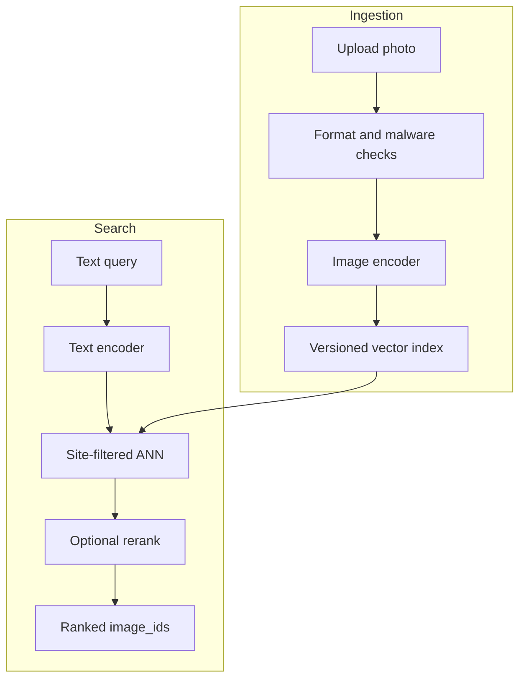
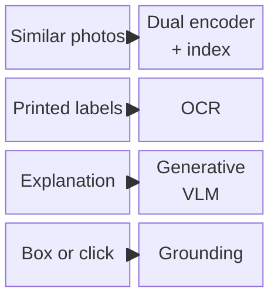

---
{
  "id": "vision-language-models-clip-beyond",
  "title": "Vision-Language Models & CLIP",
  "slug": "vision-language-models-clip-beyond",
  "category": "Multimodal Models",
  "difficulty": "Hard",
  "coverImage": "illustrations/_generated/clip_vlm_dark.png",
  "companies": [
    "Google",
    "OpenAI",
    "Meta",
    "Anthropic",
    "DeepMind"
  ],
  "shortDescription": "A single rack photo can find similar past inspections in milliseconds, yet fail to read a 6-character asset tag or count blocked vents. Master CLIP, SigLIP, ViT patchification, and VLM connectors.",
  "keyConceptsTested": [
    "CLIP's contrastive image-text pre-training",
    "Zero-shot classification via text prompts",
    "Vision backbones and CLIP variants (ViT, ResNet, SigLIP, EVA-CLIP)",
    "Limitations of CLIP embeddings",
    "Modern VLM architectures (LLaVA, BLIP-2, Qwen-VL)",
    "Multimodal projection layers",
    "Visual grounding and spatial reasoning",
    "Image tokenization strategies",
    "Adaptive visual token pruning and merging",
    "Visual token budgets, prefill cost, and KV cache pressure"
  ],
  "section": "System Design Capstones",
  "order": 6,
  "prerequisites": [
    "design-llm-powered-search-engine",
    "embeddings-cosine-dot-product-quantization",
    "vision-transformers-image-encoders",
    "long-context-window-management",
    "kv-cache-paged-attention-llm-serving",
    "hybrid-search-dense-sparse-retrieval"
  ],
  "relatedQuestions": [
    "multimodal-llms-architecture-design",
    "image-generation-diffusion-models",
    "design-real-time-voice-ai-agent",
    "design-conversational-ai-support-bot",
    "file-ingestion-pdfs-html-ocr-markdown",
    "design-llm-powered-search-engine"
  ]
}
---

A single rack photograph exposes the central split in vision-language engineering. Type `"blocked vent on rack door"` into a search bar and a dual-encoder index finds matching inspections across 10 million photos in milliseconds. Ask the exact same model to read the printed asset tag `"B-08"` or draw a box around each blocked vent, and a pooled similarity vector goes blind. Why can one 768-number embedding rank millions of images accurately while failing to count three vents or read four characters?

The answer lies in what happens to spatial information inside the vision stack. Contrastive Language-Image Pre-training (<span data-glossary="clip">CLIP</span>) aligns whole images and captions inside one shared unit hypersphere, making open-vocabulary retrieval fast and cheap.[^radford2021] Reading small labels, counting objects, and explaining hazards requires keeping spatial patch tokens alive and routing them through OCR, object detectors, or generative <span data-glossary="vision-language-model">vision-language models (VLMs)</span>. In this lesson, we design a data-center visual inspection stack and trace every layer from CLIP and SigLIP contrastive math to ViT patchification, LLaVA/BLIP-2/Flamingo/Qwen-VL connectors, and adaptive visual token pruning.

## Product brief: data-center visual inspection

Our system lets technicians upload rack photos, search past inspections with natural language, and inspect hazards with OCR or grounded VLM explanations. Dual encoders (CLIP or SigLIP) serve fast first-pass retrieval; OCR, grounding detectors, and generative VLMs handle tasks that need exact strings, bounding boxes, or written explanations.

### Requirements and API

- `POST /v1/inspection-images` accepts an immutable image reference, site, rack ID, capture time, and <span data-glossary="idempotency">idempotency</span> key, returning `image_id`, ingestion status, and active encoder version.
- `POST /v1/inspection-search` accepts `query`, site filters (intersected with server-authenticated permissions), and `limit`, returning ranked `image_id` entries, similarity scores, thumbnails, and review state.
- `POST /v1/inspection-analysis` accepts `image_id`, `question`, and requested evidence type, returning `answer`, OCR spans or bounding boxes, model versions, and status (`answered`, `abstained`, or `review`).
- **Latency and safety:** target p95 under 300 ms for search and under 3 seconds for analysis; enforce site permissions before candidate scoring and never auto-close a hazard without verification.

### Data flow and sizing

Separate cheap offline indexing and sub-second search from heavy generative VLM analysis so traffic bursts on one path never starve the other:



Size the vector index from raw embedding bytes first. Storing 10 million 768-dimensional <span data-glossary="fp16">FP16</span> embeddings takes:

$$
10{,}000{,}000 \times 768 \times 2\text{ bytes} = 15.36\text{ GB}
$$

An <span data-glossary="hnsw">HNSW</span> graph or <span data-glossary="ivf">IVF</span> index plus metadata typically adds a 2x to 4x multiplier (roughly 31 to 61 GB per index generation, before replicas or overlapping migration generations). At 100 <span data-glossary="qps">QPS</span>, isolate the lightweight text-encoder + ANN search <span data-glossary="gpu">GPU</span> pool from the heavier generative VLM pool.

### Recovery, rollout, and evaluation

Four operational rules prevent silent retrieval corruption:

1. **Paired index generations:** two independently trained CLIP models with the same 768-d width do **not** share a coordinate system. Always deploy the image encoder, text encoder, image preprocessing, L2 normalization, and vector index together as one versioned generation, keeping the previous generation ready to switch back.
2. **Pre-filtered permissions:** intersect requested sites with server-authenticated permissions *before* ANN scoring, and recheck permissions on every analysis read or cache hit so revoked access takes effect immediately.
3. **Untrusted uploads and OCR text:** cap decoded pixel dimensions and tile counts (not just compressed bytes), strip location metadata, and treat printed text inside photos as untrusted data rather than executable instructions.
4. **Sliced release checks:** evaluate retrieval Recall@10, hazard false-negative rate, asset-tag OCR exact match, grounding IoU, and p95 latency separately across sites, cameras, and lighting conditions before promoting a new index generation.

## Score the rack photo with text first

### Embeddings are the first inspection index

When a technician searches `"blocked vent on rack door"`, each stored image is already an offline 768-d **<span data-glossary="embedding">embedding</span>**, and the query becomes one 768-d vector at request time. **<span data-glossary="cosine-similarity">Cosine similarity</span>** (the dot product of L2-normalized vectors) ranks candidates between -1 and 1 without touching raw pixels at query time. Remember that cosine similarity is a relative ranking score, not a calibrated hazard probability.

```checkpoint
What does cosine similarity measure in CLIP-style systems?
---
It measures directional alignment between L2-normalized image and text embeddings in a shared space, ranking matching pairs above mismatches without acting as a calibrated probability.
```

### Why `rack_hazard` is a bad first index

A traditional supervised classifier trained on a fixed class `rack_hazard` cannot search for a brand-new failure mode next week (`"loose fiber bend near top tray"`) without collecting labeled photos and retraining a classifier head. Training on natural-language image-caption pairs teaches open-vocabulary alignment instead, letting engineers score new text descriptions immediately after validating them on real site photos.

```checkpoint
Why is open-vocabulary classification different from fixed-label classification?
---
Fixed-label classifiers only predict categories frozen at training time. Open-vocabulary models embed arbitrary text prompts at inference time so new classes can be scored without retraining a classifier head.
```

### Shared image-text space

CLIP learned this shared coordinate system from 400 million web `(image, text)` pairs (WebImageText).[^radford2021] One encoder transforms pixels and the other transforms text, and both project into the same hypersphere where matched pairs point in the same direction.

```checkpoint
What is the shared image-text space buying you?
---
It places images and natural-language queries in one common vector space so stored images can be indexed once offline and ranked against arbitrary text prompts at query time.
```

## Two encoders, one rack-photo score

### Architecture[^radford2021]

CLIP trains an image tower (ResNet or ViT) and a <span data-glossary="transformer">Transformer</span> text tower independently, joining them only at the end via linear projections and L2 normalization.[^radford2021]

<figure>
  
  <figcaption>L2 normalization projects embeddings onto the unit sphere so vector magnitude cannot override directional alignment (raw dot 9.0 vs 0.8 becomes cosine 0.6 vs 0.8).</figcaption>
</figure>

> **Common mistake:** Standard CLIP `encode_image` and `encode_text` methods return unnormalized features, and the default CLIP text tower caps prompts at 77 tokens (truncating silently if `truncate=True`).[^openaiClipImplementation2026] Skipping L2 normalization before inner-product search lets high-norm captions beat closer directional matches.

```checkpoint
Why is CLIP called a dual-encoder model?
---
It runs separate image and text encoders that produce embeddings in the same shared dimension and score pairs by vector similarity rather than generating text.
```

### Training objective

For a batch of $N$ paired images and captions, let $I_i$ and $T_j$ be L2-normalized embeddings. CLIP computes the $N \times N$ scaled similarity <span data-glossary="logits">logit</span> matrix:

$$
z_{ij} = \exp(t) \cdot I_i^\top T_j = \frac{I_i^\top T_j}{\tau}
$$

where $t$ is a learned log-scale parameter (initialized near $1/\tau \approx 1/0.07$ and clamped at $\exp(t) \le 100$).[^radford2021] The $N$ diagonal pairs $(i, i)$ are positives and the $N^2 - N$ off-diagonal pairs are in-batch negatives. Symmetric InfoNCE <span data-glossary="cross-entropy">cross-entropy</span> averages image-to-text (row-wise) and text-to-image (column-wise) losses:

$$
\mathcal{L}_{I \rightarrow T} = -\frac{1}{N}\sum_{i=1}^{N}\log\frac{\exp(z_{ii})}{\sum_{j=1}^{N}\exp(z_{ij})},
\qquad
\mathcal{L}_{T \rightarrow I} = -\frac{1}{N}\sum_{i=1}^{N}\log\frac{\exp(z_{ii})}{\sum_{j=1}^{N}\exp(z_{ji})},
\qquad
\mathcal{L} = \frac{\mathcal{L}_{I \rightarrow T} + \mathcal{L}_{T \rightarrow I}}{2}
$$

<figure>
  
  <figcaption>Symmetric InfoNCE over a 3x3 batch (temperature 0.2). Row-wise softmax scores image-to-text matching; column-wise softmax scores text-to-image matching.</figcaption>
</figure>

Original CLIP trained with a huge batch size of $N = 32{,}768$ so every image competed against 32,767 negative captions.[^radford2021] Let's implement symmetric CLIP loss in NumPy and also observe what happens when two off-diagonal items depict the exact same concept (a **false negative** collision):

<!-- leetllm: test, output=show -->
```python title="training-objective.py" id=clip-math
import numpy as np

def l2_normalize(x: np.ndarray) -> np.ndarray:
    norms = np.linalg.norm(x, axis=-1, keepdims=True)
    if np.any(norms == 0):
        raise ValueError("embedding norm must be nonzero")
    return x / norms

def clip_loss(image_embeds: np.ndarray, text_embeds: np.ndarray, temperature: float = 0.2) -> tuple[float, np.ndarray]:
    images = l2_normalize(np.asarray(image_embeds, dtype=float))
    texts = l2_normalize(np.asarray(text_embeds, dtype=float))
    logits = (images @ texts.T) / temperature
    idx = np.arange(len(logits))

    def row_ce(mat: np.ndarray) -> float:
        shifted = mat - mat.max(axis=-1, keepdims=True)
        lse = np.log(np.sum(np.exp(shifted), axis=-1)) + mat.max(axis=-1)
        return float(np.mean(lse - mat[idx, idx]))

    return 0.5 * (row_ce(logits) + row_ce(logits.T)), logits

img_clean = np.array([[0.95, 0.05, 0.00], [0.05, 0.92, 0.03], [0.00, 0.07, 0.94]])
txt_clean = np.array([[0.91, 0.08, 0.01], [0.06, 0.89, 0.04], [0.02, 0.09, 0.90]])
loss_clean, logits = clip_loss(img_clean, txt_clean)
print("clean logit matrix:\n", np.round(logits, 2))
print(f"clean symmetric_loss: {loss_clean:.3f}")

# False-negative collision: pair 0 and pair 1 both show the same blocked-airflow concept
img_dup = np.array([[0.95, 0.05, 0.00], [0.92, 0.08, 0.00], [0.00, 0.07, 0.94]])
txt_dup = np.array([[0.91, 0.09, 0.00], [0.89, 0.11, 0.00], [0.02, 0.09, 0.90]])
loss_dup, _ = clip_loss(img_dup, txt_dup)
print(f"false-negative collision loss: {loss_dup:.3f} (penalizes valid off-diagonal matches)")
```

<!-- leetllm: output:start -->
```text title="Output" output compact
clean logit matrix:
 [[5.   0.6  0.14]
 [0.71 5.   0.66]
 [0.09 0.59 5.  ]]
clean symmetric_loss: 0.022
false-negative collision loss: 0.469 (penalizes valid off-diagonal matches)
```
<!-- leetllm: output:end -->

When two different photos of the same blocked-airflow hazard appear in the same batch, the loss jumps more than 20x (from `0.022` to `0.464`), actively pushing their embeddings apart.

```checkpoint
In a batch of 3 images and 3 captions, which pairs should the contrastive loss reward?
---
Only the 3 diagonal (image_i, caption_i) pairs are positives; the 6 off-diagonal pairs are treated as negatives in both row-wise and column-wise cross-entropy.
```

```checkpoint
Why does original CLIP benefit from very large batch sizes?
---
InfoNCE relies on in-batch negatives; larger batches expose each image to thousands of harder wrong captions, sharpening the embedding geometry at the cost of cross-device synchronization.
```

### Training data

WebImageText's 400M noisy web pairs give broad semantic transfer,[^radford2021] but also introduce duplicate-concept collisions and web stereotypes.[^agarwal2021] When building a domain-specific dataset for inspection racks, split train and test sets by site and asset ID (preventing near-duplicate views of the same rack from leaking across splits), strip identifying shortcuts, and stratify evaluation by camera, lighting, and rare defects.

### Zero-shot classification

To classify an image without training a new head, embed natural-language class prompts (`"a photo of a rack hazard"`, `"a photo of a safe rack"`, `"a photo of a blocked asset tag"`), L2-normalize them, and rank by cosine similarity. On ImageNet, CLIP ViT-L/14@336px reached 76.2% zero-shot top-1 accuracy without seeing a single ImageNet label.[^radford2021]

#### Prompt engineering matters

Wrapping bare labels in sentence templates (`"a photo of a {label}"`) matches CLIP's pretraining distribution (+1.3 points on ImageNet), and averaging normalized embeddings across 80 context templates added another +3.5 points (nearly +5 points total).[^radford2021] In production, add an abstention rule requiring both a minimum cosine score and a minimum top-1 vs top-2 margin, routing borderline photos to human review.

Let's verify zero-shot scoring, prompt ensembling, the raw-dot vs cosine norm trap, and score/margin abstention in one NumPy snippet:

<!-- leetllm: test, output=show -->
```python title="zero-shot-classification.py" continue=clip-math
def softmax(x: np.ndarray) -> np.ndarray:
    shifted = x - np.max(x)
    e = np.exp(shifted)
    return e / np.sum(e)

# 1. Prompt ensembling for "rack hazard" across 4 templates
hazard_templates = np.array([
    [0.92, 0.20, 0.05],
    [0.88, 0.24, 0.07],
    [0.86, 0.28, 0.08],
    [0.82, 0.31, 0.12],
])
hazard_vec = l2_normalize(l2_normalize(hazard_templates).mean(axis=0, keepdims=True))[0]
class_names = ["rack_hazard", "safe_rack", "blocked_tag"]
class_vecs = l2_normalize(np.vstack([hazard_vec, [0.18, 0.88, 0.08], [0.48, 0.31, 0.81]]))

img = l2_normalize(np.array([0.89, 0.24, 0.08]))
cosines = class_vecs @ img
probs = softmax(12.0 * cosines)
print("ensemble cosines:", {k: round(float(v), 3) for k, v in zip(class_names, cosines)})
print("relative softmax:", {k: round(float(v), 3) for k, v in zip(class_names, probs)})
print("singleton softmax([-10]):", softmax(np.array([-10.0])).tolist())

# 2. Raw dot product vs L2-normalized cosine norm trap
probe_img = np.array([1.0, 0.0])
cap_a, cap_b = np.array([0.8, 0.6]), np.array([9.0, 12.0])  # norms 1 and 15
print(f"raw dot:   A={probe_img @ cap_a:.1f}, B={probe_img @ cap_b:.1f} -> picks B")
print(f"cosine:    A={l2_normalize(probe_img) @ l2_normalize(cap_a):.2f}, "
      f"B={l2_normalize(probe_img) @ l2_normalize(cap_b):.2f} -> picks A")

# 3. Score + margin abstention
def decide(scores: dict[str, float], min_score: float = 0.60, min_margin: float = 0.10) -> str:
    top2 = sorted(scores.items(), key=lambda kv: kv[1], reverse=True)[:2]
    if top2[0][1] < min_score or (top2[0][1] - top2[1][1]) < min_margin:
        return "review"
    return top2[0][0]

print("clear_hazard ->", decide({"rack_hazard": 0.87, "safe_rack": 0.12, "tag_blocked": 0.31}))
print("ambiguous    ->", decide({"rack_hazard": 0.56, "safe_rack": 0.53, "tag_blocked": 0.18}))
```

<!-- leetllm: output:start -->
```text title="Output" output compact
ensemble cosines: {'rack_hazard': 1.0, 'safe_rack': 0.453, 'blocked_tag': 0.618}
relative softmax: {'rack_hazard': 0.989, 'safe_rack': 0.001, 'blocked_tag': 0.01}
singleton softmax([-10]): [1.0]
raw dot:   A=0.8, B=9.0 -> picks B
cosine:    A=0.80, B=0.60 -> picks A
clear_hazard -> rack_hazard
ambiguous    -> review
```
<!-- leetllm: output:end -->

Notice `singleton softmax([-10]) = [1.0]`: <span data-glossary="softmax">softmax</span> normalizes over whatever candidate list you supply, so a terrible match still scores `1.0` if it is the only candidate. Always inspect raw cosine similarity alongside margin.

```checkpoint
What changes between training a new classifier head and doing CLIP zero-shot classification?
---
A classifier head learns fixed class weights from labeled images, whereas CLIP embeds text class prompts at inference time so categories can change without retraining.
```

```checkpoint
Why does prompt ensembling improve zero-shot classification?
---
Averaging L2-normalized embeddings across multiple prompt phrasings reduces sensitivity to wording quirks and produces a more stable class direction.
```

### Limitations of CLIP

One pooled image vector cannot answer every inspection question:

- **No localization or counting:** standard CLIP returns one global score, not bounding boxes or counts. Use open-vocabulary detectors such as Grounding DINO[^liu2023groundingdino] or grounded VLMs when box coordinates or vent counts matter.
- **No text generation:** dual encoders have no decoder head; explaining *why* a rack is unsafe requires a generative VLM.
- **Weak relational binding and fine OCR:** pooled embeddings can swap attributes (`"red toolbox beside blue cone"` vs `"blue toolbox beside red cone"`) and struggle on dense printed strings (zero-shot CLIP scores 88% on MNIST and only 51% on full-number SVHN).[^radford2021] Route printed asset tags to dedicated OCR.
- **Social bias:** web supervision encodes demographic and occupational stereotypes that require targeted evaluation before deployment.[^agarwal2021]

```checkpoint
Why is CLIP bad at counting and exact localization?
---
Its pooled output optimizes global image-text alignment rather than per-region coordinates, object counts, or spatial relations.
```

```checkpoint
When is CLIP the wrong tool even if it recognizes the concept?
---
Whenever the task requires generated explanations, bounding boxes, exact object counts, fine-grained OCR, or relational spatial reasoning.
```

## Vision encoder architectures

To keep spatial detail alive for a generative VLM, look one step *before* CLIP pools the image into one vector: the sequence of patch tokens emitted by the vision tower.

### Vision Transformer (ViT)[^dosovitskiy2020]

A **Vision Transformer (ViT)** slices an $H \times W \times C$ image into non-overlapping $P \times P$ patches, flattens each patch into $P^2 C$ scalars, linearly projects it to width $D$, adds positional embeddings (plus an optional `[CLS]` token), and runs bidirectional Transformer self-attention.[^dosovitskiy2020] Unlike ResNets (which start with local convolutions and build global receptive fields only in deep layers), ViT has global patch-to-patch attention from layer 1 and emits a Transformer-ready token sequence.

<figure>
  
  <figcaption>ViT patch tokenization on a 224x224 image with 16x16 patches: 14x14 = 196 patch tokens plus [CLS] and positional embeddings enter self-attention.</figcaption>
</figure>

Let's patchify a real 2D RGB tensor in NumPy and compare token counts across resolutions and crops:

<!-- leetllm: test, output=show -->
```python title="patch-token-budget.py"
import numpy as np

def vit_patchify(image: np.ndarray, patch_size: int, embed_dim: int) -> np.ndarray:
    H, W, C = image.shape
    gh, gw = H // patch_size, W // patch_size
    patches = image.reshape(gh, patch_size, gw, patch_size, C).transpose(0, 2, 1, 3, 4)
    flat = patches.reshape(gh * gw, patch_size * patch_size * C)
    rng = np.random.default_rng(0)
    proj = rng.standard_normal((flat.shape[1], embed_dim)) * 0.02
    return flat @ proj

img_224 = np.zeros((224, 224, 3), dtype=np.float32)
tokens_16 = vit_patchify(img_224, patch_size=16, embed_dim=768)
print("224px @ P=16 projected shape:", tokens_16.shape)

for label, size, p, crops in [
    ("thumbnail 224px", 224, 14, 1),
    ("crop 336px",      336, 14, 1),
    ("4x tiled 336px",  336, 14, 4),
]:
    n_tok = (size // p) ** 2 * crops
    print(f"{label:<16} -> {n_tok:4d} patch tokens")
```

<!-- leetllm: output:start -->
```text title="Output" output compact
224px @ P=16 projected shape: (196, 768)
thumbnail 224px  ->  256 patch tokens
crop 336px       ->  576 patch tokens
4x tiled 336px   -> 2304 patch tokens
```
<!-- leetllm: output:end -->

| Feature | Vision Transformer (ViT) | ResNet (CNN) |
| :--- | :--- | :--- |
| **Context** | Global <span data-glossary="self-attention">self-attention</span> from layer 1 | Local kernels building global context in deep layers |
| **Inductive bias** | Low; scales strongly with large datasets | High locality and translation equivariance |
| **VLM interface** | Native patch token sequence | Spatial feature map flattened by connector |

```checkpoint
How many patch tokens does a 224x224 image produce with 16x16 ViT patches?
---
224 / 16 = 14 patches per side, giving 14 x 14 = 196 patch tokens (plus an optional [CLS] token).
```

### SigLIP[^zhai2023]

CLIP's global softmax forces every GPU in a distributed batch to synchronize row and column normalizers. **SigLIP (Sigmoid Loss for Language-Image Pre-training)** replaces global softmax with independent pairwise binary classification:[^zhai2023]

$$
\mathcal{L} = -\frac{1}{N} \sum_{i=1}^{N} \sum_{j=1}^{N} \log \sigma\big(z_{ij} \cdot (t \cdot v_i^\top u_j + b)\big)
$$

Here $z_{ij} = +1$ for matched pairs and $-1$ for mismatches, $t = \exp(t_0)$ is a learned positive scale ($t_0$ initialized to $\log 10$), and $b$ is a learned bias initialized to $-10$ so initial predictions favor negatives in an imbalanced batch. Crucially, SigLIP sums all $N^2$ pair losses and **divides by $N$**, not $N^2$; dividing by $N^2$ shrinks loss and gradients by another factor of $N$. Because pairs do not share a softmax denominator, SigLIP chunks cleanly across devices and outperforms softmax CLIP at moderate batch sizes (below 16k), saturating around 32k.[^zhai2023]

<!-- leetllm: test, output=show -->
```python title="siglip-pairwise-loss.py"
import numpy as np

def siglip_pair_loss(logits: np.ndarray, labels: np.ndarray) -> np.ndarray:
    return np.logaddexp(0.0, -labels * logits)

for name, score, label in [("same_asset", 3.2, 1.0), ("wrong_caption", -2.1, -1.0), ("hard_negative", 0.4, -1.0)]:
    print(f"{name:<14} loss={float(siglip_pair_loss(score, label)):.3f}")

# 2x2 batch with all-zero logits: each pair costs log(2) = 0.693
batch_logits = np.zeros((2, 2))
batch_labels = 2.0 * np.eye(2) - 1.0
total = float(siglip_pair_loss(batch_logits, batch_labels).sum())
print(f"paper reduction (/N):   {total / 2:.3f}")
print(f"pair mean (/N^2):       {total / 4:.3f}")
```

<!-- leetllm: output:start -->
```text title="Output" output compact
same_asset     loss=0.040
wrong_caption  loss=0.116
hard_negative  loss=0.913
paper reduction (/N):   1.386
pair mean (/N^2):       0.693
```
<!-- leetllm: output:end -->

**SigLIP 2** adds captioning pretraining, self-distillation, and masked prediction for stronger VLM backbone transfer; its **NaFlex** variants also preserve native aspect ratios across resolutions when paired with NaFlex preprocessing.[^zhai2025siglip2][^googleSiglip2Implementation2026]

```checkpoint
What does SigLIP change relative to CLIP's softmax loss?
---
It scores every image-text pair independently with a binary sigmoid loss instead of a batch-wide softmax, easing distributed chunking and improving smaller-batch performance.
```

### EVA-CLIP: scaling vision backbones with masked pretraining[^sun2023evaclip]

Training billion-parameter ViTs from scratch with pure contrastive loss is unstable and sample-hungry. **EVA-CLIP** initializes the vision tower from an EVA masked image modeling (MIM) teacher, giving strong spatial features on step 1 and enabling smooth scaling: EVA-02-CLIP-L/14+ (~430M parameters) hits 80.4% ImageNet zero-shot top-1 and EVA-02-CLIP-E/14+ (5.0B parameters) reaches 82.0%.[^sun2023evaclip]

```checkpoint
Why does EVA-CLIP initialize its vision tower with masked image modeling?
---
MIM pretraining supplies stable, rich spatial representations before contrastive training begins, accelerating convergence and stabilizing billion-parameter ViT scaling.
```

## Modern VLMs: from alignment to generation

When a technician asks `"what is blocking barcode B-08?"`, retrieval scores are not enough. A generative VLM connects the vision encoder's spatial tokens to an LLM through a **connector** that trades visual detail against prefix token count:

<figure>
  
  <figcaption>Three connector patterns: LLaVA-1.5 places 576 patch tokens in the text prefix, BLIP-2 compresses features into 32 learned queries, and Flamingo stores 64 resampled tokens in a cross-attention memory bank.</figcaption>
</figure>

### LLaVA: the straightforward projector path[^liu2023a]

Original **LLaVA** pairs a frozen CLIP ViT-L/14 with Vicuna via a single linear projection matrix $W$, trained in two stages: 595K filtered CC3M captions for projector alignment, then 158K GPT-4-synthesized multimodal instructions (generated from captions and boxes, so noisy annotations can propagate into training targets) to tune both projector and LLM.[^liu2023a] **LLaVA-1.5** swaps in a 2-layer MLP connector and a 336px CLIP encoder, emitting $24 \times 24 = 576$ prefix tokens per image.[^liu2023b]

```checkpoint
What is the core LLaVA architecture recipe?
---
Project patch features from a pretrained vision encoder into the LLM's hidden dimension and concatenate them with text tokens, training first for feature alignment and then for visual instruction tuning.
```

### Common multimodal training ladder

| Stage | Objective | What it teaches |
|---|---|---|
| **Contrastive pretraining** | Image-text matching (CLIP, SigLIP)[^radford2021][^zhai2023] | Shared semantic retrieval space |
| **Connector alignment** | Train connector with frozen backbones | Maps visual features into LLM embedding space |
| **Multimodal instruction tuning** | Image + prompt $\to$ structured answer[^liu2023a] | Task format, OCR reading, and grounded dialogue |
| **Preference / safety post-training** | Chosen vs rejected pairs | Abstention, citation faithfulness, and safety |

Diagnose failures by stage: if the model reads a gauge accurately (`"42 psi"`) but writes a paragraph instead of the requested `value/unit` JSON fields, target **multimodal instruction tuning**, not contrastive pretraining.

### BLIP-2 and the Q-Former: compress before the LLM[^li2023]

**BLIP-2** inserts a **Q-Former** between a frozen ViT and frozen LLM: 32 learned query <span data-glossary="vector">vectors</span> (width 768) cross-attend over all encoder patches, compressing 257+ visual features into exactly 32 tokens regardless of input resolution.[^li2023] BLIP-2 beat Flamingo-80B by 8.7 points on zero-shot VQAv2 with $54\times$ fewer trainable parameters,[^li2023] though aggressive compression must be tested on fine asset-tag OCR.

```checkpoint
Why does BLIP-2 put a Q-Former before the LLM?
---
Its 32 learned queries extract a fixed-size visual summary from the frozen encoder, keeping LLM prefix length and prefill cost constant even as encoder resolution grows.
```

### Flamingo-style resampling: preserve more context without exploding token count[^alayrac2022]

**Flamingo** encodes visual inputs with a frozen contrastively pretrained NFNet-F6, compresses each image or video clip into 64 tokens via a **Perceiver Resampler**, and exposes that bank to a frozen LLM through $\tanh$-gated <span data-glossary="cross-attention">cross-attention</span> blocks initialized at zero.[^alayrac2022] Each text token attends directly to the most recent preceding visual bank while keeping raw patches out of the causal text prefix, making Flamingo attractive for interleaved multi-image prompts and video.

```checkpoint
When is a Flamingo-style resampler more attractive than simple projection?
---
When prompts interleave multiple images or long video streams and the decoder needs revisitable visual memory without inflating the causal text prefix with thousands of raw patches.
```

### Qwen-VL: grounding and text reading beyond caption matching[^bai2023a]

**Qwen-VL** adds multi-stage training explicitly supervised on OCR and bounding-box grounding.[^bai2023a] High-resolution tiling preserves small characters, but projected visual tokens hit serving twice: they lengthen <span data-glossary="prefill">prefill</span> and expand the resident <span data-glossary="kv-cache">KV cache</span> (<span data-glossary="pagedattention">PagedAttention</span> packs KV blocks efficiently,[^kwon2023] but cannot erase token count).

<figure>
  
  <figcaption>Visual token ladder at 14px patches: moving from one 224px view to four 336px tiles multiplies visual tokens 9x (from 256 to 2,304), expanding both prefill work and KV cache.</figcaption>
</figure>

<!-- leetllm: test, output=show -->
```python title="visual-prefix-serving-budget.py"
def prefix_summary(text_tokens: int, crops: int, patches_per_crop: int, compressed_total: int | None = None) -> tuple[int, float]:
    vis = compressed_total if compressed_total is not None else crops * patches_per_crop
    total = text_tokens + vis
    kv_mib = total * (128 / 1024)  # 128 KiB/token (32 layers, 8 KV heads, 128 dim, FP16)
    return total, kv_mib

raw_tok, raw_kv = prefix_summary(180, crops=4, patches_per_crop=576)
cmp_tok, cmp_kv = prefix_summary(180, crops=4, patches_per_crop=576, compressed_total=64)
print(f"4x raw tiles prefix:   {raw_tok:4d} tokens  ({raw_kv:.1f} MiB KV)")
print(f"global 64-tok prefix:  {cmp_tok:4d} tokens  ({cmp_kv:.1f} MiB KV, saves {raw_tok - cmp_tok} tokens)")
```

<!-- leetllm: output:start -->
```text title="Output" output compact
4x raw tiles prefix:   2484 tokens  (310.5 MiB KV)
global 64-tok prefix:   244 tokens  (30.5 MiB KV, saves 2240 tokens)
```
<!-- leetllm: output:end -->

Note the difference between a global 64-token resampler (64 tokens total across all 4 crops) and a per-crop 64-token resampler (`4 x 64 = 256` tokens). Always track <span data-glossary="evaluation-slice">failure slices</span> alongside memory savings.[^li2023][^alayrac2022]

```checkpoint
Why can high-resolution document images hurt projected-prefix VLM serving twice?
---
Large visual prefixes increase prefill compute quadratically and simultaneously enlarge the KV cache held throughout autoregressive decode.
```

### Adaptive pruning and merging under a latency budget

Blank rack walls do not need the same visual tokens as a dense wiring panel. Adaptive reducers estimate per-token saliency, **pruning** redundant patches or **merging** them into retained representatives. **PruMerge** uses sparse attention between `[CLS]` and spatial patches to pick salient tokens, then folds related pruned tokens into nearest kept tokens via weighted averaging.[^shang2024prumerge]

To keep tail latency and small-label recall safe simultaneously, pair adaptive reduction with a hard maximum cap and a protected evidence floor (for OCR boxes or small-object proposals):

$$
N_{\text{retained}} = \min\left(N_{\text{adaptive}},\, N_{\text{route\_max}}\right)
$$

| Control | Purpose |
|---|---|
| Hard maximum tokens | Prevents dense screenshots from spiking p95 prefill and VRAM |
| Protected evidence floor | Stops saliency ranking from deleting tiny warning labels or OCR boxes |
| Spatial coverage | Preserves background context when saliency clusters on one object |
| Token-count buckets | Minimizes padding waste across adaptive batches |

If protected tokens alone exceed the route cap, route to a slower path or `review` rather than silently dropping required evidence. Let's run a miniature NumPy PruMerge step with a protected warning-label token:

<!-- leetllm: test, output=show -->
```python title="adaptive-token-prumerge.py"
import numpy as np

names = ["rack-door", "logo", "cable", "warning-text"]
cls_attn = np.array([0.52, 0.25, 0.18, 0.05])  # warning-text has lowest global saliency
feats = np.array([
    [0.90, 0.10, 0.00],  # rack-door
    [0.85, 0.15, 0.00],  # logo (similar to rack-door)
    [0.10, 0.90, 0.00],  # cable
    [0.05, 0.10, 0.99],  # warning-text
])

def prumerge_with_floor(cls_scores: np.ndarray, tokens: np.ndarray, protected: set[int], cap: int):
    if len(protected) > cap:
        return None, None
    order = np.argsort(-cls_scores)
    kept = set(protected)
    for idx in order:
        if len(kept) >= cap:
            break
        kept.add(int(idx))
    kept_idx = sorted(kept)
    pruned_idx = [i for i in range(len(tokens)) if i not in kept]

    # Merge each pruned token into its most similar kept token (weighted by cls_attn)
    normed = tokens / np.linalg.norm(tokens, axis=-1, keepdims=True)
    merged = tokens[kept_idx].copy()
    weights = cls_scores[kept_idx].copy()
    for p in pruned_idx:
        sim = normed[p] @ normed[kept_idx].T
        target = int(np.argmax(sim))
        w = cls_scores[p]
        merged[target] = (merged[target] * weights[target] + tokens[p] * w) / (weights[target] + w)
        weights[target] += w
    return kept_idx, merged

kept_idx, merged = prumerge_with_floor(cls_attn, feats, protected={0, 3}, cap=2)
print("saliency_only top-2:", [names[i] for i in np.argsort(-cls_attn)[:2]])
print("protected kept:     ", [names[i] for i in kept_idx])
print("merged rack-door:   ", np.round(merged[0], 3).tolist())
print("cap=1 result:       ", "review" if prumerge_with_floor(cls_attn, feats, {0, 3}, cap=1)[0] is None else "ok")
```

<!-- leetllm: output:start -->
```text title="Output" output compact
saliency_only top-2: ['rack-door', 'logo']
protected kept:      ['rack-door', 'warning-text']
merged rack-door:    [0.735, 0.265, 0.0]
cap=1 result:        review
```
<!-- leetllm: output:end -->

Saliency alone dropped `warning-text` in favor of `logo`. Protecting `{rack-door, warning-text}` keeps the warning intact while folding `logo` into `rack-door` by cosine similarity, and `cap=1` returns `review` because two protected tokens cannot fit in one slot.

```checkpoint
Why does an adaptive token reducer still need a hard maximum and protected evidence floors?
---
The hard cap protects tail latency and VRAM on dense images, while protected floors prevent fast-path saliency pruning from deleting tiny OCR regions or safety labels.
```

## Connector design controls a serving trade-off

Four connector families span the trade-off between simplicity, token budget, and spatial fidelity:

1. **Linear projector (LLaVA):** changes channel width only; keeps all patch tokens.[^liu2023a]
2. **2-layer MLP (LLaVA-1.5):** adds nonlinear projection capacity while keeping full patch count.[^liu2023b]
3. **Q-Former / Perceiver resampler (BLIP-2, Flamingo):** compresses variable visual grids into a fixed token bank.[^li2023][^alayrac2022]
4. **Convolutional / locality-aware abstractors (Honeybee C-Abstractor):** preserve 2D neighborhood structure while downsampling tokens for OCR and grounding.[^cha2023]

```checkpoint
How do you choose between a linear projector, MLP, Q-Former, and locality-aware adapter?
---
Pick linear/MLP for simple full-grid alignment, Q-Former/Perceiver when fixed low token budgets dominate, and locality-aware abstractors when OCR or box grounding requires 2D spatial structure.
```

## Designing around unpublished internals

Closed VLM APIs rarely disclose their exact projector type, vision resolution schedule, or training mixture. Treat them as measured black-box dependencies: benchmark token billing by image size, latency vs image count, OCR exact match, grounding IoU, and schema adherence rather than speculating about unpublished connectors.

```checkpoint
What is the safe way to discuss closed VLM architectures?
---
Report observed API behavior, measured latency, and slice metrics rather than guessing unverified projector architectures or training recipes.
```

## Evaluation

Retrieval, OCR, localization, and explanation fail independently. Never average them into one headline number:

| Inspection task | Metric | Blind spot to guard against |
|---|---|---|
| Find similar racks | Recall@10 | Unauthorized candidates or stale index versions |
| Read asset tag | Exact match, CER | High accuracy achieved by abstaining on hard tags |
| Locate blocked vent | Box IoU + detection recall | Mean IoU averaged only over detected boxes hides misses |
| Explain hazard | Verified claim support | Fluent answers citing unseen features |
| Escalate uncertain cases | Risk-coverage curve | Threshold tuned on one site failing under new lighting |

<!-- leetllm: test, output=show -->
```python title="vlm-evaluation-slices.py"
import numpy as np

def box_iou(a: tuple[float, ...], b: tuple[float, ...]) -> float:
    w = max(0.0, min(a[2], b[2]) - max(a[0], b[0]))
    h = max(0.0, min(a[3], b[3]) - max(a[1], b[1]))
    inter = w * h
    area = lambda box: (box[2] - box[0]) * (box[3] - box[1])
    union = area(a) + area(b) - inter
    return inter / union if union > 0 else 0.0

rows = [
    {"rel": {"rack-a"}, "ret": ["rack-a"],          "tag": "A-17", "ocr": "A-17", "gt": (0, 0, 1, 1), "pred": (0, 0, 1, 1)},
    {"rel": {"rack-b"}, "ret": ["other", "rack-b"], "tag": "B-08", "ocr": "B-O8", "gt": (0, 0, 1, 1), "pred": (0, 0, 1, 1)},
    {"rel": {"rack-c"}, "ret": ["rack-c"],          "tag": "C-42", "ocr": "C-42", "gt": (0, 0, 1, 1), "pred": (0, 0, 0.5, 0.5)},
]

metrics = {
    "retrieval_recall_at_10": float(np.mean([len(set(r["ret"][:10]) & r["rel"]) / len(r["rel"]) for r in rows])),
    "ocr_exact_match": float(np.mean([r["ocr"] == r["tag"] for r in rows])),
    "mean_box_iou": float(np.mean([box_iou(r["pred"], r["gt"]) for r in rows])),
}
floors = {"retrieval_recall_at_10": 0.90, "ocr_exact_match": 0.92, "mean_box_iou": 0.70}
failed = [k for k, v in metrics.items() if v < floors[k]]
print({k: round(v, 3) for k, v in metrics.items()})
print("failed_slices:", failed)
```

<!-- leetllm: output:start -->
```text title="Output" output compact
{'retrieval_recall_at_10': 1.0, 'ocr_exact_match': 0.667, 'mean_box_iou': 0.75}
failed_slices: ['ocr_exact_match']
```
<!-- leetllm: output:end -->

A single `0` vs `O` swap (`B-O8`) fails the OCR slice even while retrieval hits `1.0` and box IoU clears `0.70`.

```checkpoint
Why is one VLM benchmark insufficient for deployment?
---
Retrieval, captioning, OCR, grounding, and reasoning test distinct capabilities; strong average VQA scores routinely hide character errors on asset tags or missed hazard boxes.
```

## Production applications

### Document understanding

Dense documents pack small fonts, tables, and diagrams that vanish under square resizing. Tile pages into high-resolution crops with saved coordinates, run dedicated OCR for exact string extraction, and invoke a generative VLM when layout reasoning or interpretation is needed.

```checkpoint
What is the core design goal for document understanding with VLMs?
---
Preserve task-critical text, tables, and layout cues inside a predictable visual-token budget rather than blindly maximizing raw pixel resolution.
```

### Image search and retrieval

Use a dual encoder (CLIP or SigLIP) for first-stage search so image embeddings are computed offline once and queried with a single text forward pass. Reserve expensive generative VLMs for second-stage reranking or explanation.



```checkpoint
Why is CLIP or SigLIP usually better than a generative VLM for first-pass image search?
---
Dual encoders precompute and index image embeddings offline, requiring only one fast text encode and ANN lookup per query instead of running a full multimodal decoder over every candidate.
```

### Visual agents

GUI and inspection agents need executable coordinates (`click(x, y)`, bounding boxes, field targets), not prose like `"near the top right."` Pair the VLM with a grounding model for exact regions, and verify destructive actions (such as disabling a switch port) through external checks and human confirmation rather than trusting a model-generated approval string.

```checkpoint
Why do visual agents need grounding beyond captioning?
---
Executing UI or hardware actions requires exact coordinates or bounding boxes paired with external action checks, not free-form spatial descriptions.
```

## Common pitfalls

### "One pooled CLIP embedding understands an image like a person does"
CLIP optimizes global image-text similarity, not dense spatial localization or counting. Use object detectors or grounded VLMs when coordinates and counts matter.

### "CLIP or SigLIP can also serve my chat and captioning path"
Dual encoders return similarity scalars, not sentences. Keep them on retrieval and zero-shot ranking, and route open-ended explanation to a generative VLM.

### "Higher resolution always means better OCR"
Raising resolution without selective tiling or compression explodes patch tokens quadratically while adding seams and latency. Tile selectively and measure OCR recall per token.

### "Visual serving cost ends when the encoder finishes"
Encoder latency is only the start: projected visual prefixes drive quadratic prefill compute and stay resident in KV-cache VRAM throughout decode.

### "Adaptive pruning makes the latency budget self-enforcing"
Unconstrained saliency pruning can spike on dense images or erase tiny warning text. Pair adaptive reducers with a hard token cap, protected OCR floors, and a fallback review route.

### "Every in-batch non-match is a clean negative"
Two photos of the same rack hazard in one batch create a false-negative collision that penalizes valid matches. Deduplicate and curate batches carefully.

### "Zero-shot prompts will hold in fine-grained domains"
Specialist terminology and camera shifts make single generic templates brittle. Ensemble prompts, calibrate score/margin thresholds on held-out site data, and fine-tune when precision demands it.

## What the inspection system must prove

Before shipping a visual inspection stack, verify six capabilities end to end:

- Dual-encoder image-text alignment in one L2-normalized embedding space with paired index generations.
- Exact symmetric InfoNCE (CLIP) and pairwise sigmoid (SigLIP) loss computation, including false-negative collision checks.
- Zero-shot prompt ensembling with score-and-margin abstention rules.
- Explicit separation of global retrieval from OCR, grounding detection, and generative explanation.
- Connector trade-offs across LLaVA, BLIP-2, Flamingo, and Qwen-VL.
- Visual-token and KV-cache sizing with hard caps and protected evidence floors for adaptive reduction.

### Evaluation rubric

- Derive both directions of CLIP InfoNCE and distinguish SigLIP's `/N` reduction from a `/N^2` pair mean.
- Reject zero-norm vectors, verify L2 normalization before inner-product search, and distinguish cosine scores from candidate-relative softmax weights.
- Bind image/text encoders, preprocessing, and vector index generations together; enforce server-side permissions before retrieval and on every cache hit.
- Measure retrieval Recall@10, OCR exact match, and box IoU on separate held-out slices so no aggregate score hides lost characters or missed hazards.

### Follow-up questions

```checkpoint
Why does softmax return 1.0 for a single candidate with logit -10?
---
With only one term in the denominator, exp(-10) / exp(-10) = 1.0 regardless of match quality. Candidate-relative softmax cannot detect out-of-set inputs without raw cosine thresholds.
```

```checkpoint
For a two-example SigLIP batch with four zero logits, how do the paper's reduction and a pair mean differ?
---
Each pair contributes log(2) = 0.693. Summing all 4 pairs and dividing by N=2 gives 2 log(2) = 1.386, whereas dividing by N^2=4 gives log(2) = 0.693, cutting gradient scale in half.
```

```mastery-quiz
[
  {
    "question": "The highest inspection cosine is 0.62 and the runner-up 0.57. The acceptance rule requires score ≥ 0.60 and margin ≥ 0.08. Which result follows?",
    "options": [
      "Review: the score passes, but the 0.05 margin fails the declared rule.",
      "Accept: the top score passes, so the margin requirement is redundant.",
      "Review: the margin passes, but the 0.62 score fails the declared rule.",
      "Accept: the top candidate’s 62% probability clears a calibrated risk threshold."
    ],
    "answer": "Review: the score passes, but the 0.05 margin fails the declared rule.",
    "explanation": "The score 0.62 exceeds 0.60, but 0.62−0.57=0.05<0.08. Similarity is not calibrated hazard probability."
  },
  {
    "question": "A vision tower returns 216 patch vectors for a preview and 864 for the full scan. The decoder needs exactly 24 visual tokens for either input. Which connector meets that requirement?",
    "options": [
      "Average each group of 24 consecutive patch vectors into one token.",
      "Use a Q-Former with 24 learned queries over the patch vectors.",
      "Average the whole grid into one vector and project it onto 24 features.",
      "Apply a linear projector with 24 output features to each patch vector."
    ],
    "answer": "Use a Q-Former with 24 learned queries over the patch vectors.",
    "explanation": "Each learned query produces one weighted mixture of patches, so both scans yield 24 tokens. Averaging groups of 24 yields 9 tokens for the preview and 36 for the full scan. Averaging the whole grid yields one token with 24 features. Projecting each patch separately leaves 216 or 864 tokens, each with 24 features."
  },
  {
    "question": "A team asks pooled CLIP scoring to count obscured vents and return each vent’s box. Which diagnosis fits its standard interface?",
    "options": [
      "Its fixed label inventory prevents any text-defined inspection class from being scored.",
      "Its text-only input prevents inspection pixels from entering a common embedding space.",
      "Its global alignment output provides neither count-supervised regions nor coordinates.",
      "Its box output already solves grounding, while adding a decoder solves remaining counting."
    ],
    "answer": "Its global alignment output provides neither count-supervised regions nor coordinates.",
    "explanation": "Global matching is fundamentally different from localized detection and counting. Use grounded models or region features with task-specific metrics."
  },
  {
    "question": "Inspection search needs reusable offline image work under a 300 ms p95 target. Queries can name details missing from captions, and site access can be revoked. Two CLIP models, A and B, were trained independently and produce vectors of the same width. Which first-stage design should the team take to load testing?",
    "options": [
      "Index image vectors from A, query with B’s text tower, and use the site permissions saved with the result on cache hits.",
      "Index caption vectors from A, query with A’s text tower, and use the site permissions saved with the result on cache hits.",
      "Index caption vectors from A, query with B’s text tower, and use current site permissions to filter searches and cache hits.",
      "Index image vectors from A, query with A’s text tower, and use current site permissions to filter searches and cache hits."
    ],
    "answer": "Index image vectors from A, query with A’s text tower, and use current site permissions to filter searches and cache hits.",
    "explanation": "Store image vectors offline and encode each new query with the text tower paired to that index generation. Equal vector widths alone do not align independently trained towers. Permissions must be checked live on both searches and cache hits."
  },
  {
    "question": "Two off-diagonal examples in a diagonally labeled CLIP batch describe the same hazard. What must the trainer check?",
    "options": [
      "False negatives: related pairs receive negative labels despite useful semantic overlap.",
      "Positive expansion: the loss merges matching concepts without additional labels.",
      "Hardest-pair routing: these examples contribute after they become the top mismatches.",
      "Direction cancellation: averaging row and column losses removes duplicate effects."
    ],
    "answer": "False negatives: related pairs receive negative labels despite useful semantic overlap.",
    "explanation": "Both directions treat off-diagonal labels as negatives; semantic collisions are a batch/data concern."
  },
  {
    "question": "The image vector is [0,1]. Caption A is [0.6,0.8], while B is [12,5]. What does normalized cosine change relative to raw dot product?",
    "options": [
      "Raw picks A; cosine picks B at 5/13 over A at 0.8.",
      "Raw picks B; cosine picks A at 0.8 over B at 5/13.",
      "Raw and cosine both pick B because its vector has the larger norm.",
      "Raw and cosine tie because positive temperature removes vector-scale differences."
    ],
    "answer": "Raw picks B; cosine picks A at 0.8 over B at 5/13.",
    "explanation": "A has norm 1 and B norm 13. Raw dots are 0.8 and 5; normalized dots are 0.8 and 5/13≈0.385. Common scaling cannot repair norm-dependent ranking."
  },
  {
    "question": "Two 448×448 crops use 14×14 patches and a 160-token question. A width-only projector keeps every patch and no separators are counted. What is the language-prefix length?",
    "options": [
      "1,184",
      "2,048",
      "2,208",
      "288"
    ],
    "answer": "2,208",
    "explanation": "Each crop has 448 / 14 = 32 patches per side, or 1,024 patches. The projector keeps one token per patch, so the prefix has 2 × 1,024 + 160 = 2,208 tokens."
  },
  {
    "question": "An assistant reads a gauge correctly but writes a sentence when asked for separate value and unit fields. Each experiment uses the same verified chat template and tests accuracy and format on new gauges. Which training experiment best targets the error?",
    "options": [
      "Train the image and text encoders to match gauge photos with technicians’ captions.",
      "Fit the visual connector to generate gauge captions through a frozen language model.",
      "Train a reranker to match gauge questions with the crops technicians used for their readings.",
      "Fine-tune the decoder to predict technicians’ completed forms from gauge photos and questions."
    ],
    "answer": "Fine-tune the decoder to predict technicians’ completed forms from gauge photos and questions.",
    "explanation": "The assistant already reads the gauge. Multimodal instruction tuning on completed forms teaches it how to emit the requested structured output."
  },
  {
    "question": "An adaptive reducer meets average latency but drops small warning text on dense panels. Which serving setup protects both evidence and capacity?",
    "options": [
      "Use a hard token cap, protected evidence floors and spatial coverage; review infeasible cases.",
      "Use a hard token cap and saliency ranking; treat average OCR as proof each warning survives.",
      "Use output-token caps and decoder-latency buckets; review long answers after generation finishes.",
      "Use average retained count and generic VQA quality; retune the cap when tail latency gets worse."
    ],
    "answer": "Use a hard token cap, protected evidence floors and spatial coverage; review infeasible cases.",
    "explanation": "Hard caps limit tail latency while protected evidence floors and spatial coverage prevent pruning from erasing tiny critical text; infeasible cases route to review."
  },
  {
    "question": "Full-workflow thresholds are retrieval ≥ 0.91, OCR ≥ 0.94 and grounding ≥ 0.72. A candidate scores 0.95, 0.90, 0.77 respectively. Which decision follows?",
    "options": [
      "Launch the full workflow because retrieval and grounding pass two independent bars.",
      "Block the full workflow because OCR fails its own required capability bar.",
      "Launch the full workflow because the mean metric exceeds its mean required bar.",
      "Replace the OCR bar with retrieval because both routes use the same source images."
    ],
    "answer": "Block the full workflow because OCR fails its own required capability bar.",
    "explanation": "OCR 0.90<0.94 independently blocks release. Passing unrelated routes cannot compensate for lost printed evidence."
  }
]
```

> **Next:** Continue to [Multimodal LLM Architecture](/learn/multimodal-llms-architecture-design). For one inspection photo, size the CLIP-style retrieval, choose a connector, and set the visual-token budget. A copilot that also hears the bridge call has to keep chart regions, audio time, and text on one evidence path, with fusion and cache rules this photo search never needed.
