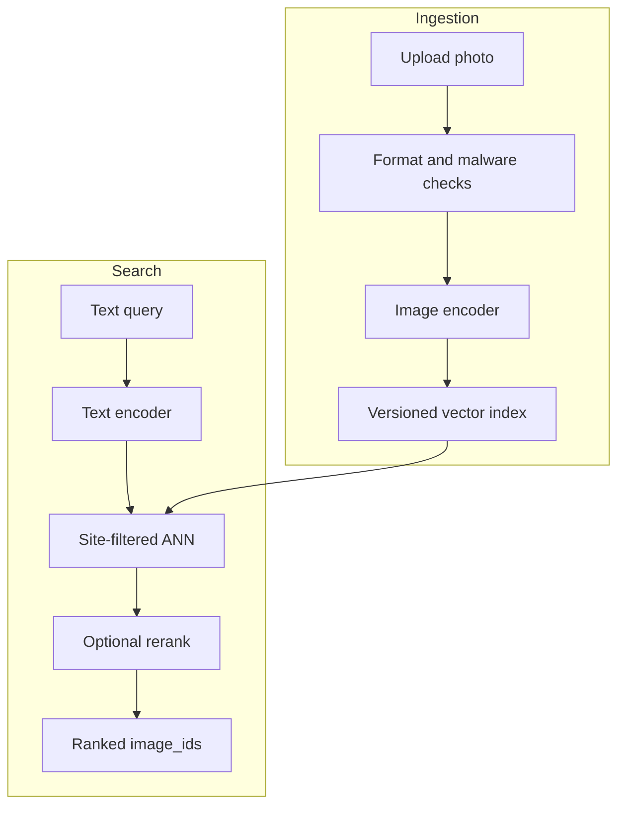
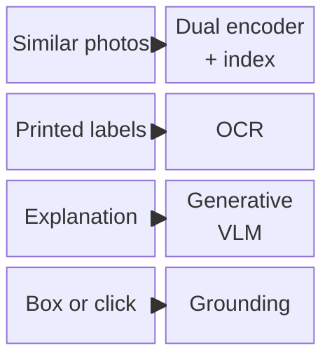

---
{
  "id": "vision-language-models-clip-beyond",
  "title": "Vision-Language Models & CLIP",
  "slug": "vision-language-models-clip-beyond",
  "category": "Multimodal Models",
  "difficulty": "Hard",
  "coverImage": "illustrations/_generated/clip_vlm_dark.png",
  "companies": [
    "Google",
    "OpenAI",
    "Meta",
    "Anthropic",
    "DeepMind"
  ],
  "shortDescription": "A rack photo can find similar inspections, but can it prove which vent is blocked? Design search, OCR, and grounding paths that give reviewers evidence.",
  "keyConceptsTested": [
    "CLIP's contrastive image-text pre-training",
    "Zero-shot classification via text prompts",
    "Vision backbones and CLIP variants (ViT, ResNet, SigLIP, EVA-CLIP)",
    "Limitations of CLIP embeddings",
    "Modern VLM architectures (LLaVA, BLIP-2, Qwen-VL)",
    "Multimodal projection layers",
    "Visual grounding and spatial reasoning",
    "Image tokenization strategies",
    "Adaptive visual token pruning and merging",
    "Visual token budgets, prefill cost, and KV cache pressure"
  ],
  "section": "System Design Capstones",
  "order": 6,
  "prerequisites": [
    "design-llm-powered-search-engine",
    "embeddings-cosine-dot-product-quantization",
    "vision-transformers-image-encoders",
    "long-context-window-management",
    "kv-cache-paged-attention-llm-serving",
    "hybrid-search-dense-sparse-retrieval"
  ],
  "relatedQuestions": [
    "multimodal-llms-architecture-design",
    "image-generation-diffusion-models",
    "design-real-time-voice-ai-agent",
    "design-conversational-ai-support-bot",
    "file-ingestion-pdfs-html-ocr-markdown",
    "design-llm-powered-search-engine"
  ]
}
---

One inspection photo can raise two very different questions. A technician uploads a rack picture and types "blocked vent on rack door." The archive should find similar inspections, but the same technician might then ask for the printed asset tag or for a box around the hazard. Finding similar photos helps locate candidates; closing a safety ticket requires checking the printed tag or inspecting the hazard location. The system needs both a fast candidate search and a deliberate inspection path.

Contrastive Language-Image Pre-training (<span data-glossary="clip">CLIP</span>) gives us the cheap first pass: it places images and captions in one embedding space, so photos can be indexed offline and searched with text.[^radford2021] The rest of this design follows one rack photo from that score to the evidence a reviewer can trust.

## Product brief: data-center visual inspection

The service lets technicians upload rack photos, search past inspections in natural language, and route uncertain hazards to a reviewer. CLIP or Sigmoid Loss for Language-Image Pre-training (SigLIP) powers first-pass retrieval. Optical character recognition (OCR), grounding, or a generative <span data-glossary="vision-language-model">vision-language model (VLM)</span> handles questions that need label text, regions, or explanations. That split keeps a similarity score from pretending to be a complete inspection.

### Requirements and API

- `POST /v1/inspection-images` accepts an immutable image reference, site, rack, capture time, and <span data-glossary="idempotency">idempotency</span> key. It returns `image_id`, ingestion state, and encoder version.
- `POST /v1/inspection-search` accepts `query`, requested site filters, and `limit`. The server intersects those filters with authenticated permissions. It returns ranked `image_id` values, similarity scores, thumbnails, and review state. Scores are ranking signals, not probabilities; clients can't lower a safety-review threshold.
- `POST /v1/inspection-analysis` accepts `image_id`, `question`, and requested evidence type. It returns `answer`, OCR spans or grounded regions, model versions, and `answered`, `abstained`, or `review`.
- Set initial <span data-glossary="p95-latency">p95</span> targets below 300ms for search and below 3 seconds for analysis, then measure them on the target workload. Access filters apply before retrieval, and a hazard never auto-closes from an unreviewed model result.

### Data flow and sizing

Ingestion has one job: turn an authorized image into a searchable, versioned record. It follows `upload -> malware and format checks -> metadata authorization -> image encoder -> normalized embedding -> versioned vector index`. A failed check stops before the image becomes searchable.

Search has a different job. It follows `authorized query -> text encoder -> site-filtered approximate nearest neighbor (ANN) search -> optional reranker -> response`, with access filters applied before candidates are returned. Analysis starts only after the selected image is authorized, then follows `crop or tile policy -> OCR or VLM -> grounding check -> review policy`. Protect search capacity from bursts of expensive analysis. Separate <span data-glossary="gpu">GPU</span> pools are one option; sharing needs admission limits and scheduling that meet the search target under mixed load.



Start with the vector bytes. For 10 million images and 768-dimensional <span data-glossary="fp16">16-bit floating-point (FP16)</span> embeddings, raw storage is `10,000,000 x 768 x 2 = 15.36 GB`. That number excludes index structures, metadata, replicas, and old encoder versions.

The selected <span data-glossary="hnsw">hierarchical navigable small-world (HNSW)</span> graph or <span data-glossary="ivf">inverted-file (IVF)</span> partitions determine the working set. With an assumed total multiplier of 2 to 4 times raw storage, one generation needs roughly 31 to 61 GB. Measure the actual vectors, graph, IDs, filters, replicas, and overlapping rollout generations before sizing hosts; some indexes retain FP32 vectors despite FP16 inputs.

At 100 <span data-glossary="qps">queries per second (QPS)</span>, give the text encoder and ANN query path their own pool. Graph probes and encoder work shouldn't compete with the separately sized generative-analysis pool.

### Recovery, rollout, and evaluation

Bind each idempotency key to the authenticated tenant and immutable request fingerprint; a content hash supports deduplication, not permission sharing. Reject a reused key with different image or metadata. Failed images enter retry or dead-letter state without becoming searchable. An encoder upgrade writes a new index generation; switch the **paired text encoder, image preprocessing, normalization, and index generation** together after validation. Equal vector dimensions don't make different models compatible. Retain the previous complete generation for rollback.

Treat uploads and image text as untrusted data. Bound decoded dimensions and tile counts as well as compressed bytes; resolve only authorized object references instead of fetching arbitrary user URLs. Strip unnecessary location metadata, restrict thumbnails and OCR artifacts, and apply deletion to indexes, crops, caches, and source images. Printed instructions such as "ignore safety policy" remain pixels or OCR evidence, not authorization for tool calls. Recheck authorization before analysis and before returning cached results.

Enforce tenant authorization as a mandatory pre-filter before scoring candidate embeddings. `permitted` comes from authenticated server state, not the request body. A requested site can't expand it, and authorization must be rechecked after revocation even for a previously returned ID.

<!-- leetllm: test, output=show -->
```python title="authorized-image-records.py"
def candidate_ids(records: dict, requested: set[str], permitted: set[str], generation: str) -> list[str]:
    visible_sites = requested & permitted
    return [image_id for image_id, row in records.items()
            if row["site"] in visible_sites and row["generation"] == generation]

def read_image(records: dict, image_id: str, permitted: set[str]) -> str:
    row = records.get(image_id)
    if row is None or row["site"] not in permitted:
        raise PermissionError("image unavailable")
    return row["object_version"]

records = {
    "a": {"site": "east", "generation": "clip-v1", "object_version": "a:v3"},
    "b": {"site": "west", "generation": "clip-v1", "object_version": "b:v1"},
    "c": {"site": "east", "generation": "clip-v2", "object_version": "c:v1"},
}
print("visible candidates:", candidate_ids(records, {"east", "west"}, {"east"}, "clip-v1"))
print("authorized object:", read_image(records, "a", {"east"}))
try:
    read_image(records, "a", set())  # permission was revoked after search
except PermissionError as error:
    print("after revocation:", error)
```

<!-- leetllm: output:start -->
```text title="Output" output compact
visible candidates: ['a']
authorized object: a:v3
after revocation: image unavailable
```
<!-- leetllm: output:end -->

Analysis needs its own safe failure. If OCR or grounding fails, return `abstained` or `review` instead of presenting a caption as verified evidence. Verify every fluent model output against a source or measurement before using it for an action.

Roll out with a frozen, technician-reviewed set, shadow traffic, a site-limited canary, and staged index switching. Block expansion when asset retrieval recall@10, hazard false-negative rate, asset-tag OCR accuracy, grounding IoU, p95 latency, review rate, or cross-site access tests miss their route-specific bars. Monitor drift by site, camera, lighting, rack type, and prompt template instead of relying on one aggregate benchmark.

Many supervised computer vision systems expose a fixed label inventory: recognizing a new category generally requires labeled examples and another training step. **CLIP** showed that image-text matching at web scale can produce representations that transfer to new text-defined classes without training a new classifier head.[^radford2021] That made practical <span data-glossary="open-vocabulary">open-vocabulary</span> retrieval possible and provided useful vision features for later generative systems.

That routing plan still doesn't say whether a high score means the vent is blocked. The uploaded rack photo has to enter the shared space before a later model is justified.

## Score the rack photo with text first

### Embeddings are the first inspection index

Suppose the search box contains "blocked vent on rack door." Each stored photo has already become a 768-number **<span data-glossary="embedding">embedding</span>**, and the query becomes another vector of the same size. The index doesn't need to compare pixels with words at request time; it ranks stored image vectors against the query vector.

If the model has learned the right visual signal, matching image and text vectors point in roughly the same direction. **<span data-glossary="cosine-similarity">Cosine similarity</span>** measures that alignment with a score between -1 and 1. Within one trained model, a higher score ranks a pair as more aligned than a lower-scoring candidate.

The number is a similarity score between image and text embeddings. CLIP ranks matching pairs above mismatches; calibrate any probability interpretation on representative data and verify image details against the caption before making a factual decision.

```checkpoint
What does cosine similarity measure in CLIP-style systems?
---
It measures whether an image embedding and a text embedding point in a similar learned direction. Use it to rank candidates, calibrate probability estimates on target data, and verify caption details against the image before making a factual decision.
```

### Why `rack_hazard` is a bad first index

A fixed label list can teach one class called `rack_hazard`, but that class says little about how blocked airflow looks across lighting, camera angles, cables, and rack labels. What happens when a technician adds a new phrase next week?

Learning from many image-text pairs gives the model a broader signal. It learns to align a *visual concept* with a *natural-language description*, rather than memorizing only the names in one classifier head.

The shared space lets the system score text prompts that weren't fixed training labels. Transfer still depends on whether <span data-glossary="pretraining">pre-training</span> learned the relevant evidence and whether the new domain resembles its data. Validate prompts on the team's racks, lighting, cabling, and review policy before turning a score into an operational decision.

```checkpoint
Why is open-vocabulary classification different from fixed-label classification?
---
Fixed-label classifiers choose from labels baked into training. CLIP-style models can score new text-defined classes without training a new head; launching a new class still requires validation and a threshold or review policy.
```

### Shared image-text space

The shared map is the handoff between two different inputs. One encoder starts with pixels and the other with words, but both are trained so a matched pair receives a higher similarity than a mismatch. The original model learned this from 400 million image-text pairs.[^radford2021]

That makes a prompt such as "blocked airflow behind rack panel" possible even when the phrase wasn't a training label. It remains a transfer hypothesis: test it on the racks that matter before trusting the rank.

```checkpoint
What is the shared image-text space buying you?
---
It gives image and text encoders a common coordinate system for ranking pairs. That enables retrieval or text-defined classification without retraining a new label head for every candidate task, subject to domain validation.
```

## Two encoders, one rack-photo score

### Architecture[^radford2021]

What has to happen inside the model for that shared map to exist? CLIP jointly trains an image encoder and a text encoder, so a rack photo and "blocked vent on rack door" land in one coordinate system. The original paper used either a ResNet (Residual Network) or a ViT (Vision Transformer) for images and a <span data-glossary="transformer">Transformer</span> for text, producing one representation for each caption.[^radford2021]

The two encoders operate independently before meeting in the shared embedding space. A contrastive objective pulls matched representations together and pushes mismatches apart.

<figure>
  
  <figcaption>The unit circle removes B’s magnitude advantage: raw dot scores 0.8 and 9 become cosines 0.8 and 0.6. Normalization ensures similarity reflects directional alignment rather than vector norm.</figcaption>
</figure>

The two lanes stay separate until their outputs are normalized and compared in the shared map. That separation is what lets us encode the image once, store it, and answer many text queries later.

Implementation details remain checkpoint-specific. The official CLIP repository's `encode_image` and `encode_text` return unnormalized features. Normalize both before using their dot product as cosine similarity; the model's full `forward` does this internally and applies its learned logit scale. The README's separate zero-shot example uses a fixed scale of 100, so distinguish that example from the learned-scale implementation.[^openaiClipImplementation2026]

Its tokenizer defaults to a 77-token sequence including start/end tokens. Overlong input raises by default; setting `truncate=True` cuts it and restores the end token, which can discard a decisive phrase. Changing `context_length` alone doesn't extend a checkpoint's learned positional embeddings. Use the matching preprocessing returned by `clip.load`, and bind it, both encoders, normalization, and the similarity metric to the index generation. These source details were checked October 10, 2026; no pretrained model was run here.[^openaiClipImplementation2026]

```checkpoint
Why is CLIP called a dual-encoder model?
---
It has one encoder for images and one encoder for text. Both produce embeddings in the same dimension, and the model scores image-text pairs by similarity rather than by decoding text.
```

### Training objective

Training turns the shared map into a ranking game. For every image, the model must pick its paired caption from the other captions in the batch. The reverse direction asks whether each caption can find its paired image.

Use a tiny batch so the game stays visible. Suppose you have **3 images** and **3 captions**:

| Image | Caption |
|---|---|
| A | "cable label torn near port" |
| B | "asset tag partly covered by tape" |
| C | "warning label visible on power unit" |

There are $3 \times 3 = 9$ possible pairings where only the 3 diagonal pairs (A+A, B+B, C+C) are positive matches, while the other 6 are in-batch negative pairs. Training maximizes the diagonal cosine similarities while minimizing mismatched off-diagonal similarities.

<figure>
  
  <figcaption>Read row A across for image-to-text scoring and column A down for text-to-image scoring. Both directions isolate positive pair A-A while penalizing mismatched pairs. The final symmetric loss averages all three examples in both directions.</figcaption>
</figure>

The real batch in the original paper contains 32,768 pairs.[^radford2021] Each image therefore sees thousands of candidate captions, which supplies many negatives for the ranking game. The loss is symmetric: image-to-text and text-to-image each contribute a cross-entropy term. It's often described as **InfoNCE-style** (Information Noise Contrastive Estimation).

CLIP trains this setup from scratch with a linear projection from each encoder into the shared space. It also learns a temperature, initialized to the equivalent of 0.07 and clipped so logits aren't scaled by more than 100.[^radford2021] The temperature controls how sharply the model separates close scores.

Let $I_i$ and $T_j$ be the L2-normalized image and text embeddings. CLIP computes <span data-glossary="logits">logits</span>

$$
z_{ij} = \exp(t) \cdot I_i^\top T_j
$$

where $t$ is a learned logit-scale parameter. You'll also see this written as division by a <span data-glossary="temperature">temperature</span> $\tau$, where $\tau = 1 / \exp(t)$. The symmetric objective is:

$$
\mathcal{L}_{I \rightarrow T} = -\frac{1}{N}\sum_{i=1}^{N}\log\frac{\exp(z_{ii})}{\sum_{j=1}^{N}\exp(z_{ij})}
$$

$$
\mathcal{L}_{T \rightarrow I} = -\frac{1}{N}\sum_{i=1}^{N}\log\frac{\exp(z_{ii})}{\sum_{j=1}^{N}\exp(z_{ji})}
$$

$$
\mathcal{L} = \frac{\mathcal{L}_{I \rightarrow T} + \mathcal{L}_{T \rightarrow I}}{2}
$$

The first equation asks: "Given image $i$, what's the probability that caption $i$ is the right one?" It compares the matching score $\exp(z_{ii})$ with every caption score in row $i$. The text-to-image equation does the same for column $i$.

The final loss averages both directions. Both contribute gradients, but an average can still hide a regression in one direction, so evaluate image-to-text and text-to-image retrieval separately. Diagonal labels assume the batch's pairs are aligned; related off-diagonal pairs may be false negatives.

```checkpoint
In a batch of 3 images and 3 captions, which pairs should the contrastive loss reward?
---
Only the 3 diagonal image-caption pairs are positives. The other 6 off-diagonal pairs are negatives. The loss raises diagonal similarity and lowers mismatched similarities in both image-to-text and text-to-image directions.
```

The next implementation keeps the same symmetric pattern with a fixed temperature. It leaves out distributed batching and the learned scale so the matrix and its output stay inspectable.

<!-- leetllm: test, output=show -->
```python title="training-objective.py" id=clip-math
import numpy as np

def normalize(vector: np.ndarray | list[float]) -> np.ndarray:
    v = np.asarray(vector, dtype=float)
    norm = np.linalg.norm(v)
    if norm == 0:
        raise ValueError("vector norm must be nonzero")
    return v / norm

def dot(left: np.ndarray | list[float], right: np.ndarray | list[float]) -> float:
    return float(np.dot(np.asarray(left, dtype=float), np.asarray(right, dtype=float)))

def clip_loss(
    image_embeds: list[list[float]],
    text_embeds: list[list[float]],
    temperature: float = 0.2,
) -> tuple[float, list[list[float]]]:
    images = np.array([normalize(vector) for vector in image_embeds])
    texts = np.array([normalize(vector) for vector in text_embeds])
    logits = (images @ texts.T) / temperature

    n = len(logits)
    labels = np.arange(n)

    def cross_entropy(l: np.ndarray, y: np.ndarray) -> float:
        l_max = np.max(l, axis=-1, keepdims=True)
        log_sum_exp = np.log(np.sum(np.exp(l - l_max), axis=-1)) + l_max.squeeze()
        return float(np.mean(log_sum_exp - l[np.arange(n), y]))

    loss_i2t = cross_entropy(logits, labels)
    loss_t2i = cross_entropy(logits.T, labels)
    return (loss_i2t + loss_t2i) / 2.0, logits.tolist()

image_embeds = [
    [0.95, 0.05, 0.00],
    [0.05, 0.92, 0.03],
    [0.00, 0.07, 0.94],
]
text_embeds = [
    [0.91, 0.08, 0.01],
    [0.06, 0.89, 0.04],
    [0.02, 0.09, 0.90],
]

loss, logits = clip_loss(image_embeds, text_embeds)
print("logit matrix:")
for row in logits:
    print([round(value, 2) for value in row])
print(f"symmetric_loss: {loss:.3f}")
```

<!-- leetllm: output:start -->
```text title="Output" output compact
logit matrix:
[5.0, 0.6, 0.14]
[0.71, 5.0, 0.66]
[0.09, 0.59, 5.0]
symmetric_loss: 0.022
```
<!-- leetllm: output:end -->

Read the output as a matrix, not as three independent scores. The diagonal entries are all `5.0`, while most off-diagonal entries are close to zero, so the paired rows and columns win. A random or poorly aligned batch would look flatter and produce a higher loss.

That matrix also explains the systems cost. <span data-glossary="softmax">Softmax</span>-based <span data-glossary="cross-entropy">cross-entropy</span> needs normalization over each row and column of the effective batch. The simple implementation materializes $N \times N$ logits; an optimized one can accumulate normalization in blocks instead. Large distributed batches still require embedding/gradient communication. CLIP used 32,768 pairs, supplying many in-batch negatives.[^radford2021]

```checkpoint
Why does original CLIP benefit from very large batch sizes?
---
The contrastive loss uses in-batch negatives. Larger batches give each image many more wrong captions to push away, but they also require a large similarity matrix and cross-device synchronization.
```

An off-diagonal pair is *treated* as negative, but it isn't automatically a clean semantic negative. Two photographs of the same rack hazard can be useful matches even when they arrived with different captions. Before scaling the batch, audit for those collisions so the loss doesn't push related examples apart.

<!-- leetllm: test, output=show -->
```python title="audit-false-negatives.py"
from dataclasses import dataclass

@dataclass(frozen=True)
class Pair:
    image_id: str
    caption: str
    concept: str

pairs = [
    Pair("rack-front", "blocked vent on rack door", "blocked-airflow"),
    Pair("rack-side", "airflow blocked by loose cabling", "blocked-airflow"),
    Pair("asset-tag", "barcode obscured by cable tie", "blocked-barcode"),
]

potential_false_negatives = [
    (left.image_id, right.image_id, left.concept)
    for index, left in enumerate(pairs)
    for right in pairs[index + 1:]
    if left.concept == right.concept
]

print("pairs_treated_as_negative_but_related:", potential_false_negatives)
```

<!-- leetllm: output:start -->
```text title="Output" output compact
pairs_treated_as_negative_but_related: [('rack-front', 'rack-side', 'blocked-airflow')]
```
<!-- leetllm: output:end -->

### Training data

The original paper names its constructed corpus WebImageText (WIT). It contains 400 million `(image, text)` pairs collected from the internet, with search queries chosen to cover a broad vocabulary rather than a closed label set.[^radford2021]

Unlike ImageNet-style datasets built around manual class labels, CLIP learns from natural language attached to images on the web. That supervision is broader and noisier. A pair of photos showing the same blocked vent can still become in-batch negatives.

For a domain dataset, record source rights, collection purpose, caption origin, and retention rules. Split near-duplicates and related views by asset/site/time before evaluating; otherwise the same rack can leak into train and test. Captions may omit hazards or contain asset identifiers that let the model memorize shortcuts. Audit those shortcuts and stratify evaluation by camera, site, lighting, and rare defects.

### Zero-shot classification

Zero-shot classification reuses the same ranking interface. Instead of a final layer with fixed class weights, the model compares one image embedding with text descriptions of the candidate classes.

Suppose a data-center rack photo must land in one of three categories:

| Class | Prompt | Cosine similarity |
|---|---|---|
| rack hazard | "a photo of a rack hazard" | 0.87 |
| safe rack | "a photo of a safe rack" | 0.12 |
| blocked asset tag | "a photo of a blocked asset tag" | 0.41 |

These scores explain ranking mechanics. The highest score nominates the top candidate; calibrate a score/margin policy on development data, then evaluate it on a separate held-out set. A softmax is conditional on its candidate class list. Calibrate that output for any probability use, and use an open-set detector for hazards outside the list.

The same mechanism produced a striking research result. The CLIP paper's best model, ViT-L/14@336px, reaches 76.2% zero-shot top-1 on ImageNet and matches the original ResNet-50 without using ImageNet's 1.28 million crowd-labeled training examples.[^radford2021] A data-center prompt such as "cable label partially obscured by a tie" can be scored the same way, but reliability on your racks still has to be measured.

```checkpoint
What changes between training a new classifier head and doing CLIP zero-shot classification?
---
A classifier head learns fixed class weights from labeled examples. CLIP zero-shot classification embeds natural-language class prompts and compares them to the image embedding, so the class set can change at inference time.
```

The function below reuses `normalize` and `dot` from `training-objective.py`. It scores constructed test vectors, not encoded rack photos. It returns both cosine similarities and candidate-relative softmax weights. No model weights are downloaded or evaluated in these exercises.

<!-- leetllm: test, output=show -->
```python title="zero-shot-classification.py" id=zero-shot continue=clip-math
import json
import numpy as np

def softmax(values: list[float] | np.ndarray) -> list[float]:
    v = np.asarray(values, dtype=float)
    shifted = v - np.max(v)
    exp_v = np.exp(shifted)
    probs = exp_v / np.sum(exp_v)
    return probs.tolist()

def zero_shot_classify(
    image_embed: list[float],
    class_names: list[str],
    text_embeds: dict[str, list[float]],
    logit_scale: float = 12.0,
) -> dict[str, object]:
    image = normalize(image_embed)
    prompts = [f"an image showing {name}" for name in class_names]
    similarities = [dot(image, normalize(text_embeds[prompt])) for prompt in prompts]
    logits = [logit_scale * similarity for similarity in similarities]
    probs = softmax(logits)
    best_index = int(np.argmax(probs))
    return {
        "predicted_class": class_names[best_index],
        "cosines": dict(zip(class_names, (round(float(x), 3) for x in similarities), strict=True)),
        "relative_softmax": {
            class_name: round(float(probability), 3)
            for class_name, probability in zip(class_names, probs, strict=True)
        },
    }

text_embeds = {
    "an image showing rack hazard": [0.92, 0.20, 0.05],
    "an image showing safe rack": [0.18, 0.88, 0.08],
    "an image showing blocked asset tag": [0.48, 0.31, 0.81],
}

result = zero_shot_classify(
    image_embed=[0.89, 0.24, 0.08],
    class_names=["rack hazard", "safe rack", "blocked asset tag"],
    text_embeds=text_embeds,
)
print(json.dumps(result, indent=2))
print("singleton softmax:", softmax([-10.0]))  # 1.0 even for a poor match

# Scaling caption B by 15x flips unnormalized inner-product ranking while leaving cosine order intact.
probe_image = [1.0, 0.0]
probe_features = {"caption A": [0.8, 0.6], "caption B": [9.0, 12.0]}
raw_scores = {name: dot(probe_image, vector) for name, vector in probe_features.items()}
cosine_scores = {name: round(dot(normalize(probe_image), normalize(vector)), 3)
                 for name, vector in probe_features.items()}
assert max(raw_scores, key=raw_scores.__getitem__) == "caption B"
assert max(cosine_scores, key=cosine_scores.__getitem__) == "caption A"
print("raw dot:", raw_scores)
print("normalized cosine:", cosine_scores)
```

<!-- leetllm: output:start -->
```text title="Output" output compact
{
  "predicted_class": "rack hazard",
  "cosines": {
    "rack hazard": 0.998,
    "safe rack": 0.453,
    "blocked asset tag": 0.618
  },
  "relative_softmax": {
    "rack hazard": 0.988,
    "safe rack": 0.001,
    "blocked asset tag": 0.01
  }
}
singleton softmax: [1.0]
raw dot: {'caption A': 0.8, 'caption B': 9.0}
normalized cosine: {'caption A': 0.8, 'caption B': 0.6}
```
<!-- leetllm: output:end -->

The second probe isolates the API trap. Caption B's feature norm is 15, so raw dot product rewards its magnitude and picks it over A. Normalizing removes that magnitude advantage and ranks A's 0.8 cosine above B's 0.6. Bind L2 normalization and the ANN distance metric together in the index schema so unnormalized inner products cannot invert rankings. Inner product and cosine rank unit vectors identically; unnormalized inner product can change their order as it did here.

#### Prompt engineering matters

The words around a class change the text vector. For a rack photo, compare a bare `rack hazard` label with "a photo of a rack hazard." The latter matches the sentence-like text CLIP saw during pre-training; on ImageNet, that template alone added 1.3 percentage points of top-1 accuracy.[^radford2021]

One wording can still be brittle. CLIP can encode several templates, average their normalized text embeddings, and cache one class vector. The original paper ensembled 80 context prompts and gained another 3.5 percentage points over the single default template; prompt engineering plus ensembling improved ImageNet accuracy by almost 5 percentage points.[^radford2021]

The code makes that averaging visible with a hardcoded list of prompt vectors. No single phrasing gets to decide the class representation by itself.

```checkpoint
Why does prompt ensembling improve zero-shot classification?
---
Different templates emphasize slightly different contexts. Averaging normalized embeddings across templates reduces sensitivity to one brittle phrase and creates a more stable class representation.
```

<!-- leetllm: test, output=show -->
```python title="prompt-engineering-matters.py" continue=zero-shot
def mean_vector(vectors: list[np.ndarray]) -> np.ndarray:
    return np.mean(np.array(vectors), axis=0)

prompt_vectors = {
    "a photo of a rack hazard": [0.92, 0.20, 0.05],
    "a picture of a rack hazard": [0.88, 0.24, 0.07],
    "an image showing rack hazard": [0.86, 0.28, 0.08],
    "a rack hazard in the wild": [0.82, 0.31, 0.12],
}

ensemble = normalize(mean_vector([
    normalize(vector)
    for vector in prompt_vectors.values()
]))

print(json.dumps({
    "class": "rack hazard",
    "templates": len(prompt_vectors),
    "ensemble_embedding": [round(float(value), 3) for value in ensemble],
}, indent=2))
```

<!-- leetllm: output:start -->
```text title="Output" output compact
{
  "class": "rack hazard",
  "templates": 4,
  "ensemble_embedding": [
    0.955,
    0.284,
    0.088
  ]
}
```
<!-- leetllm: output:end -->

Run the ensemble cell after the classification cell. Averaging may reduce wording sensitivity, so measure transfer on held-out examples. Opposing template vectors can even cancel to a zero vector, which normalization should reject. Calibrate abstention and escalation cosine thresholds on a labeled validation split and report risk-coverage curves on held-out traffic.

<!-- leetllm: test, output=show -->
```python title="zero-shot-abstention-policy.py"
def decide(scores: dict[str, float], min_score: float, min_margin: float) -> str:
    if len(scores) < 2:
        raise ValueError("require at least two cosine scores")
    ranked = sorted(scores.items(), key=lambda item: item[1], reverse=True)
    (best_label, best_score), (_, second_score) = ranked[:2]
    if best_score == second_score or best_score < min_score or best_score - second_score < min_margin:
        return "review"
    return best_label

cases = {
    "clear_hazard": {"rack_hazard": 0.87, "safe_rack": 0.12, "tag_blocked": 0.31},
    "ambiguous_panel": {"rack_hazard": 0.56, "safe_rack": 0.53, "tag_blocked": 0.18},
}

for name, scores in cases.items():
    print(name, decide(scores, min_score=0.60, min_margin=0.10))
```

<!-- leetllm: output:start -->
```text title="Output" output compact
clear_hazard rack_hazard
ambiguous_panel review
```
<!-- leetllm: output:end -->

### Limitations of CLIP

Here is the boundary to test before wiring the score into an action: can one pooled similarity tell you how many vents are blocked or where each one is? No. Standard CLIP inference exposes a pooled image representation optimized for image-text matching, not calibrated counts or boxes. For counting and grounded localization, validate a detector such as Grounding DINO[^liu2023groundingdino] or a grounding-aware VLM instead of interpreting global similarity as a region prediction.

That missing output is the key boundary. Zero-shot scoring compares one pooled image representation with one text representation and returns a global match score. Use a detector or grounding model to obtain region coordinates and count evidence when an action depends on location.

```checkpoint
Why is CLIP bad at counting and exact localization?
---
Its standard zero-shot interface scores one pooled image representation against one text representation. That output isn't supervised to return region coordinates, counts, or relations that detection or grounding models preserve.
```

Ask CLIP to "describe this image" and it returns similarity scores, not a sentence. A dual encoder has no language-generation head. Use a generative VLM such as LLaVA (Large Language-and-Vision Assistant) for captioning, or keep CLIP on retrieval and add a separate LLM for generation.

The same pooled representation can confuse relationships. Include paired probes such as "a red toolbox beside a blue safety cone" versus "a blue toolbox beside a red safety cone" in your inspection evaluation, and score both against reviewed labels. Grounding DINO is a separate open-set detector with its own relation-specific path; evaluate its boxes for spatial reasoning.[^liu2023groundingdino]

Counting needs its own evidence path. If a team maps the top similarity score to "three rack hazards" and a labeled audit finds five, the score has been asked to do count-supervised work it never outputs. Use region-based models or an explicit counting module instead.

Printed text is another boundary. CLIP learns useful OCR features on digitally rendered words, which are common in its pre-training data, but the paper reports highly variable transfer across domains and formats.[^radford2021] Zero-shot CLIP reaches 88% on MNIST and is beaten there by logistic regression on raw pixels; full-number SVHN is only 51%, with failures on repeated characters, blur, and low resolution.[^radford2021] A pooled similarity score isn't a document-OCR interface, so route rack labels through a specialized OCR stage.

Finally, web-crawled supervision carries social bias. CLIP can associate visual concepts with stereotypes.[^agarwal2021] Audit embeddings on representative data before deployment, and treat debiasing or domain-specific fine-tuning as separate interventions rather than assuming a prompt fixes the problem.

```checkpoint
When is CLIP the wrong tool even if it recognizes the concept?
---
Use a different tool when you need generated captions, object counts, bounding boxes, exact OCR, spatial relations, or safety-critical decisions that require calibrated, audited behavior.
```

## Vision encoder architectures

The pooled vector is the wrong representation for counting vents or drawing boxes. To understand what a generative VLM can preserve, look one step earlier. A ViT emits a sequence of patch features before pooling; a CNN tower emits a spatial feature map that a connector can flatten into tokens. That feature count becomes a serving input even when CLIP later reduces it to one vector.

### Vision Transformer (ViT)[^dosovitskiy2020]

Many published VLMs use **Vision Transformers (ViT)**, while earlier systems used **Convolutional Neural Networks (CNNs)** such as ResNet. ViT treats an image as a sequence of patches and runs a Transformer encoder over them, much like **Large Language Models (LLMs)** process text <span data-glossary="token">tokens</span>. Each patch becomes an embedding, and the stack returns contextualized visual tokens. CLIP pools those tokens into one image vector; a generative VLM may project many of them into the language prefix.

<figure>
  
  <figcaption>The grid has 14 rows and 14 columns. A 224 by 224 image with 16 by 16 patches produces 196 patch tokens, before any class token, pooling, or connector compression.</figcaption>
</figure>

#### Patch tokenization

A 224×224 image with 16×16 patches has 14 patches along each side. That gives $14 \times 14 = 196$ visual tokens, plus a special `[CLS]` token used by many implementations to aggregate the global image representation.

```checkpoint
How many patch tokens does a 224x224 image produce with 16x16 ViT patches?
---
$224 / 16 = 14$ patches per side, so $14 x 14 = 196$ patch tokens, plus an optional `[CLS]` token depending on the implementation.
```

Patch size is a <span data-glossary="token-budget">token-budget</span> choice. The figure uses 16x16 patches, while the high-resolution calculation below uses 14x14 patches. Compute the budget from the actual tower instead of copying a memorized number.

<!-- leetllm: test, output=show -->
```python title="patch-token-budget.py"
def patch_tokens(height: int, width: int, patch_size: int, crops: int = 1) -> int:
    if height <= 0 or width <= 0 or patch_size <= 0 or crops <= 0:
        raise ValueError("dimensions, patch size, and crops must be positive integers")
    if height % patch_size or width % patch_size:
        raise ValueError("this example requires exact patches; specify resize/padding separately")
    return (height // patch_size) * (width // patch_size) * crops

for label, size, crops in [("thumbnail", 224, 1), ("page_crop", 336, 1), ("tiled_page", 336, 4)]:
    print(label, patch_tokens(size, size, patch_size=14, crops=crops))
```

<!-- leetllm: output:start -->
```text title="Output" output compact
thumbnail 256
page_crop 576
tiled_page 2304
```
<!-- leetllm: output:end -->

The arithmetic tells us how many tokens exist. Architecture determines how those tokens acquire context. The comparison below keeps that distinction visible before we choose a connector.

#### ViT vs. ResNet

| Feature | Vision Transformer (ViT) | ResNet (CNN) |
|:---|:---|:---|
| **Scaling** | Scales well with sufficient data; attention cost grows with patch-token count. | Strong convolutional baseline with different compute and inductive-bias trade-offs. |
| **Context Window** | Global context from the first layer via <span data-glossary="self-attention">self-attention</span> across all patches. | Local context initially, building to global context only in deep layers. |
| **Inductive Bias** | Low (treats image as sequence of patches), requiring more data to learn structure. | High (locality and translation-equivariance biases), often requiring less data to train from scratch. |
| **Architecture** | Transformer-shaped token sequence is convenient for many connectors. | Also usable as a vision tower; connector still maps its features to the downstream task. |

### SigLIP[^zhai2023]

Standard CLIP pays for a softmax over image-text candidates in the effective batch. Original CLIP used a batch size of 32,768 in its distributed training run; smaller implementations can still train, but they change the negative-diversity and accuracy trade-off.[^radford2021]

SigLIP (Sigmoid Loss for Language-Image Pre-training) changes the question. Rather than asking "Which of these 32,000 captions is the best match?", it asks "Is this specific image and caption a good match, yes or no?" It replaces the global softmax competition with a **pairwise sigmoid** loss:

$$
\mathcal{L} = -\frac{1}{N} \sum_{i=1}^{N} \sum_{j=1}^{N} \log \sigma\big(z_{ij} \cdot (t \cdot v_i^\top u_j + b)\big)
$$

Here $N$ is the batch size, $z_{ij} = +1$ for matching pairs and $z_{ij} = -1$ otherwise. This $z$ is a **label**, unlike CLIP's earlier logit notation. $v_i$ and $u_j$ are normalized embeddings; $t>0$ is a learned logit scale (inverse temperature), $b$ a learned bias, and $\sigma$ the logistic sigmoid.

The paper parametrizes $t=\exp(t_0)$, initializes $t_0=\log 10$, and initializes $b=-10$. This favors negative predictions initially, matching a batch dominated by mismatches.[^zhai2023] Algorithm 1 sums all $N^2$ pair losses and **divides by $N$**, not $N^2$. Averaging every pair instead would shrink the loss and gradients by another factor of $N$.

#### Advantages over CLIP
- Decoupled computation: No global normalization is needed. Each pair is scored independently, allowing the similarity matrix to be computed in chunks across devices.[^zhai2023]
- Efficiency: The sigmoid loss removes global softmax normalization. The SigLIP paper reports a large gap versus softmax when the batch is smaller than 16k, a smaller gap as the batch grows, and diminishing returns past a more reasonable 32k. Pushing SigLiT to a 1 million batch was possible; it didn't keep helping.[^zhai2023]
- Memory and partitioning: The loss is easier to chunk across devices because it doesn't require a single global softmax over the full batch.

SigLIP's pairwise loss changes the computation structure: positive and negative pair terms can be evaluated without a batch-wide probability distribution. That makes partitioning easier, but it doesn't decide what accelerator, data volume, or accuracy a data-center matcher will need.

```checkpoint
What does SigLIP change relative to CLIP's softmax loss?
---
It scores image-text pairs with independent sigmoid terms instead of one global softmax over the batch. That reduces global synchronization pressure and works better at smaller batches, though large batches can still help.
```

<!-- leetllm: test, output=show -->
```python title="siglip-pairwise-loss.py"
import numpy as np

def pair_loss(score: float, is_match: bool) -> float:
    label = 1.0 if is_match else -1.0
    return float(np.logaddexp(0.0, -label * score))

scores = [
    ("same_asset", 3.2, True),
    ("wrong_caption", -2.1, False),
    ("hard_negative", 0.4, False),
]

for name, score, match in scores:
    print(name, round(pair_loss(score, match), 3))

# Four pairs, two examples. At zero logits each pair costs log(2).
batch_logits = [[0.0, 0.0], [0.0, 0.0]]
n = len(batch_logits)
total = sum(pair_loss(score, i == j)
            for i, row in enumerate(batch_logits) for j, score in enumerate(row))
print("paper reduction:", round(total / n, 3))
print("pair mean:", round(total / (n * n), 3))
```

<!-- leetllm: output:start -->
```text title="Output" output compact
same_asset 0.04
wrong_caption 0.116
hard_negative 0.913
paper reduction: 1.386
pair mean: 0.693
```
<!-- leetllm: output:end -->

#### Why SigLIP matters in newer stacks

Some published VLMs use SigLIP-family towers when moderate-batch training or partitioned pair scoring matters. SigLIP 2 adds caption-based pretraining, self-distillation, masked prediction, and online data curation; its paper reports better transfer than original SigLIP across model scales when used as a VLM vision backbone.[^zhai2025siglip2] Its NaFlex variants support multiple resolutions while preserving native aspect ratio. Standard fixed-resolution checkpoints don't acquire that behavior simply by being SigLIP 2: NaFlex needs its matching vision implementation and adapted preprocessing.[^googleSiglip2Implementation2026]

For a wide rack panorama, choose and validate a supported checkpoint/preprocessing pair before counting patches. “Native aspect ratio” doesn't mean the original image keeps every pixel or that an arbitrary token budget is safe. The foundation remains image-text alignment, and sigmoid match scores still need target-domain calibration rather than being treated as hazard probabilities.

### EVA-CLIP: scaling vision backbones with masked pretraining[^sun2023evaclip]

Training a large Vision Transformer directly from scratch with contrastive loss is expensive, and scaling can become unstable. **EVA-CLIP** initializes its vision tower from an EVA masked image modeling (MIM) model, then uses that representation to make contrastive scaling more stable and efficient.[^sun2023evaclip] The tower therefore starts with features learned by reconstructing masked visual features from a teacher, rather than learning every visual pattern from image-text pairs alone.

The hybrid recipe also changes the sample-efficiency result. The paper's EVA-02-CLIP-L/14+ has about 430M total model parameters and reaches 80.4% zero-shot top-1 on ImageNet-1K; EVA-02-CLIP-E/14+ has 5.0B total model parameters and reaches 82.0%.[^sun2023evaclip] The paper measures ImageNet performance; a data-center tower needs separate evaluation on small asset tags.

```checkpoint
Why does EVA-CLIP initialize its vision tower with masked image modeling?
---
Training massive vision transformers purely with contrastive loss is unstable and sample-inefficient. Initializing from an EVA masked image modeling checkpoint provides strong representations early, accelerating contrastive convergence and enabling stable scaling to billions of parameters.
```

## Modern VLMs: from alignment to generation

The similarity score has reached its boundary. CLIP and SigLIP can say whether an image and caption belong together, but a technician asking "what's covering the barcode?" needs generated text and perhaps a box.

That question introduces **fusion**: the point where visual evidence and text interact to produce an answer. Before choosing a connector, predict the serving trade-off. Passing every patch to the language model preserves detail but lengthens its input; compressing patches protects the input budget but may discard the barcode.

Three published architectures illustrate the connector patterns. Check current model documentation for newer checkpoint input limits and compare models with a task-specific evaluation:

- **simple projectors** that map vision features into the LLM space
- **query-based compressors** that reduce many visual patches into a fixed token budget
- **resamplers and adapters** that preserve more spatial detail for high-resolution inputs

These patterns are enough to reason about token flow without guessing at proprietary internals.

<figure>
  
  <figcaption>Published defaults, not one shared encoder. LLaVA-1.5 puts 576 patch tokens in the prefix; BLIP-2 admits 32 queries; Flamingo keeps 64 tokens in a revisitable bank instead of the causal prefix.</figcaption>
</figure>

### LLaVA: the straightforward projector path[^liu2023a]

LLaVA is the clearest example of projecting visual features into a language model. Original LLaVA takes a pretrained CLIP ViT-L/14 encoder and Vicuna (an instruction-tuned LLaMA chat model), then learns a **linear** projection matrix $W$ that maps encoder grid features into the LLM's word-embedding dimension.[^liu2023a] The projector changes representation space; it doesn't decide whether a barcode is present.

The original recipe separates two learning problems:[^liu2023a]

1. **Feature alignment**: freeze the vision encoder and LLM, train only $W$ on a filtered slice of Conceptual Captions 3M (595K image-text pairs after filtering).
2. **Visual instruction tuning**: fine-tune the projector and LLM on 158K GPT-4-generated multimodal instructions.

The data-generation teacher was text-only: GPT-4 received captions and object-box annotations, not image pixels. It synthesized conversations about that symbolic evidence.[^liu2023a] Missing or incorrect annotations can therefore reach the training answers; fluent synthetic instructions still need data-quality checks.

LLaVA-1.5 keeps that two-stage shape and changes two serving-relevant pieces: a two-layer MLP connector replaces the linear layer, and CLIP-ViT-L-336px replaces the 224px input. That resolution yields a $24 \times 24$ grid, or 576 visual prefix tokens per image.[^liu2023b] The pattern stays simple: a pretrained vision encoder, an LLM, and a learned projector can support multimodal instruction following without a new vision backbone.

```checkpoint
What is the core LLaVA architecture recipe?
---
Use a pretrained vision encoder, project its visual features into the LLM hidden dimension, concatenate projected visual tokens with text tokens, then train first for feature alignment and then for multimodal instruction following. Original LLaVA uses a linear projector; LLaVA-1.5 switches to an MLP and a 336px CLIP encoder.
```

### Common multimodal training ladder

The LLaVA split illustrates a common training ladder. This staged recipe separates representation learning, connector alignment, and answer behavior. The rows below are common options, not a required sequence for every VLM; which components are frozen or trained jointly depends on the architecture and recipe.

| Stage | Typical objective | What it teaches |
|---|---|---|
| **Contrastive pretraining** | image-text matching as in CLIP or SigLIP | shared semantic space for retrieval and zero-shot recognition |
| **Connector or projector alignment** | freeze big backbones, train connector | map vision features into language-model space cheaply |
| **Multimodal instruction tuning** | image + prompt -> assistant response | teach task behavior, dialogue format, OCR usage, and grounded answers |
| **Preference or safety post-training** | chosen vs rejected responses, critiques, or policy filters | reduce harmful or low-quality multimodal behavior |

CLIP and SigLIP mostly cover the first row.[^radford2021][^zhai2023] LLaVA makes the second and third rows explicit with feature alignment followed by visual instruction tuning.[^liu2023a] A chat-oriented system needs training beyond contrastive alignment because matching doesn't teach long-form answer behavior.

Use the observed failure to locate the missing stage:

- **contrastive pretraining** teaches *matching*
- **instruction tuning** teaches *how to answer*
- **post-training** teaches *which answers are preferred or allowed*

A response-format failure suggests checking instruction data and the chat template. A safety failure needs policy enforcement and evaluation, with post-training as one possible intervention. Neither symptom uniquely identifies a training stage: bad features, prompts, or data can also cause failures. BLIP-2's Q-Former addresses a separate question: how much visual information reaches the language path?

### BLIP-2 and the Q-Former: compress before the LLM[^li2023]

BLIP-2 (Bootstrapping Language-Image Pre-training, version 2) addresses the token bottleneck directly. Instead of forwarding every visual feature into the LLM, it introduces a **Q-Former** that learns a fixed set of query <span data-glossary="vector">vectors</span>. The queries pull task-relevant information from a frozen vision encoder.

The published setup uses 32 queries of dimension 768. That $32 \times 768$ bottleneck is much smaller than frozen ViT-L/14 features ($257 \times 1024$, including the class token), and the query count stays fixed when input resolution rises.[^li2023] The paper reports that BLIP-2 outperforms Flamingo-80B by 8.7 points on zero-shot VQAv2 while using $54\times$ fewer trainable parameters.[^li2023] That's a research comparison, not a serving SLA for rack photos.

The serving consequence is straightforward: tokens passed to the language path affect <span data-glossary="prefill">prefill</span> and cache cost. A smaller fixed budget wins only if it preserves task-critical evidence. If 32 queries drop characters on an asset tag, lower prefix cost is the wrong result.

```checkpoint
Why does BLIP-2 put a Q-Former before the LLM?
---
The Q-Former uses learned queries to extract a bounded set of useful visual tokens from a frozen vision encoder. That keeps visual evidence useful without sending every patch token into the expensive language model.
```

### Flamingo-style resampling: preserve more context without exploding token count[^alayrac2022]

Flamingo takes a different route to fusion. It first compresses variable-length visual features with a Perceiver Resampler, then lets language tokens attend to that compact bank through gated <span data-glossary="cross-attention">cross-attention</span> blocks inserted into a frozen LM.[^alayrac2022]

The published resampler emits 64 visual tokens **per image/video item**, independent of its resolution or frame count.[^alayrac2022] Multiple items still create multiple banks. Flamingo uses a frozen contrastively pretrained NFNet-F6, not a CLIP ViT. Its cross-attention mask directly exposes the most recent preceding image/video to a text token; older visual information can flow indirectly through text self-attention. A $\tanh$ gate initialized at zero initially preserves the frozen LM's behavior.[^alayrac2022]

Cross-attention becomes useful when a prompt contains details that pooled features erase, such as:

- multiple images appear in one prompt
- video or long visual sequences are involved
- the language model needs to revisit visual evidence later in the answer

Resamplers and cross-attention can preserve a revisitable visual bank, but they add more moving parts than the simple LLaVA prefix. That complexity belongs in the design only when multiple images, long visual sequences, or repeated visual access pay it back.

```checkpoint
When is a Flamingo-style resampler more attractive than simple projection?
---
Use it when prompts include multiple images, video frames, or long visual sequences where the language model needs to revisit visual evidence without paying for every raw patch token in the main prefix.
```

### Qwen-VL: grounding and text reading beyond caption matching[^bai2023a]

Qwen-VL (Qwen Vision-Language) shows what changes when grounding and text reading are first-class tasks. Its paper describes a visual receptor, an input-output interface, and a multi-stage training pipeline for OCR-heavy and box-grounded work in addition to generic image understanding.[^bai2023a]

Those tasks need spatial signal. A tiny asset tag or a box around a vent can disappear when a high-resolution image is reduced to one pooled representation.

#### High-resolution token math

For a separate, generic budget example, suppose the tower uses 14×14 patches. One 336×336 crop becomes $24 \times 24 = 576$ patch tokens; four crops become 2,304. This illustrates typical preprocessing behavior. More crops preserve more pixel detail, but quality does not necessarily improve: seams, repeated regions, and missing global context can introduce errors. The projected language prefix still gets longer.

In a projected-prefix VLM, those projected visual tokens cost twice. They lengthen <span data-glossary="prefill">prefill</span>, and they enlarge the <span data-glossary="kv-cache">KV cache</span> that must remain resident during decode. <span data-glossary="pagedattention">PagedAttention</span> can pack and recycle that memory more efficiently, but it doesn't reduce the prefix token count.[^kwon2023] Cross-attention designs keep a separate visual bank, so measure their memory and latency path separately.

<figure>
  
  <figcaption>In a projected-prefix path, a 14-pixel patch size turns one 224 image into 256 tokens, one 336 crop into 576, and four such crops into 2,304 tokens before the question. Measure compression against evidence loss before choosing serving policy.</figcaption>
</figure>

```checkpoint
Why can high-resolution document images hurt projected-prefix VLM serving twice?
---
They can create many prefix tokens, which makes prefill slower, and those same tokens enlarge the KV cache that must stay resident during decoding. Memory managers help pack the cache, but they don't erase token count. Cross-attention designs need separate measurement because they expose visual evidence through a different path.
```

In a projector path, the connector decides how many encoder features become autoregressive prefix tokens. Other architectures expose a separate cross-attention memory bank instead. The comparison below counts tokens for raw tiles and a fixed-size compression path. Measure OCR recall and character legibility after compression to verify evidence retention.

<!-- leetllm: test, output=show -->
```python title="visual-prefix-serving-budget.py"
def prefix_tokens(text_tokens: int, crops: int, patch_tokens_per_crop: int, compressed_tokens: int | None = None) -> int:
    visual_tokens = crops * patch_tokens_per_crop
    if compressed_tokens is not None:
        visual_tokens = compressed_tokens
    return text_tokens + visual_tokens

raw_prefix = prefix_tokens(text_tokens=180, crops=4, patch_tokens_per_crop=576, compressed_tokens=None)
compressed_prefix = prefix_tokens(text_tokens=180, crops=4, patch_tokens_per_crop=576, compressed_tokens=64)

print("raw_prefix_tokens:", raw_prefix)
print("compressed_prefix_tokens:", compressed_prefix)
print("tokens_avoided_if_quality_holds:", raw_prefix - compressed_prefix)
```

<!-- leetllm: output:start -->
```text title="Output" output compact
raw_prefix_tokens: 2484
compressed_prefix_tokens: 244
tokens_avoided_if_quality_holds: 2240
```
<!-- leetllm: output:end -->

The 64-token row models a **global prefix resampler over the full crop set**, not Flamingo's cross-attention architecture. These totals omit image separators, chat framing, and generated output; reserve those separately before admitting the request. If a compressor emits 64 tokens per crop instead, four crops contribute 256, not 64.

When detail is expendable, resize. When small objects or text matter, tile or crop the image and retain crop coordinates so OCR and boxes can map back to the original image. Compression can reduce language-model cost, but a fixed query count doesn't make arbitrary input resolutions compatible with a pretrained vision tower.

Whichever path you pick, measure the evidence path with the budget. Check resolution, tiling, OCR, connector compression, and the model's measured <span data-glossary="evaluation-slice">failure slices</span> together. BLIP-2's Q-Former and Flamingo's resampler show ways to bound or mediate visual features before language reasoning, but neither removes the need to test the asset-tag slice.[^li2023][^alayrac2022]

### Adaptive pruning and merging under a latency budget

A fixed visual-token budget makes capacity predictable, but it spends the same allowance on a blank panel and a dense wiring diagram. An adaptive reducer estimates which tokens carry useful information for each image, then drops or merges the rest.

Pruning and merging are different operations:

- **Pruning** removes low-importance tokens. It's cheap, but discarded evidence can't be recovered.
- **Merging** combines redundant tokens into retained representatives. It can preserve more aggregate context, but similarity mistakes can blend distinct objects or text regions.

PruMerge is one researched example for projected-prefix VLMs.[^shang2024prumerge] It uses sparse attention between the vision encoder's class token and spatial tokens to select important tokens per image. It then clusters tokens by key similarity and folds related pruned tokens into retained representatives with weighted averaging. The paper evaluates it on LLaVA-1.5 and Video-LLaVA. Test each encoder, OCR route, and domain before selecting it as a reducer.

The reducer still needs an explicit token limit. If a dense label panel generates more candidates than the route can afford, the cap must win:

$$
N_{retained} = \min\left(N_{adaptive}, N_{route\_max}\right)
$$

The route should also reserve minimum coverage for task-critical evidence. A dashboard policy might keep tokens that overlap OCR boxes, small-object proposals, or selected crops before spending the remaining budget on saliency. A global spatial sample protects against an importance scorer that focuses on one object.

| Control | Why it matters |
|---|---|
| Hard maximum tokens | Protects p95 prefill, memory, and concurrency from dense outliers |
| Task-specific token floor | Prevents an easy latency win from erasing text, defects, or small objects |
| Spatial coverage | Keeps neglected regions represented when saliency is concentrated |
| Token-count buckets | Reduces padding waste when adaptive requests are batched together |
| Full-token shadow sample | Measures whether reduction changes answers, OCR, or grounding |

Placement determines which cost disappears. Reducing tokens after the vision encoder saves connector and language-model work, but it doesn't save the completed vision-encoder pass. A reducer inside the vision tower can save later encoder work, but it changes more of the model and needs separate evaluation.

Track the selected-token distribution, reduction overhead, vision latency, prefill time, time to first token, peak memory, and quality by slice. For this inspection product, OCR exact match, small-hazard recall, and grounding IoU matter more than average VQA alone. If the hard cap would remove protected evidence, use a slower route or return `review` instead of silently forcing the image through the fast path.

Four token IDs are ranked by saliency, with the warning label ranking last:

<!-- leetllm: test, output=show -->
```python title="protect-visual-evidence.py"
def select_tokens(ranked: list[str], protected: set[str], cap: int) -> list[str] | None:
    if cap <= 0 or len(set(ranked)) != len(ranked):
        raise ValueError("positive cap and unique token IDs required")
    if not protected <= set(ranked):
        raise ValueError("protected evidence is absent from the candidates")
    if len(protected) > cap:
        return None  # Policy cannot satisfy both requirements on this route.
    selected = set(protected)
    for token in ranked:
        if len(selected) >= cap:
            break
        selected.add(token)
    # Keep original token order separately in the model's actual input.
    return [token for token in ranked if token in selected]

ranked = ["rack-door", "logo", "cable", "warning-text"]
protected = {"rack-door", "warning-text"}  # Trusted task policy, not model permission.
print("saliency_only:", ranked[:2])
print("protected_selection:", select_tokens(ranked, protected, cap=2))
print("cap_one:", "review" if select_tokens(ranked, protected, cap=1) is None else "accepted")
assert select_tokens(ranked, protected, 2) == ["rack-door", "warning-text"]
assert select_tokens(ranked, protected, 3) == ["rack-door", "logo", "warning-text"]
```

<!-- leetllm: output:start -->
```text title="Output" output compact
saliency_only: ['rack-door', 'logo']
protected_selection: ['rack-door', 'warning-text']
cap_one: review
```
<!-- leetllm: output:end -->

Both two-token results meet the cap, but only the protected selection includes the warning. At cap one, no valid fast-path subset exists, so the policy returns review instead of deleting required evidence. This example selects IDs; it doesn't detect text or implement PruMerge. A real reducer must preserve selected positions, spatial relationships, and the trained input format, then measure whether its protected regions actually retain legible evidence.

```checkpoint
Why does an adaptive token reducer still need a hard maximum and protected evidence floors?
---
Adaptive counts can spike on dense inputs, so a hard maximum protects the latency and memory budget. Protected floors keep the reducer from meeting that constraint by deleting OCR regions, small objects, or other evidence the task requires.
```

## Connector design controls a serving trade-off

The component between the vision encoder and the LLM answers two serving questions: what visual evidence reaches generation, and how many visual tokens the language path must handle. A connector can save context and still fail the barcode task if it compresses the wrong region.

Compare four connector architectures:

1. **Linear projection**: original LLaVA's $W$. Changes feature width without changing token count.[^liu2023a]
2. **MLP projector**: LLaVA-1.5's two-layer connector. Adds a nonlinear mapping. Measure its effect on the target model and training task.[^liu2023b]
3. **Q-Former / query transformer**: compresses many visual features into a fixed learned token set.[^li2023]
4. **Convolutional or locality-aware abstractors**: preserve more spatial structure before handing features to the LLM.[^cha2023]

An overcompressed connector can remove OCR or grounding evidence. A large or expensive connector can increase latency or language-prefix cost. Measure both outcomes by task slice.

There isn't one best adapter. Choose against the task you have to protect:

- raw simplicity
- token efficiency
- spatial fidelity
- video or multi-image support

```checkpoint
How do you choose between a linear projector, MLP, Q-Former, and locality-aware adapter?
---
Use linear or MLP projectors for simple, cheap alignment. Use Q-Former-style compression when token budget matters. Use locality-aware adapters when spatial detail, OCR, or grounding matters enough to spend more compute.
```

## Designing around unpublished internals

Closed vendors may publish capability demos and benchmark numbers without enough architecture detail to justify an internals claim. Treat that missing detail as a boundary, not an invitation to guess.

Treat the model as an evaluated dependency. Measure supported input resolution, visual-token billing if exposed, latency by image count, OCR and grounding slices, refusal behavior, and output schema. Don't infer a projector type, token budget, or training curriculum unless the provider publishes it.

```checkpoint
What is the safe way to discuss closed VLM architectures?
---
Describe observed API behavior and measured task performance. Don't claim projector types, token budgets, or training recipes unless the vendor published them.
```

## Evaluation

The connector decision is only a hypothesis until evaluation shows which evidence survives. A VLM needs more than one benchmark because retrieval, captioning, OCR, grounding, and reasoning stress different abilities.

| Inspection task | Metric | Failure the metric can miss |
|---|---|---|
| Find related inspections | Recall@k over labeled relevant images | Unauthorized candidates or stale image versions |
| Copy the asset tag | Exact match and character error rate | Low coverage if the system abstains on difficult tags |
| Locate a blocked vent | Box IoU with defined matching, detection recall | Missing hazards if IoU is averaged only over detected objects |
| Explain the hazard | Human-verified claim support and unsupported-claim rate | Fluent but incorrect descriptions |
| Route uncertain cases | Risk versus coverage and review rate | A threshold that works at one site but fails at another |

Read the table as separate failure probes. A CLIP-like model can retrieve well and still fail counting. Reference-caption overlap can look fine while spatial reasoning is weak, and OCR-heavy tasks expose errors that general image description hides.

For the inspection product, keep these capability slices separate and set a pass bar for each one. A strong aggregate score can't rescue a route that loses asset-tag characters.

```checkpoint
Why is one VLM benchmark insufficient for deployment?
---
Retrieval, captioning, VQA, OCR, expert reasoning, and prompt variation stress different capabilities. A model can look strong on one benchmark while failing counting, layout, text reading, or prompt-variation cases.
```

The small evaluation below computes metrics from explicit **synthetic predictions**. It doesn't call a vision model. Retrieval recall counts relevant IDs present in the top ten, OCR uses exact string equality, and box IoU is intersection area divided by union area in normalized image coordinates. One OCR character is wrong despite a relevant retrieved photo and an overlapping box.

<!-- leetllm: test, output=show -->
```python title="vlm-evaluation-slices.py"
def box_iou(left: tuple, right: tuple) -> float:
    width = max(0.0, min(left[2], right[2]) - max(left[0], right[0]))
    height = max(0.0, min(left[3], right[3]) - max(left[1], right[1]))
    intersection = width * height
    area = lambda b: (b[2] - b[0]) * (b[3] - b[1])
    union = area(left) + area(right) - intersection
    return intersection / union if union > 0 else 0.0

def evaluate(rows: list[dict]) -> dict[str, float]:
    if not rows or any(not row["relevant"] for row in rows):
        raise ValueError("this evaluation suite requires rows with relevant-image labels")
    return {
        "retrieval_recall_at_10": sum(
            len(set(row["retrieved"][:10]) & set(row["relevant"])) / len(set(row["relevant"]))
            for row in rows) / len(rows),
        "ocr_exact_match": sum(row["ocr"] == row["tag"] for row in rows) / len(rows),
        "mean_box_iou": sum(box_iou(row["box"], row["truth_box"]) for row in rows) / len(rows),
    }

rows = [
    {"relevant": ["rack-a"], "retrieved": ["rack-a"], "tag": "A-17", "ocr": "A-17",
     "truth_box": (0, 0, 1, 1), "box": (0, 0, 1, 1)},
    {"relevant": ["rack-b"], "retrieved": ["other", "rack-b"], "tag": "B-08", "ocr": "B-O8",
     "truth_box": (0, 0, 1, 1), "box": (0, 0, 1, 1)},
    {"relevant": ["rack-c"], "retrieved": ["rack-c"], "tag": "C-42", "ocr": "C-42",
     "truth_box": (0, 0, 1, 1), "box": (0, 0, 0.5, 0.5)},
]
metrics = evaluate(rows)
thresholds = {"retrieval_recall_at_10": 0.90, "ocr_exact_match": 0.92, "mean_box_iou": 0.70}
failed = [name for name, value in metrics.items() if value < thresholds[name]]
print({name: round(value, 3) for name, value in metrics.items()})
print("failed_slices:", failed)
```

<!-- leetllm: output:start -->
```text title="Output" output compact
{'retrieval_recall_at_10': 1.0, 'ocr_exact_match': 0.667, 'mean_box_iou': 0.75}
failed_slices: ['ocr_exact_match']
```
<!-- leetllm: output:end -->

This three-row test suite checks metric plumbing, not release readiness. Include missing-detection and no-hazard cases, false positives and false negatives, multiple boxes with explicit matching, grouped train/test splits, and uncertainty at realistic sample sizes. Mean IoU alone can hide missed hazards; OCR exact match alone can hide abstention coverage. Report both quality and review rate rather than averaging unlike metrics into one score.

## Production applications

### Document understanding

Document AI is a token-budget problem. Dense documents contain tiny text, tables, figures, and layout cues that don't survive aggressive resizing.

Start with page tiling or crop-based preprocessing when small regions matter. Add OCR features for text that has to be copied exactly, then send ambiguous or layout-heavy cases to a VLM. The stages preserve different kinds of evidence.

The design target is to preserve task-relevant evidence within a bounded visual-token budget.

```checkpoint
What is the core design goal for document understanding with VLMs?
---
Preserve the evidence that matters, such as small text, tables, layout, and figures, while keeping visual tokens and prefill cost survivable. Maximum raw resolution isn't the goal by itself.
```

### Image search and retrieval

For image search, start with a dual encoder rather than a generative VLM. The search objective is ranking, not explaining.

A dual-encoder model like CLIP or SigLIP lets you precompute <span data-glossary="image-embedding">image embeddings</span> offline, index them once, and embed only the query at request time.

This split keeps first-stage latency and cost measurable. A generative VLM earns a place after retrieval only when reranking or explanation needs detailed synthesis at higher inference cost.

```checkpoint
Why is CLIP or SigLIP usually better than a generative VLM for first-pass image search?
---
You can precompute image embeddings offline, index them once, and embed only the query at request time. A generative VLM is more expensive and better used for reranking or explanations after retrieval.
```

The running rack photo now forks by evidence type. Similarity search, OCR, generation, and grounding serve distinct objectives, so don't send every photo through the generative VLM because one ticket asked for a caption.



The function turns that fork into a routing plan only. It doesn't execute a model or enforce authorization. Retrieval stays on the dual encoder; exact label copying can stop at OCR, while interpretation may use a VLM. Clicking a disable port requires an independently enforced action policy and human approval bound to the current target and screenshot, not a model-written `approved` field.

<!-- leetllm: test, output=show -->
```python title="route-vision-requests.py"
def select_path(task: str) -> list[str]:
    if task == "retrieve_similar_assets":
        return ["dual_encoder", "vector_index"]
    if task == "answer_from_label_text":
        return ["ocr", "generative_vlm", "citation_check"]
    if task == "click_disable_port":
        return ["grounding_model", "action_policy", "human_confirm"]
    raise ValueError(task)

for task in ["retrieve_similar_assets", "answer_from_label_text", "click_disable_port"]:
    print(task, "->", " + ".join(select_path(task)))
```

<!-- leetllm: output:start -->
```text title="Output" output compact
retrieve_similar_assets -> dual_encoder + vector_index
answer_from_label_text -> ocr + generative_vlm + citation_check
click_disable_port -> grounding_model + action_policy + human_confirm
```
<!-- leetllm: output:end -->

### Visual agents

Visual agents need more than a captioning model. They need **grounding**, a link between an answer and the region or coordinate an action will use.

Suppose the agent must disable a port from a screenshot. "The blue button is near the top-right" isn't an executable target. The system may have to emit:

- click `(x, y)`
- select the second menu item
- type into the input field beneath a label

That usually requires a grounding-aware model or a separate grounding component on top of the core VLM, plus safety checks around actions. The same boundary applies to a rack hazard: a caption can explain, but policy needs a region and a human-confirmed action.

```checkpoint
Why do visual agents need grounding beyond captioning?
---
Actions need coordinates, UI targets, object regions, or bounding boxes. A caption can say "the button is near the top-right," but an agent often needs a grounded action like click `(x, y)` with safety checks.
```


## Common pitfalls

A useful diagnosis starts with the requirement that failed. Ask what the service returned, what evidence the task required, and where those two stopped matching.

### "One pooled CLIP embedding understands an image like a person does"

If a team asks one global embedding for counts, boxes, or grounded actions, the scope is already too broad. CLIP learned global alignment, not dense spatial supervision. Use detectors, grounding-aware VLMs, or region features when localization or counting matters.

### "CLIP or SigLIP can also serve my chat and captioning path"

Similarity scores are the wrong output when the product needs an open-ended explanation or grounded dialogue. Keep CLIP or SigLIP for retrieval and zero-shot scoring, then use a generative VLM for the answer path.

### "Higher resolution always means better OCR"

If document quality rises a little while latency and memory spike, resolution was increased without a token, tiling, or compression plan. Measure visual token count, tile selectively, preserve the evidence that matters, and compress before the LLM when possible.

### "Visual serving cost ends when the encoder finishes"

Offline profiling can look cheap while production decode concurrency collapses. The missing terms are prefill latency and KV-cache growth from large visual prefixes, so track both with encoder cost before choosing image resolution or crop count.

### "Adaptive pruning makes the latency budget self-enforcing"

Typical images can stay fast while dense screenshots create token spikes or erase tiny defects. That happens when the reducer has no hard maximum, protected evidence floor, or failure route. Cap the retained sequence, preserve task-critical regions, bucket requests by retained count, and route unsafe reductions to a slower path or review.

### "Every in-batch non-match is a clean negative"

Contrastive training can underperform on visually similar assets or captions that describe the same scene in different words. Some in-batch negatives are false negatives, so curate batches carefully, use richer captions, and treat batch design as a modeling choice.

### "Zero-shot prompts will hold in fine-grained domains"

Prompt wording can swing predictions or collapse specialist categories when generic templates lack domain signal. Ensemble prompts, calibrate on validation data, and fine-tune or probe when domain precision matters.

## What the inspection system must prove

Give the reviewer evidence for each route. A rack photo gets a rank, a pooled score isn't a box or a count, and the generative path keeps only the visual tokens you budget.

The implementation is ready for review when you can:

- Explain how CLIP's dual-encoder architecture aligns images and text in a shared embedding space.
- Walk through the contrastive loss logic with a concrete batch example.
- Implement zero-shot classification using prompt engineering and embedding similarity.
- Diagnose why CLIP fails on spatial reasoning, counting, or fine-grained OCR.
- Compare LLaVA, BLIP-2, and Flamingo-style designs for connecting vision encoders to language models.
- Size the visual token budget for a production VLM and choose fixed or adaptive compression with explicit latency and evidence protections.

### Evaluation rubric

- Derive both directions of CLIP loss and distinguish SigLIP's sum-over-pairs divided by batch size from a pair mean.
- Reject zero/nonfinite vectors, malformed batches, and invalid token budgets; distinguish cosine scores from candidate-relative softmax weights.
- Bind the index to the paired encoders and preprocessing, and keep permissions, image content, and action approval separate.
- Compute retrieval, OCR, and grounding metrics from predictions, then explain why synthetic arithmetic isn't pretrained model evaluation.

### Follow-up questions

```checkpoint
Why does softmax return 1.0 for a single candidate with logit -10?
---
The denominator contains only that candidate, so its normalized weight is one. This proves neither a good match nor the presence of a hazard. Candidate-relative weights need separate open-set and calibration tests.
```

```checkpoint
For a two-example SigLIP batch with four zero logits, how do the paper's reduction and a pair mean differ?
---
Every pair contributes log(2). The paper's sum divided by two is 2 log(2), about 1.386. A mean over four pairs is log(2), about 0.693. The extra factor affects gradients as well as the reported loss.
```

```mastery-quiz
[
  {
    "question": "The highest inspection cosine is 0.62 and the runner-up 0.57. Policy requires score ≥ 0.60 and margin ≥ 0.08. Which result follows?",
    "options": [
      "Review: the score passes, but the 0.05 margin fails the declared policy.",
      "Accept: the top score passes, so the margin requirement is redundant.",
      "Review: the margin passes, but the 0.62 score fails the declared policy.",
      "Accept: the top candidate’s 62% probability clears a calibrated risk gate."
    ],
    "answer": "Review: the score passes, but the 0.05 margin fails the declared policy.",
    "explanation": "The score 0.62 exceeds 0.60, but 0.62−0.57=0.05<0.08. Similarity is not calibrated hazard probability."
  },
  {
    "question": "A vision tower returns 216 patch vectors for a preview and 864 for the full scan. The decoder needs exactly 24 visual tokens for either input. Which connector meets that requirement?",
    "options": [
      "Average each group of 24 consecutive patch vectors into one token.",
      "Use a Q-Former with 24 learned queries over the patch vectors.",
      "Average the whole grid into one vector and project it onto 24 features.",
      "Apply a linear projector with 24 output features to each patch vector."
    ],
    "answer": "Use a Q-Former with 24 learned queries over the patch vectors.",
    "explanation": "Each learned query produces one weighted mixture of patches, so both scans yield 24 tokens. Averaging groups of 24 yields 9 tokens for the preview and 36 for the full scan. Averaging the whole grid yields one token with 24 features. Projecting each patch separately leaves 216 or 864 tokens, each with 24 features."
  },
  {
    "question": "A team asks pooled CLIP scoring to count obscured vents and return each vent’s box. Which diagnosis fits its standard interface?",
    "options": [
      "Its fixed label inventory prevents any text-defined inspection class from being scored.",
      "Its text-only input prevents inspection pixels from entering a common embedding space.",
      "Its global alignment output supplies neither count-supervised regions nor coordinates.",
      "Its box output already solves grounding, while adding a decoder solves remaining counting."
    ],
    "answer": "Its global alignment output supplies neither count-supervised regions nor coordinates.",
    "explanation": "Global matching is fundamentally different from localized detection and counting. Use grounded models or region features with task-specific metrics."
  },
  {
    "question": "Inspection search needs reusable offline image work under a 300 ms p95 target. Queries can name details missing from captions, and site access can be revoked. Two CLIP models, A and B, were trained independently and produce vectors of the same width. Which first-stage design should the team take to load testing?",
    "options": [
      "Index image vectors from A, query with B’s text tower, and use the site permissions saved with the result on cache hits.",
      "Index caption vectors from A, query with A’s text tower, and use the site permissions saved with the result on cache hits.",
      "Index caption vectors from A, query with B’s text tower, and use current site permissions to filter searches and cache hits.",
      "Index image vectors from A, query with A’s text tower, and use current site permissions to filter searches and cache hits."
    ],
    "answer": "Index image vectors from A, query with A’s text tower, and use current site permissions to filter searches and cache hits.",
    "explanation": "Store image vectors offline and encode each new query with the text tower paired to that index generation. Two photos with the same caption get the same caption vector even if only one shows a loose cable. Their image vectors can capture that difference. Equal vector widths alone do not align independently trained towers. Permissions saved with a cache entry can outlive site access. Measure p95 latency under load."
  },
  {
    "question": "Two off-diagonal examples in a diagonally labeled CLIP batch describe the same hazard. What must the trainer audit?",
    "options": [
      "False negatives: related pairs receive negative labels despite useful semantic overlap.",
      "Positive expansion: the loss merges matching concepts without additional labels.",
      "Hardest-pair routing: these examples contribute after they become the top mismatches.",
      "Direction cancellation: averaging row and column losses removes duplicate effects."
    ],
    "answer": "False negatives: related pairs receive negative labels despite useful semantic overlap.",
    "explanation": "Both directions treat off-diagonal labels as negatives; semantic collisions are a batch/data concern."
  },
  {
    "question": "The image vector is [0,1]. Caption A is[0.6,0.8], while B is[12,5]. What does normalized cosine change relative to raw dot product?",
    "options": [
      "Raw picks A; cosine picks B at 5/13 over A at 0.8.",
      "Raw picks B; cosine picks A at 0.8 over B at 5/13.",
      "Raw and cosine both pick B because its vector has the larger norm.",
      "Raw and cosine tie because positive temperature removes vector-scale differences."
    ],
    "answer": "Raw picks B; cosine picks A at 0.8 over B at 5/13.",
    "explanation": "A has norm 1 and B norm 13. Raw dots are 0.8 and 5; normalized dots are 0.8 and 5/13≈0.385. Common scaling cannot repair norm-dependent ranking."
  },
  {
    "question": "Two 448×448 crops use 14×14 patches and a 160-token question. A width-only projector keeps every patch and no separators are counted. What is the language-prefix length?",
    "options": [
      "1,184",
      "2,048",
      "2,208",
      "288"
    ],
    "answer": "2,208",
    "explanation": "Each crop has 448 / 14 = 32 patches per side, or 1,024 patches. The projector keeps one token per patch, so the prefix has 2 × 1,024 + 160 = 2,208 tokens. Counting one crop plus the question gives 1,184. Counting both crops alone gives 2,048. A total of 288 would require compressing each crop to 64 tokens before adding the question."
  },
  {
    "question": "An assistant reads a gauge correctly but writes a sentence when asked for separate value and unit fields. Each experiment uses the same verified chat template and tests accuracy and format on new gauges. Which training experiment best targets the error?",
    "options": [
      "Train the image and text encoders to match gauge photos with technicians’ captions.",
      "Fit the visual connector to generate gauge captions through a frozen language model.",
      "Train a reranker to match gauge questions with the crops technicians used for their readings.",
      "Fine-tune the decoder to predict technicians’ completed forms from gauge photos and questions."
    ],
    "answer": "Fine-tune the decoder to predict technicians’ completed forms from gauge photos and questions.",
    "explanation": "The assistant already reads the gauge. In multimodal instruction tuning, the completed form shows how to turn that reading and the question into the requested reply. Photo-caption matching trains a similarity score. Generating captions through a frozen language model trains the connector to support descriptions. Reranking crops trains the system to select the evidence used for a reading."
  },
  {
    "question": "An adaptive reducer meets average latency but drops small warning text on dense panels. Which serving policy protects both evidence and capacity?",
    "options": [
      "Use a hard token cap, protected evidence floors and spatial coverage; review infeasible cases.",
      "Use a hard token cap and saliency ranking; treat average OCR as proof each warning survives.",
      "Use output-token caps and decoder-latency buckets; review long answers after generation finishes.",
      "Use average retained count and generic VQA quality; retune the cap when tail latency gets worse."
    ],
    "answer": "Use a hard token cap, protected evidence floors and spatial coverage; review infeasible cases.",
    "explanation": "Hard caps bound tails; protected evidence/coverage prevent fast deletion of critical text. If both cannot hold, choose a slower or review route."
  },
  {
    "question": "Full-workflow gates are retrieval ≥ 0.91, OCR ≥ 0.94 and grounding ≥ 0.72. A candidate scores 0.95,0.90,0.77 respectively. Which decision follows?",
    "options": [
      "Launch the full workflow because retrieval and grounding pass two independent bars.",
      "Block the full workflow because OCR fails its own required capability bar.",
      "Launch the full workflow because the mean metric exceeds its mean required bar.",
      "Replace the OCR bar with retrieval because both routes use the same source images."
    ],
    "answer": "Block the full workflow because OCR fails its own required capability bar.",
    "explanation": "OCR 0.90<0.94 independently blocks release. Passing unrelated routes cannot compensate for lost printed evidence."
  }
]
```

> **Next:** Continue to [Multimodal LLM Architecture](/learn/multimodal-llms-architecture-design). For one inspection photo, size the CLIP-style retrieval, choose a connector, and set the visual-token budget. A copilot that also hears the bridge call has to keep chart regions, audio time, and text on one evidence path, with fusion and cache rules this photo search never needed.
