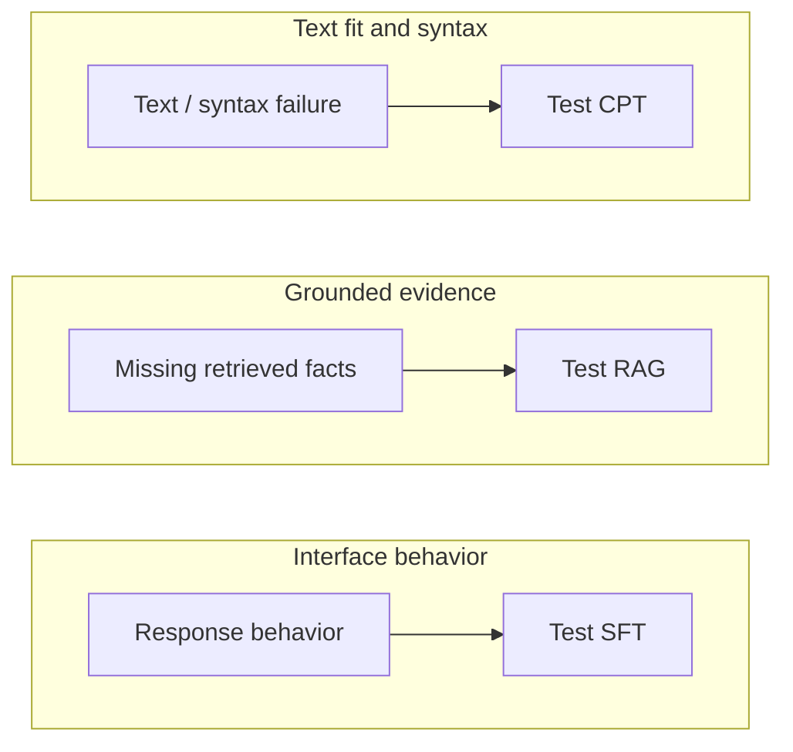

---
{
  "id": "continued-pretraining-domain-adaptation",
  "title": "Continued Pretraining for Domain Shift",
  "slug": "continued-pretraining-domain-adaptation",
  "section": "Advanced Training & Adaptation",
  "category": "Fine-Tuning & Training",
  "difficulty": "Hard",
  "order": 4,
  "coverImage": "illustrations/_generated/continued_pretraining_dark.png",
  "companies": [
    "OpenAI",
    "Meta",
    "Anthropic",
    "Google",
    "DeepMind"
  ],
  "shortDescription": "The 3 AM assistant blames Wi-Fi for `AUTH_TIMEOUT`. Continued pretraining tests whether more domain text fixes that, without hiding forgetting or a task that never improved.",
  "keyConceptsTested": [
    "continued pretraining vs SFT",
    "domain-adaptive pretraining",
    "task-adaptive pretraining",
    "corpus selection and mixing",
    "general-capability regression checks",
    "domain perplexity and downstream evals",
    "stopping rules for adaptation runs",
    "over-specialization and general regression risks"
  ],
  "prerequisites": [
    "jax-for-ml-research",
    "build-gpt-from-scratch-lab",
    "pre-training-data-pipelines-scale",
    "instruction-tuning-chat-templates"
  ],
  "relatedQuestions": [
    "supervised-fine-tuning-pipeline",
    "lora-parameter-efficient-fine-tuning",
    "reward-modeling-from-preference-data"
  ]
}
---

In a distributed payment system, an alert fires at 3 AM: an upstream gateway triggers `AUTH_TIMEOUT` on every retry, exhausting the worker connection pool. You route the incident logs to an assistant built from a standard foundation model. It replies, "Please verify your Wi-Fi settings and ensure the authentication server is reachable." It misses the runbook's two-phase commit protocol, jittered backoff, and mandatory idempotency token for `/v2/vault/token-reissue`.

Is the model failing because it couldn't retrieve the runbook, because it didn't know how to format an on-call response, or because its internal weights don't understand the vocabulary, syntax, and causal relationships of your internal distributed systems architecture? Those failures call for completely different interventions.

The <span data-glossary="jax">JAX</span> chapter treated a training step as a replayable state transition: parameters, <span data-glossary="optimizer-state">optimizer state</span>, <span data-glossary="prng-key">random-number keys</span>, and metrics cross an explicit boundary. **Continued <span data-glossary="pretraining">pretraining</span> (CPT)** resumes a pretrained model's text-learning objective on new text. For a decoder-only model, doing that on a domain is **domain-adaptive pretraining (DAPT)**. Pin the starting <span data-glossary="model-checkpoint">checkpoint</span>, domain mix, schedule, and evaluation lanes so a falling training loss can be compared with actual task gain and regression.

## What each intervention changes

Return to the incident. If a correct runbook excerpt in the prompt repairs the answer, retrieval is a useful baseline. **Retrieval-augmented generation (RAG)** can provide unfamiliar definitions, examples, and relationships without changing weights. The resulting attention patterns depend on that context. Fragmented service names don't make in-context learning impossible.

Long retrieved contexts still cost something. For full attention, the pairwise attention component of prefill grows quadratically with token count; projections and feed-forward layers also contribute. Total latency depends on the model, kernel, cache reuse, retrieval, and hardware. Measure time to a useful answer and task accuracy before deciding that a longer prompt is too expensive.

**Supervised fine-tuning (SFT)** changes trainable weights using demonstrations. It can teach facts and domain behavior as well as answer format. LIMA's **Superficial Alignment Hypothesis** is supported by its 2023 study of a strong pretrained 65B model and 1,000 curated examples.[^zhou2023] Evaluate knowledge gains and compare SFT with CPT for the target domain.

Also distinguish **masked targets** from **zero gradients through prompt representations**. Response-only SFT omits direct losses on prompt targets, but response predictions depend on the prompt. Their gradients can reach prompt embeddings and attention weights. The current TRL trainer supports completion-only and assistant-only masks; full-sequence training is also available. The dataset format, configuration, and chat template determine the mask.[^huggingface2026sfttrainer]

Predict the result of this small causal model. Its input IDs `0` and `1` are prompt tokens; it ignores the first target and scores only response ID `2`. A cumulative sum lets the response prediction depend on both prompt embeddings. This is a toy dependency graph, not a transformer. Will either prompt row receive a gradient? The independent cells in this lesson were checked on Python 3.12 with Torch 2.13.0 where required; the markers pin that dependency.

<!-- leetllm: test, deps=torch==2.13.0, output=show, output_title="Masked targets still influence gradients" -->
```python title="response_loss_updates_prompt.py"
import torch
import torch.nn.functional as F

embedding = torch.nn.Embedding(3, 2, dtype=torch.float64)
with torch.no_grad():
    embedding.weight.copy_(torch.tensor(
        [[1., 0.], [0., 1.], [0., 0.]], dtype=torch.float64
    ))

inputs = torch.tensor([0, 1])
targets = torch.tensor([-100, 2])  # prompt target ignored; response target scored
hidden = embedding(inputs).cumsum(dim=0)
head = torch.tensor([[1., 0., -1.], [0., 1., 1.]], dtype=torch.float64)
loss = F.cross_entropy(hidden @ head, targets, ignore_index=-100)
loss.backward()

print(f"response_loss={loss.item():.6f}")
for row in (0, 1):
    nonzero = bool(embedding.weight.grad[row].abs().sum() > 0)
    print(f"prompt_row_{row}_has_gradient={nonzero}")
unused = bool(embedding.weight.grad[2].abs().sum() > 0)
print(f"unused_input_row_2_has_gradient={unused}")
```

<!-- leetllm: output:start -->
```text title="Masked targets still influence gradients" output compact
response_loss=1.861995
prompt_row_0_has_gradient=True
prompt_row_1_has_gradient=True
unused_input_row_2_has_gradient=False
```
<!-- leetllm: output:end -->

Both prompt rows participate in the scored prediction. Row `2` is unused by this input embedding, and the output head is separate and fixed, so that row has no gradient here. Tied input/output weights would add another gradient path. The mask selects loss terms; it doesn't detach their causal context.

CPT continues the autoregressive next-<span data-glossary="token">token</span> objective on cleaned domain text. For a sequence $w_1,\ldots,w_n$, let nonempty $S$ contain the positions actually scored after shifting, padding, and boundary masks:

$$
\mathcal{L}_{\mathrm{CLM}}(\theta) = -\frac{1}{|S|}\sum_{i\in S} \log P(w_i \mid w_{<i}; \theta)
$$

Here $w_{<i}$ is the available causal context, subject to the chosen context window and document boundaries. With no beginning-of-sequence (BOS) token or preceding context, an ordinary shifted block of $n$ tokens scores $n-1$ targets. Padding or additional masks can reduce that count. Perplexity exponentiates mean negative log-likelihood over the scored positions.[^huggingface_ppl]

CPT usually scores a larger share of each sequence than response-only SFT. Masking and packing determine the actual scored-token fraction. Gradients follow the dependency graph and update the parameters you left trainable. Frozen base weights stay fixed during adapter-only CPT. Measure task transfer and factual grounding on held-out examples after training.

<figure>
  
  <figcaption>
    The seven labels represent toy positions. Without BOS or preceding context, CPT scores six of seven and this response-only mask scores four. The ignored prompt targets still feed later token predictions, so prompt rows receive gradients when trainable.
  </figcaption>
</figure>

Before picking a data mix, consider what CPT directly rewards. Raw runbooks reward accurate continuations of runbook text. They don't explicitly reward the assistant format your application expects. Later SFT still uses a next-token loss, but its examples are prompt-response pairs where response-only masks restrict loss to the answer.[^huggingface2026sfttrainer] Same token-level math, different supervision shape.



These are candidate experiments, not exclusive diagnoses. Compare a retrieval baseline and direct SFT with CPT followed by that same SFT recipe. One bad sampled completion is too noisy to choose an expensive training stage. Don't rank those tools from labels alone. In Ovadia et al.'s knowledge-injection experiments, <span data-glossary="rag">RAG</span> beat unsupervised fine-tuning on MMLU and current-events questions, while repeated paraphrases of the same fact helped fine-tuning on a new-fact task.[^ovadia2024] CPT earns an experiment when the base model poorly fits the domain text distribution, not when you only need fresher facts or a different answer format.

## Diagnose the shift before spending training compute

The first question is whether the model actually fits the target text. Record held-out raw-text loss and its exponentiated form, <span data-glossary="perplexity">perplexity</span>, for the base model. Then ask whether CPT lowers domain loss while a general-text control stays inside budget. A base model scoring worse on domain than general text is a screening clue, because corpora can have different inherent predictability. Evaluate product tasks separately to measure CPT's impact.

Next inspect how the tokenizer represents domain identifiers. A fixed tokenizer may spend more tokens on unfamiliar strings, raising context cost. CPT keeps the existing vocabulary. Changing tokenization requires redesigning <span data-glossary="embedding">embeddings</span> and retraining compatible weights. Treat token fertility as an inspection signal. Run the actual tokenizer over the corpus before estimating document compression.

The greedy longest-match tokenizer below shows how missing domain tokens inflate fertility: lowercase `timeout` and `AUTH` match whole vocabulary entries, whereas uppercase `TIMEOUT` fragments into single-character pieces and consumes extra context budget.

<!-- leetllm: test, output=show, output_title="Tokenizer fertility diagnostic" -->

```python title="measure_tokenizer_fertility.py"
VOCAB = [
    "timeout",
    "retry",
    "client",
    "should",
    "with",
    "backoff",
    "AUTH",
    "fires",
    "the",
    " ",
]
pieces = sorted(VOCAB, key=len, reverse=True)


def tokenize(text: str) -> list[str]:
    tokens: list[str] = []
    index = 0
    while index < len(text):
        matched = next((piece for piece in pieces if text.startswith(piece, index)), None)
        if matched is None:
            tokens.append(text[index])
            index += 1
        else:
            tokens.append(matched)
            index += len(matched)
    return tokens


samples = {
    "timeout": "timeout",
    "AUTH_TIMEOUT": "AUTH_TIMEOUT",
}

print("slice         n_pieces  pieces")
for name, text in samples.items():
    tokens = tokenize(text)
    print(f"{name:<13}{len(tokens):>8}  {tokens}")
```

<!-- leetllm: output:start -->
```text title="Tokenizer fertility diagnostic" output compact
slice         n_pieces  pieces
timeout             1  ['timeout']
AUTH_TIMEOUT        9  ['AUTH', '_', 'T', 'I', 'M', 'E', 'O', 'U', 'T']
```
<!-- leetllm: output:end -->

### Vocabulary extension vs. fixed tokenizer

High fertility consumes more of the token window. Measure the whole corpus before assigning a multiplier; one fragmented identifier cannot predict corpus-wide fertility. If total sequence length triples, full-attention pairwise arithmetic grows about ninefold at fixed width, while total forward work and measured latency also depend on other components. Subwords can represent domain concepts, so evaluate semantic quality on target tasks instead of inferring it from fragment count.

Keeping the tokenizer preserves vocabulary coordinates and avoids adding untrained rows. The base vocabulary $V$ and embedding <span data-glossary="matrix">matrix</span> $E\in\mathbb R^{V\times d}$ retain their shapes. Stable optimization still depends on the data mixture and update settings. Code Llama retained the Llama/Llama 2 tokenizer and added four markers for its infilling variants.[^roziere2023] That example documents one model's choice; a useful vocabulary-change threshold depends on the target text and tokenizer. Compare measured sequence savings, occurrence counts, initialization, and downstream retention.

Alternatively, you can expand the vocabulary with $K$ domain-specific tokens, such as frequent API methods or specialized identifiers. That expands embedding matrix $E \to \mathbb{R}^{(V+K) \times d}$ and output language-modeling head $W_{\mathrm{head}} \to \mathbb{R}^{(V+K) \times d}$, possibly with shared weights.

New rows change input representations and output support. A poorly scaled initialization can disrupt predictions, but a Gaussian draw doesn't inevitably cause collapse. **Subword centroid initialization** is one candidate: tokenize the new string using the old tokenizer and average those rows:

$$
\mathbf{e}(t_{\mathrm{new}}) = \frac{1}{m}\sum_{j=1}^{m} \mathbf{e}(s_j)
$$

This gives a vector built from existing coordinates. Evaluate its contextual behavior, effect on the old softmax distribution, and gradient behavior during training. Vocabulary-expansion studies compare several initialization strategies.[^mundra2024VocabExpansion]

An August 2026 study of Hindi adaptation in Nemotron-3-Nano-30B-A3B compares subword averaging, norm calibration, and different input/output initialization schemes. Its best observed configuration is specific to that model and language; low initial loss alone isn't a sufficient selection metric.[^joshi2026EmbeddingInitialization]

<!-- leetllm: test, deps=torch==2.13.0, output=show, output_title="Subword centroid embedding initialization" -->

```python title="subword_centroid_initialization.py"
import torch
import torch.nn as nn

# Base vocabulary: 5 tokens with embedding dim 8
vocab = {"auth": 0, "time": 1, "out": 2, "retry": 3, "jitter": 4}
embedding_dim = 8
torch.manual_seed(42)
old_embeddings = nn.Embedding(len(vocab), embedding_dim)

# Add new domain token composed of constituent subwords: auth (0), time (1), out (2)
new_tokens = {"AUTH_TIMEOUT": [0, 1, 2]}
new_vocab_size = len(vocab) + len(new_tokens)

new_embeddings = nn.Embedding(new_vocab_size, embedding_dim)
with torch.no_grad():
    new_embeddings.weight[:len(vocab)] = old_embeddings.weight
    for offset, subword_ids in enumerate(new_tokens.values()):
        centroid = old_embeddings.weight[subword_ids].mean(dim=0)
        new_embeddings.weight[len(vocab) + offset] = centroid

print(f"old_vocab_size={old_embeddings.num_embeddings}")
print(f"new_vocab_size={new_embeddings.num_embeddings}")
is_exact = torch.allclose(new_embeddings.weight[5], old_embeddings.weight[[0, 1, 2]].mean(dim=0))
print(f"centroid_initialized={is_exact}")
```

<!-- leetllm: output:start -->
```text title="Subword centroid embedding initialization" output compact
old_vocab_size=5
new_vocab_size=6
centroid_initialized=True
```
<!-- leetllm: output:end -->

That cell initializes an input lookup table. A resized language model also needs a compatible tokenizer and config, a resized output head, preserved existing IDs, and explicit handling of tied weights. Untied input and output matrices need separate treatment.

Even a mean-initialized output row changes probabilities. Predict what happens when two old logits are both zero and the new row also produces zero. The old rows remain identical, and the denominator gains a third term:

<!-- leetllm: test, deps=torch==2.13.0, output=show, output_title="Vocabulary extension changes output support" -->
```python title="centroid_changes_softmax.py"
import torch

old_rows = torch.tensor([[2., 0.], [-2., 0.]], dtype=torch.float64)
hidden = torch.tensor([0., 1.], dtype=torch.float64)
extended_rows = torch.cat([old_rows, old_rows.mean(dim=0, keepdim=True)])
old_p = torch.softmax(old_rows @ hidden, dim=0)
new_p = torch.softmax(extended_rows @ hidden, dim=0)

print(f"old_token_probability={old_p[0].item():.6f}")
print(f"after_extension={new_p[0].item():.6f}")
print(f"old_target_nll={-old_p[0].log().item():.6f}")
print(f"after_extension_nll={-new_p[0].log().item():.6f}")
```

<!-- leetllm: output:start -->
```text title="Vocabulary extension changes output support" output compact
old_token_probability=0.500000
after_extension=0.333333
old_target_nll=0.693147
after_extension_nll=1.098612
```
<!-- leetllm: output:end -->

<figure>
  
  <figcaption>
    The added output row takes probability mass from both old rows. The walkthrough uses two zero logits before expansion and three afterward. Input embeddings grow too; this figure isolates the output head's denominator.
  </figcaption>
</figure>

Here the old target's NLL rises by $\ln(3/2)\approx0.405$. Initialization can reduce disruption without eliminating it. Check initial loss, training behavior, and the final domain and general tasks.

Validation can also lie before training starts. Near-duplicates, revisions of the same OpenAPI page, or two runbook copies from one source can land in both training and validation and make CPT look stronger than the split warrants. Assign a <span data-glossary="provenance">provenance</span> or deduplication group before tokenization, then keep each group in one split.

<!-- leetllm: test, output=show, output_title="Grouped holdout split" -->

```python title="group_domain_holdout.py"
import hashlib

documents = [
    {"group": "auth-docs-v3", "text": "AUTH_TIMEOUT means the token exchange exceeded 2s"},
    {"group": "auth-docs-v3", "text": "AUTH_REJECTED means the client secret is invalid"},
    {"group": "webhook-runbooks", "text": "exhausted retries require owner acknowledgement"},
    {"group": "webhook-runbooks", "text": "duplicate deliveries must be idempotent"},
    {"group": "sdk-notes", "text": "SDK v4 retries AUTH_TIMEOUT with jitter"},
    {"group": "payments-api", "text": "capture calls must include idempotency-key"},
]


def split_for_group(group: str) -> str:
    bucket = int(hashlib.sha256(group.encode()).hexdigest(), 16) % 4
    return "validation" if bucket == 0 else "train"


splits = {"train": [], "validation": []}
for doc in documents:
    splits[split_for_group(doc["group"])].append(doc)

train_groups = {doc["group"] for doc in splits["train"]}
validation_groups = {doc["group"] for doc in splits["validation"]}
assert train_groups.isdisjoint(validation_groups)

print(f"train_groups={sorted(train_groups)}")
print(f"validation_groups={sorted(validation_groups)}")
print("group leakage: none")
```

<!-- leetllm: output:start -->
```text title="Grouped holdout split" output compact
train_groups=['auth-docs-v3', 'sdk-notes']
validation_groups=['payments-api', 'webhook-runbooks']
group leakage: none
```
<!-- leetllm: output:end -->

This split keeps the supplied groups apart; it doesn't discover duplicate groups for you. Hash bucketing targets a validation fraction over many groups, not exactly 25% of a small corpus's tokens. Check split sizes and topic coverage before accepting it.

Loss and fertility checks identify candidates for adaptation. They don't tell you how hard to push the weights once training begins.

## The two failure dynamics: forgetting and underfitting

Predict the two curves before touching the optimizer. Successful text adaptation lowers held-out domain loss, though individual evaluations can fluctuate. If general-text loss rises, general text fit has regressed. Measure downstream abilities separately before calling that a loss of reasoning or instruction-following capability.

**Catastrophic forgetting** is loss of previously learned ability as parameters shift to absorb new data. Push too hard on `AUTH_TIMEOUT` runbooks and broad validation quality can regress.

**Underfitting** means the model still poorly fits the domain. Too few effective updates are one possible cause; limited model capacity or a mismatched recipe can also matter. A run can underfit the domain and regress elsewhere at the same time.

The main controls are the <span data-glossary="learning-rate">learning-rate</span> schedule and data mixture. Run length and corpus quality matter too, so a bad corpus can't be repaired by a clever schedule.

### Learning rate re-warming and re-decaying

Inspect the checkpoint's actual training recipe. Not every run ends on a cosine floor, and a released weight file often doesn't include optimizer or scheduler state. Continuing from saved training state and starting a new adaptation optimizer are different experiments.

A low learning rate may adapt slowly; a high one may worsen general performance. Neither “trapped in a local minimum” nor “shattered attention circuits” follows from a loss trace alone. The SGD identity $\Delta\theta=-\eta\nabla\mathcal L$ also doesn't describe AdamW's moment-normalized update.

The cited Ibrahim study's 405M-model sweep tests CPT peak rates of 0.5x, 1x, and 2x the original peak, with re-warming and re-decaying. It does not test 0.1x. Warmup durations of 0%, 0.5%, 1%, and 2% show different early behavior and similar later losses in those settings.[^ibrahim2024] Use those findings to design a learning-rate sweep for the checkpoint you plan to adapt.

Warmup can help manage a new optimizer and distribution change. Zero-initialized moments don't by themselves imply an exploding denominator: at AdamW's first step, bias correction gives $\hat m=g$ and $\hat v=g^2$. Ignoring weight decay, each coordinate moves by $-\eta g/(|g|+\epsilon)$. Later behavior still depends on gradient history, precision, and the recipe.

The cell below uses an **authored teaching schedule**: 1,000 zero-indexed steps, 50 warmup steps (5%), peak $3\times10^{-5}$, and floor $3\times10^{-6}$. Steps 49 and 50 share the peak. Step 999 reaches the floor. A cosine schedule reaches those endpoints. Evaluate the resulting checkpoint for convergence and task quality.

<!-- leetllm: test, output=show, output_title="Re-warm then re-decay schedule" -->

```python title="rewarm_redecay_schedule.py"
import math

def rewarm_redecay(step: int, total_steps: int, warmup_steps: int, peak: float, floor: float) -> float:
    if not 0 <= step < total_steps or not 1 <= warmup_steps <= total_steps - 2:
        raise ValueError("need warmup and at least two decay steps; step must be in range")
    if not 0 <= floor <= peak:
        raise ValueError("require 0 <= floor <= peak")
    if step < warmup_steps:
        return floor + (peak - floor) * (step + 1) / warmup_steps
    progress = (step - warmup_steps) / (total_steps - warmup_steps - 1)
    cosine = 0.5 * (1.0 + math.cos(math.pi * progress))
    return floor + (peak - floor) * cosine

total_steps = 1000
warmup_steps = 50
peak = 3e-5  # candidate peak rate; tune for the target CPT run
floor = 3e-6

for step in [0, 49, 50, 250, 999]:
    print(f"step={step:>3} lr={rewarm_redecay(step, total_steps, warmup_steps, peak, floor):.2e}")
```

<!-- leetllm: output:start -->
```text title="Re-warm then re-decay schedule" output compact
step=  0 lr=3.54e-06
step= 49 lr=3.00e-05
step= 50 lr=3.00e-05
step=250 lr=2.71e-05
step=999 lr=3.00e-06
```
<!-- leetllm: output:end -->

### Replay: keep prior-data signal in the mix

The second critical control is **replay**: mixing a fraction of general-purpose pretraining data directly into the incoming domain corpus.

Domain and general losses depend on shared trainable parameters. Improving one can worsen the other when their gradients conflict. A domain-only run can regress, but it does not necessarily lose every broad capability. Test the abilities that matter instead of inferring particular damaged circuits from text loss.

To preserve general capabilities, you interleave a replay buffer $\mathcal{D}_{\mathrm{replay}}$ into the domain stream. The effective training objective becomes a weighted expectation across data distributions:

$$
\mathcal{L}_{\mathrm{mix}}(\theta) = (1 - \alpha)\,\mathbb{E}_{x \sim \mathcal{D}_{\mathrm{domain}}}[\mathcal{L}_{\mathrm{CLM}}(x; \theta)]
+ \alpha\,\mathbb{E}_{y \sim \mathcal{D}_{\mathrm{replay}}}[\mathcal{L}_{\mathrm{CLM}}(y; \theta)]
$$

Here $\alpha \in [0,1]$ is the fraction of **scored target tokens** assigned to replay, with each expectation representing a token-weighted loss for its source. A batch or document fraction matches this objective only if the scored-token counts match, or you weight the losses accordingly. Random sampling does not necessarily put both sources in every batch.

To see the competing gradients directly, shrink the predictor to one shared logit $z$. It assigns probability $\sigma(z)$ to token 1 and the remaining probability to token 0. Domain examples always target 1; replay examples always target 0. This deliberately conflicting model has no context features that could separate the tasks. At $z=0$, the gradients are $-0.5$ for domain and $+0.5$ for replay. A 25% replay mix gives $0.75(-0.5)+0.25(0.5)=-0.25$.

The CPU-only PyTorch cell takes one gradient step from the same starting weight for each mixture. It isolates how mixture weights scale each domain's gradient contribution on a single update. Measure forgetting on a model with held-out domain and replay evaluations.

<!-- leetllm: test, deps=torch==2.13.0, output=show, output_title="Replay changes the update" -->
```python title="one_shared_logit.py"
import torch
import torch.nn.functional as F

print("replay  gradient  new_logit  domain_nll  replay_nll")
for alpha in (0.0, 0.25, 0.5):
    z = torch.tensor(0.0, dtype=torch.float64, requires_grad=True)
    domain_loss = F.softplus(-z)  # -log sigmoid(z), target 1
    replay_loss = F.softplus(z)   # -log(1 - sigmoid(z)), target 0
    ((1 - alpha) * domain_loss + alpha * replay_loss).backward()
    gradient = z.grad.item()
    with torch.no_grad():
        z -= gradient  # learning rate 1, chosen for easy arithmetic
    print(f"{alpha:>6.0%}{gradient:>10.2f}{z.item():>11.2f}"
          f"{F.softplus(-z).item():>12.3f}{F.softplus(z).item():>12.3f}")
```

<!-- leetllm: output:start -->
```text title="Replay changes the update" output compact
replay  gradient  new_logit  domain_nll  replay_nll
    0%     -0.50       0.50       0.474       0.974
   25%     -0.25       0.25       0.576       0.826
   50%      0.00       0.00       0.693       0.693
```
<!-- leetllm: output:end -->

Both losses start at $\log2\approx0.693$. Domain-only training improves domain loss while worsening replay loss. At 50% the gradients cancel exactly. Context features can let a richer model separate some conflicts. Measure whether the target model does so, and tune the replay ratio on held-out evaluations.

Ibrahim's study selects 5% replay for its weak English-to-English shift and 25% for its stronger English-to-German shift after comparing several fractions. Its 50% runs aren't simply “wasted compute.”[^ibrahim2024] The results contradict a universal 10%–30% safe interval. Your replay source, checkpoint, shift, budget, and required abilities determine which candidates are useful.

For the incident assistant, compare several declared ratios, including a domain-only control. Hold processed tokens fixed, log scored-token fractions, and measure both downstream benefit and regression. The 25% window below illustrates token accounting. Measure reasoning retention on held-out tasks after training.

Under a fixed token budget, replay replaces some domain tokens. At `25%` replay, one quarter of a fixed window becomes general text before checking the accounting below. Equal processed tokens are a compute proxy only when model, block lengths, masks, and execution are comparable; they don't prove equal measured FLOPs or runtime.

<!-- leetllm: test, output=show, output_title="Matched-token replay accounting" -->

```python title="compute_equivalent_replay.py"
total_tokens = 2_000_000

print("replay_ratio  domain_tokens  replay_tokens  total_tokens")
for replay_ratio in [0.00, 0.05, 0.25]:
    replay_tokens = int(total_tokens * replay_ratio)
    domain_tokens = total_tokens - replay_tokens
    assert domain_tokens + replay_tokens == total_tokens
    print(f"{replay_ratio:>11.0%}{domain_tokens:>15,}{replay_tokens:>15,}{total_tokens:>14,}")
```

<!-- leetllm: output:start -->
```text title="Matched-token replay accounting" output compact
replay_ratio  domain_tokens  replay_tokens  total_tokens
         0%      2,000,000              0     2,000,000
         5%      1,900,000        100,000     2,000,000
        25%      1,500,000        500,000     2,000,000
```
<!-- leetllm: output:end -->

```checkpoint
Your continued-pretraining run resumes from the base checkpoint at its final tiny learning rate and uses 100% domain text. Domain perplexity barely moves. After you raise the re-warm peak, domain perplexity improves but general-text loss regresses. Which two sweeps should you run?
---
Sweep declared peak/schedule candidates and replay fractions under matched token budgets. Include the current recipe as a control and select against held-out domain tasks and required general abilities. Neither 0.1x peak nor 10%–30% replay is a universal prescription. Replay tests a regression-control hypothesis; it doesn't explain the original slow adaptation by itself.
```

## When continued pretraining is the right tool

Reach for continued pretraining when the domain has language the base model under-serves. Common examples include internal API docs and error catalogs (`AUTH_TIMEOUT`, `AUTH_REJECTED`), on-call runbooks and incident notes, SDK guides with domain-specific method names, long compliance or protocol documents, and codebases whose APIs and identifiers barely appeared in public pretraining.

The trigger isn't simply "the product team wants custom behavior." The question is whether extra domain-text exposure improves the final task enough to justify its cost compared with direct post-training or retrieval.

### Good signals

| Signal | Why it points to continued pretraining |
|---|---|
| Model misreads domain terminology across held-out examples | Test whether more domain-text exposure improves these errors |
| Poor held-out text fit accompanies poor domain-task results | CPT may help, but task improvement still needs measurement |
| Raw completions are weak even before instruction formatting | The issue appears before chat behavior enters the picture |
| You have lots of domain text but few high-quality prompt-response labels | Continued pretraining can exploit unlabeled corpora |

### Bad signals

| Signal | Candidate to compare |
|---|---|
| Model knows the facts but answers in the wrong format | SFT |
| You need fresh, frequently changing, or citable facts | RAG |
| Model needs one task-specific classifier head | supervised fine-tuning with a classifier head |
| Model is mostly correct but chooses the wrong safe vs unsafe answer | preference optimization |

A practical split for the `AUTH_TIMEOUT` assistant is to test raw domain-text continuation and prompt-response behavior separately. Weak raw continuation motivates testing CPT; competent continuation with poor assistant behavior motivates testing SFT. Neither observation rules out retrieval or establishes a unique cause.

The 2020 "Don't Stop Pretraining" paper names two useful scopes in masked-language-model experiments with RoBERTa:[^gururangan2020] **DAPT** (domain-adaptive pretraining) uses large unlabeled domain text such as API docs or runbooks. **TAPT** (task-adaptive pretraining) continues on the task's own unlabeled inputs, even when that corpus is smaller.

The distinction remains useful for decoder-only LLM projects, but don't silently transfer RoBERTa's quantitative gains to a causal base model. Measure whether more exposure to the target text distribution improves your model and downstream task.

## Data for continued pretraining

The same discipline from large-scale pretraining still applies: filter low-quality text, deduplicate aggressively, remove benchmarks and eval <span data-glossary="feature-leakage">leakage</span>, scrub PII and <span data-glossary="secrets-management">secrets</span> from runbooks and traces, and keep provenance and usage rights for every corpus slice.

The corpus can be narrower and more targeted. Domain data can also be more sensitive than public pretraining text, so provenance, access control, and removal procedures are product requirements, not cleanup tasks.

### Gate the corpus before tokenization

Keep a manifest that records whether a source may be trained on, whether it contains unresolved sensitive content, and whether it's reserved for evaluation. A high-quality domain document that fails one of these gates doesn't belong in the training stream.

<!-- leetllm: test, output=show, output_title="Corpus manifest gate" -->

```python title="gate_domain_manifest.py"
sources = [
    {"name": "public-api-docs", "tokens": 800_000, "licensed": True, "pii_scrubbed": True, "eval_only": False},
    {"name": "oncall-notes", "tokens": 120_000, "licensed": True, "pii_scrubbed": False, "eval_only": False},
    {"name": "heldout-probes", "tokens": 25_000, "licensed": True, "pii_scrubbed": True, "eval_only": True},
    {"name": "vendor-export", "tokens": 300_000, "licensed": False, "pii_scrubbed": True, "eval_only": False},
]

def allowed(row: dict) -> bool:
    for key in ("licensed", "pii_scrubbed", "eval_only"):
        if row.get(key) not in (True, False):
            raise ValueError(f"{key} needs a verified Boolean value")
    tokens = row.get("tokens")
    if tokens is None or tokens < 0:
        raise ValueError("tokens must be a nonnegative integer")
    return bool(row["licensed"] and row["pii_scrubbed"] and not row["eval_only"])

accepted = [
    row for row in sources
    if allowed(row)
]
rejected = [row["name"] for row in sources if row not in accepted]

print(f"accepted={[row['name'] for row in accepted]}")
print(f"training_tokens={sum(row['tokens'] for row in accepted):,}")
print(f"rejected={rejected}")
```

<!-- leetllm: output:start -->
```text title="Corpus manifest gate" output compact
accepted=['public-api-docs']
training_tokens=800,000
rejected=['oncall-notes', 'heldout-probes', 'vendor-export']
```
<!-- leetllm: output:end -->

```checkpoint
`oncall-notes` is licensed but still contains unresolved PII, while `heldout-probes` is clean and licensed. Which source can enter continued-pretraining blocks?
---
Neither. Unresolved PII blocks `oncall-notes`, and the evaluation-only flag keeps `heldout-probes` out of training. These flags record prior review; this code doesn't verify a license or detect sensitive text. A string such as `"false"` is malformed, not a trustworthy approval.
```

### Screen for evaluation overlap

The next cell screens for **normalized text matches**. It lowercases and collapses whitespace for comparison, while retaining the original training strings. That policy can falsely merge case-sensitive identifiers or meaningful spacing; choose normalization for the source type. It also misses partial copies, paraphrases, and related facts. Add provenance grouping, near-duplicate checks, and a residual-overlap audit.

<!-- leetllm: test, output=show, output_title="Normalized evaluation-overlap screen" -->

```python title="remove_exact_eval_overlap.py"
import hashlib

def fingerprint(text: str) -> str:
    normalized = " ".join(text.lower().split())
    return hashlib.sha256(normalized.encode()).hexdigest()

heldout = [
    "AUTH_TIMEOUT: token exchange exceeded 2s. Retry with jitter.",
    "Webhook retries above 8 require owner acknowledgement.",
]
candidate_training = [
    "SDK v4 retry notes for AUTH_REJECTED.",
    "  auth_timeout: TOKEN exchange exceeded 2s. retry with jitter. ",
    "Idempotency-key requirements for capture calls.",
]

heldout_hashes = {fingerprint(text) for text in heldout}
clean_training = [
    text for text in candidate_training
    if fingerprint(text) not in heldout_hashes
]

print(f"removed={len(candidate_training) - len(clean_training)}")
print(f"kept={len(clean_training)}")
assert all(fingerprint(text) not in heldout_hashes for text in clean_training)
```

<!-- leetllm: output:start -->
```text title="Normalized evaluation-overlap screen" output compact
removed=1
kept=2
```
<!-- leetllm: output:end -->

### Mixing strategy

Compare domain-only training with declared replay ratios. Replay is one <span data-glossary="guardrail">guardrail</span> against forgetting: hold total training tokens fixed, then select with domain-gain and broad-regression metrics. If general language degrades beyond your declared tolerance while specialization improves, the run exceeds that product's budget.

BloombergGPT trained from scratch on 569B tokens. Its assembled corpus inventory was roughly 709B tokens, with `51.27%` financial and `48.73%` public text. Those shares describe the inventory, not the exact training tokens consumed. The model reported strong financial results while remaining competitive on the paper's general benchmarks.[^wu2023bloomberggpt] Choose CPT replay ratios from your checkpoint's domain shift and held-out results.

### Pack blocks and preserve the mixture

CPT uses the same causal objective as base pretraining. Packing is where your data decision becomes tensors: join document token sequences with end-of-document markers, then emit full blocks. A separator marks a boundary, but it doesn't prevent cross-document attention by itself. As the data-pipeline chapter explained, choose explicitly between an ordinary <span data-glossary="causal-mask">causal mask</span> and a document-isolated block-diagonal mask. Predict where the first separator lands and whether the final short document fits before inspecting the small integer sequence.

<!-- leetllm: test, output=show, output_title="Packed CPT token blocks" -->

```python title="pack_domain_token_blocks.py"
EOS = 0
block_size = 6
documents = [[11, 12, 13], [21, 22], [31, 32, 33, 34], [41]]

stream = []
for document in documents:
    stream.extend(document + [EOS])

blocks = [
    stream[start:start + block_size]
    for start in range(0, len(stream) - block_size + 1, block_size)
]

print(f"stream={stream}")
print(f"blocks={blocks}")
remainder = stream[len(blocks) * block_size:]
print(f"remainder={remainder}")
assert all(len(block) == block_size for block in blocks)
assert EOS in blocks[0]
```

<!-- leetllm: output:start -->
```text title="Packed CPT token blocks" output compact
stream=[11, 12, 13, 0, 21, 22, 0, 31, 32, 33, 34, 0, 41, 0]
blocks=[[11, 12, 13, 0, 21, 22], [0, 31, 32, 33, 34, 0]]
remainder=[41, 0]
```
<!-- leetllm: output:end -->

The final `[41, EOS]` is returned as a remainder, not a training block. Carry it into the next packing call if you want to preserve it. Silently dropping every shard's tail can disproportionately remove short or rare sources. In a six-token block without a separate beginning context, the usual one-position shift scores five targets: `block[:-1]` predicts `block[1:]`. Padding and document-boundary masking can reduce that count further.

Once domain and replay streams are packed, make mixture selection explicit and auditable. These names stand for equal-length blocks with equal scored-token counts. Under that assumption, 5 replay blocks out of 20 also means 25% replay targets. The function selects one window, not a stateful epoch loader: a real loader must advance its cursors rather than repeatedly take the first blocks.

<!-- leetllm: test, output=show, output_title="Deterministic replay mixture" -->

```python title="build_replay_mixture.py"
import random

def make_window(domain_blocks: list[str], replay_blocks: list[str], replay_ratio: float, size: int) -> list[str]:
    if size <= 0:
        raise ValueError("size must be a positive integer")
    if not 0.0 <= replay_ratio <= 1.0:
        raise ValueError("replay_ratio must be between 0 and 1")
    replay_count = round(size * replay_ratio)
    domain_count = size - replay_count
    if len(domain_blocks) < domain_count or len(replay_blocks) < replay_count:
        raise ValueError("not enough packed blocks for requested window")
    chosen = domain_blocks[:domain_count] + replay_blocks[:replay_count]
    random.Random(7).shuffle(chosen)
    return chosen

domain_blocks = [f"domain-{index}" for index in range(20)]
replay_blocks = [f"general-{index}" for index in range(20)]
window = make_window(domain_blocks, replay_blocks, replay_ratio=0.25, size=20)

domain_count = sum(item.startswith("domain") for item in window)
replay_count = sum(item.startswith("general") for item in window)
print(f"domain_blocks={domain_count} replay_blocks={replay_count}")
print(f"first_five={window[:5]}")
assert (domain_count, replay_count) == (15, 5)
```

<!-- leetllm: output:start -->
```text title="Deterministic replay mixture" output compact
domain_blocks=15 replay_blocks=5
first_five=['general-2', 'general-0', 'domain-11', 'general-3', 'domain-7']
```
<!-- leetllm: output:end -->

The window rounds the desired block count to the nearest integer using Python's ties-to-even rule. For example, 25% of ten blocks is 2.5, so this function selects two replay blocks, or 20%. Log the realized token fraction. For sustained training, a fractional accumulator or probabilistic sampler can approach the target across many windows without always rounding in the same direction.

Now break the equal-supervision assumption. Suppose the 15 domain blocks each score six targets, but additional replay masks leave only two targets in each of five replay blocks. Replay is 25% of blocks and only `10 / (90 + 10) = 10%` of scored targets. A pooled token mean implements the latter ratio. Averaging each block's mean equally implements the former. Both are definable objectives, but they aren't the same experiment.

Use the same conflicting shared-logit model to expose the changed update:

<!-- leetllm: test, deps=torch==2.13.0, output=show -->
```python title="replay-masks-change-the-mixture.py"
import torch
import torch.nn.functional as F

domain_targets, replay_targets = 15 * 6, 5 * 2
z = torch.tensor(0.0, dtype=torch.float64, requires_grad=True)
domain_mean, replay_mean = F.softplus(-z), F.softplus(z)
block_mean = 0.75 * domain_mean + 0.25 * replay_mean
token_mean = (domain_targets * domain_mean + replay_targets * replay_mean) / (
    domain_targets + replay_targets)
block_gradient, = torch.autograd.grad(block_mean, z, retain_graph=True)
token_gradient, = torch.autograd.grad(token_mean, z)
assert torch.isclose(block_gradient, torch.tensor(-0.25, dtype=z.dtype))
assert torch.isclose(token_gradient, torch.tensor(-0.4, dtype=z.dtype))
print(f"replay block share: {5 / 20:.0%}")
print(f"replay target share: {replay_targets / (domain_targets + replay_targets):.0%}")
print(f"equal-block gradient: {block_gradient.item():.2f}")
print(f"pooled-token gradient: {token_gradient.item():.2f}")
```

<!-- leetllm: output:start -->
```text title="Output" output compact
replay block share: 25%
replay target share: 10%
equal-block gradient: -0.25
pooled-token gradient: -0.40
```
<!-- leetllm: output:end -->

<figure>
  
  <figcaption>
    Fifteen domain blocks contribute 90 scored targets, and five replay blocks contribute 10. Equal block weighting produces a 25% replay share; pooled target weighting produces 10%. These gradients come from the article's one-logit walkthrough.
  </figcaption>
</figure>

To enforce an explicit 25% token-weighted source objective on this window, combine the domain source's token mean with weight 0.75 and the replay source's token mean with weight 0.25, or change source sampling to produce the intended target counts. Record the choice after shifting and masking. Accumulating separately normalized microbatch losses can introduce the same mismatch, so inspect the trainer's actual reduction.

## Evaluation: domain gain without lying to yourself

Evaluate domain benefit and required general abilities at the same checkpoints. Lower held-out text loss doesn't identify memorization or establish better reasoning, coding, or instruction following. A domain win without a general-capability budget leaves the trade unmeasured.

### Lane 1: Domain mastery

On the domain lane, track three complementary signals:
- **Held-out domain perplexity** measures fit on cleaned domain text under a fixed scoring protocol.
- **Entity-span NLL** sums losses over aligned subword spans for critical identifiers. State the span and token weighting; it isn't automatically an entity-level correctness score.
- **Downstream probes** test the actual task. If the product needs SFT, compare base-plus-SFT with CPT-plus-the-same-SFT. A fixed small training probe is one experiment; raw completion pass@1 is a separate evaluation. Choose budgets and held-out cases deliberately. Lower aggregate domain perplexity isn't a logical prerequisite for better task accuracy.

### Lane 2: General capability retention and safety checks

On the general lane, define required abilities and their regression budgets:
- **Held-Out General Perplexity**: Evaluated on an independent, frozen slice of diverse web text (such as SlimPajama or Wikipedia).
- **Task and Reasoning Checks**: Historical anchors include MMLU, HumanEval or MBPP, and GSM8K. State prompting and scoring, inspect contamination and ceiling effects, and supplement them with private held-out tasks your application must handle.
- **Safety and Alignment Checks**: Verify that refusal behaviors and safety guardrails haven't drifted during unsupervised domain exposure.

Freeze evaluation text, tokenizer, available context, boundary protocol, and target mask across checkpoints. Tokenization changes affect perplexity.[^huggingface_ppl] For a vocabulary comparison, also report encoding-based **bits per byte (BPB)** on the same scored text: total NLL in nats divided by the scored UTF-8 byte count and $\ln2$. Nats per byte omits the $\ln2$ division. Bytes, characters, and tokens are different units; control context and boundaries as well.

Here are two reports over the same 30 scored bytes, illustrating how token count affects PPL and BPB:

<!-- leetllm: test, output=show, output_title="Token units can reverse a ranking" -->
```python title="compare_byte_normalized_loss.py"
import math

print("report  token_ppl  nats/byte  bits/byte")
for name, nll, tokens in [("coarse", 15., 10), ("fine", 18., 20)]:
    byte_count = 30
    print(f"{name:<8}{math.exp(nll / tokens):>9.3f}"
          f"{nll / byte_count:>11.3f}"
          f"{nll / (byte_count * math.log(2)):>11.3f}")
```

<!-- leetllm: output:start -->
```text title="Token units can reverse a ranking" output compact
report  token_ppl  nats/byte  bits/byte
coarse      4.482      0.500      0.721
fine        2.460      0.600      0.866
```
<!-- leetllm: output:end -->

The finer tokenization has lower loss per token but higher total NLL for these same scored bytes. Token PPL rewards the changed unit; BPB exposes that difference. These are arithmetic fixtures, not measurements of a real vocabulary extension.

For a fixed tokenizer, aggregate corpus perplexity by summing NLL and scored-token counts before exponentiating. Documents with NLL 60 over 20 targets and 160 over 40 give $\exp(220/60)\approx39.1$. Averaging their PPLs gives about 37.3, a different statistic: it changes weighting and averages after a nonlinear transform.

The diagnostic below runs that exact arithmetic on two evaluation lanes:

<!-- leetllm: test, output=show, output_title="Two-lane perplexity report" -->

```python title="report_domain_and_general_ppl.py"
import math

base = {
    "domain": {"negative_log_likelihood": 840.0, "tokens": 240},
    "general": {"negative_log_likelihood": 540.0, "tokens": 200},
}
adapted = {
    "domain": {"negative_log_likelihood": 720.0, "tokens": 240},
    "general": {"negative_log_likelihood": 548.0, "tokens": 200},
}

def perplexity(metrics: dict[str, float]) -> float:
    nll, tokens = metrics["negative_log_likelihood"], metrics["tokens"]
    if tokens <= 0:
        raise ValueError("need a positive count of scored tokens")
    if nll < 0:
        raise ValueError("NLL sum must be nonnegative")
    mean_nll = nll / tokens
    try:
        return math.exp(mean_nll)
    except OverflowError:
        return math.inf  # keep mean NLL in the report when PPL overflows

print("lane     base_ppl  adapted_ppl  delta")
for lane in ["domain", "general"]:
    base_ppl = perplexity(base[lane])
    adapted_ppl = perplexity(adapted[lane])
    print(f"{lane:<8}{base_ppl:>9.2f}{adapted_ppl:>13.2f}{adapted_ppl - base_ppl:>7.2f}")
```

<!-- leetllm: output:start -->
```text title="Two-lane perplexity report" output compact
lane     base_ppl  adapted_ppl  delta
domain      33.12        20.09 -13.03
general     14.88        15.49   0.61
```
<!-- leetllm: output:end -->

### Gate, then rank the surviving checkpoints

Declare required abilities and regression budgets before selecting a checkpoint. General-text PPL measures text fit. Evaluate safety with the required safety suite. Accuracy changes need an explicit unit: a move from 70% to 68% is two percentage points, not a 2% relative drop.

The **authored** ledger below rejects a general-PPL rise above 1.5, then ranks survivors by downstream probe accuracy and uses domain PPL to break exact ties. It doesn't enforce reasoning or safety benchmarks, calculate uncertainty, or implement an early-stopping rule.

This is constrained, lexicographic selection. A **Pareto frontier** contains candidates that aren't dominated on the chosen metrics; it doesn't uniquely pick the largest probe score. Here base, 1k, and 4k all trade better domain fit against worse general fit. The declared ranking chooses 4k among eligible candidates.

<!-- leetllm: test, output=show, output_title="Checkpoint trade-off ledger" -->

```python title="continued_pretraining_checkpoint_picker.py"
import math

checkpoints = [
    {"name": "base", "domain_ppl": 42.0, "general_ppl": 19.2, "probe_acc": 0.62},
    {"name": "cpt-1k", "domain_ppl": 31.5, "general_ppl": 19.5, "probe_acc": 0.68},
    {"name": "cpt-4k", "domain_ppl": 27.9, "general_ppl": 20.1, "probe_acc": 0.72},
    {"name": "cpt-12k", "domain_ppl": 25.8, "general_ppl": 23.9, "probe_acc": 0.71},
]

base = checkpoints[0]
max_general_regression = 1.5

def validate_checkpoint(row: dict) -> None:
    if min(row["domain_ppl"], row["general_ppl"]) < 1 or not 0 <= row["probe_acc"] <= 1:
        raise ValueError("invalid perplexity or accuracy range")

for row in checkpoints:
    validate_checkpoint(row)

print("checkpoint  domain_gain  general_regression  probe_acc  keep")
best = None
best_rank = None

for row in checkpoints:
    domain_gain = base["domain_ppl"] - row["domain_ppl"]
    general_regression = row["general_ppl"] - base["general_ppl"]
    keep = general_regression <= max_general_regression
    rank = (row["probe_acc"], -row["domain_ppl"])

    if keep and (best_rank is None or rank > best_rank):
        best = row
        best_rank = rank

    print(
        f"{row['name']:<10}"
        f"{domain_gain:>11.1f}"
        f"{general_regression:>20.1f}"
        f"{row['probe_acc']:>11.2f}"
        f"  {'yes' if keep else 'no'}"
    )

print(f"chosen={best['name']}")
print("reason=best downstream probe, then domain perplexity, inside general-regression budget")
```

<!-- leetllm: output:start -->
```text title="Checkpoint trade-off ledger" output compact
checkpoint  domain_gain  general_regression  probe_acc  keep
base              0.0                 0.0       0.62  yes
cpt-1k           10.5                 0.3       0.68  yes
cpt-4k           14.1                 0.9       0.72  yes
cpt-12k          16.2                 4.7       0.71  no
chosen=cpt-4k
reason=best downstream probe, then domain perplexity, inside general-regression budget
```
<!-- leetllm: output:end -->

<figure>
  
  <figcaption>
    The evaluation ledger applies the 1.5-point general-regression budget before ranking survivors. It rejects cpt-12k and selects cpt-4k, whose probe accuracy is 0.72. Each point is one checkpoint, with both axes shown at numerical scale. Evaluate real runs on held-out domain and general data.
  </figcaption>
</figure>

```checkpoint
`cpt-12k` has the best domain perplexity but exceeds the allowed general-regression budget. `cpt-4k` passes the gate and has the best downstream probe accuracy among survivors. Which checkpoint wins?
---
Choose `cpt-4k`. General regression is a hard gate, so `cpt-12k` is ineligible. Among eligible checkpoints, downstream probe accuracy ranks first and domain perplexity only breaks ties.
```

## Stopping rules

A falling domain loss can continue after the product task has stopped getting better. Stop when downstream probe accuracy plateaus, when domain validation loss flattens, or when general regressions approach your safety threshold.

Unused documents and a tiny loss decrease aren't sufficient reasons to keep spending compute. Set a patience window, minimum worthwhile gain, and regression limits, then consider metric uncertainty and evaluation cost. Two flat checkpoints or a 0.2-percentage-point change aren't universal stopping rules. For 500 binary task cases, one changed outcome already moves accuracy by 0.2 percentage points. Reusing the same cases for many selections can overfit the evaluation; confirm the chosen recipe on a reserved test set.

At a selected checkpoint, save weights, tokenizer, config, corpus manifest, and evaluation protocol. For exact continuation also save optimizer/scheduler state, RNG states, and loader cursors. Test the intended final assistant after its actual post-training recipe before promotion. Match a saved checkpoint to the failure you actually have: domain text, answer format, or the cost of updating every weight.

## Where it fits relative to LoRA and SFT

Match that failure to an objective before you choose full-weight training, an adapter, or another data stage.

| Goal | Candidate approach |
|---|---|
| Inject fresh or citable facts without retraining | RAG |
| Teach new domain language patterns | continued pretraining |
| Teach chat or task format | SFT |
| Run a behavior update without full-weight training | SFT with <span data-glossary="lora">LoRA</span> / QLoRA adapters |
| Choose between multiple acceptable responses | <span data-glossary="dpo">DPO</span> or <span data-glossary="rlhf">RLHF</span> |

LoRA and <span data-glossary="qlora">QLoRA</span> are parameter-efficient implementation choices; QLoRA also stores the frozen base model in <span data-glossary="quantization">quantized</span> form.[^dettmers2023] They don't determine what supervision teaches. An adapter can be trained with a next-token domain-text objective or with prompt-response SFT. First choose objective from the failure mode, then choose full-weight or parameter-efficient training from budget and deployment constraints.

A training stack can run from base model to continued pretraining on a domain corpus, then SFT on curated prompt-response data, with preference optimization if needed. Select stages according to the failure you observe. Code Llama's Instruct variants are one shipped example: code pretraining followed by instruction tuning.[^roziere2023] Llama 3's code expert combined continued pretraining with SFT and DPO, then helped produce annotations and synthetic data for the main model.[^dubey2024]

## Common pitfalls

### Using continued pretraining to fix assistant tone

Poor formatting motivates an SFT comparison. Also inspect the chat template, decoding, and supplied instructions; a malformed interface can make capable weights appear unhelpful.

### Over-specializing on one corpus

If domain completions improve while the model becomes narrow or brittle elsewhere, suspect a missing replay mixture or too many adaptation steps. Keep a general-text regression lane and stop earlier.

### Skipping the downstream check

If domain perplexity improves but the final task model barely benefits, the adaptation run optimized text fit that didn't transfer to the product task. Probe the adapted checkpoint with a small downstream SFT instead of judging only by perplexity.

A weak continuation of `AUTH_TIMEOUT` is a different failure from a bad assistant format. A domain-perplexity win that exceeds the general-text budget should be rejected.

```mastery-quiz
[
  {
    "question": "A team tests four versions of a repair assistant from one base model. A gets supervised fine-tuning (SFT) on worked repairs. B gets continued pretraining (CPT) on unlabeled manuals. C gets B's CPT recipe followed by A's SFT recipe. D keeps the base weights. All four use the same held-out faults, manual excerpts, decoding settings, and scoring rubric. Which pair measures what training on the manuals adds to the supervised assistant's repair accuracy?",
    "options": [
      "B and D",
      "A and C",
      "C and D",
      "A and B"
    ],
    "answer": "A and C",
    "explanation": "A and C both learn from the worked repairs. Only C first trains on the manuals, so its accuracy minus A's estimates the added value of CPT. Comparing the base model with CPT alone measures its effect before SFT. Comparing the base model with the fully trained assistant measures both stages together. Comparing SFT alone with CPT alone trades one training objective for another."
  },
  {
    "question": "An old target contributes 2 to the softmax denominator. All other old tokens together contribute 8. A new output row contributes 4 while the hidden vector and old logits stay fixed. What are the target's probabilities before and after expansion, and what is the change in its negative log-likelihood (after minus before, in nats)?",
    "options": [
      "2/10 to 2/11, with a change of ln(11/10)",
      "2/10 to 2/14, with a change of ln(10/14)",
      "2/10 to 2/11, with a change of ln(10/11)",
      "2/10 to 2/14, with a change of ln(14/10)"
    ],
    "answer": "2/10 to 2/14, with a change of ln(14/10)",
    "explanation": "The old denominator is 2 + 8 = 10. The new row adds 4, giving 14. The target still contributes 2, so its probability falls from 2/10 to 2/14. Subtracting the old loss from the new one gives ln((2/10)/(2/14)) = ln(14/10). A denominator of 11 counts the new row as one unit of mass. Both ln(10/14) and ln(10/11) reverse the loss subtraction."
  },
  {
    "question": "Two evaluation documents have total NLL 24 over 12 scored targets and 72 over 24 targets under one tokenizer. Which corpus perplexity follows from pooled targets?",
    "options": [
      "exp(96/36)≈14.392.",
      "(exp(2)+exp(3))/2≈13.737.",
      "exp(24/12)≈7.389.",
      "exp(72/24)≈20.086."
    ],
    "answer": "exp(96/36)≈14.392.",
    "explanation": "Add NLL and target counts first: exp((24+72)/(12+24))=exp(8/3). Averaging document perplexities changes the weighting and nonlinear order. Selecting either document omits part of the scored corpus."
  },
  {
    "question": "Every source in a CPT manifest has verified training rights. Each row lists `(pii_scrubbed, eval_only, tokens)`. The rows are `(true, false, 173)`, `(true, true, 418)`, `(\"true\", false, 52)`, `(true, false, true)`, and `(true, false, 294)`. If the loader skips each row that fails the manifest gate, how many tokens can enter training?",
    "options": [
      "418 tokens",
      "468 tokens",
      "467 tokens",
      "519 tokens"
    ],
    "answer": "467 tokens",
    "explanation": "The 173-token and 294-token sources passed privacy review and are available for training. Their counts sum to 467. Reversing the evaluation flag selects the 418 tokens reserved for evaluation. Counting the boolean `true` as one token would give 468. Accepting the string `\"true\"` as privacy approval would add 52 and give 519. The flag must be a boolean and the count must be a nonnegative integer."
  },
  {
    "question": "A new authored schedule has 50 warmup steps, floor 4 × 10⁻⁶ and peak 4 × 10⁻⁵. Using the taught zero-indexed warmup rule, what learning rates apply at steps 9 and 49?",
    "options": [
      "10.48 × 10⁻⁶ and 39.28 × 10⁻⁶.",
      "11.2 × 10⁻⁶ and 40 × 10⁻⁶.",
      "8 × 10⁻⁶ and 40 × 10⁻⁶.",
      "18.4 × 10⁻⁶ and 40 × 10⁻⁶."
    ],
    "answer": "11.2 × 10⁻⁶ and 40 × 10⁻⁶.",
    "explanation": "The difference between peak and floor is 36 × 10⁻⁶. At step 9, the warmup fraction is (9+1)/50=0.2, so the rate is 4+36(0.2)=11.2 in units of 10⁻⁶. At step 49 the fraction is one, reaching 40 × 10⁻⁶. Omitting the +1 gives 10.48 and 39.28; using a zero-origin ramp to the peak gives 8 at step 9; using 25 warmup steps produces 18.4 at step 9."
  },
  {
    "question": "A ten-position CPT block has no earlier context or excluded target pairs. In a separate toy with three trainable input rows, h=e0+e2 receives a nonzero response derivative; e1 is unused and the output head is separate and fixed. Which scored-count and input-gradient statement follows?",
    "options": [
      "Nine targets; rows 0 and 2 receive gradients while row 1 stays zero.",
      "Ten targets; rows 0 and 2 receive gradients while row 1 stays zero.",
      "Nine targets; rows 0,1 and 2 receive gradients from ignored targets.",
      "Ten targets; rows 0,1 and 2 receive gradients from ignored targets."
    ],
    "answer": "Nine targets; rows 0 and 2 receive gradients while row 1 stays zero.",
    "explanation": "The ordinary one-position shift leaves 9 target pairs. The derivative of h=e0+e2 routes the supplied nonzero sensitivity to rows 0 and 2; unused row 1 has no input path. Ignoring a target removes its loss term and does not detach a used input. Tied output weights would add another path, which this toy excludes."
  },
  {
    "question": "Six domain blocks score four targets each; three replay blocks score two each. At shared logit zero, domain gradient is −0.5 and replay gradient +0.5. What replay share and gradient does the pooled target mean use?",
    "options": [
      "Share 1/3; gradient −1/6.",
      "Share 1/5; gradient −0.4.",
      "Share 1/3; gradient −0.3.",
      "Share 1/5; gradient −0.3."
    ],
    "answer": "Share 1/5; gradient −0.3.",
    "explanation": "Domain contributes 24 targets and replay 6, giving 6/30=1/5. The gradient is 0.8(−0.5)+0.2(0.5)=−0.3. Equal block means instead assign replay 1/3 and yield−1/6. Counting source blocks without checking masks chooses a different objective."
  },
  {
    "question": "Two reports score the same 40 bytes with equal context. Coarse has NLL 12 over 8 tokens; fine has NLL 16 over 16 tokens. Which report wins in token PPL and in bits per byte?",
    "options": [
      "Token PPL coarse; bits/byte coarse.",
      "Token PPL coarse; bits/byte fine.",
      "Token PPL fine; bits/byte coarse.",
      "Token PPL fine; bits/byte fine."
    ],
    "answer": "Token PPL fine; bits/byte coarse.",
    "explanation": "Coarse PPL is exp(1.5), fine PPL exp(1), so fine wins per token. Their BPB values are 12/(40ln 2) and 16/(40ln 2), so coarse wins per byte. The changed token unit can reverse the comparison; equal bytes alone still need matched context and boundaries."
  },
  {
    "question": "Base has general PPL 16.0, domain PPL 26 and probe accuracy 0.70; the allowed general rise is at most 1.2. Candidates A=(domain 23, general 17.2, probe .78), B=(domain 20, general 17.3, probe .81), C=(domain 22, general 16.9, probe .76). Gate general regression, then rank probe accuracy, then lower domain PPL. Which is chosen?",
    "options": [
      "A.",
      "B.",
      "C.",
      "Base."
    ],
    "answer": "A.",
    "explanation": "A lies on the inclusive 1.2-point general-rise boundary and passes. B rises 1.3 and fails. Among eligible candidates A has the best probe accuracy .78; C has lower domain PPL but a worse probe score .76, so the tie-break is not reached. Base also has lower task accuracy."
  },
  {
    "question": "A team repeatedly selects recipes on 800 binary cases. One result changes from wrong to right while domain loss keeps falling. What is the best-supported interpretation?",
    "options": [
      "A 1.25 pp accuracy gain; apply declared patience/uncertainty limits and confirm on reserved cases.",
      "A 0.125 pp accuracy gain; consume the remaining corpus before assessing general regression.",
      "A 0.125 pp accuracy gain; apply declared patience/uncertainty limits and confirm on reserved cases.",
      "A 1.25 pp accuracy gain; consume the remaining corpus before assessing general regression."
    ],
    "answer": "A 0.125 pp accuracy gain; apply declared patience/uncertainty limits and confirm on reserved cases.",
    "explanation": "One of 800 is 0.00125=0.125 percentage points. That single change is not a universal stopping or continuation rule. Use the predeclared worthwhile-gain, patience and regression policy, account for uncertainty, and reserve cases against selection overfitting."
  }
]
```

> **Next:** Continue to [Synthetic Data Pipelines](/learn/synthetic-data-generation-pipelines-llms). Continued pretraining can move a base model toward unlabeled domain text such as API docs and runbooks, but later SFT and preference stages still need instructions, answers, and rejected answers. The next chapter is the data engine for that stage: generating, filtering, decontaminating, and versioning synthetic training examples.
