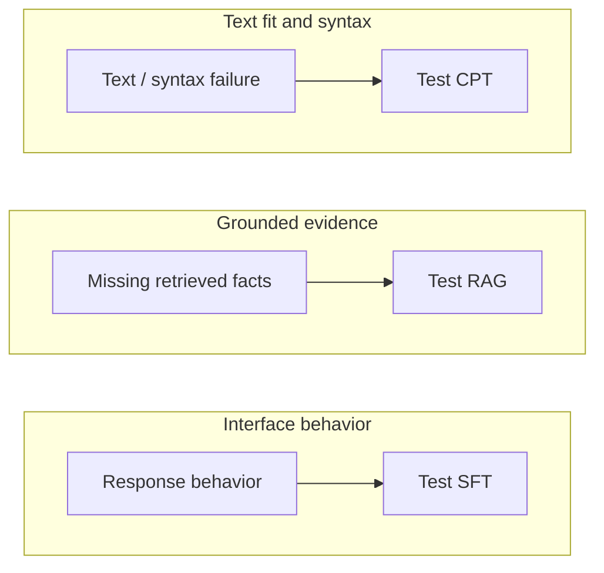

---
{
  "id": "continued-pretraining-domain-adaptation",
  "title": "Continued Pretraining for Domain Shift",
  "slug": "continued-pretraining-domain-adaptation",
  "section": "Training, Fine-Tuning & Alignment",
  "category": "Fine-Tuning & Training",
  "difficulty": "Hard",
  "order": 9,
  "coverImage": "illustrations/_generated/continued_pretraining_dark.png",
  "companies": [
    "OpenAI",
    "Meta",
    "Anthropic",
    "Google",
    "DeepMind"
  ],
  "shortDescription": "A general-purpose LLM misreads domain notation like `EGFR_L858R` and clinical pathway notes. Learn when continued pretraining fixes distribution shift, how replay prevents forgetting, and how to measure real task gains.",
  "keyConceptsTested": [
    "continued pretraining vs SFT",
    "domain-adaptive pretraining",
    "task-adaptive pretraining",
    "corpus selection and mixing",
    "general-capability regression checks",
    "domain perplexity and downstream evals",
    "stopping rules for adaptation runs",
    "over-specialization and general regression risks"
  ],
  "prerequisites": [
    "jax-for-ml-research",
    "build-gpt-from-scratch-lab",
    "pre-training-data-pipelines-scale",
    "instruction-tuning-chat-templates"
  ],
  "relatedQuestions": [
    "supervised-fine-tuning-pipeline",
    "lora-parameter-efficient-fine-tuning",
    "reward-modeling-from-preference-data"
  ]
}
---

Feed a general-purpose foundation model a molecular pathology report mentioning `EGFR_L858R` resistance after osimertinib therapy and ask it to complete the next paragraph or summarize the downstream signaling pathway. Instead of discussing `C797S` mutations or MET amplification, it drifts into generic textbook definitions of cell growth and fragments unfamiliar variant symbols into single characters.

Why did the model stumble? Three very different mechanisms can produce the same bad output: the prompt lacked the right clinical reference document, the model never learned the desired summary format, or its weights poorly model the specialized vocabulary, syntax, and statistical patterns of biomedical literature. Each root cause points to a different intervention: retrieval (RAG), supervised fine-tuning (SFT), or **continued <span data-glossary="pretraining">pretraining</span> (CPT)**.

The <span data-glossary="jax">JAX</span> chapter treated each training step as a replayable state transition across parameters, <span data-glossary="optimizer-state">optimizer state</span>, <span data-glossary="prng-key">random-number keys</span>, and metrics. **Continued pretraining** resumes a pretrained model's causal language-modeling objective on new unlabeled domain text, a strategy often called **domain-adaptive pretraining (DAPT)**. Pin the starting <span data-glossary="model-checkpoint">checkpoint</span>, domain-to-replay mixture, learning-rate schedule, and dual evaluation suites so you can compare falling domain loss directly against downstream task gains and general-capability retention.

## What each intervention changes

Before spending training compute, isolate what actually fixes the failure.

- **Retrieval-augmented generation (RAG)** supplies missing facts, definitions, or fresh clinical guidelines in the prompt without modifying weights. If putting the relevant paper excerpt into context immediately fixes the answer, retrieval is the right baseline. Longer prompts do raise prefill cost (pairwise self-attention scales quadratically with token length alongside linear projection costs), so measure end-to-end latency and accuracy before deciding prompt context is too expensive.
- **Supervised fine-tuning (SFT)** updates trainable weights on curated prompt-response pairs. It excels at teaching response structure, tone, and task interfaces, and can inject domain behavior as well; LIMA demonstrated how strongly 1,000 curated examples can shape a 65B pretrained model.[^zhou2023]
- **Continued pretraining (CPT)** updates weights using the standard next-<span data-glossary="token">token</span> objective across raw, unlabeled domain corpora.

> **Common mistake:** Assuming response-only SFT leaves prompt weights untouched. Masking prompt tokens in the loss removes direct prediction terms on the prompt, yet every response prediction still conditions on the prompt's hidden representations. Gradients flow backward through that causal context into prompt embeddings and attention weights.[^huggingface2026sfttrainer]

Watch that gradient path directly in PyTorch. Tokens `0` and `1` form the prompt, token `2` is the only scored response target (`ignore_index=-100` masks the prompt position), and a cumulative sum passes prompt context into the response prediction:

<!-- leetllm: test, deps=torch, output=show, output_title="Masked targets still influence gradients" -->
```python title="response_loss_updates_prompt.py"
import torch
import torch.nn.functional as F

embedding = torch.nn.Embedding(3, 2, dtype=torch.float64)
with torch.no_grad():
    embedding.weight.copy_(torch.tensor(
        [[1., 0.], [0., 1.], [0., 0.]], dtype=torch.float64
    ))

inputs = torch.tensor([0, 1])
targets = torch.tensor([-100, 2])  # prompt target ignored; response target scored
hidden = embedding(inputs).cumsum(dim=0)
head = torch.tensor([[1., 0., -1.], [0., 1., 1.]], dtype=torch.float64)
loss = F.cross_entropy(hidden @ head, targets, ignore_index=-100)
loss.backward()

print(f"response_loss={loss.item():.6f}")
for row in (0, 1):
    nonzero = bool(embedding.weight.grad[row].abs().sum() > 0)
    print(f"prompt_row_{row}_has_gradient={nonzero}")
unused = bool(embedding.weight.grad[2].abs().sum() > 0)
print(f"unused_input_row_2_has_gradient={unused}")
```

<!-- leetllm: output:start -->
```text title="Masked targets still influence gradients" output compact
response_loss=1.861995
prompt_row_0_has_gradient=True
prompt_row_1_has_gradient=True
unused_input_row_2_has_gradient=False
```
<!-- leetllm: output:end -->

Both prompt embedding rows receive nonzero gradients because they feed the response hidden state; only unused row `2` stays zero (and tied input/output weights would give row `2` a gradient too).

CPT applies the exact same causal cross-entropy loss, except nearly every token position in the sequence is scored. For a sequence $w_1,\ldots,w_n$ with nonempty scored position set $S$ (after shifting, padding, and document-boundary masks):

$$
\mathcal{L}_{\mathrm{CLM}}(\theta) = -\frac{1}{|S|}\sum_{i\in S} \log P(w_i \mid w_{<i}; \theta)
$$

Without a leading BOS token or prior context, a standard shifted block of $n$ tokens scores $n-1$ targets. Exponentiating the mean negative log-likelihood over $S$ gives <span data-glossary="perplexity">perplexity</span>.[^huggingface_ppl]

<figure>
  
  <figcaption>
    Without BOS or preceding context, CPT scores six of seven positions while response-only SFT scores four. Ignored prompt targets still route gradients back to trainable prompt embeddings through the causal hidden state.
  </figcaption>
</figure>

Notice what CPT directly optimizes: accurate continuation of raw domain documents, not chat-assistant formatting. Later SFT uses the same token-level cross-entropy on prompt-response pairs.[^huggingface2026sfttrainer]



Treat these as hypotheses to compare under matched evaluations: test retrieval and direct SFT alongside CPT followed by the same SFT recipe. In Ovadia et al.'s knowledge-injection study, <span data-glossary="rag">RAG</span> outperformed unsupervised fine-tuning on MMLU and current-events questions, while training on diverse paraphrases of new facts improved fine-tuning recall.[^ovadia2024] Reach for CPT when the base model genuinely mismodels the domain's text distribution, not when you merely need fresher facts or cleaner answer formatting.

## Diagnose the shift before spending training compute

Start with two fast diagnostics on the frozen base checkpoint:

1. **Held-out domain perplexity:** Measure mean negative log-likelihood and perplexity on clean, deduplicated domain documents alongside a frozen general-text control slice. High domain perplexity relative to general prose is a screening signal (different domains have different intrinsic entropy), so pair it with a downstream task probe.
2. **Tokenizer fertility:** Count average subword tokens per domain word or identifier. Because standard CPT reuses the base tokenizer, unfamiliar uppercase or symbolic identifiers fragment into many short pieces, inflating sequence lengths and context costs.

Watch what happens under a greedy longest-match tokenizer when lowercase `exon` and `EGFR` appear in the base vocabulary, while an uppercase mutation code like `EGFR_L858R` does not:

<!-- leetllm: test, output=show, output_title="Tokenizer fertility diagnostic" -->
```python title="measure_tokenizer_fertility.py"
VOCAB = [
    "mutation",
    "exon",
    "pathway",
    "kinase",
    "inhibitor",
    "resistance",
    "EGFR",
    "therapy",
    "the",
    " ",
]
pieces = sorted(VOCAB, key=len, reverse=True)

def tokenize(text: str) -> list[str]:
    tokens: list[str] = []
    index = 0
    while index < len(text):
        matched = next((piece for piece in pieces if text.startswith(piece, index)), None)
        if matched is None:
            tokens.append(text[index])
            index += 1
        else:
            tokens.append(matched)
            index += len(matched)
    return tokens

for name, text in (("mutation", "mutation"), ("EGFR_L858R", "EGFR_L858R")):
    tokens = tokenize(text)
    print(f"{name:<12}{len(tokens):>4} pieces  {tokens}")
```

<!-- leetllm: output:start -->
```text title="Tokenizer fertility diagnostic" output compact
mutation       1 pieces  ['mutation']
EGFR_L858R     7 pieces  ['EGFR', '_', 'L', '8', '5', '8', 'R']
```
<!-- leetllm: output:end -->

A single domain identifier consumes seven tokens instead of one. Measure fertility across your entire target corpus before deciding whether fragmentation actually matters.

### Vocabulary extension vs. fixed tokenizer

Keeping the base tokenizer preserves the embedding <span data-glossary="matrix">matrix</span> $E \in \mathbb{R}^{V \times d}$ and output head without introducing untrained parameters. Code Llama kept the Llama 2 tokenizer intact (adding only four infilling tokens) and still adapted cleanly to code.[^roziere2023]

When a new script or heavily fragmented domain vocabulary justifies adding $K$ new tokens, both $E \to \mathbb{R}^{(V+K)\times d}$ and the output head expand. Rather than initializing new rows from scratch, **subword centroid initialization** sets each new token's vector to the mean of its original subword embeddings:

$$
\mathbf{e}(t_{\mathrm{new}}) = \frac{1}{m}\sum_{j=1}^{m} \mathbf{e}(s_j)
$$

Studies of vocabulary expansion compare centroid averaging with norm calibration and separate input/output initialization schemes across languages and architectures.[^mundra2024VocabExpansion][^joshi2026EmbeddingInitialization]

<!-- leetllm: test, deps=torch, output=show, output_title="Subword centroid embedding initialization" -->
```python title="subword_centroid_initialization.py"
import torch
import torch.nn as nn

vocab = {"egfr": 0, "exon": 1, "mut": 2, "kinase": 3, "pathway": 4}
embedding_dim = 8
torch.manual_seed(42)
old_embeddings = nn.Embedding(len(vocab), embedding_dim)

new_tokens = {"EGFR_L858R": [0, 1, 2]}
new_embeddings = nn.Embedding(len(vocab) + len(new_tokens), embedding_dim)
with torch.no_grad():
    new_embeddings.weight[:len(vocab)] = old_embeddings.weight
    for offset, subword_ids in enumerate(new_tokens.values()):
        new_embeddings.weight[len(vocab) + offset] = old_embeddings.weight[subword_ids].mean(dim=0)

print(f"old_vocab_size={old_embeddings.num_embeddings}")
print(f"new_vocab_size={new_embeddings.num_embeddings}")
print(f"centroid_matches={torch.allclose(new_embeddings.weight[5], old_embeddings.weight[[0, 1, 2]].mean(dim=0))}")
```

<!-- leetllm: output:start -->
```text title="Subword centroid embedding initialization" output compact
old_vocab_size=5
new_vocab_size=6
centroid_matches=True
```
<!-- leetllm: output:end -->

Even centroid initialization shifts the output distribution immediately because adding a row to the language-modeling head adds another positive term to the softmax denominator. When two existing output rows produce logit `0` ($p = 0.5$, $\text{NLL} = \ln 2 \approx 0.693$) and a new centroid row also produces logit `0`, each old token's probability drops to $1/3$ and its NLL jumps by $\ln(3/2) \approx 0.405$:

<!-- leetllm: test, deps=torch, output=show, output_title="Vocabulary extension changes output support" -->
```python title="centroid_changes_softmax.py"
import torch

old_rows = torch.tensor([[2., 0.], [-2., 0.]], dtype=torch.float64)
hidden = torch.tensor([0., 1.], dtype=torch.float64)
extended_rows = torch.cat([old_rows, old_rows.mean(dim=0, keepdim=True)])

old_p = torch.softmax(old_rows @ hidden, dim=0)
new_p = torch.softmax(extended_rows @ hidden, dim=0)

print(f"old_token_probability={old_p[0].item():.6f}")
print(f"after_extension={new_p[0].item():.6f}")
print(f"old_target_nll={-old_p[0].log().item():.6f}")
print(f"after_extension_nll={-new_p[0].log().item():.6f}")
```

<!-- leetllm: output:start -->
```text title="Vocabulary extension changes output support" output compact
old_token_probability=0.500000
after_extension=0.333333
old_target_nll=0.693147
after_extension_nll=1.098612
```
<!-- leetllm: output:end -->

<figure>
  
  <figcaption>
    Adding an output row draws probability mass away from existing tokens by growing the softmax denominator, raising initial NLL even under centroid initialization.
  </figcaption>
</figure>

Before running any training, guard your validation split against document-family leakage. Multiple drafts of the same clinical paper or sections from one protocol manual split across train and validation inflate apparent gains. Hash by <span data-glossary="provenance">provenance</span> or deduplication group so every related document lands in the same split:

<!-- leetllm: test, output=show, output_title="Grouped holdout split" -->
```python title="group_domain_holdout.py"
import hashlib

documents = [
    {"group": "pubmed-egfr-2024", "text": "EGFR_L858R responds to third-generation TKIs"},
    {"group": "pubmed-egfr-2024", "text": "C797S emerges as an acquired EGFR resistance mutation"},
    {"group": "oncology-trials", "text": "Phase III progression-free survival across cohorts"},
    {"group": "oncology-trials", "text": "Biomarker stratification by exon 19 deletion"},
    {"group": "genomics-notes", "text": "Variant calling pipelines filter low-depth reads"},
    {"group": "assay-protocols", "text": "qPCR primer melting curves confirm specificity"},
]

def split_for_group(group: str) -> str:
    bucket = int(hashlib.sha256(group.encode()).hexdigest(), 16) % 4
    return "validation" if bucket == 0 else "train"

splits = {"train": [], "validation": []}
for doc in documents:
    splits[split_for_group(doc["group"])].append(doc)

train_groups = sorted({doc["group"] for doc in splits["train"]})
validation_groups = sorted({doc["group"] for doc in splits["validation"]})

print(f"train_groups={train_groups}")
print(f"validation_groups={validation_groups}")
print(f"disjoint={set(train_groups).isdisjoint(validation_groups)}")
```

<!-- leetllm: output:start -->
```text title="Grouped holdout split" output compact
train_groups=['assay-protocols', 'genomics-notes', 'oncology-trials']
validation_groups=['pubmed-egfr-2024']
disjoint=True
```
<!-- leetllm: output:end -->

Check actual token counts and topic balance in the resulting splits; hash bucketing hits the target validation fraction only in expectation across many groups.

## The two failure dynamics: forgetting and underfitting

Once training begins, continued pretraining navigates two opposing failures:

- **Catastrophic forgetting:** Shifting shared weights aggressively toward the new domain degrades performance on general language, coding, or reasoning tasks.
- **Underfitting:** Too low a learning rate, too few updates, or an overly diluted mixture leaves domain perplexity and downstream task scores stuck near baseline.

Two primary levers control this balance: the <span data-glossary="learning-rate">learning-rate</span> schedule and the replay mixture.

### Learning rate re-warming and re-decaying

Released base checkpoints usually sit at the end of a cosine decay (often without saved optimizer state). Resuming with a fresh optimizer at a tiny final floor adapts glacially, whereas jumping straight to a high peak without warmup destabilizes early updates.

In systematic CPT sweeps, Ibrahim et al. tested re-warming to 0.5x, 1x, and 2x the original peak learning rate before re-decaying with short warmups (0.5% to 2%), showing that re-warming plus re-decaying recovers plasticity cleanly across domain shifts.[^ibrahim2024] Treat those ratios as sweep anchors rather than fixed constants for every model size.

<details>
<summary>Deep dive: why AdamW warmup still helps even when step 1 is bounded</summary>

At step 1 with freshly zeroed moments, AdamW's bias correction gives $\hat{m}_1 = g$ and $\hat{v}_1 = g^2$, so each coordinate moves by $-\eta g / (|g| + \epsilon)$ (bounded in magnitude by $\eta$, ignoring weight decay). Warmup still matters across the first tens of steps while second-moment estimates stabilize on the new domain's gradient scale and outlier batches.

</details>

Here is a clean linear re-warm followed by cosine re-decay over 1,000 steps (50-step warmup from floor $3 \times 10^{-6}$ to peak $3 \times 10^{-5}$):

<!-- leetllm: test, output=show, output_title="Re-warm then re-decay schedule" -->
```python title="rewarm_redecay_schedule.py"
import math

def rewarm_redecay(step: int, total_steps: int, warmup_steps: int, peak: float, floor: float) -> float:
    if step < warmup_steps:
        return floor + (peak - floor) * (step + 1) / warmup_steps
    progress = (step - warmup_steps) / (total_steps - warmup_steps - 1)
    cosine = 0.5 * (1.0 + math.cos(math.pi * progress))
    return floor + (peak - floor) * cosine

for step in [0, 49, 50, 250, 999]:
    lr = rewarm_redecay(step, total_steps=1000, warmup_steps=50, peak=3e-5, floor=3e-6)
    print(f"step={step:>3} lr={lr:.2e}")
```

<!-- leetllm: output:start -->
```text title="Re-warm then re-decay schedule" output compact
step=  0 lr=3.54e-06
step= 49 lr=3.00e-05
step= 50 lr=3.00e-05
step=250 lr=2.71e-05
step=999 lr=3.00e-06
```
<!-- leetllm: output:end -->

### Replay: keep prior-data signal in the mix

**Replay** mixes general pretraining data back into the domain stream so shared parameters continue seeing gradients from broad language tasks:

$$
\mathcal{L}_{\mathrm{mix}}(\theta) = (1 - \alpha)\,\mathbb{E}_{x \sim \mathcal{D}_{\mathrm{domain}}}[\mathcal{L}_{\mathrm{CLM}}(x; \theta)]
+ \alpha\,\mathbb{E}_{y \sim \mathcal{D}_{\mathrm{replay}}}[\mathcal{L}_{\mathrm{CLM}}(y; \theta)]
$$

Here $\alpha \in [0, 1]$ is the fraction of **scored target tokens** coming from replay.

To see the gradient trade-off directly, collapse the model to a single shared logit $z$ predicting token `1` with probability $\sigma(z)$. Domain data wants token `1` (gradient $-0.5$ at $z=0$); replay wants token `0` (gradient $+0.5$ at $z=0$). Watch how increasing $\alpha$ dampens both the domain gain and the replay regression in a single step:

<!-- leetllm: test, deps=torch, output=show, output_title="Replay changes the update" -->
```python title="one_shared_logit.py"
import torch
import torch.nn.functional as F

print("replay  gradient  new_logit  domain_nll  replay_nll")
for alpha in (0.0, 0.25, 0.5):
    z = torch.tensor(0.0, dtype=torch.float64, requires_grad=True)
    domain_loss = F.softplus(-z)  # -log sigmoid(z), target 1
    replay_loss = F.softplus(z)   # -log(1 - sigmoid(z)), target 0
    ((1 - alpha) * domain_loss + alpha * replay_loss).backward()
    gradient = z.grad.item()
    with torch.no_grad():
        z -= gradient
    print(f"{alpha:>6.0%}{gradient:>10.2f}{z.item():>11.2f}"
          f"{F.softplus(-z).item():>12.3f}{F.softplus(z).item():>12.3f}")
```

<!-- leetllm: output:start -->
```text title="Replay changes the update" output compact
replay  gradient  new_logit  domain_nll  replay_nll
    0%     -0.50       0.50       0.474       0.974
   25%     -0.25       0.25       0.576       0.826
   50%      0.00       0.00       0.693       0.693
```
<!-- leetllm: output:end -->

At `0%` replay, domain NLL falls sharply from `0.693` to `0.474` while replay NLL jumps to `0.974`. At `25%` replay, domain NLL still drops while replay damage is cut nearly in half. Full transformers use context representations to separate many domain and general features, yet the underlying gradient competition still determines how much replay you need. Ibrahim et al. found `5%` replay sufficient for a mild English-to-English shift and `25%` helpful for a larger English-to-German shift.[^ibrahim2024]

Under a fixed total token budget, every replay token displaces a domain token:

<!-- leetllm: test, output=show, output_title="Matched-token replay accounting" -->
```python title="compute_equivalent_replay.py"
total_tokens = 2_000_000

print("replay_ratio  domain_tokens  replay_tokens  total_tokens")
for replay_ratio in [0.00, 0.05, 0.25]:
    replay_tokens = int(total_tokens * replay_ratio)
    domain_tokens = total_tokens - replay_tokens
    print(f"{replay_ratio:>11.0%}{domain_tokens:>15,}{replay_tokens:>15,}{total_tokens:>14,}")
```

<!-- leetllm: output:start -->
```text title="Matched-token replay accounting" output compact
replay_ratio  domain_tokens  replay_tokens  total_tokens
         0%      2,000,000              0     2,000,000
         5%      1,900,000        100,000     2,000,000
        25%      1,500,000        500,000     2,000,000
```
<!-- leetllm: output:end -->

```checkpoint
Your continued-pretraining run resumes from the base checkpoint at its final tiny learning rate and uses 100% domain text. Domain perplexity barely moves. After you raise the re-warm peak, domain perplexity improves but general-text loss regresses. Which two sweeps should you run?
---
Sweep peak learning-rate schedules and replay ratios under matched token budgets, keeping the baseline as a control. Select the recipe against held-out domain tasks and required general benchmarks rather than assuming a single universal peak LR or replay fraction.
```

## When continued pretraining is the right tool

Continued pretraining shines when your domain uses specialized terminology, notation, or structural patterns that are scarce in public pretraining corpora: biomedical papers and genomics reports (`EGFR_L858R`, `BRCA1_EXON11`), legal statutes, low-resource languages, or specialized codebases and hardware-programming manuals.

### Good signals

| Signal | Why it points to continued pretraining |
|---|---|
| Model misreads domain terminology across held-out examples | More domain-text exposure directly trains those representations |
| High held-out domain perplexity accompanies weak domain task scores | Distribution mismatch is holding downstream quality back |
| Raw text continuations break down before chat formatting enters | The gap lives in language modeling, not instruction style |
| Large unlabeled domain corpus with few prompt-response labels | Next-token training extracts signal without manual labeling |

### Bad signals

| Signal | Candidate to compare first |
|---|---|
| Model knows the domain facts but answers in the wrong format | SFT |
| Task needs fresh, rapidly changing, or strictly cited facts | RAG |
| Task requires a single fixed classification head | Supervised fine-tuning with a classifier head |
| Model is knowledgeable but picks unhelpful or unsafe responses | Preference optimization (DPO / RLHF) |

Test raw domain continuation and formatted assistant responses separately: weak raw continuation justifies a CPT experiment, whereas fluent domain continuation with poor instruction adherence points straight to SFT.

Gururangan et al. ("Don't Stop Pretraining") named two complementary scopes in RoBERTa adaptation experiments:[^gururangan2020] **DAPT** (domain-adaptive pretraining) trains on broad unlabeled domain corpora (such as PubMed or CS papers), while **TAPT** (task-adaptive pretraining) continues on the unlabeled inputs of the specific target task, which is much smaller yet tightly aligned. Both ideas carry over to decoder-only LLMs; test whether DAPT, TAPT, or DAPT followed by TAPT improves your downstream metric.

## Data for continued pretraining

The curation rules from large-scale pretraining apply with even sharper consequences on smaller domain corpora: filter noisy extractions, deduplicate aggressively, strip evaluation overlap, scrub personal identifiers and secrets, and track provenance and usage rights for every slice.

### Filter the corpus before tokenization

Maintain an explicit manifest tracking license rights, privacy scrubbing status, and evaluation-only reservations. Every field must carry a verified boolean flag and nonnegative token count so malformed strings or reserved test sets never leak into training blocks:

<!-- leetllm: test, output=show, output_title="Corpus manifest filter" -->
```python title="filter_domain_manifest.py"
sources = [
    {"name": "pubmed-open-access", "tokens": 800_000, "licensed": True, "pii_scrubbed": True, "eval_only": False},
    {"name": "raw-clinical-notes", "tokens": 120_000, "licensed": True, "pii_scrubbed": False, "eval_only": False},
    {"name": "heldout-case-studies", "tokens": 25_000, "licensed": True, "pii_scrubbed": True, "eval_only": True},
    {"name": "restricted-journal", "tokens": 300_000, "licensed": False, "pii_scrubbed": True, "eval_only": False},
]

def eligible(row: dict) -> bool:
    flags_valid = all(type(row.get(k)) is bool for k in ("licensed", "pii_scrubbed", "eval_only"))
    tokens_valid = type(row.get("tokens")) is int and row["tokens"] >= 0
    return flags_valid and tokens_valid and row["licensed"] and row["pii_scrubbed"] and not row["eval_only"]

accepted = [row for row in sources if eligible(row)]
rejected = [row["name"] for row in sources if row not in accepted]

print(f"accepted={[row['name'] for row in accepted]}")
print(f"training_tokens={sum(row['tokens'] for row in accepted):,}")
print(f"rejected={rejected}")
```

<!-- leetllm: output:start -->
```text title="Corpus manifest filter" output compact
accepted=['pubmed-open-access']
training_tokens=800,000
rejected=['raw-clinical-notes', 'heldout-case-studies', 'restricted-journal']
```
<!-- leetllm: output:end -->

```checkpoint
`raw-clinical-notes` is licensed but still contains unscrubbed patient identifiers, while `heldout-case-studies` is clean and licensed. Which source can enter continued-pretraining blocks?
---
Neither. Unresolved PII excludes `raw-clinical-notes`, and the `eval_only` flag reserves `heldout-case-studies` for evaluation. Validate strict boolean flags and nonnegative integer counts so malformed values such as `"false"` are rejected too.
```

### Screen for evaluation overlap

Remove exact and normalized duplicates of held-out evaluation text before packing. Lowercasing and whitespace-collapsing catches trivial reformatting while keeping original casing intact in the retained training stream; pair it with n-gram and near-duplicate checks to catch partial copies and paraphrases:

<!-- leetllm: test, output=show, output_title="Normalized evaluation-overlap screen" -->
```python title="remove_exact_eval_overlap.py"
import hashlib

def fingerprint(text: str) -> str:
    return hashlib.sha256(" ".join(text.lower().split()).encode()).hexdigest()

heldout = [
    "EGFR_L858R resistance frequently involves the secondary C797S mutation.",
    "BRCA1 exon 11 truncating variants impair homologous recombination repair.",
]
candidate_training = [
    "ALK rearrangements respond to next-generation tyrosine kinase inhibitors.",
    "  egfr_l858r RESISTANCE frequently involves the secondary c797s mutation. ",
    "KRAS G12C inhibitors lock the GTPase in its inactive GDP-bound state.",
]

heldout_hashes = {fingerprint(text) for text in heldout}
clean_training = [text for text in candidate_training if fingerprint(text) not in heldout_hashes]

print(f"removed={len(candidate_training) - len(clean_training)}")
print(f"kept={len(clean_training)}")
```

<!-- leetllm: output:start -->
```text title="Normalized evaluation-overlap screen" output compact
removed=1
kept=2
```
<!-- leetllm: output:end -->

### Mixing strategy

Test domain-only training against a small sweep of replay ratios at a fixed token budget. BloombergGPT trained from scratch on 569B tokens drawn from a 709B corpus inventory split roughly `51.27%` financial and `48.73%` general public text, achieving strong financial scores while staying competitive on general benchmarks.[^wu2023bloomberggpt] In continued pretraining, the optimal replay share depends on how far the target domain departs from the base model's distribution and how tightly you must protect general tasks.

### Pack blocks and preserve the mixture

Packing concatenates tokenized documents with end-of-sequence (`EOS`) separators and slices fixed-length blocks for efficient GPU utilization. Remember that inserting an `EOS` token does not automatically stop cross-document attention; decide explicitly whether to use a standard <span data-glossary="causal-mask">causal mask</span> or a block-diagonal document-isolated mask.

<!-- leetllm: test, output=show, output_title="Packed CPT token blocks" -->
```python title="pack_domain_token_blocks.py"
EOS = 0
block_size = 6
documents = [[11, 12, 13], [21, 22], [31, 32, 33, 34], [41]]

stream = [tok for doc in documents for tok in (*doc, EOS)]
blocks = [stream[i:i + block_size] for i in range(0, len(stream) - block_size + 1, block_size)]
remainder = stream[len(blocks) * block_size:]

print(f"stream={stream}")
print(f"blocks={blocks}")
print(f"remainder={remainder}")
```

<!-- leetllm: output:start -->
```text title="Packed CPT token blocks" output compact
stream=[11, 12, 13, 0, 21, 22, 0, 31, 32, 33, 34, 0, 41, 0]
blocks=[[11, 12, 13, 0, 21, 22], [0, 31, 32, 33, 34, 0]]
remainder=[41, 0]
```
<!-- leetllm: output:end -->

Carry the trailing remainder `[41, 0]` into the next packing buffer instead of dropping it silently, or short documents will be systematically under-represented. Each 6-token block provides 5 shifted next-token targets (`block[:-1]` predicting `block[1:]`) before any document-boundary masking.

> **Key insight:** Block share equals target-token share only when domain and replay blocks have identical scored-token counts. If 15 domain blocks each score 6 targets (90 targets) while 5 replay blocks each score only 2 targets after masking (10 targets), replay makes up `25%` of blocks yet only `10%` of scored tokens.

Compare an equal-block mean against a pooled token mean on that exact `15:5` window using the conflicting shared-logit model:

<!-- leetllm: test, deps=torch, output=show, output_title="Replay masks change the effective mixture" -->
```python title="replay-masks-change-the-mixture.py"
import torch
import torch.nn.functional as F

domain_targets, replay_targets = 15 * 6, 5 * 2
z = torch.tensor(0.0, dtype=torch.float64, requires_grad=True)
domain_mean, replay_mean = F.softplus(-z), F.softplus(z)

block_mean = 0.75 * domain_mean + 0.25 * replay_mean
token_mean = (domain_targets * domain_mean + replay_targets * replay_mean) / (domain_targets + replay_targets)

block_gradient, = torch.autograd.grad(block_mean, z, retain_graph=True)
token_gradient, = torch.autograd.grad(token_mean, z)

print(f"replay block share: {5 / 20:.0%}")
print(f"replay target share: {replay_targets / (domain_targets + replay_targets):.0%}")
print(f"equal-block gradient: {block_gradient.item():.2f}")
print(f"pooled-token gradient: {token_gradient.item():.2f}")
```

<!-- leetllm: output:start -->
```text title="Replay masks change the effective mixture" output compact
replay block share: 25%
replay target share: 10%
equal-block gradient: -0.25
pooled-token gradient: -0.40
```
<!-- leetllm: output:end -->

<figure>
  
  <figcaption>
    Fifteen domain blocks supply 90 scored targets while five replay blocks supply 10. Equal block averaging yields a 25% replay gradient weight; pooled token averaging yields 10%.
  </figcaption>
</figure>

Log the realized **scored-token** fraction after shifting and masking so your training mixture matches the objective you intended.

<details>
<summary>Deep dive: deterministic block-window mixing and rounding drift</summary>

When slicing fixed windows of `size` packed blocks (e.g., `replay_count = round(size * replay_ratio)`), Python's round-half-to-even can skew small windows (`round(10 * 0.25) == 2`, giving 20% instead of 25%). Across long runs, use a fractional accumulator or probabilistic block sampler and track cumulative scored tokens per source.

</details>

## Evaluation: domain gain without lying to yourself

Measure domain progress and general capability retention at every evaluation checkpoint. Falling domain loss alone cannot tell you whether downstream accuracy improved or whether general reasoning eroded.

### Lane 1: Domain mastery

Track three complementary signals:
- **Held-out domain perplexity:** Fit on clean, deduplicated domain text under a frozen scoring protocol.
- **Entity-span NLL:** Summed negative log-likelihood over critical domain spans (such as variant identifiers or chemical formulas), reporting span and token weighting explicitly.
- **Downstream task probes:** Compare `base + SFT` directly against `CPT + the same SFT` on your target task, holding decoding and scoring fixed.

### Lane 2: General capability retention and safety checks

Define explicit regression tolerances across:
- **Held-out general perplexity:** Frozen slice of diverse web or encyclopedia text (such as SlimPajama or Wikipedia).
- **Task and reasoning anchors:** Standard suites (MMLU, HumanEval/MBPP, GSM8K) paired with private held-out tasks your application relies on.
- **Safety and refusal behavior:** Verify that unsupervised domain exposure has not eroded refusal boundaries.

Keep the evaluation text, context length, and target mask identical across checkpoints. Whenever two runs use different tokenizers, raw token perplexity becomes incomparable; report **bits per byte (BPB)** instead, dividing total NLL in nats by scored UTF-8 bytes times $\ln 2$.[^huggingface_ppl]

Watch how splitting the same 30 bytes into 20 finer tokens lowers per-token perplexity even while total NLL and bits per byte get worse:

<!-- leetllm: test, output=show, output_title="Token units can reverse a ranking" -->
```python title="compare_byte_normalized_loss.py"
import math

print("report  token_ppl  nats/byte  bits/byte")
for name, nll, tokens in [("coarse", 15.0, 10), ("fine", 18.0, 20)]:
    byte_count = 30
    print(f"{name:<8}{math.exp(nll / tokens):>9.3f}"
          f"{nll / byte_count:>11.3f}"
          f"{nll / (byte_count * math.log(2)):>11.3f}")
```

<!-- leetllm: output:start -->
```text title="Token units can reverse a ranking" output compact
report  token_ppl  nats/byte  bits/byte
coarse      4.482      0.500      0.721
fine        2.460      0.600      0.866
```
<!-- leetllm: output:end -->

For a fixed tokenizer, compute corpus perplexity by summing total NLL and total scored tokens across all documents **before** exponentiating. Documents with NLL `60` over `20` targets and `160` over `40` targets give $\exp(220/60) \approx 39.1$, whereas averaging their individual perplexities gives `37.3`.

<!-- leetllm: test, output=show, output_title="Two-lane perplexity report" -->
```python title="report_domain_and_general_ppl.py"
import math

base = {
    "domain": {"nll": 840.0, "tokens": 240},
    "general": {"nll": 540.0, "tokens": 200},
}
adapted = {
    "domain": {"nll": 720.0, "tokens": 240},
    "general": {"nll": 548.0, "tokens": 200},
}

print("lane     base_ppl  adapted_ppl  delta")
for lane in ("domain", "general"):
    base_ppl = math.exp(base[lane]["nll"] / base[lane]["tokens"])
    adapted_ppl = math.exp(adapted[lane]["nll"] / adapted[lane]["tokens"])
    print(f"{lane:<8}{base_ppl:>9.2f}{adapted_ppl:>13.2f}{adapted_ppl - base_ppl:>7.2f}")
```

<!-- leetllm: output:start -->
```text title="Two-lane perplexity report" output compact
lane     base_ppl  adapted_ppl  delta
domain      33.12        20.09 -13.03
general     14.88        15.49   0.61
```
<!-- leetllm: output:end -->

### Filter, then rank candidate checkpoints

Declare your regression budget before inspecting checkpoints, and keep units unambiguous (moving from `70%` to `68%` is a 2-percentage-point drop, not a 2% relative drop).

Here we enforce a hard general-perplexity regression limit of `+1.5`, then rank surviving checkpoints by downstream probe accuracy (breaking ties by lower domain perplexity):

<!-- leetllm: test, output=show, output_title="Checkpoint selection table" -->
```python title="continued_pretraining_checkpoint_picker.py"
checkpoints = [
    {"name": "base", "domain_ppl": 42.0, "general_ppl": 19.2, "probe_acc": 0.62},
    {"name": "cpt-1k", "domain_ppl": 31.5, "general_ppl": 19.5, "probe_acc": 0.68},
    {"name": "cpt-4k", "domain_ppl": 27.9, "general_ppl": 20.1, "probe_acc": 0.72},
    {"name": "cpt-12k", "domain_ppl": 25.8, "general_ppl": 23.9, "probe_acc": 0.71},
]

base = checkpoints[0]
max_general_regression = 1.5

print("checkpoint  domain_gain  general_regression  probe_acc  eligible")
eligible = []
for row in checkpoints:
    domain_gain = base["domain_ppl"] - row["domain_ppl"]
    general_reg = row["general_ppl"] - base["general_ppl"]
    keep = general_reg <= max_general_regression
    if keep:
        eligible.append(row)
    print(f"{row['name']:<10}{domain_gain:>11.1f}{general_reg:>20.1f}{row['probe_acc']:>11.2f}  {'yes' if keep else 'no'}")

best = max(eligible, key=lambda r: (r["probe_acc"], -r["domain_ppl"]))
print(f"chosen={best['name']} (highest probe_acc within general-regression budget)")
```

<!-- leetllm: output:start -->
```text title="Checkpoint selection table" output compact
checkpoint  domain_gain  general_regression  probe_acc  eligible
base              0.0                 0.0       0.62  yes
cpt-1k           10.5                 0.3       0.68  yes
cpt-4k           14.1                 0.9       0.72  yes
cpt-12k          16.2                 4.7       0.71  no
chosen=cpt-4k (highest probe_acc within general-regression budget)
```
<!-- leetllm: output:end -->

<figure>
  
  <figcaption>
    Applying the 1.5-point general-regression budget eliminates cpt-12k even though it has the lowest domain perplexity, selecting cpt-4k at 0.72 probe accuracy.
  </figcaption>
</figure>

```checkpoint
`cpt-12k` has the best domain perplexity but exceeds the allowed general-regression budget. `cpt-4k` stays within budget and has the best downstream probe accuracy among survivors. Which checkpoint wins?
---
Choose `cpt-4k`. General regression is a hard eligibility threshold, so `cpt-12k` is excluded. Among eligible checkpoints, downstream probe accuracy ranks first and domain perplexity only breaks ties.
```

## Stopping rules

Domain perplexity often keeps inching downward long after downstream task accuracy has plateaued. Stop a run when probe accuracy flattens, domain validation loss stops improving meaningfully, or general regressions approach your threshold.

Calibrate your patience window and minimum gain to evaluation sample size. On 500 binary evaluation items, flipping a single question already moves accuracy by `0.2` percentage points, so tiny differences fall inside measurement noise. Repeatedly picking checkpoints against the same validation slice also overfits the selection set; confirm your final recipe on a reserved test split.

At the winning checkpoint, archive weights, tokenizer, config, corpus manifest, and evaluation settings (plus optimizer, scheduler, RNG, and dataloader cursor if you plan to resume). Always verify the final model after its downstream SFT stage before shipping it.

## Where it fits relative to LoRA and SFT

Choose the learning objective from the failure mode first, then pick full weights or parameter-efficient adapters from your compute and memory budget:

| Goal | Candidate approach |
|---|---|
| Inject fresh or citable facts without retraining | RAG |
| Teach new domain language patterns | Continued pretraining |
| Teach chat or task format | SFT |
| Adapt behavior without updating full weights | SFT with <span data-glossary="lora">LoRA</span> / QLoRA adapters |
| Choose between multiple acceptable responses | <span data-glossary="dpo">DPO</span> or <span data-glossary="rlhf">RLHF</span> |

LoRA and <span data-glossary="qlora">QLoRA</span> (<span data-glossary="quantization">quantized</span> frozen base plus trainable low-rank adapters) decide *which parameters update*, not *what objective runs*.[^dettmers2023] You can run continued pretraining with full weights or with LoRA adapters, then follow with SFT and preference optimization. Code Llama Instruct followed code CPT with instruction tuning,[^roziere2023] and Llama 3's code expert stacked CPT, SFT, and DPO.[^dubey2024]

## Common pitfalls

### Using continued pretraining to fix assistant tone

If raw domain completions are fluent while chat replies look messy, run SFT and check your chat template and decoding settings instead of spending compute on CPT.

### Over-specializing on one corpus

When domain completions sharpen while broad reasoning or instruction following crumbles, check for missing replay data or excessive training steps. Keep a general-text regression suite running and stop earlier.

### Skipping the downstream check

Lower domain perplexity does not automatically translate into higher end-task accuracy. Always probe candidate CPT checkpoints with a lightweight downstream SFT run before committing to the full recipe.

```mastery-quiz
[
  {
    "question": "A team tests four versions of a repair assistant from one base model. A gets supervised fine-tuning (SFT) on worked repairs. B gets continued pretraining (CPT) on unlabeled manuals. C gets B's CPT recipe followed by A's SFT recipe. D keeps the base weights. All four use the same held-out faults, manual excerpts, decoding settings, and scoring rubric. Which pair measures what training on the manuals adds to the supervised assistant's repair accuracy?",
    "options": [
      "B and D",
      "A and C",
      "C and D",
      "A and B"
    ],
    "answer": "A and C",
    "explanation": "A and C both learn from the worked repairs. Only C first trains on the manuals, so its accuracy minus A's estimates the added value of CPT. Comparing the base model with CPT alone measures its effect before SFT. Comparing the base model with the fully trained assistant measures both stages together. Comparing SFT alone with CPT alone trades one training objective for another."
  },
  {
    "question": "An old target contributes 2 to the softmax denominator. All other old tokens together contribute 8. A new output row contributes 4 while the hidden vector and old logits stay fixed. What are the target's probabilities before and after expansion, and what is the change in its negative log-likelihood (after minus before, in nats)?",
    "options": [
      "2/10 to 2/11, with a change of ln(11/10)",
      "2/10 to 2/14, with a change of ln(10/14)",
      "2/10 to 2/11, with a change of ln(10/11)",
      "2/10 to 2/14, with a change of ln(14/10)"
    ],
    "answer": "2/10 to 2/14, with a change of ln(14/10)",
    "explanation": "The old denominator is 2 + 8 = 10. The new row adds 4, giving 14. The target still contributes 2, so its probability falls from 2/10 to 2/14. Subtracting the old loss from the new one gives ln((2/10)/(2/14)) = ln(14/10). A denominator of 11 counts the new row as one unit of mass. Both ln(10/14) and ln(10/11) reverse the loss subtraction."
  },
  {
    "question": "Two evaluation documents have total NLL 24 over 12 scored targets and 72 over 24 targets under one tokenizer. Which corpus perplexity follows from pooled targets?",
    "options": [
      "exp(96/36)≈14.392.",
      "(exp(2)+exp(3))/2≈13.737.",
      "exp(24/12)≈7.389.",
      "exp(72/24)≈20.086."
    ],
    "answer": "exp(96/36)≈14.392.",
    "explanation": "Add NLL and target counts first: exp((24+72)/(12+24))=exp(8/3). Averaging document perplexities changes the weighting and nonlinear order. Selecting either document omits part of the scored corpus."
  },
  {
    "question": "Every source in a CPT manifest has verified training rights. Each row lists `(pii_scrubbed, eval_only, tokens)`. The rows are `(true, false, 173)`, `(true, true, 418)`, `(\"true\", false, 52)`, `(true, false, true)`, and `(true, false, 294)`. If the loader skips each row that fails the manifest filter, how many tokens can enter training?",
    "options": [
      "418 tokens",
      "468 tokens",
      "467 tokens",
      "519 tokens"
    ],
    "answer": "467 tokens",
    "explanation": "The 173-token and 294-token sources passed privacy scrubbing and are available for training. Their counts sum to 467. Reversing the evaluation flag selects the 418 tokens reserved for evaluation. Counting the boolean `true` as one token would give 468. Accepting the string `\"true\"` as a valid boolean would add 52 and give 519. The flag must be a boolean and the count must be a nonnegative integer."
  },
  {
    "question": "A learning-rate schedule has 50 warmup steps, floor 4 × 10⁻⁶ and peak 4 × 10⁻⁵. Using the zero-indexed warmup rule from this lesson, what learning rates apply at steps 9 and 49?",
    "options": [
      "10.48 × 10⁻⁶ and 39.28 × 10⁻⁶.",
      "11.2 × 10⁻⁶ and 40 × 10⁻⁶.",
      "8 × 10⁻⁶ and 40 × 10⁻⁶.",
      "18.4 × 10⁻⁶ and 40 × 10⁻⁶."
    ],
    "answer": "11.2 × 10⁻⁶ and 40 × 10⁻⁶.",
    "explanation": "The difference between peak and floor is 36 × 10⁻⁶. At step 9, the warmup fraction is (9+1)/50=0.2, so the rate is 4+36(0.2)=11.2 in units of 10⁻⁶. At step 49 the fraction is one, reaching 40 × 10⁻⁶. Omitting the +1 gives 10.48 and 39.28; using a zero-origin ramp to the peak gives 8 at step 9; using 25 warmup steps produces 18.4 at step 9."
  },
  {
    "question": "A ten-position CPT block has no earlier context or excluded target pairs. In a separate model with three trainable input rows, h=e0+e2 receives a nonzero response derivative; e1 is unused and the output head is separate and fixed. Which scored-count and input-gradient statement follows?",
    "options": [
      "Nine targets; rows 0 and 2 receive gradients while row 1 stays zero.",
      "Ten targets; rows 0 and 2 receive gradients while row 1 stays zero.",
      "Nine targets; rows 0,1 and 2 receive gradients from ignored targets.",
      "Ten targets; rows 0,1 and 2 receive gradients from ignored targets."
    ],
    "answer": "Nine targets; rows 0 and 2 receive gradients while row 1 stays zero.",
    "explanation": "The ordinary one-position shift leaves 9 target pairs. The derivative of h=e0+e2 routes the nonzero sensitivity to rows 0 and 2; unused row 1 has no input path. Ignoring a target removes its loss term and does not detach a used input. Tied output weights would add another path, which this setup excludes."
  },
  {
    "question": "Six domain blocks score four targets each; three replay blocks score two each. At shared logit zero, domain gradient is −0.5 and replay gradient +0.5. What replay share and gradient does the pooled target mean use?",
    "options": [
      "Share 1/3; gradient −1/6.",
      "Share 1/5; gradient −0.4.",
      "Share 1/3; gradient −0.3.",
      "Share 1/5; gradient −0.3."
    ],
    "answer": "Share 1/5; gradient −0.3.",
    "explanation": "Domain contributes 24 targets and replay 6, giving 6/30=1/5. The gradient is 0.8(−0.5)+0.2(0.5)=−0.3. Equal block means instead assign replay 1/3 and yield −1/6. Counting source blocks without checking masks chooses a different objective."
  },
  {
    "question": "Two reports score the same 40 bytes with equal context. Coarse has NLL 12 over 8 tokens; fine has NLL 16 over 16 tokens. Which report wins in token PPL and in bits per byte?",
    "options": [
      "Token PPL coarse; bits/byte coarse.",
      "Token PPL coarse; bits/byte fine.",
      "Token PPL fine; bits/byte coarse.",
      "Token PPL fine; bits/byte fine."
    ],
    "answer": "Token PPL fine; bits/byte coarse.",
    "explanation": "Coarse PPL is exp(1.5), fine PPL exp(1), so fine wins per token. Their BPB values are 12/(40ln 2) and 16/(40ln 2), so coarse wins per byte. The changed token unit can reverse the comparison; equal bytes alone still need matched context and boundaries."
  },
  {
    "question": "Base has general PPL 16.0, domain PPL 26 and probe accuracy 0.70; the allowed general rise is at most 1.2. Candidates A=(domain 23, general 17.2, probe .78), B=(domain 20, general 17.3, probe .81), C=(domain 22, general 16.9, probe .76). Filter on general regression, then rank probe accuracy, then lower domain PPL. Which is chosen?",
    "options": [
      "A.",
      "B.",
      "C.",
      "Base."
    ],
    "answer": "A.",
    "explanation": "A lies on the inclusive 1.2-point general-regression boundary and passes. B rises 1.3 and fails. Among eligible candidates A has the best probe accuracy .78; C has lower domain PPL but a worse probe score .76, so the tie-break is not reached. Base also has lower task accuracy."
  },
  {
    "question": "A team repeatedly selects recipes on 800 binary cases. One result changes from wrong to right while domain loss keeps falling. What is the best-supported interpretation?",
    "options": [
      "A 1.25 pp accuracy gain; apply declared patience/uncertainty limits and confirm on reserved cases.",
      "A 0.125 pp accuracy gain; consume the remaining corpus before assessing general regression.",
      "A 0.125 pp accuracy gain; apply declared patience/uncertainty limits and confirm on reserved cases.",
      "A 1.25 pp accuracy gain; consume the remaining corpus before assessing general regression."
    ],
    "answer": "A 0.125 pp accuracy gain; apply declared patience/uncertainty limits and confirm on reserved cases.",
    "explanation": "One of 800 is 0.00125=0.125 percentage points. That single change is too small to justify continuing on its own. Use predeclared worthwhile-gain, patience, and regression limits, account for uncertainty, and reserve cases against selection overfitting."
  }
]
```

> **Next:** Continue to [Synthetic Data Pipelines](/learn/synthetic-data-generation-pipelines-llms).
