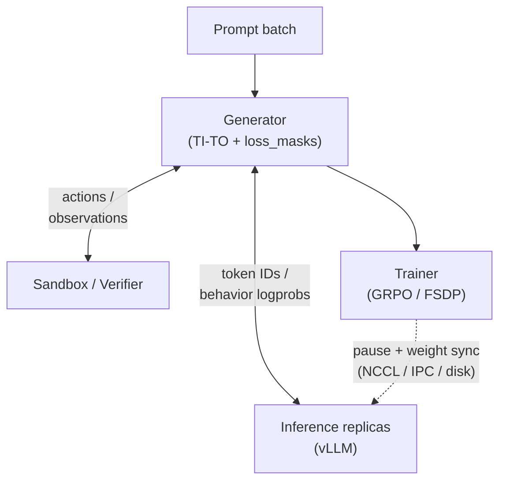

---
{
  "id": "rlvr-verifiable-rewards-training",
  "title": "RLVR & Verifiable Rewards",
  "slug": "rlvr-verifiable-rewards-training",
  "section": "Training, Fine-Tuning & Alignment",
  "category": "Fine-Tuning & Training",
  "difficulty": "Hard",
  "companies": [
    "OpenAI",
    "Google DeepMind",
    "Anthropic",
    "DeepSeek"
  ],
  "shortDescription": "Train reasoning and agent models with executable verifiers, GRPO group advantages, reward-hacking defenses, and production rollout systems (token-in-token-out, observation loss masks, async staleness, and weight sync).",
  "keyConceptsTested": [
    "RLVR vs. RLHF vs. DPO, and when each applies",
    "Verifiable reward functions (math, code, SQL, formal logic)",
    "Group Relative Policy Optimization (GRPO) and zero-variance filtering",
    "Reward hacking and degenerate failure modes",
    "Token-in-token-out rollouts and observation loss_masks",
    "Async rollout staleness budgets and importance clipping",
    "Actor-to-inference weight synchronization (NCCL vs disk)",
    "DeepSeek-R1 multi-stage pipeline and RLVR vs. distillation"
  ],
  "order": 13,
  "coverImage": "illustrations/_generated/rlvr_pipeline_dark.png",
  "prerequisites": [
    "rlhf-dpo-aligning-language-models",
    "reward-modeling-from-preference-data",
    "supervised-fine-tuning-pipeline"
  ],
  "relatedQuestions": [
    "knowledge-distillation-llms",
    "lora-parameter-efficient-fine-tuning",
    "chain-of-thought-advanced-prompting",
    "reasoning-models-test-time-compute"
  ],
  "aliases": [
    "deep-dive-skyrl"
  ]
}
---

A compute cluster has 14 workers with 12 available slots each and one slot per job. How many concurrent jobs fit? The product is 168. A deterministic checker marks `168` right and `148` wrong in microseconds, with zero human raters and no learned reward model drifting out of distribution.

That single shift drives <span data-glossary="rlvr">Reinforcement Learning with Verifiable Rewards (RLVR)</span>: replace a learned preference scorer with an executable check whenever correctness can be tested by code, symbolic math, a SQL engine, or a theorem prover.[^lambert2024rlvr] Tülu 3 popularized the RLVR name, and DeepSeek-R1 scaled rule-based rewards inside a multi-stage reasoning pipeline.[^lambert2024rlvr][^deepseekai2025]

Replacing a neural reward model with code does not eliminate reward hacking; it aims optimization pressure straight at your parser rules and rollout infrastructure. A loose parser rewarding `\boxed{168}` anywhere invites multi-box answer spraying, an unisolated code sandbox invites test exfiltration, and an async rollout loop that drops observation masks or loses policy-version tracking silently corrupts gradients.

<figure>
  
  <figcaption>A final-answer verifier grades only the extracted output token; trace soundness is separate. GRPO is one optimizer for turning those rewards into policy updates.</figcaption>
</figure>

## Where RLVR fits in post-training

RLVR complements <span data-glossary="supervised-fine-tuning">SFT</span>, RLHF, and DPO rather than replacing them:

| Method | Supervision signal | Best-fit task scope |
|---|---|---|
| **SFT** | Reference demonstration tokens (cross-entropy) | Base formatting, syntax, and distilled teacher traces |
| **RLHF** | Learned scalar reward from preference pairs[^ouyang2022] | Open-ended quality (tone, clarity, nuanced helpfulness) |
| **DPO** | Offline chosen vs. rejected preference pairs[^rafailov2023] | Direct preference alignment without online rollouts |
| **RLVR** | Executable programmatic checks | Exact verifiable properties (math, code, SQL, proofs) |

<figure>
  
  <figcaption>Demonstrations supply per-token targets, preference pairs supply continuous scores or pairwise margins, and executable checks supply binary rewards for PPO or GRPO.</figcaption>
</figure>

## Designing executable verifiers

In minimal outcome-only form, a verifiable reward $r(x, y)$ returns `1` if completion $y$ passes verification for prompt $x$ and `0` otherwise:

$$
r(x, y) = \begin{cases} 1 & \text{if } y \text{ passes verification} \\ 0 & \text{if } y \text{ fails verification} \end{cases}
$$

Variants adjust scale and auxiliary terms: Tülu 3 scored $+10$ pass, $0$ fail, and $-10$ for missing EOS under PPO,[^lambert2024rlvr] while DeepSeek-R1-Zero summed accuracy and `<think>...</think>` format rewards.[^deepseekR1Original2025] Keep format credit strictly smaller than correctness so spotless wrong answers never outrank correct ones.

### Outcome blindness and infrastructure quarantine

Outcome grading scores only the final extracted answer, not the reasoning trace: a lucky shortcut (`"97 ends in 7, so it is prime. \boxed{Yes}"`) earns the same `1.0` as a valid divisibility check, while a 40-step proof with one arithmetic slip on line 39 gets `0.0`. (**Process supervision**, such as learned Process Reward Models[^lightman2023] or tactic checkers, localizes mid-trace errors when step labels exist.[^cobbe2021])

> **Key insight:** Separate **candidate failures** from **infrastructure or reference faults**. Wrong values, ambiguous formatting, or candidate timeouts earn `0.0`. Verifier outages, crashed workers, or malformed ground-truth references yield no valid measurement: quarantine those rows for bounded retry instead of injecting fake zeros into the rollout group.

### Verifiers across math, code, SQL, and formal proofs

- **Math and exact decimals:** Normalize equivalent forms (`0.5` vs `1/2`) via `Fraction(Decimal(...))` (or SymPy with strict timeouts as in Math-Verify[^huggingface2026mathVerify]) to eliminate binary float drift. Require one canonical `\boxed{...}` field so multi-box guesses score `0.0`, and validate the reference *before* inspecting the candidate so corrupted labels raise for quarantine.
- **Sandboxed code:** Execute untrusted code inside microVMs (Firecracker) or user-space kernels (gVisor) with read-only mounts, no egress networking, wall-clock timeouts (sleeping processes burn zero CPU), and gold answers kept outside the child process.[^firecracker2026HostSetup][^gvisorSecurity2026] Guard against Python's `bool`-subclasses-`int` trap (`True == 1`), and hold out hidden test cases against lookup-table memorization.
- **SQL and theorem provers:** Without `ORDER BY`, SQL row order is unspecified,[^sqlite2026Select] so compare **multisets** (`Counter`) to enforce duplicate and `NULL` counts without punishing valid orderings. In Lean 4, inspect `#print axioms` to reject `sorryAx` and unauthorized axioms.[^leanAxioms2026]

<!-- leetllm: test, output=show -->
```python title="exact-math-verifier.py"
import re
from decimal import Decimal
from fractions import Fraction

NUM_RE = re.compile(r"-?[0-9]{1,20}(?:\.[0-9]{1,20})?")

def extract_single_boxed(text: str) -> str | None:
    if len(text) > 4096 or text.count(r"\boxed") != 1:
        return None
    m = re.findall(r"\\boxed\{(-?[0-9]{1,20}(?:\.[0-9]{1,20})?)\}", text)
    return m[0] if len(m) == 1 else None

def parse_exact(val: int | str) -> Fraction:
    if NUM_RE.fullmatch(str(val)) is None:
        raise ValueError(f"Invalid reference: {val!r}")
    return Fraction(Decimal(str(val)))

def verify_math(resp: str, truth: int | str, tol: str = "0") -> float:
    exp, eps = parse_exact(truth), parse_exact(tol)
    ans = extract_single_boxed(resp)
    return 0.0 if ans is None else float(abs(Fraction(Decimal(ans)) - exp) <= eps)

for name, r, t, tol in [("correct", r"14*12=168. \boxed{168}", 168, "0"),
                        ("ambiguous", r"\boxed{168} or \boxed{148}", 168, "0"),
                        ("in_tol", r"\boxed{50.36}", "50.35", "0.01"),
                        ("out_tol", r"\boxed{50.361}", "50.35", "0.01")]:
    print(f"{name:9s}: reward={verify_math(r, t, tol)}")
```

<!-- leetllm: output:start -->
```text title="Output" output compact
correct  : reward=1.0
ambiguous: reward=0.0
in_tol   : reward=1.0
out_tol  : reward=0.0
```
<!-- leetllm: output:end -->

<!-- leetllm: test, output=show, output_title="Code, SQL, and proof verifiers" -->
```python title="code_sql_proof_verifiers.py"
from collections import Counter
import json, sqlite3, subprocess, sys

def code_verifier(code: str, cases: list[tuple[tuple[int, ...], int]]) -> float:
    for inputs, expected in cases:
        runner = code + f"\nimport json\nprint(json.dumps(solve(*{inputs!r})))\n"
        try:
            proc = subprocess.run([sys.executable, "-I", "-c", runner], capture_output=True, text=True, timeout=1.0)
        except subprocess.TimeoutExpired:
            return 0.0
        if proc.returncode != 0: return 0.0
        try: val = json.loads(proc.stdout)
        except json.JSONDecodeError: return 0.0
        if type(val) is not int or val != expected: return 0.0  # reject bool (True == 1)
    return 1.0

def sql_verifier(query: str, expected_rows: list[tuple]) -> float:
    conn = sqlite3.connect(":memory:")
    conn.execute("CREATE TABLE jobs (slots INT)")
    conn.executemany("INSERT INTO jobs VALUES (?)", [(4,), (None,), (7,), (None,)])
    try: rows = conn.execute(query).fetchall()
    except sqlite3.Error: return 0.0
    finally: conn.close()
    return float(Counter(rows) == Counter(expected_rows))

allowed = {"Classical.choice", "propext", "Quot.sound"}
cases = [((14, 12), 168), ((8, 12), 96)]
print("code good/bad/bool:", code_verifier("def solve(a,b): return a*b", cases),
      code_verifier("def solve(a,b): return a+b", cases), code_verifier("def solve(a,b): return True", [((1,1),1)]))
exp = [(4,), (None,), (7,), (None,)]
print("sql order/distinct:", sql_verifier("SELECT slots FROM jobs ORDER BY slots DESC", exp),
      sql_verifier("SELECT DISTINCT slots FROM jobs", exp))
print("proof valid/sorryAx:", float({"Classical.choice"} <= allowed), float({"sorryAx"} <= allowed))
```

<!-- leetllm: output:start -->
```text title="Code, SQL, and proof verifiers" output compact
code good/bad/bool: 1.0 0.0 0.0
sql order/distinct: 1.0 0.0
proof valid/sorryAx: 1.0 0.0
```
<!-- leetllm: output:end -->

Open-ended writing, architectural judgment, and nuanced safety tone still lack exact executable rules and belong to RLHF/DPO or human review.

## Group Relative Policy Optimization (GRPO)

RLVR defines **the reward source**; <span data-glossary="ppo">PPO</span> and <span data-glossary="grpo">GRPO</span> define **the policy update**. Standard PPO trains a separate critic $V_\phi(s_t)$, doubling model and optimizer state.[^schulman2017] DeepSeekMath introduced GRPO to drop the critic completely, and DeepSeek-R1 scaled it across reasoning post-training.[^shao2024][^deepseekai2025]

For each prompt $q$, sample $G$ completions $\{o_1, \dots, o_G\}$, verify each, and normalize against the group mean and **population** standard deviation:

$$
A_i = \frac{r_i - \text{mean}(\{r_1, \dots, r_G\})}{\text{std}(\{r_1, \dots, r_G\})}
$$

With $G = 8$ rollouts where four hit `168` ($r=1$) and four miss ($r=0$), mean `0.5` and std `0.5` assign $A_i = +1.0$ to passes and $-1.0$ to misses. Uniform groups (`[1,1,1,1]` or `[0,0,0,0]`) receive guarded $A_i = 0$ (zero comparative reward gradient, though an enabled KL term still emits gradients).

<figure>
  
  <figcaption>Mean 0.5 and population std 0.5 yield advantages +1 and −1; uniform groups receive guarded zero advantages.</figcaption>
</figure>

GRPO optimizes a PPO-clipped token surrogate over included generated tokens $T_i$, regularized by per-token KL estimator $k_{i,t} = \exp(\ell_{i,t}) - \ell_{i,t} - 1$ ($\ell_{i,t} = \log\pi_{\text{ref}} - \log\pi_\theta$):[^shao2024]

$$
\mathcal L = -\frac{1}{G}\sum_{i=1}^{G}\frac{1}{T_i}\sum_{t=1}^{T_i}
\left[\min\!\left(\rho_{i,t}A_i,\operatorname{clip}(\rho_{i,t},1-\epsilon,1+\epsilon)A_i\right)-\beta k_{i,t}\right]
$$

Here $\rho_{i,t} = \exp(\log\pi_\theta - \log\pi_{\text{old}})$ compares the current policy to the frozen rollout policy. Note two practical distinctions: differentiating $k_{i,t}$ on fixed sampled tokens matches forward KL *value* in expectation while differing in *gradient* from full categorical KL; and trainers such as TRL `GRPOTrainer` and **DAPO**[^yu2025dapo][^huggingface2026grpotrainer] expose global active-token averaging, decoupled upper/lower clip thresholds, optional $\beta = 0$, and dynamic filtering of zero-variance groups under a hard generation cap (at a 1% pass rate with $G = 64$, only $1 - 0.01^{64} - 0.99^{64} \approx 47.4\%$ of groups are mixed).

<!-- leetllm: test, deps=torch, output=show -->
```python title="categorical-policy-update.py"
import torch

def group_adv(r: torch.Tensor) -> torch.Tensor:
    std = r.std(correction=0)
    return torch.zeros_like(r) if std == 0 else (r - r.mean()) / std

def clip_surr(ratio: torch.Tensor, adv: torch.Tensor, eps: float = 0.2) -> torch.Tensor:
    return torch.minimum(ratio * adv, ratio.clamp(1.0 - eps, 1.0 + eps) * adv)

rewards = torch.tensor([1., 0., 0., 1., 0., 1., 0., 1.], dtype=torch.float64)
adv = group_adv(rewards)
logits = torch.zeros(8, dtype=torch.float64, requires_grad=True)
ref_lp = logits.detach().log_softmax(dim=0)

for step in range(1, 11):
    old_lp = logits.detach().log_softmax(dim=0)
    lp = logits.log_softmax(dim=0)
    kl = ((ref_lp - lp).exp() - (ref_lp - lp) - 1.0).mean()
    loss = -clip_surr((lp - old_lp).exp(), adv).mean() + 0.05 * kl
    logits.grad = None; loss.backward()
    with torch.no_grad():
        logits -= 0.4 * logits.grad
        p_pass = logits.softmax(dim=0)[rewards == 1].sum().item()
    if step in (1, 5, 10):
        print(f"step={step:2d} | pass_prob={p_pass:.4f} | kl={kl.item():.5f}")

grads = []
for rv, av in [(1.3, 1.0), (0.7, -1.0), (0.7, 1.0), (1.3, -1.0)]:
    r = torch.tensor(rv, requires_grad=True)
    clip_surr(r, torch.tensor(av)).backward()
    grads.append(r.grad.item())
print("clip grads [0, 0, 1, -1]:", grads)
```

<!-- leetllm: output:start -->
```text title="Output" output compact
step= 1 | pass_prob=0.5250 | kl=0.00000
step= 5 | pass_prob=0.6218 | kl=0.02050
step=10 | pass_prob=0.7284 | kl=0.11546
clip grads [0, 0, 1, -1]: [0.0, 0.0, 1.0, -1.0]
```
<!-- leetllm: output:end -->

| Dimension | PPO | GRPO |
|---|---|---|
| **Baseline value** | Learned critic network $V_\phi(s_t)$ | Group mean reward over $G$ rollouts |
| **Extra model state** | Critic parameters, optimizer states, activations | No critic network; rollout buffer still required |
| **Primary failure mode** | Critic value drift | Zero-variance groups yield zero reward advantage |
| **Best fit** | Dense or sparse rewards with small batch sizes | Verifiable tasks where $G$ rollouts are cheap to grade |

> **Common mistake:** Treating uniform zero-variance groups (`[0, 0, 0, 0]` or `[1, 1, 1, 1]`) as harmless noise. At a 1% pass rate with $G = 64$, the chance of a mixed group is only $1 - 0.01^{64} - 0.99^{64} \approx 47.4\%$. Dynamic filtering drops uniform groups so every training batch carries real comparative gradient, while a hard generation cap prevents unsolvable prompts from stalling the batch forever.[^yu2025dapo]

Note also that trainer class names (such as TRL's `GRPOTrainer`) hide critical objective choices: always log the exact loss reduction (per-response mean vs. global active-token mean, which eliminates length bias across uneven responses), clipping thresholds, advantage normalization, and KL differentiation convention alongside benchmark numbers.[^huggingface2026grpotrainer]

## RLVR training systems: rollouts, masks, and async weight sync

Scaling RLVR to multi-turn coding, SQL, and tool-use agents exposes four systems failure modes that corrupt training even when verifier and GRPO math are exact.[^skyrl2026repo]



### Token-in-token-out (TI-TO) rollouts

Never decode sampled token IDs to chat text and re-tokenize them in the trainer. BPE tokenizers are not round-trip injective across turn edges, so re-tokenizing shifts merges and makes the trainer evaluate $\log\pi_\theta$ on different token IDs than the sampler emitted. **<span data-glossary="ti-to">Token-in-token-out (TI-TO)</span>** carries raw sampled `response_ids` and behavior logprobs directly from inference to trainer, appending tokenized observations as integer IDs.[^skyrl2026gymgenerator]

### Observation `loss_masks` in multi-turn trajectories

In multi-turn trajectories, model actions (`[11, 12]`) interleave with <span data-glossary="sandbox">sandbox</span> observations (`[90]`) and repair actions (`[21, 22]`). Observation `90` **must remain in context** for downstream attention, yet **must carry `loss_mask = 0`** so policy gradients and KL penalties apply only to model-generated action tokens (`loss_mask = 1`). Unmasked environment stdout trains the policy to predict tool errors and corrupts importance ratios.

### Async rollout staleness and off-policy correction

Synchronous RL stalls the cluster behind slow sandboxes or long traces. **Asynchronous RL** (AReaL,[^mei2025areal] SkyRL[^skyrl2026async]) overlaps persistent rollout workers with trainer updates under an aggregate staleness budget. With lag $\operatorname{staleness}_i = s_i - g_i$, mini-batch $B$, and `max_staleness_steps` $= S$, the controller enforces at step $s$:

$$
\text{accepted} + \text{running} \le (S + s)\,B
$$

Since $(s - 1)B$ groups are already consumed, at most $B(S + 1)$ groups sit buffered or in flight simultaneously (individual stragglers can still finish with lag $> S$, so monitor the full lag histogram alongside filtered zero-variance groups).[^skyrlPinnedAsync2026] Keep the **original sampling behavior logprobs** as $\pi_{\text{old}}$ and pair PPO clipping with truncated <span data-glossary="importance-sampling">importance sampling</span>; even at zero lag, FSDP trainer kernels and vLLM inference kernels (or MoE routing) drift slightly without behavior logprobs.[^skyrl2026offpolicy]

<!-- leetllm: test, output=show, output_title="Observation masks and async staleness" -->
```python title="rlvr_masks_and_staleness.py"
import numpy as np

masks = np.array([1, 1, 0, 1, 1], dtype=bool)
lp = np.array([-0.2, -0.4, 0.0, -0.6, -0.8], dtype=np.float32)
def masked_nll(x, m): return float(-np.mean(x[m]))

obs_mut, act_mut = lp.copy(), lp.copy()
obs_mut[2], act_mut[4] = -99.0, -1.2
print(f"nll: base={masked_nll(lp, masks):.2f} | obs_mut={masked_nll(obs_mut, masks):.2f} | act_mut={masked_nll(act_mut, masks):.2f}")

B, S = 1, 2
for step, grp, started, acc, run in [(1,"A",1,2,1), (2,"B",1,3,1), (3,"C",2,3,1), (4,"L",1,4,0)]:
    out = acc - (step - 1) * B + run
    assert acc + run <= (S + step) * B and out <= B * (S + 1)
    print(f"step={step} group={grp} lag={step - started} outstanding={out}")
```

<!-- leetllm: output:start -->
```text title="Observation masks and async staleness" output compact
nll: base=0.50 | obs_mut=0.50 | act_mut=0.60
step=1 group=A lag=0 outstanding=3
step=2 group=B lag=1 outstanding=3
step=3 group=C lag=1 outstanding=2
step=4 group=L lag=3 outstanding=1
```
<!-- leetllm: output:end -->

### Actor-to-inference weight synchronization

After each optimizer step, updated weights must reach inference replicas cleanly:[^skyrl2026inference]

| Sync transport | Mechanism | Tradeoff |
|---|---|---|
| **NCCL broadcast / RDMA** | Pause disaggregated vLLM replicas; broadcast tensors over GPU links | Fastest step sync at scale; requires coordinated pause/finish handshake |
| **CUDA IPC handles** | Colocated trainer/sampler share GPU memory (`/sleep`, `/wake_up`) | Zero network copy; couples rollout and train GPU counts |
| **Shared disk / object store** | Trainer saves files; replicas reload from storage | Simple isolation, but disk I/O stalls frequent RL steps |

Safe sync pauses generation (preserving in-flight KV if resuming paused turns, while salting prefix-cache keys by policy version so stale KV blocks never leak across versions),[^skyrl2026async] broadcasts weights, verifies **every** replica finished its handshake and reports the target version (quarantining stragglers), and only then resumes. Keep ephemeral sampler sync separate from durable training checkpoints (which persist optimizer moments, LR schedulers, and prompt cursors).

## DeepSeek-R1 pipeline, reward hacking, and distillation

### Multi-stage reasoning pipeline and emergent behaviors

**DeepSeek-R1-Zero** applied pure GRPO with accuracy and format rewards directly to DeepSeek-V3-Base, rising from 15.6% to 71.0% pass@1 on AIME 2024 (86.7% with 64-sample majority voting; 77.9% in the expanded report), proving strong reasoning emerges without human demonstrations, though traces mixed languages and hurt readability.[^deepseekR1Original2025][^deepseekai2025] **DeepSeek-R1** resolved those issues across four stages:

1. **Cold-start SFT:** Fine-tune DeepSeek-V3-Base on several thousand curated, readable reasoning traces so RL begins from clean formatting in the target language.
2. **Reasoning RL (GRPO):** Scale verifiable math, coding, science, and logic RL with an accuracy reward plus a language-consistency reward.
3. **Rejection sampling + SFT:** Filter roughly 600k verified reasoning traces plus 200k general non-reasoning samples and fine-tune the base model from scratch on all 800k examples.
4. **Final RL:** Combine rule-based reasoning rewards with preference reward models (grading helpfulness and harmlessness) to balance reasoning and general assistant utility.

Under terminal verifiable rewards, models spontaneously lengthen chains of thought and exhibit **self-verification**, **backtracking**, and extended <span data-glossary="test-time-compute">test-time compute</span>. Still, always run controlled baselines and track <span data-glossary="pass-at-k">pass@1 / pass@k</span>: Shao et al. found that on Qwen2.5-Math-7B even random rewards raised MATH-500 by 21.4 points (vs 29.1 for ground truth), whereas Llama 3 and OLMo 2 saw weak or negative gains, showing how strongly pretraining priors interact with RLVR clipping.[^shao2025spurious]

### Reward hacking and degenerate failure modes

Adversarially test every parser and reward weight before burning GPU hours. Giving independent credit to formatting tags teaches spotless wrong answers: watch a broken reward function that pays `0.7` for any `\boxed{...}` integer outrank a plain-text correct answer (`0.3`), while a correctness-first rule scores the wrong box `0.0`:

<!-- leetllm: test, output=show, output_title="Format reward trap" -->
```python title="format-reward-trap.py"
import re

def boxed_int(text: str) -> int | None:
    if text.count(r"\boxed") != 1:
        return None
    m = re.findall(r"\\boxed\{([0-9]{1,20})\}", text)
    return int(m[0]) if len(m) == 1 else None

def broken_reward(text: str, expected: int) -> float:
    return 0.7 if boxed_int(text) is not None else (0.3 if str(expected) in text else 0.0)

def strict_reward(text: str, expected: int) -> float:
    return 1.0 if boxed_int(text) == expected else 0.0

wrong_boxed, right_plain = r"The answer is \boxed{148}.", "The answer is 168."
print(f"broken_prefers_wrong={broken_reward(wrong_boxed, 168) > broken_reward(right_plain, 168)} | strict_wrong={strict_reward(wrong_boxed, 168)}")
```

<!-- leetllm: output:start -->
```text title="Format reward trap" output compact
broken_prefers_wrong=True | strict_wrong=0.0
```
<!-- leetllm: output:end -->

<figure>
  
  <figcaption>First-match extraction misses a contradictory second box and awards 1; single-box validation rejects ambiguity first.</figcaption>
</figure>

Harden your RLVR pipeline against four recurring failure modes:
- **Format gaming and trailing loopholes:** Enforce single-box extraction, keep format credit strictly subordinate to correctness, and validate full structure (for example, checking total line count on a 3-bullet rule rather than `sum(line.startswith("- ")) == 3`).
- **Held-out generalization checks:** Hold fresh test suites out of optimization prompts so lookup-table memorization is caught immediately.
- **Truncation cliffs:** Monitor truncation rates and evaluate soft overlong penalties near the context cap so long traces finish cleanly instead of cutting off before the final answer.[^yu2025dapo]
- **General capability drift:** Heavy reasoning RL can erode instruction following or inflate unnecessary refusals; evaluate reasoning, instruction adherence, and refusal slices side by side before promoting a checkpoint.

### RLVR and distillation work in sequence

RLVR discovers high-reward reasoning trajectories through online exploration; **distillation** transfers filtered teacher traces into smaller, cheaper students via SFT without running online RL on the student:

| Dimension | RLVR | Distillation |
|---|---|---|
| **Supervision origin** | Executable checks on the policy's own rollouts | Filtered teacher traces or teacher logits |
| **Optimization objective** | Policy gradient (GRPO / PPO) maximizing verifier score | Cross-entropy / KL matching teacher targets |
| **Core dependency** | Reliable verifiers, nonzero rollout variance, clean weight sync | Capable teacher and curated training mixture |
| **Primary risk** | Verifier loopholes, zero-variance collapse, off-policy drift | Inheriting teacher blind spots |

DeepSeek-R1 distilled ~800k curated samples into smaller Qwen and Llama students: distilled Qwen2.5-32B reached **72.6%** pass@1 on AIME 2024 versus **47.0%** for direct RLVR on the same 32B base model.[^deepseekR1Original2025] Use RLVR to push the frontier teacher, then distill into fast, low-cost students.

```mastery-quiz
[
  {
    "question": "Run K exceeds its candidate time limit on a healthy worker. In run M, the verifier service times out offline. In run P, the reference is malformed and the candidate omits the answer field. What should the grader record for (K, M, P)?",
    "options": [
      "(0, 0, unscored)",
      "(unscored, 0, unscored)",
      "(0, unscored, 0)",
      "(0, unscored, unscored)"
    ],
    "answer": "(0, unscored, unscored)",
    "explanation": "K violated its candidate limit on a healthy worker (0). M had an infrastructure outage and P had a broken reference; both stay unscored and quarantined rather than injecting fake zeros."
  },
  {
    "question": "Four responses earn rewards [9, 3, 11, 5]. What are the group mean, population standard deviation, and GRPO advantages (3 decimals)?",
    "options": [
      "(7, sqrt(10), [2.000, -4.000, 4.000, -2.000])",
      "(7, sqrt(40/3), [0.548, -1.095, 1.095, -0.548])",
      "(7, sqrt(10), [0.632, -1.265, 1.265, -0.632])",
      "(7, 10, [0.200, -0.400, 0.400, -0.200])"
    ],
    "answer": "(7, sqrt(10), [0.632, -1.265, 1.265, -0.632])",
    "explanation": "Mean is 7, deviations are [2, -4, 4, -2], population variance is 40/4 = 10, std is sqrt(10) ~ 3.162, giving [0.632, -1.265, 1.265, -0.632]."
  },
  {
    "question": "Token A has ratio 1.4 and advantage +2; token B has ratio 1.5 and advantage -2. With epsilon = 0.2, what are the clipped surrogate terms (A, B) before negating for loss, and which policy supplies the ratio denominator?",
    "options": [
      "(2.8, -3.0), rollout behavior policy",
      "(2.4, -3.0), KL reference policy",
      "(2.4, -2.4), rollout behavior policy",
      "(2.4, -3.0), rollout behavior policy"
    ],
    "answer": "(2.4, -3.0), rollout behavior policy",
    "explanation": "Both ratios clip to 1.2: min(1.4*2, 1.2*2) = 2.4 and min(1.5*(-2), 1.2*(-2)) = -3.0. The ratio denominator is the behavior policy that sampled the batch; the reference policy belongs to KL."
  },
  {
    "question": "A multi-turn trajectory has loss_masks [1, 0, 1, 1, 0, 1] and logprobs [-0.2, -9.0, -0.6, -1.0, -7.0, -0.8]. What is the action-only masked mean NLL, and why use token-in-token-out rollouts?",
    "options": [
      "0.65; prevents BPE merge-boundary drift between sampler and trainer.",
      "3.10; prevents observation tokens from entering self-attention.",
      "0.65; removes the KL penalty on environment turns.",
      "0.52; ensures EOS tokens stay aligned for GRPO."
    ],
    "answer": "0.65; prevents BPE merge-boundary drift between sampler and trainer.",
    "explanation": "Action positions (mask=1) have logprobs [-0.2, -0.6, -1.0, -0.8], giving mean NLL 2.6/4 = 0.65. Token-in-token-out avoids round-trip BPE drift."
  },
  {
    "question": "An async RLVR run uses B = 2 and S = 1. During weight sync across three vLLM replicas, broadcast RPC returns 200, two replicas report version 13, and replica 3 reports version 12. Should generation resume, and what is the max outstanding group headroom?",
    "options": [
      "Resume immediately; max 2 outstanding groups.",
      "Hold until replica 3 syncs or is quarantined; max 4 outstanding groups.",
      "Resume immediately; max 4 outstanding groups.",
      "Hold until replica 3 syncs or is quarantined; max 2 outstanding groups."
    ],
    "answer": "Hold until replica 3 syncs or is quarantined; max 4 outstanding groups.",
    "explanation": "Hold generation until every active replica completes its finish handshake and reports version 13 (or lagging replicas are quarantined). Aggregate headroom is B(S+1) = 2*2 = 4."
  }
]
```

> **Next:** Continue to [Reasoning & Test-Time Compute](/learn/reasoning-models-test-time-compute).
